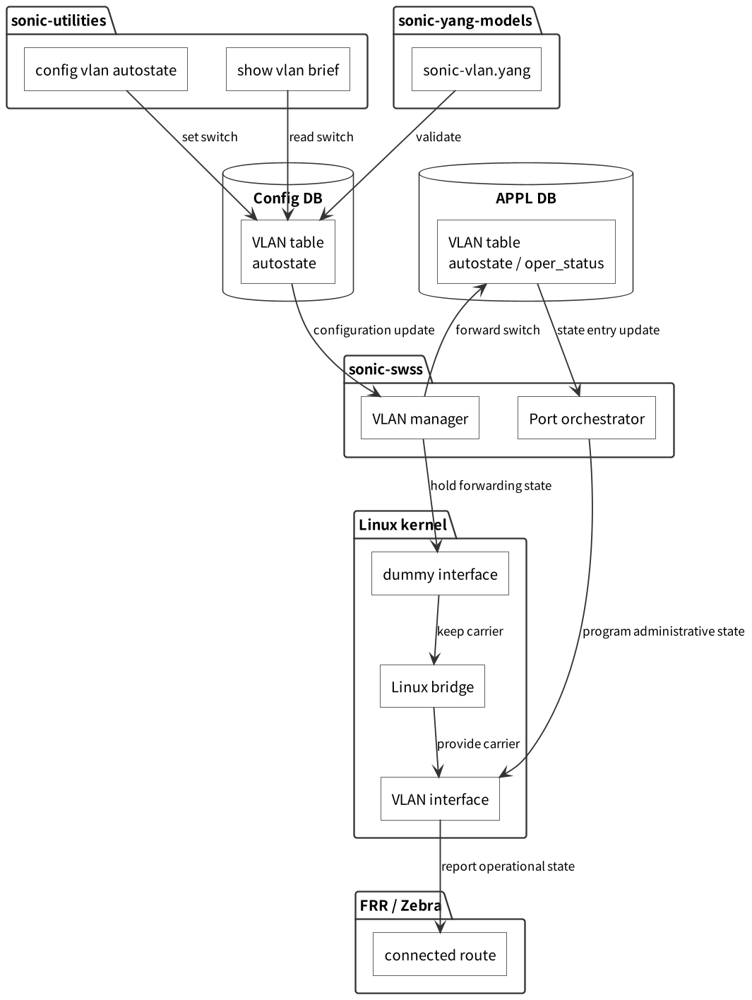
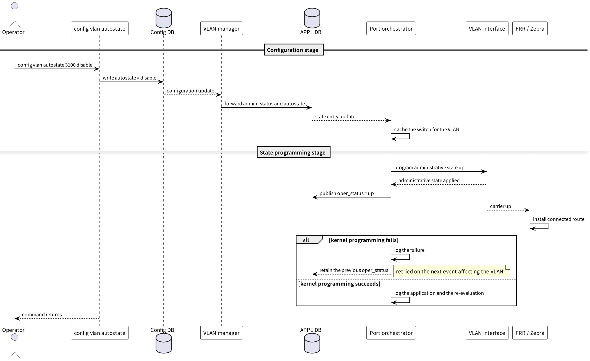
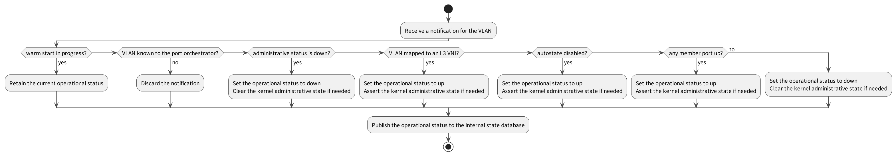
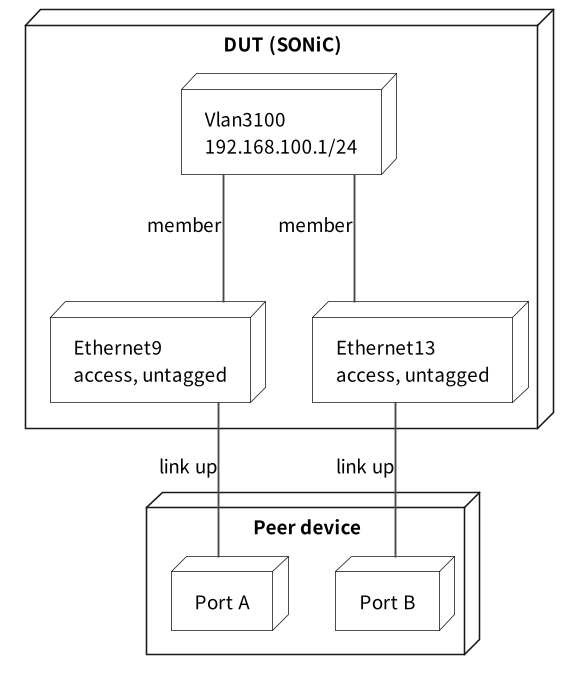

# Per-VLAN Autostate for SONiC

## Table of Content

1. Revision
2. Scope
3. Definitions and Abbreviations
4. Overview
5. Requirements
6. Architecture Design
7. High-Level Design
8. SAI API
9. Configuration and Management
10. Warmboot and Fastboot Design Impact
11. Memory Consumption
12. Restrictions and Limitations
13. Testing Requirements and Design
14. Open Action Items

### 1. Revision

| Date | Version | Author | Description |
|------|---------|--------|-------------|
| 2026-11-20 | 0.1 | Wanger | Initial version. Specifies a per-VLAN autostate switch that controls whether a VLAN interface follows the link state of its member ports. |

### 2. Scope

This document specifies a per-VLAN autostate switch for SONiC. The switch determines whether the operational status of a VLAN interface, hereafter referred to as a Switch Virtual Interface or SVI, follows the link state of the ports that are members of the corresponding VLAN. The switch is configurable independently for each VLAN and its default value preserves the behaviour of the current implementation.

The document covers the following areas:

- The representation of the switch in the configuration and state databases of SONiC.
- The behaviour of the control-plane components that translate the configuration into kernel state.
- The command-line and data-model interfaces through which the switch is configured and queried.
- The correction of an existing defect in the ownership of the kernel administrative state of an SVI, on which this feature depends.
- The verification strategy for the feature.

The following areas are explicitly out of scope:

- Exclusion of individual ports from the autostate decision. The feature provides a switch at VLAN granularity only.
- VLANs that are mapped to a VXLAN Layer 3 VNI. The SVIs of such VLANs are already kept up unconditionally by the existing implementation, and the switch has no effect on them.
- Any change to SAI, to ASIC programming or to the data path. The feature is confined to control-plane state management.
- Any change to the default behaviour of all SVIs. SONiC already keeps every SVI up at all times once the bridge carrier is permanently asserted; this design retains the existing default and makes the decoupling an explicit, per-VLAN decision.

### 3. Definitions and Abbreviations

SVI: Switch Virtual Interface, the 802.1Q VLAN device associated with a VLAN.

Member port: a front-panel port or a link aggregation group that is configured as a member of the VLAN.

Administrative status: the intended state of the SVI as expressed by the operator, either up or down.

Operational status: the runtime state of the SVI, derived from its administrative status and the state of the underlying bridge.

Carrier: the link-carrier indicator of a network interface. The carrier of a VLAN device follows the carrier of the bridge to which the device is attached.

Bridge carrier: the carrier indicator of the Linux bridge, which is asserted while at least one port of the bridge is in the forwarding state.

Forwarding state: the bridge port state in which the port is permitted to forward frames.

Dummy interface: a virtual interface attached to the bridge and held in the forwarding state, so that the bridge retains a forwarding port, and therefore its carrier, irrespective of the front-panel link state.

L3 VNI: a VXLAN Layer 3 VNI, used to provide symmetric inter-subnet forwarding in an EVPN deployment.

CONFIG_DB, APPL_DB: the SONiC databases that hold the user configuration and the internal state published to the orchestration agent respectively.

VLAN manager: the SONiC component that translates VLAN configuration into internal state and kernel configuration.

Port orchestrator: the SONiC component that owns the ports, VLANs and link aggregation groups of the system and maintains their operational status.

Quality level: the maturity classification of a SONiC feature, as defined by the SONiC feature quality definition.

### 4. Overview

#### 4.1 Background and Technical Principle

A SONiC SVI is an 802.1Q VLAN device created on top of the Linux bridge. Its operational status is determined by two independent inputs: the administrative state of the device, and the carrier of the lower device, which is the bridge.

The carrier of the bridge is, in turn, determined by the forwarding state of the ports attached to it. When every member port of a VLAN is down, or when the VLAN has no member port at all, the bridge retains no forwarding port, its carrier is de-asserted, and the SVI reports a lower-layer-down condition even though it remains administratively up.

The default SONiC behaviour couples the two inputs. The port orchestrator examines the member ports of a VLAN, sets the SVI operational status to up while at least one member port is up, and sets it to down once every member port is down. This behaviour is appropriate for access deployments, in which the SVI exists to serve traffic entering through its members. It is inappropriate for Layer 3 deployments that use the SVI as a permanent gateway address: when the last uplink changes state, the connected route is withdrawn and routing adjacencies established over the SVI are torn down, so that a link event is escalated into a routing event.

This feature decouples the two inputs at VLAN granularity while preserving the existing default behaviour:

- When the switch is enabled, which is the default, the SVI follows its member ports exactly as it does today.
- When the switch is disabled, the SVI remains operationally up for as long as its administrative status is up, irrespective of the member ports, so that the connected route and the routing adjacencies are preserved.

The scope of the mechanism is deliberately narrow, because the operating system does not permit per-VLAN control of the carrier. The carrier of a VLAN device always follows its bridge, and an attempt to assert the carrier directly is rejected by the kernel. Only the administrative state can be controlled per VLAN. The feature therefore consists of deciding when to program the administrative state of the SVI, combined with a guarantee that the bridge retains its carrier independently of the front-panel link state.

The resulting behaviour is as follows. When the SVI is required to be down, its administrative state is cleared. When the SVI is required to be up, its administrative state is asserted, and the bridge is guaranteed to hold the carrier through the dummy interface, so that the SVI is reported as up rather than as lower-layer-down. The kernel programming is performed only when the current state diverges from the intended state, which prevents redundant programming during repeated member-port events.

#### 4.2 Key Technical Details

The following characteristics are relevant to the remainder of the design:

- The state of the switch is held as a single value per VLAN. The number of VLANs supported by the system provides the upper bound on the additional state, and the value is held in the configuration database, forwarded to the internal state database and cached by the port orchestrator in its per-VLAN data structure.
- The path from configuration to effect is uniform for all supported management interfaces. A configuration write, whether issued through the command-line interface or through a model-driven interface, reaches the VLAN manager, is forwarded to the internal state database, and is consumed by the port orchestrator, which re-evaluates the operational status of the affected VLAN.
- The order in which the operational status is determined is significant. The administrative status is considered first, then the Layer 3 VNI condition, then the switch, and finally the member ports. An administratively disabled SVI remains down irrespective of the switch, and the switch does not alter the behaviour of Layer 3 VNI SVIs.
- The mechanism relies exclusively on facilities that are available on every SONiC platform: VLAN devices on a Linux bridge, the bridge forwarding state, the administrative state of an interface and the read-back of that state. No platform-specific interface is required.
- A single component is responsible for programming the administrative state of an SVI. Prior to this feature, the VLAN manager re-issued the administrative state on every configuration write of any VLAN attribute, which conflicted with the decision taken by the port orchestrator. This design resolves the conflict by assigning the ownership of the kernel state to the port orchestrator whenever the switch is enabled, and by restricting the VLAN manager to writing the kernel state only when the administrative status itself changes.
- The design builds on behaviour that SONiC already provides: the bridge carrier is permanently asserted, and the IPv6 link-local address is refreshed after a bridge reconfiguration. These changes are already part of SONiC, and this feature neither depends on nor alters their semantics.

#### 4.3 Related Work

- SONiC keeps the bridge carrier permanently asserted by bringing the dummy interface up, so that an SVI is not held down by the absence of a forwarding bridge port (SONiC PR #3370, https://github.com/sonic-net/SONiC/pull/3370).
- SONiC refreshes the IPv6 link-local address after the bridge reconfiguration introduced by the change above (SONiC PR #3527, https://github.com/sonic-net/SONiC/pull/3527).
- SONiC defines the Alpha, Beta and General Availability quality levels referred to in chapter 5 in its feature quality definition.

This design uses the first two behaviours as preconditions and adds the per-VLAN decision on top of them. It does not replace them and does not require any further change to them.

### 5. Requirements

Functional requirements:

- FR-1: The system shall provide a per-VLAN switch with the values enable and disable, and the default value shall be enable.
- FR-2: While the switch is enabled, the SVI shall be operationally up while at least one member port is up, and operationally down while every member port is down or while the VLAN has no member port.
- FR-3: While the switch is disabled, the SVI shall remain operationally up for as long as its administrative status is up, irrespective of the state of its member ports, and the connected route of the SVI shall remain installed.
- FR-4: A change of the switch value shall take effect immediately and shall not require a subsequent member-port event.
- FR-5: Repeated member-port events that do not alter the intended state of the SVI shall not result in redundant programming of the kernel state.
- FR-6: The administrative status shall take precedence over the switch, so that an administratively disabled SVI remains operationally down in both modes.
- FR-7: The switch shall be configurable through the command-line interface, reported by the VLAN query command, constrained by the data model and retained in the configuration database across restarts.
- FR-8: The switch shall be applied per VLAN and shall be independent between VLANs.

Non-functional requirements:

- NFR-1: The feature shall not modify the data path, SAI or ASIC behaviour, and shall therefore be applicable to every platform without vendor-specific work.
- NFR-2: The default configuration shall be backward compatible. Existing configuration files shall require no migration, and an upgrade shall not alter the operational status of any SVI.
- NFR-3: The feature shall retain its state across a restart of the switch state container, a configuration reload and a warm reboot, and shall re-establish that state from the configuration database.
- NFR-4: The state associated with the feature shall be bounded and shall be released when the corresponding VLAN is deleted.
- NFR-5: The behaviour shall be observable through the switch state logging facility, through the VLAN query command and through the interface status query command.

Management-plane requirements: the feature is exposed through the command-line interface and the data model, and is persisted in the configuration database. The SNMP, gNMI and REST interfaces are not extended by this design.

Quality level: the feature is targeted at the Beta level as defined by the SONiC feature quality definition. Unit tests accompany the change. The system test plan is specified in this document but has not yet been implemented in the integration test suite and has not been signed off, and the General Availability level is therefore not claimed. The default value of the switch is enabled, whereas the Beta level nominally requires a new feature to be disabled by default. The deviation is deliberate and is considered safe: with the switch enabled the behaviour is identical to the behaviour that predates the feature, so retaining the default preserves compatibility rather than enabling new behaviour on upgrade.

### 6. Architecture Design

The feature is an integral part of SONiC and does not alter its architecture. No daemon, container, database or SAI object is introduced. The feature is realised within four existing components:

- The command-line component, which provides the configuration and query interfaces.
- The data model component, which provides the constraint and the persistent schema.
- The VLAN manager, which translates configuration into internal state and maintains the kernel VLAN and bridge configuration.
- The port orchestrator, which maintains the operational status of VLANs and programs the corresponding kernel state.

#### 6.1 Software Structure



Fig. 6-1 Software architecture of the per-VLAN autostate feature

- Modules and components: the command-line component provides the configuration and query interfaces; the data model component constrains the configuration; the VLAN manager and the port orchestrator implement the translation and the state machine; the operating system hosts the dummy interface, the bridge and the VLAN devices; the routing suite derives the connected route from the operational status of the SVI.
- Data flow: configuration is written to the configuration database; the VLAN manager forwards the switch to the internal state database; the port orchestrator consumes the entry, caches the switch and determines the operational status; the resulting kernel state is reflected by the routing suite as the presence or absence of the connected route.
- Extent of change: the configuration command is new; the query command, the data model, the VLAN manager and the port orchestrator are modified; the operating system and the routing suite are unchanged.

### 7. High-Level Design

#### 7.1 Feature Classification and Affected Components

The feature is a built-in SONiC capability rather than an application extension. The affected components and the nature of each change are summarised below.

| Component | Nature of the change |
|---|---|
| Command-line component | A configuration command is added and the VLAN query command gains a column. |
| Data model component | A new leaf with a default value is added to the VLAN model, together with a model revision. |
| VLAN manager | The switch is forwarded from the configuration database to the internal state database; the programming of the kernel administrative state is restricted to genuine changes of the administrative status and is delegated to the port orchestrator while the switch is enabled; the forwarding state of the dummy interface is asserted when the bridge is established and after the bridge is reconfigured during a change of the VLAN MAC address. |
| Port orchestrator | The switch is parsed, cached per VLAN and applied to the operational-status determination; an explicit re-evaluation is performed when the switch changes; the kernel programming is made idempotent and is extended to repair a diverged kernel state. |

No interface between the orchestration agent and the synchronization agent is modified, and no SAI attribute is used.

#### 7.2 Behaviour

The operational status of a VLAN is determined each time the port orchestrator is notified of a change affecting that VLAN. The determination proceeds in a fixed order. If a warm restart is in progress, the existing status is retained and the determination ends, which prevents transient state changes while the control plane is recovering. If the VLAN is not known to the port orchestrator, the notification is discarded. If the administrative status of the VLAN is down, the operational status is set to down and, if the kernel state diverges, the administrative state of the SVI is cleared. If the VLAN is mapped to a Layer 3 VNI, the operational status is set to up, which preserves the existing behaviour. If the switch is disabled, the operational status is set to up and the administrative state of the SVI is asserted if it is not already asserted. Otherwise the member ports are examined: the operational status is set to up if at least one member port is up, and to down if none is.

A change of the switch results in a single explicit re-evaluation of the operational status of the affected VLAN, so that the effect is immediate and does not depend on a subsequent member-port event. When a single notification carries both a change of the administrative status and a change of the switch, the re-evaluation is performed once, after both values have been recorded, so that the kernel state is not programmed twice and the SVI does not transition unnecessarily.

Kernel programming is performed only when the current state of the kernel differs from the intended state, and this applies to transitions in both directions as well as to the case in which the operational status is unchanged. As a consequence, a repeated member-port event does not produce redundant programming, and a kernel state that has diverged from the recorded state, for example because an operator altered it directly, is repaired at the next event that reaches the determination.

#### 7.3 Database Changes

The feature adds a single field to an existing table in the configuration database and a single field to an existing table in the internal state database. The schema of the configuration entry is as follows.

```text
; VLAN configuration
key = VLAN|Vlan<vid> ; identified by the VLAN identifier, 1..4094

; field        = value
vlanid         = 1*4DIGIT      ; VLAN identifier, 1..4094, mandatory
admin_status   = admin-status  ; administrative status, optional, default "up"
autostate      = autostate     ; per-VLAN autostate switch, optional, default "enable"

; value annotations
admin-status   = "up" / "down"
autostate      = "enable" / "disable"
```

The internal state entry carries the same field, together with the operational status that is published by the port orchestrator:

```text
; VLAN state published to the orchestration agent
key = VLAN_TABLE:Vlan<vid> ; one entry per VLAN

; field        = value
admin_status   = admin-status  ; forwarded from the configuration database
autostate      = autostate     ; forwarded from the configuration database; absent means "enable"
oper_status    = oper-status   ; published by the port orchestrator

; value annotations
admin-status   = "up" / "down"
autostate      = "enable" / "disable"
oper-status    = "up" / "down"
```

The field is written when the VLAN is created and whenever its value changes, and it is removed when the VLAN is deleted. The state, counter and logging databases are unaffected. The field is optional and its absence is equivalent to the value enable, so that an existing configuration remains valid and requires no migration.

#### 7.4 Configuration Sequence



Fig. 7-1 Configuration of the switch and programming of the operational status

- Interaction: the operator issues the configuration command; the command writes the configuration database; the VLAN manager forwards the value to the internal state database; the port orchestrator records the switch, re-evaluates the operational status and programs the kernel; the routing suite reflects the resulting state in its connected route.
- Outcome: the internal state database reports the operational status, the kernel interface reflects the intended administrative state, and the connected route is either retained or withdrawn accordingly.
- Failure handling: when the kernel programming fails, the failure is logged, the previously recorded state is retained and the operation is retried at the next event that affects the VLAN. When the programming succeeds, the application of the switch and the subsequent re-evaluation are both recorded in the log.

#### 7.5 Determination of the Operational Status



Fig. 7-2 Determination of the operational status of a VLAN

- Sequence of decisions: warm restart, presence of the VLAN, administrative status, Layer 3 VNI, switch and member ports. The order is normative and shall not be rearranged.
- Programming rule: the kernel is programmed only when the intended state differs from the current state, so that repeated events in the same direction produce no additional programming.

#### 7.6 Operating System Dependencies

The design relies on behaviour of the operating system that is present on every supported platform: a VLAN device on a bridge derives its carrier from the bridge; the bridge asserts its carrier while at least one attached port is in the forwarding state; the administrative state of an interface can be programmed and read back; and the forwarding state of a bridge port can be asserted explicitly. No additional kernel module, tunable or interface is required.

#### 7.7 Scalability and Performance

The additional state is bounded by one value per VLAN. The work performed for each event is a single comparison before the examination of the member ports, and the kernel is programmed only on a genuine change of the intended state, so that a period of repeated member-port transitions results in fewer kernel operations than the current implementation. The feature does not participate in forwarding and therefore introduces no performance impact on any data path.

#### 7.8 Container and Build Dependencies

No container is added. The change is delivered within the existing packages of the switch state container, the command-line component and the data model component. No new build dependency is introduced.

#### 7.9 Management Interfaces

The command-line and data-model interfaces are specified in chapter 9. The SNMP, gNMI and REST interfaces are not extended. The command-line interface resides in the standard configuration and query command trees and therefore uses the existing authorisation and audit framework.

#### 7.10 Serviceability and Debugging

The feature reports the following events through the logging facility of the switch state container: the application of a switch value to a VLAN, the subsequent re-evaluation of its operational status, a failure to program the kernel state, a condition in which the switch is disabled while the bridge holds no forwarding port, and a failure to assert the forwarding state of the dummy interface or to restore the bridge after a change of the VLAN MAC address. These events can be correlated with the output of the VLAN query command, the interface status query command and the kernel link inspection utilities.

#### 7.11 Platform Considerations

The feature is implemented entirely in user space on the bridge and VLAN model that is common to all SONiC platforms. No platform interface requires implementation by a vendor, and no platform-specific capability is required.

#### 7.12 Alternatives Considered

| Option | Summary | Assessment |
|---|---|---|
| Per-VLAN switch within the existing state machine | The operational-status determination is extended with a per-VLAN condition, on the basis of the bridge-carrier behaviour already present in SONiC. | Adopted. It preserves per-VLAN semantics, it is independent of the number of member ports, it confines the change to the control plane and it reuses the existing state machine as the single owner of the operational status. |
| Global retention of the SVI | Every SVI is kept up at all times, as SONiC does today once the bridge carrier is permanently asserted. | Rejected. It offers no per-VLAN control and removes the coupled behaviour that some deployments require. |
| Suppression of link detection in the routing suite | The routing protocol suite is configured not to consider the interface state. | Rejected. It spans additional components, and the operational status reported by the system would contradict the routing state. |

The first option is adopted. The decision weights per-VLAN correctness most heavily, followed by the behaviour on a switch without any active link, the extent of the change, the consistency with the existing design, the associated risk and the testability of the result.

### 8. SAI API

No SAI API is added, modified or reinterpreted. The feature is realised entirely through the administrative state of the VLAN device in the operating system, which in this design is not represented as a SAI object. The synchronization agent and the SAI implementations of all vendors are unaffected, and no ASIC capability is required, so the feature is applicable to every platform without vendor-specific work.

### 9. Configuration and Management

#### 9.1 Manifest

Not applicable. The feature is part of SONiC and is not an application extension.

#### 9.2 Command-Line and Data-Model Interfaces

The feature adds one configuration command, extends one query command and adds one leaf to the VLAN data model.

The configuration command sets the switch for a single VLAN. The VLAN identifier is mandatory and shall refer to an existing VLAN within the supported range. The value is mandatory and shall be either enable or disable. The command reports an error and writes nothing when the VLAN does not exist or when the identifier is outside the supported range, and the argument validation rejects any value other than the two permitted values. When the field has never been configured, the default value applies, so no configuration migration is required on upgrade. As a consequence of the new command, the bare abbreviation of the configuration command group becomes ambiguous, and the abbreviated forms of the existing and new commands shall be distinguished by the operator.

The query command reports the switch of every VLAN in an additional column. A VLAN whose value has never been configured is reported with the default value. The column carries a single value per VLAN and is displayed on the first line of the entry, consistently with the other single-valued columns of the same output.

The following examples illustrate the interfaces.

```bash
admin@sonic:~$ sudo config vlan autostate 3100 disable
admin@sonic:~$ show vlan brief
+-----------+------------------+------------+----------------+-------------+------------+-------------+
|   VLAN ID | IP Address       | Ports      | Port Tagging   | Proxy ARP   | Proxy ND   | Autostate   |
+===========+==================+============+================+=============+============+=============+
|      1000 | 192.168.0.1/21   | Ethernet4  | untagged       | disabled    | disabled   | enable      |
|           | fc02:1000::1/64  | Ethernet8  | untagged       |             |            |             |
+-----------+------------------+------------+----------------+-------------+------------+-------------+
|      3100 | 192.168.100.1/24 | Ethernet9  | untagged       | disabled    | disabled   | disable     |
|           |                  | Ethernet13 | untagged       |             |            |             |
+-----------+------------------+------------+----------------+-------------+------------+-------------+
```

The data model gains a leaf within the VLAN list. The leaf is an enumeration of the two permitted values and declares enable as its default, so that a configuration that does not carry the leaf remains valid. A model revision is introduced to record the addition. Three model tests accompany the change: one for each of the two permitted values, which shall be accepted, and one for a value outside the enumeration, which shall be rejected.

#### 9.3 Configuration Database

The change to the configuration database is the additional optional field of the VLAN table, whose schema is given in section 7.3. The field is written by the configuration command and by any model-driven interface, such as a generic configuration update or a RESTCONF request, that validates the configuration against the data model. No table is added or removed, and the change is backward compatible.

### 10. Warmboot and Fastboot Design Impact

No daemon or container is added, and the orchestration of warm restart and fast restart is therefore unchanged.

During a warm restart the port orchestrator suspends the determination of the operational status, so that the state of an SVI is not altered while the control plane recovers. At the end of the warm restart every VLAN is re-evaluated, so that a VLAN with the switch disabled is restored to the up state and a VLAN with the switch enabled follows its member ports. The kernel state, including the forwarding state of the dummy interface and the carrier of the bridge, is retained by the warm restart itself. The VLAN manager re-asserts the forwarding state of the dummy interface when it re-establishes its bridge configuration.

The feature does not participate in the fast restart path. It introduces no additional wait, retry or input-output operation to the boot sequence and does not alter the ordering of that sequence. When the feature is not used, the behaviour is identical to the behaviour that predates it, so the boot duration is unchanged.

#### 10.1 Warmboot and Fastboot Performance Impact

No additional processor-intensive processing, template rendering or third-party dependency update is introduced, and no additional delay is added to the boot sequence. The work associated with the feature is a single comparison per VLAN, and the additional kernel operations occur only when the intended state changes, which is not part of the boot-critical path. The boot duration is therefore not expected to degrade, whether or not the feature is configured.

### 11. Memory Consumption

One value per VLAN is added to the in-memory representation of a VLAN in the port orchestrator, which amounts to a few tens of kilobytes for the maximum number of VLANs supported by the system. One optional field is added to the configuration entry and one to the internal state entry, both of which are retained by the database rather than by the daemons. The state is bounded, it does not grow over time, and it is released when the corresponding VLAN is deleted. The bookkeeping of the last applied administrative status in the VLAN manager is likewise bounded by the number of VLANs and is released on deletion. No memory is consumed when the feature is compiled out.

### 12. Restrictions and Limitations

- The switch applies at VLAN granularity only. Individual ports cannot be excluded from the autostate decision of a VLAN in which they participate.
- VLANs mapped to a Layer 3 VNI are kept up unconditionally, as before. The switch has no effect on them, and this behaviour is intentional and consistent with the existing implementation.
- While the switch is disabled, the SVI remains up although every member port may be down. Traffic directed to the subnet of the SVI is then forwarded towards a port without an active link and is discarded. The design trades the reachability of the gateway address and of the connected route against this temporary loss of forwarding, and the condition is reported in the log when the bridge holds no forwarding port.
- The operating system does not permit per-VLAN control of the carrier, so the design depends on the dummy interface remaining in the forwarding state. While the kernel spanning tree implementation is not enabled on the bridge, which is the case unless spanning tree is configured, the dummy interface remains in the forwarding state. If the kernel implementation is enabled, or if the forwarding state of the dummy interface is altered directly, the state is re-asserted when the bridge is established and after a change of the VLAN MAC address, but an alteration made in between is not repaired until the next such event.
- The bare abbreviation of the configuration command group becomes ambiguous with the introduction of the new command, and scripts that rely on that abbreviation require adjustment.
- The output of the VLAN query command gains a column, so tools that parse the output by column position require adjustment, whereas tools that parse it by column name are unaffected.

### 13. Testing Requirements and Design

The scenarios below are verified on a single device under test with at least two front-panel ports configured as untagged members of one VLAN, whose SVI carries an IPv4 address. The two VLANs used for the independence scenario are configured with opposite values.



Fig. 13-1 Test topology

- Topology: two front-panel ports of the device under test are untagged members of one VLAN whose SVI carries an IPv4 address, and the corresponding ports of the peer device remain up.
- Control points: the member link state is controlled from the device under test, the switch is controlled through the configuration command, and the outcome is observed through the VLAN, interface and route query commands and through the log.

#### 13.1 Unit Test Cases

1. Verify that the configuration command sets the switch for an existing VLAN.

2. Verify that the configuration command rejects a VLAN that does not exist without altering the configuration.

3. Verify that the configuration command rejects a value outside the enumeration.

4. Verify that the configuration command rejects an identifier outside the supported range.

5. Verify that the query command reports the switch of every VLAN, and the default value for a VLAN that has never been configured.

6. Verify that the operational status is retained for a VLAN whose switch is disabled and whose member ports are all down.

7. Verify that a change of the switch re-evaluates the operational status without a member-port event.

8. Verify that two VLANs configured with opposite values are evaluated independently.

9. Verify that the data model accepts both permitted values and rejects a value outside the enumeration.

#### 13.2 Functional Test Cases

1. Verify that the switch value survives a write and a read-back, including the transition between the two values.

2. Verify that, with the switch enabled, the SVI is up while at least one member port is up.

3. Verify that, with the switch enabled, the SVI is down and the connected route withdrawn once every member port is down.

4. Verify that the SVI and the connected route are restored when a member port returns.

5. Verify that, with the switch disabled, the SVI remains up and the connected route remains installed while every member port is down.

6. Verify that a change of the switch takes effect immediately in both directions without a member-port event.

7. Verify that repeated transitions of a member port do not alter the operational status while the switch is disabled.

8. Verify that the administrative status takes precedence over the switch, so that an administratively disabled SVI remains down.

9. Verify that a kernel state altered outside the control plane is repaired at the next event affecting the VLAN.

10. Verify that two VLANs configured with opposite values do not affect each other.

11. Verify that the configuration and the resulting state are retained across a restart of the switch state container, across a configuration reload, across a warm reboot and across a device reboot.

12. Verify that the switch has no effect on a VLAN mapped to a Layer 3 VNI.

#### 13.3 Logging Test Cases

1. Verify that the application of a switch value to a VLAN is logged.

2. Verify that the re-evaluation following a change of the switch is logged.

3. Verify that a failure to program the kernel state is logged and that the previous state is retained.

4. Verify that the condition in which the switch is disabled while the bridge holds no forwarding port is logged.

Regression testing is performed with the existing VLAN, interface, virtual routing and Layer 3 suites; the behaviour observed with the switch enabled shall be indistinguishable from the behaviour before the change. The warm reboot and fast restart criteria of those suites are unaffected, because the feature does not program the data plane.

### 14. Open Action Items

1. The system test plan specified in this document has not yet been implemented in the integration test suite and has not been signed off, so the General Availability level cannot be claimed until both are complete.
2. A device restart and a configuration reload with the switch disabled have not been exercised as part of this design. They are covered by the test cases above and should be added to the regression scope.
3. The interaction with VLANs mapped to a Layer 3 VNI is left to the existing behaviour. A dedicated test case should confirm it on a platform with VXLAN support.
4. Whether the per-VLAN switch should also be made available to platforms that do not use a Linux bridge for their SVIs remains to be decided.
