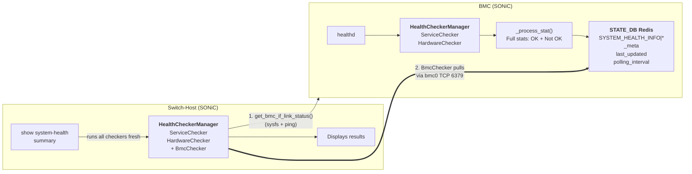

# BMC Health Monitoring on Switch-Host

## Table of Content

- [1. Revision](#1-revision)
- [2. Definitions/Abbreviations](#2-definitionsabbreviations)
- [3. Scope](#3-scope)
- [4. Overview](#4-overview)
- [5. Requirements](#5-requirements)
- [6. Architecture Design](#6-architecture-design)
- [7. High-Level Design](#7-high-level-design)
  - [7.1. healthd - Full Stats Publishing to STATE_DB](#71-healthd--full-stats-publishing-to-state_db)
  - [7.2. Platform API - get_bmc_if_link_status()](#72-platform-api--get_bmc_if_link_status)
  - [7.3. BmcChecker - Switch-Host Pulls from BMC Redis](#73-bmcchecker--switch-host-pulls-from-bmc-redis)
  - [7.4. STATE_DB Schema](#74-state_db-schema)
  - [7.5. CLI Display Update](#75-cli-display-update)
  - [7.6. Non-BMC Platform Safety](#76-non-bmc-platform-safety)
- [8. Future Enhancements](#8-future-enhancements)
- [9. References](#9-references)

---

## 1. Revision

| Rev | Date | Author | Change Description |
| --- | --- | --- | --- |
| 0.1 | 2026-09-15 | Prajjwal Singh | Initial version (push model) |
| 0.2 | 2026-09-30 | Prajjwal Singh | Revised to pull model; added BmcUsbInterfaceChecker; healthd writes full stats |
| 0.3 | 2026-10-26 | Prajjwal Singh | Replaced BmcUsbInterfaceChecker with platform API `get_bmc_if_link_status()`; BmcChecker checks link before Redis connect |

---

## 2. Definitions/Abbreviations

| Term | Definition |
| --- | --- |
| BMC | Board Management Controller - specialized microcontroller managing platform power and hardware |
| healthd | SONiC system health monitor daemon, runs as `system-health.service` |
| bmc0/usb0 | USB ethernet interface connecting BMC and switch-host (point-to-point /30 link) |
| STATE_DB | SONiC Redis database (id 6) for runtime state |
| BmcChecker | New health checker on the switch-host that pulls BMC health data from BMC's Redis |

---

## 3. Scope

Currently the switch-host has no visibility into BMC's health status (services, hardware).

This HLD adds BMC health monitoring to the switch-host's `show system-health summary` output using a
**pull model** where the switch-host reads health data from the BMC's Redis over the USB ethernet
link.

- Pull model: switch-host reads BMC's SYSTEM_HEALTH_INFO table
- healthd writes full stats (OK + Not OK) to local STATE_DB
- New platform API `get_bmc_if_link_status()` for bmc0 link health (sysfs + ping)
- New `BmcChecker` on switch-host - checks bmc0 link first, then pulls from BMC Redis
- CLI shows BMC section with Last Updated + Refresh Interval


## 4. Overview

### 4.1 SWITCH-HOST monitoring BMC health stats
The BMC runs SONiC with its own `healthd` instance that performs periodic health checks (services,
hardware) using the `HealthCheckerManager` framework. Today, `healthd` only writes Not OK entries
to the local `SYSTEM_HEALTH_INFO` table, and these results are not visible from the switch-host.

This design uses a **pull model**: the BMC's `healthd` writes full health stats to its own
STATE_DB, and the switch-host's health checker framework connects to the BMC's Redis to read that
data.
The switch-host CLI command `show system-health summary` subscribes to the new BmcChecker in the
health checker framework, which checks the bmc0 link state and then fetches BMC's health stats
from its STATE_DB.

The BMC's Redis is already bound to the bmc0 interface IP by the existing
`docker-database-init.sh` logic (when `switch_bmc=1` is set in `platform_env.conf`).
No new Redis binding configuration is needed on either side.

The health checks performed on the BMC are platform-specific and vendor-configurable via the
existing `system_health_monitoring_config.json` (`services_to_ignore`, `devices_to_ignore`,
`user_defined_checkers`, `polling_interval`).

### 4.2 BMC-Switch-Host USB Interface (bmc0) link monitoring

A new platform API `ChassisBase.get_bmc_if_link_status()` is defined to check the bmc0 USB
interface health (link state via sysfs + peer reachability via ping). The default implementation
requires no vendor work - it reads `bmc_if_name` from `bmc.json` and the interface state from
sysfs. Vendors with a better signal can override it,

On the switch-host, `BmcChecker` calls this API before connecting to BMC's Redis. A down link
reports "bmc0 link down" immediately, and is distinguishable from
BMC Redis not answering.

The API is also available for other consumers on both sides for BMC and Switch-Host.

---

## 5. Requirements

1. The switch-host's `show system-health summary` must display BMC health status as an independent
   section ("BMC"), separate from the existing "Services" and "Hardware" sections.
2. BMC health data must be pulled by the switch-host from the BMC's Redis (pull model).
3. The design must reuse the existing health checker framework - no new daemon or timer.
4. Per-object health results (type, status, message) must be available on the switch-host, so that
   individual failure reasons are visible (e.g., a specific process not running on the BMC).
5. The switch-host must display the `last_updated` timestamp and BMC's `polling_interval` so the
   operator can assess data freshness.
6. A platform API must provide bmc0 link-state and peer-reachability checks via sysfs and ping,
   with a default implementation that requires no vendor work. Vendors may override for
   platform-specific signals.
7. BmcChecker must check bmc0 link state before connecting to BMC Redis, so that a link failure
   is reported instantly.
8. The design must be vendor-agnostic - different platforms may check different services and
   hardware devices, at different intervals.
9. On platforms without a BMC, there must be no impact - no new sections in CLI output, no new
   checkers registered, no additional resource usage.
10. The switch-host must handle BMC being unreachable gracefully - connection timeout, clear error
    message, no blocking of other health checks.

---

## 6. Architecture Design

### 6.1. Data Flow



### 6.2. Components

`+` marks new or modified components.

| # | Component | Location | Runs On | Change Type |
|---|-----------|----------|---------|-------------|
| 1 | + `_process_stat()` (full stats) | `system-health/scripts/healthd` | Both | Modified - writes OK + Not OK |
| 2 | + `get_bmc_if_link_status()` | `sonic_platform_base/chassis_base.py` | Both | New platform API on ChassisBase |
| 3 | + `BmcChecker` | `system-health/health_checker/bmc_checker.py` | Switch-Host | New checker class |
| 4 | + `HealthCheckerManager` | `system-health/health_checker/manager.py` | Switch-Host | Modified - registers BmcChecker |
| 5 | + `display_system_health_summary()` | `sonic-utilities/show/system_health.py` | Switch-Host | Modified - renders BMC section |
| 6 | Redis binding on bmc0 | `docker-database-init.sh` | BMC | Existing - no change needed |

---

## 7. High-Level Design

### 7.1. healthd - Full Stats Publishing to STATE_DB

**File:** `src/system-health/scripts/healthd`

The existing `_process_stat()` method is modified to write **all** health check results (both OK
and Not OK) to the `SYSTEM_HEALTH_INFO` table in STATE_DB. Previously, only Not OK entries were
written.

Each health check object is written with pipe-separated keys containing its category, type,
status, and message. A `_meta` entry is added containing `last_updated` (UTC ISO 8601 timestamp),
`summary` (aggregate OK/Not OK), and `polling_interval`.

Before writing, all existing `SYSTEM_HEALTH_INFO|*` keys are cleared to prevent stale entries
from persisting across polling cycles.

This change applies to **both BMC and switch-host** - both sides write full stats to their own
local STATE_DB.

### 7.2. Platform API - get_bmc_if_link_status()

**File:** `src/sonic-platform-common/sonic_platform_base/chassis_base.py`

A new method `get_bmc_if_link_status()` is added to `ChassisBase`. It checks the bmc0 USB
interface health using two checks: link state via sysfs and peer reachability via ping.

**Default implementation:**

1. Read `bmc_if_name` and peer IP from `device_info.get_bmc_data()`.
2. Read `/sys/class/net/{bmc_if_name}/operstate` - if not `"up"`, return link-down status.
3. Ping peer IP with `-c 1 -W 3 -I {bmc_if_name}` - if ping fails, return peer-unreachable
   status.
4. If both pass, return link-up-and-reachable status.

**Return value:**

A tuple `(link_state, message)`. If either check fails, `link_state` is `False` and `message`
indicates the reason:

| link_state | message | Meaning |
| --- | --- | --- |
| `False` | `"bmc0 link is down"` | sysfs operstate != up |
| `False` | `"bmc0 peer {ip} unreachable"` | ping to peer failed |
| `True` | `""` | Fully healthy - link up and peer reachable |
| `False` | `"Platform does not support BMC"` | default on Non-BMC and Non-Swith-Host platforms |

**Consumers:**

- `BmcChecker` (§7.3) - calls it before connecting to BMC Redis on the switch-host.
- Other daemons that connect to BMC Redis (e.g., thermalctld's TEMPERATURE_INFO mirror) can
  use it as a pre-check to avoid stalling on SYN retries when bmc0 is down.

**Override:**

Vendors with a better signal (hardware register, out-of-band BMC heartbeat, etc.) override
`get_bmc_if_link_status()` in their platform Chassis class, as they do with
`is_midplane_reachable()`.

### 7.3. BmcChecker - Switch-Host Pulls from BMC Redis

**File:** `src/system-health/health_checker/bmc_checker.py` (new)

A new `BmcChecker` class extending `HealthChecker`, registered only on switch-host
(`device_info.is_switch_host()`). It checks bmc0 link health first (via the platform API),
then connects to the BMC's Redis and reads the `SYSTEM_HEALTH_INFO` table.

**Behavior:**

- Reports under the `"BMC"` category.
- Reads the BMC address from `device_info.get_bmc_address()` (sourced from `/etc/sonic/bmc.json`).
- On each `check()` call:
  1. **Link pre-check:** Calls `chassis.get_bmc_if_link_status()`. If the link is down or
     peer is unreachable, reports the failure immediately under the BMC category and returns
     - no Redis connection attempted.
  2. **Redis connect:** Creates a fresh `swsscommon.DBConnector` to BMC's STATE_DB with a
     5-second connection timeout.
  3. **Data read:** Reads all keys via `getKeys()` and iterates with `get()` to read
     field-value pairs.
  4. **Meta handling:** The `_meta` key is processed to extract `last_updated` and
     `polling_interval`, surfaced as informational entries for CLI display.
  5. **Health objects:** All other keys are reported via `set_object_ok()` /
     `set_object_not_ok()` under the "BMC" category, preserving the original object names
     and messages from the BMC.

**Error messages by failure mode:**

| Failure Mode | Detection | Error Displayed |
| --- | --- | --- |
| BMC address not in bmc.json | Config check | `BMC address not configured` |
| bmc0 link down | `get_bmc_if_link_status()` sysfs | `bmc0 link is down` |
| bmc0 peer unreachable | `get_bmc_if_link_status()` ping | `bmc0 peer 169.254.100.1 unreachable` |
| Redis not running on BMC | Redis connect refused | `Cannot connect to BMC Redis: ...Connection refused...` |
| No data in SYSTEM_HEALTH_INFO | Empty `getKeys()` | `No BMC health data available` |

### 7.4. STATE_DB Schema

The existing `SYSTEM_HEALTH_INFO` table is extended to write all objects with pipe-separated keys.

**Per-object entries:**

```
Key:    SYSTEM_HEALTH_INFO|{category}|{object_name}
Fields: category, type, status, message
```

**Meta entry:**

```
Key:    SYSTEM_HEALTH_INFO|_meta
Fields: last_updated, summary, polling_interval
```

The set of entries is dynamic and platform-dependent. The BMC does not own PSU, fan, or ASIC
devices - those are managed by the switch-host. BMC entries typically include services (pmon,
database, lldp, gnmi, etc.) and hardware sensors (liquid cooling leak detection, etc.).

**Example entries on BMC's STATE_DB:**

| Key | status | message |
| --- | --- | --- |
| `SYSTEM_HEALTH_INFO\|Services\|sonic` | OK | |
| `SYSTEM_HEALTH_INFO\|Services\|rsyslog` | OK | |
| `SYSTEM_HEALTH_INFO\|Services\|database:redis` | OK | |
| `SYSTEM_HEALTH_INFO\|Services\|pmon:bmcctld` | OK | |
| `SYSTEM_HEALTH_INFO\|Services\|lldp:lldpd` | Not OK | Process 'lldpd' in container 'lldp' is not running |
| `SYSTEM_HEALTH_INFO\|_meta` | - | last_updated=2026-09-30T06:41:35Z, summary=Not OK, polling_interval=300 |

**Example entries on Switch-Host's STATE_DB:**

| Key | status | message |
| --- | --- | --- |
| `SYSTEM_HEALTH_INFO\|Services\|sonic` | OK | |
| `SYSTEM_HEALTH_INFO\|Services\|rsyslog` | OK | |
| `SYSTEM_HEALTH_INFO\|Services\|swss:orchagent` | OK | |
| `SYSTEM_HEALTH_INFO\|Hardware\|PSU 1` | OK | |
| `SYSTEM_HEALTH_INFO\|Hardware\|fan1` | OK | |
| `SYSTEM_HEALTH_INFO\|BMC\|Services\|pmon:bmcctld` | OK | |
| `SYSTEM_HEALTH_INFO\|BMC\|Services\|lldp:lldpd` | Not OK | Process 'lldpd' in container 'lldp' is not running |
| `SYSTEM_HEALTH_INFO\|BMC\|BMC-LastUpdate` | OK | Last updated: 2026-09-30T06:41:35Z |
| `SYSTEM_HEALTH_INFO\|BMC\|BMC-RefreshInterval` | OK | BMC Refresh Interval: 300s |
| `SYSTEM_HEALTH_INFO\|BMC\|_meta` | - | last_updated=2026-09-30T06:41:35Z, summary=Not OK, polling_interval=300 |
| `SYSTEM_HEALTH_INFO\|_meta` | - | last_updated=2026-09-30T06:41:40Z, summary=Not OK, polling_interval=180 |

### 7.5. CLI Display Update

**File:** `src/sonic-utilities/show/system_health.py`

`display_system_health_summary()` is modified to render a "BMC" section when the `stat` dict
contains a `"BMC"` category. On non-BMC platforms, the output is unchanged.

The `BMC-LastUpdate` and `BMC-RefreshInterval` entries are informational metadata - they are
extracted and displayed as metadata lines, excluded from the reasons list.

When `Last Updated` and `BMC Refresh Interval` are available (successful pull), they are shown.
When the pull fails (BMC unreachable or link down), no timestamp is shown - only the error.

**1. All healthy - BMC and bmc0 link OK:**

```
System status summary

  System status LED  green
  Services:
    Status: OK
  Hardware:
    Status: OK
  BMC:
    Status: OK
    Last Updated: 2026-09-30T06:41:35Z
    BMC Refresh Interval: 300s
```

**2. bmc0 link down - detected instantly by platform API pre-check:**

```
System status summary

  System status LED  red
  Services:
    Status: OK
  Hardware:
    Status: OK
  BMC:
    Status: Not OK
    Reasons: BMC-Connectivity: bmc0 link is down
```

Note: No 5-second timeout - `get_bmc_if_link_status()` reads sysfs and returns immediately.
No `Last Updated` is shown because no data was received.

**3. bmc0 peer unreachable - link UP but ping fails:**

```
System status summary

  System status LED  red
  Services:
    Status: OK
  Hardware:
    Status: OK
  BMC:
    Status: Not OK
    Reasons: BMC-Connectivity: bmc0 peer 169.254.100.1 unreachable
```

**4. BMC Redis not running - link OK, Redis connection refused:**

```
System status summary

  System status LED  red
  Services:
    Status: OK
  Hardware:
    Status: OK
  BMC:
    Status: Not OK
    Reasons: BMC-Connectivity: Cannot connect to BMC Redis: Connection refused
```

Note: This is now distinguishable from a link failure (scenario 2) - the link pre-check passed
but the Redis connection failed.

**5. BMC service failure - bmc0 link OK, BMC service down:**

```
System status summary

  System status LED  red
  Services:
    Status: OK
  Hardware:
    Status: OK
  BMC:
    Status: Not OK
    Last Updated: 2026-09-30T07:59:24Z
    BMC Refresh Interval: 300s
    Reasons: Services|lldp:lldpd: Process 'lldpd' in container 'lldp' is not running
```

### 7.6. Non-BMC Platform Safety

On platforms without a BMC:

- `device_info.is_switch_host()` returns `False`.
- `BmcChecker` is never instantiated.
- `get_bmc_if_link_status()` returns link-down (no `bmc_if_name` configured) - but it is never
  called because `BmcChecker` is not registered.
- No "BMC" section appears in `show system-health summary`.
- No connections are attempted to any BMC Redis.
- No additional resource usage beyond module imports.

---

## 8. Future Enhancements
Future enhancement as recommended by the community to make the bmc_checker on
-switch-host side not use BMC's STATE_DB to pull data from, instead use redfish APIs.
This is also to make the system compatible with BMC running OpenBMC as well.

---

## 9. References

| # | Description | Link |
| --- | --- | --- |
| 1 | healthd - system health monitor daemon | [sonic-buildimage/src/system-health/scripts/healthd](https://github.com/sonic-net/sonic-buildimage/blob/master/src/system-health/scripts/healthd) |
| 2 | HealthCheckerManager | [sonic-buildimage/src/system-health/health_checker/manager.py](https://github.com/sonic-net/sonic-buildimage/blob/master/src/system-health/health_checker/manager.py) |
| 3 | ChassisBase (platform API) | [sonic-platform-common/sonic_platform_base/chassis_base.py](https://github.com/sonic-net/sonic-buildimage/blob/master/src/sonic-platform-common/sonic_platform_base/chassis_base.py) |
| 4 | ModuleBase.is_midplane_reachable() | [sonic-platform-common/sonic_platform_base/module_base.py](https://github.com/sonic-net/sonic-buildimage/blob/master/src/sonic-platform-common/sonic_platform_base/module_base.py) |
| 5 | BMCBase (Redfish) | [sonic-platform-common/sonic_platform_base/bmc_base.py](https://github.com/sonic-net/sonic-buildimage/blob/master/src/sonic-platform-common/sonic_platform_base/bmc_base.py) |
| 6 | mgmt_oper_status.py (eth0 link via sysfs) | [sonic-buildimage/files/image_config/monit/mgmt_oper_status.py](https://github.com/sonic-net/sonic-buildimage/blob/master/files/image_config/monit/mgmt_oper_status.py) |
| 7 | chassisd (midplane reachability) | [sonic-platform-daemons/sonic-chassisd/scripts/chassisd](https://github.com/sonic-net/sonic-buildimage/blob/master/src/sonic-platform-daemons/sonic-chassisd/scripts/chassisd) |
| 8 | `show system-health` CLI | [sonic-utilities/show/system_health.py](https://github.com/sonic-net/sonic-utilities/blob/master/show/system_health.py) |
| 9 | docker-database-init.sh (BMC Redis binding) | [sonic-buildimage/dockers/docker-database/docker-database-init.sh](https://github.com/sonic-net/sonic-buildimage/blob/master/dockers/docker-database/docker-database-init.sh) |
| 10 | `device_info.is_switch_bmc()` / `get_bmc_data()` | [sonic-platform-common/sonic_py_common/device_info.py](https://github.com/sonic-net/sonic-platform-common/blob/master/sonic_py_common/device_info.py) |
| 11 | thermalctld BMC thermals mirror | [sonic-platform-daemons#818](https://github.com/sonic-net/sonic-platform-daemons/pull/818) |
