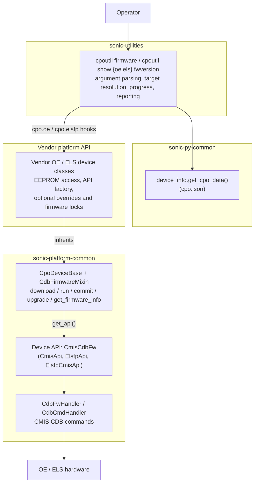
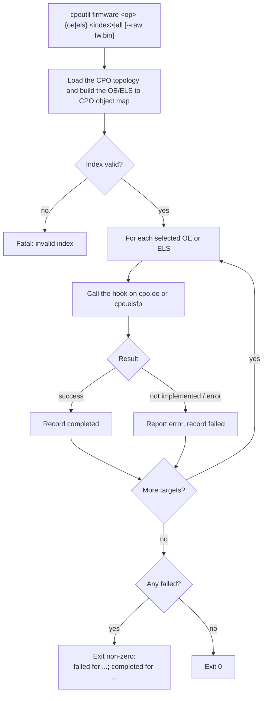
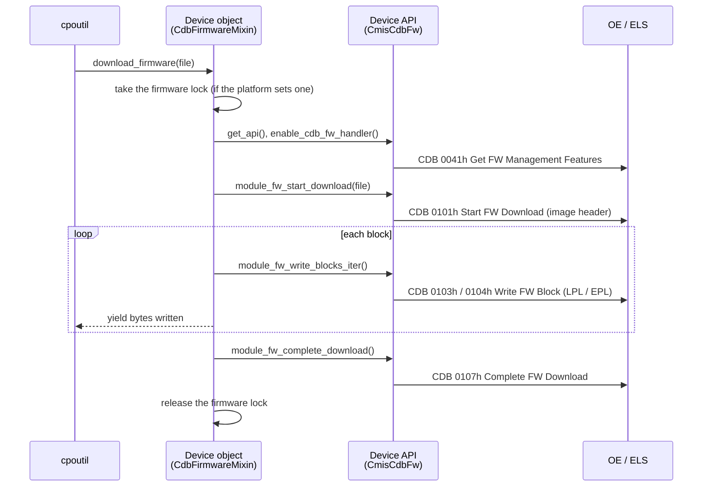
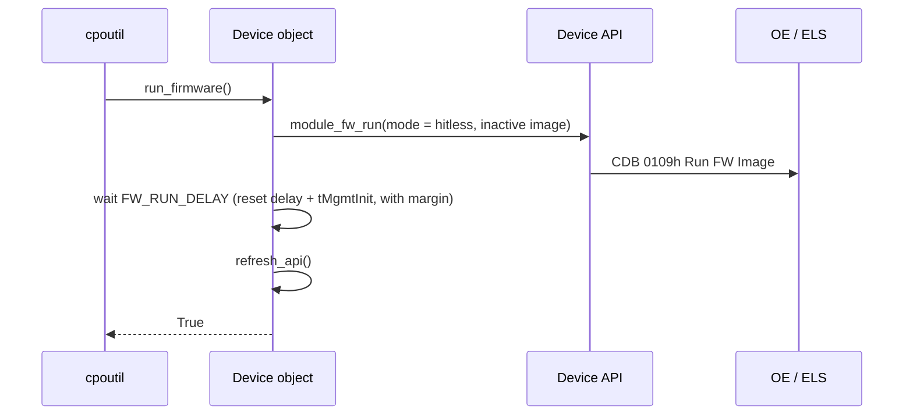
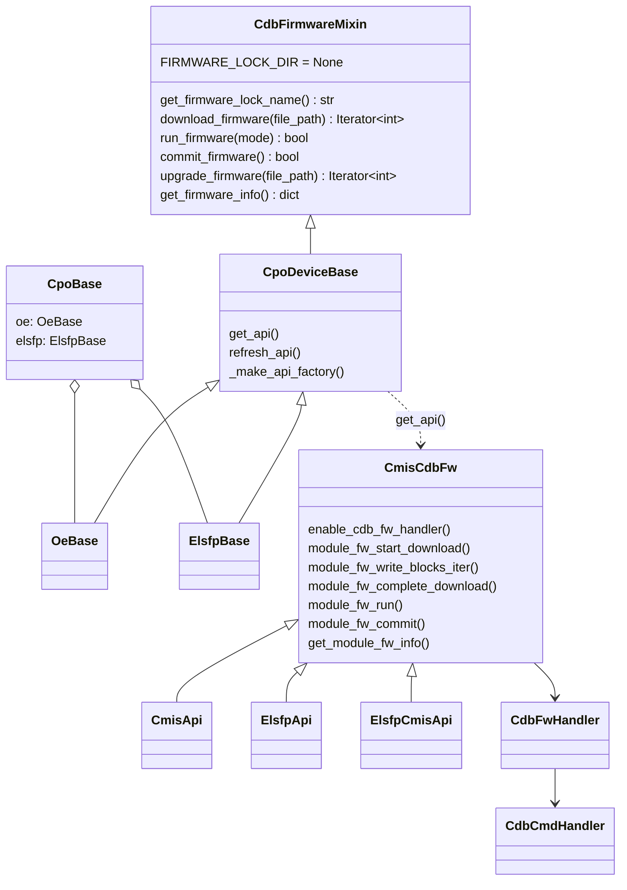
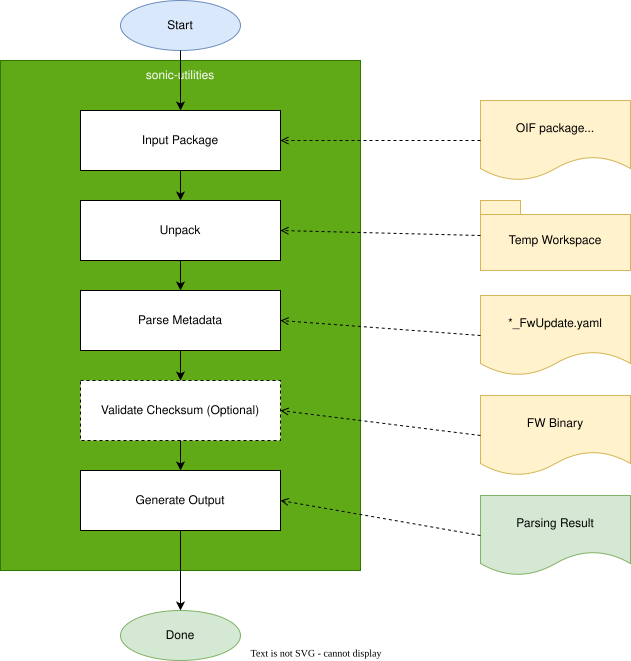
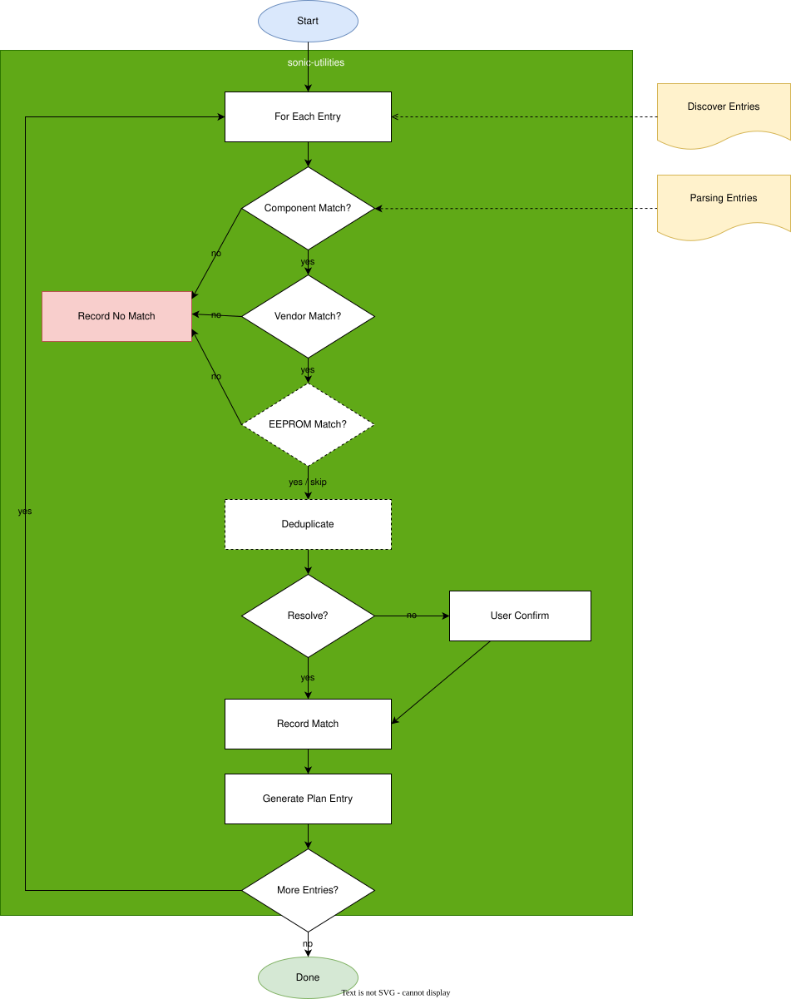

# cpoutil — CPO Component Firmware Management HLD

## Table of Content

- [Revision](#1-revision)
- [Scope](#2-scope)
- [Definitions/Abbreviations](#3-definitionsabbreviations)
- [Overview](#4-overview)
- [Requirements](#5-requirements)
- [Architecture Design](#6-architecture-design)
- [High-Level Design](#7-high-level-design)
  - [7.1 Background](#71-background)
  - [7.2 Motivation](#72-motivation)
  - [7.3 Repositories and modules](#73-repositories-and-modules)
  - [7.4 Flows](#74-flows)
  - [7.5 sonic-utilities](#75-sonic-utilities)
  - [7.6 sonic-platform-common](#76-sonic-platform-common)
  - [7.7 Vendor platform API](#77-vendor-platform-api)
  - [7.8 Concurrency](#78-concurrency)
  - [7.9 Error handling](#79-error-handling)
  - [7.10 Event logging / Serviceability](#710-event-logging--serviceability)
  - [7.11 Security considerations](#711-security-considerations)
  - [7.12 Platform dependency](#712-platform-dependency)
- [SAI API](#8-sai-api)
- [Configuration and management](#9-configuration-and-management)
- [Warmboot and Fastboot Design Impact](#10-warmboot-and-fastboot-design-impact)
- [Memory Consumption](#11-memory-consumption)
- [Restrictions/Limitations](#12-restrictionslimitations)
- [Testing Requirements/Design](#13-testing-requirementsdesign)
- [Open/Action items](#14-openaction-items)
- [Appendix A — OIF Firmware Update Package (future)](#appendix-a--oif-firmware-update-package-future)
- [References](#references)

### 1. Revision

| Rev | Date       | Author | Change Description                                      |
| --- | ---------- | ------ | ------------------------------------------------------- |
| 1.0 | 2026-08-03 | Junchao Chen | Base version — Phase 1 (firmware command group)         |
| 1.1 | 2026-10-14 | Junchao Chen | Identify OE and ELS by component index instead of interface name, and defer the OIF package path to a future phase |

### 2. Scope

This document describes the high-level design of the **`cpoutil` firmware management commands** for Co-Packaged Optics (CPO) and their firmware-bearing sub-components: the Optical Engine (OE) and the External Laser Source (ELS).

`cpoutil` is the top-level SONiC CLI utility for CPO. This document covers only its firmware management commands:

- the `cpoutil firmware` command group: `upgrade`, `download`, `run`, `commit`;
- the `cpoutil show oe fwversion` and `cpoutil show els fwversion` commands;
- the platform API that implements them.

The other `cpoutil` commands are out of scope.

Compared with the `sfputil firmware` command group:

| Operation | Description | In scope |
| --- | --- | --- |
| download | Download a firmware image to the inactive bank of the device | Yes |
| run | Run the inactive image | Yes |
| commit | Commit the running image so that the device boots from it | Yes |
| upgrade | download, run and commit | Yes |
| fwversion | Show the firmware versions of the device | Yes |
| unlock | Enter the module password | No |
| target | Select the target firmware of a `Y-cable` | No (not relevant) |

Key points:

- Firmware is managed **per OE or per ELS**, selected by its index in the platform CPO topology, or `all`. It is not managed per logical port: one OE or ELS may serve many ports, and selecting by port would apply the same operation more than once to the same device.
- The firmware image is a **raw firmware binary** given with `--raw`. Selecting the image from an OIF Firmware Update Package [1] is future work (Appendix A).
- The firmware lifecycle follows the standard CMIS CDB firmware management flow [2]. The default implementation is in `sonic-platform-common` and is shared by every OE and ELS. A vendor platform API overrides it only where its device needs different behavior.
- No SAI, SDK, orchagent, or Config DB changes are required.

### 3. Definitions/Abbreviations

| Term | Definition |
| --- | --- |
| CPO | Co-Packaged Optics — optical assembly co-packaged with the switch ASIC |
| OE | Optical Engine — the optical engine component of a CPO |
| ELS | External Laser Source — the pluggable laser source component of a CPO (ELSFP form factor) |
| CMIS | Common Management Interface Specification [2] |
| CDB | Command Data Block — the CMIS command mechanism used for firmware management |
| LPL / EPL | Local / Extended Payload — the CDB payload areas used to write firmware blocks |
| Bank / image | A CMIS firmware storage slot (image A, image B). `download` writes the inactive one |
| OIF | Optical Internetworking Forum |
| Platform API | `sonic_platform_base` abstract bases plus the vendor platform API subclasses |
| CPO topology | The platform `cpo.json` file, read with `device_info.get_cpo_data()`, which names the OEs and ELSs (`oe0`, `els0`, ...) and the ports they serve |

### 4. Overview

An OE and an ELS carry independent firmware, may come from different vendors, and each implements CMIS CDB firmware management. `cpoutil` exposes one firmware command per operation and per component class:

```
cpoutil firmware upgrade  {oe|els} <index>|all --raw <fw.bin>
cpoutil firmware download {oe|els} <index>|all --raw <fw.bin>
cpoutil firmware run      {oe|els} <index>|all
cpoutil firmware commit   {oe|els} <index>|all
cpoutil show oe  fwversion [<oe_index>]  [--json]
cpoutil show els fwversion [<els_index>] [--json]
```

Each command resolves the selected OEs or ELSs from the CPO topology, and calls a firmware hook on the matching platform device object (`cpo.oe` or `cpo.elsfp`) for each of them in turn. The hooks are implemented once in `sonic-platform-common`, on top of the existing CMIS CDB firmware code.

Examples:

```
# Upgrade one ELS: download, run and commit
cpoutil firmware upgrade els 0 --raw els_fw.bin

# Upgrade every OE
cpoutil firmware upgrade oe all --raw oe_fw.bin

# Staged ELS lifecycle on every ELS
cpoutil firmware download els all --raw els_fw.bin
cpoutil firmware run els all
cpoutil firmware commit els all

# Verify on every ELS
cpoutil show els fwversion
```

### 5. Requirements

#### 5.1 Functional Requirements

| ID | Requirement |
| --- | --- |
| REQ-1 | `cpoutil` provides the `firmware` command group — `upgrade`, `download`, `run`, `commit` — for OE and ELS, following the Platform API dispatch pattern of `sfputil`, `fwutil`, and `psuutil`. |
| REQ-2 | A firmware command selects its targets by component class (`oe` or `els`) and by index from the CPO topology, or `all` for every OE or every ELS. |
| REQ-3 | `upgrade` and `download` take a raw firmware binary with `--raw <fw.bin>`. The same binary is applied to every selected target. |
| REQ-4 | `cpoutil show {oe\|els} fwversion` displays the firmware versions of one OE or ELS, or of every OE or ELS when no index is given, in plain text or JSON. |
| REQ-5 | The firmware operations are platform API hooks on the OE and ELS device objects. `sonic-platform-common` provides a default implementation through the standard CMIS CDB firmware flow, shared by every OE and ELS. |
| REQ-6 | A vendor platform API MAY override a hook when its device needs different behavior, or report it as not implemented. `cpoutil` reports an unimplemented hook as not implemented for the platform. |
| REQ-7 | Targets are processed in turn. A failure on one target does not stop the others; the command exits non-zero and names the failed and completed targets. |
| REQ-8 | `upgrade` and `download` report the transfer progress. Interrupting a transfer (for example with Ctrl-C) stops it and aborts the download on the device when the device supports Abort. |

#### 5.2 Configuration and Management Requirements

`cpoutil` is a maintenance CLI utility. It adds no persistent configuration and no Config DB change.

#### 5.3 Scalability Requirements

- Every firmware command accepts a single index or `all`.
- Targets are processed sequentially.

#### 5.4 Performance Requirements

A `cpoutil` command processes its targets one after the other. Firmware operations on different devices can run in parallel from separate `cpoutil` processes, as far as the platform's firmware lock allows ([§7.8](#78-concurrency)). The transfer time is bound by the CDB block write rate of the device and the management bus.

#### 5.5 Warm/Fast boot Requirements

No impact.

#### 5.6 Multi ASIC Requirements

The CPO topology and the platform chassis are system wide; an OE or ELS index is unique in the system. `cpoutil` builds the OE/ELS to CPO object map from the CPO topology and `platform_chassis.get_cpo(physical_port)`, using the same port configuration loading as `sfputil`. No additional multi-ASIC handling is required.

### 6. Architecture Design

Design direction: implement the firmware lifecycle once, in vendor-neutral code, on the standard CMIS CDB flow. The vendor platform API supplies the device access (EEPROM read/write, API factory) and overrides only what its devices do differently. `cpoutil` contains no vendor or ASIC conditionals.



**Layer model:**

```
Layer 0   Operator
            |
Layer 1   cpoutil CLI              argument parsing, target resolution, progress, reporting
            |
Layer 2   Platform API             CpoDeviceBase / CdbFirmwareMixin: firmware hooks
            |
Layer 3   Device API               CmisCdbFw over the CMIS CDB handlers
            |
Layer 4   Vendor platform API      device access, API factory, optional overrides
            |
Layer 5   CPO hardware             CMIS-managed OE / ELS
```

### 7. High-Level Design

#### 7.1 Background

A CPO is composite: an OE and one or more ELSs. In the platform API, a `CpoBase` object represents the CPO virtual module behind a physical port and holds two device objects: `cpo.oe` (`OeBase`) and `cpo.elsfp` (`ElsfpBase`), both derived from `CpoDeviceBase`. Each device object builds its own device API (`get_api()`).

The CPO topology names each OE and ELS (`oe0`, `els0`, ...) and the ports they serve. Several physical ports — and so several `CpoBase` objects — may share the same OE or ELS. Firmware belongs to the OE or ELS, not to the port, so `cpoutil` selects firmware targets by OE or ELS index.

`sfputil firmware` manages a pluggable module per port through its CMIS API. It does not model the OE/ELS decomposition, and its download path runs a single blocking call without per-block progress.

#### 7.2 Motivation

- OE and ELS firmware must be upgraded independently, per device, on systems where one device serves many ports.
- The CMIS CDB firmware flow is standard; implementing it once in `sonic-platform-common` lets every OE and ELS that follows CMIS work without vendor code.
- A single vendor-neutral CLI with a well-defined platform API boundary keeps vendor specifics out of `sonic-utilities`.

#### 7.3 Repositories and modules

| Repository | Change |
| --- | --- |
| `sonic-utilities` | `cpoutil firmware {upgrade\|download\|run\|commit}` and `cpoutil show {oe\|els} fwversion`; `doc/Command-Reference.md` |
| `sonic-platform-common` | New `CdbFirmwareMixin` (`sonic_xcvr/cdb_firmware.py`) mixed into `CpoDeviceBase`; `CmisCdbFw` extensions; `ElsfpApi` / `ElsfpCmisApi` mix in `CmisCdbFw`; CDB status polling fix |
| Vendor platform API | Device access and API factory (existing); optional firmware locks; optional overrides |

No changes to SWSS, syncd, SAI, SDK, orchagent, or Redis DB schemas.

#### 7.4 Flows

##### 7.4.1 Command flow



| Command | Hook | Result |
| --- | --- | --- |
| `firmware upgrade` | `upgrade_firmware(file_path)` | Iterator of bytes written per block, drives the progress bar |
| `firmware download` | `download_firmware(file_path)` | Iterator of bytes written per block, drives the progress bar |
| `firmware run` | `run_firmware()` | `True` on success |
| `firmware commit` | `commit_firmware()` | `True` on success |
| `show {oe\|els} fwversion` | `get_firmware_info()` | Dict of firmware fields |

A hook raises on failure: `NotImplementedError` when the device or platform does not support it, `RuntimeError` otherwise.

##### 7.4.2 Download



If the transfer stops early — the caller closes the iterator, for example on Ctrl-C — the mixin waits for the CDB to be idle and sends CDB 0102h Abort FW Download when the device advertises Abort support. A failed block write has already aborted the download in `CmisCdbFw`.

##### 7.4.3 Run



The default run mode attempts a hitless reset to the inactive image. Whether the switch is hitless depends on the device; running new firmware may disrupt traffic on the ports the OE or ELS serves. After the device resets, the device API is rebuilt, because the new image may report different capabilities.

##### 7.4.4 Commit

`commit_firmware()` sends CDB 010Ah Commit FW Image, so that the device boots from the running image.

##### 7.4.5 Upgrade

`upgrade_firmware()` holds the firmware lock once, for the whole sequence: download, run, then commit through the device API rebuilt by the run. It yields the bytes written during the download, then blocks during the run delay.

##### 7.4.6 Firmware information

`get_firmware_info()` sends CDB 0100h Get Firmware Info and returns its fields: image A, image B and factory image versions, running and committed images, active and inactive firmware. A device without CDB firmware management returns only the active and inactive versions read from the EEPROM; a version that the EEPROM does not report is `N/A`.

#### 7.5 sonic-utilities

##### 7.5.1 Command structure

```
cpoutil firmware upgrade  els <els_index>|all --raw <fw.bin>
cpoutil firmware upgrade  oe  <oe_index>|all  --raw <fw.bin>
cpoutil firmware download els <els_index>|all --raw <fw.bin>
cpoutil firmware download oe  <oe_index>|all  --raw <fw.bin>
cpoutil firmware run      els <els_index>|all
cpoutil firmware run      oe  <oe_index>|all
cpoutil firmware commit   els <els_index>|all
cpoutil firmware commit   oe  <oe_index>|all
cpoutil show oe  fwversion [<oe_index>]  [--json]
cpoutil show els fwversion [<els_index>] [--json]
```

- `<index>` is the number of an OE or ELS in the CPO topology (`0` selects `oe0` or `els0`); `all` selects every OE or every ELS.
- `show {oe|els} fwversion` takes an optional index instead, like the other `cpoutil show oe` and `cpoutil show els` commands: without it, every OE or ELS is shown, and `all` is not accepted. The firmware commands require an explicit `<index>|all`, because they write to the device.
- `--raw <fw.bin>` is mandatory on `upgrade` and `download`; the file must exist and be readable. The option name leaves room for an OIF package argument in the future (Appendix A).
- The binary must match the selected component class; `cpoutil` does not inspect it. The device validates the image during the download.

##### 7.5.2 Behavior

- The CPO topology is loaded and the OE/ELS to CPO object map is built once per command. An unknown index fails the command before any firmware operation.
- Targets are processed in natural order (`els0`, `els1`, ..., `els10`).
- `upgrade` and `download` show a progress bar per target, sized by the image, and print `<Verb> <TARGET> firmware ... OK (<n> bytes)`.
- An interrupted transfer is closed right away, so that the hook aborts the download and releases the firmware lock.
- A missing hook, or a hook that raises `NotImplementedError`, is reported as `<OE|ELS> <hook> is not implemented for this platform`.
- Any other error is reported for that target, and the remaining targets still run.
- The command fails when any target failed: `<OE|ELS> firmware <op> failed for <targets>; completed for <targets>`.
- `show {oe|els} fwversion` prints one block per target, like `sfputil show fwversion`. With `--json`, the output is a JSON object keyed by target (`oe0`, `els0`, ...). A target that fails is reported on stderr and omitted from the output; the command then fails with `Failed to get <OE|ELS> firmware version for <targets>`.

##### 7.5.3 Usage examples

```
admin@sonic:~$ cpoutil firmware upgrade els 0 --raw els_fw.bin
Upgrading ELS0 firmware  [####################################]  100%
Upgrading ELS0 firmware ... OK (262144 bytes)

admin@sonic:~$ cpoutil firmware download els all --raw els_fw.bin
admin@sonic:~$ cpoutil firmware run els all
admin@sonic:~$ cpoutil firmware commit els all

admin@sonic:~$ cpoutil show els fwversion 0
ELS0:
  Image A Version: 1.2.0
  Image B Version: 1.1.0
  Factory Image Version: 1.0.0
  Running Image: A
  Committed Image: A
  Active Firmware: 1.2.0
  Inactive Firmware: 1.1.0

admin@sonic:~$ cpoutil show oe fwversion 0 --json
{
    "oe0": {
        "Active Firmware": "2.1",
        "Inactive Firmware": "2.0"
    }
}

```

The commands are documented in `doc/Command-Reference.md` of `sonic-utilities`.

#### 7.6 sonic-platform-common



##### 7.6.1 CdbFirmwareMixin

New module `sonic_platform_base/sonic_xcvr/cdb_firmware.py`. `CpoDeviceBase` mixes in `CdbFirmwareMixin`, so `OeBase`, `ElsfpBase` and every vendor subclass inherit the firmware hooks. The mixin needs only `get_api()` and `refresh_api()` from the object, so other device classes can reuse it.

```python
FW_RUN_MODE_HITLESS_INACTIVE = 0x01
FW_RUN_DELAY = 5  # seconds


class CdbFirmwareMixin(object):
    FIRMWARE_LOCK_DIR = None

    def get_firmware_lock_name(self) -> str:
        """
        Retrieves the name of the firmware lock of the device, unique among
        the devices that share FIRMWARE_LOCK_DIR, such as 'els0'.
        Required when FIRMWARE_LOCK_DIR is set.
        """

    def download_firmware(self, file_path: str) -> Iterator[int]:
        """
        Downloads a firmware image to the inactive bank of the device

        Returns:
            An iterator that yields the number of bytes written for each
            block of the image. Closing it before the end aborts the download.

        Raises:
            NotImplementedError: The device does not support CDB firmware management
            RuntimeError: A CDB firmware command failed, or another firmware
                operation is in progress
        """

    def run_firmware(self, mode: int = FW_RUN_MODE_HITLESS_INACTIVE) -> bool:
        """
        Runs a firmware image of the device, then waits FW_RUN_DELAY seconds
        for the device to reset and be manageable again.
        """

    def commit_firmware(self) -> bool:
        """
        Commits the running firmware image of the device so that the device
        boots from it
        """

    def upgrade_firmware(self, file_path: str) -> Iterator[int]:
        """
        Downloads the image to the inactive bank, runs it and commits it.
        Yields the bytes written per block, like download_firmware().
        """

    def get_firmware_info(self) -> dict:
        """
        Retrieves the firmware information of the device, from CDB Get
        Firmware Info, or the active and inactive versions from the EEPROM
        when the device has no CDB firmware management.
        """
```

Design notes:

- **Generators for transfers.** `download_firmware()` and `upgrade_firmware()` are generators, so the client reports progress per block without callbacks, and closing the generator runs the abort and lock-release paths.
- **Errors raise.** A CDB failure raises `RuntimeError` with the module's status text; a device or API without CDB firmware support raises `NotImplementedError`. `run_firmware()` and `commit_firmware()` return `True` only for symmetry with existing hooks.
- **Enabling CDB lazily.** CPO device APIs are built without the CDB firmware handler, so routine EEPROM access does not pay for CDB discovery. The mixin calls `enable_cdb_fw_handler()` only when a firmware operation runs. A device that does not advertise CDB support yields `NotImplementedError`.
- **Run delay.** `FW_RUN_DELAY` covers the Run FW Image reset delay (512 ms) plus tMgmtInit (2 s in CMIS), with margin. A vendor whose device needs longer overrides `run_firmware()`.
- **Firmware lock.** See [§7.8](#78-concurrency).

##### 7.6.2 CmisCdbFw

- `enable_cdb_fw_handler()`: creates the CDB firmware handler on an API built without it. Class-level defaults let APIs not derived from `CmisApi` mix `CmisCdbFw` in.
- `module_fw_write_blocks_iter()`: the block loop of `module_fw_write_blocks()`, as a generator that yields the bytes written per block and raises `RuntimeError` on failure. `module_fw_write_blocks()` keeps its behavior on top of it, so `sfputil` is unchanged.

##### 7.6.3 ELS API

`ElsfpApi` and `ElsfpCmisApi` mix in `CmisCdbFw`, so an ELS gets CDB firmware management like a CMIS module. `ElsfpCmisApi` adds `is_cdb_supported()`, read from the CDB support field of page 01h.

##### 7.6.4 CDB status polling

`CdbCmdHandler.wait_for_cdb_status()` stopped polling at the first status that was neither busy nor failed, including a command result of 0. CMIS defines result 0 as reserved; success is 01h. A device that resets during Run FW Image clears its CDB status, so the host can read 0 before the device reports the result, and a successful run was reported as failed. The handler now keeps polling on a reserved result until the device reports success or failure, or the timeout expires. This change is a standalone CMIS fix and benefits `sfputil` too.

#### 7.7 Vendor platform API

A vendor OE or ELS device class derives from `OeBase` or `ElsfpBase` and already provides EEPROM access and an API factory.

The vendor platform API SHALL NOT change the command surface or the target selection of `cpoutil`.

#### 7.8 Concurrency

CDB is a single command mailbox per device. Two clients that send CDB commands to the same device at the same time corrupt each other's command sequence, and a firmware transfer is a long sequence.

- A platform sets `FIRMWARE_LOCK_DIR` to a lock directory, and each device names its lock with `get_firmware_lock_name()`, for example `oe0` or `els3`. Every firmware hook, including `get_firmware_info()`, then takes the locks returned by `_firmware_locks()`, each a non-blocking `flock` on `<FIRMWARE_LOCK_DIR>/<name>.lock`, shared or exclusive. A hook that finds a lock held in a conflicting mode releases the locks it took and raises `RuntimeError("Another firmware operation is in progress")`, which `cpoutil` reports for that target.
- By default, `_firmware_locks()` returns the exclusive lock of the device only: two operations on the same OE, or on the same ELS, exclude each other, and operations on different devices, including an OE and an ELS, run in parallel.
- A platform overrides `_firmware_locks()` for wider rules. 
- `upgrade_firmware()` holds the lock for the whole download-run-commit sequence.
- The lock is released when the hook returns, raises, or its generator is closed, and by the kernel when the process dies.
- When firmware operations can run from more than one container, the platform makes the lock directory visible to each of them.
- Without a lock directory, `cpoutil` takes no lock. The operator must avoid concurrent firmware operations on the same device.

The lock serializes only firmware hooks. Other clients that use CDB on the same device, for example periodic CDB-based telemetry, must take the same lock or be paused during a firmware operation.

#### 7.9 Error handling

Failures are isolated per target. A failed target does not roll back completed targets.

**CLI:**

| Error | When detected | Behavior |
| --- | --- | --- |
| CPO topology unavailable | Command start | Fatal |
| Invalid OE/ELS index | Target resolution | Fatal, before any operation |
| `--raw` missing on upgrade/download | Argument parsing | Fatal |
| `--raw` file missing or unreadable | Argument parsing | Fatal |
| OE/ELS device object unavailable | Per target | Target failed |
| Hook missing or `NotImplementedError` | Per target | Target failed: not implemented for this platform |
| Another firmware operation in progress | Per target | Target failed: busy |
| Interrupted transfer (Ctrl-C) | Per target | Transfer closed; download aborted when supported; command exits |
| `get_firmware_info()` returns no data | Per target | Target failed |

**Platform API:**

| Error | Behavior |
| --- | --- |
| Device does not support CDB firmware management | `NotImplementedError` (`get_firmware_info()` falls back to the EEPROM) |
| CDB Get FW Management Features failed | `RuntimeError` |
| CDB Start / Write / Complete download failed | `RuntimeError` with the module status; the download is aborted by `CmisCdbFw` on a block failure |
| CDB Run / Commit failed | `RuntimeError` with the module status |
| CDB command timeout | `RuntimeError` |
| Abort failed | Logged; the original error is reported |

#### 7.10 Event logging / Serviceability

| Event | Source | Severity |
| --- | --- | --- |
| Firmware operation started on a target | cpoutil | NOTICE |
| Firmware operation completed on a target | cpoutil | NOTICE |
| Firmware operation failed on a target | cpoutil | ERROR |
| Abort of an interrupted download failed | Platform API | ERROR |
| CDB command failed or timed out | CDB handler | NOTICE |

Each step can be verified with `cpoutil show {oe|els} fwversion`.

#### 7.11 Security considerations

- `cpoutil` is a local host CLI that requires the existing administrative privileges. There is no new network-facing API.
- The raw binary path has no host-side metadata or checksum. The operator is responsible for supplying the correct image; the device's own integrity, applicability, and secure-boot checks apply during and after the download.
- No sensitive information is stored. Firmware binaries are opaque vendor images supplied by the operator.
- No new third-party runtime dependency.

#### 7.12 Platform dependency

The feature is not specific to a platform. A platform that exposes CPO through `CpoBase` gets the firmware hooks from `CpoDeviceBase`, and works without vendor code when its OE and ELS follow CMIS CDB firmware management. Vendor overrides are described in [§7.7](#77-vendor-platform-api).

### 8. SAI API

No change.

### 9. Configuration and management

#### 9.1. Manifest (if the feature is an Application Extension)

N/A

#### 9.2. CLI/YANG model Enhancements

The CLI is specified in [§7.5](#75-sonic-utilities). No YANG model changes.

#### 9.3. Config DB Enhancements

N/A

### 10. Warmboot and Fastboot Design Impact

No impact. The feature is not on the boot path. Firmware operations SHOULD NOT be run during a warm or fast reboot.

### 11. Memory Consumption

No daemon. `cpoutil` is a short-lived CLI process; the firmware image is read block by block. No memory is consumed when the utility is not running.

### 12. Restrictions/Limitations

| # | Limitation | Notes |
| --- | --- | --- |
| LIM-1 | Raw binary only | No automatic image selection or host-side image validation. OIF package support is future work (Appendix A). |
| LIM-2 | Sequential | Targets are processed one after the other. |
| LIM-3 | Traffic | Running new firmware may disrupt traffic on the ports the OE or ELS serves. |
| LIM-4 | STATE_DB | Firmware operations do not update `TRANSCEIVER_FIRMWARE_INFO` in STATE_DB. Use `cpoutil show {oe\|els} fwversion`. |
| LIM-5 | Other CDB clients | The firmware lock covers only firmware hooks ([§7.8](#78-concurrency)). |
| LIM-6 | Device behavior | Some devices reject a download while the running image is not committed, or invalidate the inactive bank when a download fails. Commit before the next download, and keep an image at hand to recover the inactive bank. |

### 13. Testing Requirements/Design

#### 13.1. Unit Test cases

`sonic-utilities` (mock platform objects):

- Every firmware command calls the right hook on the right device, for one index and for `all`.
- `show {oe|els} fwversion` calls `get_firmware_info()` on the right device, for one index and with no index; `all` is rejected as an invalid index.
- An invalid index and a missing `--raw` file are rejected before any hook is called.
- A missing hook or `NotImplementedError` is reported as not implemented.
- A failed target does not stop the others; the exit code and message name failed and completed targets.
- The progress bar counts the bytes yielded; an interrupted transfer closes the generator.
- `fwversion` plain-text and JSON output; a failed target is omitted and reported.

`sonic-platform-common`:

- download / run / commit / upgrade call the CMIS CDB operations in order and yield per-block byte counts.
- Each CDB failure raises `RuntimeError`; no CDB support raises `NotImplementedError`.
- Closing a download early aborts it when Abort is supported, and not otherwise; a failed block write is not aborted twice.
- Run waits `FW_RUN_DELAY` and refreshes the API; upgrade commits through the refreshed API.
- The firmware lock: busy error on contention, release on return, error and generator close, no lock when `FIRMWARE_LOCK_DIR` is not set; same lock name excludes, different names run in parallel; shared locks run together and an exclusive one excludes them; a failed lock releases the locks already taken.
- `get_firmware_info()`: CDB fields, EEPROM fallback, `N/A` for missing versions.
- `wait_for_cdb_status()` keeps polling on a reserved result 0.
- `module_fw_write_blocks()` behavior is unchanged.

#### 13.2. System Test cases

On a CPO-capable switch:

- `upgrade` of one ELS and of `all`; versions verified with `fwversion`, before and after a reboot.
- Stepwise `download`, `run`, `commit`; bank state verified after each step.
- Upgrade to the same version.
- Corrupted and truncated images: the download fails and the running image is unaffected.
- Ctrl-C during a download: the command exits and the next download succeeds.
- Two concurrent firmware operations on a platform with a firmware lock: the second fails as busy; the lock is released after `kill -9`.
- Traffic on the ports served by an upgraded OE/ELS recovers after the run.
- A hook that the platform does not implement is reported as not implemented.

### 14. Open/Action items

- OIF Firmware Update Package input with Parsing and Matching (Appendix A).
- Update `TRANSCEIVER_FIRMWARE_INFO` in STATE_DB after firmware operations, as `sfputil` does, including how CPO ports report OE and ELS firmware versions.
- Coordination between firmware operations and other CDB clients (for example CDB-based telemetry in `xcvrd`).
- Parallel firmware operations on independent devices.
- Firmware management of other CPO sub-components (for example a management MCU).

### Appendix A — OIF Firmware Update Package (future)

This appendix keeps the package-driven design reviewed in revision 1.x. It is not implemented. When it is, `upgrade` and `download` accept an OIF Firmware Update Package [1] as an alternative to `--raw`, and the following stages run before the firmware hooks, entirely in `sonic-utilities`:

1. **Parsing** — unpack the `.tgz`, parse every `*_FwUpdate.yaml` (a single mapping or a list of mappings, one per Firmware Load), and verify the optional SHA-256/SHA-512 checksums.
2. **Matching** — for each selected OE or ELS, select at most one Firmware Load by `ComponentClass`, `VendorName` (exact match), and the optional CMIS match attributes (`?` and `*` wildcards). Tie-break: highest `FwLoadVersion`, otherwise prompt the operator. A target without a match is skipped with a warning on `upgrade`, and is fatal on `download`.
3. The selected Firmware Load is passed to the same hooks as `--raw`.





`ComponentClass` (`OpticalEngine` or `ExternalLaserSource`) is a CPO extension to the OIF metadata, needed to tell OE loads from ELS loads.

Package example:

```
cpo_switch_bundle.3.0.0_FwUpdate.tgz
  ├── vendor_a_oe_FwUpdate.yaml     # ComponentClass: OpticalEngine
  ├── vendor_a_oe.bin
  ├── vendor_a_els_FwUpdate.yaml    # ComponentClass: ExternalLaserSource, VendorName: VendorA
  ├── vendor_a_els.bin
  ├── acme_els_FwUpdate.yaml        # ComponentClass: ExternalLaserSource, VendorName: AcmePhotonics
  └── acme_els.bin
```

Metadata example:

```yaml
- VendorName: "Contoso"
  ComponentClass: "OpticalEngine"
  VendorPN: "CONTOSO-OE-*"
  ModuleHardwareMajorRevision: "2"
  ModuleActiveFirmwareVersion: "02.00.*"
  FwLoadName: "firmware/oe.bin"
  FwLoadVersion: "02.00.00123"
  FwUpdateLoadChecksumSHA256: "c4b210de9f21e5c3faa111a019848e24d94b3e3ea899b2375f70a1f7f12afc99"

- VendorName: "Contoso"
  ComponentClass: "ExternalLaserSource"
  VendorPN: "CONTOSO-ELS-*"
  FwLoadName: "firmware/els.bin"
  FwLoadVersion: "02.01.00005"
```

Match attributes:

| Page | Byte range | Field Name | Mandatory | Exact Match |
|---|---|---|---|---|
| 00h | 129-144 | VendorName | Mandatory | Yes |
| 00h | 0 | SFF8024Identifier | Optional | No |
| 00h | 145-147 | VendorOUI | Optional | No |
| 00h | 148-163 | VendorPN | Optional | No |
| 00h | 164-165 | VendorRev | Optional | No |
| 00h | 166-181 | VendorSN | Optional | No |
| 00h | 182-189 | DateCode | Optional | No |
| 00h | 190-199 | CLEICode | Optional | No |
| 01h | 128 | ModuleHardwareMajorRevision | Optional | No |
| 01h | 129 | ModuleHardwareMinorRevision | Optional | No |
| — | CDB 0100h | ModuleActiveFirmwareVersion | Optional | No |
| — | CDB 0100h | ModuleInActiveFirmwareVersion | Optional | No |
| — | CDB 0100h | ActiveExtraString | Optional | No |
| — | CDB 0100h | InActiveExtraString | Optional | No |

Open points for this phase: where the match attributes are read from (STATE_DB or the device), and how the ELS exposes them.

### References

1. OIF Implementation Agreement OIF2026.122.02 — CMIS Firmware Update Package and Metadata File.
2. OIF-CMIS-05.3 — Common Management Interface Specification, section 9.7 (Firmware Management Commands).
