# ycabled in Rust

## Revision

| Rev | Date | Author | Change Description |
| :---: | :---: | :---: | --- |
| 0.1 | 11/04/26 | Longxiang Lyu | Initial version |

## Scope

This document describes a Rust implementation of ycabled, the dual ToR mux cable daemon in the pmon container, as a drop-in replacement for the Python implementation in `sonic-platform-daemons/sonic-ycabled`. It covers:

- the limitations of the Python implementation,
- the requirements for the Rust implementation,
- the current design, workflows and DB contract of Python ycabled,
- the design of Rust ycabled, its tests and its rollout.

linkmgrd, orchagent, xcvrd, the `muxcable` CLI, the SoC gRPC services and the vendor Y-cable drivers do not change.

## Content

- [ycabled in Rust](#ycabled-in-rust)
  - [Revision](#revision)
  - [Scope](#scope)
  - [Content](#content)
  - [Definitions/Abbreviations](#definitionsabbreviations)
  - [1 Background](#1-background)
    - [1.1 Role of ycabled](#11-role-of-ycabled)
    - [1.2 Limitations of Python ycabled](#12-limitations-of-python-ycabled)
      - [1.2.1 A slow SoC or cable delays every port](#121-a-slow-soc-or-cable-delays-every-port)
      - [1.2.2 Resource usage](#122-resource-usage)
      - [1.2.3 Correctness and maintainability](#123-correctness-and-maintainability)
    - [1.3 Why Rust](#13-why-rust)
  - [2 Requirements](#2-requirements)
    - [2.1 Functional](#21-functional)
    - [2.2 Compatibility](#22-compatibility)
    - [2.3 Non-functional](#23-non-functional)
    - [2.4 Non-goals](#24-non-goals)
  - [3 Current Python implementation](#3-current-python-implementation)
    - [3.1 Position in the dual ToR system](#31-position-in-the-dual-tor-system)
    - [3.2 Threads and lifecycle](#32-threads-and-lifecycle)
    - [3.3 Workflows](#33-workflows)
      - [3.3.1 Active-standby toggle](#331-active-standby-toggle)
      - [3.3.2 Active-standby probe](#332-active-standby-probe)
      - [3.3.3 Active-active toggle (self and peer)](#333-active-active-toggle-self-and-peer)
      - [3.3.4 Active-active forwarding state probe](#334-active-active-forwarding-state-probe)
      - [3.3.5 gRPC channel lifecycle](#335-grpc-channel-lifecycle)
      - [3.3.6 GracefulRestart](#336-gracefulrestart)
      - [3.3.7 Cable insertion and removal](#337-cable-insertion-and-removal)
      - [3.3.8 Telemetry](#338-telemetry)
      - [3.3.9 CLI commands](#339-cli-commands)
      - [3.3.10 Runtime knobs](#3310-runtime-knobs)
    - [3.4 External interfaces](#34-external-interfaces)
      - [3.4.1 SoC gRPC service](#341-soc-grpc-service)
      - [3.4.2 Vendor Y-cable drivers](#342-vendor-y-cable-drivers)
      - [3.4.3 Platform API](#343-platform-api)
    - [3.5 DB schema](#35-db-schema)
      - [3.5.1 CONFIG\_DB (read)](#351-config_db-read)
      - [3.5.2 APPL\_DB](#352-appl_db)
      - [3.5.3 STATE\_DB](#353-state_db)
      - [3.5.4 MUX\_CABLE\_INFO and MUX\_CABLE\_STATIC\_INFO](#354-mux_cable_info-and-mux_cable_static_info)
      - [3.5.5 CLI command tables](#355-cli-command-tables)
    - [3.6 Existing tests](#36-existing-tests)
    - [3.7 Known issues](#37-known-issues)
      - [3.7.1 Found by reading the code](#371-found-by-reading-the-code)
      - [3.7.2 Found by the black-box tests](#372-found-by-the-black-box-tests)
      - [3.7.3 State the threads share](#373-state-the-threads-share)
      - [3.7.4 Found by reviewing the unit tests](#374-found-by-reviewing-the-unit-tests)
      - [3.7.5 Cable insertion and removal after startup](#375-cable-insertion-and-removal-after-startup)
      - [3.7.6 Tests that reproduce the issues](#376-tests-that-reproduce-the-issues)
    - [3.8 Current design improvements](#38-current-design-improvements)
  - [4 Rust design](#4-rust-design)
    - [4.1 Design decisions](#41-design-decisions)
    - [4.2 Architecture](#42-architecture)
    - [4.3 Components](#43-components)
      - [4.3.1 Process, runtime and supervision](#431-process-runtime-and-supervision)
      - [4.3.2 DB access](#432-db-access)
      - [4.3.3 Router and port actors](#433-router-and-port-actors)
      - [4.3.4 SoC gRPC client](#434-soc-grpc-client)
      - [4.3.5 Port map, presence and transceiver info](#435-port-map-presence-and-transceiver-info)
      - [4.3.6 Y-cable bridge (embedded Python)](#436-y-cable-bridge-embedded-python)
      - [4.3.7 Telemetry](#437-telemetry)
      - [4.3.8 CLI commands](#438-cli-commands)
      - [4.3.9 Logging](#439-logging)
    - [4.4 Workflows](#44-workflows)
    - [4.5 Deliberate behavior differences](#45-deliberate-behavior-differences)
    - [4.6 Build, packaging and selection](#46-build-packaging-and-selection)
    - [4.7 Warm reboot, fast reboot and restart](#47-warm-reboot-fast-reboot-and-restart)
    - [4.8 Restrictions and limitations](#48-restrictions-and-limitations)
  - [5 Performance and memory](#5-performance-and-memory)
    - [5.1 Expected results](#51-expected-results)
    - [5.2 How to measure](#52-how-to-measure)
    - [5.3 Measured results](#53-measured-results)
  - [6 Testing](#6-testing)
    - [6.1 Rust unit tests](#61-rust-unit-tests)
    - [6.2 Parity tests](#62-parity-tests)
    - [6.3 Black-box component tests](#63-black-box-component-tests)
    - [6.4 System tests](#64-system-tests)
    - [6.5 Performance, fault and soak tests](#65-performance-fault-and-soak-tests)
    - [6.6 Acceptance criteria](#66-acceptance-criteria)
  - [7 Rollout and migration](#7-rollout-and-migration)
  - [8 Risks and mitigations](#8-risks-and-mitigations)
  - [9 Open questions](#9-open-questions)
  - [10 References](#10-references)

## Definitions/Abbreviations

| Term | Meaning |
| --- | --- |
| ycabled | Y-cable daemon in pmon. Older documents and log messages call it xcvrd. |
| active-standby | Dual ToR with a Y-cable whose mux connects the server to one ToR at a time. ycabled drives the mux over I2C through the cable vendor's Python driver. |
| active-active | Dual ToR where both ToR links forward. ycabled sets and queries the admin forwarding state on the server NIC's SoC over gRPC. |
| SoC | System-on-chip on the server NIC that runs the gRPC services |
| upper ToR, lower ToR | The two ToRs of a dual-ToR pair. |
| read_side | Which side of the cable this ToR is. Active-standby: (1 = upper ToR, 2 = lower ToR). Active-active: (1 = upper ToR, 0 = lower ToR). |
| PyO3 | Rust bindings to CPython, used here to embed a Python interpreter |
| tonic | Rust gRPC library on top of hyper and HTTP/2 |
| actor | A tokio task, a lightweight coroutine, that owns one mux port's state and handles that port's requests from its mailbox, one at a time. Actors are not threads: all of them share tokio's 2 worker threads ([Section 4.3.3](#433-router-and-port-actors)). |
| parity test | A test that runs the Python and the Rust daemon on the same inputs and compares their DB writes and logs |
| pmon-common | Crate shared by the Rust pmon daemons, added by [sonic-platform-daemons#915](https://github.com/sonic-net/sonic-platform-daemons/pull/915) |
| platform API facade | Generated cross-language platform API, added by [sonic-platform-common#768](https://github.com/sonic-net/sonic-platform-common/pull/768) |

## 1 Background

### 1.1 Role of ycabled

ycabled runs in the pmon container when `DEVICE_METADATA|localhost.subtype` is `DualToR`. It is the mux driver of the dual ToR system: linkmgrd decides which ToR should carry a server's traffic, orchagent programs the data plane, and ycabled applies the decision to the cable or the NIC and reports the hardware state back.

- **Active-standby:** ycabled toggles and reads the mux cable through the vendor driver, and answers linkmgrd's mux direction probes.
- **Active-active:** ycabled sets this ToR's and the peer ToR's admin forwarding state on the NIC SoC, and answers linkmgrd's forwarding state probes.
- **Both:** it publishes mux cable or SoC telemetry, handles cable insertion and removal, and executes the `show/config muxcable` hardware commands.

### 1.2 Limitations of Python ycabled

#### 1.2.1 A slow SoC or cable delays every port

Python ycabled has one thread for each kind of work, shared by all ports ([Section 3.2](#32-threads-and-lifecycle)). Whatever one port's request waits for, the requests of the other ports wait too.

- **Toggles and probes are serial.** One thread handles the toggles, the linkmgrd probes and the peer toggles of all ports, one at a time. Each active-active request is a blocking gRPC call with a 0.5 s deadline. With K unreachable SoCs ahead in the queue, a request for a healthy port waits up to K × 0.5 s.
- **Toggles go first.** Each time it wakes up, this thread handles every pending toggle before any probe, then the probes, then the peer toggles. A burst of toggles, such as many ports switching over at once, delays the probes of every port.
- **linkmgrd gives up first.** By default, linkmgrd waits 300 ms for the answer to an active-active probe: three probe intervals of 100 ms. A single hung SoC queued ahead of a healthy port's probe makes that probe time out in linkmgrd, which then retries with a backoff of up to 32 times that wait.
- **Startup is serial.** Ports are initialized one after another, and each active-active port queries its SoC, for up to 0.5 s. No request is handled until the last port is initialized.
- **Cable insertion and removal are serial.** One thread handles the cable insertions and removals of all ports. Inserting an active-standby cable loads its driver and makes about 10 cable reads, and inserting an active-active cable waits 0.5 s if the SoC does not answer. Meanwhile, the insertions and removals of other ports wait. A driver error while a cable is initialized deadlocks this thread (issue 24 in [Section 3.7](#37-known-issues)): no later insertion or removal of any port is handled, while the thread still counts as alive.
- **Telemetry is serial.** Every 60 s, one thread refreshes the telemetry of all ports in turn, with 4 RPCs per active-active port. With 32 unreachable SoCs, one pass takes 32 × 4 × 0.5 s = 64 s, longer than the period.
- **CLI commands are serial.** One thread runs the CLI commands of all ports. A slow vendor command, such as a register dump that the CLI waits up to 100 s for, delays every command after it. Firmware activation and rollback run in this thread too; only a firmware download runs in a thread of its own.
- **A port lock couples the threads.** Telemetry, insertion and the CLI lock the port around each cable call. A CLI command for a port waits for the telemetry call in progress on it, and the commands of other ports wait behind it. Toggles and probes do not take the lock (issue 26), so telemetry does not delay them.
- **One interpreter lock.** The gRPC library releases Python's interpreter lock while it waits, but the Python work around each call (parsing, DB writes, logging) of 5 or more threads still runs one at a time.
- **Failures are shared too.** An exception in one port's request ends its thread, and within 60 s the process is killed, so no port is served until ycabled has restarted (issues 3, 15, 17, 19 and 20). A deadlocked thread (issue 24) is worse: it stays alive, so nothing restarts it.

#### 1.2.2 Resource usage

| Where | Configuration | RSS | PSS | Threads | Other |
| --- | --- | --- | --- | --- | --- |
| KVM dualtor DUTs vlab-vpp-03/04 (`master.1248213`), measured 2026-11-04 | 24 active-standby ports, simulated Y-cable driver | 53-54 MB | 33-35 MB | 5 | 124 Redis TCP connections (vlab-vpp-03). CPU 0.7-0.8% of one core averaged over 2.3 days, 1.9-2.2% over a 65 s window with one telemetry pass. |
| Dev VM, Python 3.10, grpcio 1.71, measured 2026-10-27 | ycable modules loaded, 32 gRPC channels | 41 MB | - | 53 | |
| Same VM, Rust spike (tokio with 2 workers, tonic) | 32 gRPC channels | 4.5 MB | - | 3 | |
| Same VM, embedded CPython | `sonic_platform_base`, `sonic_py_common` and `sonic_y_cable` drivers imported | 26.5 MB | - | - | A bare interpreter is 8.5 MB. |

- grpcio starts a connectivity-polling thread for every channel ycabled subscribes to, so Python's thread count grows with the number of active-active ports.
- Every table-helper class opens its own DB connectors, and every `SubscriberStateTable` opens another connection. ycabled held 124 Redis connections on a 24-port DUT.
- The KVM numbers do not include a vendor platform plugin. On hardware, ycabled also loads `sonic_platform`.
- Active-active numbers on a DUT are still to be measured on the physical testbeds.

#### 1.2.3 Correctness and maintainability

- About 5.2K lines in three modules. State such as driver instances, gRPC stubs, channels and counters lives in module globals shared by 5 or more threads, and only the vendor driver calls are locked (per port).
- Mistakes such as undefined names or wrong fields only show up at run time. [Section 3.7](#37-known-issues) lists 32 issues: 14 found by reading the code, 11 by the black-box tests ([Section 6.3](#63-black-box-component-tests)), and 7 by reviews of the state the threads share and of the unit tests. Among them: a shutdown that never completes, a startup deadlock after one driver error, and a syslog identity that changes with import order.
- The 306 unit tests (81% line coverage) patch Python internals, so they cannot check another implementation. 27 more never run because of duplicate names.

### 1.3 Why Rust

- **Memory saving, the top consideration.** ycabled runs on every dual ToR device. Rust runs no interpreter where none is needed: the active-active path is native code only, and active-standby ports embed one only for the vendor drivers.
- **Isolation with few threads.** Async I/O (tokio) gives every port its own sequential worker while the process keeps a small, fixed number of threads.
- **Compile-time checks.** Types, ownership and `Send`/`Sync` rule out the classes of problems listed in [Section 3.7](#37-known-issues).

## 2 Requirements

### 2.1 Functional

| ID | Requirement |
| --- | --- |
| F1 | Implement every function of Python ycabled described in [Section 3](#3-current-python-implementation): <ul><li>active-standby: toggle and probe</li><li>active-active: self and peer toggle, forwarding state probe, connectivity reporting and the GracefulRestart stream</li><li>cable insertion and removal</li><li>`MUX_CABLE_INFO` and `MUX_CABLE_STATIC_INFO` telemetry and `MUX_METRICS_TABLE` timestamps</li><li>all `XCVRD_*` CLI commands and the `XCVRD_LOG` knobs</li><li>multi-ASIC namespaces (Python ycabled cannot start on a multi-ASIC platform, issue 23 in [Section 3.7](#37-known-issues)), and the KVM (VS) platform including the simulated Y-cable driver</li></ul> |
| F2 | Load vendor Y-cable drivers exactly as Python does ([Section 3.4.2](#342-vendor-y-cable-drivers)): selection through `y_cable_vendor_mapping`, the `get_vendor()` check and the `/etc/sonic/mux_simulator.json` override. |
| F3 | Talk to the SoC with the same proto, TCP port 50075, TLS settings, keepalive options and deadlines ([Section 3.4.1](#341-soc-grpc-service)). |

### 2.2 Compatibility

These are contracts with other components and with sonic-mgmt. They must not change.

| ID | Contract | Defined by |
| --- | --- | --- |
| C1 | DB keys, fields, value domains and formats in [Section 3.5](#35-db-schema), including the timestamp format `%Y-%b-%d %H:%M:%S.%f` (UTC) and Python's `str()` form of driver values (a `None` is written as `None`) | this document |
| C2 | When ycabled writes `FORWARDING_STATE_RESPONSE.response = failure`. linkmgrd treats it as a gRPC connection failure for active-active ports. | linkmgrd `MuxPort::handleProbeMuxState` |
| C3 | The CLI request/response protocol, and responses within the CLI timeouts | sonic-utilities `show/config muxcable` |
| C4 | supervisord program name `ycabled`, the `skip_ycabled` and `delay_ycabled` options, and restart with `supervisorctl restart ycabled` | `docker-pmon.supervisord.conf.j2`, `test_switchover_faulty_ycable.py` |
| C5 | Syslog identity `ycable`. Messages matched by sonic-mgmt keep their text. Nothing is logged at ERR that Python logs at a lower level. | The `pmon#ycable` rules in `loganalyzer_common_ignore.txt` |
| C6 | A vendor driver file replaced on the DUT is picked up when ycabled restarts | `test_switchover_faulty_ycable.py` |
| C7 | DB tables written by ycabled are not deleted when it stops, so orchagent, linkmgrd and `show muxcable` keep the last state across a restart. This is Python's effective behavior, and a deliberate change from what Python intends: its `deinit()` would delete the `HW_MUX_CABLE_TABLE`, `MUX_CABLE_STATIC_INFO` and `MUX_CABLE_INFO` rows and the `GRPCCLIENT` keys it copied, but never runs (issue 1 in [Section 3.7](#37-known-issues)). | The DB contract allows no delete besides the CLI's command keys; `test_stop_keeps_tables` |

### 2.3 Non-functional

The targets are proposals, to be confirmed against baselines measured on the physical testbeds.

| ID | Requirement | Proposed target |
| --- | --- | --- |
| N1 | A slow or unreachable SoC, or a slow cable, does not delay requests for other ports | Toggle and probe response for healthy ports p99 < 100 ms with 4 of 32 SoCs not responding (Python: up to 2 s) |
| N2 | Requests for one port are processed in the order their notifications arrive. As with `SubscriberStateTable`, a request is a row read when its notification is handled, so a row written again before then is handled with its latest value. Requests may merge where that changes no end state and no latest answer, and a port held up long enough to fill its mailbox acts on the rows as they are when it is free again, as Python's thread does when it resumes ([Section 4.3.3](#433-router-and-port-actors)). | |
| N3 | Ports are initialized in parallel | All active-active ports initialized within 1 s with every SoC unreachable (Python: ports × 0.5 s) |
| N4 | Memory | Device with only active-active ports: RSS ≤ 15 MB. Device with active-standby ports: RSS at least 10 MB below Python's on the same device ([Section 5.3](#53-measured-results)). |
| N5 | Threads and DB connections bounded, independent of the port count | ≤ 16 threads besides those of driver calls in flight (at most 3 per active-standby port, a firmware download included), ≤ 48 Redis connections per namespace |
| N6 | CPU | Idle CPU no higher than Python's |
| N7 | Every external call (gRPC, vendor driver, Redis) has a deadline, or runs where it can only block its own port | |
| N8 | If an internal task fails, the process exits non-zero and supervisord restarts it, as with Python. ycabled-rs waits for redis at startup, and a failure within 11 s of its start ends it only when the 11 s are up, a second past supervisord's `startsecs`, so supervisord never gives up on it ([Section 4.3.1](#431-process-runtime-and-supervision)). | Exit at once, or when 11 s have passed since the start for an earlier failure (Python: within 60 s) |
| N9 | SIGTERM ends the process | ≤ 2 s (Python: never ends by itself) |
| N10 | Selected per platform ([Section 4.6](#46-build-packaging-and-selection)). Both implementations installed side by side. Switching needs no rebuild. | |
| N11 | Tests | Rust unit test line coverage ≥ 80%. Parity and black-box tests run in CI. |
| N12 | ycabled's test coverage improves, with tests that check its behavior only through its interfaces (redis, syslog, the SoC's gRPC services and the vendor driver API), so the same tests run against Python and Rust ycabled ([Section 6.3](#63-black-box-component-tests)) | Every DB contract entry and every workflow in [Section 3.3](#33-workflows), failure paths included, is exercised, and every known issue in [Section 3.7](#37-known-issues) that a test can observe has a test. With the unit tests, ≥ 95% of Python ycabled's statements are covered (unit tests alone: 81%). |

### 2.4 Non-goals

- Changing the DB schema, the CLI, linkmgrd, orchagent or the SoC proto.
- Porting the vendor Y-cable drivers (`sonic_y_cable`) to Rust. They stay Python.
- Warm-restart state. Python ycabled has none.
- Changing linkmgrd's or orchagent's timers or behavior.

## 3 Current Python implementation

### 3.1 Position in the dual ToR system

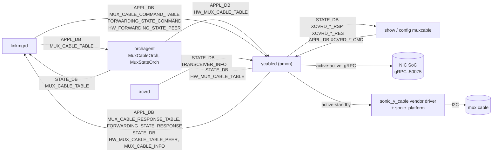

A switchover runs through every component in the loop:

1. linkmgrd writes the target state to APPL_DB `MUX_CABLE_TABLE`.
2. orchagent's `MuxCableOrch` reprograms neighbors and routes, then writes APPL_DB `HW_MUX_CABLE_TABLE`.
3. ycabled applies the state to the mux cable or the SoC and writes STATE_DB `HW_MUX_CABLE_TABLE`.
4. orchagent's `MuxStateOrch` reconciles it and writes STATE_DB `MUX_CABLE_TABLE`, which linkmgrd reads.

### 3.2 Threads and lifecycle

| Thread | Started | Waits on | Work |
| --- | --- | --- | --- |
| main (`DaemonYcable`) | always | stop event, 60 s timeout | Initializes every mux port, as for a cable insertion ([Section 3.3.7](#337-cable-insertion-and-removal)). Every 60 s, checks that the threads are alive; if one has ended it SIGKILLs its own process. |
| `YcableInfoUpdateTask` | always | 60 s timer | `MUX_CABLE_INFO` of every mux port, one after another, unless telemetry is disabled |
| `YcableStateUpdateTask` | always | STATE_DB `TRANSCEIVER_INFO` (select, 100 ms timeout) | Cable insertion and removal |
| `YCableTableUpdateTask` | if any mux cable is found at startup | APPL_DB `HW_MUX_CABLE_TABLE`, `MUX_CABLE_COMMAND_TABLE`, `FORWARDING_STATE_COMMAND`, `HW_FORWARDING_STATE_PEER` (select, 1 s) | Toggles, probes and peer toggles, one at a time |
| `YCableCliUpdateTask` | if any mux cable is found at startup | CONFIG_DB `XCVRD_LOG` and 14 APPL_DB `XCVRD_*_CMD` tables (select, 1 s) | CLI commands, one at a time. A firmware download runs in a new thread per port. |
| `YCableAsyncNotificationTask` | if any port is active-active | asyncio event loop | One GracefulRestart stream per port with a SoC IP |
| grpcio internal threads | one or more per channel | | Connectivity polling, and the `wait_for_state_change` callback |

### 3.3 Workflows

#### 3.3.1 Active-standby toggle

1. orchagent writes APPL_DB `HW_MUX_CABLE_TABLE:<port>` `state` = `active` or `standby`.
2. ycabled reads `read_side` from STATE_DB `HW_MUX_CABLE_TABLE` and calls `toggle_mux_to_tor_a()` (upper ToR) or `toggle_mux_to_tor_b()` (lower ToR): active with read_side 1 means the upper ToR, active with read_side 2 means the lower ToR, and standby means the other one. If read_side is not 1 or 2, it calls `get_read_side()` first.
3. It writes STATE_DB `MUX_METRICS_TABLE` `xcvrd_switch_<state>_start` and `_end`, then STATE_DB `HW_MUX_CABLE_TABLE` `state`, `read_side` and `active_side`. The mux direction is not read back after the toggle.
   - **Success:** `state` is the requested state, `active_side` the side the mux was toggled to (1 for the upper ToR, 2 for the lower ToR), and `read_side` is unchanged.
   - **Failure:** the driver returns anything but `True`, raises, or the port has no driver. `state` is `unknown`, in the metrics field names too (`xcvrd_switch_unknown_start` and `_end`), and `active_side` is -1. `read_side` keeps its value, unless the cable is absent or its read side had to be read again and could not be; then it is -1 too. Nothing is retried.

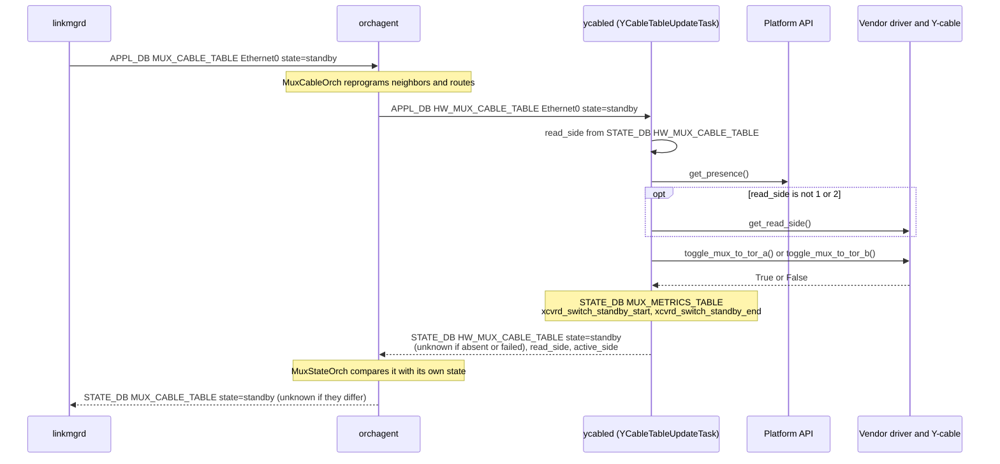

#### 3.3.2 Active-standby probe

linkmgrd writes APPL_DB `MUX_CABLE_COMMAND_TABLE:<port>` `command=probe`. ycabled reads `read_side` from STATE_DB `HW_MUX_CABLE_TABLE`, calls `get_mux_direction()`, and writes APPL_DB `MUX_CABLE_RESPONSE_TABLE` `response`:

- **Success:** the direction is 1 or 2. `response` is `active` if it equals read_side, `standby` if not.
- **Failure:** the cable is absent, the port has no driver, or `get_mux_direction()` raises or returns anything but 1 or 2. `response` is `unknown`. Nothing is retried.
- **Read side not 1 or 2:** 0 (the NIC side) or -1 (not readable) never equals the direction, so `response` is `standby` (issue 31 in [Section 3.7](#37-known-issues)).
- **Ignored:** a command other than `probe`, or a port without a STATE_DB `HW_MUX_CABLE_TABLE` entry. Nothing is written.

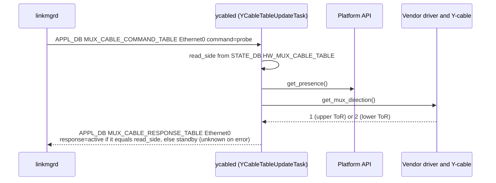

#### 3.3.3 Active-active toggle (self and peer)

- **Self:** APPL_DB `HW_MUX_CABLE_TABLE:<port>` `state` → `SetAdminForwardingPortState(portid=[read_side], state=[1 or 0])`, with read_side from STATE_DB `HW_MUX_CABLE_TABLE`.
- **Peer:** APPL_DB `HW_FORWARDING_STATE_PEER:<port>` `state` → the same with `portid=[1 - read_side]`, with read_side from STATE_DB `HW_MUX_CABLE_TABLE_PEER`.
- **Written:** STATE_DB `MUX_METRICS_TABLE` `xcvrd_switch_self_<state>_start` and `_end` (`peer` for a peer toggle), then `state`, `read_side` and `active_side` in the STATE_DB table read_side came from. `read_side` is written back unchanged. Unlike active-standby, `active_side` is the state the SoC reports, not a side number.
- **Success:** the reply names the requested port id. `state` is the requested state, and `active_side` the reported one, `active` or `standby`. If the SoC reports the opposite of the request, `state` is still the requested one.
- **Failure:** the RPC fails or reaches its 0.5 s deadline, or the reply is empty or names another port id. `state` and `active_side` are `unknown`, in the metrics field names too (`xcvrd_switch_self_unknown_start` and `_end`). Nothing is retried.
- **No channel:** ycabled tries once to set it up again. If that fails, it writes the same as for a failed RPC, without calling the SoC.
- **Read side -1** (no usable Loopback3): the request still goes to the SoC, with port id -1, or 2 for the peer (issue 30).
- **Ignored:** a state other than `active` or `standby`, or a port without an entry in the table. Nothing is written.

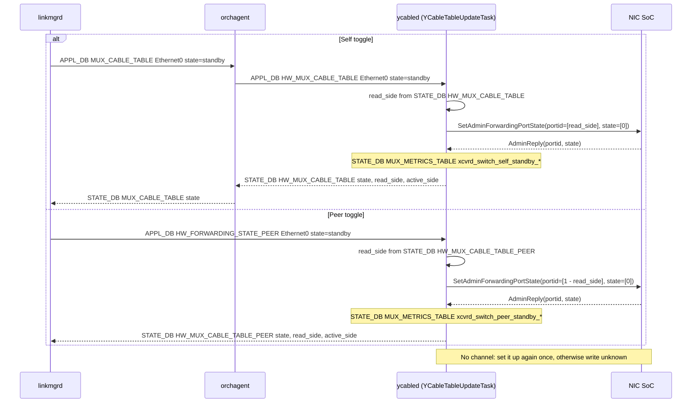

Because one thread handles every port, a SoC that does not answer delays the toggles of the other ports:

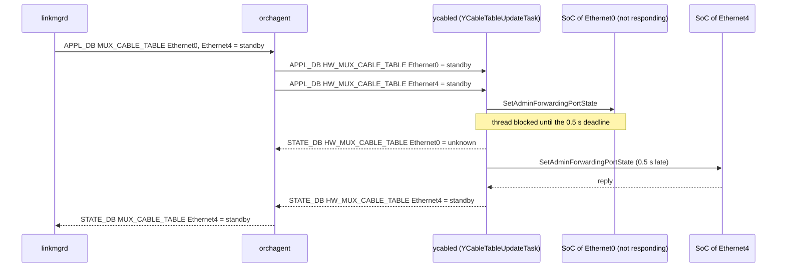

#### 3.3.4 Active-active forwarding state probe

linkmgrd writes APPL_DB `FORWARDING_STATE_COMMAND:<port>` `command=probe`. ycabled reads `read_side` from STATE_DB `HW_MUX_CABLE_TABLE`, calls `QueryAdminForwardingPortState(portid=[0, 1], state=[0, 0])`, and writes APPL_DB `FORWARDING_STATE_RESPONSE` `response` for this ToR and `response_peer` for the peer:

- **Success:** the reply has two port ids and two states. `response` is `active` if `state[read_side]` is true and `standby` if it is false, and `response_peer` likewise from `state[1 - read_side]`. The port ids in the reply are not checked.
- **Failure:** the RPC fails or reaches its 0.5 s deadline, or the reply does not have two port ids and two states. Both are `unknown`. Nothing is retried.
- **No channel:** ycabled tries once to set it up again. If that fails, both are `unknown`, without calling the SoC.
- **Read side -1** (no usable Loopback3): the RPC is still made, and both are `unknown`.
- **Probe counters:** every RPC, successful or not, increments the counters that telemetry publishes in `MUX_CABLE_INFO`.
- **Ignored:** a command other than `probe`, or a port without a STATE_DB `HW_MUX_CABLE_TABLE` entry. Nothing is written.

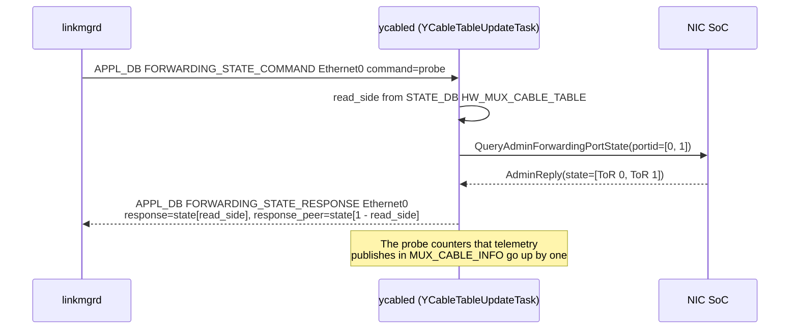

#### 3.3.5 gRPC channel lifecycle

- **Target:** `soc_ipv4` from `MUX_CABLE`, or `soc_ipv6` if there is no IPv4 address, without the prefix length. IPv6 is written as `[addr]:50075`.
- **Creation:** channels are created at startup, when a cable is inserted, and by a toggle or probe of a port without one, which tries once. They are not recreated when CONFIG_DB changes.
- **Connectivity:** a callback records every state change (`READY`, `CONNECTING`, `IDLE`, `TRANSIENT_FAILURE`, `SHUTDOWN`) for `MUX_CABLE_INFO.grpc_connection_status`. On `TRANSIENT_FAILURE` or `IDLE` it also writes APPL_DB `FORWARDING_STATE_RESPONSE` `response=failure`, which linkmgrd handles as a connection failure.

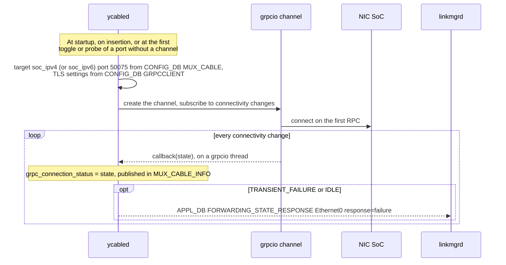

#### 3.3.6 GracefulRestart

For each `MUX_CABLE` port with a SoC address (active-standby ports too, once any port is active-active), ycabled calls `NotifyGracefulRestartStart(tor)`, with `tor` = `UPPER_TOR` if read_side is 0 and `LOWER_TOR` otherwise, and reads the stream. When the stream ends, it waits `period` seconds from the last response (20 s if there was none or the call failed) and subscribes again. Responses are only logged; nothing is written to the DB.

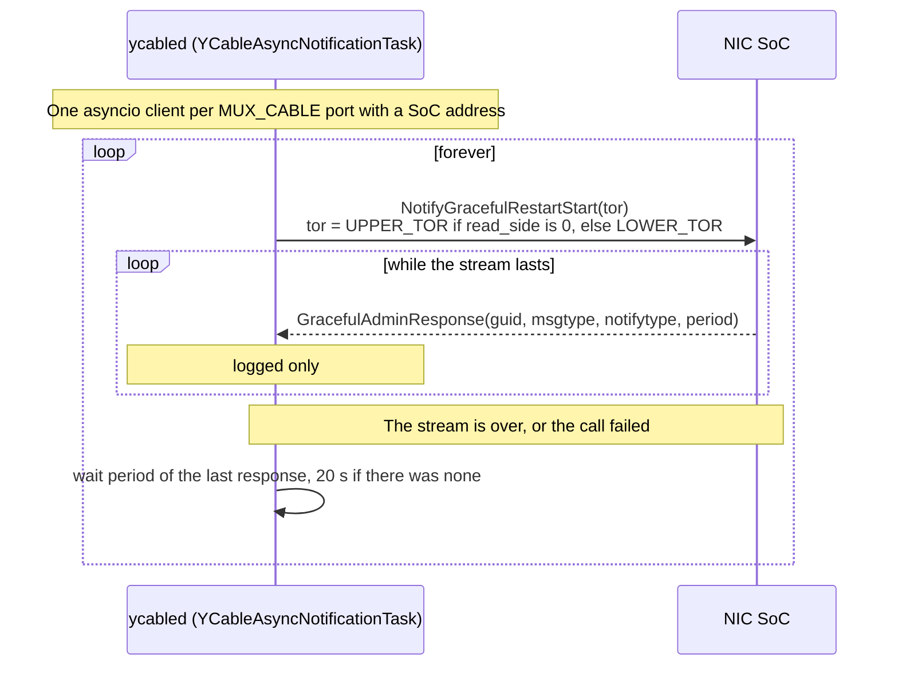

#### 3.3.7 Cable insertion and removal

ycabled subscribes to STATE_DB `TRANSCEIVER_INFO`, written by xcvrd:

- **SET (inserted):** ignored if the port's driver is already initialized ([#882](https://github.com/sonic-net/sonic-platform-daemons/pull/882)); otherwise the port is initialized as at startup, with its cable type read again from CONFIG_DB `MUX_CABLE`.
- **DEL (removed):** STATE_DB `HW_MUX_CABLE_TABLE` gets `state=unknown` and `active_side=-1`, and the driver instance is dropped. `MUX_CABLE_INFO` and `MUX_CABLE_STATIC_INFO` are kept.

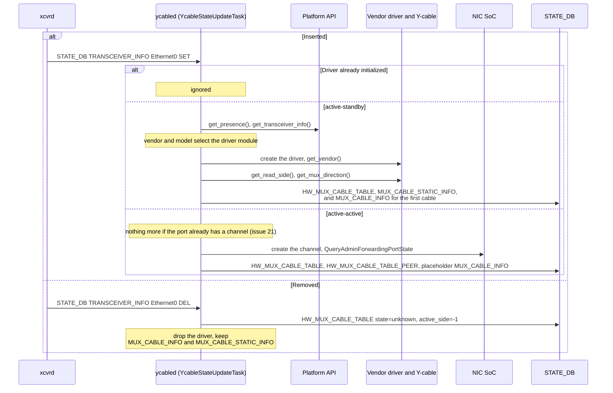

#### 3.3.8 Telemetry

Every 60 s after the previous pass ends, for every port whose `MUX_CABLE.state` is valid, unless `XCVRD_LOG|Y_CABLE.disable_telemetry` is `True`:

- **active-standby:** 27 `MUX_CABLE_INFO` fields from the vendor driver (mux direction, switch counts, eye heights, temperatures, voltages, link status, firmware versions). If the port has no driver, nothing is written, and ERR "Error: Could not get port instance for muxcable info for Y cable port \<port\>" is logged. While a firmware download runs on the port, the firmware versions are copied from what `MUX_CABLE_INFO` already holds instead of being read from the cable; the other fields are still read from the cable.
- **active-active:** 4 RPCs (`QueryLinkState`, `QueryOperationPortState`, `QueryAdminForwardingPortState`, `QueryServerVersion`) fill 15 `MUX_CABLE_INFO` fields. The probe counters written are the counts before this pass, `unknown` until the first query of that kind.
- **Cable absent (either type):** the 27 active-standby fields are written with placeholder values (`unknown` or `N/A`).

`MUX_CABLE_STATIC_INFO` (read_side and 30 cursor values, active-standby only) is written at initialization only.

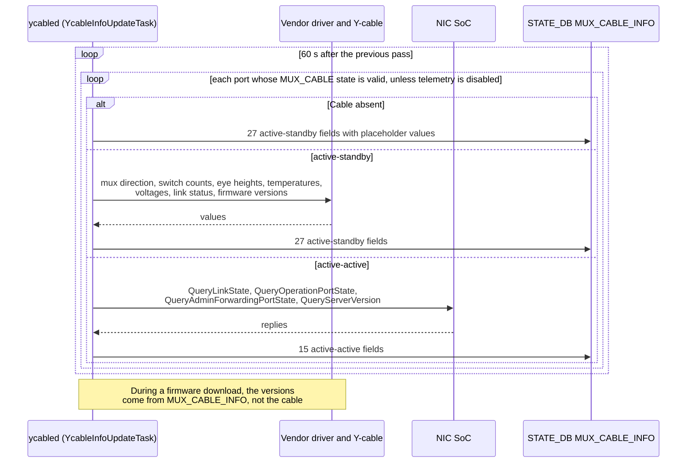

#### 3.3.9 CLI commands

1. The CLI deletes old entries in the command, argument, response and result tables of the command.
2. For some commands, it writes the arguments to APPL_DB `<CMD>_ARG:<port>`.
3. It writes APPL_DB `<CMD>:<port>` with `<command field>=<value>`.
4. It waits on STATE_DB `<RSP>|<port>` for the response field, with a timeout of 1 s to 1000 s depending on the command.
5. ycabled calls the vendor driver. For an active-active `hwmode muxdirection` it answers the state it last published in STATE_DB `HW_MUX_CABLE_TABLE`, and asks the SoC only if there is none. It writes any result rows to STATE_DB `<RES>|<port>`, then the response field, then deletes the command key.

**Firmware versions during a download:** the vendor driver sets its `download_firmware_status` attribute to in progress when `download_firmware()` starts, and to finished or failed when it ends; ycabled only reads it. While it is in progress, `show muxcable firmware version` and telemetry ([Section 3.3.8](#338-telemetry)) do not call `get_firmware_version()`. They answer the nine `version_<nic|self|peer>_<active|inactive|next>` fields from STATE_DB `MUX_CABLE_INFO`: `N/A` if the port has no entry, `None` for a missing field. The values are therefore those of the last telemetry pass before the download. The command still reads the read side from the cable, to tell self from peer. Once the download has finished or failed, versions are read from the cable again; a failed download is also logged at ERR.

The command tables are listed in [Section 3.5.5](#355-cli-command-tables).

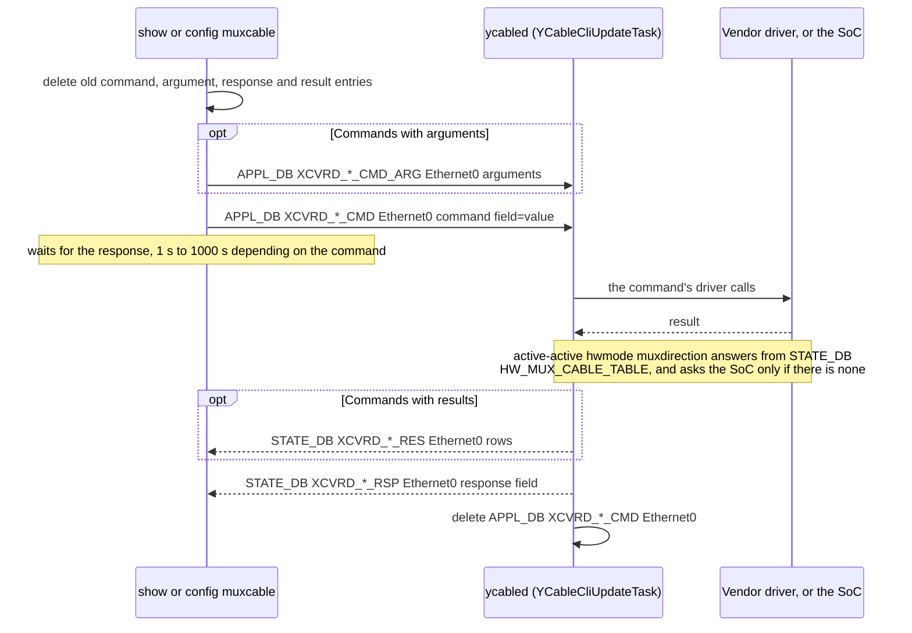

#### 3.3.10 Runtime knobs

CONFIG_DB `XCVRD_LOG|Y_CABLE`:

- `log_verbosity` = `debug` or `notice` sets the log level.
- `disable_telemetry` = `True` or `False` stops or resumes telemetry. It is written by `config muxcable telemetry`.

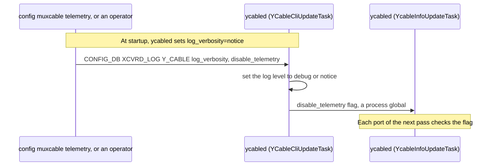

### 3.4 External interfaces

#### 3.4.1 SoC gRPC service

| RPC | Request | Used for | Deadline |
| --- | --- | --- | --- |
| `DualToRActive.QueryAdminForwardingPortState` | `AdminRequest{portid: [0, 1], state: [0, 0]}` | Initial state, forwarding state probe, telemetry, `show muxcable hwmode muxdirection` | 0.5 s |
| `DualToRActive.SetAdminForwardingPortState` | `AdminRequest{portid: [side], state: [1 or 0]}` | Self and peer toggles | 0.5 s |
| `DualToRActive.QueryOperationPortState` | `OperationRequest{portid: [0, 1]}` | Telemetry | 0.5 s |
| `DualToRActive.QueryLinkState` | `LinkStateRequest{portid: [0, 1]}` | Telemetry | 0.5 s |
| `DualToRActive.QueryServerVersion` | `ServerVersionRequest{version: "1.0"}` | Telemetry | 0.5 s |
| `GracefulRestart.NotifyGracefulRestartStart` | `GracefulAdminRequest{tor}`, server stream of `GracefulAdminResponse` | Logging only | none |

- **Channel options:** keepalive every 4 s, keepalive timeout 8 s, keepalive without calls, unlimited pings without data.
- **TLS:** `GRPCCLIENT|config` `type=secure` uses the files in `GRPCCLIENT|certs`. `auth_level=server` verifies the server with `ca_crt`; `auth_level=mutual` also presents `client_crt` and `client_key`. `grpc_ssl_credential` overrides the TLS target name. With `type=insecure`, or no `config` key, the channel is plaintext.
- **read_side:** the reply index of this ToR comes from hard-coded Loopback3 addresses (`process_loopback_interface_and_get_read_side`):

| CONFIG_DB `LOOPBACK_INTERFACE` key | read_side | ToR | This ToR in replies | Peer in replies | GracefulRestart `tor` |
| --- | :---: | --- | :---: | :---: | --- |
| `Loopback3\|10.212.64.2/32` or `Loopback3\|10.1.0.39/32` | 0 | lower | `state[0]` | `state[1]` | `UPPER_TOR` |
| `Loopback3\|10.212.64.1/32` or `Loopback3\|10.1.0.38/32` | 1 | upper | `state[1]` | `state[0]` | `LOWER_TOR` |
| anything else | -1 | unknown | `unknown` | `unknown` | `LOWER_TOR` |

On an active-standby cable, the upper ToR reads read_side 1 and the lower ToR 2. sonic-mgmt makes the first ToR of the testbed file the upper one and gives it the first Loopback3 address, 10.1.0.38 (`dual_tor_facts.py`), and its NIC simulator answers for the upper ToR at port id 1. Lab testbeds agree: the 10.1.0.38 ToR reads 1 from active-standby cables and gets read_side 1 with active-active ones. Python's GracefulRestart `tor` is the other way round: the lower ToR sends `UPPER_TOR` ([Section 9](#9-open-questions), question 9).

#### 3.4.2 Vendor Y-cable drivers

- **Where they live:** sonic-platform-common `sonic_y_cable`. `YCableBase` defines 60 methods. The vendor drivers are Credo (`credo.y_cable_credo`), Molex cables with `broadcom.y_cable_broadcom`, and the simulated driver for test (`microsoft.y_cable_simulated`, which talks HTTP to the mux simulator).
- **Hardware access:** drivers do their own I/O through `sonic_platform`: `Platform().get_chassis().get_sfp(port).read_eeprom()` and `write_eeprom()`.
- **Selection:**
  1. Read manufacturer and model from the platform API, then lower-case and strip them.
  2. If `/etc/sonic/mux_simulator.json` exists, use `microsoft` and `simulated` instead.
  3. Look up `y_cable_vendor_mapping.mapping[vendor][model]`, import `sonic_y_cable.<module>` and create `YCable(physical_port, logger)`.
  4. The driver's `get_vendor()` must match; otherwise the port is reported `unknown`.
- **Methods used by ycabled:**
  - toggles: `toggle_mux_to_tor_a`, `toggle_mux_to_tor_b`
  - state: `get_read_side`, `get_mux_direction`, `get_active_linked_tor_side`, `is_link_active`, `get_switch_count_total`
  - signal quality: eye, BER, FEC and PCS
  - temperatures and voltages
  - firmware: version, download, activate, rollback, download status
  - switching mode, PRBS, loopback, ANLT, FEC mode, event log
  - health check, reset cause, operation time, queue info, debug dump

#### 3.4.3 Platform API

- **Presence:** `chassis.get_sfp(i).get_presence()`. Always true on VS.
- **Transceiver info:** `chassis.get_sfp(i).get_transceiver_info()`. Empty on VS.
- **Fallback:** if either raises `NotImplementedError`, ycabled calls `get_presence()` or `get_transceiver_info_dict()` on its sfputil object. Only the legacy sfputil plugin, loaded when the platform API is not, has these methods. With the platform API loaded, the object is `SfpUtilHelper`, which has neither, so the call raises.
- **Port mapping:** `SfpUtilHelper` reads CONFIG_DB `PORT` (`index`) through sonic-config-engine's `get_port_config`, and `port_config.ini` only if `PORT` is empty.

### 3.5 DB schema

#### 3.5.1 CONFIG_DB (read)

| Table | Key | Field | Description |
| --- | --- | --- | --- |
| MUX_CABLE | \<PORT\> | state | `auto`, `manual`, `detach`, `active` or `standby`. The port is handled only if `state` is one of these. |
| | | cable_type | `active-standby` (default) or `active-active` |
| | | soc_ipv4, soc_ipv6 | SoC address with prefix length. IPv4 is preferred. |
| GRPCCLIENT | config | type | `secure` or `insecure` |
| | | auth_level | `server` or `mutual` in ycabled; the YANG model allows `server` or `client` (issue 7 in [Section 3.7](#37-known-issues)) |
| GRPCCLIENT | certs | ca_crt, client_crt, client_key | Certificate and key file paths |
| | | grpc_ssl_credential | TLS target name override |
| LOOPBACK_INTERFACE | Loopback3\|\<ip\>/\<len\> | | Gives read_side ([Section 3.4.1](#341-soc-grpc-service)) |
| DEVICE_METADATA | localhost | platform | Detects VS |
| PORT | \<PORT\> | index | Port map ([Section 3.4.3](#343-platform-api)) |
| CONFIG_DB_INITIALIZED | (plain key) | | Waited for at startup, through `sonic_py_common` |
| XCVRD_LOG | Y_CABLE | log_verbosity, disable_telemetry | Runtime knobs, subscribed ([Section 3.3.10](#3310-runtime-knobs)) |

ycabled also writes to CONFIG_DB. At every start it sets `XCVRD_LOG|Y_CABLE` `log_verbosity=notice`, and copies the `GRPCCLIENT` fields from `/etc/sonic/grpc_secrets.json` that CONFIG_DB lacks.

#### 3.5.2 APPL_DB

| Table | Key | Field | Direction | Description |
| --- | --- | --- | --- | --- |
| HW_MUX_CABLE_TABLE | \<PORT\> | state | in, from orchagent | `active` or `standby`: set this ToR's side |
| HW_FORWARDING_STATE_PEER | \<PORT\> | state | in, from linkmgrd | `active` or `standby`: set the peer's side (active-active) |
| MUX_CABLE_COMMAND_TABLE | \<PORT\> | command | in, from linkmgrd | `probe` (active-standby) |
| FORWARDING_STATE_COMMAND | \<PORT\> | command | in, from linkmgrd | `probe` (active-active); ycabled ignores other values |
| MUX_CABLE_RESPONSE_TABLE | \<PORT\> | response | out, to linkmgrd | `active`, `standby` or `unknown` |
| FORWARDING_STATE_RESPONSE | \<PORT\> | response, response_peer | out, to linkmgrd | `active`, `standby` or `unknown`. `response` is `failure` when the channel goes to `TRANSIENT_FAILURE` or `IDLE`. |
| XCVRD_\*_CMD, XCVRD_\*_CMD_ARG | \<PORT\> | | in, from the CLI | [Section 3.5.5](#355-cli-command-tables) |

#### 3.5.3 STATE_DB

| Table | Key | Field | Direction | Description |
| --- | --- | --- | --- | --- |
| TRANSCEIVER_INFO | \<PORT\> | | in, from xcvrd | SET means inserted, DEL means removed |
| HW_MUX_CABLE_TABLE | \<PORT\> | state | out, to orchagent | `active`, `standby` or `unknown` |
| | | read_side | | active-standby: `1`, `2` or `-1` (`0` if the cable reports the NIC side, then `state` is `standby`). active-active: `0`, `1` or `-1` |
| | | active_side | | active-standby: `0` (no ToR), `1`, `2` or `-1`. active-active: `active`, `standby` or `unknown`, and `-1` after a cable removal, as for active-standby |
| HW_MUX_CABLE_TABLE_PEER | \<PORT\> | state, read_side, active_side | out, to linkmgrd | The peer's side, active-active only |
| MUX_CABLE_INFO | \<PORT\> | [Section 3.5.4](#354-mux_cable_info-and-mux_cable_static_info) | out, to linkmgrd, CLI and telemetry | Cable or SoC telemetry |
| MUX_CABLE_STATIC_INFO | \<PORT\> | [Section 3.5.4](#354-mux_cable_info-and-mux_cable_static_info) | out, to the CLI | active-standby only |
| MUX_METRICS_TABLE | \<PORT\> | xcvrd_switch_\<state\>_start, _end | out, to the CLI | active-standby toggle timestamps |
| | | xcvrd_switch_\<self or peer\>_\<state\>_start, _end | | active-active toggle timestamps |
| XCVRD_\*_RSP, XCVRD_\*_RES | \<PORT\> | | out, to the CLI | [Section 3.5.5](#355-cli-command-tables) |

Timestamps are UTC in the format `%Y-%b-%d %H:%M:%S.%f`, e.g. `2026-Nov-04 10:43:04.123456`.

#### 3.5.4 MUX_CABLE_INFO and MUX_CABLE_STATIC_INFO

| Table | Cable type | Fields |
| --- | --- | --- |
| MUX_CABLE_INFO | active-standby (27) | tor_active, time_post, mux_direction, manual_switch_count, auto_switch_count, link_status_self, link_status_peer, link_status_nic, {self, peer, nic}\_eye_height_lane{1, 2}, internal_temperature, internal_voltage, nic_temperature, nic_voltage, version\_{self, peer, nic}\_{active, inactive, next} |
| MUX_CABLE_INFO | active-active (15) | time_post, self_link_state, peer_link_state, self_oper_state, peer_oper_state, self_mux_direction, peer_mux_direction, server_version, grpc_connection_status, mux_direction_probe_count, peer_mux_direction_probe_count, link_state_probe_count, peer_link_state_probe_count, operation_state_probe_count, peer_operation_state_probe_count |
| MUX_CABLE_STATIC_INFO | active-standby (31) | read_side (`tor1`, `tor2` or `-1`), {nic, tor_self, tor_peer}\_lane{1, 2}\_{precursor1, precursor2, maincursor, postcursor1, postcursor2} |

The writes merge fields into the key (`HSET`), and nothing removes old fields. An active-active port's key therefore holds both sets: ycabled writes the 27 active-standby fields with placeholder values at initialization (`post_port_mux_info_to_db(..., 'pseudo-cable')` in `check_identifier_presence_and_setup_channel`), and telemetry adds the 15 active-active fields. Rust ycabled must write the same fields (C1).

Readers include:

- linkmgrd: `link_status_peer` (active-standby)
- `show muxcable`: firmware versions, `self_mux_direction`, `peer_mux_direction`, `grpc_connection_status`
- streaming telemetry

#### 3.5.5 CLI command tables

Command and argument tables are in APPL_DB; response and result tables are in STATE_DB. `show muxcable hwmode muxdirection` also works on active-active ports; every other command needs a vendor driver.

| CLI | Command table: field | Argument table | Calls | Response table: field | Result table |
| --- | --- | --- | --- | --- | --- |
| show muxcable hwmode muxdirection | XCVRD_SHOW_HWMODE_DIR_CMD: state | | `get_read_side`, `get_mux_direction`; active-active: the published `HW_MUX_CABLE_TABLE` state, `QueryAdminForwardingPortState` only if there is none | XCVRD_SHOW_HWMODE_DIR_RSP: state | XCVRD_SHOW_HWMODE_DIR_RES |
| config muxcable hwmode state | XCVRD_CONFIG_HWMODE_DIR_CMD: config | | `get_read_side`, `toggle_mux_to_tor_a`, `toggle_mux_to_tor_b` | XCVRD_CONFIG_HWMODE_DIR_RSP: result | |
| show muxcable hwmode switchmode | XCVRD_SHOW_HWMODE_SWMODE_CMD: state | | `get_switching_mode` | XCVRD_SHOW_HWMODE_SWMODE_RSP: state | |
| config muxcable hwmode setswitchmode | XCVRD_CONFIG_HWMODE_SWMODE_CMD: config | | `set_switching_mode` | XCVRD_CONFIG_HWMODE_SWMODE_RSP: result | |
| show muxcable firmware version | XCVRD_SHOW_FW_CMD: firmware_version | | `get_firmware_version` (self, peer, NIC) | XCVRD_SHOW_FW_RSP: status | XCVRD_SHOW_FW_RES |
| config muxcable firmware download | XCVRD_DOWN_FW_CMD: download_firmware | | `download_firmware`, in its own thread | XCVRD_DOWN_FW_RSP: status | |
| config muxcable firmware activate | XCVRD_ACTI_FW_CMD: activate_firmware | XCVRD_ACTI_FW_CMD_ARG | `activate_firmware` | XCVRD_ACTI_FW_RSP: status | |
| config muxcable firmware rollback | XCVRD_ROLL_FW_CMD: rollback_firmware | | `rollback_firmware` | XCVRD_ROLL_FW_RSP: status | |
| config muxcable prbs, reset, set_anlt, set_fec | XCVRD_CONFIG_PRBS_CMD: config_prbs | XCVRD_CONFIG_PRBS_CMD_ARG | `enable_prbs_mode`, `disable_prbs_mode`, `reset`, `set_anlt`, `set_fec_mode` | XCVRD_CONFIG_PRBS_RSP: status | |
| config muxcable loopback | XCVRD_CONFIG_LOOP_CMD: config_loop | XCVRD_CONFIG_LOOP_CMD_ARG | `enable_loopback_mode`, `disable_loopback_mode` | XCVRD_CONFIG_LOOP_RSP: status | |
| show muxcable event_log | XCVRD_EVENT_LOG_CMD: show_event | | `get_event_log` | XCVRD_EVENT_LOG_RSP: status | XCVRD_EVENT_LOG_RES |
| show muxcable get_fec_anlt_speed | XCVRD_GET_FEC_CMD: get_fec | | `get_fec_mode`, `get_anlt`, `get_speed` | XCVRD_GET_FEC_RSP: status | XCVRD_GET_FEC_RES |
| show muxcable berinfo, eyeinfo, fecstatistics, pcsstatistics, alivecablestatus, health, resetcause, operationtime, queueinfo, debugdumpregisters | XCVRD_GET_BER_CMD: get_ber | XCVRD_GET_BER_CMD_ARG (`mode` selects the call) | `get_ber_info`, `get_eye_heights`, `get_fec_stats`, `get_pcs_stats`, `get_alive_status`, `health_check`, `reset_cause`, `operation_time`, `queue_info`, `debug_dump_registers` | XCVRD_GET_BER_RSP: status | XCVRD_GET_BER_RES |

### 3.6 Existing tests

- **Files:** `tests/test_y_cable_helper.py` (7929 lines), `tests/test_ycable.py` (556) and `tests/test_grpc_ipv6.py` (162).
- **Results:** 306 tests pass with 81% line coverage (with a stub swsscommon). 27 more test functions never run because another test in the same class has the same name.
- **Limitation:** the tests patch internals (`MagicMock` for swsscommon, gRPC stubs and drivers), so they cannot run against another implementation.
- **Black-box tests:** `sonic-ycabled/blackbox` runs the daemon against a real redis. 307 tests pass and 29 are expected failures (27 for 25 known issues, and 2 for the N1 and N3 targets), with 87% line and branch coverage. The pipeline runs them with the unit tests, which together cover 95% of ycabled's statements ([Section 6.3](#63-black-box-component-tests)).
- **System tests:** sonic-mgmt covers ycabled indirectly through `tests/dualtor`, `tests/dualtor_io` and `tests/dualtor_mgmt`. `test_switchover_faulty_ycable.py` replaces the simulated driver and restarts ycabled.

### 3.7 Known issues

Issues keep their numbers in the tables below, which group them by how they were found ([Sections 3.7.1](#371-found-by-reading-the-code) to [3.7.4](#374-found-by-reviewing-the-unit-tests)) or, for cable changes after startup, by trigger ([Section 3.7.5](#375-cable-insertion-and-removal-after-startup)). ycabled-rs has the fixes of the issues in the daemon's code ([Section 4.5](#45-deliberate-behavior-differences)); whether Python gets them is open question 4 ([Section 9](#9-open-questions)).

Each table lists its issues by priority:

- **P0:** ycabled stops serving every port (it exits, restarts in a loop or deadlocks) after a trigger that occurs in normal operation: a cable error, a state orchagent writes, or a missing TLS file. Issues 17, 18, 20 and 24.
- **P1:** a port gets a wrong state or is not served; or every port is, but only after an uncommon trigger (a misconfiguration, an unusual CLI command, a cable or `MUX_CABLE` change after startup); or the logs that tests rely on are wrong. Issues 2, 3, 5, 15, 16, 19, 21, 26 to 28 and 30 to 32.
- **P2:** no effect on toggles, probes or the state of a working port. The other 15 issues.

#### 3.7.1 Found by reading the code

| # | Priority | Issue | Where | Impact | Proposal |
| :---: | :---: | --- | --- | --- | --- |
| 2 | P1 | The syslog identity changes with import order. `openlog` is process-wide, and any module that creates a `Logger` later replaces `ycable`; for example `sonic_platform_base/bmc_base.py`. | `sonic_py_common` logger | ycabled messages appear as `pmon#bmc_base`, and sonic-mgmt's `pmon#ycable` ignore rules do not match them | Rust uses a fixed identity. Raise the problem separately for the Python daemons. |
| 3 | P1 | `logical_port_name` undefined in an error path | `get_muxcable_info_for_active_active` | `NameError` ends the telemetry thread, and the process is killed within 60 s, after every restart while the port has no SoC address | Fix in Python |
| 1 | P2 | SIGTERM never completes. `run()` joins worker threads whose stop events are never set. | `ycable.py` `run()` | Every stop waits until supervisord or the container kills the process. `deinit()` never runs. | Rust exits in ≤ 2 s and keeps the tables (C7). A Python fix must keep them too, so it cannot simply let `deinit()` run. |
| 4 | P2 | `peer_eye_height_lane2` is written from lane 1 | `post_port_mux_info_to_db` | Wrong telemetry value | Fix in Python |
| 6 | P2 | `break` instead of `continue` for a port that is not active-active | `YCableTableUpdateTask` | None observed. The entries after that port stay in the subscriber's buffer, and are handled one more pass of the loop later: swsscommon's `Select` keeps a subscriber with more than one entry pending in its ready set, so the next `select()` returns it at once. | Fix in Python |
| 7 | P2 | `auth_level` values differ: `server` or `client` in YANG, `server` or `mutual` in the code | `get_grpc_credentials`, `sonic-grpcclient.yang` | Mutual TLS needs a value YANG rejects | Align the two ([Section 9](#9-open-questions)) |
| 8 | P2 | `XCVRD_LOG\|Y_CABLE.disable_telemetry` is missing from YANG | `sonic-xcvrd-log.yang` | YANG validation rejects what `config muxcable telemetry` writes | Add it to the YANG model |
| 9 | P2 | The global `GRPC_CLIENT_OPTIONS` list gets another target-name override for every secure channel, and insecure channels are created with it too | `create_channel` | The option list grows with the number of channels. No other effect is observable, because every secure channel has the same target name and insecure channels ignore it. | Fix in Python |
| 10 | P2 | `XCVRD_DOWN_FW_STATUS_CMD` is in the select set but never popped, and nothing writes it | `YcableCliUpdateTableHelper`, `YCableCliUpdateTask` | Dead. A write would make select return it on every call. | Remove |
| 11 | P2 | Dead code: `setup_grpc_channels` has no caller, and `hook_grpc_nic_simulated` uses undefined names | `y_cable_helper.py` | | Remove |
| 12 | P2 | 27 tests never run because of duplicate names | `tests/` | Lost coverage | Rename |
| 13 | P2 | 124 Redis connections on a 24-port KVM DUT; 166 with 16 active-active ports in the black-box tests | measured | The count grows with the number of active-active ports | Rust: bounded (N5). Attribute the Python count on a physical testbed. |
| 14 | P2 | `nice -n -20` fails: "cannot set niceness: Permission denied" | supervisord log, KVM | The intended high priority is not applied, at least on KVM | Check on hardware |

#### 3.7.2 Found by the black-box tests

Issues 18 and 24 also occur when a cable is inserted after startup.

| # | Priority | Issue | Where | Impact | Proposal |
| :---: | :---: | --- | --- | --- | --- |
| 17 | P0 | An active-standby toggle request with a state other than `active` or `standby` | `y_cable_helper.py` `toggle_mux_direction` | orchagent writes `init` after a failed first switch; `TypeError` ends the toggle thread | Ignore other states, as for active-active |
| 18 | P0 | An exception from a vendor driver's constructor is not caught | `check_identifier_presence_and_update_mux_table_entry` | ycabled exits at startup; at insertion the thread dies | Fix in Python |
| 20 | P0 | A secure `GRPCCLIENT` config that yields no channel (missing file, target name or client key) gives the GracefulRestart task a `None` channel | `YCableAsyncNotificationTask` | The task dies and the process is killed within 60 s, after every restart | Fix in Python |
| 24 | P0 | After a `get_vendor()` exception, the port lock is taken again while it is held | `check_identifier_presence_and_update_mux_table_entry` → `read_y_cable_and_update_statedb_port_tbl` | Startup deadlocks: no port is published or served, while supervisord sees a running process. A transient EEPROM error at boot is enough. At insertion, the insertion thread deadlocks instead, and no later insertion or removal of any port is handled. | Fix in Python |
| 19 | P1 | `config muxcable firmware rollback` for a port without a driver takes a lock that does not exist | `handle_config_firmware_roll_cmd_arg_tbl_notification` | After answering, `KeyError` ends the CLI thread | Fix in Python |
| 23 | P2 | Multi-ASIC: namespace connections are opened before `SonicDBConfig.initializeGlobalConfig()`, and the default namespace `''` is resolved to an ASIC index | `ycable.py` `DaemonYcable.__init__`; `apply_grpc_secrets_configuration`, `wait_for_state_change`, `process_loopback_interface_and_get_read_side` and `delete_ports_status_for_y_cable` | ycabled cannot start on a multi-ASIC platform | Rust keeps the namespaces; fix Python only if multi-ASIC dual ToR is planned |
| 25 | P2 | `XCVRD_LOG` changes are handled as key `Y_CABLE`, whatever their key | `YCableCliUpdateTask` | The fields of any `XCVRD_LOG` key set the log level and the telemetry flag | Fix in Python |

#### 3.7.3 State the threads share

Found by a review of the state ycabled's threads share. Issues 27 to 29, found by the same review, are in [Section 3.7.5](#375-cable-insertion-and-removal-after-startup).

| # | Priority | Issue | Where | Impact | Proposal |
| :---: | :---: | --- | --- | --- | --- |
| 26 | P1 | Active-standby toggles and probes call the cable without the port lock, which insertion, telemetry and the CLI take | `y_cable_toggle_mux_torA`, `y_cable_toggle_mux_torB` and `toggle_mux_tor_direction_and_update_read_side` (toggle), `update_appdb_port_mux_cable_response_table` (probe) | A toggle or probe interleaves its cable access with another thread's call to the same cable, unless the vendor driver serializes them itself | Rust: the port actor ([Section 4.3.3](#433-router-and-port-actors)). Python: take the port lock in toggles and probes. |

#### 3.7.4 Found by reviewing the unit tests

Found by a review of the unit tests against the code.

| # | Priority | Issue | Where | Impact | Proposal |
| :---: | :---: | --- | --- | --- | --- |
| 30 | P1 | Without a usable Loopback3 address, read_side is -1, and active-active toggles still go to the SoC: `portid=[-1]` for this ToR, `[2]` for the peer | `handle_hw_mux_cable_table_grpc_notification` | The SoC gets port ids that name neither side. A SoC that indexes its port list with them toggles the wrong side, or fails. | Do not call the SoC; answer `unknown` |
| 31 | P1 | An active-standby cable read from the NIC side (read side 0) is published and probed as `standby`, but a toggle treats the read side as invalid and writes `unknown`. A probe also answers `standby` when the read side could not be read (-1). | `read_y_cable_and_update_statedb_port_tbl`, `update_appdb_port_mux_cable_response_table` | Neither read side tells which ToR this is, so the state answered is a guess, and the paths disagree | `unknown` on every path |
| 32 | P1 | A `MUX_CABLE` state outside the YANG enum (auto, manual, detach, active, standby) makes `check_mux_cable_port_type` return `None` instead of a tuple | `check_mux_cable_port_type` and its callers | Every caller dies unpacking it: at startup ycabled exits, and supervisord restarts it into the same failure. YANG validation keeps such values out, except for writes that bypass it. | Skip the port with a warning |

#### 3.7.5 Cable insertion and removal after startup

These issues only occur when a cable is inserted or removed, or a `MUX_CABLE` entry changes, after ycabled has started; issues 18 and 24 ([Section 3.7.2](#372-found-by-the-black-box-tests)) occur then too. Without such changes they are rare: xcvrd deletes `TRANSCEIVER_INFO` only when the platform reports the transceiver removed, when the port is removed from CONFIG_DB, or when it starts and finds the transceiver absent, and it keeps the table when it restarts. Whether Python must handle these changes is open question 10 ([Section 9](#9-open-questions)). Issue 5 was found by reading the code, 15, 16, 21 and 22 by the black-box tests, and 27 to 29 by the review of the state the threads share.

| # | Priority | Issue | Where | Impact | Proposal |
| :---: | :---: | --- | --- | --- | --- |
| 5 | P1 | STATE_DB `HW_MUX_CABLE_TABLE` keys are read once when the toggle thread starts | `YCableTableUpdateTask` | Toggles and probes for ports that get an entry later are dropped until restart. Initialization writes an entry for every mux port it initializes, but it skips a port whose `MUX_CABLE` entry has no `state`, which YANG defaults to `auto`. If the state is set later, the next insertion of that cable initializes the port, and its requests are then dropped. | Fix in Python |
| 15 | P1 | The first `TRANSCEIVER_INFO` event without fields (a DEL, or a SET whose row is already gone) uses `fvp_dict` before it is assigned | `ycable.py` `YcableStateUpdateTask.task_worker` | `UnboundLocalError` ends the thread, and the process is killed within 60 s. A later event without fields reuses the previous event's `fvp_dict`; that has no effect, because the handler does not use it. | Fix in Python |
| 16 | P1 | The toggle, probe and CLI threads start only if a cable initialized at startup | `ycable.py` `run()` | Cables inserted later are initialized but never toggled, probed or served until restart | Fix in Python |
| 21 | P1 | A re-inserted active-active cable keeps its channel and returns early | `check_identifier_presence_and_setup_channel` | `HW_MUX_CABLE_TABLE` stays `unknown` until the next toggle | Query the SoC again |
| 27 | P1 | The toggle thread and the insertion and removal thread write a port's `HW_MUX_CABLE_TABLE` entry in no defined order; each calls the cable, then writes | `YCableTableUpdateTask` (toggle), `read_y_cable_and_update_statedb_port_tbl` (insertion), `check_identifier_presence_and_delete_mux_table_entry` (removal) | A toggle that finishes after a removal leaves `active` or `standby` for a cable that is gone. An insertion that read the direction before a toggle overwrites the toggle's result, so the entry disagrees with the cable. Most likely when a cable is pulled, which can bring a removal and a toggle at once. | Rust: the port actor. Python: hold the port lock from the cable call to the write, removal included. |
| 28 | P1 | Insertion publishes the driver before `get_vendor()` verifies it and before it creates the port lock, and replaces the lock of a port that had one | `check_identifier_presence_and_update_mux_table_entry` | Toggles can go through a driver that is then rejected. A thread that still holds the old lock overlaps the insertion's calls. For a port without a lock, telemetry or the CLI would hit `KeyError` between the two steps, which ends the thread and gets the process killed within 60 s; no test reproduces this, as no call holds that moment open. | Rust: the port actor. Python: create each port's lock once, and publish the driver after the check. Removal already leaves the lock in place: its check for a driver runs after the driver has been dropped. |
| 22 | P2 | Removing a port that has no `HW_MUX_CABLE_TABLE` entry (active-active without a SoC address) | `check_identifier_presence_and_delete_mux_table_entry` | Creates the entry with `read_side` `None` | Fix in Python |
| 29 | P2 | Telemetry and the CLI fetch the driver once, then keep calling it after the cable's removal has been handled | `get_muxcable_info`, CLI handlers | Calls go to a cable that is gone, and telemetry can write `MUX_CABLE_INFO` for it | Rust: the port actor. Python: look the driver up for each call, under the port lock. |

#### 3.7.6 Tests that reproduce the issues

The black-box tests ([Section 6.3](#63-black-box-component-tests)) that reproduce these issues, by test file in `sonic-ycabled/blackbox/tests`. Each test describes its issue in its `known_issue` reason and docstring, without referring to this document.

| Test file | Issue: test |
| --- | --- |
| `test_lifecycle.py` | 1 `test_sigterm_exits_promptly`, 2 `test_syslog_identity`, 32 `test_mux_cable_state_outside_yang_enum` |
| `test_active_standby.py` | 17 `test_toggle_to_other_state_is_ignored`, 18 `test_driver_constructor_failure`, 24 `test_get_vendor_failure`, 31 `test_read_side_nic` |
| `test_active_active.py` | 7 `test_tls_auth_level_client`, 20 `test_tls_misconfiguration_keeps_running`, 30 `test_no_toggle_without_read_side`; requirements N1 `test_slow_soc_does_not_delay_other_ports`, N3 `test_parallel_startup_with_unreachable_socs` |
| `test_insert_remove.py` | 5 `test_port_initialized_after_startup_is_served`, 15 `test_first_transceiver_event_without_fields`, 16 `test_first_cable_inserted_after_startup`, 21 `test_reinsert_active_active_refreshes_state`, 22 `test_remove_port_without_state` |
| `test_telemetry.py` | 3 `test_active_active_port_without_soc_address`, 4 `test_peer_eye_height_lane2` |
| `test_cli.py` | 19 `test_rollback_firmware_without_driver` |
| `test_config.py` | 13 `test_redis_connections_bounded`, 25 `test_log_verbosity_other_key_is_ignored` |
| `test_multi_asic.py` | 23 `test_multi_asic` |
| `test_concurrency.py` | 26 `test_toggle_waits_for_call_in_progress`; 27 `test_removal_during_toggle_leaves_unknown`, `test_toggle_during_insertion_keeps_cable_direction`; 28 `test_no_toggle_through_unverified_driver`, `test_insertion_waits_for_call_in_progress`; 29 `test_no_cable_calls_after_removal` |

### 3.8 Current design improvements

These are improvement candidates for the current Python daemon, independent of the Rust port. They complement the concrete bugs in [Section 3.7](#37-known-issues); implementing all of them in Python is not a prerequisite for the port.

| Improvement | Proposed change | Safeguard |
| --- | --- | --- |
| Ready-table dispatch instead of table scans | Register each subscription with its ASIC and handler, then dispatch only the ready table. Use one registry for registration and dispatch rather than separate lists of subscriptions and `pop()` blocks ([Section 4.3.2](#432-db-access)). | Preserve startup replay, pending events, namespace isolation and fairness between ready tables. |
| Use the main thread for coordination | Replace the mostly idle liveness loop with lightweight event dispatch, timer scheduling and supervision. Consolidate redundant listener threads where practical. | Isolate blocking work first. Do not run a full telemetry sweep or firmware operation inline; preserve signal handling, worker-failure detection and the active-active asyncio notification loop. |
| Isolate slow work by port | Use asynchronous RPCs or a bounded worker pool instead of serial operations across all ports or a new thread for each firmware request. Schedule telemetry separately from latency-sensitive toggles and probes. | Preserve per-port ordering and driver locks. Test slow-port isolation and pool saturation; adding a pool alone does not guarantee either. |
| Reuse DB access infrastructure | Consolidate table helpers and reuse read/write connectors per DB and namespace where safe, rather than duplicating them for every task. | Keep subscriber-owned connections required by swsscommon. Do not share a connector across threads without a defined ownership or serialization model; measure the actual connection reduction. |
| Structured shutdown and supervision | Stop accepting work, signal every worker, cancel asynchronous streams and use bounded waits with explicit failure reporting. Surface worker failures promptly instead of waiting for the 60 s health check. | Keep DB tables on exit (C7). A vendor call cannot be forcibly cancelled inside a Python thread; retain supervisor/watchdog handling for stuck calls. |
| Explicit per-port state ownership | Encapsulate driver instances, locks, gRPC channels, connectivity and probe counters in a port context instead of unrelated module-global dictionaries. Serialize updates and take consistent telemetry snapshots. | Preserve externally visible DB fields and counter semantics; this is an ownership cleanup, not a schema change. |

Start with ready-table dispatch as a focused cleanup. Treat thread consolidation and concurrency changes separately, with parity and black-box tests. Compare empty-table checks, CPU/RSS, thread and Redis connection counts, and healthy-port toggle/probe latency before and after each change; fewer dispatch blocks alone do not establish resource savings.

## 4 Rust design

### 4.1 Design decisions

| ID | Decision | Alternatives considered | Reason |
| --- | --- | --- | --- |
| D1 | A standalone crate, `sonic-ycabled-rs` in sonic-platform-daemons, as xcvrd-rs ([#936](https://github.com/sonic-net/sonic-platform-daemons/pull/936)) is; it moves into the Rust workspace of [#915](https://github.com/sonic-net/sonic-platform-daemons/pull/915) once that merges | `crates/ycabled` in [#915](https://github.com/sonic-net/sonic-platform-daemons/pull/915)'s workspace from the start, using pmon-common | [#915](https://github.com/sonic-net/sonic-platform-daemons/pull/915) and [#936](https://github.com/sonic-net/sonic-platform-daemons/pull/936) are still open, and neither offers what ycabled needs from a shared crate yet (D9). The crate has no dependency that blocks the move. |
| D2 | tokio, with one actor task per mux port, and one subscription task and one routing task per namespace | A thread per port; one loop as in Python | Ports are independent (N1), each port's requests stay in order (N2), and the thread count stays fixed (N5) |
| D3 | The active-active path runs no Python. Presence comes from STATE_DB `TRANSCEIVER_INFO` and the port map from CONFIG_DB `PORT` | Platform API through embedded Python | Keeps most of the memory saving. ycabled already relies on `TRANSCEIVER_INFO` for insertion and removal. The generated facade ([#768](https://github.com/sonic-net/sonic-platform-common/pull/768)) defers transceivers to a later phase. |
| D4 | Active-standby runs the unchanged vendor drivers in an embedded CPython (PyO3), started only when a port needs one | Port the drivers to Rust; a separate Python helper process | The drivers are vendor code (over 14K lines) and do their own I/O through `sonic_platform`. A helper process adds IPC and a second process to supervise. |
| D5 | gRPC with tonic and prost; TLS with rustls | The grpcio crate (gRPC C core) | Pure Rust and async, on the tokio runtime ycabled-rs already uses, with no threads of its own; sonic-dash-ha already uses tonic 0.12 with prost 0.13. The grpcio crate builds the C core with CMake and a C++ compiler, runs the core's threads beside tokio's, and has had no release since 0.13.0 (August 2023), whose C core 1.56 is older than the grpcio 1.71 Python ycabled requires. Python's grpcio bundles its own BoringSSL, so neither uses the system TLS library. The risk is connectivity semantics ([Section 4.3.4](#434-soc-grpc-client)). |
| D6 | Generate the gRPC code from `sonic-ycabled/proto/proto_out/linkmgr_grpc_driver.proto` with tonic-build | Copy the proto | One source of truth. `protoc` 3.21 is already in sonic-slave-trixie. |
| D7 | Rust writes syslog itself, with identity `ycable` and no PID, as Python's logger does. Vendor drivers log through Rust. | libc `openlog`, which Python can change at any time | Python's `openlog` cannot change ycabled's identity (issue 2 in [Section 3.7](#37-known-issues)) |
| D8 | `use_rust_ycabled` in `pmon_daemon_control.json` starts `/usr/bin/ycabled-rs` | A CONFIG_DB knob | The mechanism [sonic-buildimage#29860](https://github.com/sonic-net/sonic-buildimage/pull/29860) uses for the other Rust pmon daemons |
| D9 | A pure-Rust Redis client (the `redis` crate, async), with swss-common's table semantics reimplemented in one module: key separators, `HSET` merge, keyspace subscriptions with a replay of existing rows | The swss-common crate (C API) | swss-common's C API has no multi-field `HSET` or `KEYS` on a `DbConnector`, each `Table` opens 2 connections, and `SubscriberStateTable` takes its connector by value, so 20 subscriptions take 40 connections and per-field writes are not atomic. The `redis` crate needs 4 connections per namespace ([Section 4.3.2](#432-db-access)). |

### 4.2 Architecture

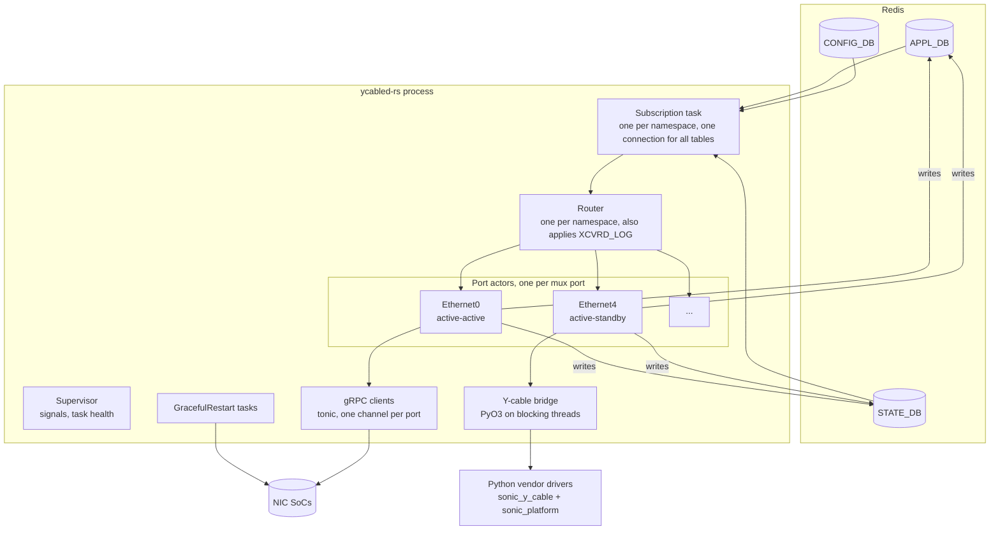

- Per namespace, one subscription task wakes on Redis notifications and reads the changed rows, and the router turns them into typed messages, in the order redis delivered them.
- The router delivers each message to the mailbox of the port it is for.
- A port actor handles one message at a time, so each port sees its requests in order. Different ports run at the same time.
- Only active-standby actors use the Python bridge, and the interpreter starts only when the first one needs it.

### 4.3 Components

#### 4.3.1 Process, runtime and supervision

- **Binary:** `/usr/bin/ycabled-rs`, started by supervisord as program `ycabled` ([Section 4.6](#46-build-packaging-and-selection)).
- **Runtime:** tokio with 2 worker threads. DB access and gRPC are async; only Python driver calls, which block, run on tokio's blocking threads, started when needed ([Section 4.3.6](#436-y-cable-bridge-embedded-python)).
- **Supervisor task:**
  - SIGTERM or SIGINT: stop accepting events, close the channels and exit 0 within 2 s, without deleting any tables (C7, N9).
  - SIGHUP: ignored, as in Python.
  - A task that ends unexpectedly or panics: log an error and exit 1, and supervisord restarts the daemon (N8).
- **Redis at startup:** until redis answers, ycabled-rs retries the connection every second and logs a warning; it does not exit. Python exits: swsscommon's `DBConnector` raises when it cannot connect.
- **Restart by supervisord:** pmon's `[program:ycabled]` sets `autorestart=unexpected` and `startsecs=10`, and leaves `startretries` (3) and `exitcodes` (0) at their defaults.
  - A process that has run for 10 s and then exits non-zero or is killed is restarted at once.
  - A process that exits sooner has failed to start. supervisord tries again after 1, 2 and 3 s, and after the fourth failed start it gives up (`FATAL`): ycabled stays down until pmon restarts. pmon has no critical processes, so nothing else restarts it.
  - Python finds a failed thread with its 60 s check, so it is always restarted. An exception while it initializes, such as redis not answering or issues 18 and 32, usually comes within 10 s, and four in a row end in `FATAL`.
  - ycabled-rs exits at once when it loses its subscription, so its restart may find redis still down. Waiting for redis keeps that start from failing, but redis can also drop a connection again while it recovers. So a failure within 11 s of the start, a second more than `startsecs` as a margin, does not end ycabled-rs at once: it logs the failure, and exits when the 11 s are up, unless SIGTERM ends it first. A later failure ends it at once. supervisord therefore counts every start as successful and restarts ycabled-rs, at most once every 11 s, whatever the failure, as it does for Python's thread failures.

#### 4.3.2 DB access

- **Library:** the `redis` crate with tokio (D9). One module, `db.rs`, gives it swss-common's semantics, and the rest of the code uses a `Db` trait with an in-memory mock for unit tests:
  - DB IDs, separators, host and port come from `database_config.json`, or `database_global.json` for the namespaces, as swss-common reads them. Like Python's `daemon_base.db_connect`, ycabled-rs connects over TCP.
  - `set` is one multi-field `HSET`, which merges fields as swss-common's `Table::set` does.
  - A subscription is what `SubscriberStateTable` does: `PSUBSCRIBE __keyspace@<db>__:<table><sep>*`, then the rows that already exist (`KEYS` and `HGETALL`), then one `HGETALL` per notification. A `del` notification is a DEL; a notification for a row that is gone again is skipped. A notification carries no value, so a row written several times before its notification is handled is read with its latest value each time, as with `SubscriberStateTable`: requests are states, not events (N2).
  - Waiting for `CONFIG_DB_INITIALIZED` subscribes to its keyspace notification instead of polling.
  - If the subscription connection is lost, ycabled-rs logs an error and exits 1, and supervisord restarts it (N8, [Section 4.3.1](#431-process-runtime-and-supervision)). So does a row that cannot be read after its notification: the restart replays every row, so no request is lost, as when an exception ends Python's subscriber thread.
- **Ready-table dispatch:** each keyspace notification names its table and key, so the namespace's subscription task reads that row only and passes the change to the namespace's routing task, which sends it to the port's actor. Both handle the notifications in the order redis delivered them, whatever the table, so a port's requests reach its actor in that order: a toggle written after a cable insertion runs after it. A notification never makes ycabled-rs look at another table.
  - Python can adopt the same improvement independently: register `fd -> (asic_index, original SubscriberStateTable, handler)` and look up the ready object's `getFd()`. Keep the original table for `pop()`, since SWIG returns a `Selectable`, not the original subscriber wrapper. `BmcEventHandler` in [bmcctld](https://github.com/sonic-net/sonic-platform-daemons/blob/master/sonic-bmcctld/scripts/bmcctld) is existing prior art.
  - This removes repeated empty-table checks and duplicated dispatch blocks; it does not by itself remove Python worker threads or Redis connections. In ycabled-rs, one task per namespace serves all of its subscriptions on the shared runtime, without an OS thread per group of tables, and only driver calls block.
- **Namespaces:** connections per namespace, for the same front-end namespaces Python's `multi_asic` uses. Dualtor platforms are single-ASIC today, but the code keeps the namespace dimension.
- **Connections:** 20 subscriptions: 4 toggle and probe tables, 13 CLI command tables plus `XCVRD_DOWN_FW_STATUS_CMD`, `XCVRD_LOG` and `TRANSCEIVER_INFO`. They share one pub/sub connection per namespace. `TRANSCEIVER_INFO` is subscribed to whatever the ports; the other 19 tables only once the namespace has a mux port, at startup or later, through the same connection and task. If redis refuses a subscription, ycabled-rs exits, as for a lost connection. CONFIG_DB, APPL_DB and STATE_DB have one multiplexed connection each, which reconnects by itself. That is 4 connections per namespace, whatever the number of ports (N5).
- **Schema in one place:** table names, field names and value encoders (timestamps, Python `str()` of numbers) live in one module that the tests use too.

#### 4.3.3 Router and port actors

| Message | Source | Handling |
| --- | --- | --- |
| Init | Startup, or `TRANSCEIVER_INFO` SET for a port not yet initialized | Load the driver or create the channel, then write the initial state ([Section 3.2](#32-threads-and-lifecycle)) |
| Remove | `TRANSCEIVER_INFO` DEL | [Section 3.3.7](#337-cable-insertion-and-removal) |
| Toggle(state) | APPL_DB `HW_MUX_CABLE_TABLE` | [Section 3.3.1](#331-active-standby-toggle) or the self case of [Section 3.3.3](#333-active-active-toggle-self-and-peer) |
| PeerToggle(state) | APPL_DB `HW_FORWARDING_STATE_PEER` | Peer case of [Section 3.3.3](#333-active-active-toggle-self-and-peer) |
| MuxProbe | APPL_DB `MUX_CABLE_COMMAND_TABLE` | [Section 3.3.2](#332-active-standby-probe) |
| ForwardingProbe | APPL_DB `FORWARDING_STATE_COMMAND` | [Section 3.3.4](#334-active-active-forwarding-state-probe) |
| Telemetry tick | The port's 60 s timer, in the actor's loop | Starts a pass in a task of its own ([Section 4.3.7](#437-telemetry)) |
| Cli(command) | APPL_DB `XCVRD_*_CMD` | [Section 3.3.9](#339-cli-commands) |

- **Port state:** each actor owns its port's name, physical index, cable type, initialization state, and driver handle or gRPC client. As in Python, the read side is kept in STATE_DB `HW_MUX_CABLE_TABLE`, and active-active ports share their namespace's read side from Loopback3. An actor shares only its call lock, epoch and probe counters with its own telemetry pass, and its channel's connectivity state with the connection monitor, which writes `response=failure` itself ([Section 4.3.4](#434-soc-grpc-client)). No other state is shared between ports.
- **One operation at a time:** insertion and removal, toggles, probes and CLI commands for a port all go through its actor, which finishes each one, including its writes to the port's DB entries, before it starts the next. The cross-thread races of Python ycabled (issues 26 to 29 in [Section 3.7](#37-known-issues)) cannot occur, and `test_concurrency.py` checks it ([Section 6.3](#63-black-box-component-tests)).
- **Telemetry beside the actor:** a pass makes dozens of driver calls, so it runs in a task of its own, and a toggle does not wait for the whole pass:
  - active-standby: the port's call lock, a fair mutex, covers every call to the cable: driver calls, presence checks, and loading and unloading the driver. A request holds it while it runs, and the pass takes it for one call at a time. A toggle waits for at most one call of the pass, no call of the pass comes between the calls of a request, and two calls to one cable never overlap. Python takes its port lock per call.
  - active-active: RPCs share the port's HTTP/2 channel and do not wait for each other, as in Python, whose threads share one stub.
  - A pass that overlaps an initialization, a removal or a change of cable type of its port, while it waits for its turn or while it runs, is not written, because its values may be stale. The pass checks the port's epoch and writes under one lock, which the actor also takes to change the epoch, so no change can fall between the check and the write.
- **Mailboxes:** a port's requests run in the order their notifications arrive (N2), each with the row its notification read ([Section 4.3.2](#432-db-access)).
  - **A repeated row:** a request that repeats the row of its table's last pending request merges into it if only probes are queued after that one. Applying the same row once has the same effect, and the probes in between see it applied either way. A failed attempt is not repeated, though ([Section 4.5](#45-deliberate-behavior-differences)).
  - **Probes:** a newer probe replaces the pending probe of its table and joins the end of the queue. Its answer reflects every request notified before it, which is what linkmgrd acts on.
  - **Any other request** joins the end, so a changed toggle, and a `TRANSCEIVER_INFO` removal followed by an insertion, run in their order. A port whose driver call never returns therefore holds a few requests: the probes linkmgrd repeats and the toggles orchagent repeats merge, and only changed requests, cable events and CLI commands add to the queue.
  - **Limit:** a port's mailbox holds at most 1,000 requests, which only a port whose driver call has not returned for a long time reaches. ycabled-rs then logs an error naming the port, and drops the port's queue and every request for it until the call returns. Then the port is initialized again and acts on the rows of its tables as they are then, toggles before probes and CLI commands, as a restart of ycabled-rs would do for it. Nothing is lost that a restart would carry out: the rows hold the latest request of each table, and the CLI replaces a table's old commands when it sends a new one. Python's thread, when it resumes, likewise acts on the rows as they are then, toggles first, since `SubscriberStateTable` reads a row only when it pops it. The other ports are not interrupted (N1). Restarting ycabled-rs instead would interrupt them, and again each time a hang that persists fills the mailbox, since the restarted port calls its driver again.
  - **Other ports:** routing never waits for a mailbox, so other ports are not affected. Requests for ports that are not in `MUX_CABLE` are dropped, as Python does. CLI commands for such ports get Python's answer for a port without a Y-cable driver, or without a cable if `TRANSCEIVER_INFO` has none.
- **Long-running work:** a firmware download runs in its own task, so toggles for that port are not held up for minutes. A port has at most one download in flight, until its call returns, across cable changes too; another download request for the port is answered `-1`, as Python answers a failed download, and logged. Telemetry and the CLI read the driver's `download_firmware_status` and, while it is in progress, report the last known firmware versions, as Python does ([Section 3.3.9](#339-cli-commands)). So the driver must accept other calls while `download_firmware` runs. Python ycabled relies on this too: it calls `download_firmware` without the port lock.
- **Startup:** `TRANSCEIVER_INFO` is subscribed to before the ports initialize, so a cable inserted or removed meanwhile is handled right after its port's initialization. The request tables are subscribed to without waiting for the initializations, and each subscription first delivers the rows that already exist ([Section 4.4](#44-workflows)). A port's requests wait in its mailbox behind its own initialization, so a driver call that never returns holds up only its port, and every other port is served as soon as it is initialized.

#### 4.3.4 SoC gRPC client

- **Channel:** one tonic channel per port to `http(s)://<soc_ip>:50075` (`[addr]` for IPv6), connected lazily. HTTP/2 keepalive every 4 s with an 8 s timeout, also while idle, and a 0.5 s deadline on every RPC, as in Python.
- **Requests and replies:** the same requests, and the same reply parsing by read_side, as Python ([Section 3.4.1](#341-soc-grpc-service)).
- **TLS:** from `GRPCCLIENT`: the CA from `ca_crt`, a client identity from `client_crt` and `client_key` for mutual authentication, and the domain name from `grpc_ssl_credential`. Files are read when the channel is created, as in Python, and `/etc/sonic/grpc_secrets.json` is applied to CONFIG_DB at startup.
- **Connectivity:** tonic does not report gRPC connectivity states, but linkmgrd depends on when `response=failure` is written (C2).
  - ycabled-rs wraps the connector (`Endpoint::connect_with_connector`) to see connection attempts, established connections and closed connections. A connection counts as established only once TLS, when configured, and the HTTP/2 handshake have completed, as in grpc-core; one that fails or does not complete them within the RPC deadline counts as failed.
  - From those events a per-port state machine derives `CONNECTING`, `READY`, `TRANSIENT_FAILURE` and `IDLE`. Entering `TRANSIENT_FAILURE` or `IDLE` writes `FORWARDING_STATE_RESPONSE` `response=failure`, and every state is recorded for `grpc_connection_status`.
  - No reconnect timer: a failed or closed connection is set up again by the port's next RPC. grpc-core retries in the background with backoff and, while it waits, fails RPCs at once. ycabled-rs lets each RPC wait for its 0.5 s deadline instead. For a SoC that accepts no HTTP/2 connection, ycabled-rs answers up to 0.5 s later than Python, but only on that port ([Section 5.3](#53-measured-results)).
  - **What linkmgrd does with `failure`** (sonic-linkmgrd `MuxPort::handleProbeMuxState` and `ActiveActiveStateMachine`): on an active-active port, `failure` is not a mux state. `handleProbeMuxFailure` logs `lost gRPC connection` and, unless linkmgrd is already waiting for a probe's answer, probes the forwarding state. The answer to that probe sets the state; `failure` itself changes no state and causes no switchover. linkmgrd also probes every 10 s once it has initialized (`handleAdminForwardingStateSyncUp`), when the peer ToR asks, and with backoff while the state is unknown. So a `failure` that ycabled-rs writes later than Python, or not at all, delays a probe by at most 10 s (C2).
  - **A SoC that stops answering while its channel is idle:** no RPC is in flight, so only the HTTP/2 keepalive notices: a ping goes out within 4 s, and 8 s without its answer close the connection, which writes `failure`. An RPC sent before then fails at its deadline and is answered `unknown`. Python sets the same keepalive options, but grpc-core 1.71, in the oldest grpcio Python ycabled accepts, arms the keepalive timeout only when that timer is already pending ([`writing.cc`](https://github.com/grpc/grpc/blob/v1.71.0/src/core/ext/transport/chttp2/transport/writing.cc#L758-L774)), so the 60 s default ping timeout applies instead, and Python may write `failure` up to a minute later. Meanwhile, RPCs fail at their deadline with either implementation. A black-box test to add: blackhole an idle SoC, expect `failure` within 12 s from ycabled-rs, and record Python's time and grpcio version. It is a phase 1 exit criterion ([Section 6.6](#66-acceptance-criteria)).
  - The black-box tests run a SoC double that accepts, drops, refuses and blackholes connections, and check the resulting writes for both implementations.
- **GracefulRestart:** one task per port with a SoC IP, with the same request, re-subscription timing and log-only handling ([Section 3.3.6](#336-gracefulrestart)).

#### 4.3.5 Port map, presence and transceiver info

- **Port map:** physical index from CONFIG_DB `PORT|<name>` `index`; ASIC from the namespace. This is what Python reads too: `SfpUtilHelper` takes CONFIG_DB `PORT` and falls back to `port_config.ini` only when `PORT` is empty. Mux ports are never broken out.
- **active-active (no Python):**
  - present if STATE_DB has `TRANSCEIVER_INFO|<port>` (D3)
  - always present on VS, as in Python
- **active-standby:** the bridge makes the same calls as Python, `chassis.get_sfp(i).get_presence()` and `get_transceiver_info()`, so driver selection does not change. If they raise `NotImplementedError`, the cable counts as absent (present on VS), where Python's fallback raises ([Section 3.4.3](#343-platform-api)); the legacy sfputil plugin is not supported ([Section 4.8](#48-restrictions-and-limitations)).

#### 4.3.6 Y-cable bridge (embedded Python)

- **Interpreter:** PyO3 embeds pmon's CPython (3.13 on trixie). It starts at startup, before the actors, if any port is active-standby; otherwise the first time a port needs it, so an active-active-only device never starts it. If the platform API cannot be loaded, ycabled-rs exits 1, as Python does when it has neither the platform API nor an sfputil plugin. The interpreter is initialized without Python's own signal handlers, so SIGTERM stays with Rust.
- **Bridge module:** a small Python module compiled into the binary owns all Python objects: the chassis and one driver per port. It exposes flat functions:
  - `load(port, physical_index)`: vendor mapping, simulator override and the `get_vendor()` check; `unload(physical_index)` and `has_driver(physical_index)`
  - `call(physical_index, method, args)` and `attr(physical_index, name)`, returning plain values that keep the Python type and `str()`
  - `presence(physical_index)` and `transceiver_info(physical_index)`

  Rust never holds a Python object, so each operation crosses the language boundary once. This is the same principle as the platform API facade ([#768](https://github.com/sonic-net/sonic-platform-common/pull/768)), and the module can move there if sonic-platform-common adds a Y-cable facade.
- **Threads:** each call runs on one of tokio's blocking threads, which are started when needed and stop after 10 s idle, and takes the GIL. Drivers release it during I2C I/O, so different ports can make progress at the same time. Each port makes one call at a time (its call lock, [Section 4.3.3](#433-router-and-port-actors)).
- **Shared-bus limit:** the calls of active-standby telemetry passes run one at a time across the ports, as the calls of Python's serial pass do, to avoid overloading shared I2C buses. A pass never waits for the limit while it holds its port's call lock, or for the lock while it holds the limit. So a port held by a long request delays only its own pass, where Python's pass waits for it, and so do the ports after it; and a call that hangs holds up the other ports' telemetry, not their requests. Toggles, probes and CLI commands are not counted against it.
- **Watchdog:** Python calls cannot be cancelled. A call still running after 5 s is logged at WARNING, and its end at NOTICE. The watchdog only logs: it does not end the call, and the port stays blocked until the call returns or ycabled restarts, with its mailbox bounded meanwhile ([Section 4.3.3](#433-router-and-port-actors)). A stuck call blocks its own port and one blocking thread, unless it keeps the GIL ([Section 4.8](#48-restrictions-and-limitations)). A port has at most three calls in flight, one from its actor, one from its telemetry pass and one firmware download, so there are at most three blocking threads per active-standby port, well under the runtime's limit of 512: stuck calls on some ports never leave the others without a thread. In Python, one stuck call stops every port served by the same thread.
- **Driver logger:** the logger passed to the drivers forwards to the Rust logger (D7).

#### 4.3.7 Telemetry

- **Timing:** each actor gets its own 60 s timer, and its first pass is 60 s after the actor starts, as Python's first pass is 60 s after startup. A tick that comes while the port's previous pass still runs is skipped. Ports that start together run their passes together, but the burst is bounded: at most 16 active-active passes run at once, each making its 4 RPCs one after another to its own SoC, and active-standby calls take turns on the bridge's shared-bus limit. Python's pass also queries the ports back to back, so the timers are not spread out.
- **Writes:** each pass reads its own port's cable or SoC and writes that port's `MUX_CABLE_INFO` row, in one `HSET`; no task collects the values of several ports. The actor keeps handling the port's requests meanwhile, and a pass that overlapped an initialization, a removal or a change of cable type is dropped ([Section 4.3.3](#433-router-and-port-actors)).
- **Contents:** the same tables and fields as Python ([Section 3.5.4](#354-mux_cable_info-and-mux_cable_static_info)).
- **Disable:** stopped while `disable_telemetry` is `True`.
- **Concurrency:** each pass runs in its own task ([Section 4.3.3](#433-router-and-port-actors)). Active-active passes run for all ports in parallel, at most 16 at a time. The calls of active-standby passes take the bridge's shared-bus limit. A pass delays the port's requests only on active-standby: a toggle, probe or CLI command waits for the one telemetry call in progress on its cable, never for the rest of the pass or for other ports' telemetry. Active-active requests share the port's channel with the pass and do not wait for it.

#### 4.3.8 CLI commands

- **Routing:** one subscription per `XCVRD_*_CMD` table, and the command goes to the port's actor.
- **Order of writes:** the actor writes the result rows, then the response field, then deletes the command key, in the same order as Python. Field names and values are the same ([Section 3.5.5](#355-cli-command-tables)); a driver's return value is answered as Python's `str()` of it.
- **Where Python crashes:** a port outside the port map, an argument that is not an integer, or a rollback without a driver kill Python's CLI thread. ycabled-rs answers these commands as errors and logs a warning.
- **Not started without mux ports:** while the namespace has no mux port, the command subscriptions are not started, so the CLI times out as it does with Python. They start once it has one, at startup or later; Python starts its CLI thread only if a cable was initialized at startup (issue 16).

#### 4.3.9 Logging

- **Identity:** syslog identity `ycable`, without the PID (Python does not set `LOG_PID`), facility USER, default minimum level NOTICE, as with `sonic_py_common`'s Logger.
- **Level control:** `XCVRD_LOG|Y_CABLE.log_verbosity` switches between debug and notice.
- **Text:**
  - Messages matched by sonic-mgmt keep their exact text: `URLError ... No route to host` (from the simulated driver) and `Error: Could not get port instance for muxcable info for Y cable port Ethernet`. The third rule, `executing the cli for prbs thread`, matches nothing Python ycabled still logs.
  - Other messages keep their wording where practical.
  - Nothing is logged at ERR that Python logs at a lower level (C5).

### 4.4 Workflows

**Startup:**

1. Connect to the default namespace's databases, retrying until redis answers ([Section 4.3.1](#431-process-runtime-and-supervision)), and wait for `CONFIG_DB_INITIALIZED`. Read `DEVICE_METADATA` to detect VS, and find the namespaces.
2. Write `XCVRD_LOG|Y_CABLE` `log_verbosity=notice`, as Python does. Build the port map, and per namespace determine read_side from Loopback3 (looked up again when an active-active cable is initialized while it is still unknown, as Python does), apply `grpc_secrets.json` to CONFIG_DB and read the `MUX_CABLE` ports.
3. Start the Y-cable bridge if any port is active-standby.
4. Create an actor for every `MUX_CABLE` port, with its initialization as the first message in its mailbox.
5. Subscribe to `TRANSCEIVER_INFO`, then start the actors, which initialize in parallel. A cable inserted or removed from then on is handled right after its port's initialization.
6. Subscribe to the request tables if the namespace has mux ports, without waiting for the initializations. Each subscription first delivers the rows that already exist, so requests written before or during startup are handled, as in Python. A port's requests wait in its mailbox until its initialization ends ([Section 4.3.3](#433-router-and-port-actors)).
7. Start the GracefulRestart tasks if any port is active-active, with the read side known then: like Python, look Loopback3 up again if it is still unknown.

**Toggles of two ports, one SoC not responding.** Compare with the serial case in [Section 3.3.3](#333-active-active-toggle-self-and-peer):

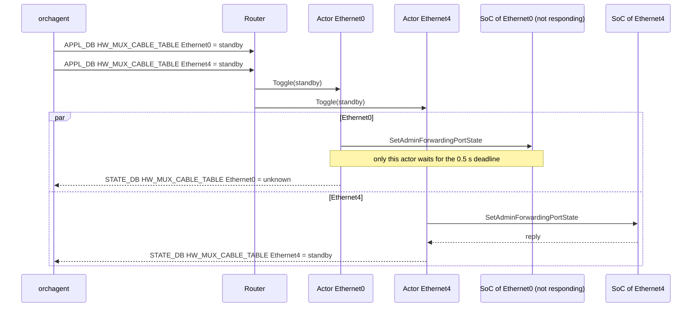

**Shutdown:** on SIGTERM, ycabled-rs stops the subscriptions, cancels the actors and the GracefulRestart streams, closes the channels and exits 0. Tables are not deleted (C7).

### 4.5 Deliberate behavior differences

| Area | Python | Rust | Reason |
| --- | --- | --- | --- |
| Concurrency | Every port in one thread, one request at a time | One actor per port | N1 |
| Startup | Ports initialized one by one; threads start after the last port | Ports initialized in parallel; the request tables are subscribed to at once, and each port's requests wait behind its own initialization | N1, N3: a hung driver call holds up only its port |
| Cable removed during startup | Missed: `TRANSCEIVER_INFO` is subscribed to after initialization, and its first rows do not include the removed cable | Handled after the port's initialization | `TRANSCEIVER_INFO` is subscribed to before initialization |
| A port held up long enough to fill its mailbox | The thread, when it resumes, acts on the rows as they are then, toggles first | The port's queue is dropped; when its call returns, the port is initialized again and acts on the rows as they are then, toggles first | Bounded memory without interrupting the other ports ([Section 4.3.3](#433-router-and-port-actors)) |
| Requests notified again before they are handled | Handled once per notification, each time with the latest row: a port toggled twice before the first toggle is handled is toggled twice, and `MUX_METRICS_TABLE` gets two start and end pairs | Merged into the pending request if it repeats the same row and only probes are queued between them: one toggle and one pair | Short mailboxes ([Section 4.3.3](#433-router-and-port-actors)). The end state is the same unless a toggle fails. Python's second toggle acts as a retry: after a failure and then a success it ends at the requested state, where ycabled-rs, with its one attempt, writes `unknown`; after a success and then a failure, the other way round. That `unknown` is the same as after any failed toggle |
| Order across tables | Within one select wake-up, a fixed table order; cable insertion and removal in another thread | The order redis delivered the notifications, for all of a namespace's tables | A toggle written after a cable insertion runs after it ([Section 4.3.2](#432-db-access)) |
| Shutdown | Never ends by itself; tables kept | Exits within 2 s; tables kept | N9, C7 |
| Thread or task failure | Process killed within 60 s | Process exits at once, or when 11 s have passed since its start for an earlier failure | N8 |
| Failure soon after a start | Exits, and after four failed starts in a row supervisord gives up (`FATAL`); redis not answering is one such failure | Waits for redis; for any other failure, exits when 11 s have passed since the start, so supervisord keeps restarting it | N8: a restart after a lost subscription may find redis still down ([Section 4.3.1](#431-process-runtime-and-supervision)) |
| Telemetry | Every 60 s after the previous pass over all ports ends; a port busy with a request holds up the ports after it | Every 60 s per port; a port busy with a request holds up only its own pass | Independent of port count, SoC health and the other ports' requests |
| Presence of active-active cables | Platform API | STATE_DB `TRANSCEIVER_INFO`. Until xcvrd writes it, after a cold boot for instance, the port's initial state is `unknown`, but requests still reach the SoC: the first one sets up the channel ([Section 3.3.5](#335-grpc-channel-lifecycle)) | D3; the delay is measured on hardware ([Section 5.2](#52-how-to-measure)) |
| Redis connections | 125 with 24 active-standby ports, 199 with 32 active-active ports ([Section 5.3](#53-measured-results)) | 4 per namespace | N5, D9 |
| RPCs to a SoC that accepts no HTTP/2 connection | Fail at once between grpc-core's connection attempts | Wait for the 0.5 s deadline | No reconnect timer ([Section 4.3.4](#434-soc-grpc-client)); affects only that port |
| `response=failure` | Written when a channel is created, because it reports `IDLE`, and after each failed background connection attempt of grpc-core | Written when a connection an RPC asked for fails, or an established one closes | linkmgrd only probes sooner on a `failure`, and probes every 10 s anyway: fewer `failure`s delay a probe by at most 10 s and change no state ([Section 4.3.4](#434-soc-grpc-client)) |
| Slow driver calls | Not logged | Logged after 5 s | [Section 4.3.6](#436-y-cable-bridge-embedded-python) |
| Firmware download requests | A new thread for every request, without limit | One download per port at a time; another request is answered `-1` | Hung downloads cannot use up the threads of other ports |
| Firmware activation | The CLI thread waits 5 s after `activate_firmware`; the port's toggles go on | The port's actor waits 5 s, toggles of that port included | The cable restarts its firmware meanwhile; other ports are not affected |
| CLI commands where Python crashes | The CLI thread dies, and the process exits within 60 s | Answered as errors | [Section 4.3.8](#438-cli-commands) |
| Syslog identity | Changes with import order | Always `ycable` | C5 |
| Issues in [Section 3.7](#37-known-issues) | Present | Fixed in the daemon's code: every known-issue test passes ([Section 6.3](#63-black-box-component-tests)) | ycabled-rs ships with the fixes, whether or not Python gets them (open question 4 in [Section 9](#9-open-questions)) |

Most of the fixes only keep ycabled running and serving where Python crashes, deadlocks or drops requests. These also change what other components receive:

- **linkmgrd and orchagent:**
  - 17: an active-standby toggle request for a state other than `active` or `standby`, such as the `init` orchagent writes after a failed first switch, is ignored with a warning, as for active-active.
  - 21: a re-inserted active-active cable is queried again, so its state does not stay `unknown`.
  - 22: removing a port that has no `HW_MUX_CABLE_TABLE` entry does not create one.
  - 30: without a usable Loopback3 address (read side -1), an active-active toggle does not call the SoC and writes `unknown`.
  - 31: an active-standby port whose read side is 0 or -1 is published and probed as `unknown`, not `standby`.
  - 32: a `MUX_CABLE` port whose state is outside the YANG enum is skipped with a warning, and the other ports are served.
- **Telemetry, TLS and configuration:** 4 (`peer_eye_height_lane2` comes from lane 2), 7 (`auth_level=client`, the YANG value, enables mutual TLS as `mutual` does) and 25 (`XCVRD_LOG` keys other than `Y_CABLE` are ignored).

Some issues are not in the daemon's code, and need changes of their own whichever implementation runs: the YANG model for 8, Python's unit tests for 12, and for 14 the `nice -n -20` in the supervisord command, which ycabled-rs keeps. For 7, ycabled-rs accepts both values; which one the YANG model and the code keep is open question 5.

### 4.6 Build, packaging and selection

- **Source:** `sonic-ycabled-rs` in sonic-platform-daemons (D1). Dependencies: tokio, redis (D9), tonic and prost with rustls, and PyO3. No swss-common and no C++ library.
- **Build:** in sonic-slave-trixie (Rust 1.98.1, protoc 3.21). PyO3 links the libpython of the build environment, which must be the Python of pmon's base image (3.13). A check in `sonic-pmon-daemons-rs.mk` fails the build if they differ, so a change of pmon's Python version fails the build, not the DUT. Until the package rules exist, `sonic-ycabled-rs/build.sh` builds and runs the unit tests in an image based on docker-sonic-vs (Debian 12, Python 3.11), the image the black-box suite runs in. That binary links Python 3.11 and is for development and the black-box suite only; pmon gets the package built in sonic-slave-trixie.
- **Package:** `sonic-ycabled-rs`, which contains `/usr/bin/ycabled-rs` (the bridge module is compiled in). It is built by `rules/sonic-pmon-daemons-rs.mk` from [#29860](https://github.com/sonic-net/sonic-buildimage/pull/29860) and installed in pmon next to the Python wheel.
- **Selection** (`docker-pmon.supervisord.conf.j2`, inside its `DualToR` condition); everything else in the entry stays as it is:

```jinja

[program:ycabled]


command=bash -c "sleep 30 && nice -n -20 {{ ycabled }}"

command=nice -n -20 {{ ycabled }}

```

- **Which file:** at every start, pmon renders its supervisord configuration from the HwSKU's `pmon_daemon_control.json` if there is one, otherwise from the platform's. The two are not merged, so a HwSKU file repeats the keys of the platform file. In sonic-buildimage, some platforms share a file through a symlink: 46 Arista platforms, the 7050CX3 dual ToRs among them, link to `x86_64-arista_common`. A platform or HwSKU that turns ycabled-rs on alone needs a file of its own. The image copies the files with the links resolved.
- **On a DUT:** add `"use_rust_ycabled": true` to `/usr/share/sonic/device/<platform>/pmon_daemon_control.json`, or to `<platform>/<hwsku>/pmon_daemon_control.json` if that exists, and run `sudo systemctl restart pmon`. To go back, remove the key and restart pmon. The change survives reboots but not an image upgrade.

### 4.7 Warm reboot, fast reboot and restart

- **No warm-restart state:** neither implementation keeps any. At startup, ycabled-rs reads the cable and SoC state again, as Python does.
- **Shorter refresh window:** parallel initialization shortens the time during which `HW_MUX_CABLE_TABLE` is stale after a restart.
- **Tables survive:** they are kept across restarts (C7), so linkmgrd and orchagent keep seeing the last known state while ycabled restarts.

### 4.8 Restrictions and limitations

- The vendor drivers stay Python, so devices with active-standby ports keep an embedded interpreter and save less memory.
- Connectivity states are derived from connection events ([Section 4.3.4](#434-soc-grpc-client)). There is no reconnect timer, so a `failure` is written when a connection fails or is lost, not again on every background attempt as grpc-core may. linkmgrd's own probes find the same state, at most 10 s later.
- A Python driver call cannot be cancelled. A hung call blocks only its own port and one blocking thread, unless it keeps the GIL: then every active-standby port stops, as it does in Python. Nothing ends a hung call automatically, since restarting ycabled-rs would interrupt every port: the port waits for the call to return, or for an operator to restart ycabled after the watchdog's warning ([Section 4.3.6](#436-y-cable-bridge-embedded-python)), as with Python.
- Active-standby ports need the platform API (`sonic_platform`). The legacy `sfputil` plugin, which Python ycabled falls back to, is not supported.
- ycabled-rs must be built for the Python version of pmon's base image; the build checks it ([Section 4.6](#46-build-packaging-and-selection)).

## 5 Performance and memory

### 5.1 Expected results

The baselines are in [Section 1.2.2](#122-resource-usage). The active-active numbers on a DUT and all numbers on physical testbeds are still to be collected.

| Metric | Python | Rust target | Why |
| --- | --- | --- | --- |
| Healthy-port probe or toggle latency with K unreachable SoCs | Up to K × 0.5 s | Independent of K | Per-port actors |
| Startup, N active-active ports, SoCs unreachable | N × 0.5 s plus channel setup | About 0.5 s | Parallel initialization |
| Telemetry pass, 32 unreachable SoCs | 64 s, longer than the 60 s period | About 2 s per port, in parallel | Per-port timers |
| RSS, active-active only | 41 MB (dev VM, 32 channels) | ≤ 15 MB | No interpreter |
| RSS, active-standby | 53-54 MB (KVM, 24 ports) | 10 MB below Python's on the same device: 43-44 MB here | Interpreter only for the drivers, no per-thread DB connectors |
| Threads | 5, plus about 1 per active-active channel (53 with 32 channels) | ≤ 16, plus one per driver call in flight | tokio; blocking threads only while a driver call runs |
| Redis connections | 124 (KVM, 24 ports) | ≤ 48 per namespace (4 by design) | One connection per database and one pub/sub connection for all subscriptions (D9) |
| Idle CPU | 0.7-0.8% of one core (KVM, 24 active-standby ports) | No higher than Python's | Event-driven, no 100 ms select loop |

### 5.2 How to measure

Run both implementations on the same DUT and image, switching with `use_rust_ycabled`:

- **Memory:** RSS and PSS from `/proc/<pid>/smaps_rollup`, threads from `/proc/<pid>/status`, Redis connections with `ss -tanp`. Measure 10 minutes after startup and again after a toggle storm, and record the peak thread count during startup and the storm.
- **Latency:**
  - toggles: from orchagent's write of the request to ycabled's STATE_DB `HW_MUX_CABLE_TABLE` write, which includes the time a request waits behind others; `MUX_METRICS_TABLE` `xcvrd_switch_*` cover only the handling
  - probes: time from the command write to the response write, in the test harness
- **Fault injection:** make K SoCs unreachable with nic_simulator or by dropping their traffic with iptables.
- **Startup:** from supervisord's "spawned" message to the last `HW_MUX_CABLE_TABLE` row written.
- **Boot** (active-active): after a cold boot and after `config reload`, the time from ycabled's start to each port's first `HW_MUX_CABLE_TABLE` `active` or `standby`. With ycabled-rs it includes waiting for xcvrd's `TRANSCEIVER_INFO` (D3).
- **CPU:** utime plus stime over one idle hour, and during telemetry passes.

### 5.3 Measured results

`sonic-ycabled/blackbox/bench` ran both implementations one after the other, in the black-box suite's container (docker-sonic-vs, Debian 12, Python 3.11) on a shared 16-core host. Both ran on the suite's fakes: a vendor driver that forwards every call to a cable model in the test process over a Unix socket, and gRPC SoC doubles in the test process. So the numbers compare the daemons, not hardware: real drivers' I2C calls are slower, and numbers on KVM and physical testbeds are still to be collected.

| Scenario | Metric | Python | Rust |
| --- | --- | ---: | ---: |
| 24 active-standby ports | RSS / PSS | 50.3 / 42.0 MB | 38.3 / 33.8 MB |
| | Threads | 5 | 3 |
| | Redis connections | 125 | 4 |
| | CPU over 65 s, with one telemetry pass | 0.14% | 0.14% |
| | Startup, until the suite sees every subscription | 0.88 s | 0.73 s |
| 32 active-active ports, one SoC each | RSS / PSS | 58.8 / 48.6 MB | 12.1 / 10.6 MB |
| | Threads | 61 | 3 |
| | Redis connections | 199 | 4 |
| | CPU over 65 s, with one telemetry pass | 4.31% | 0.14% |
| | Startup, until the suite sees every subscription | 0.86 s | 0.41 s |
| Startup, SoCs accept TCP and never answer: first DB access to every port's first state | 8 ports | 4.16 s | 0.51 s |
| | 32 ports | 16.30 s | 0.52 s |
| 8 active-active ports toggled at once, the SoCs of 4 hang | Healthy ports, slowest answer | 2021 ms | 6.9 ms |
| | Hanging ports, slowest answer | 2014 ms | 502 ms |
| Active-standby probe, 200 in a row | Median / p99 | 1.65 / 2.12 ms | 1.88 / 2.55 ms |
| 24 active-standby ports toggled together, 10 rounds | Toggles per second | 936 | 1063 |
| First telemetry pass of 32 active-active ports, first write to last | SoCs connected, telemetry RPCs hang | 62.3 s | 2.0 s |
| | SoCs blackholed | 0.04 s | 2.0 s |

- **Memory:** an active-active device runs no Python, so ycabled-rs needs a fifth of Python's memory. With active-standby ports, the embedded interpreter and the driver modules account for most of it, and Python loads them too: ycabled-rs saves 12 MB, 38.3 MB against Python's 50.3 MB (76%). On hardware, both also load the vendor's `sonic_platform`, which raises the share without reducing the saving, so N4 sets the saving, at least 10 MB, rather than a share. Python's 50.3 MB here and its 53-54 MB on the KVM DUTs of [Section 1.2.2](#122-resource-usage) come from different setups; each comparison, like N4 on a device, runs both implementations in one setup. Every target of [Section 5.1](#51-expected-results) is met.
- **Threads:** the runtime's 2 workers and the main thread. Threads for driver calls come and go. Python's count grows with the active-active ports: grpcio polls each channel's connectivity in a thread of its own.
- **CPU:** the active-active difference is grpcio's polling threads. With active-standby ports, both are idle.
- **Latency:** Python's single request loop makes the healthy ports wait for the 4 hanging ones' 0.5 s deadlines, and initializes ports one after another. Probe latency is the fake cable's round trip for both.
- **Telemetry:** with hanging SoCs, Python's serial pass (4 RPCs of 0.5 s per port) takes longer than the 60 s period. Blackholed SoCs are the exception: once grpc-core's first connection attempt has failed, it fails RPCs at once, and ycabled-rs waits for each deadline, 16 ports at a time ([Section 4.3.4](#434-soc-grpc-client)). The pass runs beside the actors, so no request waits for it.

## 6 Testing

### 6.1 Rust unit tests

142 tests, in `sonic-ycabled-rs`. Most run a port actor against mocks of the DB, the platform and cables, and the SoC (`src/testing.rs`). Behavior at a boundary is tested against the real component: a private `redis-server`, an in-process gRPC server, and the embedded interpreter with fake drivers. Among the cases:

- read_side mapping
- reply parsing
- the timestamp format and Python `str()` formatting
- the connectivity state machine
- subscriptions: the existing rows first, then the changes, in the order redis delivered them across tables
- mailbox ordering, toggles beside a telemetry pass, and a port held by a request beside the other ports' passes
- every CLI command family, with its failures

Each test names the Python unit tests whose behavior it covers, and `sonic-ycabled-rs/doc/python-ut-coverage.md` maps all 284 Python tests: covered, or why not (Python's threads, breakout ports, functions nothing calls).

Line coverage must be at least 80% (N11). The tests run with `cargo test`; the package build and the sonic-platform-daemons CI will run them once they build the crate.

### 6.2 Parity tests

Until the harness of [#915](https://github.com/sonic-net/sonic-platform-daemons/pull/915) exists, the black-box suite ([Section 6.3](#63-black-box-component-tests)) is the parity test: it runs either daemon on the same inputs, with the same assertions and the same DB contract.

- **Harness:** the pmon-common parity harness ([#915](https://github.com/sonic-net/sonic-platform-daemons/pull/915)) runs the Python daemon and the Rust daemon on the same inputs and compares what they write and log.
- **Inputs for ycabled:**
  - a real Redis with CONFIG_DB, APPL_DB and STATE_DB contents
  - a scriptable SoC double serving both gRPC services
  - a scriptable Python Y-cable driver
  - a fake platform for presence and transceiver info
- **Cases:** the scenarios of the existing Python unit tests, plus the cases in [Section 6.3](#63-black-box-component-tests).
- **When Python changes:** a parity test fails, so the two implementations cannot drift apart unnoticed.

### 6.3 Black-box component tests

`sonic-ycabled/blackbox` in sonic-platform-daemons ([#941](https://github.com/sonic-net/sonic-platform-daemons/pull/941)) runs the daemon as a process against a real redis, in a throwaway container: one built on docker-sonic-vs (`run.sh`), or the sonic-slave container of the sonic-platform-daemons pipeline, where `pytest` runs them after ycabled's unit tests. The tests see only what the daemon writes to the databases, sends to the SoCs, asks of the cables and logs. `BB_YCABLED_CMD` runs another implementation with the same inputs.

- **Stand-ins:**
  - orchagent, linkmgrd, xcvrd and the `show/config muxcable` CLI write the requests, with the CLI's own table protocol.
  - A fake vendor driver is installed in a copy of `sonic_y_cable` and mapped like a real one. It and a fake `sonic_platform` forward every call to a cable model in the test, which can return values, raise, delay or block. The suite also records any call that starts while another call to the same cable is still running.
  - gRPC SoC doubles serve both services from the real proto, with TLS when asked.
  - A mux simulator serves the real `y_cable_simulated` driver on VS.
  - A syslog sink on `/dev/log` records the logs.
- **Checks on every test:** redis MONITOR records every command of the daemon. A test fails if the daemon writes a table, field or value outside a machine-readable DB contract (200 entries, from [Section 3.5](#35-db-schema)), if it logs a crash, or if it exits unexpectedly.
- **Known issues:** each issue in [Section 3.7](#37-known-issues) that a test can observe has a test that asserts the correct behavior; [Section 3.7.6](#376-tests-that-reproduce-the-issues) names the tests. These tests are strict xfails on Python ycabled, so they flag a fix in Python, and must pass on Rust. N1 and N3 have such tests too. Each test explains its issue in its `known_issue` reason and docstring, so the suite does not depend on this document. Only an `AssertionError` counts as the expected failure: the harness raises a `RuntimeError` when it cannot do what a test asks, and every test has a time limit (300 s), so a harness error, a timeout or a hang cannot pass as the issue.
- **Results on Python ycabled:** 307 tests pass and 29 are expected failures (27 for 25 known issues, N1, N3), in about 14 minutes.
  - The tests exercise all 200 DB contract entries. A run of the whole suite on Python ycabled fails if one is not exercised, so the contract cannot keep entries no test reaches or accesses ycabled no longer makes.
  - They cover 87% of ycabled's lines and branches (90% of its statements). The unit tests reach 81%.
  - Of the 342 statements not reached: 70 are the shutdown path, which issue 1 blocks; 82 are dead code, unused getters and import fallbacks; most of the rest are guards no input reaches, such as breakout ports, unknown event codes and `select` errors.
- **Results on ycabled-rs:** 334 tests pass, the known-issue tests included, and the 2 tests of Python-only mechanisms are skipped, in about 10 minutes. The run exercises all 200 DB contract entries.
- **In the pipeline:** the ycabled test step sets `BB_ENABLE=1`, which lets the tests take over the container, and runs them after the unit tests. The step takes about 14 minutes instead of 15 seconds. The ycabled coverage it reports, which diff coverage uses, goes from 81% to 95% of statements (N12).

| Area | Cases |
| --- | --- |
| Lifecycle | Startup with active-standby, active-active and mixed ports; no mux ports; waiting for `CONFIG_DB_INITIALIZED`; port map from CONFIG_DB `PORT` or `port_config.ini`; startup failures; SIGTERM, SIGHUP; restart and replay of the last request; task failure |
| Insertion and removal | `TRANSCEIVER_INFO` SET and DEL; SET for an initialized port ([#882](https://github.com/sonic-net/sonic-platform-daemons/pull/882)) and for a driver that is not initialized; absent at startup, inserted later |
| Active-standby | Toggle to active and standby for each read_side; toggle failures; read side or mux direction unreadable; probe; every driver-load failure, including `get_vendor()` mismatch and exceptions; simulator override on VS |
| Active-active | Self and peer toggles; forwarding state probe; status codes, malformed replies, hangs; no, invalid or IPv6 SoC address; absent cable; SoC up later or lost (`failure`); insecure, server-auth and mutual TLS and their misconfigurations; GracefulRestart streams; N1, N3 |
| Telemetry | Both cable types and read sides; driver values and exceptions; absent cable, no driver, unreachable SoC; download in progress; telemetry disabled and enabled again |
| CLI | Every command family in [Section 3.5.5](#355-cli-command-tables) with its arguments, driver failures, missing arguments, missing driver, cable gone and malformed commands; firmware download in progress |
| Configuration | `XCVRD_LOG` knobs, `grpc_secrets.json`, Loopback3 variants, VS platform, log texts sonic-mgmt matches, Redis connection count, multi-ASIC namespaces |
| Concurrency | A toggle or an insertion during another call to the same cable; a removal during a toggle; a toggle during an insertion, or before the driver is verified; calls after a removal |

### 6.4 System tests

- **Acceptance:** on the physical dualtor testbeds Libra and Gemini, which cover both cable types, run the full dualtor suite with Rust ycabled and compare with a Python baseline on the same image:
  - `tests/dualtor`, `tests/dualtor_io`, `tests/dualtor_mgmt`
  - the dualtor cases of `arp`, `decap` and `qos` (`test_tunnel_qos_remap`)
- **Log analyzer:** enabled, so new ERR messages fail a test.
- **KVM, with each implementation:**
  - active-standby: the `dualtor` set of sonic-mgmt's `pr_test_scripts.yaml`, which sonic-buildimage's PR check `kvmtest-dualtor-t0` runs on the `dualtor` topology with the mux simulator
  - active-active, which has no upstream KVM PR check: `vms-kvm-dual-vpp-t0-2` (`dualtor-aa-vpp`, with nic_simulator) or `vms-kvm-dual-mixed` (`dualtor-mixed`)
- **A SoC unreachable from boot** (active-active, with each implementation): make one SoC unreachable, reboot, run `dualtor_io` on the other ports, then make the SoC reachable again. The other ports must match the baseline, and linkmgrd must see the recovered port's state within 10 s, one sync-up interval, of when it does with Python. This bounds the delay of fewer `failure` writes ([Section 4.3.4](#434-soc-grpc-client)); safety does not depend on it. It is a phase 1 exit criterion ([Section 6.6](#66-acceptance-criteria)).
- **By hand:** CLI commands that no suite runs, such as firmware download, activate and rollback with an image the vendor has approved, and PRBS and loopback.

### 6.5 Performance, fault and soak tests

- The measurements in [Section 5.2](#52-how-to-measure), including a toggle storm on all ports and K unreachable SoCs.
- Redis restarts, on a KVM DUT: restart redis while ycabled runs; and stop redis, restart ycabled and start redis again 30 s later. ycabled-rs must end up running and serving, not `FATAL`. Python's outcome is recorded for comparison: in the second case it is expected to end in `FATAL` ([Section 4.3.1](#431-process-runtime-and-supervision)), and is started by hand once redis is back.
- **A driver call that never returns**, in the black-box suite, whose cable model can hold a call: hold one active-standby port's call, and send that port alternating toggles, probes, CLI commands and cable events until its mailbox has reached the limit several times, while the other ports are toggled and probed. Record the other ports' toggle and probe latency, the process's memory, and the time from the call's return to the port's latest state. ycabled-rs must keep running, the other ports' latency must match a run without the held call (N1), and the memory must stay bounded. When the call returns, the port must be initialized again and act on the rows as they are then: a probe sent between two different toggles answers the second one's state, and of a `set_fec` that a `set_anlt` replaced in `XCVRD_CONFIG_PRBS_CMD`, only the `set_anlt` is carried out. Then hold a call that keeps the GIL: every active-standby port stops, and the active-active ports must not be affected.
- A 72-hour soak with periodic toggles, SoC restarts, cable removal and insertion where the testbed allows it, pmon restarts and config reloads.

### 6.6 Acceptance criteria

- All unit, parity and black-box tests pass. The black-box tests pass on both implementations.
- On each physical testbed, the dualtor suite results with Rust match the Python baseline over 3 runs, and every difference has a known cause. The log analyzer reports nothing new.
- The targets in [Section 2.3](#23-non-functional) are met, or the reviewers accept the difference.
- On a physical active-active testbed, ycabled-rs meets N4, and after a cold boot it takes no longer than Python to publish each port's first `active` or `standby` ([Section 5.2](#52-how-to-measure)), or the reviewers accept the difference.
- The fault tests pass on ycabled-rs: the driver call that never returns ([Section 6.5](#65-performance-fault-and-soak-tests)), the idle SoC blackholed ([Section 4.3.4](#434-soc-grpc-client)) and the SoC unreachable from boot ([Section 6.4](#64-system-tests)).
- The soak run has no restarts, no growth in memory and no port stuck in `unknown`.

## 7 Rollout and migration

| Phase | What | Exit criteria |
| --- | --- | --- |
| 0 | Merge the crate, the package and the supervisord switch, with `use_rust_ycabled` off everywhere | CI passes; the image builds on all platforms |
| 1 | KVM dualtor tests with both implementations ([Section 6.4](#64-system-tests)); acceptance on the physical testbeds | [Section 6.6](#66-acceptance-criteria), including memory and boot time on a physical active-active testbed, and the fault tests |
| 2 | Turn on in the nightly dualtor test plans | 4 weeks without regressions caused by ycabled |
| 3 | Turn on by default for the dualtor HwSKUs, in their device files | Release sign-off |
| 4 | Retire Python ycabled, one release after phase 3 | Agreement of the owners |

Changes to Python ycabled during phases 0-3 must be made in both implementations, and the parity tests enforce this. The fixes of the issues in [Section 3.7](#37-known-issues) that are in the daemon's code are the exception: ycabled-rs has them already, and Python gets them only if the maintainers decide so (open question 4 in [Section 9](#9-open-questions)). At any phase, removing the key and restarting pmon goes back to Python.

## 8 Risks and mitigations

| Risk | Impact | Mitigation |
| --- | --- | --- |
| The shared framework ([#915](https://github.com/sonic-net/sonic-platform-daemons/pull/915), [#29860](https://github.com/sonic-net/sonic-buildimage/pull/29860)) changes or merges late | Rework, or a blocked merge | Keep ycabled's dependency on pmon-common narrow. If needed, build in a workspace of its own as [#936](https://github.com/sonic-net/sonic-platform-daemons/pull/936) does, and move later. |
| tonic's connections behave differently from grpc-core's connectivity states | linkmgrd sees `failure` at different times, so a probe can come up to 10 s later ([Section 4.3.4](#434-soc-grpc-client)) | Connector wrapper and state machine ([Section 4.3.4](#434-soc-grpc-client)); parity tests with a fault-injecting SoC double; the idle-blackhole and unreachable-from-boot tests as phase 1 exit criteria ([Section 6.6](#66-acceptance-criteria)); fall back to the grpcio crate if the gap cannot be closed |
| Embedded Python: the GIL, drivers that start threads or call `openlog`, signal handling | Hangs, or a changed log identity | Interpreter without signal handlers; logging owned by the bridge; a worker pool and a watchdog; a hung call stops only its port, whose mailbox stays bounded ([Section 4.3.3](#433-router-and-port-actors)), which the fault test of [Section 6.5](#65-performance-fault-and-soak-tests) checks |
| Python ycabled keeps changing | The Rust version falls behind | Parity tests in CI; changes made in both until Python is retired; freeze Python before phase 3 |
| `TRANSCEIVER_INFO` as the active-active presence source (D3) | Different behavior while xcvrd has not posted yet | Insertion events are already handled; parity test with a late `TRANSCEIVER_INFO`; measure the boot delay on hardware, a phase 1 exit criterion ([Section 6.6](#66-acceptance-criteria)); fall back to the platform API |
| Access to physical testbeds and cables from several vendors | Acceptance takes longer | Book the testbeds early; test day to day on the KVM testbeds ([Section 6.4](#64-system-tests)) |
| Review bandwidth: the Rust pmon PRs have been open since September 2026 | Slow merges | Small PRs, one per component; coordinate with the owners of the Rust pmon daemons |

## 9 Open questions

1. Is STATE_DB `TRANSCEIVER_INFO` acceptable as the presence source for active-active ports (D3), or must presence come from the platform API? The boot measurement of [Section 5.2](#52-how-to-measure) informs the answer.
2. Should vendor drivers be reached through a ycabled-local bridge, or through a Y-cable facade added to sonic-platform-common's generated platform API ([#768](https://github.com/sonic-net/sonic-platform-common/pull/768))?
3. gRPC: tonic with derived connectivity states (D5), or the grpcio crate, which uses grpc-core? Its semantics would be closer to Python's, though not identical: its last release (0.13.0, August 2023) has C core 1.56, and Python ycabled requires grpcio 1.71.
4. Which issues in [Section 3.7](#37-known-issues) should be fixed in Python too? ycabled-rs ships with the fixes in the daemon's code ([Section 4.5](#45-deliberate-behavior-differences)), so the port does not wait for them, but Python stays the default until phase 3 of [Section 7](#7-rollout-and-migration). The P0 issues (17, 18, 20 and 24) are the first candidates.
5. `GRPCCLIENT|config.auth_level`: should YANG (`server`, `client`) or the code (`server`, `mutual`) change?
6. Is keeping the tables on stop (C7), which is what Python does in practice, the intended behavior, rather than deleting them as `deinit()` was written to do?
7. Is `pmon_daemon_control.json` enough to select the implementation, or do labs need an override that does not edit device files?
8. When should Python ycabled be retired after Rust becomes the default?
9. GracefulRestart `tor`: Python sends `UPPER_TOR` from the lower ToR (read_side 0) and `LOWER_TOR` from the upper ToR. That is the opposite of the ToR names and of the enum's values, which follow the port ids (`LOWER_TOR = 0`, `UPPER_TOR = 1`). The proto does not define the sides, and sonic-mgmt's NIC simulator does not implement the service. Which side does the SoC expect? Until its owners confirm, ycabled-rs sends what Python sends. Owner: Longxiang Lyu, with the owners of the SoC's gRPC service; to be answered before phase 2 of [Section 7](#7-rollout-and-migration).
10. Is inserting or removing a cable, or changing `MUX_CABLE`, after ycabled starts a supported scenario? Python ycabled has a thread for cable insertion and removal, but the issues in [Section 3.7.5](#375-cable-insertion-and-removal-after-startup) show that this path is incomplete. If the procedure for replacing a cable restarts ycabled instead, those issues need no Python fix; 18 and 24 still do, for startup. ycabled-rs handles these changes either way.

## 10 References

- [Active-Active Dual ToR HLD](active_active_hld.md) and [Active-Standby Dual ToR HLD](dualtor_active_standby_hld.md)
- Python ycabled: [sonic-platform-daemons/sonic-ycabled](https://github.com/sonic-net/sonic-platform-daemons/tree/master/sonic-ycabled)
- This design: black-box tests [sonic-platform-daemons#941](https://github.com/sonic-net/sonic-platform-daemons/pull/941), Rust implementation [sonic-platform-daemons#944](https://github.com/sonic-net/sonic-platform-daemons/pull/944)
- Rust pmon daemons:
  - [sonic-platform-daemons#915](https://github.com/sonic-net/sonic-platform-daemons/pull/915): workspace, pmon-common, thermalctld
  - [#916](https://github.com/sonic-net/sonic-platform-daemons/pull/916) to [#920](https://github.com/sonic-net/sonic-platform-daemons/pull/920): the other daemons
  - [#936](https://github.com/sonic-net/sonic-platform-daemons/pull/936): xcvrd
- Platform API facade: [sonic-platform-common#768](https://github.com/sonic-net/sonic-platform-common/pull/768)
- Build and selection: [sonic-buildimage#29860](https://github.com/sonic-net/sonic-buildimage/pull/29860)
- Vendor drivers: [sonic-platform-common/sonic_y_cable](https://github.com/sonic-net/sonic-platform-common/tree/master/sonic_y_cable)
- linkmgrd: [sonic-linkmgrd](https://github.com/sonic-net/sonic-linkmgrd) `DbInterface.cpp`, `MuxPort.cpp`, `LinkManagerStateMachineActiveActive.cpp`
- orchagent: [sonic-swss](https://github.com/sonic-net/sonic-swss) `orchagent/muxorch.cpp`
- CLI: [sonic-utilities](https://github.com/sonic-net/sonic-utilities) `show/muxcable.py`, `config/muxcable.py`
- Rust swss-common: [sonic-swss-common/crates/swss-common](https://github.com/sonic-net/sonic-swss-common/tree/master/crates/swss-common)
- sonic-mgmt: `tests/dualtor*`, `ansible/roles/test/files/tools/loganalyzer/loganalyzer_common_ignore.txt`
- [tonic](https://github.com/hyperium/tonic), [PyO3](https://github.com/PyO3/pyo3)
