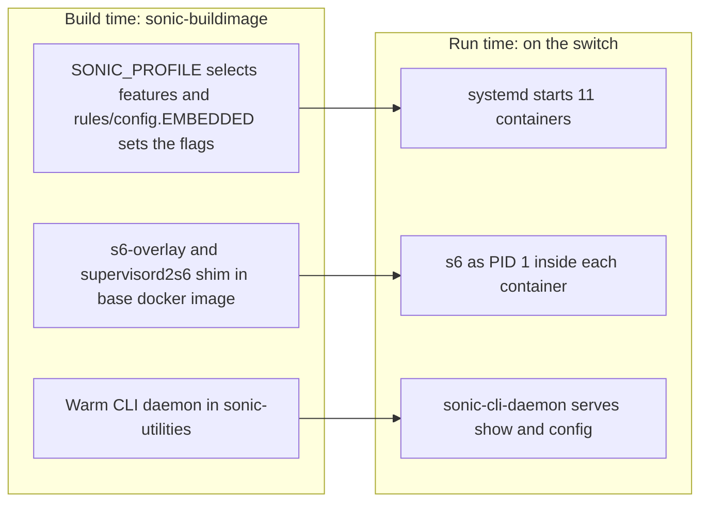
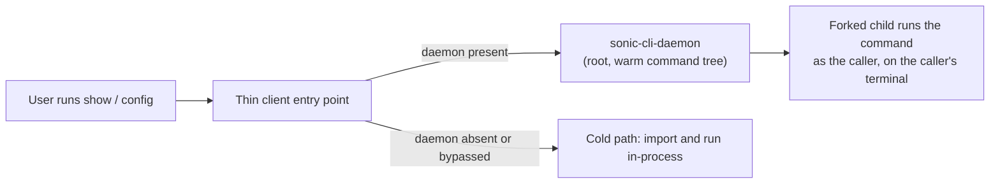
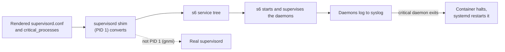
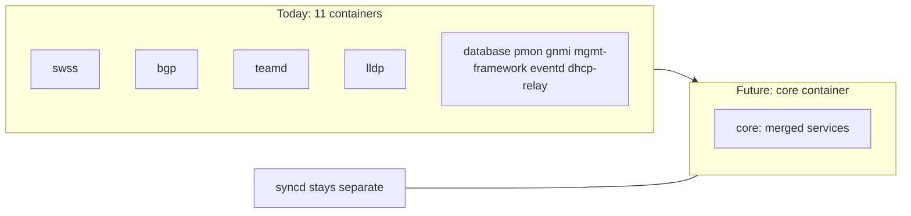

# Embedded SONiC Optimizations HLD #

## Table of Content

1. [Revision](#1-revision)
2. [Scope](#2-scope)
3. [Definitions/Abbreviations](#3-definitionsabbreviations)
4. [Requirements](#4-requirements)
5. [Overview](#5-overview)
6. [Architecture Design](#6-architecture-design)
7. [High-Level Design](#7-high-level-design)
8. [SAI API](#8-sai-api)
9. [Configuration and management](#9-configuration-and-management)
10. [Warmboot and Fastboot Design Impact](#10-warmboot-and-fastboot-design-impact)
11. [Memory Consumption](#11-memory-consumption)
12. [Restrictions/Limitations](#12-restrictionslimitations)
13. [Testing Requirements/Design](#13-testing-requirementsdesign)
14. [Open/Action items - if any](#14-openaction-items---if-any)
15. [Future work: core container](#15-future-work-core-container)

### 1. Revision

| Rev |    Date    | Author | Change Description |
|:---:|:----------:|:------:|--------------------|
| 0.1 | 2026-11-17 | amazor | Initial version. |

**Related pull requests**

| Repository | Pull request | Status |
|------------|--------------|--------|
| `sonic-net/SONiC` | [sonic-net/SONiC#2648](https://github.com/sonic-net/SONiC/pull/2648) (this HLD) | Open, in review. |
| `sonic-net/sonic-buildimage` | [sonic-net/sonic-buildimage#30838](https://github.com/sonic-net/sonic-buildimage/pull/30838) (deployment profile, `OPTIMIZE_CLI` plumbing, `OPTIMIZE_SUPD_S6`) | Draft, against the `202605` branch. Not mergeable as is (14.1). |
| `sonic-net/sonic-utilities` | [sonic-net/sonic-utilities#5080](https://github.com/sonic-net/sonic-utilities/pull/5080) (CLI fork-server, `OPTIMIZE_CLI`) | Draft, against the `202605` branch. Not mergeable as is (14.1). |
| `sonic-net/sonic-buildimage` | [#29462](https://github.com/sonic-net/sonic-buildimage/pull/29462), with HLD [sonic-net/SONiC#2479](https://github.com/sonic-net/SONiC/pull/2479) | Open upstream. Deployment profile mechanism that this work builds on. |

### 2. Scope

This document describes three footprint optimizations for SONiC on resource-constrained,
cost-effective, lower-performance arm64 edge switches, and the measurements that show their effect.

**Covered:**

- Deployment profiles (the `EMBEDDED` profile)
- CLI fork-server daemon
- `supervisord` to `s6-overlay` in the containers

### 3. Definitions/Abbreviations

| Term | Meaning |
|------|---------|
| Baseline | The unmodified starting image. Every result is compared against it unless stated otherwise. |
| Profile / `SONIC_PROFILE` | A named feature set chosen at build time. `EMBEDDED` is the footprint-oriented one. |
| `OPTIMIZE_*` flag | A default-off build flag that gates one optimization. With the flag off the build behaves like the baseline. |
| Isolated / stacked | Isolated is one optimization alone on the baseline. Stacked is a cumulative build with the optimizations switched on in order: profile, then + CLI, then + s6 (the full stack). |
| supervisord | Python process supervisor that SONiC starts as the init process inside most containers. |
| s6 / s6-overlay | A small C process-supervision suite and its container packaging. Used here in place of `supervisord`. |
| Fork-server | A daemon that has already imported the program once and forks a child per request. The cold path is a fresh Python start per command; the warm path is a request served by the daemon. |
| `containers_up` | Boot milestone: the time, measured from the start of the kernel, until all enabled containers are running. |

### 4. Requirements

#### 4.1. Functional requirements

| # | Requirement | Applies to |
|:-:|-------------|------------|
| R1 | **Gated by a build flag, default off.** Each optimization is switched on only by a build-time setting (`SONIC_PROFILE=EMBEDDED`, `OPTIMIZE_CLI`, `OPTIMIZE_SUPD_S6`). A build with the flag off, or with no profile, behaves like the baseline (no-profile behavior is not yet tested, `V7`). An unknown profile name fails the build. | All |
| R2 | **No change to SAI, SWSS, syncd or SONiC daemon logic.** A profile only selects among existing features. | All |
| R3 | **CLI stays backward compatible.** `show` and `config` keep their syntax, output and exit codes, and a command runs as the caller. If the daemon is absent the client uses the cold path, and a command that has started is never re-run, because `config` is not idempotent. | CLI |
| R4 | **Supervision behaves as before under s6.** The rendered `supervisord.conf` stays the single source of truth. `supervisorctl status`, `system-health`, `monit`, the critical-process rule (a critical exit restarts the container) and syslog output behave as with `supervisord`, with the small differences in 7.4.4. A container that cannot run s6 as PID 1 (`gnmi`) keeps `supervisord`. | s6 |

#### 4.2. Non-functional requirements

- **Resources first.** An optimization is kept only if it reduces at least one scarce resource
  (RAM, tasks, boot time, flash, CLI latency) at an acceptable cost elsewhere.
- **No run-time network dependency.** s6-overlay is fetched at build time with a pinned version
  and SHA-256.

### 5. Overview

#### 5.1. Problem and results

SONiC is designed for data-center switches with a strong x86 host. Edge switches built on
cost-effective, lower-performance arm64 chips have a much weaker host: a dual-core arm64 CPU at
about 1.4 GHz, about 4 GB of RAM and limited flash. On such a box the stock image is expensive in every scarce resource:

- **RAM.** Thirteen containers, each with its own Python `supervisord`, use 1.4 GiB at steady
  state (1403.8 MiB once fully settled).
- **CPU and tasks.** About 700 tasks. The CPU is pinned at 100 % of both cores for the first
  422 s after login. Once settled and with no load applied (the idle system), it still burns 86.9 core-seconds of CPU per minute, which is
  72 % of both cores (`load1` 3.6).
- **Boot time.** 203 s from the start of the kernel until all containers are up.
- **Flash.** The image is 982 MB.
- **Operability.** `show version` takes 4.9 s and `show interfaces` 11.5 s, because every command
  starts Python and imports the whole command tree.

These boxes are used as **edge switches** and need far fewer features than a data-center SONiC,
so there is room to cut without touching forwarding behavior.

**Results.** All three optimizations together against the baseline:

| Metric | Baseline | All three | Change |
|--------|----------|-----------|--------|
| Containers | 13 | 11 | -2 (`snmp` and `radv` removed) |
| CPU cost of the idle system (core-s/min) | 86.9 (72 % of both cores) | 51.2 (43 %) | **-35.7 (-41.1 %)** |
| CPU work, login to quiescence (core-s) | 843.7 | 607.8 | **-235.9 (-28.0 %)** |
| `mem_used` settled (MiB) | 1403.8 | 1188.3 | **-215.5 (-15.4 %)** |
| `tasks_total` settled | 697 | 751 | +54 (+7.7 %) |
| `containers_up` from kernel start (s) | 203.2 | 186.4 | -16.8 (-8.3 %) |
| CLI `show version` (ms) | 4905 | 650 | **-4255 (-86.7 %)** |
| CLI `show interfaces` (ms) | 11530 | 4300 | **-7230 (-62.7 %)** |

**Measurement note.** The stacked builds were measured with one further change, to the size of the
boot image, that is not part of this document. It only shortens the time before the kernel starts
and has no steady-state effect (`mem_used` and `tasks_total` differed by no more than the
run-to-run noise). Therefore boot times in this document are reported from the start of the
kernel (the `containers_up` figures are derived from the recorded milestones), image size is
given for the profile alone, and the steady-state figures are unaffected.

#### 5.2. The optimizations

| # | Optimization (build flag) | What it adds | Headline effect | Main cost / caveat |
|:-:|---------------------------|--------------|-----------------|--------------------|
| 1 | **Deployment profiles** (`SONIC_PROFILE=EMBEDDED`) | A build-time feature set that decides which optional SONiC features are built in and how they start. `EMBEDDED` keeps LLDP, teamd, mgmt-framework, gNMI, eventd and DHCP relay and drops SNMP, sFlow, telemetry, OTEL, BMP, NAT, MACsec, router advertiser and other data-center features. A port of upstream PR #29462 (HLD #2479). | 13 to 11 containers; image -9.6 %; `mem_used` -134 MiB (-9.4 %); tasks -71 (vs baseline) | Drops the `snmp` and `radv` containers from the baseline (13 to 11). Dropped features cannot be enabled at run time. |
| 2 | **CLI fork-server** (`OPTIMIZE_CLI`) | `show` and `config` normally cold-start Python on every call. A warm host daemon imports the command tree once and forks a child per command. The client falls back to the cold path if the daemon is absent. | `show version` 4045 to 635 ms (-84 %); `show interfaces` -48 % (vs profile) | +49.5 MiB `mem_used` and +4 tasks. The daemon runs as root. |
| 3 | **supervisord to s6** (`OPTIMIZE_SUPD_S6`) | Each container's Python `supervisord` is replaced by `s6-overlay`. A converter turns the rendered `supervisord.conf` into s6 services at container start, and a `supervisorctl` shim keeps existing tooling working. The `gnmi` container (`--pid=host`) keeps `supervisord`. | `mem_used` -152.7 MiB (-11.4 %); graceful shutdown -29 s (vs profile + CLI). Alone on the baseline: -209 MiB (-14.7 %) | +110 tasks, noisier container logs, and an open question on restart behavior (section 7.4.4). |

### 6. Architecture Design

#### 6.1. What changes and what does not

The SONiC architecture is unchanged. The host still runs systemd and the SONiC host services.
Each feature is still a docker container started by a systemd unit, state still lives in the
Redis databases, and the data plane still goes through SWSS, syncd and the platform SAI. There
is no new Redis table, no new SAI call and no new inter-container interface.

The optimizations are **built-in build-system features**. They are not Application Extensions
(they are not packaged with a manifest and installed by `sonic-package-manager`), because they
change how the base image is built and supervised, which an extension cannot do.

#### 6.2. Where each optimization acts

Each optimization acts at a different point in the life of the image: when it is built and
when it runs. The design of each one is in section 7 (7.2 to 7.4).

#### 6.3. Interaction between the optimizations

The optimizations do not call each other. They share only the build configuration:

- The profile and both flags are read from the same make configuration, in a fixed order
  and exported to the build. `rules/config.EMBEDDED` is the one place that turns them on together.
- The profile and s6 both reduce the number of supervisors, but independently. The profile
  removes two containers, and s6 replaces the supervisor in each container that remains.
  This is why the s6 saving is smaller on the stack than on the baseline (section 5.1).
- s6 changes how the host script detects that a container is ready (either s6 or
  `supervisord` counts), which is why `OPTIMIZE_SUPD_S6` also touches the host control script.

### 7. High-Level Design

#### 7.1. Common design

This subsection covers what the three optimizations share: how they are switched on, where the
switches live, and which repositories carry the change.
The optimizations themselves are in 7.2 to 7.4.

##### 7.1.1. Flag policy

Every optimization is gated by one build-time setting that is off by default. There is no run-time
switch for the build-time part.

- **One setting per optimization.** The profile uses `SONIC_PROFILE`. The other two use one flag
  each: `OPTIMIZE_CLI` and `OPTIMIZE_SUPD_S6`. The flags are
  independent, but only the in-order combinations were built (section 12).
- **Default off.** Each flag is declared as `n` in `rules/config`. A build that sets nothing gets
  the stock behavior (R1). The profile is off simply because `SONIC_PROFILE` is not set.
- **Flag-off means "not shipped", not "disabled at run time".** Where an optimization adds code
  to the image, a flag-off build leaves that code out.
- **Flag-off behaves like the baseline** (R1). It is proven per optimization (sections 12 and 13).

| Setting | Flag on | Flag off |
|---------|---------|----------|
| `SONIC_PROFILE` | The profile's feature values replace the stock feature defaults (7.2). | Stock feature defaults (with the render differences in 7.2.4). |
| `OPTIMIZE_CLI` | The daemon, the client entry points and the daemon's systemd unit are built and shipped (7.3). | None of that is built. `show` and `config` keep their original entry points. |
| `OPTIMIZE_SUPD_S6` | The base docker image carries s6-overlay and the two supervisor shims (7.4). | Neither is present. The base image and host script renders are byte-identical to the baseline. |

##### 7.1.2. `rules/config.EMBEDDED`

`rules/config.EMBEDDED` is the one place that defines the embedded image. It is selected with
`SONIC_PROFILE=EMBEDDED` and has two parts:

1. **The feature set** (the profile itself, 7.2): which optional features are built and how they
   start on boot.
2. **The optimization flags**, one line per optimization:
   `OPTIMIZE_CLI = y`, `OPTIMIZE_SUPD_S6 = y`.

##### 7.1.3. Repositories touched

| Repository | What changed |
|------------|--------------|
| [`sonic-buildimage`](https://github.com/amazor/sonic-buildimage) (branch `embedded-sonic`, on top of `sonic-net/sonic-buildimage` commit `6aec5bee6` of the `202605` branch). Draft PR [sonic-net/sonic-buildimage#30838](https://github.com/sonic-net/sonic-buildimage/pull/30838). | Build configuration, the feature-table template, and the base docker image and host control script. |
| [`sonic-utilities`](https://github.com/amazor/sonic-utilities) (branch `opt/cli-all`, on top of `sonic-net/sonic-utilities` commit `bf72b0aea` of the `202605` branch). Draft PR [sonic-net/sonic-utilities#5080](https://github.com/sonic-net/sonic-utilities/pull/5080). | The CLI fork-server daemon, its client entry points, its systemd unit and the build gating (7.3). |

Each optimization was tested alone on the baseline and then rebuilt on top of the previous
accepted steps, so any step can be reverted on its own.

#### 7.2. Deployment profiles (EMBEDDED)

##### 7.2.1. What it does

A **deployment profile** is a named, build-time feature set that decides, per optional SONiC
feature, whether it is built into the image and how it starts on boot. The mechanism is not new
work: it is the upstream change
[sonic-net/sonic-buildimage#29462](https://github.com/sonic-net/sonic-buildimage/pull/29462),
whose design is described in the HLD
[sonic-net/SONiC#2479](https://github.com/sonic-net/SONiC/pull/2479). Both were still open when
this document was written. The only addition here is `rules/config.EMBEDDED`, a footprint-oriented
feature set. If the pull request merges or changes, the port is dropped or rebased.

| Kept by `EMBEDDED` | Excluded by `EMBEDDED` (some were already off in the stock build) |
|--------------------|-------------------------------------------------------------------|
| LLDP, teamd, mgmt-framework, gNMI, eventd, DHCP relay (plus the always-present `database`, `swss`, `syncd`, `bgp`, `pmon`) | SNMP, sFlow, telemetry, OTEL, BMP, NAT, MACsec, router advertiser, MUX, STP, REST API, DHCP server, ICCPD, P4RT |

Compared with the baseline, `EMBEDDED` drops two running containers (13 to 11) and the images of
the other excluded features. `snmp` is dropped because gNMI, which the profile keeps, supersedes
it. `radv` (the IPv6 router advertiser) is dropped because basic L2/L3 forwarding on an edge
switch does not need IPv6 router advertisements. The other excluded features (sFlow, telemetry,
OTEL, BMP, NAT, MACsec, MUX, STP, REST API, DHCP server, ICCPD, P4RT) were not running in the
baseline, so excluding them only removes their images.

##### 7.2.2. How it works

Each optional feature has four build variables. `INCLUDE_<FEATURE>` decides whether its docker
image is built and installed. `ENABLE_<FEATURE>`, `AUTORESTART_<FEATURE>` and `DELAY_<FEATURE>`
decide whether it starts on boot, restarts automatically, and starts only after the ports are
configured; they are rendered into the default `FEATURE` table, which the existing SONiC feature
machinery reads at boot. The build stops with an error if an installer needs a docker that the
profile did not build. The layering of the configuration files, the `make list-sonic-profiles`
and `make show-sonic-profile` targets and the rest of the mechanism are in the upstream HLD
linked above.

##### 7.2.3. Effect

Measurements, alone on the baseline:

| Metric | Baseline | Profiles | Delta |
|--------|----|----------------|-------|
| Containers | 13 | 11 | -2 |
| Image size (B) | 982,284,270 | 888,035,310 | -94.2 MB (-9.6 %) |
| `mem_used` steady (MiB) | 1419.9 | 1285.9 | **-134 (-9.4 %)** |
| `tasks_total` | 704 | 633 | -71 |
| `load1` | 16.5 | 8.9 | -7.5 |
| `containers_up` from kernel start (s) | 203.2 | 189.5 | -13.7 |
| CLI `show version` (ms) | 4905 | 4085 | -17 % (side effect of fewer containers) |

All deltas come from the smaller container set.

##### 7.2.4. Trade-offs

- **Dropped features cannot be switched on at run time.** With `INCLUDE_*=n` the docker image is
  not on the device, so `config feature state <name> enabled` cannot bring it back. An edge box
  that needs SNMP needs a different profile or its own image.

#### 7.3. CLI fork-server daemon

##### 7.3.1. What it does

Every `show` and `config` call normally starts a new Python interpreter, imports `click`,
`swsscommon` and roughly 100 command submodules, and only then runs the command. On the arm64 host
CPU that start-up dominates: the baseline needs 4.9 s for `show version`.

`OPTIMIZE_CLI=y` adds a host service, `sonic-cli-daemon`, that does this import **once**. For each
command it forks a child that already holds the imported command tree, so a call costs a fork
instead of an interpreter start-up. The commands are the unchanged `show` and `config` code.
The client falls back to the normal cold path whenever the daemon is not there.

The change lives in `sonic-utilities` and in the
build flag. No SONiC daemon is modified.

##### 7.3.2. How it works

- **Client.** With the flag on, the `show` and `config` entry points are small clients that import
  almost nothing. They try the daemon and, if it is not there, run the original code. Setting
  `SONIC_CLI_DAEMON=0` bypasses the daemon for one session.
- **Daemon.** It starts with `sonic.target`, imports both command trees once and waits on a local
  socket restricted to the `admin` group. For each request it forks a child to run the command,
  so a failing command cannot take the warm tree down.
- **Privileges.** The daemon runs as root, as `show` and `config` already do through `sudo`. It
  does not trust the request: the caller's identity comes from the kernel, and the child drops to
  that user before it runs the command. The existing root check of `config` therefore behaves as
  today. No new authorization logic is added (R3).
- **Terminals.** The child receives the caller's standard streams, so colors, prompts and pipes
  behave as in a cold run. When a terminal is involved, the command runs on a fresh pty that the
  client proxies, so password prompts, window resizing and Ctrl-C and Ctrl-Z work.
- **Keeping the warm tree correct.** `show` decides at import time which routing stack it shows
  and discovers plugins once, so a daemon that imported once would go stale. It therefore reloads
  itself when the `bgp` container starts, when plugins or its own sources change, and on
  `systemctl reload sonic-cli-daemon`. Without the `bgp` trigger, `show ip bgp summary` failed
  because the daemon starts about 110 s before the `bgp` container. During a reload a new client
  sees a missing socket or an explicit fallback and runs cold, so a command never fails.
- **Safety.** Once a request has started to be sent, the client never re-runs it on the cold path,
  because `config` commands are not idempotent. A broken connection at that point returns exit
  code 1 (R3).
- **Build gating.** With the flag off the daemon modules, the unit and the `bgp` hook are not
  built, and the console scripts point at the original entry points.

##### 7.3.3. Effect

Measurements, stacked on the profile, with each `show` timed 10 times per
evaluation (all timings pooled):

| Metric | Profile | + CLI | Delta |
|--------|---------------------|---------------|-------|
| CLI `show version` (ms) | 4045 | 635 | **-3410 (-84 %)** (max 1340 is below the old minimum 3170) |
| CLI `show interfaces` (ms) | 8400 | 4385 | **-48 %** (p95 10200 to 6630) |
| Steady `mem_used` (MiB) | 1292.7 | 1342.2 | **+49.5** |
| `tasks_total` | 634 | 638 | +4 |

Against the baseline the full stack gives `show version` 4905 to 650 ms (-87 %) and `show interfaces`
11530 to 4300 ms (-63 %) (section 5.1). Alone on the baseline, the first daemon version (before
two fixes) gave `show version` 1240 ms (-75 %), `show interfaces` 8265 ms (-28 %) and +56.9 MiB.
`show version` gains most; much of the `show interfaces` time is not interpreter start-up, and the
rest was not analyzed.

##### 7.3.4. Trade-offs

- **RAM.** A resident daemon holds the imported command tree: +49.5 MiB steady (about 1.2 % of
  the 3.9 GiB of RAM) and +4 tasks. It is not a CPU consumer on a settled board.
- **Runs as root.** The same privilege `show` and `config` already reach through `sudo`. The
  caller's identity comes from the kernel, and the socket is restricted to group `admin`.
- **Behavior differences that remain:** `sudo` asks for a password per command in the pty
  if the user's entry is not `NOPASSWD` (the default `admin` is);
  a pager is not redrawn after Ctrl-Z and `fg` until a key is pressed; a caller with no terminal
  (cron, `ssh host show ...` without `-t`) gets a command without a controlling terminal; the
  `bgp` hook covers `bgp.service` only, not multi-ASIC `bgp@N.service`.

#### 7.4. supervisord to s6

##### 7.4.1. What it does

Almost every SONiC container starts the Python `supervisord` as its init process (PID 1). It
launches the container's daemons, restarts them when they exit, and halts the container when a
critical one dies so that systemd restarts it. That job is needed, but not by a Python
interpreter: each `supervisord` holds about 27 to 32 MiB of RSS (resident set size: physical RAM in use), and there is one per container.

With `OPTIMIZE_SUPD_S6=y` the base docker image carries
[s6-overlay](https://github.com/just-containers/s6-overlay) (a small C process-supervision suite),
and **s6 runs the container's daemons instead of `supervisord`**. Nothing else changes for the
rest of SONiC:

- The container still starts the same entry point. That name is now a small shim, so no
  container's start-up script, Dockerfile or `supervisord.conf` is edited.
- The rendered `supervisord.conf` and `critical_processes` stay the single source of truth for what
  runs (R4). s6 runs exactly what `supervisord` would have run.
- `supervisorctl` is a shim too. It answers `status` from s6, so `system-health`, `monit` and
  other users of `supervisorctl status` keep working.
- The one container that runs with `--pid=host` (`gnmi`) cannot have s6 as PID 1, so the shim
  hands over to the real `supervisord` there (R4).

##### 7.4.2. How it works

- **Build time.** The base image downloads a pinned s6-overlay release (v3.2.0.2), checks it
  against a pinned SHA-256 and installs it. The real `supervisord` and `supervisorctl` are kept and
  the two shims go in front of them. Every container image derived from the base inherits both.
  The host control script changes in one place: its readiness check now accepts either s6 or
  `supervisord` as the container's supervisor.
- **Container start.** The shim reads the rendered configuration, writes an s6 service tree and
  hands over to s6. The tree is rebuilt at every start, so it cannot go stale.

The conversion keeps the meaning of the `supervisord` settings that SONiC relies on:

| `supervisord` concept | In s6 |
|-----------------------|-------|
| Programs that start automatically | One s6 service each. Programs `supervisord` would never start are skipped. |
| Start-order dependencies | Dependency edges between services. |
| Restart policy | Always, only on an unexpected exit, or run once. |
| Critical processes | If one exits, the container halts and systemd restarts it. A stop the user requested is not treated as a crash. |
| Output to syslog | Piped to `logger` with the same tag, so it still reaches syslog. |
| User, environment, stop signal and timeout | Preserved. |

With the flag off none of this is in the image (the renders are byte-identical to the baseline, section
13), and with the flag on a container that cannot run s6 as PID 1 runs the real `supervisord`.

##### 7.4.3. Effect

Measurements, stacked on profile + CLI, both sides with 11 containers:

| Metric | Profile + CLI | + s6 (full stack) | Delta |
|--------|---------------|--------------|-------|
| `mem_used` steady (MiB) | 1342.2 | 1189.6 | **-152.7 (-11.4 %)** (ranges do not overlap) |
| `tasks_total` | 638 | 748 | **+110 (+17.2 %)** |
| `containers_up` from kernel start (s) | 196.5 | 186.4 | -10.1 |
| Graceful shutdown, from the `reboot` command to the platform restart (s) | 134.3 | 104.9 | -29.4 |
| `load1` | 8.93 | 4.91 | -4.0 |
| CLI `show version` / `show interfaces` (ms) | 635 / 4385 | 650 / 4300 | flat |

Alone on the baseline (13 containers), `mem_used` is 1210.7
against 1419.9 MiB (**-209.2 MiB, -14.7 %**) and `tasks_total` is +118. The saving is larger
there because the stack has already removed two containers, and their supervisors, with the
profile.

Where the memory goes (an estimate from per-process RSS, which over-counts shared pages): the
`supervisord` removed from each container except `gnmi` is worth roughly 270 to 390 MiB, and the
processes s6 adds cost about 125 MiB (154 processes, 124.6 MiB summed RSS), of which about 90 MiB
is the per-program `logger` pipelines and only about 9 MiB the `s6-supervise` processes. This
matches the measured -153 MiB.

##### 7.4.4. Trade-offs

- **More tasks.** +110 on the stack (+118 isolated): an `s6-supervise` process per service and a
  `logger` process per syslog-logging program replace one `supervisord` per container. The cost is
  in task count and a few MiB of RSS, not in measured CPU.
- **Noisier `docker logs`.** Daemon output still reaches syslog and no log loss was found, but
  start-up messages now show in the container log of several containers.
- **One `supervisord` remains.** `gnmi` keeps the real one (27 to 32 MiB RSS, about 2.5 % of
  `mem_used`). A non-PID-1 s6 start would need a custom path for at most about 25 to 30 MiB, so it
  was not attempted. Dropping `gnmi` from the profile or merging it into a core container
  (section 15) removes more (`V11`).
- **`supervisorctl status` differs slightly.** The shim omits one-shot programs and prints a zero
  pid and uptime for some running processes. Restart retry limits are not converted, which
  differs from `supervisord` only for `countersyncd` and `teamsyncd` (`V12`).
- **s6-overlay is fetched from GitHub at build time.** The version and SHA-256 are pinned, but an
  upstream submission needs the version pinned the SONiC way (`U3`).

#### 7.5. Impact on the rest of the system

This subsection answers the remaining HLD template questions once for all three optimizations.

- **SWSS and syncd.** No change; they keep their baseline revisions (R2). Under s6 the `swss` and `syncd`
  daemons are started by s6 instead of `supervisord`, with the same commands, order and
  critical-process rule. `swss`, `syncd` and `database` are always built, whatever the profile.
- **DB and schema.** No new table, key or field in any database. In `CONFIG_DB` only the `FEATURE`
  rows change, driven by the profile (9.3).
- **Linux and docker dependencies.** No kernel change and no new kernel module. The CLI daemon
  adds one systemd unit and a `bgp.service` hook; s6 adds s6-overlay and two shims to the shared
  base image, which every derived container inherits; the profile removes the images of dropped
  features. No change to how containers are created.
- **Build dependencies.** Network access to GitHub at build time for the pinned s6-overlay
  tarballs.
- **Management interfaces.** No SNMP, REST, gNMI or YANG change and no new CLI command. The
  additions are a few environment knobs for the CLI daemon (9.2), `systemctl reload
  sonic-cli-daemon` and the `supervisorctl` shim. A feature the profile excludes cannot be enabled
  with `config feature state` (7.2.4).
- **Serviceability and debug.** Daemon output still reaches syslog under the program's name, and
  `supervisorctl status` is still the health interface. Inside an s6 container the service state
  is under `/run/service` (`s6-svstat`); the CLI daemon is visible with `systemctl status
  sonic-cli-daemon`. No new counters or traces.
- **Platform specificity.** Profiles, the CLI daemon and s6 are not platform-specific in design.
  Platforms need to implement nothing. Everything was measured on one arm64 platform only.
- **Warm and fast reboot, scalability, memory.** See section 10 (not evaluated), section 11 (RAM)
  and section 5.1 (boot and CLI latency). No optimization changes the number of routes, ports or
  other scale dimensions.

### 8. SAI API

No change.

### 9. Configuration and management

The optimizations are selected at build time and add no run-time configuration object, CLI command or YANG model.

#### 9.1. Manifest (if the feature is an Application Extension)

Not applicable. None of the three optimizations is an Application Extension.

#### 9.2. CLI/YANG model Enhancements

No change to the CLI command set or the YANG models. The build adds the flags listed in 7.1.1, and
the CLI daemon adds optional environment variables (`SONIC_CLI_DAEMON`, `SONIC_CLI_DAEMON_PTY`,
`SONIC_CLI_SOCKET`, `SONIC_CLI_DAEMON_CONNECT_TIMEOUT`, `SONIC_CLI_SOCKET_GROUP`;
`SONIC_CLI_DAEMON=0` bypasses the daemon, 7.3.2).

#### 9.3. Config DB Enhancements

No change to the `CONFIG_DB` schema. With a profile selected, the default `FEATURE` rows follow
the profile's feature set (11 rows on `EMBEDDED`, one per container). A build with no profile
differs from the baseline in two small ways (7.2.4).

### 10. Warmboot and Fastboot Design Impact

Warm reboot and fast reboot were not evaluated for any of the three optimizations (open item `V1`, section 14).

### Warmboot and Fastboot Performance Impact

Not measured for warm or fast reboot. The figures here are cold boot (graceful reboot, measured
from the start of the kernel): from the baseline to the full stack, `containers_up` falls from
203.2 to 186.4 s (-8.3 %). The gains from fewer containers and no
Python supervisors act in the container start-up phase, which a warm or fast reboot also goes
through, but their size on that path is unknown. The boot-path costs are the CLI daemon's start-up
import (`containers_up` 6.9 s later on the CLI step, the one measured regression) and the s6
conversion at each container start; neither was isolated. If a warm or fast measurement shows a
degradation, the options are to start the daemon later, avoid its second import, or cache the s6
service tree (`V1`, `V5`).

### 11. Memory Consumption

The values below are steady-state `mem_used` on the arm64 board (about 3.9 GiB of RAM,
`mem_used` plus `mem_available` is 3976 MiB on the baseline), measured over repeated graceful-reboot evaluations, with the
[min..max] range across evaluations (section 5.1). A negative delta is a saving.

#### 11.1. Per-optimization RAM

**Alone on the baseline** (one variable changed; baseline `mem_used` 1419.85 [1406.6..1430.0] MiB, 13 containers):

| Optimization | `mem_used` (MiB) | Delta vs baseline (MiB) | `tasks_total` (baseline: 704) | Reading |
|------------------------|------------------|-------------------|-------------------------|---------|
| Deployment profiles | 1285.85 [1279.3..1292.7] | **-134.0 (-9.4 %)** | 633 (-71) | Two containers (`snmp`, `radv`) and their supervisors and daemons are not started. |
| CLI fork-server (first daemon design) | 1476.75 [1464.9..1482.05] | **+56.9 (+4.0 %)** | 707 (+3) | A resident daemon holding the imported command tree. |
| supervisord to s6 | 1210.65 [1184.85..1227.9] | **-209.2 (-14.7 %)** | 822 (+118) | One Python `supervisord` per container (27 to 32 MiB RSS each) is replaced by s6. |

**Stacked** (each row compares to the previous stack; this is the figure to use for the product):

| Stack | `mem_used` (MiB) | Delta vs previous (MiB) | Delta vs baseline (MiB) | `mem_available` (MiB) |
|-----------------|------------------|-------------------------|-------------------|-----------------------|
| Baseline | 1419.85 | n/a | n/a | 2556.25 |
| Profile | 1292.7 [1281.95..1302.95] | -127.2 | -127.2 | 2683.3 |
| + CLI fork-server | 1342.2 [1338.25..1347.75] | **+49.5 (+3.8 %)** | -77.7 | 2633.9 |
| + s6 (full stack) | 1189.55 [1178.95..1192.55] | **-152.65 (-11.4 %)** | **-230.3 (-16.2 %)** | 2786.55 |

The profile step on the stack (-127.2) and the profile alone (-134.0) agree within the run-to-run
spread. Cumulatively the stack frees 230.3 MiB (-16.2 %), which is 5.8 % of the 3976 MiB of RAM.

**Why the isolated and stacked numbers differ.** The effects are not additive. s6 saves -209.2 MiB on the baseline
but -152.65 MiB on the stack, because the profile has already removed two containers and their
supervisors. The CLI daemon costs +56.9 MiB for its first design and +49.5 MiB for the final
design on the stack. Use the stacked figures for the product and the isolated ones to attribute a change.

**Where the memory goes** (an estimate from per-process RSS, which over-counts shared pages;
section 7.4.3):

- **Profiles.** The memory is that of the dropped containers' daemons. It was measured as a whole
  (-134 MiB), not per process.
- **CLI fork-server.** The cost is the daemon's resident, imported command tree: +49.5 MiB, about 1.2 %
  of RAM, and +4 tasks. Each command also runs in a forked child that shares those pages copy-on-write. That
  transient per-command cost was not measured.
- **s6.** The Python `supervisord` removed from each container except `gnmi` is worth roughly
  270 to 390 MiB. The processes s6 adds cost about 125 MiB (154 supervisor-class processes,
  124.6 MiB summed RSS): about 90 MiB for the per-program `logger` pipelines and only about 9 MiB for the
  `s6-supervise` processes. The net is the measured -153 MiB. The `gnmi` container keeps one `supervisord`
  (27 to 32 MiB, about 2.5 % of `mem_used`).

### 12. Restrictions/Limitations

- **Build-time only.** Changing the set needs a new image, and a dropped feature cannot be enabled
  at run time. The only run-time switch is the CLI bypass (`SONIC_CLI_DAEMON=0`).
- **One platform, one set of runs.** Everything was measured on one arm64 board with repeated graceful
  reboots per variant. Other platforms, multi-ASIC, warm and fast reboot (`V1`) and long soaks (`V4`) are not
  covered. The CPU result is for the whole stack against the baseline, not per optimization.
- **Only in-order stacks were built** (profile, CLI, s6, plus each one alone). Flag-off
  behavior is shown by construction or by a run, but no flag-off image went through a
  measurement (`V7`).
- **Boot milestones are only comparable between runs on the same install state**, so the isolated
  CLI and s6 runs use only their steady and CLI numbers.
- **Profiles.** The `EMBEDDED` feature set was chosen for a generic edge switch and not reviewed
  for a customer deployment (`V13`). A build with no profile differs slightly from the baseline
  (7.2.4).
- **CLI daemon.** +49.5 MiB RAM and +4 tasks, runs as root, and one `orchagent` abort after a
  smoke-test `config reload` is unexplained (`V6`).
- **s6.** +110 tasks. `gnmi` keeps `supervisord` because it runs with `--pid=host` (`V11`), and
  the `swss` exit 137 on restart is not explained (`V2`).

Open items are tracked in section 14.

### 13. Testing Requirements/Design

Each optimization was tested on its own and then stacked with the others, to check for regressions.

#### 13.1. Isolated testing

Each optimization was built alone on the baseline and tested on a real board. A test is a graceful
reboot followed by a check that the system comes back healthy, and a number of evaluations (5) was run
for each optimization. The checks are:

- The system reaches the `running` state and every enabled container is up.
- The image contains the change when the flag is on and not when it is off.
- `show version`, `config reload` and a graceful reboot work, and the core CLI commands succeed.
- The effect on RAM, tasks, boot time, image size and CLI latency is measured against the baseline.

#### 13.2. Stacked testing (regression)

The optimizations were then stacked on top of each other in order: profile, then CLI, then
s6. After each step the same checks and measurements were repeated and compared with the previous
stack, to confirm that the step still works with the ones before it and to measure its cost on top of them.

#### 13.3. Results

| Optimization | Isolated | Stacked | Verdict |
|--------------|:--------:|:-------:|:-------:|
| Profiles | Pass | Pass | **Keep** |
| CLI fork-server | Pass | Pass | **Keep** |
| s6 | **Pass with caveat** | **Pass with caveat** | **Keep** |

The s6 caveats (`swss` and `bgp` exit 137 on restart, and a container-log check that fails on start-up
noise) are described in section 7.4.4.

#### 13.4. Not tested

Warm and fast reboot, other platforms, multi-ASIC, in-place upgrade across profiles or flags, a long soak,
and the flag-off measurements. They are listed with
an ID in section 14.

### 14. Open/Action items - if any

All items are **open** unless marked otherwise. The IDs are quoted from sections 10 to 13.
`U*` items are about getting the work upstream, `V*` items are validation and measurement work
that is not done yet.

#### 14.1. Upstream plan

The code is published on the `embedded-sonic` branch of
[amazor/sonic-buildimage](https://github.com/amazor/sonic-buildimage) (based on
`sonic-net/sonic-buildimage` commit `6aec5bee6`, which is in the `202605` branch), with the CLI daemon
in [amazor/sonic-utilities](https://github.com/amazor/sonic-utilities) (based on
`sonic-net/sonic-utilities` commit `bf72b0aea`, also in `202605`). Each accepted step is to be ported
onto a pinned upstream master base (`U0`) with the flag off by default.

The code is submitted as two **draft** pull requests against the `202605` branch, so the work can be
reviewed next to this HLD: [sonic-net/sonic-buildimage#30838](https://github.com/sonic-net/sonic-buildimage/pull/30838)
and [sonic-net/sonic-utilities#5080](https://github.com/sonic-net/sonic-utilities/pull/5080). They are
not meant to merge as they are: they carry a temporary submodule repoint, a port of
[#29462](https://github.com/sonic-net/sonic-buildimage/pull/29462), and are not yet ported to master.
This HLD is [sonic-net/SONiC#2648](https://github.com/sonic-net/SONiC/pull/2648).

| ID | Item | What is needed | Status |
|----|------|----------------|--------|
| `U0` | **Upstream base and clean port.** | Choose the upstream master base at PR time. Port each step onto it and re-run the isolated and stacked tests (section 13) flag-on and flag-off on the ported change. | Not started. `U0` is not pinned. The draft PRs above are against `202605`. |
| `U1` | **Deployment profiles.** | Already upstream: [sonic-net/sonic-buildimage#29462](https://github.com/sonic-net/sonic-buildimage/pull/29462), design [sonic-net/SONiC#2479](https://github.com/sonic-net/SONiC/pull/2479). Track both. Drop the local port if they merge, and rebase it if they change. Contribute `rules/config.EMBEDDED` (a feature set only) after the mechanism lands. | In review upstream. |
| `U2` | **CLI fork-server.** | Port the daemon from the `amazor/sonic-utilities` fork to `sonic-net/sonic-utilities`, with its own HLD and a default-off build flag. Remove the submodule repoint. | Draft PR [sonic-net/sonic-utilities#5080](https://github.com/sonic-net/sonic-utilities/pull/5080) against `202605`. Not ported to master. |
| `U3` | **supervisord to s6.** | A separate HLD (supervisor abstraction, the shim design, the `--pid=host` fallback, the log pipeline through `logger`, the readiness check `s6-svscan` or `supervisord`). Pin the s6-overlay version and SHA-256 the SONiC way (`versions-web`) instead of a plain download from GitHub. Default-off flag. Close the `swss` exit-137 question first (`V2`). | Code is in draft PR [sonic-net/sonic-buildimage#30838](https://github.com/sonic-net/sonic-buildimage/pull/30838) against `202605`. No separate HLD yet. |
| `U4` | **Split this document.** | This HLD is one document for three changes. For upstream, lift the generic parts into one HLD per change (sections 7.2 to 7.4 with 5, 8, 9, 10, 11 and 13 filled in for that change), and keep the measurements as evidence. | Not started. |

#### 14.2. Validation and measurement

| ID | Item | Why it is open | How to close it |
|----|------|----------------|-----------------|
| `V1` | **Warm reboot and fast reboot.** | Not evaluated for any optimization (section 10). | Run `warm-reboot` and `fast-reboot` on flag-on and flag-off images on the board, record control-plane and data-plane downtime with the same method, and compare. |
| `V2` | **`swss` exit 137 on restart.** | `swss` ended `systemctl restart` with 137 three times and `bgp` once on the full stack, and the `database` restart cascade ended in `start-limit-hit`. No `supervisord` run of the same tests exists on the 11-container stack, so the cause is not established (7.4.4). | Re-run the restart tests on the stack without s6 and measure the `swss` stop time on the full stack. If `swss` stops after docker's 10 s grace only under s6, raise its stop grace. Re-check it under a warm shutdown (`V1`). Needed before `U3`. |
| `V3` | **Validation on a second platform.** | The stack was measured on one platform only. Numbers for a platform with an external host CPU are from an earlier proof of concept on an older base (section 15). | Deploy the full stack (or the ported stack) on that platform and run the tests in section 13 and a measurement. |
| `V4` | **Memory soak.** | The steady window is minutes long. A slow leak in the resident CLI daemon or the s6 supervisors would not show. | Sample `mem_used` per hour for hours to days on the stack, and report the slope. |
| `V5` | **Cost of the boot-path additions.** | The CLI daemon's import and its re-import at `bgp.service` start, and the per-container s6 conversion, were not isolated. The CLI stack's `containers_up` is 6.9 s later (section 10). | Measure each alone. If it matters: start the daemon later (clients already fall back), avoid the second import, and cache the s6 service tree instead of converting at each container start. |
| `V6` | **CLI open observations.** | The steady `cpu_busy` rise on the CLI stack is unexplained, and one `orchagent` abort followed a smoke-test `config reload`. Power-cycle and fault injection were not run on the final stacked CLI image (7.3.4). | Repeat the `config reload` smoke test several times with and without the daemon. Run power-cycle and the fault-injection checks on the final stacked image. Use the integrated core-seconds CPU measure, not `cpu_busy`. |
| `V7` | **Close the flag-off gaps.** | Profile: no no-profile image was built. No flag-off measurements. No offline test of the `INCLUDE_*` rules (section 13). | Build and run a no-profile image, run the section 13 tests on it, and add offline tests for the profile gating. Run flag-off measurements if a comparison to the baseline is wanted. |
| `V8` | **Upgrade across profiles and flags.** | A device keeps its `CONFIG_DB`. An in-place upgrade between images with different profiles or flags was not tested. | Upgrade (cold and warm) from a flag-off image to the stack and back, and check the `FEATURE` rows and the removed containers. |
| `V9` | **Multi-ASIC.** | The CLI daemon's bgp reload hook covers `bgp.service` only, and nothing was run on a multi-ASIC image (section 12). | Extend the hook to `bgp@N.service` and test on a multi-ASIC platform, or state the exclusion in the upstream HLD. |
| `V10` | **Flash footprint.** | Only the `.bin` size was measured. The installed footprint of the image directory was not. | Measure it before and after, on a clean install. |
| `V11` | **The `gnmi` decision.** | `gnmi` is the one container that keeps `supervisord` (27 to 32 MiB), and the `EMBEDDED` profile keeps it. A non-PID-1 s6 start was judged not worth the risk for at most 25 to 30 MiB (7.4.4). | Decide whether an edge box needs `gnmi`. If not, drop it from the profile. Otherwise revisit it with the core container (section 15). |
| `V12` | **Minor s6 follow-ups.** | `startsecs` and `startretries` are not converted (differs for `countersyncd` and `teamsyncd`), the `supervisorctl` shim differs cosmetically, and the strict container-log check fails on start-up noise (7.4.4). | Convert or document the two keys, and either quiet the noise or relax the log check with a reasoned criterion. |
| `V13` | **Review the `EMBEDDED` feature set.** | The set was chosen for a generic edge switch and not reviewed for a customer deployment (7.2.4). | Review the kept and dropped features with the product owners. |
| `V14` | **Core container.** | Future work, not part of the current implementation (section 15). | Start only after the three steps here have their verdicts and upstream plan. |

#### 14.3. References

- This HLD: [sonic-net/SONiC#2648](https://github.com/sonic-net/SONiC/pull/2648). Code: [sonic-net/sonic-buildimage#30838](https://github.com/sonic-net/sonic-buildimage/pull/30838) and [sonic-net/sonic-utilities#5080](https://github.com/sonic-net/sonic-utilities/pull/5080) (drafts, `202605`).
- Deployment profiles: [sonic-net/sonic-buildimage#29462](https://github.com/sonic-net/sonic-buildimage/pull/29462) (code), [sonic-net/SONiC#2479](https://github.com/sonic-net/SONiC/pull/2479) (HLD).
- [SONiC HLD template](https://github.com/sonic-net/SONiC/blob/master/doc/guidelines/hld_template.md) (`doc/guidelines/hld_template.md`, followed by this document) and the [warm reboot design](https://github.com/sonic-net/SONiC/blob/master/doc/warm-reboot/system-warmboot.md) (`doc/warm-reboot/system-warmboot.md`, section 10).
- [s6-overlay](https://github.com/just-containers/s6-overlay), version v3.2.0.2 (section 7.4).

**Related sections of this document**: section 10 (warm and fast reboot), section 11 (memory), section 15 (future work, the core container).

### 15. Future work: core container

> **Not part of the current implementation.** Nothing in this section is built, flag-gated,
> or measured on the productized stack. It records the next
> topology step (merging containers), the proof-of-concept evidence behind it,
> and what must be settled before it can start. Section 14 tracks it as `V14`.

#### 15.1. Concept

After the three optimizations in this document, the `EMBEDDED` stack still runs **11
containers**: `database`, `swss`, `syncd`, `bgp`, `pmon`, `lldp`, `teamd`, `dhcp_relay`,
`mgmt-framework`, `gnmi` and `eventd`. Each one carries its own container overhead: a supervisor
(`s6` here), its `logger` processes, its own copy of the Python and library runtime, and the
event and health plumbing around it.

The **core container** idea is to run the SONiC services that do not touch the ASIC inside **one
container** (`core`), and keep **`syncd`** in its own container. `syncd` is the SAI and vendor
layer and is the riskiest to change, so it stays as it is and keeps talking to the merged
Redis through the shared `/var/run/redis` mount. The service set, the Redis databases and the
SAI path do not change. Only the container boundary does.

This is a topology change, so it is the highest-risk step. It moves the failure and restart
domain: today one crashing container restarts its own services; in a merged container a
critical process that exits restarts everything in it.

#### 15.2. How it would build on s6

The core container only makes sense on top of the supervisord-to-s6 step (section 7.4). The
reasons are specific to what that step already provides:

- **One supervisor for many programs.** In the proof of concept, about 39 programs ran under a
  single Python `supervisord` plus its `dependent-startup` event listener. That combination
  caused start-up problems. An s6 service tree is a declarative dependency graph that
  `s6-rc` brings up in one pass, with no event listener that re-evaluates and re-spawns services.
  This is the expected benefit, and it is **not measured**: no s6-based core container exists yet.
- **The converter already maps what SONiC needs.** The `supervisord` to s6 converter (7.4.2)
  turns `dependent_startup_wait_for` into dependency edges, `critical_processes` into "halt the
  container", and `stdout_syslog` into `logger`. A core container would feed it the merged,
  rendered configuration of all the folded services instead of one container's configuration.
- **A smaller supervisor per service.** s6 adds a few MiB per container instead of 27 to 32 MiB
  for each `supervisord`, so the supervisor part of the per-container overhead is already largely
  taken by section 7.4. The core container removes the rest (duplicated runtime and plumbing),
  so its gain on top of the current stack will be **smaller** than the proof-of-concept figures,
  which compared against a stock stack with 13 supervisors.
- **`gnmi` needs a decision.** s6 needs to be PID 1, and `gnmi` runs with `--pid=host` (7.4.4,
  `V11`). Giving the whole core container `--pid=host` is not acceptable, so `gnmi` would stay
  out of `core`, or be dropped from the profile, or be reworked. This is the same open question
  as `V11`.

The build side is a generator that composes the container from the per-feature sources
(`CORE_DOCKER_SERVICES`, depends on `OPTIMIZE_SUPD_S6`). It is only a scaffold (feature discovery, supervisord merge, `docker-mega.mk` and
Dockerfile generation exist; the step that applies them to a tree does not). A second variant,
`docker-core`, keeps one `supervisord` per service inside one container and was run on an arm64
board with all of its services running. This document quotes no measurements for it.
