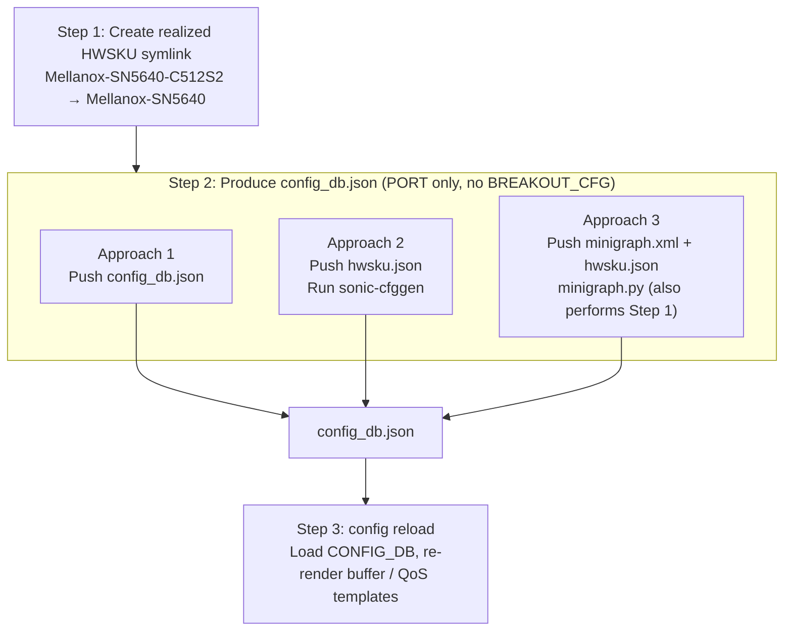

# SONiC Generic HWSKU Definition and Qualification Workflow HLD

## Table of Content

- [1 Revision](#1-revision)
- [2 Scope](#2-scope)
- [3 Definitions/Abbreviations](#3-definitionsabbreviations)
- [4 Overview](#4-overview)
  - [4.1 Background](#41-background)
  - [4.2 Motivations](#42-motivations)
- [5 Requirements](#5-requirements)
  - [5.1 G1: One platform, one HWSKU, any breakout](#51-g1-one-platform-one-hwsku-any-breakout)
  - [5.2 G2: Qualify once per platform, not per breakout](#52-g2-qualify-once-per-platform-not-per-breakout)
- [6 Architecture Design](#6-architecture-design)
- [7 High-Level Design](#7-high-level-design)
  - [7.1 Generic HWSKU definition](#71-generic-hwsku-definition)
  - [7.2 Vendor generic HWSKU creation request](#72-vendor-generic-hwsku-creation-request)
  - [7.3 Dynamic HWSKU creation with specific port breakout](#73-dynamic-hwsku-creation-with-specific-port-breakout)
    - [7.3.1 Step 1: Create a symlink to the base HWSKU folder](#731-step-1-create-a-symlink-to-the-base-hwsku-folder)
    - [7.3.2 Step 2: Create config_db.json for the target breakout](#732-step-2-create-config_dbjson-for-the-target-breakout)
    - [7.3.3 Step 3: Run config reload to load config_db.json](#733-step-3-run-config-reload-to-load-config_dbjson)
  - [7.4 HWSKU qualification process](#74-hwsku-qualification-process)
    - [7.4.1 sonic-mgmt nightly tests](#741-sonic-mgmt-nightly-tests)
    - [7.4.2 snappi-test / NUT tests](#742-snappi-test--nut-tests)
- [8 SAI API](#8-sai-api)
- [9 Configuration and Management](#9-configuration-and-management)
  - [9.1 CLI/YANG model Enhancements](#91-cliyang-model-enhancements)
  - [9.2 Config DB Enhancements](#92-config-db-enhancements)
- [10 Warmboot and Fastboot Design Impact](#10-warmboot-and-fastboot-design-impact)
  - [10.1 Warmboot and Fastboot Performance Impact](#101-warmboot-and-fastboot-performance-impact)
- [11 Memory Consumption](#11-memory-consumption)
- [12 Restrictions/Limitations](#12-restrictionslimitations)
- [13 Testing Requirements/Design](#13-testing-requirementsdesign)
  - [13.1 Unit Test cases](#131-unit-test-cases)
  - [13.2 System Test cases](#132-system-test-cases)
- [14 Open/Action items](#14-openaction-items)
- [15 References](#15-references)

## 1 Revision

| Rev | Date       | Author      | Change Description |
|:---:|:-----------|:------------|:-------------------|
| 0.1 | 11/06/2025 | Riff Jiang  | Initial version |
| 0.2 | 02/26/2026 | Bing Wang   | Updated SAI profile and qualification sections |
| 0.3 | 03/23/2026 | Bing Wang   | Reworked into SONiC HLD structure |
| 0.4 | 05/26/2026 | Riff Jiang  | Restructured: vendor request, dynamic HWSKU creation approaches, qualification feature-coverage framing |
| 0.5 | 11/25/2026 | Bing Wang   | Synced with the latest generic HWSKU design |

## 2 Scope

This document describes the high-level design of the generic HWSKU model in SONiC:

- What a generic HWSKU is.
- What a platform vendor delivers for a new platform under the generic HWSKU model.
- How a HWSKU with a specific port breakout is realized at deploy time from the generic base HWSKU.
- How qualification is organized so that its cost scales per platform rather than per breakout.

This HLD does not introduce a new runtime component, SAI API, or CONFIG_DB table.

## 3 Definitions/Abbreviations

| Term | Definition |
|------|------------|
| Base HWSKU | The single generic HWSKU folder shipped for a platform, named `<Vendor>-<Model>` and referenced by `default_sku`. |
| DPB | Dynamic Port Breakout — SONiC runtime feature for changing individual port breakouts after first boot. |
| Generic HWSKU | A HWSKU model in which a single HWSKU folder per platform can run any port breakout the hardware supports. |
| HWSKU | Hardware SKU — per-device configuration bundle (port layout, buffers, QoS, SAI init) inside a SONiC platform folder. |
| MMU | Memory Management Unit — the ASIC's packet buffer subsystem. |
| NUT | Network Under Test. |
| PG | Priority Group — ingress buffer entity associated with a TC. |
| Platform requirements owner | The operator or team that defines the platform requirements and qualification expectations. |
| Platform vendor | The party that delivers the platform folder and base HWSKU artifacts. |
| Port breakout | Splitting one physical port (cage) into one or more logical ports. |
| QoS | Quality of Service. |
| RDMA | Remote Direct Memory Access. |
| Realized HWSKU | A breakout-suffixed HWSKU name (for example `Mellanox-SN5640-C512S2`) materialized at deploy time as a symlink to the base HWSKU folder. |
| SAI | Switch Abstraction Interface — vendor-agnostic ASIC programming API. |
| TC | Traffic Class — QoS scheduling class. |
| WRED | Weighted Random Early Detection. |

## 4 Overview

### 4.1 Background

In SONiC, a **HWSKU folder** is the configuration bundle a device runs: it sits inside a platform folder and pins down one specific way of using that hardware (port layout, buffers, QoS, SAI init). A typical HWSKU folder today contains:

- Port layout: `port_config.ini`, `hwsku.json`
- Lossless headroom lookup: `pg_profile_lookup.ini`
- Buffer templates: `buffers.json.j2`, `buffers_defaults_*.j2`, `buffer_ports.j2`
- QoS templates: `qos.json.j2`
- SAI / SDK init: `sai.profile` and the vendor SAI init file (for example `config.bcm` or `sai.xml`)
- Media settings: `media_settings.json`, `optics_si_settings.json`

The key property of today's HWSKU model is that **a HWSKU folder is a frozen port-breakout decision** — almost every file inside is shaped by how the platform's ports are sliced. So a different breakout means a different HWSKU folder. The same physical chassis routinely ships with many HWSKU folders that differ only in breakout math.

The **generic HWSKU** effort aims to break that 1:1 link, so one HWSKU per platform can cover any supported port slicing.

### 4.2 Motivations

Generic HWSKU is needed to unblock faster onboarding of new network scenarios. Two compounding problems flow from today's "one HWSKU folder per breakout" model: new scenarios are slow to onboard because they require a new breakout (weeks to create, months more to qualify), and the qualification matrix grows with every new HWSKU that is added.

#### 4.2.1 M1: New scenarios are blocked by weeks-to-months breakout turnaround

In production, changing a device's port breakout means picking a different HWSKU folder — which means a different image config bundle, a different qualification record, and a re-onboarding. The HWSKU folder is breakout-shaped end to end: `port_config.ini`, `hwsku.json`, buffer pool sizes, QoS maps, `SAI_NUM_ECMP_MEMBERS`, and — most tightly coupled of all — the vendor-supplied SAI init file.

The Dynamic Port Breakout (DPB) machinery in swss exists but doesn't help here: a new scenario almost always needs a new breakout the platform's HWSKU folders don't already cover, which means **authoring a new HWSKU folder + a new qualification record before the scenario can deploy**. End-to-end turnaround is **weeks for breakout creation and months for the new qualification cycle on top**, even though the underlying ASIC supports the breakout out of the box. That latency directly slows down the rollout of new networking scenarios.

#### 4.2.2 M2: Qualification explodes combinatorially

Every (HWSKU, topology) pair has to be qualified independently, because each HWSKU is a distinct artifact even when the only real difference from a sibling is the breakout. This compounds in two ways:

- **Per-scenario cost.** Each new scenario — which in practice almost always means a new breakout — drags a new HWSKU folder and a full qualification cycle along with it on top of the breakout work itself.
- **Engineering cost from the combinatorial blow-up.** More HWSKUs means more testbeds to set up, more lab capacity consumed, and a longer overall qualification cycle. Cost and cycle time grow with the matrix, not with the underlying scenario count.

## 5 Requirements

### 5.1 G1: One platform, one HWSKU, any breakout

A single HWSKU folder per platform should be able to run any breakout the hardware supports, without authoring a new HWSKU. Port-dependent state is derived at config time from declarative inputs (`platform.json` + per-device wiring) and applied to CONFIG_DB, and the vendor SAI init contract evolves so it no longer requires a new file per breakout. This unblocks new-scenario onboarding by removing the new-HWSKU + new-qualification prerequisite that today gates every new breakout.

### 5.2 G2: Qualify once per platform, not per breakout

Only a representative topology needs full qualification on a given platform; other supported breakouts are covered by reduced, targeted testing instead of a full re-qualification. This shrinks the qualification matrix from (HWSKU × topology) to roughly per platform, and turns the marginal cost of a new use case from "new HWSKU + full qualification" into "new config + targeted qualification on the delta".

## 6 Architecture Design

Generic HWSKU does not introduce a new SONiC runtime component. It changes how platform and HWSKU artifacts are organized, how a specific port breakout is realized at deploy time, and how qualification is scoped.

The following repositories and components are impacted:

| Repository / component | Impact |
|------------------------|--------|
| `sonic-buildimage` — platform folder | `platform.json` is the authoritative list of supported breakouts. `default_sku` references the base HWSKU. `pg_profile_lookup.ini` moves from the HWSKU folder to the platform folder. |
| `sonic-buildimage` — base HWSKU folder | Named `<Vendor>-<Model>`. Ships no `port_config.ini` or `hwsku.json`. Buffer and QoS templates render correctly for any supported breakout. |
| `sonic-buildimage` — `sonic-cfggen` | Expands a per-port `hwsku.json` plus `platform.json` into `PORT` entries ([Approach 2](#7322-approach-2-push-hwskujson-and-run-sonic-cfggen)). |
| `sonic-buildimage` — `minigraph.py` | Creates the realized HWSKU symlink and writes `PORT` from `hwsku.json` ([Approach 3](#7323-approach-3-use-minigraphxml-with-hwskujson)). |
| `sonic-mgmt` | Deploy tooling materializes the realized HWSKU symlink. The nightly qualification matrix is selected by feature coverage ([7.4](#74-hwsku-qualification-process)). |
| Platform vendor deliverables | Platform folder, base HWSKU, and platform documentation delivered against the generic HWSKU definition doc ([7.2](#72-vendor-generic-hwsku-creation-request)). |

## 7 High-Level Design

### 7.1 Generic HWSKU definition

A generic HWSKU is a single HWSKU folder per platform, defined by four properties:

1. **All supported port breakouts are declared in `platform.json`.**
   - Today `platform.json` already carries valid `breakout_modes` per cage.
   - Under generic HWSKU it is the **authoritative source** for what the platform supports.
   - The HWSKU folder itself carries no breakout-specific configuration files.
2. **Base HWSKU with minimum breakout as default.**
   - In the platform folder, a single base HWSKU is provided. On top of it, breakout-specific HWSKUs are created on the fly at deploy time.
   - The base HWSKU folder is named **`<Vendor>-<Model>`** — no breakout suffix, because the folder is breakout-agnostic.
     - Example: `Mellanox-SN5640`.
   - When no per-port breakout selection is supplied, the base HWSKU is interpreted as the platform's **minimum breakout** (one logical port per physical cage at the max supported speed). This is a semantic default, not a folder-name encoding.
   - The realized HWSKU name carrying the breakout suffix (for example `Mellanox-SN5640-P64`, `Mellanox-SN5640-C512S2`) is materialized at deploy time as a symlink to the base HWSKU folder. See [7.3 Dynamic HWSKU creation with specific port breakout](#73-dynamic-hwsku-creation-with-specific-port-breakout).
3. **No per-port information lives in the HWSKU folder.**
   - Per-port state (breakout mode, lane assignment, speed, FEC, alias) lives in SONiC CONFIG_DB / `config_db.json`, never in HWSKU files.
   - `hwsku.json` and `port_config.ini` are explicitly not shipped from the HWSKU folder.
   - Runtime tooling reads per-port config only from CONFIG_DB.
4. **Buffer, headroom, and QoS configuration covers every supported breakout.**
   - Buffer templates (`buffer_ports.j2`, `buffers_defaults_*.j2`, `buffers.json.j2`) and QoS templates (`qos.json.j2`) must render correctly for any breakout the platform supports.
   - No breakout-tuned constants, and no DSCP-map stripping that breaks RDMA.
   - Headroom lookup (`pg_profile_lookup.ini`) is a strict speed-superset covering every (speed, cable_len) combination any supported breakout can produce.
     - `pg_profile_lookup.ini` **will be moved from the HWSKU folder to the platform folder** so a single file covers every breakout the platform can run, and multiple HWSKU revisions can share it. Today the file lives per HWSKU and typically carries rows only for that HWSKU's own breakout speeds; under generic HWSKU it lives at platform level and must be a strict superset.

### 7.2 Vendor generic HWSKU creation request

When a new platform comes out, a generic HWSKU creation process is kicked off as part of the platform bring-up work. The handoff from the platform requirements owner to the platform vendor is driven by a single **generic HWSKU definition doc** per platform, which replaces today's "one HWSKU definition doc per breakout" model. RDMA requirements are folded into the same doc so the vendor receives a single, complete request per platform.

1. **The platform requirements owner provides a generic HWSKU definition doc** per platform, which contains the fields a vendor needs to ship a generic base HWSKU:
   1. **Min port breakout to support** — the minimum slicing every port must support, which defines the lower bound of the port count the platform will run.
   2. **Per-port speed / mode / feature matrix** — for each port, all speeds, modes, and features (for example AN and FEC) that must be supported.
   3. **Per-port optics list** — for each port, all optic types that must be supported.
   4. **RDMA requirements per (speed, cable_length)** — all (speed, cable_length) combinations that must support RDMA, so the vendor can size headroom and pool memory up front. No separate per-use-case RDMA doc is needed; everything the vendor needs to ship a complete base HWSKU is in this one document.
2. **The vendor delivers the base HWSKU** that meets the [generic HWSKU definition](#71-generic-hwsku-definition) properties above:
   - The platform folder with all supported port breakouts declared in `platform.json`.
   - A base HWSKU folder named **`<Vendor>-<Model>`** (no breakout suffix), referenced by `default_sku`.
   - **No `port_config.ini` and no `hwsku.json`** in the HWSKU folder — per-port state comes from CONFIG_DB at runtime (see [sonic-buildimage#24494](https://github.com/sonic-net/sonic-buildimage/issues/24494)).
   - **RDMA settings included in the platform-level `pg_profile_lookup.ini`** — the file moves out of the HWSKU folder up to the platform folder, and every (speed, cable_length) from the request gets a row, so `buffermgrd` can apply lossless headroom for any realized breakout without further per-use-case overrides.
   - **QoS templates render correctly for any breakout** the platform supports — no breakout-tuned constants and no DSCP-map stripping. The template enumerates ports from `CONFIG_DB.PORT` rather than hardcoded ranges.
   - Platform documentation listing ASIC / switch limit factors: per-port or per-port-group breakout limits, optics support limits, and any other capability constraints that can't be encoded in `platform.json` today.

### 7.3 Dynamic HWSKU creation with specific port breakout

The base generic HWSKU is breakout-agnostic — it ships as `<Vendor>-<Model>` and defaults to the minimum breakout when nothing else is specified. Any specific port breakout — including the breakout-suffixed names operators use operationally (for example `Mellanox-SN5640-P64`, `Mellanox-SN5640-C512S2`) — is materialized at deploy time, not shipped as a separate HWSKU folder.

The workflow has three steps:



#### 7.3.1 Step 1: Create a symlink to the base HWSKU folder

A soft link is created from the breakout-suffixed HWSKU name the operator uses (for example `Mellanox-SN5640-C512S2`) to the base generic HWSKU folder (`Mellanox-SN5640`). This preserves operational HWSKU-by-name lookup — existing tooling that resolves HWSKU by name keeps working unchanged.

Who creates the symlink depends on the Step 2 approach:

- **Approach 1 (direct `config_db.json`) / Approach 2 (`hwsku.json` + `sonic-cfggen`):** the operator (or deploy tooling) creates the symlink explicitly before Step 2 runs.
- **Approach 3 (`minigraph.xml` + `hwsku.json`):** `minigraph.py` creates the symlink as part of its own processing — see [Approach 3](#7323-approach-3-use-minigraphxml-with-hwskujson) below.

Example:

```text
Mellanox-SN5640-C512S2 -> Mellanox-SN5640
```

#### 7.3.2 Step 2: Create config_db.json for the target breakout

The `config_db.json` carries the `PORT` entries for the realized breakout. There are three approaches for producing it; all end with a `config_db.json` ready to be loaded.

> **PORT only — no BREAKOUT_CFG writes.** Generic HWSKU populates only `CONFIG_DB.PORT`. The `BREAKOUT_CFG` table is intentionally not written by any of the three approaches: `PORT` carries the realized lane assignment / speed / alias / FEC for each materialized port, which is everything downstream consumers (`portsyncd`, `buffermgrd`, Jinja templates) need to compute the running state. Carrying the same breakout decision in a second table only adds drift risk between the two.

In Approach 2 and Approach 3, `hwsku.json` is a deploy-time input provided by the operator; it is not shipped in the HWSKU folder.

##### 7.3.2.1 Approach 1: Push config_db.json directly

In this approach:

- The operator authors (or generates out of band) a `config_db.json` with `PORT` entries already populated for the target breakout, and pushes it to the device.
- Validation that the breakout satisfies the cage's valid `breakout_modes` from `platform.json` is the responsibility of the out-of-band tooling that produces the file.

This is typical for operators who maintain an authoritative active config (for example `golden_config_db.json`) and want CONFIG_DB to be the single source of truth without any intermediate templating step.

##### 7.3.2.2 Approach 2: Push hwsku.json and run sonic-cfggen

In this approach:

- The operator pushes a per-port `hwsku.json` carrying one breakout-mode string per port — a much smaller and more declarative input than the full `PORT` entries it produces.
- `sonic-cfggen` reads `platform.json` + `hwsku.json`, validates each selection against the cage's valid `breakout_modes`, and expands the breakout-mode strings into the corresponding `PORT` entries (lane lists, aliases, speeds, FEC) in `config_db.json`.
  - `hwsku.json` supports `autoneg` and `fec` attributes, which is enough to replace `port_config.ini`.
- When no `hwsku.json` is provided, `sonic-cfggen` falls back to the platform's **minimum breakout** (one logical port per physical cage at the max supported speed).

Here is an example of `hwsku.json`:

```json
{
    "interfaces": {
        "Ethernet0": {
            "default_brkout_mode": "8x100G[50G]",
            "autoneg": "off",
            "fec": "rs"
        },
        ...
    }
}
```

This approach simplifies configuration generation for operators: they don't have to generate the full `config_db.json`, only specify the breakout mode for each port.

##### 7.3.2.3 Approach 3: Use minigraph.xml with hwsku.json

In this approach:

- The operator pushes `minigraph.xml` (carrying the breakout-suffixed HWSKU name in `<HwSku>`) plus a per-port `hwsku.json`.
- `minigraph.py` processes the inputs in three steps (tracked by [sonic-buildimage#25751](https://github.com/sonic-net/sonic-buildimage/issues/25751); step 1 is already in place, steps 2 and 3 are new):
  1. **Parse the HWSKU name from `minigraph.xml`** via `parse_device`.
  2. **If the HWSKU folder doesn't exist, create it via symlink** to the base generic HWSKU folder. For example, `Mellanox-SN5640-C512S2` → `Mellanox-SN5640`.
  3. **Take `hwsku.json` as input and write `CONFIG_DB.PORT`** for the realized breakout. `BREAKOUT_CFG` should not be written.
- When no `hwsku.json` is provided, the platform's **minimum breakout** is used as the default — the same fallback as Approach 2.

This is typical for existing minigraph-based deploy flows that already carry the breakout-suffixed HWSKU name (for example `Mellanox-SN5640-C512S2`) in `<HwSku>` and want the breakout to be realized through the same pipeline.

#### 7.3.3 Step 3: Run config reload to load config_db.json

`config reload` loads the `config_db.json` from Step 2 into CONFIG_DB, which triggers a re-render of buffer / QoS templates against the realized breakout's CONFIG_DB state — picking up the right `pg_profile_lookup.ini` rows and QoS map for the materialized port set.

### 7.4 HWSKU qualification process

**Simplifying qualification is one of the primary goals of generic HWSKU** — see [M2](#422-m2-qualification-explodes-combinatorially) and [G2](#52-g2-qualify-once-per-platform-not-per-breakout).

Qualification still consumes the realized (breakout-suffixed) HWSKU the same way as today — the breakout suffix stays in the HWSKU name for inventory and result-reporting purposes. What changes is **how the test matrix is sliced**, so the full qualification cost is not paid for every breakout the platform supports.

#### 7.4.1 sonic-mgmt nightly tests

Today nightly coverage is driven by the HWSKU matrix — every supported breakout gets its own qualification cycle. This is the combinatorial problem described in [M2](#422-m2-qualification-explodes-combinatorially). Under generic HWSKU, nightly coverage is instead driven by the feature surface: tests are organized around the features each platform must support, and HWSKUs are selected to cover that feature surface with as few entries as possible.

Two HWSKUs per platform are sufficient for most coverage:

1. **Max port breakout HWSKU** — exercises control-plane behavior and data-plane forwarding at the platform's scale ceiling. Runs on the max port breakout against the full topology of each type (t0 / t1 / t2). For example, on SN5640 this is `Mellanox-SN5640-C512S2` with t0 / t1 / t2 topologies.
2. **Multi-speed coverage HWSKU** — exercises port / optics / L1 / MMU / QoS behavior across every port speed the platform supports. A dedicated HWSKU is chosen so that every supported speed appears at least once, and the test topology is sized for per-speed evaluation rather than scale.

A third HWSKU is added to the nightly matrix only when it covers a feature these two cannot reach. Other breakouts on the same platform receive reduced coverage focused on the delta instead of a full re-qualification.

#### 7.4.2 snappi-test / NUT tests

snappi-test and NUT (Network Under Test) runs are left as-is — they are more ad hoc and focused on specific scenarios, so the per-breakout structure they already have continues to make sense.

## 8 SAI API

This HLD does not introduce new SAI APIs.

Per [G1](#51-g1-one-platform-one-hwsku-any-breakout), the vendor SAI init contract needs to evolve so it no longer requires a new SAI init file per breakout. That change is vendor and platform specific, and is tracked by platform onboarding work and [sonic-buildimage#25720](https://github.com/sonic-net/sonic-buildimage/issues/25720).

## 9 Configuration and Management

### 9.1 CLI/YANG model Enhancements

No new user-facing CLI or YANG model is introduced by this HLD.

### 9.2 Config DB Enhancements

This HLD does not define a new CONFIG_DB table or schema.

It relies on the existing `PORT` table as the single source of per-port state for the realized breakout (lanes, speed, alias, FEC, autoneg). `BREAKOUT_CFG` is intentionally not written; see [7.3.2](#732-step-2-create-config_dbjson-for-the-target-breakout).

## 10 Warmboot and Fastboot Design Impact

Generic HWSKU does not change warmboot or fastboot behavior. Applying a new breakout goes through `config reload` ([Step 3](#733-step-3-run-config-reload-to-load-config_dbjson)) and is not a warm or fast reboot path. Warm and fast reboot expectations remain part of platform qualification.

### 10.1 Warmboot and Fastboot Performance Impact

No direct warmboot or fastboot performance impact is expected.

## 11 Memory Consumption

No direct runtime memory impact is expected. Because realized HWSKUs are symlinks to the base HWSKU folder, per-breakout HWSKU folders no longer need to be shipped in the image.

## 12 Restrictions/Limitations

- Platform limit factors that can't be encoded in `platform.json` today (per-port or per-port-group breakout limits, optics support limits, and other capability constraints) are captured in vendor platform documentation rather than enforced by tooling.
- In Approach 1, validating the breakout against `breakout_modes` is the responsibility of the out-of-band tooling that produces `config_db.json`.
- Platforms whose vendor SAI init still requires a per-breakout SAI init file cannot fully meet [G1](#51-g1-one-platform-one-hwsku-any-breakout) until the SAI init contract evolves.
- Applying a new breakout requires `config reload`.
- snappi-test and NUT runs keep their per-breakout structure.

## 13 Testing Requirements/Design

### 13.1 Unit Test cases

Implementation changes should add unit tests covering:

- `sonic-cfggen`: expanding a per-port `hwsku.json` plus `platform.json` into `PORT` entries, rejecting breakout modes not listed in `breakout_modes`, honoring `autoneg` and `fec`, and falling back to the minimum breakout when no `hwsku.json` is provided.
- `minigraph.py`: creating the realized HWSKU symlink when the folder doesn't exist, writing `PORT` from `hwsku.json`, and not writing `BREAKOUT_CFG`.
- Buffer and QoS template rendering for each supported breakout of a reference platform, including lossless headroom lookup from the platform-level `pg_profile_lookup.ini`.

### 13.2 System Test cases

- Deploy the base HWSKU without a per-port breakout selection and verify that the minimum breakout is applied.
- Deploy a realized HWSKU with each approach in [7.3.2](#732-step-2-create-config_dbjson-for-the-target-breakout) and verify that `PORT` matches the target breakout, `BREAKOUT_CFG` is not written, and buffer and QoS configuration is re-rendered after `config reload`.
- Run the nightly qualification matrix described in [7.4.1](#741-sonic-mgmt-nightly-tests).
- Verify that result reporting stays tied to the realized (breakout-suffixed) HWSKU name.

## 14 Open/Action items

Implementation items:

- [sonic-buildimage#24494](https://github.com/sonic-net/sonic-buildimage/issues/24494): Clean up `port_config.ini` dependencies.
- [sonic-buildimage#25718](https://github.com/sonic-net/sonic-buildimage/issues/25718): Enhance `hwsku.json` (per-port `autoneg` and `fec`) for [Approach 2](#7322-approach-2-push-hwskujson-and-run-sonic-cfggen).
- [sonic-buildimage#25716](https://github.com/sonic-net/sonic-buildimage/issues/25716): Move `pg_profile_lookup.ini` to the platform folder.
- [sonic-buildimage#25747](https://github.com/sonic-net/sonic-buildimage/issues/25747): Make buffer and QoS templates render for any supported breakout.
- [sonic-buildimage#25720](https://github.com/sonic-net/sonic-buildimage/issues/25720): Unify SAI profile and SDK configuration across HWSKUs.
- [sonic-buildimage#25751](https://github.com/sonic-net/sonic-buildimage/issues/25751): Realized HWSKU symlink and `PORT` generation from `hwsku.json` in `minigraph.py` ([Approach 3](#7323-approach-3-use-minigraphxml-with-hwskujson)).
- `sonic-mgmt`: Create the realized HWSKU symlink during deployment, and select the nightly qualification matrix as described in [7.4.1](#741-sonic-mgmt-nightly-tests).

Open questions:

- Interaction with runtime DPB (`config interface breakout`), which today reads the current breakout mode from `BREAKOUT_CFG`.
- How to encode platform limit factors that `platform.json` can't express today.

## 15 References

- [SONiC dynamic port breakout feature high level design](https://github.com/sonic-net/SONiC/blob/master/doc/dynamic-port-breakout/sonic-dynamic-port-breakout-HLD.md)
- [Enhancement: Clean up `port_config.ini` dependencies for HWSKUs that use `hwsku.json` instead of `port_config.ini`](https://github.com/sonic-net/sonic-buildimage/issues/24494)
- [Enhancement: Enhance `hwsku.json` to support generic HWSKU](https://github.com/sonic-net/sonic-buildimage/issues/25718)
- [Enhancement: Move `pg_profile_lookup.ini` to a shared place for all HWSKU on a specific platform](https://github.com/sonic-net/sonic-buildimage/issues/25716)
- [Enhancement: Unified SAI profile and SDK configuration across different HWSKU](https://github.com/sonic-net/sonic-buildimage/issues/25720)
- [Enhancement: Enhance buffer and QoS template to support generic HWSKU](https://github.com/sonic-net/sonic-buildimage/issues/25747)
- [Enhancement: Ensure minigraph-based provisioning is compatible with generic HWSKU](https://github.com/sonic-net/sonic-buildimage/issues/25751)
