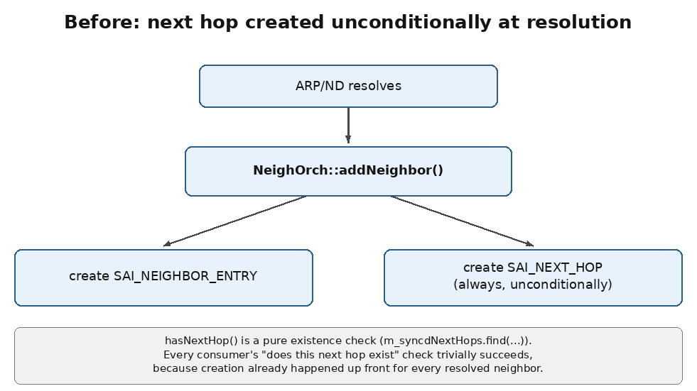
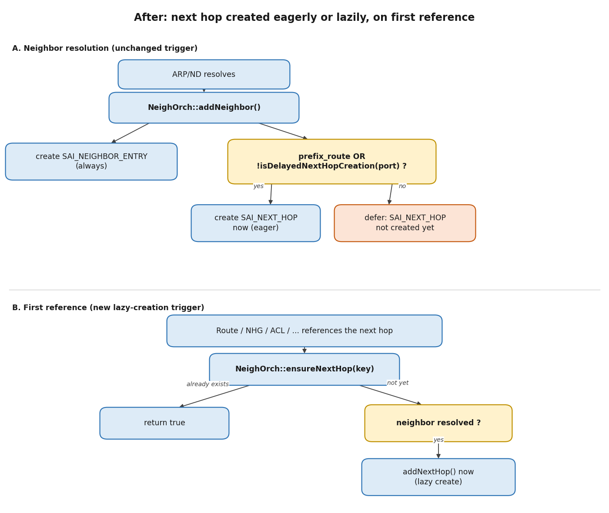

# Delayed Neighbor Next-Hop Creation

Delayed Neighbor Next-Hop Creation is a feature that optimizes SAI next-hop resource usage by delaying a resolved neighbor's next-hop creation until it is actually referenced/used by a route or next-hop group, rather than creating it unconditionally as soon as the neighbor resolves.

This saves hardware resources in scenarios where only a fraction of a large number of resolved neighbors ever get referenced -- each unused resolved neighbor would otherwise consume a scarce, platform-limited SAI/ASIC next-hop entry for no functional benefit. No change is required from any next-hop *consumer* orchagent module in the common case.

The feature is opt-in via `DEVICE_METADATA|localhost|nexthop_on_demand` (default `false`); when it is off, creation stays eager at resolution.

## Table of Contents

<!-- @import "[TOC]" {cmd="toc" depthFrom=1 depthTo=6 orderedList=false} -->

<!-- code_chunk_output -->
- [1. Revision](#1-revision)
- [2. Scope](#2-scope)
- [3. Definitions/Abbreviation](#3-definitionsabbreviation)
- [4. Overview](#4-overview)
  - [4.1 Problem Statement](#41-problem-statement)
- [5. Requirements](#5-requirements)
  - [5.1 Functional Requirements](#51-functional-requirements)
  - [5.2 Compatibility Requirements](#52-compatibility-requirements)
- [6. Architecture](#6-architecture)
  - [6.1 Before](#61-before)
  - [6.2 After](#62-after)
  - [6.3 Key APIs](#63-key-apis)
  - [6.4 Gating Logic in addNeighbor()](#64-gating-logic-in-addneighbor)
  - [6.5 Consumer Call-Site Classification](#65-consumer-call-site-classification)
- [7. High-Level Design](#7-high-level-design)
  - [7.1 FgNhgOrch (Fine-Grained ECMP)](#71-fgnhgorch-fine-grained-ecmp)
  - [7.2 MuxOrch](#72-muxorch)
  - [7.3 CRM and Reference Counting](#73-crm-and-reference-counting)
  - [7.4 BFD Sessions and the Down-Before-Creation Replay](#74-bfd-sessions-and-the-down-before-creation-replay)
  - [7.5 Warm Restart](#75-warm-restart)
  - [7.6 Operational Implications](#76-operational-implications)
    - [7.6.1 Adjacency Resolution No Longer Reserves a Next Hop](#761-adjacency-resolution-no-longer-reserves-a-next-hop)
    - [7.6.2 Behavior Under FRR Route Churn (Withdraw / Re-inject)](#762-behavior-under-frr-route-churn-withdraw--re-inject)
    - [7.6.3 Bounding CRM Staleness: Delayed Cleanup of Idle Next Hops](#763-bounding-crm-staleness-debounced-reclaim-of-idle-next-hops)
  - [7.7 Alternative Considered: Delayed Creation Below SAI (in the SDK)](#77-alternative-considered-delayed-creation-below-sai-in-the-sdk)
- [8. DB Schema Changes](#8-db-schema-changes)
  - [8.1 CONFIG_DB: DEVICE_METADATA](#81-config_db-device_metadata)
- [9. Command Line](#9-command-line)
- [10. Future Enhancements](#10-future-enhancements)
  - [10.1 Distinct Signal for Table-Full vs. Unresolved Neighbor](#101-distinct-signal-for-table-full-vs-unresolved-neighbor)
- [11. Limitations](#11-limitations)
- [12. Error Handling and Failure Scenarios](#12-error-handling-and-failure-scenarios)
- [13. Testing](#13-testing)
  - [13.1 Test Plan](#131-test-plan)

<!-- /code_chunk_output -->

<a id="1-revision"></a>
## 1. Revision
| Rev |     Date     |         Author        |    Change Description    |
|:---:|:------------:|:----------------------:|:-------------------------:|
| 0.1 | 07/27/2026   | Manas Kumar Mandal     | Initial draft.            |

**Target release:** TBD.

<a id="2-scope"></a>
## 2. Scope
This feature changes when a resolved neighbor's hardware next hop is created: no hardware next hop is created for a neighbor unless something -- a route, a next-hop group, or any other feature that forwards traffic -- actually references it. Creation of the neighbor entry itself is unaffected and remains immediate, since it is required for L3 forwarding regardless of usage.

**Out of scope:**

  * Any change to when the neighbor entry itself is created (always immediate, unchanged).
  * Runtime toggling of the feature -- the gate ([Section 8.1](#81-config_db-device_metadata)) is read at orchagent start.

<a id="3-definitionsabbreviation"></a>
## 3. Definitions/Abbreviation
| Term                      | Definition |
|:-------------------------:|:-----------|
| SAI                       | Switch Abstraction Interface. |
| CRM                       | Critical Resource Monitoring; SONiC's mechanism for tracking used/available counts of scarce ASIC resources (e.g. `CRM_IPV4_NEXTHOP`). |
| ARP / ND                  | Address Resolution Protocol / Neighbor Discovery -- the mechanisms that resolve an IP neighbor to a link-layer address. |
| ECMP                      | Equal-Cost Multi-Path. |
| FG ECMP                   | Fine-Grained ECMP, implemented by `FgNhgOrch`. |
| FRR / zebra               | The routing stack (FRRouting / its `zebra` RIB daemon) that distributes routes to SONiC via `fpmsyncd`/`APPL_DB`. |
| Mux                       | The dual-ToR mux next-hop abstraction owned by `MuxOrch`, used to steer traffic to the active ToR. |
| Warm restart              | SONiC's mechanism for reconciling in-memory/SAI state against a saved state across an orchagent/`swss` restart without traffic disruption. |

<a id="4-overview"></a>
## 4. Overview

<a id="41-problem-statement"></a>
### 4.1 Problem Statement
Today, as soon as a neighbor (ARP/ND entry) resolves, `NeighOrch::addNeighbor()` creates both:

1. The `SAI_OBJECT_TYPE_NEIGHBOR_ENTRY` (required for L3 forwarding/ARP suppression regardless of usage), and
2. The `SAI_OBJECT_TYPE_NEXT_HOP` object (a limited, ASIC-scarce hardware resource) for that neighbor.

Every resolved neighbor consumes one hardware next-hop entry, **whether or not any route or next-hop group ever points at it**. On boxes with a large number of resolved neighbors relative to actual next-hop consumers (e.g. large L3 fan-out, many peers/servers resolved but only a subset actively routed to at a given time), this wastes a scarce, platform-limited SAI/ASIC resource and can contribute to hitting the `CRM` next-hop scale ceiling for no functional benefit.

**Goal:** do not consume the hardware next-hop resource until it is actually used, so effective next-hop scale tracks real usage -- within a short, bounded lag on the way back down (see [Section 7.6.3](#763-bounding-crm-staleness-debounced-reclaim-of-idle-next-hops)) -- instead of neighbor resolution.

<a id="5-requirements"></a>
## 5. Requirements

<a id="51-functional-requirements"></a>
### 5.1 Functional Requirements
- On-demand creation is opt-in, off by default, gated by `nexthop_on_demand` ([Section 8.1](#81-config_db-device_metadata)).
- Once enabled, no SAI next hop is created for a neighbor unless something (a route, a next-hop group member, ACL redirect, SRv6, MPLS, VNET, a BFD session, etc.) actually references that next hop key.
- The read-side call `hasNextHop()` is renamed and split across three cases, decided per call site ([Section 6.5](#65-consumer-call-site-classification)): callers about to use a next hop call `ensureNextHop()` (which can create); callers that only ask whether the object exists call `hasSyncdNextHop()` (never creates); callers that only need to know whether the neighbor resolved call `isNeighborResolved()`. This is not a blanket rename -- some call sites change behavior and must be classified individually ([Section 6.3](#63-key-apis), [Section 6.5](#65-consumer-call-site-classification)).
- On-demand creation is batch-aware: when a single batch of routes references multiple not-yet-created next hops, they are created with one bulk SAI next-hop create, not one synchronous create per next hop. The route path already processes a batch of route tasks in one pass and bulks the route-entry creations into a single flush per batch; on-demand next-hop creation does the same instead of creating each referenced next hop one at a time inside that loop. Concretely, the route path gains a phase that, before building routes, scans the batch, enqueues every referenced not-yet-created next hop into one bulk next-hop create, and flushes it once, so the later per-route logic sees the next hops already present. This requires splitting the route path's "check the next hop, then build the route" flow across that new phase, and a choice of bulk error mode: whether a table-full partway through one bulk create leaves the remaining entries to be retried (stop-on-error) or lets each entry report its own status (ignore-error). The saving is largest for many distinct single-next-hop routes in one batch, each referencing a different not-yet-created neighbor (large-scale host/VM route injection, or initial convergence after a mass re-peer); ECMP/next-hop-group batches already pay their member-creation cost once per distinct group, so there the win is turning a group's member creates into one bulk call. The per-neighbor, event-driven `ensureNextHop()` calls from FG ECMP and mux do not fit a batch-of-routes loop and keep the single-create path.
<a id="52-compatibility-requirements"></a>
### 5.2 Compatibility Requirements
- With the gate off, next-hop creation remains eager at neighbor resolution (pre-change behavior).
- No regression to existing behaviors that require the SAI next hop immediately at resolution time: mux prefix-route neighbors (no-host-route mode), warm-restart reconciliation, and BFD-down-before-creation replay.
- CRM next-hop counters must continue to accurately reflect only next hops that actually exist in hardware.

<a id="6-architecture"></a>
## 6. Architecture

<a id="61-before"></a>
### 6.1 Before



`hasNextHop()` (since renamed -- see [Section 6.3](#63-key-apis)) was a read-only existence check. Every consumer's "does this next hop exist" check trivially succeeded because creation always happened up front.

<a id="62-after"></a>
### 6.2 After



With the gate enabled, the SAI next hop is created either eagerly (unchanged, for the cases that still need it immediately) or on demand, on first reference, via the `ensureNextHop()` call a consumer makes before using a next hop.

A next hop created on demand is deleted on exactly one of two triggers:

- **Trigger 1 -- its neighbor is removed.**
- **Trigger 2 -- it has had no references for a short grace period** (the delayed cleanup).

Both run the same teardown -- see [Section 7.3](#73-crm-and-reference-counting) and [Section 7.6.3](#763-bounding-crm-staleness-debounced-reclaim-of-idle-next-hops) for the mechanism.

The consumers affected are `RouteOrch`, `NhgOrch`, `MplsRouteOrch`, `Srv6Orch`, `VNetOrch`, `AclOrch`, `FgNhgOrch`, `MuxOrch`, and `BfdOrch`; [Section 6.5](#65-consumer-call-site-classification) classifies each of their call sites.

<a id="63-key-apis"></a>
### 6.3 Key APIs
| Function | Kind | Purpose |
|---|---|---|
| `ensureNextHop(key)` | can create | Ensures the next hop is usable, creating the SAI object now if the neighbor is resolved but the object doesn't exist yet. The trigger point for on-demand creation. Its existence check also counts a `MuxOrch` tunnel override as existing -- right for callers that then call `getNextHopId()`, wrong for callers that need the neighbor's own local object ([Section 7.2](#72-muxorch)). |
| `ensureLocalNextHop(key)` | can create | `ensureNextHop()` whose existence check looks only at the neighbor's own next hop, not a `MuxOrch` tunnel override. Used by the mux and BFD sites that then call `getLocalNextHopId()` ([Section 7.2](#72-muxorch), [Section 7.4](#74-bfd-sessions-and-the-down-before-creation-replay)). |
| `hasSyncdNextHop(key)` | read-only | Reports whether the SAI object exists right now. Never creates. Used by every internal check and by consumer sites that only need the answer, not the object ([Section 6.5](#65-consumer-call-site-classification)). |
| `isNeighborResolved(key)` | read-only | Reports whether the underlying ARP/ND entry is resolved, independent of whether the SAI next hop exists. |
| `isDelayedNextHopCreation()` | read-only | Returns the configured gate ([Section 8.1](#81-config_db-device_metadata)), evaluated once per neighbor in `addNeighbor()`. Global -- it applies to every port alike. |

**Why rename `hasNextHop()`.** Leaving the creating call named `has*` would leave a method that looks read-only but can allocate a hardware resource -- a trap for any future caller. The rename touches every consumer that called it, a wider diff than the behavior change alone, but the clearer contract is worth it.

**The read-only rule inside `NeighOrch`.** The design holds only if every internal check that must not create calls `hasSyncdNextHop()` (or `isNeighborResolved()`), never `ensureNextHop()`. That covers the creation precondition in `addNextHop()`, the removal guards and id/ref-count accessors, and the VOQ/system-neighbor reconcile path. One internal site, `removeNeighbor()`, does not use `hasSyncdNextHop()` and instead inspects the neighbor's own next-hop map directly, because `hasSyncdNextHop()` would count a `MuxOrch` tunnel override as existing and drive a teardown off an entry that was never real ([Section 7.2](#72-muxorch)). Consumers outside `neighorch.cpp` are classified in [Section 6.5](#65-consumer-call-site-classification).

<a id="64-gating-logic-in-addneighbor"></a>
### 6.4 Gating Logic in addNeighbor()

When a neighbor resolves, `addNeighbor()` decides whether to create its SAI next hop now or leave it for first reference. Creation is left on demand only when the gate is on *and* the neighbor is not a `prefix_route` neighbor. Otherwise creation stays eager, exactly as before this change. On the on-demand path, `addNeighbor()` does not create the next hop; it only notifies `FgNhgOrch` that the neighbor resolved ([Section 7.1](#71-fgnhgorch-fine-grained-ecmp)) and clears any pending resolution request ([Section 7.6.2](#762-behavior-under-frr-route-churn-withdraw--re-inject)).

`prefix_route` neighbors (mux no-host-route mode, where a full-prefix host route points directly at the next hop) always stay eager, since the SAI next hop is required the moment the host route is programmed.

<a id="65-consumer-call-site-classification"></a>
### 6.5 Consumer Call-Site Classification
`hasNextHop()` is used in three ways today, and only one may become `ensureNextHop()`. Each class, and the reason a call site falls into it:

1. **Check-before-use -> `ensureNextHop()`** (or `ensureLocalNextHop()` where the neighbor's own object is required). The caller is about to use the next hop and reads its id right after. Converting these is what makes on-demand creation work.
2. **Read-only check -> `hasSyncdNextHop()`.** The caller only wants to know whether the object exists, usually on a teardown path. Creating one here would be wrong.
3. **Resolution check -> `isNeighborResolved()`.** The caller is really asking "is the neighbor resolved," not "does the next hop exist," and must neither create the object nor require it to exist yet.

Classifying each `hasNextHop()` caller individually is a required step of the conversion, not a mechanical rename: a few sites change behavior and the wrong class is a bug. These are the cases that show why, one per class boundary:

- **A teardown guard that must not create.** `NextHopGroupMember`'s destructor removes the member only when its next hop exists and is unreferenced. If the check created, the destructor would allocate a SAI next hop and immediately delete it. `RouteOrch::removeNextHopGroup()` is the same shape: it skips a member whose next hop is missing, and a creating check flips that condition. These are read-only checks (`hasSyncdNextHop()`).
- **A resolution question wearing an existence check.** The MPLS branch of `RouteOrch::addNextHopGroup()` and prefix-based `FgNhgOrch::setFgNhg()` use `hasNextHop()` to ask "is the underlying IP neighbor resolved," not "does the next hop exist." Neither `ensureNextHop()` (which would create just to answer) nor `hasSyncdNextHop()` (which fails while the next hop is not yet created) fits; these use `isNeighborResolved()`.
- **A reference that outlives one call.** A `BfdOrch` session sets its next-hop attribute from the neighbor's own next hop and keeps using it. It must create on demand (`ensureLocalNextHop()`) *and* hold a reference, so the delayed cleanup ([Section 7.4](#74-bfd-sessions-and-the-down-before-creation-replay)) cannot remove a next hop the session still needs.

The authoritative, current list of every converted call site lives with the code change and its review, where it stays accurate as `sonic-swss` evolves; reproducing it here would go stale the first time a caller is added or moved.

<a id="7-high-level-design"></a>
## 7. High-Level Design
This section assumes the feature is enabled; with the gate off, `addNeighbor()` always takes the eager path and none of the on-demand cases below arise. It covers the detailed interactions triggered by the gating logic in [Section 6.4](#64-gating-logic-in-addneighbor), the operational implications of the change ([Section 7.6](#76-operational-implications)), and an alternative design that was considered and rejected ([Section 7.7](#77-alternative-considered-delayed-creation-below-sai-in-the-sdk)).

<a id="71-fgnhgorch-fine-grained-ecmp"></a>
### 7.1 FgNhgOrch (Fine-Grained ECMP)
Before this change, `addNextHop()` was the only place that told `FgNhgOrch` a next hop had become usable (`validNextHopInNextHopGroup()`), and `removeNextHop()` the only place that told it one had gone away (`invalidNextHopInNextHopGroup()`). Neither runs for a neighbor whose next hop was never created, so this notification pair is restored on both sides. Restoring only the add side would leave a stale FG member behind when a neighbor resolves, is validated as a member, and is later removed without its next hop ever having been created.

1. **Add side.** `addNeighbor()` notifies `FgNhgOrch` that the neighbor resolved, for every plain neighbor. `FgNhgOrch` then calls `ensureNextHop()` before activating a member, since being configured as an FG ECMP member is itself a reference that should create the next hop. Any next hop FG ECMP activates therefore exists as a SAI object from that point on.
2. **Remove side.** `removeNeighbor()` notifies `FgNhgOrch` of the invalidation for a plain neighbor whose next hop was never created, mirroring the add side instead of relying only on the `removeNextHop()` call site that runs just when the object exists. The call is a safe no-op unless the key is an FG member. With both sides restored, every valid/invalid notification is paired whether or not the SAI object was ever created, so FG membership cannot go stale on removal.

**Resource-blocked members are tracked and retried.** `ensureNextHop()` can fail when the next-hop table is full. On its own, FG ECMP would skip that member and still complete the route or group, leaving a resolved member inactive with nothing scheduled to try again when capacity frees up. To prevent that, a member whose `ensureNextHop()` fails is recorded as pending activation. The periodic sweep timer ([Section 7.6.3](#763-bounding-crm-staleness-debounced-reclaim-of-idle-next-hops)) re-attempts each pending member; once creation succeeds the member is activated and dropped from the pending set, and a member removed before then is dropped without activation. So a resolved-but-resource-blocked member keeps retrying until it either activates or goes away, rather than being silently skipped.

<a id="72-muxorch"></a>
### 7.2 MuxOrch
Mux neighbors in the default ("host-route") mode are plain (non `prefix_route`) neighbors, so they are subject to on-demand creation. Several mux paths (`MuxNbrHandler::update()`/`enable()`, `MuxOrch::updateRoute()`) fetch the neighbor's **own** next hop id via `getLocalNextHopId()`, which returns `SAI_NULL_OBJECT_ID` for a next hop not yet created on demand. Each of these must force creation first. (`MuxPrefixBasedNbrHandler`, used for no-host-route mode, is always `prefix_route`, hence always eager, and is unaffected.)

**`ensureNextHop()` is the wrong call here.** Its existence check counts a `MuxOrch` tunnel override as existing, not just the neighbor's own object. That is correct for ordinary consumers: while a mux neighbor is standby, they should get the tunnel next hop. But for the mux sites above it means `ensureNextHop()` reports success having created nothing, and the following `getLocalNextHopId()` still returns null -- the very failure those sites exist to prevent. `MuxNbrHandler::enable()` hits this on every standby-to-active transition, because its entries still hold the tunnel id from the standby path.

**Design:** these sites call `ensureLocalNextHop()` ([Section 6.3](#63-key-apis)), whose existence check looks only at the neighbor's own next hop, ignoring the tunnel override. Every other consumer keeps `ensureNextHop()`.

The tunnel override is also why `removeNeighbor()` must not use `hasSyncdNextHop()` to decide whether this neighbor's own next hop needs tearing down: the override would make a not-yet-created next hop look like it exists, and the teardown would then run off an entry that was never real, risking a CRM `used` and router-interface ref-count underflow. `removeNeighbor()` inspects the neighbor's own next-hop map directly for this decision.

<a id="73-crm-and-reference-counting"></a>
### 7.3 CRM and Reference Counting
- CRM next-hop counters (`CRM_IPV4_NEXTHOP` / `CRM_IPV6_NEXTHOP` / `CRM_MPLS_NEXTHOP`) are incremented when a next hop is created and decremented when it is torn down. Only the *timing* of creation moves; the one-to-one match between counter and SAI object is untouched, and counts now track real hardware usage more closely than before.
- The ref-count accessors assume the object already exists (read-only check, never create). Every caller must therefore call `ensureNextHop()` (or `ensureLocalNextHop()`) before touching a next hop's ref count -- including the `FgNhgOrch` and `MuxOrch` paths above. This is the create-side of the same discipline that [Section 6.5](#65-consumer-call-site-classification) applies to the sites that must *not* create.

**A shared next-hop-only teardown path.** Freeing a next hop means both deleting the SAI object (and decrementing CRM and the router-interface ref count) and dropping the software bookkeeping. Before this change those two happened together only inside neighbor removal; the bookkeeping-only step did not free the hardware or touch CRM on its own. The delayed cleanup ([Section 7.6.3](#763-bounding-crm-staleness-debounced-reclaim-of-idle-next-hops)) has to free a next hop *without* removing the resolved neighbor, so this design factors out a single next-hop-only teardown that frees the hardware, updates CRM and the router-interface ref count, sends the `FgNhgOrch` invalidation, and clears the bookkeeping for one next-hop key. Both neighbor removal and the cleanup call it, so there is one place that frees a next hop and one place that updates its accounting, and the two cannot drift apart.

<a id="74-bfd-sessions-and-the-down-before-creation-replay"></a>
### 7.4 BFD Sessions and the Down-Before-Creation Replay
`BfdOrch` uses a neighbor's next hop: a session on an interface without a `dst_mac` sets its next-hop attribute from `getLocalNextHopId()`, at session create and on each neighbor-change add. With the next hop not yet created, that id is null, and nothing would ever create it, so the session would never get its next hop.

**A BFD session counts as a reference.** `BfdOrch` calls `ensureLocalNextHop()` before reading the id, so the session creates the neighbor's own next hop on demand, and takes a ref count on it for as long as the session uses it. The ref count keeps the delayed cleanup ([Section 7.6.3](#763-bounding-crm-staleness-debounced-reclaim-of-idle-next-hops)) from tearing down a next hop a session still depends on. `BfdOrch` is listed as a consumer in [Section 6.5](#65-consumer-call-site-classification).

**Down before the next hop exists.** A session for a peer can report `DOWN` before that peer's next hop exists. The down flag (`NHFLAGS_IFDOWN`) cannot be applied to an object that isn't there, so `NeighOrch` tracks the set of peers last known to be down, independent of next-hop existence, and replays the down flag when the next hop is later created.

**The down-state cache follows the BFD session, not the neighbor.** A BFD session can outlive its neighbor. If the cached down state were cleared when the neighbor is removed, a next hop re-created after the neighbor's ARP relearns -- while the session is still down -- would come up without the down flag and wrongly forward. So an entry is cleared only on BFD session events: when the session reports `UP`, or when the session is deleted. It is not cleared on neighbor removal. This keeps the down state correct across a neighbor that comes and goes under a still-down session, and still bounds the set, since every entry is removed when its session ends.

<a id="75-warm-restart"></a>
### 7.5 Warm Restart
Reconciliation is unaffected: `addNeighbor()`'s gating logic runs identically during warm-boot replay as during normal operation, and consumers reconcile next hops the same way they always have (via `ensureNextHop()`), so a next hop that was created before the warm reboot is re-created (or found already present, depending on `bake()` ordering) using the same on-demand-or-eager decision as a fresh resolution.

Pending cleanups do not survive the restart; a post-reconciliation sweep re-schedules them for any unreferenced next hop, as described in [Section 7.6.3](#763-bounding-crm-staleness-debounced-reclaim-of-idle-next-hops).

<a id="76-operational-implications"></a>
### 7.6 Operational Implications

<a id="761-adjacency-resolution-no-longer-reserves-a-next-hop"></a>
#### 7.6.1 Adjacency Resolution No Longer Reserves a Next Hop
This is a trade-off of the design.

Before this change, a resolved adjacency and an existing hardware next hop were effectively the same event: `addNeighbor()` created the SAI next hop as part of resolving the neighbor, so any later route referencing that neighbor was guaranteed a next hop already existed. If the ASIC next-hop table was full at resolution time, creation failed and `addNeighbor()` rolled back the *neighbor entry itself*, so the failure showed up as a stuck/retrying adjacency for every affected neighbor -- whether or not that neighbor would ever be used by a route.

With on-demand creation, a plain neighbor's resolution never touches the next-hop table. The SAI next hop -- and any `SAI_STATUS_TABLE_FULL` / `SAI_STATUS_INSUFFICIENT_RESOURCES` it can return -- is now only attempted later, inside `ensureNextHop()`, at the moment a route or next-hop-group actually references the key. Concretely:

- **Adjacency-resolved no longer implies "a hardware next hop is available for this destination."** A neighbor can be fully resolved (up, ARP/ND-suppressed, visible as reachable to `FRR`/`zebra`/`BGP`) while the ASIC genuinely has no free next-hop slot, and that fact is now only discovered when a route actually gets pushed and processed.
- **FRR/zebra has no visibility into this.** Routing stacks distribute routes to `fpmsyncd`/`APPL_DB` based purely on RIB/adjacency state; they have no notion of a two-stage "adjacency then hardware-resource" SAI reservation. A route pointing at a perfectly healthy neighbor can fail to get its next hop created purely due to table exhaustion discovered at that later point.
- **The failure is handled as a retry, not a drop, but is not reported distinctly.** Table-full/insufficient-resource statuses map to a retry, so the referencing route is left in the consumer's retry queue and retried every orchagent iteration. The log line in the route path looks identical to the ordinary "still waiting for ARP to resolve" case, even though the cause here is hardware capacity, not an unresolved neighbor. The table-full status itself is logged at error level where the next hop is created, but that is one layer removed from the route that is actually stuck.

**Net effect:** this shift should *reduce* how often the next-hop table fills up, since capacity is only spent on next hops genuinely referenced by routes or groups rather than on every resolved-but-unused neighbor -- the point of this change. But when the table is genuinely undersized for the routes actually needed, the failure now shows up later (at route-install time, per route) instead of earlier (at adjacency-resolution time, per neighbor).

**Read CRM `used` and `available` differently here.** `available` is queried live from the ASIC, unaffected by this change, and stays the precise signal for approaching next-hop scale limits -- the primary thing to watch. `used` still means the count of next hops that currently exist; this design does not redefine it. What changes is how closely that count tracks real demand: before, it counted every resolved neighbor; now it counts next hops referenced at least once, and (per [Section 7.6.2](#762-behavior-under-frr-route-churn-withdraw--re-inject)) a next hop is not destroyed the instant its reference count hits zero, so `used` can run ahead of live demand while the neighbor stays resolved. [Section 7.6.3](#763-bounding-crm-staleness-debounced-reclaim-of-idle-next-hops) bounds that lag to a short grace period, but `used` should be read as a trend that backs up `available`, not as a live measure of demand.

A reasonable follow-up (not implemented here) would be to give this specific case -- next hop meant to be created on demand but currently resource-blocked -- a distinct counter/log signature from "neighbor not yet resolved," so it can be alerted on directly instead of only inferred from CRM trending (see [Section 10.1](#101-distinct-signal-for-table-full-vs-unresolved-neighbor)).

<a id="762-behavior-under-frr-route-churn-withdraw--re-inject"></a>
#### 7.6.2 Behavior Under FRR Route Churn (Withdraw / Re-inject)
Churn is `FRR`/`zebra` repeatedly withdrawing and re-injecting routes for a destination (path flapping, graceful-restart replay, ECMP/UCMP recompute) while the neighbor stays resolved throughout.

**Steady-state churn repeats no SAI work.** A plain next hop's destruction is not driven by its route reference count reaching zero -- that path only decrements an in-memory count. A next hop is torn down only when its neighbor is removed or after it stays idle past the grace period ([Section 7.6.3](#763-bounding-crm-staleness-debounced-reclaim-of-idle-next-hops)). So a withdraw and re-install within the grace period finds the next hop still present, cancels the pending cleanup, and only adjusts ref counts -- no SAI create/destroy. The one-time creation cost is paid once at first reference, not per cycle, so steady-state flapping costs no more than before; only the timing of that cost moves (first reference instead of resolution). MPLS-labeled and overlay/VXLAN next hops already created on reference and were destroyed on zero ref count before this change, so they are unaffected. If the churn also re-resolves the neighbor, its removal tears down the next hop and the next reference re-creates it -- the same cost as before on every re-resolution.

**Under a full table, churn costs more logging and retries.** The retry cache already collapses fast add/withdraw/add, so churn builds no ever-growing backlog. But each re-install retries `ensureNextHop()`, so a failing create and its error log recur once per churn cycle rather than once per neighbor. The route path also cannot tell a genuinely unresolved neighbor from a resolved one blocked by a full table -- both log "resolving neighbor" each cycle, obscuring the real cause. This motivates the distinct-signal follow-up in [Section 10.1](#101-distinct-signal-for-table-full-vs-unresolved-neighbor).

**Ref counts stay correct.** They are touched only on the success path, after an id is obtained; a failed `ensureNextHop()` retries without touching them, so churn cannot leave them out of sync.

**Pending-resolution cleanup is decoupled from next-hop creation.** A route may reference a next hop before its neighbor resolves, which prompts a resolution request (a recorded key plus an `APPL_DB` probe). If the route is withdrawn and the neighbor then resolves on its own, the on-demand path creates no next hop -- so `addNeighbor()` clears the pending-resolution record and its `APPL_DB` row whenever a requested resolution is satisfied, not only inside next-hop creation. Otherwise that bookkeeping would linger (no SAI or CRM effect). A regression test covers the sequence ([Section 13.1](#131-test-plan)).

<a id="763-bounding-crm-staleness-debounced-reclaim-of-idle-next-hops"></a>
#### 7.6.3 Bounding CRM Staleness: Delayed Cleanup of Idle Next Hops
Section 7.6.2 establishes that a plain next hop is destroyed only when its neighbor is removed, never when its route reference count drops back to zero -- this is what makes steady-state route churn free. The flip side is that a next hop that becomes genuinely unreferenced (not just mid-flap, but never used again) can keep occupying a hardware slot for as long as the neighbor stays resolved. CRM `used`, accordingly, counts every next hop referenced at least once since resolution, not current demand (see [Section 7.6.1](#761-adjacency-resolution-no-longer-reserves-a-next-hop)).

To bound that staleness without giving up the churn-free property, cleanup of an idle next hop is **delayed** rather than immediate or never. When a next hop becomes idle, its deletion is scheduled after a short, fixed grace period. If any consumer references it again before the grace period elapses -- the ordinary churn case -- the pending deletion is cancelled and no SAI work happens. Only a next hop that stays idle longer than the grace period is torn down, once, through the shared next-hop-only teardown ([Section 7.3](#73-crm-and-reference-counting)), so the CRM decrement and `FgNhgOrch` invalidation ([Section 7.1](#71-fgnhgorch-fine-grained-ecmp)) stay consistent with no separate teardown logic.

**Two ways a next hop becomes idle, both scheduled.** Scheduling cleanup only when a ref count *drops* to zero would miss a next hop that is created but never successfully referenced -- for example, created on first reference but the route install then fails, so the count never leaves zero and never *drops* to it. To cover that, cleanup is scheduled both when a ref count drops to zero *and* when a next hop is created and left at zero references. Acquiring the first reference cancels the pending cleanup. So every idle next hop, however it became idle, is eventually cleaned up, and any next hop that gets used in time is not.

This is narrow in scope: it bounds staleness under ordinary churn, and does not reactively free capacity under table-full pressure (a different problem, not addressed here).

**Parameters and mechanism.** The grace period is **5 seconds** and the pending-cleanup queue is swept **once per second**, both fixed compile-time constants with no CONFIG_DB knob. Five seconds covers the flap and reconverge timescales in [Section 7.6.2](#762-behavior-under-frr-route-churn-withdraw--re-inject) while keeping CRM `used` staleness bounded. A timer owned by `NeighOrch` drives the sweep and also re-attempts resource-blocked FG members ([Section 7.1](#71-fgnhgorch-fine-grained-ecmp)). Every entry waits the same grace period, so the queue stays in due-time order and each sweep only looks at the front. Cancelling a scheduled cleanup removes the key from the still-due set and leaves its queue entry to be ignored when the sweep reaches it, so re-referencing a next hop never has to search or rebuild the queue. If the neighbor is removed while a cleanup is pending, neighbor removal tears down as usual and the pending entry is dropped.

**Warm restart.** The queue is in-memory and does not survive a warm boot: pending cleanups are discarded, and reference counts are rebuilt by reconciliation ([Section 7.5](#75-warm-restart)). Since a cleanup is scheduled on the *transition* to idle, a next hop already idle before the restart would never be cleaned up after it. To close this, a post-reconciliation sweep schedules a cleanup for every plain next hop sitting at zero references.

<a id="77-alternative-considered-delayed-creation-below-sai-in-the-sdk"></a>
### 7.7 Alternative Considered: Delayed Creation Below SAI (in the SDK)
Instead of gating creation in `orchagent`, the vendor SDK could accept `create_next_hop()` eagerly (as today) but defer the actual hardware programming internally until the object is referenced by a route/group.

**Pros:**

- **Transparency:** transparent to every consumer with no `orchagent` code changes, so none of the consumer-side edge cases this design handles (FG ECMP, mux, pending-resolution cleanup) would arise.
- **Bulk coalescing:** the SDK can potentially see a bulk route create and a bulk next-hop create together and commit them as one hardware transaction -- something `orchagent`'s per-object-type bulking cannot express through SAI today.

**Cons:**

- **CRM inaccuracy:** `used` is incremented on every next-hop create call, so it reverts to counting resolved neighbors, not actual references -- the problem this HLD fixes. `available` stays accurate (queried live from hardware), so the two counters no longer agree with each other, which is misleading for capacity monitoring.
- **Loss of control:** `orchagent` loses control over bulking/error-mode policy, since the decision now lives in vendor code.
- **Error misattribution:** table-full failures would show up on whatever call finally references the next hop (e.g. a route or group-member create), not on a next-hop-specific call: the wrong resource type gets blamed, there's no next-hop key to log, and a single failed member inside an ECMP group create can only return one aggregate status for the whole group.
- **Vendor lock-in:** vendor/SDK-specific, closed-source in most cases, not portable or testable in open-source `orchagent` unit tests.

**Verdict:** rejected primarily because it cannot satisfy the CRM-accuracy requirement above -- CRM accounting is defined at the SAI call boundary, not the hardware-programming boundary -- and secondarily because it degrades error attribution, turning a precise per-next-hop failure into an ambiguous failure on whatever route/group object referenced it. The bulk-coalescing benefit is better pursued as a vendor-internal optimization layered underneath this design rather than as a replacement for it.

<a id="8-db-schema-changes"></a>
## 8. DB Schema Changes
No SAI, APPL_DB, or STATE_DB schema changes. The only CONFIG_DB change is the opt-in field below. Any code path that already followed the established "`ensureNextHop()` before using a next hop" convention needs no changes and transparently benefits once the feature is enabled.

<a id="81-config_db-device_metadata"></a>
### 8.1 CONFIG_DB: DEVICE_METADATA
One optional boolean field is added to `DEVICE_METADATA|localhost`, with a matching `sonic-device_metadata` YANG leaf:

```
key                                 = DEVICE_METADATA|localhost
nexthop_on_demand                   = "true" / "false"   ; default "false"
```

`true` enables on-demand creation (and the delayed cleanup of [Section 7.6.3](#763-bounding-crm-staleness-debounced-reclaim-of-idle-next-hops)); `false` or absent keeps the legacy eager behavior. `isDelayedNextHopCreation()` returns this value, read once at orchagent start, so a `swss` restart is needed to change it.

<a id="9-command-line"></a>
## 9. Command Line
No new CLI is introduced by this change; the feature is enabled by setting the CONFIG_DB field in [Section 8.1](#81-config_db-device_metadata).

Operators should continue to use the existing CRM show commands (`CRM_IPV4_NEXTHOP` / `CRM_IPV6_NEXTHOP` / `CRM_MPLS_NEXTHOP` used/available counters), with `available` remaining the primary, precise signal for approaching next-hop scale limits and `used` serving as a supporting trend rather than a live measure of demand (see [Section 7.6.1](#761-adjacency-resolution-no-longer-reserves-a-next-hop)).

<a id="10-future-enhancements"></a>
## 10. Future Enhancements

<a id="101-distinct-signal-for-table-full-vs-unresolved-neighbor"></a>
### 10.1 Distinct Signal for Table-Full vs. Unresolved Neighbor
`RouteOrch::addRoute()`'s `ensureNextHop() == false` handling cannot distinguish an unresolved neighbor from a resolved one whose on-demand creation failed due to table exhaustion; under route churn this repeats a misleading "resolving neighbor" log/probe once per churn cycle (see [Section 7.6.2](#762-behavior-under-frr-route-churn-withdraw--re-inject)). A distinct counter/log signature for "creation meant to be on demand but currently resource-blocked" would let operators alert on this directly instead of only inferring it from CRM trending (see [Section 7.6.1](#761-adjacency-resolution-no-longer-reserves-a-next-hop)).

<a id="11-limitations"></a>
## 11. Limitations
- The gate is global and boot-time only: it applies to every port alike, and toggling it requires a `swss` restart.
- When the feature is enabled, a resolved adjacency no longer guarantees an available hardware next hop; see the trade-off discussion in [Section 7.6.1](#761-adjacency-resolution-no-longer-reserves-a-next-hop).
- Under sustained table-full conditions combined with route churn, log volume and retry-driven work scale with route churn rate in addition to neighbor resolution rate; see [Section 7.6.2](#762-behavior-under-frr-route-churn-withdraw--re-inject).
- The cleanup grace period in [Section 7.6.3](#763-bounding-crm-staleness-debounced-reclaim-of-idle-next-hops) is a fixed constant with no per-platform tuning yet, and only bounds CRM `used` staleness under ordinary churn -- it does not reactively free capacity under table-full pressure.
- The read-only/creating split is a convention, not something the type system enforces. A future caller that picks `ensureNextHop()` on a teardown or decision path brings back the hazard in [Section 6.5](#65-consumer-call-site-classification). The naming makes that visible in review but cannot prevent it.

<a id="12-error-handling-and-failure-scenarios"></a>
## 12. Error Handling and Failure Scenarios
- **Next-hop table full at first reference:** the status maps to a retry; the referencing route/group is left in the consumer's retry queue and retried every orchagent iteration, and the table-full status is logged where the next hop is created. See [Section 7.6.1](#761-adjacency-resolution-no-longer-reserves-a-next-hop) for the implications of this failure moving from resolution-time to route-install-time.
- **FG ECMP member blocked by table-full:** the member is recorded as pending activation and re-attempted on the sweep until it activates or is removed, rather than being skipped with no retry ([Section 7.1](#71-fgnhgorch-fine-grained-ecmp)).
- **Repeated table-full under route churn:** each re-install re-enters `ensureNextHop()` and can re-attempt (and re-log) a failing create once per cycle; see [Section 7.6.2](#762-behavior-under-frr-route-churn-withdraw--re-inject).
- **Next hop created but never successfully referenced:** a cleanup scheduled at creation tears it down after the grace period, so it does not strand a slot waiting for a ref-count drop that never comes ([Section 7.6.3](#763-bounding-crm-staleness-debounced-reclaim-of-idle-next-hops)).
- **Neighbor removed before its on-demand next hop was ever created:** teardown is clean, with no spurious SAI remove call ([Section 13.1](#131-test-plan) covers this).
- **Neighbor removed after its next hop was created:** neighbor removal tears down the SAI next hop ([Section 13.1](#131-test-plan) covers this).
- **BFD session uses an on-demand next hop:** `BfdOrch` creates it on demand via `ensureLocalNextHop()` and holds a reference, so the session gets its next hop and the delayed cleanup cannot remove one a session still uses ([Section 7.4](#74-bfd-sessions-and-the-down-before-creation-replay)).
- **BFD session reports `DOWN` before the peer's next hop is created:** the down state is tracked independent of next-hop existence and replayed when the next hop is created; the cached state is cleared on session `UP`/delete, not on neighbor removal, so a next hop re-created under a still-down session stays down ([Section 7.4](#74-bfd-sessions-and-the-down-before-creation-replay)).
- **Route references a next hop before its neighbor resolves, then the route is withdrawn before resolution:** does not leak a SAI object, a CRM count, or a pending-resolution bookkeeping entry -- `addNeighbor()` clears the pending resolution-request state directly once the neighbor resolves; see [Section 7.6.2](#762-behavior-under-frr-route-churn-withdraw--re-inject).

<a id="13-testing"></a>
## 13. Testing

<a id="131-test-plan"></a>
### 13.1 Test Plan
- Unit tests added in `neighorch_ut.cpp`:
  - With the gate off, plain neighbor resolution still eagerly creates a SAI next hop (legacy behavior). The remaining cases run with it enabled.
  - Plain neighbor resolution does not eagerly create a SAI next hop.
  - First reference creates exactly one SAI next hop on demand; subsequent references do not re-create it.
  - Removing a neighbor whose next hop was never created tears down cleanly (no spurious SAI remove call, no assert).
  - Removing a neighbor whose next hop was created on demand correctly tears down the SAI next hop.
  - A route requests resolution, is withdrawn before the neighbor resolves, and the neighbor then resolves independently: the pending-resolution record and its `APPL_DB` row are cleared by `addNeighbor()` even though no next hop is created (see [Section 7.6.2](#762-behavior-under-frr-route-churn-withdraw--re-inject)).
  - A configured FG ECMP member resolves (activating the member and creating its next hop) and is then removed: `FgNhgOrch`'s member state reflects the removal and no stale member remains.
  - A non-member neighbor resolves, is never referenced, and is then removed: the on-demand-path invalidation call is a no-op and teardown completes cleanly (see [Section 7.1](#71-fgnhgorch-fine-grained-ecmp)).
  - An FG ECMP member's `ensureNextHop()` fails with the table full: the member is recorded pending, re-attempted on the sweep, and activated once creation succeeds; a member removed before then is dropped without activation (see [Section 7.1](#71-fgnhgorch-fine-grained-ecmp)).
  - A next hop goes idle and is referenced again before the grace period: the pending destruction is cancelled and no SAI create/destroy call is made (see [Section 7.6.3](#763-bounding-crm-staleness-debounced-reclaim-of-idle-next-hops)).
  - A next hop goes idle and stays idle past the grace period: it is torn down exactly once through the shared teardown, with the corresponding CRM decrement (see [Section 7.3](#73-crm-and-reference-counting), [Section 7.6.3](#763-bounding-crm-staleness-debounced-reclaim-of-idle-next-hops)).
  - A next hop is created but never successfully referenced (ref count stays at zero): the cleanup scheduled at creation tears it down after the grace period, and acquiring a reference before then cancels it (see [Section 7.6.3](#763-bounding-crm-staleness-debounced-reclaim-of-idle-next-hops)).
  - A neighbor is removed while one of its next hop's cleanups is still pending: teardown completes cleanly, with no double-teardown or stale pending state.
  - A BFD session on an interface without a `dst_mac` is created while the peer's next hop is not yet created: `BfdOrch` creates it via `ensureLocalNextHop()`, the session gets a valid next-hop id, and the held reference keeps the delayed cleanup from removing it (see [Section 7.4](#74-bfd-sessions-and-the-down-before-creation-replay)).
  - A session reports `DOWN` before the peer's next hop exists, the next hop is then created, and the down flag is replayed; the cached down state is cleared on session `UP` or delete, and is *not* cleared when the neighbor is removed while the session is still down (see [Section 7.4](#74-bfd-sessions-and-the-down-before-creation-replay)).
  - A mux'd neighbor whose local next hop is not yet created is removed while `MuxOrch` reports a tunnel override for the key: neighbor removal does not treat the local next hop as existing, issues no SAI remove call, and does not decrement CRM or the router-interface ref count (see [Section 7.2](#72-muxorch)).
  - A mux'd neighbor whose local next hop is not yet created goes standby-to-active while `MuxOrch` still reports a tunnel override: `ensureLocalNextHop()` creates the local object and `getLocalNextHopId()` returns a valid id instead of null (see [Section 7.2](#72-muxorch)).
  - Tearing down an unreferenced `NextHopGroupMember` whose next hop was never created issues no create call, confirming the teardown path uses the read-only check (see [Section 6.5](#65-consumer-call-site-classification)).
  - Warm-restart reconciliation ends with a plain next hop at zero references: the post-reconciliation sweep schedules a cleanup, which fires once after the grace period (see [Section 7.6.3](#763-bounding-crm-staleness-debounced-reclaim-of-idle-next-hops)).
- Manual/code review verification: mux active/standby transitions in host-route mode, warm-restart reconciliation, and BFD-down replay before and after on-demand creation.
