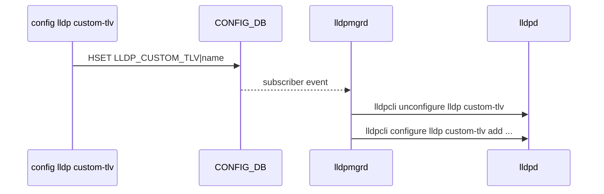
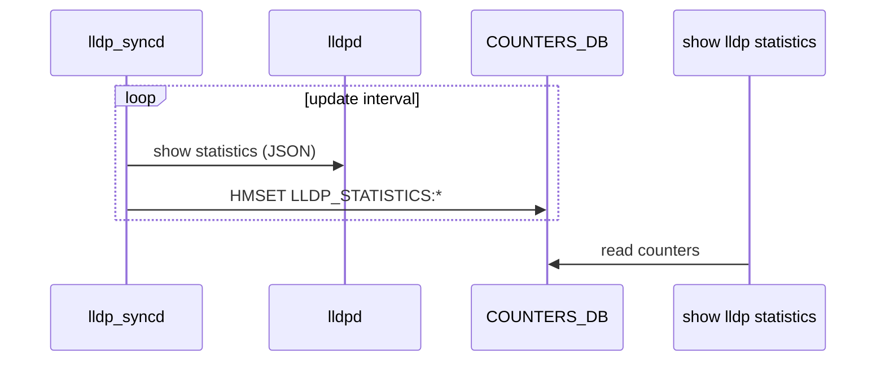
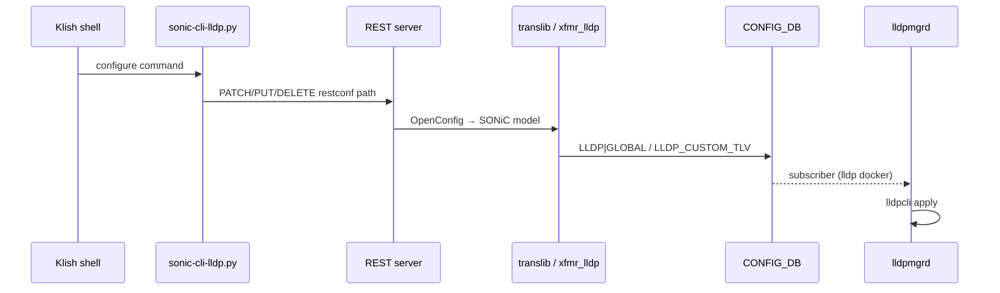

# SONiC LLDP Enhancements HLD

## Table of Contents

- [Revision](#revision)
- [Scope](#scope)
- [Definitions/Abbreviations](#definitionsabbreviations)
- [Overview](#overview)
- [Requirements](#requirements)
- [Architecture Design](#architecture-design)
- [High-Level Design](#high-level-design)
  - [Proposed upstream pull requests](#proposed-upstream-pull-requests)
  - [Global custom LLDP TLVs](#global-custom-lldp-tlvs)
  - [Neighbor and local chassis state](#neighbor-and-local-chassis-state)
  - [LLDP statistics](#lldp-statistics)
  - [Enhanced Click CLI](#enhanced-click-cli)
  - [Klish CLI](#klish-cli)
  - [Control flows](#control-flows)
- [SAI API](#sai-api)
- [SAIREDIS API](#sairedis-api)
- [Configuration and management](#configuration-and-management)
  - [CLI enhancements](#cli-enhancements)
  - [YANG model enhancements](#yang-model-enhancements)
  - [Config DB enhancements](#config-db-enhancements)
  - [APP DB and COUNTERS_DB](#app-db-and-counters_db)
- [Warmboot and Fastboot Design Impact](#warmboot-and-fastboot-design-impact)
- [Memory Consumption](#memory-consumption)
- [Restrictions/Limitations](#restrictionslimitations)
- [Testing Requirements/Design](#testing-requirementsdesign)
  - [Unit test cases](#unit-test-cases)
- [Open/Action items](#openaction-items)
- [References](#references)

### Revision

| Rev |     Date    | Author              | Change Description |
|:---:|:-----------:|:-------------------:|--------------------|
| 0.1 | 11/27/2026  | Govindaraj Haridass | Initial version    |

### Scope

This document describes the high-level design for **SONiC-native** LLDP enhancements on top of the baseline LLDP configuration work, whose HLD is [SONiC PR #2557](https://github.com/sonic-net/SONiC/pull/2557) and whose implementation PRs are [sonic-buildimage #30154](https://github.com/sonic-net/sonic-buildimage/pull/30154) and [sonic-utilities #4969](https://github.com/sonic-net/sonic-utilities/pull/4969). The enhancements are described as feature subsections in this document and are intended to land as **one upstream pull request per repository** (sonic-buildimage, sonic-dbsyncd, sonic-utilities, sonic-mgmt-framework), each implementing all the subsections that touch that repository.

**In scope**

- Global organizationally-specific (type 127) **custom TLVs** (`CONFIG_DB`, `lldpmgrd`).
- **Extended neighbor and local chassis** fields in `APPL_DB` (`lldp_syncd`).
- **LLDP statistics** in `COUNTERS_DB` and `show lldp statistics`.
- **Click CLI additions** in `sonic-utilities` for custom TLVs, statistics and effective config, reusing the `config lldp global`, `config lldp-port` and `show lldp global|port` commands from #4969 without duplicating them.
- **Klish CLI** extensions in `sonic-mgmt-framework` for statistics, global config, management-interface, and custom TLVs (REST via Management Framework).

### Definitions/Abbreviations

| Term | Description |
|------|-------------|
| LLDP | Link Layer Discovery Protocol (IEEE 802.1AB) |
| OUI | Organizationally Unique Identifier (3 bytes) |
| TLV | Type-Length-Value |
| `lldpmgrd` | Daemon in `docker-lldp`; applies `CONFIG_DB` to `lldpcli` |
| `lldp_syncd` | Daemon in `sonic-dbsyncd`; polls `lldpd` JSON into Redis |
| KLISH | Command shell in `sonic-mgmt-framework`; actioners call local REST |
| UMF | Unified Management Framework (`sonic-mgmt-common` REST + translib) |

### Overview

SONiC ships `lldpd`, `lldpmgrd`, and `lldp_syncd` with core neighbor identity in `APPL_DB` `LLDP_ENTRY_TABLE`. The baseline PRs (#30154, #4969) add configurable global/per-port LLDP settings and the Management Address TLV source. This HLD proposes enhancements on top of them: operational visibility (PVID, MED, aggregation, remote custom TLVs, TTL, statistics), global custom TLV configuration, and richer Click and Klish CLIs.

These items should be upstreamed as one PR per repository that **builds on** SONiC PR #2557 without duplicating it. New YANG and CLI use the `mgmt_addr_interface` leafref defined in #30154, and the Management Address TLV continues to use the address derivation implemented in #30154.

### Requirements

1. Persist global custom TLVs in `CONFIG_DB`; `lldpmgrd` advertises them via `lldpcli configure lldp custom-tlv`.
2. Expose extended neighbor/chassis fields in `APPL_DB` for SNMP, automation, and diagnostics.
3. Mirror `lldpcli show statistics` into `COUNTERS_DB` and surface via `show lldp statistics`.
4. Add Click commands for custom TLVs, statistics and effective-config display, reusing the #4969 `lldp global` / `lldp-port` command groups for baseline settings.
5. Extend **Klish** so operators can show statistics/config/custom TLVs and set/clear management-interface and custom TLVs through the same OpenConfig REST paths as gNMI, without duplicating business logic in the actioner.

### Architecture Design

LLDP data-plane control stays in the **lldp** and **dbsyncd** containers. Configuration reaches `CONFIG_DB` via **Click** (direct) or **Klish → REST → translib** (Management Framework). `orchagent`, `syncd`, and SAI are unchanged.

```
  Click config lldp ---------> CONFIG_DB (LLDP, LLDP_PORT, LLDP_CUSTOM_TLV)
                                     |
  Klish (configure) --> REST ------>+    lldpmgrd (docker-lldp) --> lldpd
        ^              translib     |
        |              (mgmt-common)|
        +---- show (GET counters/neighbors/config from APPL_DB / COUNTERS_DB)

  lldp_syncd <-- JSON poll --- lldpd --> APPL_DB (LLDP_ENTRY_TABLE, LLDP_LOC_CHASSIS)
                            \-> COUNTERS_DB (LLDP_STATISTICS:*)
```

Klish does **not** write Redis directly. Configure-mode commands invoke `sonic-cli-lldp.py`, which uses `cli_client.ApiClient` against the local REST server; translib maps OpenConfig LLDP to `CONFIG_DB` (see [Management Framework HLD](../mgmt/Management%20Framework.md)). Show commands for statistics read OpenConfig counter leaves populated from `COUNTERS_DB` via the transformer; neighbor shows read operational data from `APPL_DB`.

| Component | Repository / image |
|-----------|-------------------|
| `lldpmgrd`, `lldpd`, YANG | sonic-buildimage (`docker-lldp`, sonic-yang-models) |
| `lldp_syncd` | sonic-dbsyncd |
| Click CLI | sonic-utilities |
| Klish CLI | sonic-mgmt-framework (`mgmt-framework` container) |
| OpenConfig LLDP transformer | sonic-mgmt-common (prerequisite for the sonic-mgmt-framework PR) |

### High-Level Design

#### Proposed upstream pull requests

The subsections below describe the design per feature. Implementation is delivered as **one PR per repository**; each PR contains every subsection that touches that repository.

| PR | Repository | Subsections implemented | Depends on |
|----|------------|-------------------------|------------|
| **PR-1** | sonic-buildimage | [Global custom LLDP TLVs](#global-custom-lldp-tlvs): `LLDP_CUSTOM_TLV` YANG, `lldpmgrd` apply, YANG and `lldpmgrd` unit tests for custom TLVs only | SONiC PR #2557 / #30154 YANG |
| **PR-2** | sonic-dbsyncd | [Neighbor and local chassis state](#neighbor-and-local-chassis-state) and [LLDP statistics](#lldp-statistics) (`lldp_syncd`, parsers, tests) | [sonic-dbsyncd#88](https://github.com/sonic-net/sonic-dbsyncd/pull/88) |
| **PR-3** | sonic-utilities | [Enhanced Click CLI](#enhanced-click-cli): `show lldp statistics`, `show lldp config`, custom-TLV config/show, docs, tests | SONiC PR #2557; #4969; PR-1; PR-2 |
| **PR-4** | sonic-mgmt-framework | [Klish CLI](#klish-cli) show/config for statistics, config, custom TLV, management-interface, global LLDP leaves and per-port enable | OpenConfig LLDP in sonic-mgmt-common; PR-1; PR-2 |

#### Global custom LLDP TLVs

Implemented in **PR-1** (sonic-buildimage).

**YANG:** Add `LLDP_CUSTOM_TLV` / `LLDP_CUSTOM_TLV_LIST` keyed by `name` with `type` (default 127), `oui`, `oui_subtype`, optional `value`. Update `tests/yang_model_tests/tests/lldp.json` and `tests_config/lldp.json`.

**lldpmgrd**

- Subscribe to `LLDP_CUSTOM_TLV` (`SubscriberStateTable`).
- On change: `apply_custom_tlv_config()` — `unconfigure lldp custom-tlv`, then per entry `configure lldp custom-tlv add oui … subtype … [oui-info …]`.
- `build_custom_tlv_cli_commands()` normalises hex for `lldpcli`.
- Run once at boot after global/port init.

**Config DB key:** `LLDP_CUSTOM_TLV|<name>`

| Field | Description |
|-------|-------------|
| `name` | Administrative key (1..64); not on wire |
| `type` | Default `127` |
| `oui` | `aa:bb:cc` |
| `oui_subtype` | 0–255 |
| `value` | Optional contiguous hex |

#### Neighbor and local chassis state

Implemented in **PR-2** (sonic-dbsyncd).

`lldp_syncd` polls `lldpctl -f json` and `lldpcli -f json show chassis` on the existing interval (default 10 s).

Additional `LLDP_ENTRY_TABLE|<ifname>` fields (additive):

| lldpd JSON / parser | APPL_DB field |
|---------------------|---------------|
| VLAN TLV | `lldp_rem_port_vlan_id` |
| Unknown org-specific | `lldp_rem_custom_tlvs` (JSON string) |
| LLDP-MED | `lldp_rem_med_inv_serial` |
| Port TLVs | `lldp_rem_max_frame_size`, `lldp_rem_agg_port_id` |
| Neighbor | `lldp_rem_ttl` |
| Capabilities | `lldp_rem_sys_cap_supported`, `lldp_rem_sys_cap_enabled` |

If only `lldp_rem_time_mark` changes, update that field in place. After sonic-dbsyncd#88, rewrite `LLDP_LOC_CHASSIS` when missing from `APPL_DB` even if JSON is unchanged.

#### LLDP statistics

Implemented in **PR-2** (sonic-dbsyncd, `COUNTERS_DB` population) and **PR-3** (sonic-utilities, `show lldp statistics`).

`parse_statistics()` on JSON from `lldpcli show statistics`:

- Per-interface keys for names matching `Ethernet*`, `Ethernet-BP*`, `eth0`; skip others with warning.
- `LLDP_STATISTICS:GLOBAL` = sum of interfaces, or `summary` when no per-if data.

`sync_statistics()` diffs against cache → `HMSET` / `DEL` on `COUNTERS_DB`.

| lldpd key | COUNTERS_DB field |
|-----------|-------------------|
| `tx` | `frame_out` |
| `rx` | `frame_in` |
| `rx_discarded_cnt` | `frame_discard` |
| `rx_unrecognized_cnt` | `tlv_unknown` |
| `insert_cnt` | `tlv_accepted` |
| `ageout_cnt` | `entries_aged_out` |

`show lldp statistics [interface]` reads `COUNTERS_DB`; column labels match `lldpcli`.

#### Enhanced Click CLI

Implemented in **PR-3** (sonic-utilities).

#4969 already provides the baseline settings CLI, generated from the YANG model:

- `config lldp global <leaf>` for `hello-time`, `multiplier`, `system-name`, `system-description`, `enabled`, `mode`, `supp-mgmt-address-tlv`, `supp-system-capabilities-tlv`, `mgmt-addr-interface`
- `config lldp-port add|update|delete <ifname>` for per-port `enabled` / `mode`
- `show lldp global` and `show lldp port [ifname]`

These are **reused as-is** for all global and per-port settings; this PR adds no parallel commands for them and no validation of its own, since #4969 validates against the YANG model.

This PR adds:

- `config lldp custom-tlv add|delete` (PR-1 backend) with OUI and hex-value checks before the `CONFIG_DB` write
- `show lldp custom-tlv`
- `show lldp statistics [ifname]` (data from PR-2)
- `show lldp config` for the effective configuration (`LLDP|GLOBAL` and `LLDP_PORT` merged with defaults), complementing the raw `show lldp global|port`

Neighbor display continues to use the existing `show lldp neighbors` and `show lldp table` commands the new PVID, MED, TTL and similar fields from PR-2 will be added to those outputs.

Update [Command-Reference.md](https://github.com/sonic-net/sonic-utilities/blob/master/doc/Command-Reference.md).

#### Klish CLI

Implemented in **PR-4** (sonic-mgmt-framework).

**Community baseline** (upstream `sonic-mgmt-framework`, e.g. SONiC Management Framework 1.0) already ships neighbor-oriented **show** commands wired to OpenConfig REST:

| Mode | Command | Actioner handler | REST GET |
|------|---------|------------------|----------|
| Enable | `show lldp` | `get_openconfig_lldp_lldp_interfaces` | `/restconf/data/openconfig-lldp:lldp/interfaces` |
| Enable | `show lldp table` | same (template `lldp_show.j2`) | same |
| Enable | `show lldp neighbor [ifname]` | all interfaces or `…/interface={name}` | per-interface path |

The baseline `CLI/actioner/sonic-cli-lldp.py` only implements neighbor/interface GET handlers and renders via Jinja templates under `CLI/renderer/templates/`.

**Enhancement (PR-4)** extends Klish without changing the neighbor command tree:

| Mode | Command | Handler | REST operation |
|------|---------|---------|----------------|
| Enable | `show lldp statistics [ifname]` | `get_openconfig_lldp_lldp_statistics` / `…_interface_statistics` | `lldp/state/counters` or `interfaces/interface={name}/state/counters` |
| Enable | `show lldp config` | `get_openconfig_lldp_lldp_config` | `/restconf/data/openconfig-lldp:lldp/config` |
| Enable | `show lldp custom-tlv` | `get_openconfig_lldp_lldp_custom_tlvs` | `/restconf/data/openconfig-lldp:lldp/custom-tlvs` |
| Configure | `lldp management-interface <ifname>` | `patch_openconfig_lldp_management_interface` | PATCH `lldp/config/management-interface` |
| Configure | `no lldp management-interface` | `delete_openconfig_lldp_management_interface` | DELETE same leaf |
| Configure | `lldp custom-tlv <name> <oui> <subtype> [value]` | `patch_openconfig_lldp_custom_tlv` | PUT `custom-tlvs/tlv={name}/config` |
| Configure | `no lldp custom-tlv <name>` | `delete_openconfig_lldp_custom_tlv` | DELETE `custom-tlvs/tlv={name}` |
| Configure | `lldp enable` / `no lldp enable` | `patch_openconfig_lldp_lldp_config_enabled` | PATCH `lldp/config/enabled` |
| Configure | `lldp hello-timer <seconds>` / `no lldp hello-timer` | `patch_openconfig_lldp_lldp_config_hello_timer` / `delete_…` | PATCH / DELETE `lldp/config/hello-timer` |
| Configure | `lldp system-name <name>` / `no lldp system-name` | `patch_openconfig_lldp_lldp_config_system_name` / `delete_…` | PATCH / DELETE `lldp/config/system-name` |
| Configure | `lldp system-description <text>` / `no lldp system-description` | `patch_openconfig_lldp_lldp_config_system_description` / `delete_…` | PATCH / DELETE `lldp/config/system-description` |
| Configure | `lldp suppress-tlv-advertisement {management-address \| system-capabilities}` / `no …` | `patch_openconfig_lldp_lldp_config_suppress_tlv` / `delete_…` | PATCH / DELETE `lldp/config/suppress-tlv-advertisement` |
| Configure (interface) | `lldp enable` / `no lldp enable` (in `interface Ethernet<N>` mode) | `patch_openconfig_lldp_lldp_interface_config_enabled` / `delete_…` | PATCH / DELETE `lldp/interfaces/interface={name}/config/enabled` |

The global-leaf commands map to the same `LLDP|GLOBAL` fields that the #4969 Click `config lldp global` commands set (`enabled`, `hello_time`, `system_name`, `system_description`, `supp_mgmt_address_tlv`, `supp_system_capabilities_tlv`). The `no` forms delete the OpenConfig leaf so the field reverts to its default, which also gives Klish the unset capability that #4969 Click lacks. The per-port `lldp enable` is entered in the interface configuration view, so it does not clash with the global `lldp enable` in the configure view; it maps to `LLDP_PORT|<ifname>` `enabled` (the same field as #4969 `config lldp-port`), and `no lldp enable` deletes the leaf so the port follows the global setting again. The interface name comes from the Klish interface context. `multiplier` and per-port `mode` have no supported OpenConfig leaf (OpenConfig `ttl` is independent of hello-timer and is not settable), so they are not exposed in Klish; use the #4969 Click commands.

**Files touched (PR-4)**

| File | Purpose |
|------|---------|
| `CLI/clitree/cli-xml/lldp.xml` | New commands under `enable-view`, `configure-view` (global leaves) and `configure-if-view` (per-port enable) |
| `CLI/actioner/sonic-cli-lldp.py` | REST helpers, statistics row builder, custom TLV base64 encode/decode for show |
| `CLI/renderer/templates/lldp_statistics_show.j2` | Columns: Transmitted, Received, Discarded, Unrecognized, Ageout, Inserted (aligned with Click `show lldp statistics`) |
| `CLI/renderer/templates/lldp_config_show.j2` | Global config leaf display |
| `CLI/renderer/templates/lldp_custom_tlv_show.j2` | Advertised TLV table |
| `CLI/clitree/cli-xml/sonic_types.xml` | Add `PTYPE IFNAME` pattern `^[A-Za-z][A-Za-z0-9._/-]{0,31}$` for management-interface param; range type for hello-timer (5–254) |

**Actioner behaviour**

- **Statistics:** Fetches per-interface counters from OpenConfig; sorts interfaces with `natsort`; appends a `GLOBAL` row from `lldp/state/counters` when showing all interfaces (matches Click ordering).
- **Custom TLV config:** Optional value hex is converted to base64 for the OpenConfig `binary` leaf on PUT; show path decodes to hex for display (consistent with Click CLI).
- **Global leaves:** Each command issues a single-leaf PATCH (or DELETE for the `no` form) on `lldp/config/<leaf>`; hello-timer range is checked in the XML parameter type before the REST call, and suppress-tlv accepts only `management-address` and `system-capabilities` (other OpenConfig identities are rejected by the transformer as unsupported).
- **Per-port enable:** PATCH/DELETE on the keyed `interfaces/interface={name}/config/enabled` path using the interface from the Klish context; the interface name is validated by the transformer (unknown interfaces return the REST error).
- **Management interface:** Client-side regex validation before PATCH; errors print REST message from `ApiClient`.
- **Neighbors:** Unchanged community logic—skip render when REST returns empty neighbor state (guard for “junk” 404-style payloads).

**Klish vs Click**

| Capability | Click (`sonic-utilities`) | Klish (PR-4) |
|------------|---------------------------|----------------|
| Enable, hello-time, system name/description, suppress TLVs | #4969 `config lldp global` | PR-4 (`lldp enable`, `hello-timer`, `system-name`, `system-description`, `suppress-tlv-advertisement`) |
| Multiplier, mode | #4969 `config lldp global` | Not exposed (no OpenConfig leaf) |
| Per-port enable | #4969 `config lldp-port` | PR-4 (`lldp enable` in interface view) |
| Per-port mode | #4969 `config lldp-port` | Not exposed (no OpenConfig leaf) |
| Statistics / custom TLV show | PR-3 | PR-4 |
| Management-interface show | #4969 `show lldp global` | PR-4 |
| Custom TLV config / mgmt-if config | PR-1 + PR-3 (custom TLV); #4969 (mgmt-if) | PR-4 |

**Dependency:** PR-4 assumes OpenConfig LLDP 1.2.0 support in `sonic-mgmt-common` (`xfmr_lldp.go`, annotations). Statistics show requires PR-2 (transformer reads `COUNTERS_DB`). Custom TLV show/config requires PR-1. Global-leaf commands require the transformer mappings for `lldp/config/{enabled,hello-timer,system-name,system-description,suppress-tlv-advertisement}`, and per-port enable requires the `lldp/interfaces/interface/config/enabled` mapping to `LLDP_PORT`. Management-interface PATCH ultimately updates `CONFIG_DB` and `lldpmgrd` like SONiC PR #2557.

**Persistence:** As with other Management Framework configure commands, operators should run `config save` after Klish changes so `config_db.json` survives reboot.

#### Control flows

**Custom TLV**



**Statistics**



**Klish configure (management-interface or custom TLV)**



**Error handling (summary)**

| Scenario | Behaviour |
|----------|-----------|
| Invalid OUI/value on CLI | Fail before ConfigDB write |
| YANG validation failure | Error to CLI |
| `lldpcli` failure | Log; port retry queue where applicable |
| Empty statistics JSON | Skip COUNTERS_DB update for cycle |

### SAI API

No SAI API changes. LLDP is not offloaded through SAI in standard SONiC images.

### SAIREDIS API

No SAIREDIS API changes.

### Configuration and management

#### CLI enhancements

**Click (sonic-utilities, PR-3)**

| Command | PR |
|---------|-----|
| `config lldp custom-tlv add\|delete` | PR-1 (backend), PR-3 |
| `show lldp custom-tlv` | PR-3 |
| `show lldp statistics [if]` | PR-2 (data), PR-3 |
| `config lldp global …`, `config lldp-port add\|update\|delete`, `show lldp global\|port` | Already provided by #4969 (reused, not changed) |
| `show lldp config` | PR-3 |

**Klish (sonic-mgmt-framework, PR-4)**

See [Klish CLI](#klish-cli). XML definitions live in `CLI/clitree/cli-xml/lldp.xml`; build-time preprocessing follows the standard Management Framework KLISH pipeline ([Management Framework.md](../mgmt/Management%20Framework.md) § CLI).

Upstream submission: propose PR-4 to [sonic-mgmt-framework](https://github.com/sonic-net/sonic-mgmt-framework) as an incremental change on top of the existing community `lldp.xml` / `sonic-cli-lldp.py` neighbor commands.

#### YANG model enhancements

PR-1 adds `sonic-lldp:LLDP_CUSTOM_TLV`. Align `LLDP|GLOBAL` management interface field with #30154 (`mgmt_addr_interface` leafref + `must` when suppressing mgmt TLV).

#### Config DB enhancements

| Table | Key | PR |
|-------|-----|-----|
| `LLDP_CUSTOM_TLV` | `<name>` | PR-1 |
| `LLDP` | `GLOBAL` | Baseline (SONiC PR #2557) |
| `LLDP_PORT` | `<ifname>` | Baseline (SONiC PR #2557) |

#### APP DB and COUNTERS_DB

| Table | PR | Notes |
|-------|-----|-------|
| `LLDP_ENTRY_TABLE` | PR-2 | Additive hash fields |
| `LLDP_LOC_CHASSIS` | PR-2 | Chassis + #88 repopulation |
| `LLDP_STATISTICS` | PR-2 | Not in APP_DB |

### Warmboot and Fastboot Design Impact

LLDP is not on the warm/fast reboot critical path. `CONFIG_DB` persists; `lldpmgrd` and `lldp_syncd` repopulate Redis on restart. No new boot-chain stalls or template work when the feature is disabled. Warm/fast reboot behaviour is unchanged.

### Memory Consumption

Bounded growth: one `CONFIG_DB` row per custom TLV; one `COUNTERS_DB` hash per front-panel interface plus `GLOBAL`; `lldp_syncd` caches mirror last poll. No unbounded allocation when custom TLVs are not configured.

### Restrictions/Limitations

1. Custom TLVs are **global** only (not per-port).
2. One neighbor per local port (existing `LLDP_ENTRY_TABLE` model).
3. Statistics regex excludes non-front-panel `lldpd` interface names.
4. Remote custom TLVs are read-only opaque JSON in `APPL_DB`.
5. The Management Address TLV source is the `mgmt_addr_interface` field from #30154; this HLD adds no second field for it.
6. **Klish** configure/show for LLDP requires Management Framework services; if `mgmt-framework` is down, use Click CLI (same limitation as other UMF-backed Klish features).
7. Klish does not expose `multiplier` or per-port `mode` (no supported OpenConfig leaf); use the #4969 Click commands.

### Testing Requirements/Design

#### Unit test cases

| Area | Location |
|------|----------|
| Custom TLV YANG | sonic-yang-models `yang_model_tests` |
| `lldpmgrd` (custom TLV apply only) | `dockers/docker-lldp/tests` (PR-1) |
| Parsers, statistics, chassis | `sonic-dbsyncd/tests/test_lldpSyncDaemon.py` (22+; +1 after #88) |
| Click config/show (new commands only: custom-tlv, statistics, config) | `tests/test_config_lldp.py`, `test_show_lldp.py` |

### References

- [SONiC PR #2557](https://github.com/sonic-net/SONiC/pull/2557) — baseline LLDP configuration HLD (upstream)
- [sonic-buildimage #30154](https://github.com/sonic-net/sonic-buildimage/pull/30154)
- [sonic-utilities #4969](https://github.com/sonic-net/sonic-utilities/pull/4969)
- IEEE 802.1AB
- [Management Framework HLD](../mgmt/Management%20Framework.md) — KLISH → REST → translib
- [OpenConfig LLDP HLD](../mgmt/OpenConfig_LLDP.md) ([PR #2671)](https://github.com/sonic-net/SONiC/pull/2671) — transformer and REST paths used by PR-4