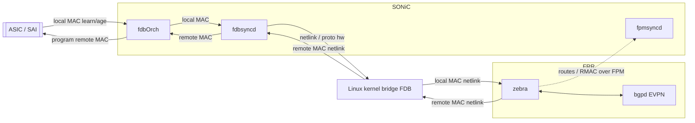
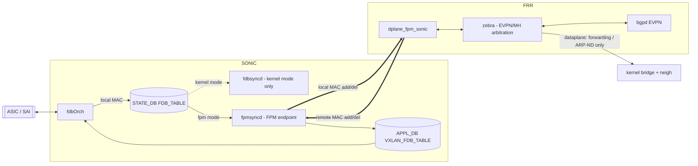

# MAC Learning Synchronization over the FPM Channel HLD

## Table of Contents

- [Revision](#revision)
- [Scope](#scope)
- [Definitions/Abbreviations](#definitionsabbreviations)
- [Overview](#overview)
- [Requirements](#requirements)
- [Architecture Design](#architecture-design)
- [High-Level Design](#high-level-design)
- [SAI API](#sai-api)
- [Configuration and management](#configuration-and-management)
- [Warmboot and Fastboot Design Impact](#warmboot-and-fastboot-design-impact)
- [Memory Consumption](#memory-consumption)
- [Restrictions/Limitations](#restrictionslimitations)
- [Testing Requirements/Design](#testing-requirementsdesign)

## Revision

| Rev | Date       | Author            | Change Description |
|:---:|:----------:|:------------------|:-------------------|
| 1.0 | 08/31/2026 | Patrice Brissette (Cisco), Tamer Ahmed (Microsoft) | Initial version |
| 1.1 | 10/20/2026 | Patrice Brissette (Cisco), Tamer Ahmed (Microsoft) | Single configuration knob, give-back model, sticky MACs, L3 multihoming pins; reconciliation moved to future scope |

## Scope

This document describes a high-level design for synchronizing MAC (bridge FDB) state between
SONiC and FRRouting (FRR) over the **FPM channel** instead of the Linux kernel / netlink path.
The scope is EVPN-VXLAN with Multihoming (MH), where a MAC can be learned locally in hardware and,
at the same time, remotely through BGP EVPN.

The document covers the motivation, the target architecture, the affected SONiC and FRR components,
and the behavioral impact (configuration, warm/fast reboot, scale). It defines the message
**semantics** — direction, local vs remote source, and sticky (static) MACs — because those are
architectural contracts between SONiC and FRR.

Reconciliation after an FPM connection drop or a warm restart is future scope and is not specified
here.

## Definitions/Abbreviations

| Term | Definition |
|------|------------|
| FDB | Forwarding Database (MAC table) |
| FPM | Forwarding Plane Manager — netlink-over-TCP channel between FRR and SONiC |
| fdbOrch | SONiC orchagent component that owns the ASIC FDB via SAI |
| fdbsyncd | SONiC daemon syncing FDB state between STATE_DB/APPL_DB and the kernel |
| fpmsyncd | SONiC daemon that owns the SONiC-side FPM socket and exchanges FPM messages with FRR zebra |
| zebra | FRR routing/dataplane manager daemon |
| dplane_fpm_sonic | SONiC-specific zebra FPM dataplane plugin (FPM client) loaded by SONiC, derived from upstream `dplane_fpm_nl` |
| EVPN | Ethernet VPN |
| MH | EVPN Multihoming |
| RT-2 | EVPN Route Type 2 (MAC/IP advertisement) |
| VTEP | VXLAN Tunnel Endpoint |
| VNI | VXLAN Network Identifier |
| SAI | Switch Abstraction Interface |
| RMAC | Router MAC (L3VNI) |
| ES | Ethernet Segment |
| L3EvpnMH | `DEVICE_METADATA` subtype for EVPN L3 multihoming; such a device always syncs MACs over FPM |
| Sticky MAC | MAC advertised with the static flag of the EVPN MAC Mobility extended community (RFC 7432 §15.2) |

## Overview

In SONiC today, MAC learning is hardware-driven. The ASIC reports learned/aged MACs through SAI to
**fdbOrch**, which records them and hands local MACs to **fdbsyncd**. fdbsyncd mirrors them into the
Linux kernel bridge FDB, and FRR **zebra** learns them from the kernel through netlink. Remote MACs
learned from BGP EVPN travel the opposite way: zebra programs them into the kernel bridge, fdbsyncd
picks them up from netlink, and fdbOrch installs them into the ASIC.

This works, but it uses the Linux kernel as an **inter-process message bus** for MAC state, on top
of its legitimate roles (local slow-path forwarding and ARP/ND resolution). That was fine when a
MAC had a single source. With **EVPN Multihoming, one `(VLAN, MAC)` can have two sources at once**:
a local hardware entry and a remote BGP EVPN entry.

zebra already represents this multi-source state in its MAC flags: `ZEBRA_MAC_LOCAL` for the
hardware source, and `ZEBRA_MAC_ES_PEER_ACTIVE` / `ZEBRA_MAC_ES_PEER_PROXY` for the route of an ES
peer. The **kernel bridge FDB can only hold one effective entry per MAC**, so forcing two sources
through it creates races and churn.

A concrete example: zebra holds a MAC that is both BGP-EVPN-learned and locally learned. The BGP
route is withdrawn, so zebra deletes the MAC through the kernel. The kernel removes the single
entry even though the MAC is still present in hardware, and SONiC must then detect this and
re-install the local MAC — unnecessary churn and a race window.

Two distinct kernel-side mechanisms are involved, and it is important to separate them:

- **External-learn MAC model (`--kernel-mac-ext-learn`).** zebra installs MACs as externally learned
  and suppresses the kernel's own MAC learning/aging, so hardware and the EVPN control plane — not
  the kernel — drive the MAC state machine. This model is correct and is **retained** by this design.
- **Self-notification filtering (the out-of-tree dependency).** To use the kernel as a *relay*,
  a protocol tag (`proto hw` / `RTPROT_HW`) is added so zebra and fdbsyncd can ignore the netlink
  notifications caused by their own writes. This part is a **SONiC-specific kernel patch** whose
  upstreaming is uncertain, and it exists only because MAC state is bounced through the kernel.

**This design moves MAC add/delete/update synchronization off the kernel and onto the FPM channel**,
which SONiC already uses between zebra and fpmsyncd for routes, nexthop groups, and RMACs. Ownership
is split cleanly:

- **SONiC reports what the ASIC has.** fdbOrch keeps its role and DB contract. fpmsyncd reports
  each hardware MAC add and age-out to zebra, and writes zebra's remote MACs to APPL_DB.
- **zebra owns the EVPN/MH multi-source arbitration** through its existing MAC flags, and remains
  the only writer of the kernel bridge FDB (through its dataplane) — but now only for the kernel's
  own forwarding/ARP-ND needs, never as a relay.

The result removes the race conditions, eliminates the dependency on the kernel patch (the
`proto hw`/`RTPROT_HW` self-notification tag is no longer needed once SONiC stops snooping the
kernel), and aligns MAC synchronization with the existing SONiC/FRR FPM architecture.

## Requirements

**Functional**

- Local (hardware-learned) MAC add/move/age events are delivered from SONiC to zebra **without**
  using the kernel bridge FDB as a synchronization bus.
- Remote (BGP EVPN RT-2) MAC add/withdraw events are delivered from zebra to SONiC **without** using
  the kernel bridge FDB as a synchronization bus.
- zebra maintains authoritative EVPN/MH arbitration, tracking the local and remote sources
  independently and deriving one effective result.
- When zebra flushes a MAC, or keeps it only because an ES peer still advertises it, while the
  ASIC still has it, the MAC is given back to zebra as hardware-learned without waiting for a new
  hardware event.
- A MAC provisioned as static in SONiC is advertised sticky (RFC 7432 §15.2). MACs the ASIC learns
  stay mobile.
- On an L3EvpnMH device, the static MAC that zebra pins on a local ES port for a neighbour synced
  from the ES peer is delivered to SONiC over FPM.
- The kernel bridge FDB and neighbor tables remain correct for local forwarding and ARP/ND.
- Neither mode requires the SONiC-specific `proto hw` / `RTPROT_HW` kernel and iproute2 patches.

**Non-functional**

- Reuse the existing FPM transport (zebra `dplane_fpm_sonic` ↔ SONiC `fpmsyncd`); do not introduce a
  new channel.
- Backward compatible: the default `kernel` mode keeps the legacy kernel/netlink path, which now
  runs without the `proto hw` / `RTPROT_HW` extension, as it did before that extension existed.
- Restarting the bgp container resynchronizes MAC state in both directions. Reconciliation after an
  FPM connection drop or a warm restart is future scope.
- Scale to platform L2 FDB capacity and MAC-move rates without unbounded churn.

**Out of scope**

- L3VNI RMAC delivery over FPM (already implemented).
- EVPN Type-5 / IP-prefix routes (already over FPM).
- L2 nexthop groups and IMET routes: fdbsyncd keeps reading them from the kernel in both modes.
- Changes to ASIC/SAI FDB learning or aging behavior.

## Architecture Design

The current architecture routes MAC synchronization through the kernel bridge FDB:



Both directions of MAC state relay through the kernel: local MACs go
`ASIC → fdbOrch → fdbsyncd → kernel → zebra`, and remote EVPN MACs go the reverse way
`zebra → kernel → fdbsyncd → fdbOrch → ASIC`. The FPM channel (dotted) already exists for routing
state, but MAC synchronization runs through the kernel.

The proposed architecture keeps the FPM channel as the single control path for MAC state and
reduces the kernel to a pure forwarding/ARP-ND consumer:



**Key architectural decisions:**

- **fpmsyncd is the single SONiC-side FPM endpoint** for MAC messages in both directions. It reads
  STATE_DB `FDB_TABLE`, which fdbOrch writes, directly; fdbsyncd takes no part in unicast MAC sync
  in fpm mode, and no new daemon-to-daemon channel is introduced.
- **zebra is the arbitration point.** Its MAC flags hold both sources: the ASIC
  (`ZEBRA_MAC_LOCAL`) and an ES peer's route (`ZEBRA_MAC_ES_PEER_ACTIVE` / `ZEBRA_MAC_ES_PEER_PROXY`).
  `dplane_fpm_sonic` follows those flags rather than keeping a second state machine; it only
  remembers which MACs the ASIC reported. Because SONiC no longer snoops kernel FDB events in fpm
  mode, there is no self-echo to filter — which is what removes the need for the `proto hw` patches.
- **Give-back instead of per-source state in SONiC.** fdbOrch is not changed to track sources.
  Instead, when zebra removes the kernel entry of a local MAC (a flush, or an ES peer withdrawing its
  route) or keeps it only on behalf of an ES peer while the ASIC still has the MAC,
  `dplane_fpm_sonic` reports it to zebra again as hardware-learned. When zebra rereads local MACs
  from the kernel (an L2VNI added or brought up, BGP enabling EVPN), a dataplane hook lets
  `dplane_fpm_sonic` give zebra the ASIC MACs that zebra is missing or no longer counts as learned
  in hardware.

## High-Level Design

- **Feature type.** Built-in SONiC feature. No new containers.
- **Components affected.** fpmsyncd, fdbsyncd and fdbOrch (sonic-swss); zebra and its SONiC FPM
  plugin `dplane_fpm_sonic` (FRR); docker-fpm-frr startup; sonic-yang-models; sonic-utilities CLI.
- **DB and schema.** STATE_DB `FDB_TABLE` (local MACs) and APPL_DB `VXLAN_FDB_TABLE` (remote MACs)
  keep their existing schema, so the DB contract with fdbOrch is unchanged. A new `CONFIG_DB`
  table `FDB_SYNC|global` carries the mode (see Configuration and management).

**MAC event flows.**

```
SONiC to FRR, local MACs
  ASIC -> fdbOrch -> STATE_DB FDB_TABLE -> fpmsyncd
    -> FPM: AF_BRIDGE RTM_NEWNEIGH / RTM_DELNEIGH
    -> dplane_fpm_sonic -> zebra (hardware source set / cleared)
    -> zebra dataplane -> kernel bridge FDB

FRR to SONiC, remote MACs
  BGP EVPN -> zebra -> dplane_fpm_sonic
    -> FPM: AF_BRIDGE RTM_NEWNEIGH / RTM_DELNEIGH -> fpmsyncd
    -> APPL_DB VXLAN_FDB_TABLE -> fdbOrch -> ASIC

Give-back of a MAC the ASIC still has
  zebra removes a local MAC's kernel entry, or keeps it only for an ES peer,
  or rereads local MACs from the kernel
    -> dplane_fpm_sonic -> zebra (hardware source set again)
```

- *Hardware learns a MAC:* fdbOrch writes it to STATE_DB `FDB_TABLE`; fpmsyncd sends it to zebra.
  zebra writes the kernel bridge FDB entry through its dataplane, marks the MAC local, runs its
  EVPN/MH logic, and advertises RT-2.
- *Hardware ages a MAC:* fpmsyncd sends the delete. zebra clears
  the hardware source. If an ES peer still advertises the MAC, zebra keeps it as a local MAC on
  behalf of that peer and rewrites the kernel entry itself; otherwise the kernel entry is removed.
  In fpm mode, fdbOrch no longer asks nbrmgrd to resolve the neighbour of an aged-out MAC; zebra
  owns that decision.
- *BGP EVPN adds a MAC:* zebra sends it over FPM to fpmsyncd, which writes APPL_DB
  `VXLAN_FDB_TABLE`; fdbOrch installs it in the ASIC.
- *BGP EVPN withdraws a MAC:* zebra recomputes the effective entry. If the MAC is still local, the
  local ASIC entry is untouched. If zebra removes the kernel entry while the ASIC still has the MAC,
  it is given back to zebra as hardware-learned.
- *Both sources present:* zebra holds both in its MAC flags. Local MACs are not echoed back to
  SONiC; only remote MACs travel FRR to SONiC.
- *Static MAC provisioned in SONiC:* sent with `NTF_STICKY`, so zebra advertises it with the static
  flag of RFC 7432 §15.2. Kernel mode advertised such a MAC as mobile.
- *L3 multihoming pin:* on a VLAN with no L2VNI, the static MAC that zebra pins on a local ES port
  for a neighbour synced from the ES peer is sent to fpmsyncd as a static MAC on that port, with no
  VTEP and no nexthop group. The pins are sent again on every FPM connect, and a pin is put back in
  the kernel when the ASIC ages out the same host's MAC.

**Component responsibilities.**

- **fdbOrch** keeps its ownership of SAI FDB learning/aging and its STATE/APPL DB contract. The
  only change is that, in fpm mode, it does not ask nbrmgrd to resolve the neighbour of an aged-out
  MAC.
- **fdbsyncd**, in fpm mode, no longer programs local MACs into the kernel bridge or writes remote
  MACs to APPL_DB. It keeps publishing IMET routes and `L2_NEXTHOP_GROUP_TABLE` from the kernel in
  both modes. Its kernel FDB protocol plumbing (`proto hw` tag and support probe) is removed in both
  modes.
- **fpmsyncd**, SONiC to FRR, follows STATE_DB `FDB_TABLE` and sends each add or delete as an
  AF_BRIDGE `RTM_NEWNEIGH` / `RTM_DELNEIGH`, encoded the way zebra encodes its own FDB writes. FRR to
  SONiC, it writes remote MACs to APPL_DB `VXLAN_FDB_TABLE` with the fields fdbsyncd writes
  (`remote_vtep`, `nexthop_group`, `ifname`, `type`, `vni`).
- **zebra `dplane_fpm_sonic`** decodes hardware MACs from fpmsyncd and applies them to zebra, encodes
  remote MACs and L3 multihoming pins toward fpmsyncd, and performs the give-back.
- **zebra core** lets a dataplane module declare that it learns local MACs: zebra then ignores
  kernel FDB notifications for local bridge ports, and when the hold timer for an ES peer's MAC
  expires, it flushes the MAC only if the hardware no longer has it. It also calls a dataplane hook
  when it rereads local MACs from the kernel.

**Message format.** MAC messages use the standard `AF_BRIDGE` bridge-FDB netlink format carried
inside the existing FPM framing, so no new FPM message container is required.

| Direction | Case | `ndm_state` / flags | Destination attributes |
|---|---|---|---|
| SONiC → FRR | MAC the ASIC learns | `NUD_REACHABLE` | port `ndm_ifindex`, `NDA_LLADDR`, `NDA_VLAN` |
| SONiC → FRR | MAC provisioned as static in SONiC | `NUD_REACHABLE \| NUD_NOARP`, `NTF_STICKY` | port `ndm_ifindex`, `NDA_LLADDR`, `NDA_VLAN` |
| FRR → SONiC | Remote MAC behind a VTEP | | `NDA_DST` (IPv4 or IPv6 VTEP), VNI, `NDA_VLAN` |
| FRR → SONiC | Remote MAC behind an ES | | `NDA_NH_ID`, no `NDA_DST`, VNI, `NDA_VLAN` |
| FRR → SONiC | L3 multihoming pin | `NUD_NOARP` | local ES port, `NDA_VLAN`, no VTEP, no nexthop group |

Stickiness is taken from `NTF_STICKY` alone; `NUD_NOARP` only says the entry does not age. The
pair matches zebra's own encoding of a sticky MAC.

Remote MAC messages carry the VNI and VLAN, so fpmsyncd builds the `VXLAN_FDB_TABLE` key
(`Vlan<id>:<mac>`) and fields directly, with no dependency on a VXLAN link cache.

**Message validation.** Netlink uses `RTM_NEWNEIGH` / `RTM_DELNEIGH` for IP neighbours too, so both
receivers check `ndm_family == AF_BRIDGE` and drop anything else; no IP neighbour messages are sent
on this channel. Malformed messages are dropped.

Within the MAC path, direction alone determines the source: a message received by zebra is a
hardware MAC, and a message received by fpmsyncd is a remote MAC. No kernel protocol tag is needed.

**Resynchronization.** MAC state is resynchronized when the bgp container restarts: fpmsyncd sends
the MACs already in STATE_DB `FDB_TABLE`, zebra relearns remote MACs from BGP and sends them as it
installs them, and zebra sends the RMACs and the L3 multihoming pins again when the FPM connection
comes up.

**Reconciliation (future scope).** This design does not reconcile MAC state after an FPM
connection drop without a restart, or across a warm restart.

**Linux dependency.** The kernel keeps only its functional roles: local slow-path bridging and
ARP/ND resolution. zebra writes MACs into the bridge FDB through its dataplane as a *derived
output* of its arbitration, not as a relay. As today, those entries are externally learned
(`NTF_EXT_LEARNED`) with kernel aging suppressed (`--kernel-mac-ext-learn`), so the MAC
learning/aging state machine stays outside the kernel. The SONiC-specific bridge FDB protocol field
(`proto hw` / `RTPROT_HW`) is no longer needed in the kernel, iproute2 or FRR. The kernel support
for `NTF_EXT_VALIDATED` is still required, because zebra's EVPN-MH peer-sync neighbour flag uses
that bit.

**Serviceability.** Existing FDB show/debug tooling continues to work because the DB schema is
unchanged. In fpm mode, `show evpn mac vni <vni>` shows the MACs the ASIC learns as local.

## SAI API

No new or modified SAI APIs are required. The design reuses the existing SAI FDB object and FDB
event notifications already consumed by fdbOrch (learn/age/move/flush, static/dynamic entry types,
endpoint-IP and next-hop-group destinations for remote MACs). Silicon vendors need no additional
SAI support for this feature.

## Configuration and management

MAC synchronization over FPM is selected by **one knob**, `FDB_SYNC|global|mac_sync_mode`. The
same key drives both ends:

- **SONiC:** fpmsyncd, fdbsyncd and fdbOrch follow `mac_sync_mode`.
- **FRR:** the docker-fpm-frr supervisord template starts zebra with `--kernel-mac-ext-learn` when
  `mac_sync_mode` is `fpm`. There is no separate zebra FPM option.

The default is `kernel`, so nothing changes unless `fpm` is configured.

**CONFIG_DB schema.** A dedicated single-instance table (rather than overloading `DEVICE_METADATA`):

```
FDB_SYNC|global
    mac_sync_mode = kernel | fpm      # default: kernel
```

**CLI (sonic-utilities).**

```
config fdb mac-sync-mode <kernel|fpm>     # write FDB_SYNC|global:mac_sync_mode
show fdb mac-sync-mode                    # display current mode
show mac sync-mode                        # same, under the existing show mac group
```

Example:

```
admin@sonic:~$ show fdb mac-sync-mode
kernel
admin@sonic:~$ sudo config fdb mac-sync-mode fpm
admin@sonic:~$ show fdb mac-sync-mode
fpm
admin@sonic:~$ show mac sync-mode
fpm
```

`show` prints `kernel` when `FDB_SYNC|global` or its `mac_sync_mode` field is absent.

**YANG.** A new `sonic-fdb-sync` model defines the `FDB_SYNC` container with a single
`mac_sync_mode` enumeration leaf (`kernel` | `fpm`, default `kernel`).

**L3EvpnMH subtype.** A device with `DEVICE_METADATA|localhost|subtype` = `L3EvpnMH` always syncs
MACs over FPM, whatever `FDB_SYNC` says: zebra gets `--kernel-mac-ext-learn`, fdbsyncd and
fpmsyncd select `fpm`, `show` reports `fpm`, and `config fdb mac-sync-mode kernel` is refused.
`L3EvpnMH` is added to the `subtype` pattern of `sonic-device_metadata.yang`.

**Applying a mode change.** zebra reads `--kernel-mac-ext-learn` when the bgp container starts, so
a mode change takes effect on the next bgp restart:

```
admin@sonic:~$ sudo config fdb mac-sync-mode fpm
admin@sonic:~$ sudo config save -y
admin@sonic:~$ sudo systemctl restart bgp
```

fpmsyncd starts in the new mode and sends the MACs already in STATE_DB `FDB_TABLE`. No state is
carried across a mode change.

**No fallback.** Both ends take the mode from the same key, so they agree once bgp restarts. There
is no automatic fallback to the kernel path in fpm mode, and no capability exchange on the FPM
channel. The `kernel` mode is the legacy fdbsyncd path, which now runs without the `proto hw`
extension. Existing FDB and FPM show/status commands are unchanged.

## Warmboot and Fastboot Design Impact

Kernel mode is unchanged. In fpm mode:

- **bgp restart:** MAC state is resynchronized as described in
  [Resynchronization](#high-level-design).
- **FPM connection drop without a restart:** not reconciled (future scope).
- **Warm reboot / swss warm restart:** the ASIC keeps forwarding and STATE_DB `FDB_TABLE` is
  restored, so fpmsyncd sends the local MACs on start without relearning. Reconciling remote MACs
  in APPL_DB `VXLAN_FDB_TABLE` across a warm restart is future scope.
- **Fast reboot:** the data plane is briefly interrupted and the ASIC FDB is rebuilt by the
  existing fast-reboot FDB restore and by hardware relearning. Local MACs are sent to zebra as they
  reappear in STATE_DB `FDB_TABLE`; remote MACs follow as BGP relearns them.
- **Cold boot:** all tables start empty and are populated by normal learning and BGP EVPN.

Existing warmboot/fastboot behavior for other features is unaffected.

## Memory Consumption

Bounded by the existing FDB scale. No new DB tables are introduced. fpmsyncd keeps the port of
each local MAC and the set of remote MAC keys it wrote; `dplane_fpm_sonic` keeps the set of MACs
the hardware reported. Memory scales linearly with the number of MACs.

## Restrictions/Limitations

- The primary target — and the focus of the requirements, flows, and tests in this HLD — is
  EVPN-VXLAN Multihoming with hardware-based MAC learning. Single-homed EVPN uses the same path,
  since the zebra flag follows `FDB_SYNC`.
- **Other FDB modes.** The FPM path is designed to apply to all FDB modes (e.g. MCLAG, non-EVPN
  bridging), but this HLD only specifies and validates EVPN-VXLAN. Using fpm mode with MCLAG, which
  synchronizes MACs between peers through its own path, is not covered and must be validated
  before it is supported.
- A mode change takes effect only after a bgp restart, and there is no automatic fallback to the
  kernel path.
- No reconciliation after an FPM connection drop or across a warm restart (future scope). L2
  nexthop groups and IMET routes still come from the kernel.

## Testing Requirements/Design

**Unit tests**

- FRR FPM MAC encode/decode: hardware and sticky MACs from SONiC; remote MACs behind an IPv4 VTEP,
  an IPv6 VTEP and an ES nexthop group toward SONiC; deletes; rejection of non-bridge and malformed
  messages.
- fpmsyncd: local MAC add/delete produces the expected FPM message; remote MACs produce the
  expected `VXLAN_FDB_TABLE` fields for VTEP, nexthop group and ES port destinations; malformed
  messages are dropped.
- fdbsyncd: in fpm mode no kernel bridge FDB programming and no remote MAC writes to APPL_DB; in
  kernel mode the legacy path runs without the `proto hw` extension.
- fdbOrch: existing FDB tests pass unchanged; in fpm mode an aged-out MAC does not trigger an
  nbrmgrd resolve.
- CLI and YANG: both modes, default when the key or field is absent, `L3EvpnMH` behavior.
- docker-fpm-frr: zebra gets `--kernel-mac-ext-learn` only in fpm mode or with `L3EvpnMH`.

**Integration / system tests**

- Two-leaf EVPN multihoming with dual-homed hosts: MACs the ASIC learns, MACs only the ES peer
  has, ageing, a move between Ethernet Segments, and the peer losing a MAC.
- In fpm mode: hardware MACs are local in zebra, remote MACs appear in APPL_DB
  `VXLAN_FDB_TABLE`, and SONiC issues no kernel bridge FDB commands.
- Peer-synced neighbours resolve and multihomed hosts keep reaching their gateway during an ES link
  failure.
- FRR EVPN-MH topotest over FPM for RT-2 add/withdraw and the local+remote combined cases.

**Robustness / scale**

- bgp restart: both directions resynchronize with no stale or missing entries.
- Local and remote at once: a BGP withdraw while a MAC is still local must not remove the local
  ASIC entry.
- Give-back: zebra flushing a MAC, or keeping it only for an ES peer, while the ASIC still has it
  restores it in zebra as learned in hardware.
- A static MAC is advertised sticky; a learned MAC stays mobile.
- Scale: fill the L2 FDB to platform capacity and exercise MH failover across many MACs;
  confirm fewer operations than the kernel baseline.
