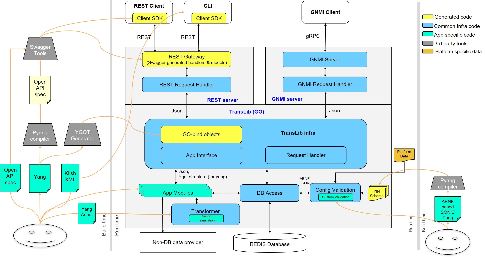
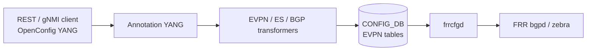
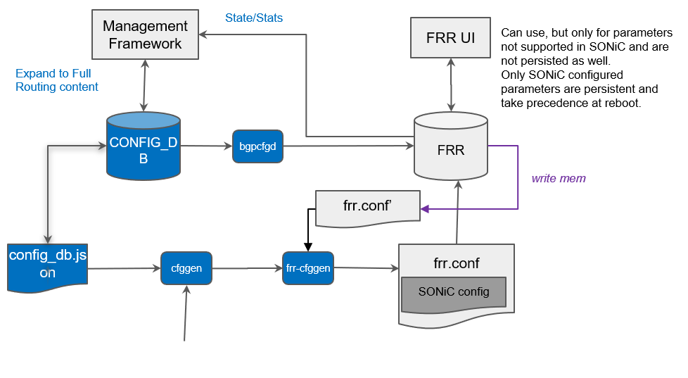

# OpenConfig Model Support for SONiC EVPN Feature

# High Level Design Document
#### Rev 0.1

# Table of Contents
  * [List of Tables](#list-of-tables)
  * [Revision](#revision)
  * [About This Manual](#about-this-manual)
  * [Related Documents](#related-documents)
  * [Scope](#scope)
  * [Definition/Abbreviation](#definitionabbreviation)
  * [1 Feature Overview](#1-feature-overview)
    * [1.1 Requirements](#11-requirements)
      * [1.1.1 Functional Requirements](#111-functional-requirements)
      * [1.1.2 Configuration and Management Requirements](#112-configuration-and-management-requirements)
      * [1.1.3 Scalability Requirements](#113-scalability-requirements)
    * [1.2 Design Overview](#12-design-overview)
      * [1.2.1 Basic Approach](#121-basic-approach)
      * [1.2.2 Container](#122-container)
  * [2 Functionality](#2-functionality)
      * [2.1 Target Deployment Use Cases](#21-target-deployment-use-cases)
  * [3 Design](#3-design)
    * [3.1 Overview](#31-overview)
      * [3.1.1 SONiC Feature YANG and CONFIG_DB](#311-sonic-feature-yang-and-config_db)
      * [3.1.2 OpenConfig Modules](#312-openconfig-modules)
      * [3.1.3 UMF Translation (REST/gNMI to CONFIG_DB)](#313-umf-translation-restgnmi-to-config_db)
      * [3.1.4 FRR Programming (frrcfgd)](#314-frr-programming-frrcfgd)
      * [3.1.5 OpenConfig Extensions](#315-openconfig-extensions)
      * [3.1.6 Mapping Table and Unit Tests](#316-mapping-table-and-unit-tests)
    * [3.2 DB Changes](#32-db-changes)
      * [3.2.1 CONFIG DB](#321-config-db)
      * [3.2.2 APP DB](#322-app-db)
      * [3.2.3 STATE DB](#323-state-db)
      * [3.2.4 ASIC DB](#324-asic-db)
      * [3.2.5 COUNTER DB](#325-counter-db)
  * [4 OpenConfig to SONiC Mapping Table](#4-openconfig-to-sonic-mapping-table)
    * [4.1 EVPN Instances Container](#41-evpn-instances-container)
    * [4.2 EVPN Instance Entry](#42-evpn-instance-entry)
    * [4.3 EVPN Instance Leaves (config/state)](#43-evpn-instance-leaves-configstate)
    * [4.4 EVPN Instance Import-Export Policy](#44-evpn-instance-import-export-policy)
    * [4.5 EVPN Instance VXLAN VNI](#45-evpn-instance-vxlan-vni)
    * [4.6 Network-Instance EVPN Import-Export Policy](#46-network-instance-evpn-import-export-policy)
    * [4.7 BGP L2VPN EVPN AFI-SAFI Leaves](#47-bgp-l2vpn-evpn-afi-safi-leaves)
    * [4.8 Ethernet Segments](#48-ethernet-segments)
    * [4.9 Ethernet Segment Leaves (config/state)](#49-ethernet-segment-leaves-configstate)
    * [4.10 Ethernet Segment DF Election](#410-ethernet-segment-df-election)
    * [4.11 EVPN Multihoming Global](#411-evpn-multihoming-global)
    * [4.12 Per-Interface EVPN Multihoming](#412-per-interface-evpn-multihoming)
  * [5 User Interface](#5-user-interface)
    * [5.1 Data Models](#51-data-models)
    * [5.2 REST API Support](#52-rest-api-support)
      * [5.2.1 GET](#521-get)
      * [5.2.2 PUT](#522-put)
      * [5.2.3 POST](#523-post)
      * [5.2.4 PATCH](#524-patch)
      * [5.2.5 DELETE](#525-delete)
    * [5.3 gNMI Support](#53-gnmi-support)
      * [5.3.1 GET](#531-get)
      * [5.3.2 SET](#532-set)
      * [5.3.3 DELETE](#533-delete)
      * [5.3.4 SUBSCRIBE](#534-subscribe)
  * [6 Error Handling](#6-error-handling)
  * [7 Unit Test Cases](#7-unit-test-cases)
    * [7.1 Functional Test Cases](#71-functional-test-cases)
    * [7.2 Negative Test Cases](#72-negative-test-cases)

# List of Tables
[Table 1: Abbreviations](#table-1-abbreviations)

[Table 2: Translation Flow Layers](#table-2-translation-flow-layers)

OpenConfig to SONiC mapping tables: [Section 4](#4-openconfig-to-sonic-mapping-table)

# Revision
| Rev | Date | Author | Change Description |
|:---:|:-----------:|:---------------------:|-----------------------------------|
| 0.1 | 11/25/2026 | Soumya Gargari | Initial version |

# About this Manual
This document provides general information about the OpenConfig configuration and management of EVPN in SONiC corresponding to the `openconfig-network-instance` EVPN tree, `openconfig-ethernet-segments`, and SONiC EVPN extension models. It describes how OpenConfig models are translated to SONiC CONFIG_DB entries and FRR EVPN configuration, and how operational state is returned over REST and gNMI.

EVPN is configured under:

```
/network-instances/network-instance/evpn
/network-instances/network-instance/protocols/protocol/bgp/global/afi-safis/afi-safi[afi-safi-name=L2VPN_EVPN]/l2vpn-evpn
/ethernet-segments
/evpn/multihoming
/interfaces/interface/evpn
```

# Related Documents
| Document | Description |
|----------|-------------|
| Management Framework.md | UMF architecture (REST, gNMI, translib, transformers) |
| Openconfig_BGP.md | BGP global / AFI-SAFI; L2VPN EVPN address-family is a prerequisite for EVPN instances |
| OpenConfig_VXLAN.md | VXLAN connection-points (`VXLAN_TUNNEL` / `VXLAN_TUNNEL_MAP`) used as the EVPN overlay dataplane |
| SONiC Unified FRR Mgmt Interface HLD | CONFIG_DB → frrcfgd → FRR programming path |
| RFC 7432 | BGP MPLS-Based Ethernet VPN |
| RFC 8365 | Network Virtualization Overlay using EVPN (VXLAN) |

# Scope
- This document describes the high level design of OpenConfig **EVPN** configuration and operational retrieval in SONiC.
- **In scope:** REST and gNMI — Get, Set (POST/PUT/PATCH), Delete, and Subscribe on supported EVPN YANG paths listed below.
- **Out of scope:** SONiC KLISH CLI and native SONiC CLI for EVPN; MPLS EVPN; VLAN-aware-bundle and VLAN-bundle MAC-VRFs; PBB-EVPN; VPWS; VXLAN connection-point / tunnel-map detailed mapping (see OpenConfig_VXLAN.md); `BGP_GLOBALS_EVPN_VNI_RT` (native table not used by OpenConfig; per-VNI RTs are leaf-lists on `BGP_GLOBALS_EVPN_VNI`).
- Supported encapsulation is **VXLAN** only. Supported service type is **VLAN_BASED** only.
- OpenConfig xpath roots:
  - `/network-instances/network-instance/evpn`
  - `/network-instances/network-instance/protocols/protocol/bgp/global/afi-safis/afi-safi[afi-safi-name=L2VPN_EVPN]/l2vpn-evpn`
  - `/ethernet-segments`
  - `/evpn/multihoming`
  - `/interfaces/interface/evpn`
- Supported attributes in OpenConfig YANG tree (reflecting current UMF implementation):

```
module: openconfig-network-instance
        (+ openconfig-network-instance-ext)
+--rw network-instances
   +--rw network-instance* [name]
      +--rw evpn
      |  +--rw evpn-instances
      |  |  +--rw evpn-instance* [evi]
      |  |     +--rw evi                         -> ../config/evi
      |  |     +--rw config
      |  |     |  +--rw evi?                                           oc-evpn-types:evi-id
      |  |     |  +--rw encapsulation-type?                            identityref (VXLAN only)
      |  |     |  +--rw service-type?                                  identityref (VLAN_BASED only)
      |  |     |  +--rw route-distinguisher?                           oc-ni-types:route-distinguisher
      |  |     |  +--rw oc-netinst-ext:advertise-default-gateway?      boolean
      |  |     +--ro state
      |  |     |  +--ro evi?
      |  |     |  +--ro encapsulation-type?
      |  |     |  +--ro service-type?
      |  |     |  +--ro route-distinguisher?
      |  |     |  +--ro oc-netinst-ext:advertise-default-gateway?
      |  |     +--rw import-export-policy
      |  |     |  +--rw config
      |  |     |  |  +--rw export-route-target*   union
      |  |     |  |  +--rw import-route-target*   union
      |  |     |  +--ro state
      |  |     |     +--ro export-route-target*
      |  |     |     +--ro import-route-target*
      |  |     +--rw vxlan
      |  |        +--rw config
      |  |        |  +--rw vni?    oc-evpn-types:vni-id   // must match evi; virtual (not persisted)
      |  |        +--ro state
      |  |           +--ro vni?
      |  +--rw oc-netinst-ext:import-export-policy
      |     +--rw config
      |     |  +--rw export-route-target*
      |     |  +--rw import-route-target*
      |     +--ro state
      |        +--ro export-route-target*
      |        +--ro import-route-target*
      +--rw protocols
         +--rw protocol* [identifier name]
            +--rw bgp
               +--rw global
                  +--rw afi-safis
                     +--rw afi-safi* [afi-safi-name]
                        +--rw l2vpn-evpn
                           +--rw oc-netinst-ext:config
                           |  +--rw advertise-all-vni?
                           |  +--rw advertise-ipv4-unicast?
                           |  +--rw advertise-ipv6-unicast?
                           |  +--rw advertise-svi-ip?
                           |  +--rw advertise-default-gateway?
                           |  +--rw disable-ethernet-segment-l3-nexthop-gateway?
                           |  +--rw route-distinguisher?
                           |  +--rw auto-route-target?     enumeration (RFC8365_COMPATIBLE)
                           |  +--rw flooding?              enumeration (DISABLE | HEAD_END_REPLICATION)
                           |  +--rw default-originate-ipv4?
                           |  +--rw default-originate-ipv6?
                           +--rw oc-netinst-ext:route-target
                           |  +--rw config
                           |     +--rw import-route-target*
                           |     +--rw export-route-target*
                           +--rw oc-netinst-ext:duplicate-address-detection
                              +--rw config
                                 +--rw enabled?
                                 +--rw max-moves?
                                 +--rw detection-time?
                                 +--rw freeze?             union (uint32 | PERMANENT)

module: openconfig-ethernet-segments
+--rw ethernet-segments
   +--rw ethernet-segment* [name]
      +--rw name        -> ../config/name
      +--rw config
      |  +--rw name?
      |  +--rw esi-type?          oc-evpn-types:esi-type   // TYPE_0 | TYPE_3 only
      |  +--rw esi?               union (20-hex | AUTO)
      |  +--rw interface?         string   // virtual; must match name (or parent of subinterface)
      |  +--rw subinterface?      uint32   // virtual; only when name is if.subif
      +--ro state
      +--rw df-election
         +--rw config
            +--rw df-election-method?   enumeration (PREFERENCE only)
            +--rw preference?           uint16

module: openconfig-evpn-extension
+--rw evpn
   +--rw multihoming
      +--rw config
      |  +--rw startup-delay?        uint16 (0..3600)
      |  +--rw mac-holdtime?         uint32 (0..86400)
      |  +--rw neighbor-holdtime?    uint32 (0..86400)
      |  +--rw redirect-disabled?    boolean
      +--ro state

augment /interfaces/interface:
+--rw evpn
   +--rw config
   |  +--rw multihoming-uplink?   boolean
   |  +--rw bypass?               boolean
   +--ro state
```

Extension leaves are documented in [Section 3.1.5 OpenConfig Extensions](#315-openconfig-extensions).

# Definition/Abbreviation
### Table 1: Abbreviations

| **Term** | **Definition** |
|--------------------------|-------------------------------------|
| YANG | Yet Another Next Generation: modular language representing data structures in an XML tree format |
| REST | REpresentative State Transfer |
| gNMI | gRPC Network Management Interface |
| UMF | Unified Management Framework (`sonic-mgmt-common`) |
| FRR | Free Range Routing (bgpd / zebra) |
| EVPN | Ethernet VPN (RFC 7432 / RFC 8365) |
| EVI | EVPN Instance identifier; in this implementation equal to the L2 VNI |
| VNI | VXLAN Network Identifier |
| ESI | Ethernet Segment Identifier |
| DF | Designated Forwarder (multihoming) |
| RT | Route Target |
| RD | Route Distinguisher |
| MH | EVPN Multihoming |
| VTEP | VXLAN Tunnel End Point |

# 1 Feature Overview
## 1.1 Requirements
### 1.1.1 Functional Requirements
1. Expose SONiC EVPN configuration through standard OpenConfig YANG models under `network-instances/network-instance/evpn`, BGP `l2vpn-evpn` AFI-SAFI, `ethernet-segments`, and EVPN multihoming extensions.
2. Support configuration and operational retrieval of EVPN instances (VNI), per-VNI and VRF-level route targets, BGP L2VPN EVPN address-family leaves, Ethernet Segments, and EVPN MH global / per-interface parameters (see Scope and Section 4).
3. Support VXLAN encapsulation and VLAN_BASED service type only. Reject MPLS, VLAN_AWARE, VLAN_BUNDLE, PBB, and VPWS.
4. Require `vxlan/config/vni` on EVPN instance create and require that VNI equal the `evi` list key.
5. Provide REST Get, Post, Put, Patch, and Delete, and gNMI Get, Set, Delete, and Subscribe on all mapped EVPN paths.

### 1.1.2 Configuration and Management Requirements
EVPN is configured and queried only through REST and gNMI via the Unified Management Framework (UMF). KLISH and native SONiC CLI are out of scope for this document. Unsupported operations return an error through existing UMF error handling; no new management interfaces are introduced.

A BGP instance with L2VPN EVPN AFI-SAFI (typically with `advertise-all-vni` enabled) is a prerequisite for creating EVPN instances in a VRF.

### 1.1.3 Scalability Requirements
EVPN scale follows the existing CONFIG_DB `BGP_GLOBALS_EVPN_VNI`, `BGP_GLOBALS_EVPN_RT`, `EVPN_ETHERNET_SEGMENT`, `EVPN_MH_GLOBAL`, and `EVPN_MH_INTERFACE` schemas and platform limits for VNIs, Ethernet Segments, and BGP EVPN peers.

## 1.2 Design Overview
### 1.2.1 Basic Approach
SONiC already programs FRR EVPN from CONFIG_DB through **frrcfgd**. This feature adds a northbound OpenConfig view: REST/gNMI clients configure OpenConfig YANG; UMF transformers translate requests into existing CONFIG_DB tables; frrcfgd applies configuration to FRR bgpd/zebra from CONFIG_DB changes.

### 1.2.2 Container
Implementation changes are in **sonic-mgmt-common** (REST server in the Management Framework container and gNMI server in the gnmi container: annotations, transformers) and **sonic-frr-mgmt-framework** (frrcfgd runtime mapping for EVPN tables). Native schema is in **sonic-yang-models** (`sonic-bgp-global.yang`, `sonic-evpn.yang`).

# 2 Functionality
## 2.1 Target Deployment Use Cases
All northbound clients configure and query EVPN using OpenConfig YANG over REST or gNMI.

1. **REST clients** — GET, POST, PUT, PATCH, and DELETE on EVPN RESTCONF paths. Orchestration systems are one example.
2. **gNMI clients** — Capabilities, Get, Set (update/delete), and Subscribe (stream) on EVPN gNMI paths. Controllers and telemetry consumers are examples.

Typical VXLAN EVPN fabric use:
1. Enable BGP L2VPN EVPN AFI-SAFI (`advertise-all-vni`, optional DAD / flooding / AF RTs).
2. Create EVPN instances (one per L2 VNI) with RD and per-VNI import/export RTs.
3. Optionally set VRF-level EVPN import/export RTs.
4. Configure Ethernet Segments and MH global/interface parameters for dual-homed CEs.

# 3 Design
## 3.1 Overview
This HLD follows Management Framework.md. The design covers: SONiC feature YANG, OpenConfig modules, UMF translation, CONFIG_DB, FRR programming, mapping tables (Section 4), and unit tests (Section 7).

### 3.1.1 SONiC Feature YANG and CONFIG_DB
SONiC defines the southbound schema in `sonic-bgp-global.yang` and `sonic-evpn.yang`:

| Item | Detail |
|------|--------|
| CONFIG_DB tables | `BGP_GLOBALS_EVPN_VNI`, `BGP_GLOBALS_EVPN_RT`, `BGP_GLOBALS_AF`, `EVPN_ETHERNET_SEGMENT`, `EVPN_MH_GLOBAL`, `EVPN_MH_INTERFACE` |
| `BGP_GLOBALS_EVPN_VNI` key | `{vrf_name}\|l2vpn_evpn\|{vni_number}` |
| `BGP_GLOBALS_EVPN_VNI` leaves | `route-distinguisher`, `advertise-default-gw`, `import-rts`, `export-rts` |
| `BGP_GLOBALS_EVPN_RT` key | `{vrf_name}\|l2vpn_evpn\|{rt_value}` |
| `BGP_GLOBALS_EVPN_RT` leaves | `route-target-type` (`import` / `export` / `both`) |
| `BGP_GLOBALS_AF` key | `{vrf_name}\|l2vpn_evpn` |
| `EVPN_ETHERNET_SEGMENT` key | `{ifname}` (OpenConfig `ethernet-segment` name **is** the interface / subinterface name) |
| `EVPN_ETHERNET_SEGMENT` leaves | `esi`, `type`, `df_pref` |
| `EVPN_MH_GLOBAL` key | `default` |
| `EVPN_MH_INTERFACE` key | `{ifname}` |
| Out of scope | `BGP_GLOBALS_EVPN_VNI_RT` (not written by OpenConfig) |

OpenConfig clients never write CONFIG_DB directly; UMF transformers populate these tables from OpenConfig payloads. CONFIG_DB examples are in [§3.2.1](#321-config-db).

### 3.1.2 OpenConfig Modules
| Module | Source | Role for EVPN |
|--------|--------|------------------------|
| [openconfig-evpn.yang](https://github.com/openconfig/public/blob/master/release/models/network-instance/openconfig-evpn.yang) | openconfig/public | EVPN instance groupings used by `openconfig-network-instance` |
| [openconfig-network-instance.yang](https://github.com/openconfig/public/blob/master/release/models/network-instance/openconfig-network-instance.yang) | openconfig/public | `/network-instances/.../evpn` and BGP AFI-SAFI trees |
| [openconfig-ethernet-segments.yang](https://github.com/openconfig/public/blob/master/release/models/network-instance/openconfig-ethernet-segments.yang) | openconfig/public (SONiC copy) | Device-scoped Ethernet Segments |
| openconfig-network-instance-ext.yang | sonic-mgmt-common | Per-VNI `advertise-default-gateway`; NI-level EVPN import-export-policy; L2VPN EVPN AFI-SAFI leaves (`oc-netinst-ext`) |
| openconfig-evpn-extension.yang | sonic-mgmt-common | `/evpn/multihoming` and `/interfaces/interface/evpn` (`oc-evpn-ext`) |
| openconfig-network-instance-annot.yang | sonic-mgmt-common | XPath to CONFIG_DB and transformer bindings |
| openconfig-ethernet-segments-annot.yang | sonic-mgmt-common | ES xpath bindings |
| openconfig-evpn-extension-annot.yang | sonic-mgmt-common | MH global xpath bindings |
| openconfig-network-instance-deviation.yang / openconfig-ethernet-segments-deviation.yang | sonic-mgmt-common | `not-supported` deviations |

### 3.1.3 UMF Translation (REST/gNMI to CONFIG_DB)
OpenConfig SET/GET/SUBSCRIBE requests are handled by translib and the **transformer** common app. Annotation YANG defines xpath-to-DB bindings; EVPN transformers perform key composition (`vrf|l2vpn_evpn|vni`), virtual-leaf validation (encapsulation / service-type / vni), RT import/export/both merge, ESI hex conversion, and Subscribe path mapping.



*Figure: Management Framework architecture ([Management Framework.md](https://github.com/sonic-net/SONiC/blob/master/doc/mgmt/Management%20Framework.md)).*

#### Table 2: Translation Flow Layers

| Layer | Artifact | Role |
|-------|----------|------|
| **1. SONiC feature YANG** | `sonic-bgp-global.yang`, `sonic-evpn.yang` | CONFIG_DB EVPN / BGP EVPN / ES / MH schema |
| **2. OpenConfig modules** | `openconfig-network-instance.yang`, `openconfig-evpn.yang`, `openconfig-ethernet-segments.yang`, `openconfig-network-instance-ext.yang`, `openconfig-evpn-extension.yang` | Northbound client model |
| **3. UMF annotations** | `openconfig-network-instance-annot.yang`, `openconfig-ethernet-segments-annot.yang`, `openconfig-evpn-extension-annot.yang` | XPath → table/field/transformer binding |
| **4. UMF transformers** | `xfmr_evpn.go`, `xfmr_ethernet_segments.go`, `xfmr_bgp.go` (L2VPN EVPN AF) | YangToDb / DbToYang / Subscribe |
| **5. CONFIG_DB** | `BGP_GLOBALS_EVPN_VNI`, `BGP_GLOBALS_EVPN_RT`, `BGP_GLOBALS_AF`, `EVPN_ETHERNET_SEGMENT`, `EVPN_MH_GLOBAL`, `EVPN_MH_INTERFACE` | Runtime configuration store |
| **6. FRR** | `frrcfgd.py` | Programs FRR bgpd / zebra EVPN configuration |



### 3.1.4 FRR Programming (frrcfgd)
CONFIG_DB EVPN table changes are consumed by **frrcfgd**, which programs FRR bgpd (`vni`, `route-target`, `advertise-all-vni`, DAD, flooding) and zebra (`evpn mh …`) at runtime.



*Figure: Unified FRR management framework ([SONiC Unified FRR Mgmt Interface HLD](https://github.com/sonic-net/SONiC/blob/master/doc/mgmt/SONiC_Design_Doc_Unified_FRR_Mgmt_Interface.md)) — EVPN follows the same CONFIG_DB → frrcfgd → FRR path as other BGP objects.*

### 3.1.5 OpenConfig Extensions
SONiC augments base OpenConfig using two extension modules.

| Property | `openconfig-network-instance-ext` | `openconfig-evpn-extension` |
|----------|----------------------------------|-----------------------------|
| Prefix | `oc-netinst-ext` | `oc-evpn-ext` |
| Namespace | SONiC NI extension namespace | `http://openconfig.net/yang/evpn/extension` |

| OpenConfig YANG Node | Data type |
|----------------------|-----------|
| **evpn-instance/config and state** | |
| advertise-default-gateway | boolean |
| **evpn/import-export-policy (NI-level, not per EVI)** | |
| import-route-target | leaf-list union (IP:N or ASN:N) |
| export-route-target | leaf-list union (IP:N or ASN:N) |
| **bgp/.../l2vpn-evpn/config** | |
| advertise-all-vni | boolean |
| advertise-ipv4-unicast / advertise-ipv6-unicast / advertise-svi-ip / advertise-default-gateway | boolean |
| disable-ethernet-segment-l3-nexthop-gateway | boolean (inverted vs `use_es_l3nhg`) |
| route-distinguisher | oc-ni-types:route-distinguisher |
| auto-route-target | enumeration (`RFC8365_COMPATIBLE`) |
| flooding | enumeration (`DISABLE` \| `HEAD_END_REPLICATION`) |
| default-originate-ipv4 / default-originate-ipv6 | boolean |
| **l2vpn-evpn/duplicate-address-detection/config** | |
| enabled / max-moves / detection-time | boolean / uint32 / uint32 |
| freeze | union (uint32 \| `PERMANENT`) |
| **evpn/multihoming/config** | |
| startup-delay / mac-holdtime / neighbor-holdtime / redirect-disabled | uint16 / uint32 / uint32 / boolean |
| **interfaces/interface/evpn/config** | |
| multihoming-uplink / bypass | boolean |

Extension leaf DB mappings are documented in [Section 4](#4-openconfig-to-sonic-mapping-table).

### 3.1.6 Mapping Table and Unit Tests
- **OpenConfig → SONiC mapping:** [Section 4](#4-openconfig-to-sonic-mapping-table) — xpath-to-CONFIG_DB mapping.
- **REST/gNMI examples:** [Section 5](#5-user-interface).
- **Unit tests:** [Section 7](#7-unit-test-cases).

## 3.2 DB Changes
OpenConfig EVPN uses existing CONFIG_DB tables. No new CONFIG_DB, APP_DB, STATE_DB, ASIC_DB, or COUNTER_DB tables are added.

### 3.2.1 CONFIG DB
Example:

```
BGP_GLOBALS_AF|default|l2vpn_evpn
  advertise-all-vni: true
  dad-enabled:      true
  flooding:         head-end-replication

BGP_GLOBALS_EVPN_VNI|default|l2vpn_evpn|100
  route-distinguisher:  10.1.1.1:100
  advertise-default-gw: true
  import-rts@:          65001:100
  export-rts@:          65001:100

BGP_GLOBALS_EVPN_RT|default|l2vpn_evpn|65001:1
  route-target-type: both

EVPN_ETHERNET_SEGMENT|Ethernet0
  esi:     00:11:22:33:44:55:66:77:88:99
  type:    TYPE_0_OPERATOR_CONFIGURED
  df_pref: 100

EVPN_MH_GLOBAL|default
  startup_delay:  300
  mac_holdtime:   1080
  neigh_holdtime: 1080
  redirect_off:   false

EVPN_MH_INTERFACE|Ethernet1
  mh_uplink: true
  bypass:    false
```

Virtual leaves (`encapsulation-type`, `service-type`, `vxlan/vni`, ES `interface` / `subinterface`, `df-election-method`) are **not** stored in CONFIG_DB. GET synthesizes them from the key or from related fields.

### 3.2.2 APP DB
No APP DB tables are used for EVPN OpenConfig configuration.

### 3.2.3 STATE DB
No STATE DB tables are used for EVPN OpenConfig configuration. Operational `state` on GET is returned from CONFIG_DB (config=state for mapped leaves).

### 3.2.4 ASIC DB
No ASIC DB tables are used for EVPN OpenConfig configuration.

### 3.2.5 COUNTER DB
No COUNTER DB tables are used for EVPN OpenConfig configuration.

# 4 OpenConfig to SONiC Mapping Table
**CONFIG_DB tables:** `BGP_GLOBALS_EVPN_VNI`, `BGP_GLOBALS_EVPN_RT`, `BGP_GLOBALS_AF`, `EVPN_ETHERNET_SEGMENT`, `EVPN_MH_GLOBAL`, `EVPN_MH_INTERFACE`  
**Key patterns:** see each subsection.

**Conventions:**
- Each subsection maps one OpenConfig container or list. Placeholders: `<ni>`, `<evi>`, `<rt>`, `<ifname>`.
- **Extension** — `Yes` on extension leaves; blank on base OpenConfig leaves. Extension definitions are in [§3.1.5](#315-openconfig-extensions).
- Where `config` and `state` share the same mapping, both are covered in one table; operational `state` is returned on GET from CONFIG_DB.
- **Virtual** — validated on SET and synthesized on GET; no CONFIG_DB field.

## 4.1 EVPN Instances Container
**OpenConfig path:**
```
/network-instances/network-instance[name=<ni>]/evpn/evpn-instances
```
| OpenConfig node | Extension | DB Name | Table:Field | Notes |
|-----------------|-----------|---------|-------------|-------|
| evpn-instances | | — | — | Container for EVPN instances in this network-instance |

## 4.2 EVPN Instance Entry
**OpenConfig path:**
```
/network-instances/network-instance[name=<ni>]/evpn/evpn-instances/evpn-instance[evi=<evi>]
```
| OpenConfig leaf | Extension | DB Name | Table:Field | Notes |
|-----------------|-----------|---------|-------------|-------|
| evi (list key) | | CONFIG_DB | BGP_GLOBALS_EVPN_VNI:key `{ni}\|l2vpn_evpn\|{evi}` | `evi` is the L2 VNI number (1..16777215). AFI-SAFI component is hardcoded `l2vpn_evpn` |

## 4.3 EVPN Instance Leaves (config/state)
**OpenConfig path:**
```
/network-instances/network-instance[name=<ni>]/evpn/evpn-instances/evpn-instance[evi=<evi>]
     config
     state
```
| OpenConfig leaf | Extension | DB Name | Table:Field | Notes |
|-----------------|-----------|---------|-------------|-------|
| evi | | CONFIG_DB | BGP_GLOBALS_EVPN_VNI:key `{vni_number}` | |
| encapsulation-type | | — | — (virtual) | SET: **VXLAN only**. GET always returns `openconfig-network-instance-types:VXLAN`. Mandatory on CREATE |
| service-type | | — | — (virtual) | SET: **VLAN_BASED only**. GET always returns `openconfig-evpn-types:VLAN_BASED`. Mandatory on CREATE |
| route-distinguisher | | CONFIG_DB | BGP_GLOBALS_EVPN_VNI:route-distinguisher | IP:N or ASN:N |
| advertise-default-gateway | Yes | CONFIG_DB | BGP_GLOBALS_EVPN_VNI:advertise-default-gw | boolean |

## 4.4 EVPN Instance Import-Export Policy
**OpenConfig path:**
```
/network-instances/network-instance[name=<ni>]/evpn/evpn-instances/evpn-instance[evi=<evi>]
     import-export-policy/config
     import-export-policy/state
```
| OpenConfig leaf | Extension | DB Name | Table:Field | Notes |
|-----------------|-----------|---------|-------------|-------|
| import-route-target | | CONFIG_DB | BGP_GLOBALS_EVPN_VNI:import-rts | Leaf-list on the VNI row (not `BGP_GLOBALS_EVPN_VNI_RT`) |
| export-route-target | | CONFIG_DB | BGP_GLOBALS_EVPN_VNI:export-rts | Leaf-list on the VNI row |

## 4.5 EVPN Instance VXLAN VNI
**OpenConfig path:**
```
/network-instances/network-instance[name=<ni>]/evpn/evpn-instances/evpn-instance[evi=<evi>]
     vxlan/config/vni
     vxlan/state/vni
```
| OpenConfig leaf | Extension | DB Name | Table:Field | Notes |
|-----------------|-----------|---------|-------------|-------|
| vni | | — | — (virtual) | Mandatory on CREATE. Must equal `evi`. GET returns the VNI component of the DB key. Other `vxlan/*` leaves (`vni-list`, overlay-endpoint, host-reachability-bgp, multicast-*) are `not-supported`. `pbb` is `not-supported` |

## 4.6 Network-Instance EVPN Import-Export Policy
**OpenConfig path:**
```
/network-instances/network-instance[name=<ni>]/evpn/import-export-policy
```
This is an **extension** (`oc-netinst-ext`) at the EVPN container, not per EVI. Subtree transformer `bgp_evpn_rt_xfmr`.

| OpenConfig leaf | Extension | DB Name | Table:Field | Notes |
|-----------------|-----------|---------|-------------|-------|
| import-route-target | Yes | CONFIG_DB | BGP_GLOBALS_EVPN_RT:key `{ni}\|l2vpn_evpn\|{rt}` + `route-target-type` | One row per RT value. Same RT in both lists → `both`. PATCH merges directions. Scoped PUT replaces only the targeted leaf-list. DELETE of one direction on a `both` row **downgrades** to the remaining direction |
| export-route-target | Yes | CONFIG_DB | same | same |

## 4.7 BGP L2VPN EVPN AFI-SAFI Leaves
**OpenConfig path:**
```
/network-instances/network-instance[name=<ni>]/protocols/protocol[identifier=BGP][name=bgp]
     /bgp/global/afi-safis/afi-safi[afi-safi-name=L2VPN_EVPN]/l2vpn-evpn
```
**CONFIG_DB table:** `BGP_GLOBALS_AF` key `{ni}\|l2vpn_evpn`

| OpenConfig leaf | Extension | DB Name | Table:Field | Notes |
|-----------------|-----------|---------|-------------|-------|
| advertise-all-vni | Yes | CONFIG_DB | BGP_GLOBALS_AF:advertise-all-vni | boolean `true`/`false`. Prerequisite for advertising local VNIs |
| advertise-ipv4-unicast | Yes | CONFIG_DB | BGP_GLOBALS_AF:advertise-ipv4-unicast | |
| advertise-ipv6-unicast | Yes | CONFIG_DB | BGP_GLOBALS_AF:advertise-ipv6-unicast | |
| advertise-svi-ip | Yes | CONFIG_DB | BGP_GLOBALS_AF:advertise-svi-ip | |
| advertise-default-gateway | Yes | CONFIG_DB | BGP_GLOBALS_AF:advertise-default-gw | AF-level default GW advertise (distinct from per-VNI leaf) |
| disable-ethernet-segment-l3-nexthop-gateway | Yes | CONFIG_DB | BGP_GLOBALS_AF:use_es_l3nhg | **Inverted:** OC `true` → DB `false`; OC `false` → DB `true` |
| route-distinguisher | Yes | CONFIG_DB | BGP_GLOBALS_AF:evpn_rd | AF-level EVPN RD |
| auto-route-target | Yes | CONFIG_DB | BGP_GLOBALS_AF:autort | `RFC8365_COMPATIBLE` → `rfc8365-compatible` |
| flooding | Yes | CONFIG_DB | BGP_GLOBALS_AF:flooding | `DISABLE` → `disable`; `HEAD_END_REPLICATION` → `head-end-replication` |
| default-originate-ipv4 / ipv6 | Yes | CONFIG_DB | BGP_GLOBALS_AF:default-originate-ipv4 / default-originate-ipv6 | |
| route-target/import-route-target | Yes | CONFIG_DB | BGP_GLOBALS_AF:import-rts | AF-level RTs (distinct from `BGP_GLOBALS_EVPN_RT`) |
| route-target/export-route-target | Yes | CONFIG_DB | BGP_GLOBALS_AF:export-rts | |
| duplicate-address-detection/enabled | Yes | CONFIG_DB | BGP_GLOBALS_AF:dad-enabled | |
| duplicate-address-detection/max-moves | Yes | CONFIG_DB | BGP_GLOBALS_AF:dad-max-moves | |
| duplicate-address-detection/detection-time | Yes | CONFIG_DB | BGP_GLOBALS_AF:dad-time | |
| duplicate-address-detection/freeze | Yes | CONFIG_DB | BGP_GLOBALS_AF:dad-freeze | uint32 seconds or `PERMANENT` → `permanent` |
| prefix-limit / prefix-limit-received | | — | — | `not-supported` |

## 4.8 Ethernet Segments
**OpenConfig path:**
```
/ethernet-segments/ethernet-segment[name=<ifname>]
```
| OpenConfig leaf | Extension | DB Name | Table:Field | Notes |
|-----------------|-----------|---------|-------------|-------|
| name (list key) | | CONFIG_DB | EVPN_ETHERNET_SEGMENT:key `{ifname}` | Name **must** be the Ethernet / PortChannel / subinterface name (e.g. `Ethernet0`, `PortChannel17.100`) |

## 4.9 Ethernet Segment Leaves (config/state)
**OpenConfig path:**
```
/ethernet-segments/ethernet-segment[name=<ifname>]
     config
     state
```
| OpenConfig leaf | Extension | DB Name | Table:Field | Notes |
|-----------------|-----------|---------|-------------|-------|
| name | | CONFIG_DB | EVPN_ETHERNET_SEGMENT:key | |
| interface | | — | — (virtual) | Must equal `name`, or the parent interface when `name` is a subinterface. Not persisted |
| subinterface | | — | — (virtual) | Only valid when `name` is `if.subif`; must match the suffix. Not persisted |
| esi | | CONFIG_DB | EVPN_ETHERNET_SEGMENT:esi | OC 20-char hex (no colons) or `AUTO` → SONiC `aa:bb:…:ii` or `AUTO`. DELETE on `esi` is not supported. CVL: TYPE_0 cannot use `AUTO`; TYPE_3 must use `AUTO` |
| esi-type | | CONFIG_DB | EVPN_ETHERNET_SEGMENT:type | Supported: `TYPE_0_OPERATOR_CONFIGURED`, `TYPE_3_MAC_BASED`. DELETE restores TYPE_0 unless current ESI is `AUTO` (then TYPE_3) |
| redundancy-mode | | — | — | `not-supported` |
| es-import-route-target | | — | — | `not-supported` |

## 4.10 Ethernet Segment DF Election
**OpenConfig path:**
```
/ethernet-segments/ethernet-segment[name=<ifname>]/df-election
     config
     state
```
| OpenConfig leaf | Extension | DB Name | Table:Field | Notes |
|-----------------|-----------|---------|-------------|-------|
| df-election-method | | — | — (virtual) | SET: **PREFERENCE only**, and only when `preference` is present in the same request or already in DB. GET returns PREFERENCE when `df_pref` exists. DELETE not supported |
| preference | | CONFIG_DB | EVPN_ETHERNET_SEGMENT:df_pref | uint16 1..65535; default 32767 |
| revertive | | — | — | `not-supported` |
| election-wait-time | | — | — | `not-supported` |

## 4.11 EVPN Multihoming Global
**OpenConfig path:**
```
/evpn/multihoming
     config
     state
```
| OpenConfig leaf | Extension | DB Name | Table:Field | Notes |
|-----------------|-----------|---------|-------------|-------|
| (container) | Yes | CONFIG_DB | EVPN_MH_GLOBAL:key `default` | Single global instance |
| startup-delay | Yes | CONFIG_DB | EVPN_MH_GLOBAL:startup_delay | uint16 0..3600; default 300 |
| mac-holdtime | Yes | CONFIG_DB | EVPN_MH_GLOBAL:mac_holdtime | uint32 0..86400; default 1080 |
| neighbor-holdtime | Yes | CONFIG_DB | EVPN_MH_GLOBAL:neigh_holdtime | uint32 0..86400; default 1080 |
| redirect-disabled | Yes | CONFIG_DB | EVPN_MH_GLOBAL:redirect_off | boolean; zebra `evpn mh redirect-off` |

## 4.12 Per-Interface EVPN Multihoming
**OpenConfig path:**
```
/interfaces/interface[name=<ifname>]/evpn
     config
     state
```
| OpenConfig leaf | Extension | DB Name | Table:Field | Notes |
|-----------------|-----------|---------|-------------|-------|
| (container) | Yes | CONFIG_DB | EVPN_MH_INTERFACE:key `{ifname}` | Ethernet or PortChannel name |
| multihoming-uplink | Yes | CONFIG_DB | EVPN_MH_INTERFACE:mh_uplink | boolean; zebra `evpn mh uplink` |
| bypass | Yes | CONFIG_DB | EVPN_MH_INTERFACE:bypass | boolean; zebra `evpn mh bypass` |

# 5 User Interface
## 5.1 Data Models
| Model | Source | Purpose |
|-------|--------|---------|
| sonic-bgp-global.yang | sonic-yang-models | `BGP_GLOBALS_EVPN_VNI`, `BGP_GLOBALS_EVPN_RT`, `BGP_GLOBALS_AF` |
| sonic-evpn.yang | sonic-yang-models | `EVPN_ETHERNET_SEGMENT`, `EVPN_MH_GLOBAL`, `EVPN_MH_INTERFACE` |
| openconfig-network-instance.yang / openconfig-evpn.yang | openconfig/public | EVPN instance tree |
| openconfig-network-instance-ext.yang | sonic-mgmt-common | Per-VNI advertise-default-gateway, NI-level RTs, L2VPN EVPN AF |
| openconfig-ethernet-segments.yang | sonic-mgmt-common | Ethernet Segments |
| openconfig-evpn-extension.yang | sonic-mgmt-common | MH global and per-interface |
| `*-annot.yang` / `*-deviation.yang` | sonic-mgmt-common | Bindings and `not-supported` |

## 5.2 REST API Support
Examples below use paths and payloads validated by unit tests. RESTCONF URL encoding uses `=` separators; gNMI uses bracket notation (see §5.3).

### 5.2.1 GET
Supported at container, list, and leaf levels.

```
curl -X GET -k "https://<device>/restconf/data/openconfig-network-instance:network-instances/network-instance=default/evpn/evpn-instances/evpn-instance=100" -H "accept: application/yang-data+json"
```

```
curl -X GET -k "https://<device>/restconf/data/openconfig-ethernet-segments:ethernet-segments/ethernet-segment=Ethernet0" -H "accept: application/yang-data+json"
```

```
curl -X GET -k "https://<device>/restconf/data/openconfig-evpn-extension:evpn/multihoming" -H "accept: application/yang-data+json"
```

### 5.2.2 PUT
Supported. PUT on an EVPN instance replaces the targeted resource per RESTCONF rules.

```
curl -X PUT -k "https://<device>/restconf/data/openconfig-network-instance:network-instances/network-instance=default/evpn/evpn-instances/evpn-instance=100/config/route-distinguisher" -H "accept: */*" -H "Content-Type: application/yang-data+json" -d "{\"openconfig-network-instance:route-distinguisher\":\"10.1.1.1:100\"}"
```

PUT on NI-level `import-route-target` replaces the import direction only (export rows are preserved or downgraded, not blindly deleted).

### 5.2.3 POST
POST creates EVPN instances or Ethernet Segments.

POST — create EVPN instance (VNI 100). `encapsulation-type`, `service-type`, and `vxlan/config/vni` (equal to `evi`) are mandatory:

```
curl -X POST -k "https://<device>/restconf/data/openconfig-network-instance:network-instances/network-instance=default/evpn/evpn-instances" -H "accept: */*" -H "Content-Type: application/yang-data+json" -d "{\"openconfig-network-instance:evpn-instance\":[{\"evi\":\"100\",\"config\":{\"evi\":\"100\",\"encapsulation-type\":\"openconfig-network-instance-types:VXLAN\",\"service-type\":\"openconfig-evpn-types:VLAN_BASED\",\"route-distinguisher\":\"10.1.1.1:100\",\"openconfig-network-instance-ext:advertise-default-gateway\":true},\"vxlan\":{\"config\":{\"vni\":100}}}]}"
```

POST — Ethernet Segment (TYPE_0, operator ESI):

```
curl -X POST -k "https://<device>/restconf/data/openconfig-ethernet-segments:ethernet-segments" -H "accept: */*" -H "Content-Type: application/yang-data+json" -d "{\"openconfig-ethernet-segments:ethernet-segment\":[{\"name\":\"Ethernet0\",\"config\":{\"name\":\"Ethernet0\",\"interface\":\"Ethernet0\",\"esi-type\":\"TYPE_0_OPERATOR_CONFIGURED\",\"esi\":\"00112233445566778899\"},\"df-election\":{\"config\":{\"df-election-method\":\"PREFERENCE\",\"preference\":100}}}]}"
```

### 5.2.4 PATCH
Supported at leaf and leaf-list level (e.g. per-VNI RD, NI-level RT merge, MH `startup-delay`).

```
curl -X PATCH -k "https://<device>/restconf/data/openconfig-network-instance:network-instances/network-instance=default/evpn/evpn-instances/evpn-instance=100/config/openconfig-network-instance-ext:advertise-default-gateway" -H "accept: */*" -H "Content-Type: application/yang-data+json" -d "{\"openconfig-network-instance-ext:advertise-default-gateway\":false}"
```

PATCH of NI-level import/export RTs **merges** with existing `route-target-type` (`import` + `export` → `both`).

### 5.2.5 DELETE
Supported at EVPN instance, RT leaf-list instance, Ethernet Segment, and container levels.

DELETE one EVPN instance:

```
curl -X DELETE -k "https://<device>/restconf/data/openconfig-network-instance:network-instances/network-instance=default/evpn/evpn-instances/evpn-instance=100" -H "accept: */*"
```

DELETE one NI-level import RT instance (URL-encoded `:`):

```
curl -X DELETE -k "https://<device>/restconf/data/openconfig-network-instance:network-instances/network-instance=default/evpn/openconfig-network-instance-ext:import-export-policy/config/import-route-target=65001%3A100" -H "accept: */*"
```

If that RT was `both`, the row is downgraded to `export` rather than deleted.

## 5.3 gNMI Support
### 5.3.1 GET

```
gnmic -a <device>:<port> --insecure --target OC-YANG -e json_ietf get \
  --path "/openconfig-network-instance:network-instances/network-instance[name=default]/evpn/evpn-instances/evpn-instance[evi=100]"
```

Leaf GET (`route-distinguisher`):

```
gnmic -a <device>:<port> --insecure --target OC-YANG -e json_ietf get \
  --path "/openconfig-network-instance:network-instances/network-instance[name=default]/evpn/evpn-instances/evpn-instance[evi=100]/config/route-distinguisher"
```

### 5.3.2 SET

Create EVPN instance with nested VXLAN VNI:

```
gnmic -a <device>:<port> --insecure --target OC-YANG -e json_ietf set \
  --update-path "/openconfig-network-instance:network-instances/network-instance[name=default]/evpn/evpn-instances/evpn-instance[evi=100]" \
  --update-value '{
  "config": {
    "evi": "100",
    "encapsulation-type": "openconfig-network-instance-types:VXLAN",
    "service-type": "openconfig-evpn-types:VLAN_BASED",
    "route-distinguisher": "10.1.1.1:100"
  },
  "vxlan": { "config": { "vni": 100 } }
}'
```

### 5.3.3 DELETE

Delete an EVPN instance:

```
gnmic -a <device>:<port> --insecure --target OC-YANG -e json_ietf set \
  --delete "/openconfig-network-instance:network-instances/network-instance[name=default]/evpn/evpn-instances/evpn-instance[evi=100]"
```

### 5.3.4 SUBSCRIBE

Supported on mapped config and state paths. EVPN instance Subscribe uses `bgp_evpn_vni_key_xfmr` (`{vrf}|l2vpn_evpn|*`). NI-level RT Subscribe uses `Subscribe_bgp_evpn_rt_xfmr`.

On-change subscription:

```
gnmic -a <device>:<port> --insecure --target OC-YANG -e json_ietf sub \
  --path "/openconfig-network-instance:network-instances/network-instance[name=default]/evpn" \
  --stream-mode on-change
```

Periodic sample subscription:

```
gnmic -a <device>:<port> --insecure --target OC-YANG -e json_ietf sub \
  --path "/openconfig-network-instance:network-instances/network-instance[name=default]/evpn/evpn-instances" \
  --stream-mode sample --sample-interval 30s
```

# 6 Error Handling
Invalid configurations and unsupported operations report an error with a descriptive message. Representative categories:

- Missing `encapsulation-type` on EVPN instance create (`encapsulation-type is mandatory… Only VXLAN is supported`)
- Missing `service-type` on create (`… Only VLAN_BASED is supported`)
- Missing `vxlan/config/vni` on create, or VNI ≠ `evi`
- Non-VXLAN `encapsulation-type` or non-VLAN_BASED `service-type`
- VRF name or EVI missing from URI on write
- Invalid ESI (not 20 hex chars and not `AUTO`); unsupported `esi-type` (only TYPE_0 and TYPE_3)
- `AUTO` ESI with TYPE_0, or operator ESI with TYPE_3 (CVL `auto-esi-type-invalid`)
- Ethernet-segment `interface` not matching `name` (or parent of subinterface)
- `subinterface` on a non-subinterface key, or index mismatch
- `df-election-method` other than PREFERENCE, or PREFERENCE without `preference`
- DELETE of `esi` or `df-election-method` (`NotSupported`)
- RT DELETE/REPLACE direction merge failures (invalid VRF)
- `disable-ethernet-segment-l3-nexthop-gateway` unexpected type
- Unsupported OpenConfig leaves marked `not-supported` in deviation/annotation YANG

# 7 Unit Test Cases

Section 7 summarizes generic functional and negative scenarios for REST and gNMI paths under the EVPN subtree. Implementation tests live in `translib/transformer/xfmr_evpn_test.go` and `xfmr_ethernet_segments` tests.

## 7.1 Functional Test Cases

**EVPN instance CRUD**

1. POST EVPN instance with `evi`, VXLAN, VLAN_BASED, matching `vxlan/vni`, optional RD and `advertise-default-gateway`; CONFIG_DB `BGP_GLOBALS_EVPN_VNI|{vrf}|l2vpn_evpn|{evi}` is created.
2. POST instance with only mandatory virtual leaves; row exists with `NULL:NULL`.
3. GET returns `encapsulation-type=VXLAN`, `service-type=VLAN_BASED`, `vxlan/vni` equal to `evi`, and persisted RD / advertise-default-gw.
4. PATCH RD and advertise-default-gateway; GET returns updated config and state.
5. DELETE EVPN instance removes the `BGP_GLOBALS_EVPN_VNI` row.

**Per-VNI import/export RTs**

- SET `import-route-target` / `export-route-target` leaf-lists on the instance; stored as `import-rts` / `export-rts` on the VNI row.

**NI-level import-export-policy**

- SET import and export leaf-lists; same RT in both → `BGP_GLOBALS_EVPN_RT` `route-target-type=both`.
- PATCH one direction merges with existing (`import` + later `export` → `both`).
- DELETE a specific leaf-list instance; `both` downgrades to the remaining direction.
- Scoped PUT of import-only replaces import RTs and leaves export intact.
- Full PUT of the policy removes stale RT rows.

**BGP L2VPN EVPN AFI-SAFI**

- SET `advertise-all-vni`, flooding, auto-route-target, DAD (including `freeze=PERMANENT`), inverted `disable-ethernet-segment-l3-nexthop-gateway`.

**Ethernet Segments and MH**

- CREATE TYPE_0 ES with 20-hex ESI and DF preference; GET returns colon-stripped ESI and `df-election-method=PREFERENCE`.
- CREATE TYPE_3 ES with `esi=AUTO`.
- Subinterface ES name `PortChannel17.100` with matching `interface` + `subinterface`.
- SET MH global timers / `redirect-disabled`; SET per-interface `multihoming-uplink` / `bypass`.

**Subscribe**

- gNMI Subscribe on `evpn` / `evpn-instances` and NI-level import-export-policy (on-change and sample).

## 7.2 Negative Test Cases

**EVPN instance validation**

1. CREATE without `encapsulation-type`, without `service-type`, or without `vxlan/vni` rejected.
2. `vxlan/vni` ≠ `evi` rejected.
3. `encapsulation-type` other than VXLAN rejected.
4. `service-type` other than VLAN_BASED rejected.

**Ethernet Segment validation**

- ESI not 20 hex and not `AUTO` rejected.
- Unsupported `esi-type` rejected.
- `interface` not matching ES name rejected.
- `subinterface` on a physical-port key rejected.
- `df-election-method` DEFAULT / HRW rejected; PREFERENCE without `preference` rejected.
- DELETE of `esi` or `df-election-method` rejected.

**Unsupported leaf rejection tests**

- `redundancy-mode`, `es-import-route-target`, `revertive`, `election-wait-time`, PBB, VPWS IDs, multicast/replication-mode, `vxlan/vni-list`, overlay-endpoint, `l2vpn-evpn/prefix-limit` rejected (`not-supported`).

