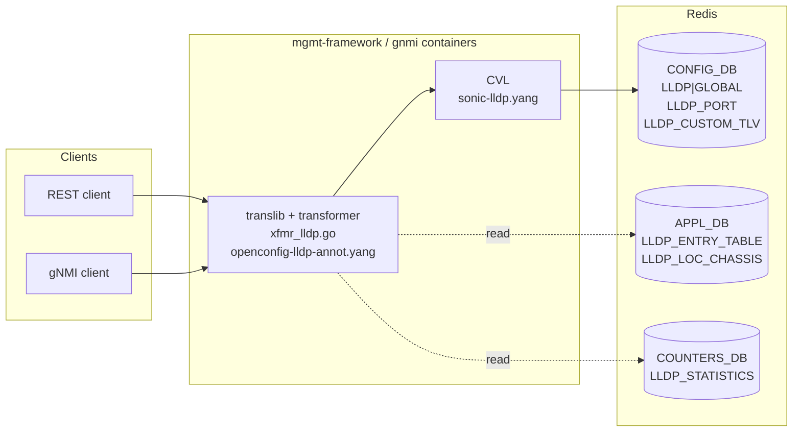
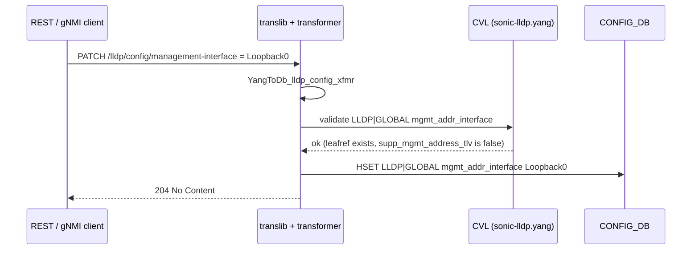
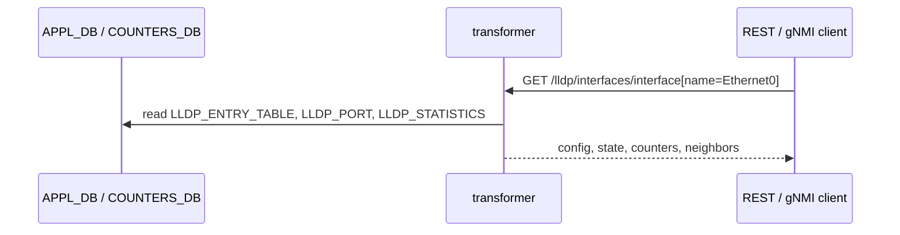
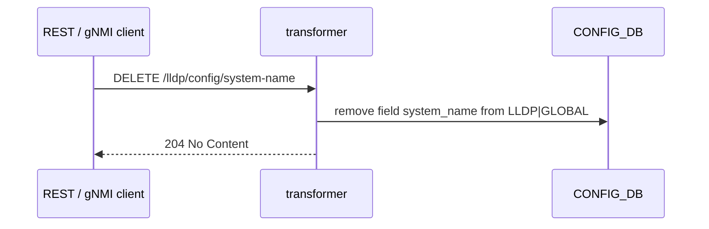

# OpenConfig support for LLDP

# High Level Design Document

#### Rev 0.1

# Table of Contents

* [List of Tables](#list-of-tables)
* [Revision](#revision)
* [About This Manual](#about-this-manual)
* [Scope](#scope)
* [Definition/Abbreviation](#definitionabbreviation)
* [1 Feature Overview](#1-feature-overview)
  * [1.1 Requirements](#11-requirements)
    * [1.1.1 Functional Requirements](#111-functional-requirements)
    * [1.1.2 Configuration and Management Requirements](#112-configuration-and-management-requirements)
    * [1.1.3 Scalability Requirements](#113-scalability-requirements)
    * [1.1.4 Warm Boot Requirements](#114-warm-boot-requirements)
  * [1.2 Design Overview](#12-design-overview)
    * [1.2.1 Basic Approach](#121-basic-approach)
    * [1.2.2 Container](#122-container)
* [2 Functionality](#2-functionality)
  * [2.1 Target Deployment Use Cases](#21-target-deployment-use-cases)
* [3 Design](#3-design)
  * [3.1 Overview](#31-overview)
  * [3.2 DB Changes](#32-db-changes)
    * [3.2.1 CONFIG DB](#321-config-db)
    * [3.2.2 APP DB](#322-app-db)
    * [3.2.3 STATE DB](#323-state-db)
    * [3.2.4 ASIC DB](#324-asic-db)
    * [3.2.5 COUNTER DB](#325-counter-db)
  * [3.3 Component Design](#33-component-design)
    * [3.3.1 OpenConfig to SONiC Mapping](#331-openconfig-to-sonic-mapping)
    * [3.3.2 Transformer Behavior](#332-transformer-behavior)
  * [3.4 User Interface](#34-user-interface)
    * [3.4.1 REST API Support](#341-rest-api-support)
    * [3.4.2 gNMI Support](#342-gnmi-support)
    * [3.4.3 gNMI Subscription Support](#343-gnmi-subscription-support)
* [4 Flow Diagrams](#4-flow-diagrams)
* [5 Error Handling](#5-error-handling)
* [6 Unit Test Cases](#6-unit-test-cases)
  * [6.1 Functional Test Cases](#61-functional-test-cases)
  * [6.2 Negative Test Cases](#62-negative-test-cases)
* [7 Limitations](#7-limitations)
* [8 Open Items](#8-open-items)

# List of Tables

[Table 1: Abbreviations](#table-1-abbreviations)

[Table 2: Components and Repositories](#table-2-components-and-repositories)

[Table 3: Global Configuration Mapping](#table-3-global-configuration-mapping)

[Table 4: Interface Configuration Mapping](#table-4-interface-configuration-mapping)

[Table 5: Custom TLV Mapping](#table-5-custom-tlv-mapping)

[Table 6: Global and Interface State Mapping](#table-6-global-and-interface-state-mapping)

[Table 7: Neighbor State Mapping](#table-7-neighbor-state-mapping)

[Table 8: Subscription Support](#table-8-subscription-support)

# Revision

| Rev |     Date    |       Author          | Change Description                |
|:---:|:-----------:|:---------------------:|-----------------------------------|
| 0.1 | 11/25/2026  | Govindaraj Haridass   | Initial version                   |

# About this Manual

This document provides general information about the OpenConfig configuration and operational state of LLDP in SONiC, corresponding to the `openconfig-lldp.yang` module (version 1.2.0).

# Scope

- This document describes the high level design of LLDP configuration and operational state using OpenConfig models via REST and gNMI.
- Supported OpenConfig module: `openconfig-lldp` 1.2.0, with `openconfig-lldp-types` 0.2.0. The module is stored in `sonic-mgmt-common/models/yang`, and the SONiC-specific annotations are in `openconfig-lldp-annot.yang`.
- Items in the model that SONiC does not support are listed in [Limitations](#7-limitations).
- Supported attributes in the OpenConfig YANG tree (`[N/S]` = rejected as not supported, `[RO*]` = in a `config` container but derived from operational data, so a SET has no effect):

```
module: openconfig-lldp
  +--rw lldp
     +--rw config
     |  +--rw enabled?                      boolean
     |  +--rw hello-timer?                  uint64
     |  +--rw ttl?                          uint16                    [N/S]
     |  +--rw suppress-tlv-advertisement*   identityref (oc-lldp-types:LLDP_TLV)
     |  +--rw system-name?                  string
     |  +--rw system-description?           string
     |  +--rw chassis-id?                   string                    [RO*]
     |  +--rw chassis-id-type?              oc-lldp-types:chassis-id-type   [RO*]
     |  +--rw management-interface?         oc-if:interface-id
     +--ro state
     |  +--ro enabled?                      boolean
     |  +--ro hello-timer?                  uint64
     |  +--ro ttl?                          uint16
     |  +--ro suppress-tlv-advertisement*   identityref
     |  +--ro system-name?                  string
     |  +--ro system-description?           string
     |  +--ro chassis-id?                   string
     |  +--ro chassis-id-type?              oc-lldp-types:chassis-id-type
     |  +--ro management-interface?         oc-if:interface-id
     |  +--ro counters
     |     +--ro frame-in?                  oc-yang:counter64
     |     +--ro frame-out?                 oc-yang:counter64
     |     +--ro frame-discard?             oc-yang:counter64
     |     +--ro tlv-unknown?               oc-yang:counter64
     |     +--ro tlv-accepted?              oc-yang:counter64
     |     +--ro entries-aged-out?          oc-yang:counter64
     +--ro mgmt-addresses
     |  +--ro mgmt-address* [address]
     |     +--ro address                    -> ../state/address
     |     +--ro state
     |        +--ro address?                oc-inet:ip-address
     +--rw interfaces
     |  +--rw interface* [name]
     |     +--rw name                       -> ../config/name
     |     +--rw config
     |     |  +--rw name?                   oc-if:base-interface-ref
     |     |  +--rw enabled?                boolean
     |     |  +--rw port-description?       string                    [N/S]
     |     |  +--rw custom-tlv-names*       leafref                   [N/S]
     |     +--ro state
     |     |  +--ro name?                   oc-if:base-interface-ref
     |     |  +--ro enabled?                boolean
     |     |  +--ro counters
     |     |     +--ro frame-in?            oc-yang:counter64
     |     |     +--ro frame-out?           oc-yang:counter64
     |     |     +--ro frame-discard?       oc-yang:counter64
     |     |     +--ro tlv-unknown?         oc-yang:counter64
     |     +--ro neighbors
     |        +--ro neighbor* [id]
     |           +--ro id                   -> ../state/id
     |           +--ro state
     |           |  +--ro id?                           string
     |           |  +--ro age?                          uint64
     |           |  +--ro ttl?                          uint16
     |           |  +--ro system-name?                  string
     |           |  +--ro system-description?           string
     |           |  +--ro chassis-id?                   string
     |           |  +--ro chassis-id-type?              oc-lldp-types:chassis-id-type
     |           |  +--ro port-id?                      string
     |           |  +--ro port-id-type?                 oc-lldp-types:port-id-type
     |           |  +--ro port-description?             string
     |           |  +--ro management-address?           string   (deprecated)
     |           |  +--ro management-address-type?      string   (deprecated)
     |           |  +--ro med-inventory-serial-number?  string
     |           |  +--ro port-vlan-id?                 uint16
     |           |  +--ro max-frame-size?               uint16
     |           +--ro link-aggregation
     |           |  +--ro state
     |           |     +--ro capable?                   boolean
     |           |     +--ro enabled?                   boolean
     |           |     +--ro port-id?                   uint32
     |           +--ro mgmt-addresses
     |           |  +--ro mgmt-address* [address]
     |           |     +--ro state/address?             oc-inet:ip-address
     |           +--ro custom-tlvs
     |           |  +--ro tlv* [type oui oui-subtype]
     |           |     +--ro state/{type,oui,oui-subtype,value}
     |           +--ro capabilities
     |              +--ro capability* [name]
     |                 +--ro state/{name,enabled}
     +--rw custom-tlvs
        +--rw tlv* [name]
           +--rw name                       -> ../config/name
           +--rw config
           |  +--rw name?                   string
           |  +--rw type?                   int32
           |  +--rw oui?                    string
           |  +--rw oui-subtype?            string
           |  +--rw value?                  binary
           +--ro state
              +--ro name?, type?, oui?, oui-subtype?, value?
```

# Definition/Abbreviation

### Table 1: Abbreviations

| **Term**                 | **Definition**                         |
|--------------------------|-------------------------------------|
| LLDP                     | Link Layer Discovery Protocol (IEEE 802.1AB) |
| TLV                      | Type-Length-Value, the encoding unit of an LLDP frame |
| OUI                      | Organizationally Unique Identifier |
| MED                      | LLDP Media Endpoint Discovery |
| YANG                     | Yet Another Next Generation: modular language representing data structures in an XML tree format |
| REST                     | REpresentational State Transfer |
| gNMI                     | gRPC Network Management Interface: used to retrieve or manipulate the state of a device via telemetry or configuration data |
| CVL                      | Config Validation Library |
| xfmr                     | Transformer: the translib component that converts OpenConfig YANG data to and from SONiC DB |

# 1 Feature Overview

## 1.1 Requirements

### 1.1.1 Functional Requirements

1. Provide support for the `openconfig-lldp` YANG model through REST and gNMI.
2. Configure/Set, Get and Delete the global LLDP settings: `enabled`, `hello-timer`, `system-name`, `system-description`, `management-interface` and `suppress-tlv-advertisement`.
3. Configure/Set, Get and Delete the per-interface LLDP `enabled` setting.
4. Configure/Set, Get and Delete globally advertised organizationally specific (custom) TLVs.
5. Provide read-only operational state:
   - global state and counters
   - per-interface state and counters
   - local management addresses
   - neighbor state, including TTL, port VLAN ID, maximum frame size, LLDP-MED inventory serial number, link aggregation, management addresses, custom TLVs and capabilities
6. Support the `suppress-tlv-advertisement` identities `MANAGEMENT_ADDRESS` and `SYSTEM_CAPABILITIES`. Any other identity is rejected.
7. Revert a leaf to its default value when it is deleted.
8. Support gNMI subscription on the supported paths: ON_CHANGE for configuration and neighbor data, and SAMPLE (and ON_CHANGE) for counters.

### 1.1.2 Configuration and Management Requirements

- LLDP can be configured with the OpenConfig REST and gNMI interfaces.
- The implementation returns an error if a configuration is not allowed, either because it violates the SONiC YANG model (CVL) or because the leaf is not supported.
- Configuration is validated against the SONiC YANG model before it is committed.

### 1.1.3 Scalability Requirements

- Neighbor data is held in `LLDP_ENTRY_TABLE`, which has one entry per local interface. The scale is therefore bounded by the number of front-panel ports and the management port.
- Counter subscriptions use a minimum sample interval of 30 seconds.

### 1.1.4 Warm Boot Requirements

- LLDP does not take part in warm boot state restoration. The OpenConfig configuration is read from CONFIG_DB, so it is consistent after warm boot, config reload and container restart.
- Counters in COUNTERS_DB `LLDP_STATISTICS` restart from the values reported after the restart.

## 1.2 Design Overview

### 1.2.1 Basic Approach

The OpenConfig support has the following parts:

1. **Transformer.** The OpenConfig model is mapped to the SONiC tables with a transformer (`xfmr_lldp.go`) and annotations (`openconfig-lldp-annot.yang`).
2. **Configuration tables.** `LLDP|GLOBAL` and `LLDP_PORT` in CONFIG_DB hold the global and per-interface settings. A new table `LLDP_CUSTOM_TLV` holds the custom TLVs. All of them are validated by `sonic-lldp.yang`.
3. **Operational tables.** Neighbor and local chassis state is read from APPL_DB `LLDP_ENTRY_TABLE` and `LLDP_LOC_CHASSIS`. Counters are read from the new COUNTERS_DB table `LLDP_STATISTICS`. The fields needed by OpenConfig are added to the existing APPL_DB tables.

### 1.2.2 Container

- The transformer, the OpenConfig YANG model and the REST server are part of the *Management Framework* container (`sonic-mgmt-common`, `sonic-mgmt-framework`). The gNMI server is in the *gnmi* container.

# 2 Functionality

## 2.1 Target Deployment Use Cases

1. A REST client that performs GET, PUT, PATCH and DELETE on the supported OpenConfig LLDP paths, for example to turn LLDP off on one interface or to set the management-address source interface.
2. A gNMI client that uses Capabilities, Get, Set and Subscribe on the supported paths. For example, a telemetry collector subscribes to the neighbor tree (ON_CHANGE) and to the LLDP counters (SAMPLE).
3. Network automation that provisions an organizationally specific TLV (for example a vendor serial number) so that it is advertised on every LLDP-enabled interface, then reads the neighbor's custom TLVs to verify that the peer advertises the same value.

# 3 Design

## 3.1 Overview

This HLD is in line with the [Management Framework HLD](https://github.com/project-arlo/SONiC/blob/354e75b44d4a37b37973a3a36b6f55141b4b9fdf/doc/mgmt/Management%20Framework.md) and uses the transformer infrastructure.



### Table 2: Components and Repositories

| Component | Repository / path | Role |
|-----------|-------------------|------|
| `sonic-lldp.yang` | `sonic-buildimage/src/sonic-yang-models` | CONFIG_DB schema and validation for `LLDP`, `LLDP_PORT`, `LLDP_CUSTOM_TLV` |
| `openconfig-lldp.yang`, `openconfig-lldp-types.yang` | `sonic-mgmt-common/models/yang` | OpenConfig model (version 1.2.0) |
| `openconfig-lldp-annot.yang` | `sonic-mgmt-common/models/yang/annotations` | Binds model nodes to transformer functions |
| `xfmr_lldp.go` | `sonic-mgmt-common/translib/transformer` | OpenConfig to SONiC DB conversion |

## 3.2 DB Changes

### 3.2.1 CONFIG DB

All CONFIG_DB LLDP tables are validated by `sonic-lldp.yang`. `sonic-lldp.yang` is added to the `sonic-mgmt-common` YANG import list so that the transformer and CVL load it.

#### LLDP|GLOBAL

Key: `GLOBAL`.

| Field | Type | Default | Description |
|-------|------|---------|-------------|
| `enabled` | boolean | `true` | LLDP globally on/off |
| `hello_time` | uint8, 5..254 | `30` | Transmit interval, in seconds |
| `system_name` | string | not set | Overrides the advertised system name. If absent, the device hostname is used |
| `system_description` | string | not set | Overrides the advertised system description. If absent, the SONiC default is used |
| `supp_mgmt_address_tlv` | boolean | `false` | Suppress the Management Address TLV |
| `supp_system_capabilities_tlv` | boolean | `false` | Suppress the System Capabilities TLV |
| `mgmt_addr_interface` | union of leafrefs | not set | Interface whose IP addresses are advertised in the Management Address TLV. It can name a Loopback, a Port, a VLAN, a PortChannel or a management port. It must not be set while `supp_mgmt_address_tlv` is `true` |

Example:

```
"LLDP": {
    "GLOBAL": {
        "enabled": "true",
        "hello_time": "30",
        "system_name": "sonic",
        "system_description": "sonic-system",
        "supp_mgmt_address_tlv": "false",
        "supp_system_capabilities_tlv": "false",
        "mgmt_addr_interface": "Loopback0"
    }
}
```

#### LLDP_PORT

Key: interface name (leafref to `PORT`).

| Field | Type | Default | Description |
|-------|------|---------|-------------|
| `enabled` | boolean | `true` | LLDP on the interface |

A per-interface entry takes precedence over the global setting. Deleting the entry makes the interface inherit the global setting.

```
"LLDP_PORT": {
    "Ethernet8": {
        "enabled": "false"
    }
}
```

#### LLDP_CUSTOM_TLV (new)

Key: administrative TLV name (1..64 characters, not sent on the wire).

| Field | Type | Default | Description |
|-------|------|---------|-------------|
| `type` | uint8 | `127` | LLDP TLV type. Only organizationally specific TLVs (127) are supported |
| `oui` | string | mandatory | Three-byte OUI as colon-separated hex, for example `00:90:69` |
| `oui_subtype` | uint8 | mandatory | Organization-defined subtype (0..255) |
| `value` | string | not set | TLV information as hex digits |

```
"LLDP_CUSTOM_TLV": {
    "vendor-serial": {
        "type": "127",
        "oui": "00:90:69",
        "oui_subtype": "1",
        "value": "435530323133353130363530"
    }
}
```

### 3.2.2 APP DB

`LLDP_ENTRY_TABLE` (one entry per local interface) and `LLDP_LOC_CHASSIS` already exist. The following fields are added so that the OpenConfig 1.2.0 leaves can be served.

#### LLDP_ENTRY_TABLE: (new fields)

| Field | OpenConfig leaf |
|-------|-----------------|
| `lldp_rem_ttl` | `neighbor/state/ttl` |
| `lldp_rem_max_frame_size` | `neighbor/state/max-frame-size` |
| `lldp_rem_agg_port_id` | `neighbor/link-aggregation/state/port-id` |
| `lldp_rem_port_vlan_id` | `neighbor/state/port-vlan-id` |
| `lldp_rem_custom_tlvs` | `neighbor/custom-tlvs` |
| `lldp_rem_med_inv_serial` | `neighbor/state/med-inventory-serial-number` |

`lldp_rem_custom_tlvs` is a compact JSON array, one object per TLV, for example:

```
[{"type":127,"oui":"00:90:69","oui-subtype":"1","value":"435530323133353130363530"}]
```

The system capability fields `lldp_rem_sys_cap_supported` and `lldp_rem_sys_cap_enabled` carry the full 16-bit IEEE 802.1AB capability word (`"HH HH"`). The first byte is unchanged for the existing capabilities, so existing readers are not affected.

#### LLDP_LOC_CHASSIS (new field)

| Field | OpenConfig leaf |
|-------|-----------------|
| `lldp_loc_ttl` | `state/ttl` |

### 3.2.3 STATE DB

There are no changes to STATE DB schema definition.

### 3.2.4 ASIC DB

There are no changes to ASIC DB schema definition.

### 3.2.5 COUNTER DB

#### LLDP_STATISTICS (new)

There is one hash per interface (key `LLDP_STATISTICS:<ifname>`) and one hash `LLDP_STATISTICS:GLOBAL` that is the sum of the interface hashes.

| Field | OpenConfig leaf |
|-------|-----------------|
| `frame_out` | `frame-out` |
| `frame_in` | `frame-in` |
| `frame_discard` | `frame-discard` |
| `tlv_unknown` | `tlv-unknown` |
| `tlv_accepted` | `tlv-accepted` (global only) |
| `entries_aged_out` | `entries-aged-out` (global only) |

A missing counter is stored as `0`.

## 3.3 Component Design

### 3.3.1 OpenConfig to SONiC Mapping

#### Table 3: Global Configuration Mapping

| OpenConfig path (`/openconfig-lldp:lldp/config/...`) | SONiC table / field | Notes |
|------|------|------|
| `enabled` | `LLDP\|GLOBAL` `enabled` | Default `true` when absent |
| `hello-timer` | `LLDP\|GLOBAL` `hello_time` | Default `30`. The OpenConfig type is `uint64`; values outside 5..254 are rejected by CVL |
| `system-name` | `LLDP\|GLOBAL` `system_name` | If not configured, a GET returns `lldp_loc_sys_name` from `LLDP_LOC_CHASSIS` |
| `system-description` | `LLDP\|GLOBAL` `system_description` | If not configured, a GET returns `lldp_loc_sys_desc` from `LLDP_LOC_CHASSIS` |
| `management-interface` | `LLDP\|GLOBAL` `mgmt_addr_interface` | Must refer to an existing interface. Rejected while the Management Address TLV is suppressed |
| `suppress-tlv-advertisement` | `LLDP\|GLOBAL` `supp_mgmt_address_tlv`, `supp_system_capabilities_tlv` | `MANAGEMENT_ADDRESS` sets `supp_mgmt_address_tlv`. `SYSTEM_CAPABILITIES` sets `supp_system_capabilities_tlv`. Other identities are rejected |
| `chassis-id`, `chassis-id-type` | APPL_DB `LLDP_LOC_CHASSIS` `lldp_loc_chassis_id`, `lldp_loc_chassis_id_subtype` | Read-only. A SET has no effect and a DELETE is rejected |
| `ttl` | none | Not supported. SET and DELETE are rejected |

#### Table 4: Interface Configuration Mapping

| OpenConfig path (`/openconfig-lldp:lldp/interfaces/interface[name=<if>]/config/...`) | SONiC table / field | Notes |
|------|------|------|
| `name` | key of `LLDP_PORT` | |
| `enabled` | `LLDP_PORT\|<if>` `enabled` | Default `true` when there is no `LLDP_PORT` entry. A SET writes only `enabled`, so other fields of an existing entry are kept |
| `port-description` | none | Not supported. SET is rejected |
| `custom-tlv-names` | none | Not supported. Custom TLVs are global, not per interface. SET is rejected |

The set of interfaces returned for `/lldp/interfaces/interface` is the union of the keys of APPL_DB `LLDP_ENTRY_TABLE`, CONFIG_DB `LLDP_PORT` and COUNTERS_DB `LLDP_STATISTICS` (excluding `GLOBAL`).

#### Table 5: Custom TLV Mapping

| OpenConfig leaf (`/lldp/custom-tlvs/tlv[name=<n>]/config/...`) | `LLDP_CUSTOM_TLV\|<n>` field | Notes |
|------|------|------|
| `name` | key | |
| `type` | `type` | Default `127` |
| `oui` | `oui` | Normalized to lower-case `xx:xx:xx`. Must be 3 bytes |
| `oui-subtype` | `oui_subtype` | |
| `value` | `value` | OpenConfig `binary` (base64 in JSON). Stored as a hex string |

`oui` and `oui-subtype` are required on PUT. The OUI and subtype must not collide with a standard TLV.

#### Table 6: Global and Interface State Mapping

| OpenConfig state leaf | Source |
|------|------|
| `lldp/state/{enabled,hello-timer,system-name,system-description,management-interface,suppress-tlv-advertisement}` | Same as [Table 3](#table-3-global-configuration-mapping), including the defaults and the `LLDP_LOC_CHASSIS` fallback |
| `lldp/state/{chassis-id,chassis-id-type}` | `LLDP_LOC_CHASSIS` |
| `lldp/state/ttl` | `LLDP_LOC_CHASSIS` `lldp_loc_ttl` |
| `lldp/state/counters/{frame-in,frame-out,frame-discard,tlv-unknown,tlv-accepted,entries-aged-out}` | `LLDP_STATISTICS:GLOBAL` |
| `lldp/mgmt-addresses/mgmt-address[address]` | `LLDP_LOC_CHASSIS` `lldp_loc_man_addr` (comma-separated list) |
| `interfaces/interface/state/{name,enabled}` | `LLDP_PORT` |
| `interfaces/interface/state/counters/{frame-in,frame-out,frame-discard,tlv-unknown}` | `LLDP_STATISTICS:<if>` |
| `custom-tlvs/tlv/state/*` | `LLDP_CUSTOM_TLV` (the advertised configuration) |

#### Table 7: Neighbor State Mapping

Path: `/lldp/interfaces/interface[name=<if>]/neighbors/neighbor[id=<if>]`. The source is `LLDP_ENTRY_TABLE:<if>`.

| OpenConfig leaf | APPL_DB field |
|------|------|
| `state/id` | `lldp_rem_index` |
| `state/age` | `lldp_rem_time_mark` |
| `state/ttl` | `lldp_rem_ttl` |
| `state/system-name`, `state/system-description` | `lldp_rem_sys_name`, `lldp_rem_sys_desc` |
| `state/chassis-id`, `state/chassis-id-type` | `lldp_rem_chassis_id`, `lldp_rem_chassis_id_subtype` |
| `state/port-id`, `state/port-id-type` | `lldp_rem_port_id`, `lldp_rem_port_id_subtype` |
| `state/port-description` | `lldp_rem_port_desc` |
| `state/management-address`, `state/management-address-type` | `lldp_rem_man_addr`. The type is `ipv4` or `ipv6`, derived from the first address |
| `mgmt-addresses/mgmt-address[address]` | `lldp_rem_man_addr` split on `,` |
| `state/max-frame-size` | `lldp_rem_max_frame_size` |
| `state/port-vlan-id` | `lldp_rem_port_vlan_id` |
| `state/med-inventory-serial-number` | `lldp_rem_med_inv_serial` |
| `link-aggregation/state/port-id` | `lldp_rem_agg_port_id`. `capable` is `true` and `enabled` is `true` when the value is greater than 0 |
| `custom-tlvs/tlv[type,oui,oui-subtype]/state` | `lldp_rem_custom_tlvs` (JSON) |
| `capabilities/capability[name]/state/{name,enabled}` | `lldp_rem_sys_cap_supported`, `lldp_rem_sys_cap_enabled` (16-bit bitmaps) |

Capability bits follow IEEE 802.1AB (bit 0 is the most significant bit of the first octet): `OTHER`, `REPEATER`, `MAC_BRIDGE`, `WLAN_ACCESS_POINT`, `ROUTER`, `TELEPHONE`, `DOCSIS_CABLE_DEVICE`, `STATION_ONLY`, `C_VLAN`, `S_VLAN`, `TWO_PORT_MAC_RELAY`. A capability that is supported but not enabled is returned with `enabled: false`.

### 3.3.2 Transformer Behavior

The model nodes are bound to subtree transformers in `openconfig-lldp-annot.yang`:

| Node | Transformer | Extra annotation |
|------|-------------|------------------|
| `/lldp/config` | `lldp_config_xfmr` | `db-name CONFIG_DB` |
| `/lldp/state` | `lldp_state_xfmr` | |
| `/lldp/interfaces` | `lldp_interfaces_xfmr` | `path-transformer lldp_interfaces_path_xfmr` |
| `/lldp/mgmt-addresses` | `lldp_mgmt_addresses_xfmr` | |
| `/lldp/custom-tlvs` | `lldp_custom_tlvs_xfmr` | `db-name CONFIG_DB`, `path-transformer lldp_custom_tlvs_path_xfmr` |
| `/lldp/{config,state}/{system-name,system-description,chassis-id,chassis-id-type}` | field transformers | Apply the `LLDP_LOC_CHASSIS` fallback on a leaf GET, as on a container GET |
| `.../interface/{config,state}/custom-tlv-names` | `deviate not-supported` | |

**GET.**

- Global and interface leaves that are not in CONFIG_DB are returned with their default values (`enabled` true, `hello-timer` 30).
- `system-name`, `system-description`, `chassis-id` and `chassis-id-type` are completed from `LLDP_LOC_CHASSIS`.
- Containers with no data are not returned (for example neighbor `link-aggregation`, `mgmt-addresses`, `custom-tlvs`, and the global `custom-tlvs` and `mgmt-addresses`).

**SET (PATCH / PUT).**

- Only the leaves that are present in the request are written. A PATCH of `config/enabled` does not change the suppress fields.
- A PUT of `suppress-tlv-advertisement` writes both `supp_mgmt_address_tlv` and `supp_system_capabilities_tlv`: `true` for each identity in the list and `false` for the others.
- A PUT or PATCH of `custom-tlvs/tlv` requires `oui` and `oui-subtype`. A REPLACE of the whole `custom-tlvs` list also deletes entries that are not in the request.
- `management-interface` must match `^[A-Za-z][A-Za-z0-9._/-]{0,31}$`. The existence of the interface and the rule about suppression are enforced by the SONiC YANG (leafref and `must`).
- The global `state` container, `neighbors` and `mgmt-addresses` are read-only. A SET on them is rejected. The per-interface `state` container is not mapped to any table, so a SET on it writes nothing.

**DELETE.**

| Path | Result |
|------|--------|
| `/lldp/config` | No change |
| `/lldp/config/{enabled,hello-timer,system-name,system-description,management-interface}` | The field is removed from `LLDP\|GLOBAL`. The leaf reverts to its default value |
| `/lldp/config/suppress-tlv-advertisement` | Both `supp_*` fields are removed (both TLVs are advertised again) |
| `/lldp/interfaces/interface[name]/config/enabled` | The `enabled` field is removed from `LLDP_PORT\|<if>` |
| `/lldp/interfaces/interface[name]/config` | The `LLDP_PORT\|<if>` entry is removed. The interface inherits the global setting |
| `/lldp/custom-tlvs/tlv[name]` | The `LLDP_CUSTOM_TLV\|<name>` entry is removed |
| `/lldp/custom-tlvs` | All `LLDP_CUSTOM_TLV` entries are removed |
| Neighbor paths, `chassis-id`, `chassis-id-type`, `ttl` | Rejected |

**Subscription.** See [Table 8](#table-8-subscription-support).

## 3.4 User Interface

### 3.4.1 REST API Support

In the examples, `<device>` is the management address of the switch.

#### 3.4.1.1 GET

Supported at container and leaf level.

Global configuration:

```
curl -X GET -k "https://<device>/restconf/data/openconfig-lldp:lldp/config" -H "accept: application/yang-data+json"
{"openconfig-lldp:config":{"chassis-id":"00:11:22:33:44:55","chassis-id-type":"MAC_ADDRESS","enabled":true,"hello-timer":30,"suppress-tlv-advertisement":["openconfig-lldp-types:MANAGEMENT_ADDRESS"],"system-description":"SONiC LLDP test","system-name":"sonic-switch"}}
```

Per-interface configuration (default when there is no `LLDP_PORT` entry):

```
curl -X GET -k "https://<device>/restconf/data/openconfig-lldp:lldp/interfaces/interface=Ethernet0/config" -H "accept: application/yang-data+json"
{"openconfig-lldp:config":{"enabled":true,"name":"Ethernet0"}}
```

Neighbor state (with the extended leaves):

```
curl -X GET -k "https://<device>/restconf/data/openconfig-lldp:lldp/interfaces/interface=Ethernet0/neighbors/neighbor=Ethernet0/state" -H "accept: application/yang-data+json"
{"openconfig-lldp:state":{"age":5000,"chassis-id":"00:aa:00:00:00:01","chassis-id-type":"MAC_ADDRESS","id":"1","management-address":"172.17.2.1,fd00::1","management-address-type":"ipv4","max-frame-size":1514,"med-inventory-serial-number":"SN-1234","port-description":"Port 1/1","port-id":"Ethernet0","port-id-type":"LOCAL","port-vlan-id":146,"system-description":"SONiC simulator 1","system-name":"sonic1","ttl":90}}
```

Neighbor capability, link aggregation and custom TLVs:

```
curl -X GET -k "https://<device>/restconf/data/openconfig-lldp:lldp/interfaces/interface=Ethernet0/neighbors/neighbor=Ethernet0/capabilities/capability=MAC_BRIDGE/state" -H "accept: application/yang-data+json"
{"openconfig-lldp:state":{"enabled":true,"name":"openconfig-lldp-types:MAC_BRIDGE"}}

curl -X GET -k "https://<device>/restconf/data/openconfig-lldp:lldp/interfaces/interface=Ethernet0/neighbors/neighbor=Ethernet0/link-aggregation/state" -H "accept: application/yang-data+json"
{"openconfig-lldp:state":{"capable":true,"enabled":true,"port-id":42}}

curl -X GET -k "https://<device>/restconf/data/openconfig-lldp:lldp/interfaces/interface=Ethernet0/neighbors/neighbor=Ethernet0/custom-tlvs" -H "accept: application/yang-data+json"
{"openconfig-lldp:custom-tlvs":{"tlv":[{"oui":"00:90:69","oui-subtype":"1","state":{"oui":"00:90:69","oui-subtype":"1","type":127,"value":"Q1UwMjEzNTEwNjUw"},"type":127}]}}
```

Local management addresses and local TTL:

```
curl -X GET -k "https://<device>/restconf/data/openconfig-lldp:lldp/mgmt-addresses" -H "accept: application/yang-data+json"
{"openconfig-lldp:mgmt-addresses":{"mgmt-address":[{"address":"10.1.0.32","state":{"address":"10.1.0.32"}},{"address":"fc00:1::32","state":{"address":"fc00:1::32"}}]}}

curl -X GET -k "https://<device>/restconf/data/openconfig-lldp:lldp/state/ttl" -H "accept: application/yang-data+json"
{"openconfig-lldp:ttl":120}
```

Counters:

```
curl -X GET -k "https://<device>/restconf/data/openconfig-lldp:lldp/state/counters" -H "accept: application/yang-data+json"
{"openconfig-lldp:counters":{"entries-aged-out":11,"frame-discard":7,"frame-in":220,"frame-out":110,"tlv-accepted":13,"tlv-unknown":9}}

curl -X GET -k "https://<device>/restconf/data/openconfig-lldp:lldp/interfaces/interface=Ethernet0/state/counters" -H "accept: application/yang-data+json"
{"openconfig-lldp:counters":{"frame-discard":6,"frame-in":200,"frame-out":100,"tlv-unknown":7}}
```

Custom TLVs:

```
curl -X GET -k "https://<device>/restconf/data/openconfig-lldp:lldp/custom-tlvs" -H "accept: application/yang-data+json"
{"openconfig-lldp:custom-tlvs":{"tlv":[{"config":{"name":"vendor-serial","oui":"00:90:69","oui-subtype":"1","type":127,"value":"Q1UwMjEzNTEwNjUw"},"name":"vendor-serial","state":{"name":"vendor-serial","oui":"00:90:69","oui-subtype":"1","type":127,"value":"Q1UwMjEzNTEwNjUw"}}]}}
```

#### 3.4.1.2 SET (PUT / PATCH)

Supported at leaf level as well.

Disable LLDP globally:

```
curl -X PATCH -k "https://<device>/restconf/data/openconfig-lldp:lldp/config/enabled" -H "accept: */*" -H "Content-Type: application/yang-data+json" -d "{\"openconfig-lldp:enabled\":false}"
```

Set the hello timer:

```
curl -X PATCH -k "https://<device>/restconf/data/openconfig-lldp:lldp/config/hello-timer" -H "accept: */*" -H "Content-Type: application/yang-data+json" -d "{\"openconfig-lldp:hello-timer\":20}"
```

Select the management-address source interface:

```
curl -X PATCH -k "https://<device>/restconf/data/openconfig-lldp:lldp/config/management-interface" -H "accept: */*" -H "Content-Type: application/yang-data+json" -d "{\"openconfig-lldp:management-interface\":\"Loopback0\"}"
```

Suppress the Management Address TLV:

```
curl -X PUT -k "https://<device>/restconf/data/openconfig-lldp:lldp/config/suppress-tlv-advertisement" -H "accept: */*" -H "Content-Type: application/yang-data+json" -d "{\"openconfig-lldp:suppress-tlv-advertisement\":[\"openconfig-lldp-types:MANAGEMENT_ADDRESS\"]}"
```

Disable LLDP on one interface:

```
curl -X PATCH -k "https://<device>/restconf/data/openconfig-lldp:lldp/interfaces/interface=Ethernet0/config" -H "accept: */*" -H "Content-Type: application/yang-data+json" -d "{\"openconfig-lldp:config\":{\"name\":\"Ethernet0\",\"enabled\":false}}"
```

Advertise a custom TLV (the value is base64 of the bytes `CU0213510650`):

```
curl -X PUT -k "https://<device>/restconf/data/openconfig-lldp:lldp/custom-tlvs/tlv=vendor-serial/config" -H "accept: */*" -H "Content-Type: application/yang-data+json" -d "{\"openconfig-lldp:config\":{\"name\":\"vendor-serial\",\"oui\":\"00:90:69\",\"oui-subtype\":\"1\",\"type\":127,\"value\":\"Q1UwMjEzNTEwNjUw\"}}"
```

#### 3.4.1.3 DELETE

Supported at leaf level as well.

```
curl -X DELETE -k "https://<device>/restconf/data/openconfig-lldp:lldp/config/system-name" -H "accept: */*"
curl -X DELETE -k "https://<device>/restconf/data/openconfig-lldp:lldp/config/suppress-tlv-advertisement" -H "accept: */*"
curl -X DELETE -k "https://<device>/restconf/data/openconfig-lldp:lldp/interfaces/interface=Ethernet0/config" -H "accept: */*"
curl -X DELETE -k "https://<device>/restconf/data/openconfig-lldp:lldp/custom-tlvs/tlv=vendor-serial" -H "accept: */*"
```

### 3.4.2 gNMI Support

#### 3.4.2.1 GET

Supported on all the paths of [3.4.1.1](#3411-get), for example:

```
gnmi_get -insecure -logtostderr -username USER -password PASSWORD -target_addr localhost:8080 -xpath /openconfig-lldp:lldp/config
gnmi_get -insecure -logtostderr -username USER -password PASSWORD -target_addr localhost:8080 -xpath /openconfig-lldp:lldp/interfaces/interface[name=Ethernet0]/neighbors/neighbor[id=Ethernet0]/state
```

#### 3.4.2.2 SET

Supported on all the writable paths of [3.4.1.2](#3412-set-put--patch), for example:

```
gnmi_set -insecure -logtostderr -username USER -password PASSWORD -target_addr localhost:8080 -xpath_target OC-YANG -update /openconfig-lldp:lldp/config/hello-timer:@/host_home/admin/helloTimer.json

helloTimer.json:
{
  "openconfig-lldp:hello-timer": 20
}
```

```
gnmi_set -insecure -logtostderr -username USER -password PASSWORD -target_addr localhost:8080 -xpath_target OC-YANG -update /openconfig-lldp:lldp/interfaces/interface[name=Ethernet0]/config/enabled:@/host_home/admin/lldpEnabled.json

lldpEnabled.json:
{
  "openconfig-lldp:enabled": false
}
```

#### 3.4.2.3 DELETE

Supported on the paths of [3.4.1.3](#3413-delete), for example:

```
gnmi_set -insecure -logtostderr -username USER -password PASSWORD -target_addr localhost:8080 -xpath_target OC-YANG -delete /openconfig-lldp:lldp/interfaces/interface[name=Ethernet0]/config
```

### 3.4.3 gNMI Subscription Support

#### Table 8: Subscription Support

| Path | DB tables watched | Modes enabled by the transformer |
|------|-------------------|-------|
| `/lldp/config`, `/lldp/state` (excluding counters) | CONFIG_DB `LLDP\|GLOBAL`, APPL_DB `LLDP_LOC_CHASSIS` | ON_CHANGE |
| `/lldp/state/counters`, `/lldp/interfaces/interface/state/counters` | COUNTERS_DB `LLDP_STATISTICS` | SAMPLE (minimum interval 30 s), ON_CHANGE (fires each time the counters are updated) |
| `/lldp/mgmt-addresses` | APPL_DB `LLDP_LOC_CHASSIS` | ON_CHANGE |
| `/lldp/interfaces/interface/neighbors` | APPL_DB `LLDP_ENTRY_TABLE` | ON_CHANGE |
| `/lldp/interfaces/interface`, `/lldp/interfaces` (wildcard) | APPL_DB `LLDP_ENTRY_TABLE`, CONFIG_DB `LLDP_PORT` | ON_CHANGE |
| `/lldp/interfaces/interface[name=<if>]`, `.../config`, `.../state` | virtual table | ON_CHANGE |
| `/lldp/custom-tlvs`, `/lldp/custom-tlvs/tlv[name=*]` | CONFIG_DB `LLDP_CUSTOM_TLV` | ON_CHANGE |

Path transformers resolve wildcard list keys for subscribe:

- For `/lldp/interfaces`, both `interface/name` and `neighbor/id` are taken from the interface name, which is the Redis key of `LLDP_ENTRY_TABLE`, `LLDP_PORT` and `LLDP_STATISTICS`.
- For `/lldp/custom-tlvs`, `tlv/name` is taken from the `LLDP_CUSTOM_TLV` key.
- Nested neighbor lists (capability, mgmt-address, custom-tlv) are not in the Redis key and cannot be resolved for a wildcard subscribe.

`LLDP_LOC_CHASSIS` is a singleton hash stored under the table name with an empty key component. The subscription must use the empty key.

#### 3.4.3.1 On Change

```
gnmi_cli -insecure -logtostderr -address <device>:8080 -query_type s -streaming_type ON_CHANGE -v 0 -target OC-YANG -q /openconfig-lldp:lldp/config
```

#### 3.4.3.2 SAMPLE

```
gnmi_cli -insecure -logtostderr -address <device>:8080 -query_type s -streaming_type SAMPLE -target OC-YANG -q /openconfig-lldp:lldp/state/counters -heartbeat_interval 30
```

#### 3.4.3.3 Target Defined

```
gnmi_cli -insecure -logtostderr -address <device>:8080 -with_user_pass -query_type s -target OC-YANG -q "/openconfig-lldp:lldp/interfaces/interface[name=*]/neighbors"
```

# 4 Flow Diagrams

#### Configuration flow



#### Operational state flow



#### Delete flow



# 5 Error Handling

Invalid configurations return an error to the client.

| Condition | Error |
|-----------|-------|
| `hello-timer` outside 5..254, bad enum value | CVL error (invalid value) |
| `management-interface` does not match `^[A-Za-z][A-Za-z0-9._/-]{0,31}$` | `Invalid LLDP management-interface '<name>'` |
| `management-interface` does not refer to an existing interface | CVL leafref error |
| `management-interface` set while `supp_mgmt_address_tlv` is `true` | `mgmt_addr_interface cannot be set when supp_mgmt_address_tlv is true` |
| `suppress-tlv-advertisement` identity other than `MANAGEMENT_ADDRESS`, `SYSTEM_CAPABILITIES` | `LLDP suppress-tlv-advertisement identity not supported by lldpd` |
| SET or DELETE of `lldp/config/ttl` | `LLDP configuration not supported on /openconfig-lldp:lldp/config/ttl` |
| SET of interface `config/port-description` or `config/custom-tlv-names` | `LLDP configuration not supported on <path>` |
| SET of `lldp/state` | `LLDP operational state is read-only` |
| SET or DELETE of a neighbor | `LLDP neighbor data is read-only` |
| SET of `lldp/mgmt-addresses` | `LLDP management addresses are read-only` |
| DELETE of a read-only leaf such as `chassis-id` | `DELETE not supported on <path>` |
| Custom TLV without a name, or without `oui` / `oui-subtype` | `LLDP custom-tlv name is required` / `LLDP custom-tlv requires oui and oui-subtype` |
| Custom TLV OUI that is not 3 bytes | `LLDP custom-tlv OUI must be 3 bytes` |
| GET on an LLDP container with no data | The container is omitted from the response |

# 6 Unit Test Cases

## 6.1 Functional Test Cases

1. GET `/lldp/config`, `/lldp/state`, `/lldp` with and without a `LLDP|GLOBAL` entry. Verify defaults and the `LLDP_LOC_CHASSIS` fallback for `system-name`, `system-description`, `chassis-id`, `chassis-id-type`.
2. GET each global leaf individually, including `state/ttl`.
3. PATCH `enabled`, `hello-timer`, `system-name`, `system-description`, `management-interface` and verify CONFIG_DB `LLDP|GLOBAL`.
4. PUT `suppress-tlv-advertisement` with `MANAGEMENT_ADDRESS` and verify both `supp_*` fields. PATCH `enabled` afterwards and verify that the `supp_*` fields are unchanged.
5. DELETE `enabled`, `hello-timer`, `system-name`, `suppress-tlv-advertisement`, `management-interface` and verify the fields are removed from CONFIG_DB and that the GET returns the defaults.
6. PATCH and DELETE interface `config/enabled`. DELETE of the interface `config` container removes `LLDP_PORT|<if>`.
7. GET interface config and state when the interface is known only from `LLDP_PORT`, only from `LLDP_ENTRY_TABLE`, and from both.
8. GET neighbor `state`, `capabilities`, `mgmt-addresses`, `link-aggregation` and `custom-tlvs`. Verify `ttl`, `port-vlan-id`, `max-frame-size`, `med-inventory-serial-number`.
9. GET global and interface counters from COUNTERS_DB and verify the six global and four interface counters.
10. PUT, GET and DELETE of `custom-tlvs/tlv[name]`. A REPLACE of the full list removes entries that are not in the request.
11. GET `lldp/mgmt-addresses` with both IPv4 and IPv6 addresses.
12. Subscribe (ON_CHANGE) to `/lldp/config`, `/lldp/interfaces/interface[name=*]/neighbors`, `/lldp/custom-tlvs/tlv[name=*]`. Subscribe (SAMPLE) to the counters paths.

## 6.2 Negative Test Cases

1. PATCH `hello-timer` with 4 and with 255. Verify an error.
2. PATCH `management-interface` with `?`, with an interface that does not exist, and with a valid interface while `supp_mgmt_address_tlv` is `true`. Verify an error.
3. PUT `suppress-tlv-advertisement` with `CHASSIS_ID` and with `SYSTEM_NAME`. Verify an error.
4. PATCH and DELETE of `lldp/config/ttl`. Verify an error.
5. PATCH of interface `config/port-description` and `config/custom-tlv-names`. Verify an error.
6. PATCH of `lldp/state`, a neighbor `state`, and `lldp/mgmt-addresses`. Verify a read-only error.
7. DELETE of a neighbor and of `lldp/config/chassis-id`. Verify an error.
8. PUT a custom TLV without `oui`, with a two-byte OUI, and with a non-hex value.
9. GET of an interface that has no LLDP data. Verify the response does not cause a server error.

# 7 Limitations

1. **Single neighbor per interface.** `LLDP_ENTRY_TABLE` is keyed by the local interface name, so one neighbor per interface is reported. The neighbor list key `id` is the interface name; the value reported by the `state/id` leaf is `lldp_rem_index`.
2. **Not supported OpenConfig leaves.** `lldp/config/ttl`, `interface/config/port-description` and `interface/config/custom-tlv-names`.
3. **Not populated.** The counters `last-clear`, `frame-error-in`, `frame-error-out` and `tlv-discard`; the interface timestamps `last-packet-transmitted` and `last-good-packet-received`; the neighbor leaf `last-update`; and the management-address leaves `interface-number` and `interface-number-subtype`. There is no source for this data.
4. `suppress-tlv-advertisement`**.** Only the Management Address and System Capabilities TLVs can be suppressed. The mandatory TLVs and the other optional TLVs cannot be suppressed.
5. **Custom TLVs.** They are global and organizationally specific (type 127) only. They cannot be advertised on a subset of interfaces.
6. `chassis-id` **and** `chassis-id-type`**.** They are read-only and derived from the running chassis.
7. **Interface** `enabled`**.** The per-interface OpenConfig `enabled` leaf only controls whether LLDP is on. OpenConfig has no receive-only or transmit-only mode.
8. **Counter semantics.** The `GLOBAL` counters are the sum of the per-interface values and are as fresh as the last update of COUNTERS_DB.

# 8 Open Items

1. **Per-interface RX/TX mode.** OpenConfig has no RX/TX mode. A proposal for an extension to the OpenConfig model is needed if the mode must be exposed.
2. **TTL configuration.** `config/ttl` could be mapped to `hello_time` x `multiplier`. It is rejected today.
3. **Multiple neighbors per interface.** This needs a change of the `LLDP_ENTRY_TABLE` key and of the neighbor `id` handling in the transformer - not supported.
4. **Interface key naming.** The neighbor `id` is the interface name rather than the remote index. 
