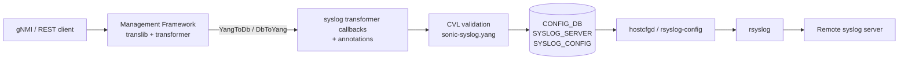

# OpenConfig support for Syslog (system/logging)

# High Level Design Document
#### Rev 0.1

# Table of Contents
  * [List of Tables](#list-of-tables)
  * [Revision](#revision)
  * [About This Manual](#about-this-manual)
  * [Scope](#scope)
  * [Definition/Abbreviation](#definitionabbreviation)
  * [1 Feature Overview](#1-feature-overview)
    * [1.1 Requirements](#11-requirements)
      * [1.1.1 Functional Requirements](#111-functional-requirements)
      * [1.1.2 Configuration and Management Requirements](#112-configuration-and-management-requirements)
      * [1.1.3 Scalability Requirements](#113-scalability-requirements)
    * [1.2 Design Overview](#12-design-overview)
      * [1.2.1 Basic Approach](#121-basic-approach)
      * [1.2.2 Container](#122-container)
  * [2 Functionality](#2-functionality)
      * [2.1 Target Deployment Use Cases](#21-target-deployment-use-cases)
  * [3 Design](#3-design)
    * [3.1 Overview](#31-overview)
    * [3.2 DB Changes](#32-db-changes)
      * [3.2.1 CONFIG DB](#321-config-db)
      * [3.2.2 APP DB](#322-app-db)
      * [3.2.3 STATE DB](#323-state-db)
      * [3.2.4 ASIC DB](#324-asic-db)
      * [3.2.5 COUNTER DB](#325-counter-db)
    * [3.3 User Interface](#33-user-interface)
      * [3.3.1 Data Models](#331-data-models)
        * [3.3.1.1 Vendor extensions](#3311-vendor-extensions)
      * [3.3.2 REST API Support](#332-rest-api-support)
      * [3.3.3 gNMI Support](#333-gnmi-support)
  * [4 Flow Diagrams](#4-flow-diagrams)
    * [4.1 OpenConfig to SONiC mapping](#41-openconfig-to-sonic-mapping)
    * [4.2 Operation semantics](#42-operation-semantics)
    * [4.3 Validation](#43-validation)
    * [4.4 Translation Notes](#44-translation-notes)
  * [5 Error Handling](#5-error-handling)
  * [6 Limitations and Dependencies](#6-limitations-and-dependencies)
  * [7 Unit Test Cases](#7-unit-test-cases)
    * [7.1 Functional Test Cases](#71-functional-test-cases)
    * [7.2 Negative Test Cases](#72-negative-test-cases)
  * [8 References](#8-references)

# List of Tables
[Table 1: Abbreviations](#table-1-abbreviations)  
[Table 2: OpenConfig to CONFIG DB mapping](#table-2-openconfig-to-config-db-mapping)  
[Table 3: Severity mapping](#table-3-severity-mapping)  
[Table 4: Facility mapping](#table-4-facility-mapping)  
[Table 5: DELETE semantics](#table-5-delete-semantics)  
[Table 6: UPDATE and REPLACE semantics](#table-6-update-and-replace-semantics)

# Revision
| Rev |     Date    |       Author          | Change Description                |
|:---:|:-----------:|:---------------------:|-----------------------------------|
| 0.1 | 24/11/2026  | Govindaraj Haridass (govi-nokia) | Initial version        |

# About this Manual
This document provides general information about the OpenConfig configuration/management of remote syslog (`/system/logging`) in SONiC, corresponding to the `openconfig-system-logging.yang` sub-module of `openconfig-system.yang`.

It complements the following documents:
- [OpenConfig_System.md](OpenConfig_System.md), which covers the other System features. Its `logging` entry only lists `remote-port`, `source-address`, `network-instance` and a single facility. This document replaces that description for logging.
- [syslog-design.md](../syslog/syslog-design.md), which defines the remote syslog schema in CONFIG DB (source IP, VRF, filter, severity).
- [syslog-over-tls-hld.md](../syslog/syslog-over-tls-hld.md), which defines syslog over TLS (`protocol` `tls`, SSL profiles, permitted peers, apply state).

# Scope
- This document describes the high level design of OpenConfig configuration/management of remote syslog via gNMI/REST in SONiC.
- This does not cover the SONiC KLISH CLI or the `config syslog` / `show syslog` click CLI.
- The behaviour of the rsyslog daemon, the rendering of `rsyslog.conf`, and SSL profile handling are defined in the documents listed above and are not repeated here.
- Remote syslog **servers** and the **global source-interface** are covered. The `files`, `console` and `vty` containers of `openconfig-system-logging` and the `messages` container are not covered by this document.
- `openconfig-system-logging.yang` is extended from revision 0.7.0 to 0.8.0 (TLS leaves). Two vendor extension modules are added: `openconfig-system-ext.yang` and `openconfig-system-logging-ext.yang`.
- Supported attributes in OpenConfig YANG tree (`+` marks nodes that are vendor extensions and not part of the upstream OpenConfig models):
```
module: openconfig-system
  +--rw system
     +--rw logging
        +--rw oc-sys-ext:config                                    (+)
        |  +--rw oc-sys-ext:source-interface?   string
        +--ro oc-sys-ext:state                                     (+)
        |  +--ro oc-sys-ext:source-interface?   string
        +--rw remote-servers
           +--rw remote-server* [host]
              +--rw host         -> ../config/host
              +--rw config
              |  +--rw host?                          oc-inet:host
              |  +--rw source-address?                oc-inet:ip-address
              |  +--rw network-instance?              oc-ni:network-instance-ref
              |  +--rw remote-port?                   oc-inet:port-number
              |  +--rw transport-security?            boolean
              |  +--rw tls-profile-id?                string
              |  +--rw oc-log-ext:tls-permitted-peers? string      (+)
              +--ro state
              |  +--ro host?                          oc-inet:host
              |  +--ro source-address?                oc-inet:ip-address
              |  +--ro network-instance?              oc-ni:network-instance-ref
              |  +--ro remote-port?                   oc-inet:port-number
              |  +--ro transport-security?            boolean
              |  +--ro tls-profile-id?                string
              |  +--ro oc-log-ext:tls-permitted-peers? string      (+)
              +--rw selectors
                 +--rw selector* [facility severity]
                    +--rw facility    -> ../config/facility
                    +--rw severity    -> ../config/severity
                    +--rw config
                       +--rw facility?   identityref
                       +--rw severity?   syslog-severity
```

# Definition/Abbreviation
### Table 1: Abbreviations

| **Term**                 | **Definition**                         |
|--------------------------|-------------------------------------|
| YANG                     | Yet Another Next Generation: modular language representing data structures in an XML tree format        |
| gNMI                     | gRPC Network Management Interface: used to retrieve or manipulate the state of a device via telemetry or configuration data         |
| CVL                      | Config Validation Library         |
| TLS                      | Transport Layer Security          |
| VRF                      | Virtual Routing and Forwarding    |
| SSL profile              | Directory of PEM files (CA bundle, certificate, key) identified by a profile ID and used for TLS |
| rsyslog                  | The syslog daemon used by SONiC   |

# 1 Feature Overview
## 1.1 Requirements
### 1.1.1 Functional Requirements
1. Provide OpenConfig support for remote syslog servers under `/openconfig-system:system/logging/remote-servers`.
2. Implement transformer support for the OpenConfig logging model with the following operations:  
    Configure/Set remote server attributes.  
    Get remote server attributes.  
    Delete remote server attributes.  
    Subscribe remote server attributes for telemetry.
3. Support the following remote server attributes:
    * destination host (IPv4, IPv6 or host name)
    * destination port
    * source address
    * network instance (VRF)
    * transport security (TLS) with TLS profile ID and permitted peers
    * selectors (facility and severity)
4. Support a global source interface for remote syslog traffic as a vendor extension.
5. Apply the same validation as the SONiC CLI and CVL, and report errors for invalid combinations with a meaningful message.

### 1.1.2 Configuration and Management Requirements
The remote syslog configuration/management can be done via REST and gNMI. The implementation returns an error if the configuration is not allowed due to misconfiguration, or if an unsupported node is accessed.

Configuration written through OpenConfig is stored in the same CONFIG DB tables used by the SONiC CLI. Configuration made by either interface is visible to the other.

### 1.1.3 Scalability Requirements
The number of remote servers is limited by the CONFIG DB schema and rsyslog, not by this feature. Only one selector per remote server is supported (see [Translation Notes](#44-translation-notes)).

## 1.2 Design Overview
### 1.2.1 Basic Approach
SONiC already supports a framework for Get, Patch and Delete via REST and gNMI. This feature adds OpenConfig support for remote syslog using the transformer based implementation:
- Table, key and field mappings that are one-to-one are declared as annotations in `openconfig-system-annot.yang`.
- The mappings that are not one-to-one are implemented in transformer callbacks: the remote server list (TLS and selector semantics, validation, replace/delete scoping, subscribe) and the global logging config (`source-interface`).
- CVL validates the resulting CONFIG DB writes against the imported `sonic-syslog.yang`.

### 1.2.2 Container
The code changes for this feature are part of the *Management Framework* container, which includes the REST server and the *gnmi* container for gNMI support, in the *sonic-mgmt-common* repository.

# 2 Functionality
## 2.1 Target Deployment Use Cases
1. REST client through which the user can perform POST, PUT, PATCH, DELETE, GET operations on the supported YANG paths.
2. gNMI client with support for capabilities, get, set and subscribe based on the supported YANG models.
3. Network automation (for example a controller using gNMI) that configures remote syslog collectors, including collectors reached over TLS, with the same data model across vendors.
4. Telemetry collectors that subscribe on-change to remote syslog configuration to detect configuration drift.

# 3 Design
## 3.1 Overview
This HLD design is in line with the [Management Framework HLD](https://github.com/sonic-net/SONiC/blob/master/doc/mgmt/Management%20Framework.md).



The OpenConfig layer only reads and writes CONFIG DB. Applying the configuration to rsyslog (rendering `rsyslog.conf`, restarting the service, TLS state) is done by the existing SONiC syslog components, as described in [syslog-design.md](../syslog/syslog-design.md) and [syslog-over-tls-hld.md](../syslog/syslog-over-tls-hld.md).

## 3.2 DB Changes
### 3.2.1 CONFIG DB
There are no changes to the CONFIG DB tables defined by the syslog designs. The OpenConfig mapping reads and writes:

- `SYSLOG_SERVER|<host>`: fields `port`, `source`, `vrf`, `protocol`, `transport_security`, `tls_profile_id`, `tls_permitted_peers`, `severity`, `facility`.
- `SYSLOG_CONFIG|GLOBAL`: field `src_intf`.

Example:
```
"SYSLOG_SERVER": {
    "10.0.0.5": {
        "port": "6514",
        "source": "10.0.0.1",
        "vrf": "Vrf-blue",
        "protocol": "tls",
        "transport_security": "true",
        "tls_profile_id": "siem-east",
        "tls_permitted_peers": "syslog-east.example.com",
        "severity": "warn",
        "facility": "local4"
    }
},
"SYSLOG_CONFIG": {
    "GLOBAL": {
        "src_intf": "Loopback0"
    }
}
```

The schema is provided by `sonic-syslog.yang` in `sonic-yang-models`. See [Limitations and Dependencies](#6-limitations-and-dependencies) for the leaves this feature requires.

### 3.2.2 APP DB
There are no changes to APP DB schema definition.

### 3.2.3 STATE DB
There are no changes to STATE DB schema definition.

The TLS apply state (`applied_transport_security`, `failure_reason` in `SYSLOG_SERVER|<host>`) is written by `rsyslog-config` as described in the TLS HLD. It is not exposed through OpenConfig by this feature. The `state` containers of the OpenConfig model are served from CONFIG DB and therefore reflect the configured values.

### 3.2.4 ASIC DB
There are no changes to ASIC DB schema definition.

### 3.2.5 COUNTER DB
There are no changes to COUNTER DB schema definition.

## 3.3 User Interface
### 3.3.1 Data Models
The following models are used as user facing models:

| Module | Description |
|--------|-------------|
| `openconfig-system.yang` / `openconfig-system-logging.yang` | Base OpenConfig models. `openconfig-system-logging` is updated to revision 0.8.0 to add `transport-security` and `tls-profile-id` to the remote server config. |
| `openconfig-system-ext.yang` (new, vendor extension) | Adds `config` and `state` containers under `/system/logging` with the `source-interface` leaf. The base model has no global logging config container. |
| `openconfig-system-logging-ext.yang` (new, vendor extension) | Adds the `tls-permitted-peers` leaf to remote server `config` and `state`. |
| `openconfig-system-annot.yang` | SONiC annotations: table, key, field, subtree and path transformer bindings. |

Backing SONiC YANG models:

| Module | Description |
|--------|-------------|
| `sonic-syslog.yang` | CONFIG DB schema for `SYSLOG_SERVER` and `SYSLOG_CONFIG`. Imported from `sonic-yang-models` (not a local copy). |
| `sonic-syslog-state.yang` | Local augment of the imported `sonic-syslog` module that carries the STATE DB leaves `applied_transport_security` and `failure_reason`, so that CVL does not register a second `SYSLOG_SERVER` table. |

`tls-permitted-peers` is a comma-separated list of DNS names, each optionally starting with a `*.` wildcard label. It corresponds to rsyslog `StreamDriverPermittedPeers` (x509/name authentication) described in the TLS HLD.

#### 3.3.1.1 Vendor extensions
The upstream OpenConfig models have no way to express two settings that the SONiC syslog feature needs: a global source interface, and the list of server certificate names that a TLS collector may present. These are added as augments in two separate extension modules. The extension modules are kept apart from the upstream modules, so that the upstream modules can be updated without merge conflicts. If OpenConfig later defines equivalent leaves, the extension can be deprecated in favour of them.

**Summary**

| | `openconfig-system-ext` | `openconfig-system-logging-ext` |
|---|---|---|
| Namespace | `http://openconfig.net/yang/system-ext` | `http://openconfig.net/yang/system/logging-ext` |
| Prefix | `oc-sys-ext` | `oc-log-ext` |
| Version | 0.1.0 | 0.1.0 |
| Augments | `/system/logging` | `/system/logging/remote-servers/remote-server/config` and `.../state` |
| Adds | containers `config` and `state`, with leaf `source-interface` | leaf `tls-permitted-peers` |
| Maps to | `SYSLOG_CONFIG\|GLOBAL` `src_intf` | `SYSLOG_SERVER\|<host>` `tls_permitted_peers` |
| Transformer | subtree transformer `logging_config_xfmr` (config); table and field annotations (state) | field annotation on `config` and `state` leaves |

**`source-interface`** (`openconfig-system-ext`)
- Type `string`: the name of an interface (for example `Loopback0`). The IP address of the interface is used as the source address of remote syslog packets for servers that have no per-server `source-address`.
- Because the base `openconfig-system-logging` model has no global logging config container, the extension adds both `config` (read-write) and `state` (read-only) containers directly under `/system/logging`.
- Address family rules are enforced when the value is set (see [Validation](#43-validation)).
- gNMI path: `/openconfig-system:system/logging/openconfig-system-ext:config/source-interface`

**`tls-permitted-peers`** (`openconfig-system-logging-ext`)
- Type `string` with a pattern: comma-separated DNS names, each optionally starting with a `*.` wildcard label (for example `syslog1.lab.example.com,*.example.com`).
- Corresponds to rsyslog `StreamDriverPermittedPeers` with x509/name authentication. The server certificate presented by the collector must match one of the entries.
- Required when `transport-security` is `true`, and rejected when it is `false`.
- rsyslog 8.2504 and earlier match a wildcard entry only against the certificate subject CN and not against subjectAltName entries, and `*` stands for exactly one DNS label. The exact DNS name of the server certificate is therefore recommended over a wildcard. This is also stated in the leaf description of the YANG module.
- gNMI path: `/openconfig-system:system/logging/remote-servers/remote-server[host=<>]/config/openconfig-system-logging-ext:tls-permitted-peers`

**Encoding**
- In JSON (REST and gNMI JSON_IETF), extension nodes carry their module name as prefix whenever their parent belongs to another module, for example `"openconfig-system-logging-ext:tls-permitted-peers": "..."` inside `config`, and `"openconfig-system-ext:config": {...}` inside `logging`. The REST and gNMI samples in this document use this form.
- In gNMI paths, the module-qualified element name is required, as in the paths above.

**Change to an upstream model**
`openconfig-system-logging.yang` is not an extension module, but it is modified: revision 0.8.0 adds `transport-security` (boolean, default `false`) and `tls-profile-id` (string) to the remote server config, and updates the description of `remote-port` to mention TLS. The TLS profile is expected to be provisioned by the system, for example through gNSI Certz, as referenced in the leaf description. These two leaves are not in revision 0.7.0, which this tree was based on; they are added in the SONiC copy of the model.

**Build and registration**
- Both extension modules are placed in `models/yang/common/`. `openconfig-system-annot.yang` imports both of them.
- `config/transformer/models_list` lists `openconfig-system.yang`, `openconfig-system-ext.yang` and the annotation module. `openconfig-system-logging-ext.yang` is not listed separately: the ocbinds Go bindings are generated from all YANG files in the build, and it is loaded through the annotation module's import.

### 3.3.2 REST API Support
#### 3.3.2.1 GET
Supported at server list, server instance, `config`, `state`, selector and leaf level, and for the global `source-interface`.

#### 3.3.2.2 SET
Supported (POST, PUT, PATCH). See [Operation semantics](#42-operation-semantics) for the scope rules of UPDATE and REPLACE.

#### 3.3.2.3 DELETE
Supported at server, config leaf, selector and global source-interface level. See [Table 5](#table-5-delete-semantics).

Sample REST request to create a server over UDP:
```
PATCH /restconf/data/openconfig-system:system/logging/remote-servers
{
  "openconfig-system:remote-servers": {
    "remote-server": [
      {
        "host": "10.0.0.5",
        "config": {
          "host": "10.0.0.5",
          "remote-port": 514,
          "source-address": "10.0.0.1",
          "network-instance": "Vrf-blue"
        },
        "selectors": {
          "selector": [
            {
              "facility": "openconfig-system-logging:LOCAL4",
              "severity": "WARNING",
              "config": {
                "facility": "openconfig-system-logging:LOCAL4",
                "severity": "WARNING"
              }
            }
          ]
        }
      }
    ]
  }
}
```

### 3.3.3 gNMI Support
#### 3.3.3.1 GET
Supported

Sample GET on a remote server:
```
gnmic -a <ip:port> -u <user> -p <passwd> get --target OC-YANG --path "/openconfig-system:system/logging/remote-servers/remote-server[host=10.0.0.5]"
[
 {
  "source": "<ip:port>",
  "timestamp": 1712673160649745928,
  "time": "2026-11-24T20:02:40.649745928+05:30",
  "updates": [
   {
    "Path": "openconfig-system:system/logging/remote-servers/remote-server[host=10.0.0.5]",
    "values": {
      "openconfig-system:system/logging/remote-servers/remote-server": {
        "host": "10.0.0.5",
        "config": {
          "host": "10.0.0.5",
          "remote-port": 6514,
          "source-address": "10.0.0.1",
          "network-instance": "Vrf-blue",
          "transport-security": true,
          "tls-profile-id": "siem-east",
          "openconfig-system-logging-ext:tls-permitted-peers": "syslog-east.example.com"
        },
        "selectors": {
          "selector": [
            {
              "facility": "openconfig-system-logging:LOCAL4",
              "severity": "WARNING",
              "config": {
                "facility": "openconfig-system-logging:LOCAL4",
                "severity": "WARNING"
              }
            }
          ]
        }
      }
    }
   }
  ]
 }
]
```

Sample GET on the global source interface:
```
gnmic -a <ip:port> -u <user> -p <passwd> get --target OC-YANG --path "/openconfig-system:system/logging/openconfig-system-ext:config/source-interface"
```

#### 3.3.3.2 SET
Supported (UPDATE and REPLACE).

Sample SET to enable TLS on an existing server. `tls-profile-id` and `tls-permitted-peers` are required together with `transport-security`:
```
gnmi_set -target_addr <ip:port> -update /openconfig-system:system/logging/remote-servers/remote-server[host=10.0.0.5]/config:@./tls-config.json -xpath_target OC-YANG

tls-config.json:
{
  "transport-security": true,
  "tls-profile-id": "siem-east",
  "openconfig-system-logging-ext:tls-permitted-peers": "syslog-east.example.com"
}
```

Sample SET of the global source interface:
```
gnmi_set -target_addr <ip:port> -update /openconfig-system:system/logging/openconfig-system-ext:config/source-interface:@./srcintf.json -xpath_target OC-YANG

srcintf.json:
{ "source-interface": "Loopback0" }
```

#### 3.3.3.3 DELETE
Supported. See [Table 5](#table-5-delete-semantics).

Sample delete of the source address of a server:
```
gnmi_set -target_addr <ip:port> -delete /openconfig-system:system/logging/remote-servers/remote-server[host=10.0.0.5]/config/source-address -xpath_target OC-YANG
```

#### 3.3.3.4 SUBSCRIBE
Supported (ON_CHANGE and SAMPLE).

For ON_CHANGE, the transformer watches `SYSLOG_SERVER|<host>`, or `SYSLOG_SERVER|*` when the path has no host key. The fields watched depend on the subscribed path:

| Subscribed path | Watched CONFIG DB fields |
|-----------------|--------------------------|
| `.../selectors/selector/config/severity` | `severity` |
| `.../selectors/selector/config/facility` | `facility` |
| `.../selectors` | `severity`, `facility` |
| any other path | `port`, `source`, `vrf`, `transport_security`, `tls_profile_id`, `tls_permitted_peers`, `severity`, `facility` |

Subscription to a server that does not exist yet is accepted, so that the creation of the server is notified.

Sample telemetry with ON_CHANGE mode on a remote server port:
```
gnmic -a <ip>:<port> -u <> -p <> sub --path "/openconfig-system:system/logging/remote-servers/remote-server[host=10.0.0.5]/config/remote-port" --target OC-YANG --stream-mode on-change
```

Example list of xpaths which can be used for subscription:
```
"/openconfig-system:system/logging/remote-servers/remote-server[host=<>]/config"
"/openconfig-system:system/logging/remote-servers/remote-server[host=<>]/config/remote-port"
"/openconfig-system:system/logging/remote-servers/remote-server[host=<>]/config/source-address"
"/openconfig-system:system/logging/remote-servers/remote-server[host=<>]/config/network-instance"
"/openconfig-system:system/logging/remote-servers/remote-server[host=<>]/config/transport-security"
"/openconfig-system:system/logging/remote-servers/remote-server[host=<>]/selectors"
"/openconfig-system:system/logging/openconfig-system-ext:config/source-interface"
```

# 4 Flow Diagrams
## 4.1 OpenConfig to SONiC mapping
### Table 2: OpenConfig to CONFIG DB mapping

| OpenConfig path (under `/system/logging`) | CONFIG DB | Notes |
|-------------------------------------------|-----------|-------|
| `remote-servers/remote-server[host]` | `SYSLOG_SERVER\|<host>` | Key is the server address. `host` in `config` and `state` is taken from the key; a payload `host` that differs from the key is rejected. |
| `.../config/remote-port` | `port` | The port is not rewritten unless the client sets it. |
| `.../config/source-address` | `source` | |
| `.../config/network-instance` | `vrf` | |
| `.../config/transport-security` | `transport_security` and `protocol` | `true` sets `protocol=tls`; `false` sets `protocol=udp`. |
| `.../config/tls-profile-id` | `tls_profile_id` | |
| `.../config/openconfig-system-logging-ext:tls-permitted-peers` | `tls_permitted_peers` | Vendor extension. |
| `.../selectors/selector/config/severity` | `severity` | See [Table 3](#table-3-severity-mapping). |
| `.../selectors/selector/config/facility` | `facility` | See [Table 4](#table-4-facility-mapping). |
| `openconfig-system-ext:config/source-interface` | `SYSLOG_CONFIG\|GLOBAL` `src_intf` | Vendor extension. |
| `openconfig-system-ext:state/source-interface` | `SYSLOG_CONFIG\|GLOBAL` `src_intf` | Mirrors the configured value. |

The `state` leaves of a remote server use the same mappings as the `config` leaves.

### Table 3: Severity mapping

| OpenConfig severity | CONFIG DB `severity` |
|---------------------|----------------------|
| EMERGENCY | `crit` |
| ALERT | `crit` |
| CRITICAL | `crit` |
| ERROR | `error` |
| WARNING | `warn` |
| NOTICE | `notice` |
| INFORMATIONAL | `info` |
| DEBUG | `debug` |

On GET, `crit` is returned as CRITICAL.

### Table 4: Facility mapping

| OpenConfig facility | CONFIG DB `facility` |
|---------------------|----------------------|
| ALL | `*` |
| KERNEL | `kern` |
| USER | `user` |
| MAIL | `mail` |
| SYSTEM_DAEMON | `daemon` |
| AUTH | `auth` |
| SYSLOG | `syslog` |
| LOCAL0 ... LOCAL7 | `local0` ... `local7` |

## 4.2 Operation semantics
### Table 5: DELETE semantics

A DELETE only affects the addressed node. Deleting a leaf never deletes the server entry.

| DELETE target | Effect |
|---------------|--------|
| `remote-servers` or `remote-server[host]` | Deletes the `SYSLOG_SERVER` entry (or entries). |
| `.../config/remote-port` | Clears `port`. NotFound if not set. |
| `.../config/source-address` | Clears `source`. NotFound if not set. |
| `.../config/network-instance` | Clears `vrf`. NotFound if not set. |
| `.../config/tls-profile-id` | Clears `tls_profile_id`. NotFound if not set. Rejected while TLS is still enabled on the server. |
| `.../config/openconfig-system-logging-ext:tls-permitted-peers` | Clears `tls_permitted_peers`. NotFound if not set. Allowed only while TLS is off. |
| `.../config/transport-security` | Clears `transport_security`. If the server is still TLS through `protocol`, the entry is also replaced with `protocol=udp` and the TLS profile and permitted peers are dropped. NotFound if neither TLS field is set. |
| `.../selectors`, `.../selectors/selector`, `.../selectors/selector/config` | Clears `facility` and `severity`. |
| `.../selectors/selector/config/severity` | Clears `severity` only. |
| `.../selectors/selector/config/facility` | Clears `facility` only. |
| any other path under `selectors` (for example `state`) | Rejected with an error. |
| `openconfig-system-ext:config/source-interface` | Clears `src_intf`. |

### Table 6: UPDATE and REPLACE semantics

The scope of the request decides how much of the existing `SYSLOG_SERVER` entry is kept.

| Request | Behaviour |
|---------|-----------|
| UPDATE (any level) | The existing entry is read and merged. Fields not in the request are kept. A leaf-only UPDATE (for example only `tls-profile-id`) is validated against the merged entry. |
| REPLACE on `.../config` | Replaces the config leaves. Selector fields (`severity`, `facility`) are kept. Config leaves left out of the request are removed. |
| REPLACE on `.../selectors` | Replaces the selector fields. `port`, `source`, `vrf` and the TLS fields are kept. |
| REPLACE on `.../selector/config/facility` or `.../severity` | Replaces that leaf and keeps the other selector field from the existing entry. |
| REPLACE of a whole server or of `remote-servers` | No merge: the entry contains exactly the fields in the request. Fields left out are removed. |

Setting `transport-security` to `false` removes `tls_profile_id` and `tls_permitted_peers` in the same operation and sets `protocol=udp`.

## 4.3 Validation
The transformer validates the request before it is written, in addition to CVL:

| Attribute | Rule |
|-----------|------|
| `host` | Must match the list key. |
| `network-instance` | Must be an existing VRF, or `mgmt` when the management VRF is enabled. |
| `source-address` | Must be a valid IP address. It must not be a loopback, multicast or link-local address. It must be of the same IP family as `host`. It must be configured on the device in the selected VRF. |
| `source-interface` (global) | Every configured server that has no per-server `source-address` must find an address of its own family on that interface. IPv4: any address. IPv6: global scope only. Servers with a `source-address`, and servers whose host is a name, are skipped. Servers in the same request are included in the check. |
| `transport-security` / `tls-profile-id` | `tls-profile-id` is required when `transport-security` is `true`, and rejected when it is not. It must match `[A-Za-z0-9._-]+`. `gnxi` is reserved for the gNMI listener and is rejected. |
| `tls-permitted-peers` | Required when `transport-security` is `true`, and rejected when it is not. Each comma-separated entry must be a DNS name with an optional leading `*.`. Whitespace around entries is removed. Empty entries are rejected. |
| selectors | Only one selector per server is supported. |

The Linux address and VRF checks are done through an injectable provider so that they can be mocked in unit tests.

## 4.4 Translation Notes
1. Severity: EMERGENCY, ALERT and CRITICAL are all translated to the SONiC `crit` level, so the original value is not preserved. See [Table 3](#table-3-severity-mapping).
2. Selectors: SONiC stores a single `severity` and `facility` per server, so only one selector per remote server is accepted.
3. Protocol: OpenConfig exposes TLS only through `transport-security`. `protocol` values `udp` and `tcp` are not selectable through OpenConfig. Enabling TLS sets `protocol=tls`, and disabling it sets `protocol=udp`. The default TLS port (6514), certificate handling, and the fail-closed behaviour (no clear text fallback) are defined by the TLS HLD and applied by the rsyslog configuration scripts.
4. `tls-profile-id` refers to an SSL profile directory on the device (see the TLS HLD). The OpenConfig layer validates only the profile ID format. Whether the PEM files exist is evaluated when the configuration is applied to rsyslog.
5. `source-interface` is a global setting and is used by servers that have no `source-address`.
6. `state` containers are served from CONFIG DB.

# 5 Error Handling
Invalid configurations/operations report an error through the standard transformer error types:

| Condition | Error |
|-----------|-------|
| Invalid value (`source-address`, `network-instance`, `host`, peer name, profile ID) | Invalid argument, with the offending value in the message |
| `transport-security` `true` without `tls-profile-id` or `tls-permitted-peers` | Invalid argument |
| `tls-profile-id` or `tls-permitted-peers` without `transport-security` `true` | Invalid argument: "transport-security true is required when ..." |
| `gnxi` used as `tls-profile-id` | Invalid argument |
| `source-interface` has no address of a server's IP family | Invalid argument: "... (IP address family mismatch)" |
| More than one selector for a server | Not supported |
| DELETE of a leaf that is not set | Not found |
| DELETE of `tls-profile-id` while TLS is enabled | Invalid argument |
| DELETE or write on an unsupported selector path | Invalid argument |
| The Linux interface/VRF view cannot be read | The request is rejected with the provider error |
| CONFIG DB schema violation | Error reported by CVL |

# 6 Limitations and Dependencies
1. **CONFIG DB schema.** The feature depends on `sonic-syslog.yang` in `sonic-yang-models` defining the leaves it writes: `SYSLOG_SERVER` `protocol` (with `tls`), `transport_security`, `tls_profile_id`, `tls_permitted_peers`, `facility`, `severity`, `source`, `vrf`, `port`, and `SYSLOG_CONFIG|GLOBAL` `src_intf`. If a leaf is missing, CVL rejects the write.
2. **Extension modules.** `source-interface` and `tls-permitted-peers` are not part of the upstream OpenConfig models. Clients must use the extension module prefixes shown in this document. If the community models gain equivalents, the extensions can be replaced.
3. **TLS apply state** is not exposed through OpenConfig. Use `show syslog tls-state` on the device (see the TLS HLD).
4. **Selectors:** only one selector per server.
5. **REPLACE of a list with several servers** depends on the handling of table-owner lists in the transformer infrastructure. Each server is handled correctly when replaced individually.
6. `files`, `console`, `vty` and `messages` logging nodes are not supported by this feature.

# 7 Unit Test Cases
## 7.1 Functional Test Cases
Operations:  
gNMI - (Create/Update/Delete/Replace/Get/Subscribe)  
REST - POST/PATCH/DELETE/PUT/GET  
1. Verify that a server can be created with host, port, source address and VRF, and that GET returns the same values in `config` and `state`.
2. Verify that a selector with each supported facility and severity is stored with the expected CONFIG DB values, and returned on GET.
3. Verify that EMERGENCY, ALERT and CRITICAL are stored as `crit` and returned as CRITICAL.
4. Verify that enabling `transport-security` with a valid `tls-profile-id` and `tls-permitted-peers` sets `protocol=tls`.
5. Verify that a leaf-only UPDATE of `tls-profile-id` or `tls-permitted-peers` on a TLS server is accepted.
6. Verify that setting `transport-security` to `false` on a TLS server removes the profile and permitted peers and sets `protocol=udp`.
7. Verify that each leaf-level DELETE (`remote-port`, `source-address`, `network-instance`) clears only that field.
8. Verify DELETE of `tls-profile-id`, `tls-permitted-peers`, and `transport-security` as in [Table 5](#table-5-delete-semantics).
9. Verify DELETE of `selectors`, of the selector `severity` leaf and of the selector `facility` leaf.
10. Verify UPDATE keeps the unspecified fields, and REPLACE at `config`, `selectors`, `selector` leaf and server level behaves as in [Table 6](#table-6-update-and-replace-semantics).
11. Verify GET on a server that has only one of severity or facility set.
12. Verify the global `source-interface` set, get, delete, and that `state` mirrors the configured value.
13. Verify ON_CHANGE subscription to a server (with and without host key) and to a selector leaf, and that creation of a new server is notified.
14. Verify SAMPLE subscription on `config`.
15. Verify that a configuration made through the CLI is returned by OpenConfig GET, and the reverse.

## 7.2 Negative Test Cases
1. Verify that an invalid `source-address` (loopback, multicast, link-local, wrong IP family, not present in the VRF) returns an error.
2. Verify that a non-existent `network-instance`, and `mgmt` when the management VRF is disabled, return an error.
3. Verify that `transport-security` `true` without `tls-profile-id`, or without `tls-permitted-peers`, returns an error.
4. Verify that `tls-profile-id` or `tls-permitted-peers` without `transport-security` `true` returns an error.
5. Verify that `gnxi` and an invalid-character profile ID are rejected.
6. Verify that an invalid permitted peer (empty entry, invalid characters) is rejected.
7. Verify that a payload `host` that differs from the key is rejected.
8. Verify that a request with more than one selector for a server is rejected.
9. Verify that DELETE of a leaf that is not set returns not found.
10. Verify that DELETE of `tls-profile-id` while TLS is enabled returns an error.
11. Verify that DELETE or write on `selector/state` returns an error.
12. Verify that setting a global `source-interface` with no address of the family of a configured server (or of a server in the same request) is rejected.
13. Verify that adding a server whose family has no address on the configured global `source-interface` is rejected.
14. Verify that GET on a non-existing server returns empty data.

# 8 References
- [OpenConfig_System.md](OpenConfig_System.md)
- [SONiC Syslog Source IP / Syslog design](../syslog/syslog-design.md)
- [SONiC Remote Syslog over TLS](../syslog/syslog-over-tls-hld.md)
- [Management Framework HLD](Management%20Framework.md)
- [OpenConfig system logging model](https://github.com/openconfig/public/blob/master/release/models/system/openconfig-system-logging.yang)
