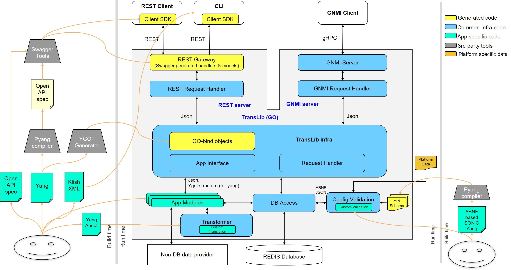

# OpenConfig Model Support for SONiC VRRP Feature

# High Level Design Document
#### Rev 1.2

# Table of Contents
  * [List of Tables](#list-of-tables)
  * [Revision](#revision)
  * [About This Manual](#about-this-manual)
  * [Related Documents](#related-documents)
  * [Scope](#scope)
  * [Definition/Abbreviation](#definitionabbreviation)
  * [1 Feature Overview](#1-feature-overview)
    * [1.1 Requirements](#11-requirements)
      * [1.1.1 Functional Requirements](#111-functional-requirements)
      * [1.1.2 Configuration and Management Requirements](#112-configuration-and-management-requirements)
      * [1.1.3 Scalability Requirements](#113-scalability-requirements)
    * [1.2 Design Overview](#12-design-overview)
      * [1.2.1 Basic Approach](#121-basic-approach)
      * [1.2.2 Container](#122-container)
  * [2 Functionality](#2-functionality)
      * [2.1 Target Deployment Use Cases](#21-target-deployment-use-cases)
  * [3 Design](#3-design)
    * [3.1 Overview](#31-overview)
      * [3.1.1 SONiC Feature YANG and CONFIG_DB](#311-sonic-feature-yang-and-config_db)
      * [3.1.2 OpenConfig Modules](#312-openconfig-modules)
      * [3.1.3 UMF Translation (REST/gNMI to CONFIG_DB)](#313-umf-translation-restgnmi-to-config_db)
      * [3.1.4 FRR Programming](#314-frr-programming)
      * [3.1.5 OpenConfig Extensions](#315-openconfig-extensions)
      * [3.1.6 Mapping Table and Unit Tests](#316-mapping-table-and-unit-tests)
      * [3.1.7 Multiple L3 addresses on one interface](#317-multiple-l3-addresses-on-one-interface)
    * [3.2 DB Changes](#32-db-changes)
      * [3.2.1 CONFIG DB](#321-config-db)
      * [3.2.2 APP DB](#322-app-db)
      * [3.2.3 STATE DB](#323-state-db)
      * [3.2.4 ASIC DB](#324-asic-db)
      * [3.2.5 COUNTER DB](#325-counter-db)
  * [4 Mapping Tables](#4-mapping-tables)
    * [4.1 SONiC CLI to SONiC YANG](#41-sonic-cli-to-sonic-yang)
    * [4.2 SONiC YANG to OpenConfig](#42-sonic-yang-to-openconfig)
    * [4.3 OpenConfig to CONFIG_DB](#43-openconfig-to-config_db)
    * [4.4 gNMI bases (Google / PINS form)](#44-gnmi-bases-google--pins-form)
    * [4.5 Deviations](#45-deviations)
  * [5 User Interface](#5-user-interface)
    * [5.1 Data Models](#51-data-models)
    * [5.2 REST API Support](#52-rest-api-support)
      * [5.2.1 GET](#521-get)
      * [5.2.2 PUT](#522-put)
      * [5.2.3 POST](#523-post)
      * [5.2.4 PATCH](#524-patch)
      * [5.2.5 DELETE](#525-delete)
    * [5.3 gNMI Support](#53-gnmi-support)
      * [5.3.1 GET](#531-get)
      * [5.3.2 SET](#532-set)
      * [5.3.3 DELETE](#533-delete)
      * [5.3.4 SUBSCRIBE](#534-subscribe)
  * [6 Error Handling](#6-error-handling)
  * [7 Unit Test Cases](#7-unit-test-cases)
    * [7.1 Functional Test Cases](#71-functional-test-cases)
    * [7.2 Negative Test Cases](#72-negative-test-cases)


# List of Tables
[Table 1: Abbreviations](#table-1-abbreviations)

[Table 2: Translation Flow Layers](#table-2-translation-flow-layers)

Mapping tables: [Section 4](#4-mapping-tables)


# Revision
| Rev | Date | Author | Change Description |
|:---:|:-----------:|:---------------------------:|-----------------------------------|
| 0.1 | 11/16/2026 | Malavika Unnikrishnan | Initial UMF mapping for OpenConfig IPv6 VRRP |
| 0.2 | 11/18/2026 | Malavika Unnikrishnan | Cover IPv4, routed-vlan, and remaining OC VRRP leaves |
| 0.3 | 11/19/2026 | Malavika Unnikrishnan | Document gNMI paths in Google / PINS form |
| 0.4 | 11/19/2026 | Malavika Unnikrishnan | Align HLD to Network Instance format; add CLI → YANG → OC mapping and deviations |
| 0.5 | 11/19/2026 | Malavika Unnikrishnan | Bind OpenConfig GET/DELETE to the interface IP used at SET (`oc_ip`) |
| 0.6 | 11/19/2026 | Malavika Unnikrishnan | Drop OpenConfig support for preempt-delay and accept-mode; do not map version or admin_status |
| 0.7 | 11/22/2026 | Malavika Unnikrishnan | Drop `oc_ip` from CVL; GET of any L3 address on `{if}|{vrid}` fans out |
| 0.8 | 11/24/2026 | Malavika Unnikrishnan | Google `virtual-router-id` maps only to Redis key `{vrid}`; UMF does not write hash field `vid` |
| 0.9 | 11/24/2026 | Malavika Unnikrishnan | First leaf SET creates the group; `virtual-address` SET replaces `vip@`; duplicate VIP is rejected |
| 1.0 | 11/24/2026 | Malavika Unnikrishnan | VIP uniqueness is by host address (prefix length ignored). IPv6 link-local uniqueness is per hosting interface |
| 1.1 | 11/24/2026 | Malavika Unnikrishnan | Join OC `address[ip]` to INTERFACE; multi-IP is different-subnet prefixes on one if sharing `{if}\|{vrid}` |
| 1.2 | 11/25/2026 | Malavika Unnikrishnan | Canonical IPv6 VIPs; empty virtual-address HDEL; unkeyed DELETE/REPLACE require VRID; uniqueness is CLI+UMF not CVL |
| 1.3 | 11/25/2026 | Malavika Unnikrishnan | JSON annot marks preempt-delay/accept-mode not-supported; REPLACE of config omits VIP category as delete; Subscribe address[ip=*] fans out |
| 1.4 | 11/25/2026 | Malavika Unnikrishnan | Controller SET==GET must drop sibling VRRP echoes keyed {if, family, vrid} |

# About this Manual
This document describes OpenConfig configuration and management of VRRP in SONiC. Google / PINS clients walk the `openconfig-interfaces` tree. `openconfig-if-ip` 3.9.0 adds `ipv4` / `ipv6` / `vrrp` / `vrrp-group` onto that tree (and onto `openconfig-vlan:routed-vlan` for SVIs). There is no `/openconfig-if-ip:` root.

UMF maps those four `vrrp-group` bases onto CONFIG_DB `VRRP` / `VRRP_TRACK` and `VRRP6` / `VRRP6_TRACK`. Native VRRP dataplane, FRR `vrrpd`, and KLISH/click CLI implementation are documented in [VRRP_Adaptation_HLD.md](../vrrp/VRRP_Adaptation_HLD.md). This HLD covers the northbound OpenConfig mapping and records the CLI and SONiC YANG that mapping sits on.

gNMI path elements after `interfaces` are unprefixed (`ipv4`, `ipv6`, `vrrp`). JSON_IETF SET values still use leaf names such as `openconfig-if-ip:priority`. YANG annotation deviations keep `oc-ip:` prefixes because YANG requires them.

# Related Documents
| Document | Description |
|----------|-------------|
| Management Framework.md | UMF architecture (REST, gNMI, translib, transformers) |
| OpenConfig_Interfaces.md | Parent Ethernet / address tree |
| OpenConfig_VLAN_Interface.md | `openconfig-vlan:routed-vlan` (SVI) |
| [VRRP_Adaptation_HLD.md](../vrrp/VRRP_Adaptation_HLD.md) | Native VRRP (FRR vrrpd, CLI, CONFIG_DB) |

# Scope
- This document describes the high level design of OpenConfig **VRRP** configuration and operational retrieval in SONiC.
- **In scope:** REST and gNMI — Get, Set (POST/PUT/PATCH), Delete, and Subscribe on the four `vrrp-group` bases and suffixes in [Section 4](#4-mapping-tables).
- **Out of scope:** native VRRP dataplane and FRR `vrrpd` internals; KLISH/click CLI implementation; writing `FEATURE|*`; OpenConfig `preempt-delay` and `accept-mode` (not-supported); native `version` and `admin_status` (no OpenConfig counterpart; UMF never writes them).
- OpenConfig xpath root (Google / PINS gNMI):
  `/openconfig-interfaces:interfaces/interface`
- Supported attributes in the OpenConfig YANG tree (reflecting current UMF implementation):

```
module: openconfig-interfaces
  +--rw interfaces
     +--rw interface* [name]
        +--rw subinterfaces
        |  +--rw subinterface* [index]
        |     +--rw ipv4
        |     |  +--rw addresses
        |     |     +--rw address* [ip]
        |     |        +--rw vrrp
        |     |           +--rw vrrp-group* [virtual-router-id]   → CONFIG_DB VRRP
        |     +--rw ipv6
        |        +--rw addresses
        |           +--rw address* [ip]
        |              +--rw vrrp
        |                 +--rw vrrp-group* [virtual-router-id]   → CONFIG_DB VRRP6
        +--rw openconfig-vlan:routed-vlan
           +--rw ipv4
           |  +--rw addresses
           |     +--rw address* [ip]
           |        +--rw vrrp
           |           +--rw vrrp-group* [virtual-router-id]      → CONFIG_DB VRRP
           +--rw ipv6
              +--rw addresses
                 +--rw address* [ip]
                    +--rw vrrp
                       +--rw vrrp-group* [virtual-router-id]      → CONFIG_DB VRRP6

vrrp-group:
  +--rw virtual-router-id
  +--rw config
  |  +--rw virtual-router-id
  |  +--rw virtual-address*          ip-address
  |  +--rw virtual-link-local?       ipv6-address   (IPv6 only)
  |  +--rw priority?                 uint8
  |  +--rw preempt?                  boolean
  |  +--rw preempt-delay?            uint16   (not-supported)
  |  +--rw accept-mode?              boolean  (not-supported)
  |  +--rw advertisement-interval?   uint16   (centiseconds)
  +--ro state
  |  +--ro virtual-router-id
  |  +--ro virtual-address*
  |  +--ro virtual-link-local?
  |  +--ro priority?
  |  +--ro current-priority?         (GET mirrors configured priority)
  |  +--ro preempt?
  |  +--ro preempt-delay?            (not-supported)
  |  +--ro accept-mode?              (not-supported)
  |  +--ro advertisement-interval?
  +--rw interface-tracking
     +--rw config
     |  +--rw track-interface*
     |  +--rw priority-decrement?
     +--ro state
        +--ro track-interface*
        +--ro priority-decrement?
```

# Definition/Abbreviation
### Table 1: Abbreviations
| **Term** | **Definition** |
|----------|----------------|
| YANG | Yet Another Next Generation: modular language representing data structures in an XML tree format |
| gNMI | gRPC Network Management Interface: used to retrieve or manipulate the state of a device via telemetry or configuration data |
| UMF | Unified Management Framework (translib + transformers) |
| VRRP | Virtual Router Redundancy Protocol |
| VIP | Virtual IP address advertised by the VRRP group |
| VRID | Virtual Router Identifier (1..255) |
| SVI | Switch Virtual Interface; the L3 interface on a VLAN (`Vlan100`). OpenConfig models this as `openconfig-vlan:routed-vlan` |
| CVL | Config Validation Library (SONiC YANG used to validate CONFIG_DB writes) |

# 1 Feature Overview
## 1.1 Requirements
### 1.1.1 Functional Requirements
1. Map OpenConfig IPv4 `vrrp-group` onto CONFIG_DB `VRRP|{interface}|{vrid}` and `VRRP_TRACK|{interface}|{vrid}|{track_if}`.
2. Map OpenConfig IPv6 `vrrp-group` onto CONFIG_DB `VRRP6|{interface}|{vrid}` and `VRRP6_TRACK|{interface}|{vrid}|{track_if}`.
3. Support both subinterface (`subinterfaces/subinterface[index=0]`) and SVI (`openconfig-vlan:routed-vlan`) anchors.
4. Support Get, Patch, Put, Post, Delete, and Subscribe for the suffixes in [Section 4](#4-mapping-tables).
5. Merge IPv6 `virtual-address` and `virtual-link-local` into the same native `vip` leaf-list.
6. Translate OpenConfig boolean `preempt` to native `enabled` / `disabled`.
7. Translate OpenConfig `priority-decrement` to native `priority_increment`.
8. Map `advertisement-interval` onto CONFIG_DB. OpenConfig `preempt-delay` and `accept-mode` are not-supported.
9. Enable/disable is presence of the `VRRP` / `VRRP6` row. UMF does not write `FEATURE|*`, `version`, or `admin_status`.

### 1.1.2 Configuration and Management Requirements
VRRP configuration through OpenConfig is done via REST and gNMI. The implementation returns an error if configuration is not allowed due to misconfiguration. There are no new CLI commands required for OpenConfig. Native CLI remains as documented in VRRP_Adaptation_HLD.md.

### 1.1.3 Scalability Requirements
The maximum number of VRRP instances depends on the native VRRP feature and platform resources. UMF does not add a separate scale limit.

## 1.2 Design Overview
### 1.2.1 Basic Approach
SONiC already stores VRRP in CONFIG_DB. UMF transformers translate REST/gNMI OpenConfig requests into those existing tables. Native `frrcfgd` / `vrrpd` consume CONFIG_DB independently of UMF.

### 1.2.2 Container
Implementation changes are in **sonic-mgmt-common** (REST server in the Management Framework container and gNMI server in the gnmi container: annotations, transformers) and **sonic-yang-models** (`sonic-vrrp.yang` CVL).

# 2 Functionality
## 2.1 Target Deployment Use Cases
Google / PINS and other northbound clients configure and query VRRP using OpenConfig YANG over REST or gNMI, without using SONiC CLI.

What a client must be able to do through UMF:

1. **Create** a VRRP group on an existing L3 IPv4 or IPv6 address (Ethernet subinterface or SVI).
2. **Set** VRID, virtual address(es), IPv6 virtual link-local, priority, preempt, advertisement-interval, tracked interface(s), and priority-decrement.
3. **Get** the same leaves from `config` and `state`.
4. **Delete** a group or an individual leaf / VIP member.
5. **Subscribe** to group and tracking changes.

1. **REST clients** — GET, POST, PUT, PATCH, and DELETE on VRRP RESTCONF paths.
2. **gNMI clients** — Capabilities, Get, Set (update/delete), and Subscribe on VRRP gNMI paths in Google / PINS form.

# 3 Design
## 3.1 Overview
This HLD follows [Management Framework.md](https://github.com/sonic-net/SONiC/blob/master/doc/mgmt/Management%20Framework.md). The design covers: SONiC feature YANG, OpenConfig modules, UMF translation, CONFIG_DB, mapping tables (Section 4), and unit tests (Section 7).

### 3.1.1 SONiC Feature YANG and CONFIG_DB
SONiC defines the southbound schema in `sonic-vrrp.yang`:

| Item | Detail |
|------|--------|
| CONFIG_DB tables | `VRRP`, `VRRP_TRACK`, `VRRP6`, `VRRP6_TRACK` |
| Redis keys | `VRRP|{if}|{vrid}`, `VRRP_TRACK|{if}|{vrid}|{track_if}` (same pattern for VRRP6) |
| Prerequisite | Host interface must already be an L3 `INTERFACE`, `PORTCHANNEL_INTERFACE`, or `VLAN_INTERFACE` |

OpenConfig clients never write CONFIG_DB directly; UMF transformers populate these tables from OpenConfig payloads.

### 3.1.2 OpenConfig Modules
| Module | Source | Role for VRRP |
|--------|--------|----------------|
| [openconfig-interfaces.yang](https://github.com/openconfig/public/blob/master/release/models/interfaces/openconfig-interfaces.yang) | openconfig/public | Root tree Google walks |
| [openconfig-if-ip.yang](https://github.com/openconfig/public/blob/master/release/models/interfaces/openconfig-if-ip.yang) 3.9.0 | openconfig/public | `ipv4` / `ipv6` / `vrrp` / `vrrp-group` grouping |
| [openconfig-vlan.yang](https://github.com/openconfig/public/blob/master/release/models/vlan/openconfig-vlan.yang) | openconfig/public | `routed-vlan` (SVI) |
| openconfig-if-ip-vrrp-annot.yang | sonic-mgmt-common | XPath to CONFIG_DB and transformer bindings |
| sonic-vrrp.yang | sonic-yang-models | CVL for rows UMF writes |

### 3.1.3 UMF Translation (REST/gNMI to CONFIG_DB)
OpenConfig SET/GET/SUBSCRIBE requests are handled by translib and the **transformer** common app. Annotation YANG defines xpath-to-DB bindings; `xfmr_vrrp.go` performs family detection, VIP merge, unit conversion, and tracking expansion.



*Figure: Management Framework architecture ([Management Framework.md](https://github.com/sonic-net/SONiC/blob/master/doc/mgmt/Management%20Framework.md)).*

#### Table 2: Translation Flow Layers

| Layer | Artifact | Role |
|-------|----------|------|
| **1. SONiC feature YANG** | `sonic-vrrp.yang` | CONFIG_DB schema for `VRRP` / `VRRP6` / tracking tables |
| **2. OpenConfig modules** | `openconfig-interfaces`, `openconfig-if-ip` 3.9.0, `openconfig-vlan` | Northbound client model |
| **3. UMF annotations** | `openconfig-if-ip-vrrp-annot.yang` | XPath → table/field/transformer binding |
| **4. UMF transformers** | `xfmr_vrrp.go` | YangToDb / DbToYang / Subscribe |
| **5. CONFIG_DB** | `VRRP`, `VRRP_TRACK`, `VRRP6`, `VRRP6_TRACK` | Runtime configuration consumed by native VRRP |

### 3.1.4 FRR Programming
UMF does **not** program FRR. Native `frrcfgd` reads CONFIG_DB `VRRP` / `VRRP6` and programs FRR `vrrpd`.

UMF does not write `version`, `admin_status`, `preempt_delay`, or `accept_mode`. Native CLI still sets `version` and `admin_status`. OpenConfig `preempt-delay` and `accept-mode` are not-supported.

### 3.1.5 OpenConfig Extensions
None. VRRP uses base `openconfig-if-ip` 3.9.0. There is no SONiC VRRP extension module.

### 3.1.6 Mapping Table and Unit Tests
- **CLI → SONiC YANG → OpenConfig:** [Section 4](#4-mapping-tables).
- **REST/gNMI examples:** [Section 5](#5-user-interface).
- **Unit tests:** [Section 7](#7-unit-test-cases).

### 3.1.7 Multiple L3 addresses on one interface

OpenConfig hangs `vrrp-group` off `addresses/address[ip]`. Native VRRP does not: the Redis key is `{ifname}|{vrid}` and FRR `vrrpd` is per interface. UMF does **not** add an OpenConfig-only field to `sonic-vrrp.yang` to remember which IP was used at SET.

**Join.** For SET, GET, DELETE, and Subscribe, UMF reads `address[ip]` from the path and looks it up in `INTERFACE` / `PORTCHANNEL_INTERFACE` / `VLAN_INTERFACE` on the path's `interface[name]`.

| Path IP | Result |
|---------|--------|
| Configured on that interface, same family as the `ipv4` / `ipv6` node | Use `VRRP\|{if}\|{vrid}` or `VRRP6\|{if}\|{vrid}` |
| Not on that interface, or wrong family | SET/DELETE: `InvalidArgs`. GET: empty in translib (`{}`); live gNMI `NOT_FOUND` (that address is not an L3 object). Not `InvalidArgs` and not another group's VRRP |

The path IP is the **interface** address, not the VIP. The VIP is still `virtual-address` / `virtual-link-local` stored in `vip@`.

**Same subnet.** Two IPv4 (or two IPv6) addresses in one subnet on one VRF do not both program in hardware. `IntfsOrch` skips the overlapping prefix (`isAddressInSubnet`). So `1.1.1.1/24` plus `1.1.1.2/24` on Ethernet1 is not a live L3 case and is not a VRRP UMF case.

**Different subnets.** This is the real multi-IP case:

```
config interface ip add Ethernet1 1.1.1.1/24
config interface ip add Ethernet1 2.2.2.1/24
```

Both prefixes are valid L3. Native VRRP is still one instance per `{Ethernet1}|{vrid}`. IPv4 and IPv6 are separate tables (`VRRP` vs `VRRP6`), not two IPs of one group.

```
SET  .../ipv4/addresses/address[ip=1.1.1.1]/vrrp/vrrp-group[virtual-router-id=1]
       → CONFIG_DB VRRP|Ethernet1|1
GET   .../ipv4/addresses/address[ip=2.2.2.1]/vrrp/vrrp-group[virtual-router-id=1]
       → same row (fan-out)
SET   on 2.2.2.1 with the same VRID
       → updates the same row
DELETE of vrrp-group[virtual-router-id=1] on 2.2.2.1
       → native `config interface vrrp remove Ethernet1 1` (shared row)
DELETE of unkeyed /vrrp or /vrrp-group
       → InvalidArgs (`VRRP DELETE requires virtual-router-id`); native CLI always takes `<vrid>`
REPLACE of unkeyed /vrrp or /vrrp-group
       → InvalidArgs (`VRRP REPLACE requires virtual-router-id`); same reason as DELETE
```

That is native semantics, not a second group. Google cannot have a different VRRP config per subnet on one interface without a stored locator IP, which is not in `sonic-vrrp.yang`. IPv6 VIP aliases (`2001:db8:1:2:3:4::1` vs `2001:db8:1:2:3:4:0:1`) are the same host; UMF stores `net.IP` canonical form so uniqueness matches native VIP list compare.

**VIP uniqueness.** Native CLI rejects a VIP that is already on any VRRP/VRRP6 row (exact string). OpenConfig UMF rejects the same **host** on another `{if}|{vrid}` (prefix length ignored; IPv6 link-local unique per hosting interface). CVL does **not** enforce uniqueness, so JSON `config load` of two groups sharing a host will succeed. Operators who load JSON must not introduce duplicate VIP hosts.

**CLI / JSON monitor.** A group created by CLI has no OpenConfig cookie. GET of any configured address of that family on the interface returns the group. That is how OpenConfig-only monitoring of CLI config works.

**Controller SET==GET.** A generic tree-diff of intended vs GET of the parent will see `vrrp-group` under IP-2 even when the controller only SET it under IP-1. That extra copy is the same `{if}|{vrid}` object, not additional config. Comparators must drop GET paths matching `.../address[ip=Y]/vrrp/vrrp-group[VRID]` when intended already has the same group on `address[ip=X]` of the same interface, family, and VRID, with the same body. A different VRID, the other family (`VRRP` vs `VRRP6`), another interface, or a different body is still a mismatch. The helper is `vrrp_set_get_extra()` in `whitebox/sonic-test` `sonic-mgmt/tests/common/umf_cli/vrrp_set_get.py`. UMF GET does not change.

**Dual stack.** `address[ip=1.1.1.1]/ipv4/vrrp` and `address[ip=2001:db8::1]/ipv6/vrrp` map to `VRRP` and `VRRP6` respectively. They do not share a row.

## 3.2 DB Changes
OpenConfig VRRP uses existing CONFIG_DB tables. No OpenConfig-only leaf is added to `sonic-vrrp.yang`. No new Redis tables.

### 3.2.1 CONFIG DB
| Table | Key | Fields UMF writes |
|-------|-----|-------------------|
| `VRRP` | `{if}\|{vrid}` | `priority`, `preempt`, `adv_interval`, `vip@` |
| `VRRP_TRACK` | `{if}\|{vrid}\|{track_if}` | `priority_increment` |
| `VRRP6` | `{if}\|{vrid}` | same as `VRRP` |
| `VRRP6_TRACK` | `{if}\|{vrid}\|{track_if}` | `priority_increment` |

UMF does not SET `version`, `admin_status`, `preempt_delay`, or `accept_mode`. Native VRRP is keyed `{if}|{vrid}`. GET/SET/DELETE of any **configured** L3 address of that family on the interface (different subnets) sees the same group. See [§3.1.7](#317-multiple-l3-addresses-on-one-interface). The VIP remains `virtual-address`.

### 3.2.2 APP DB
No APPL_DB fields are used. `state/current-priority` GET mirrors configured `priority` until a native current-priority field exists.

### 3.2.3 STATE DB
There are no STATE_DB tables used for OpenConfig VRRP in this document.

### 3.2.4 ASIC DB
There are no ASIC_DB tables used for OpenConfig VRRP in this document.

### 3.2.5 COUNTER DB
There are no COUNTERS_DB tables used for OpenConfig VRRP in this document.


# 4 Mapping Tables

This section is the mapping contract.

1. **SONiC CLI → SONiC YANG** — what an operator types, and the CVL / CONFIG_DB leaf it writes.
2. **SONiC YANG → OpenConfig** — how that same leaf appears on the Google / PINS gNMI tree.
3. **OpenConfig → CONFIG_DB** — transformer bindings UMF uses.
4. **Deviations** — every mismatch between CLI, YANG, OpenConfig, native dataplane, and Google's ask.

**Key notation for §4.3:**
- **OpenConfig YANG Node** — Parent container or list paths appear in **bold** on their own row; child leaves below use the leaf name only (relative to the parent path above).
- **DB Name** — Redis database (`CONFIG_DB` or `—` for derived values).
- **Table:Field** — SONiC table and field in `TABLE:field` form; `Derived` when the value is encoded in the Redis key.
- IPv4 OpenConfig maps to `VRRP` / `VRRP_TRACK`. IPv6 OpenConfig maps to `VRRP6` / `VRRP6_TRACK`. The leaf mapping is the same on all four bases in [§4.4](#44-gnmi-bases-google--pins-form).

Paths below are the gNMI form Google / PINS send: `/openconfig-interfaces:interfaces/...` with unprefixed `ipv4` / `ipv6` / `vrrp`. There is no `/openconfig-if-ip:` root.

## 4.1 SONiC CLI to SONiC YANG

Native click CLI from [VRRP_Adaptation_HLD.md](../vrrp/VRRP_Adaptation_HLD.md). IPv6 uses the `vrrp6` command family and `VRRP6` / `VRRP6_TRACK` tables; the YANG leaves are the same names.

| SONiC CLI | SONiC YANG (`sonic-vrrp.yang`) | CONFIG_DB |
|-----------|--------------------------------|-----------|
| `config interface vrrp add <if> <vrid>` | `/sonic-vrrp/VRRP/VRRP_LIST[ifname][vrid]` | create `VRRP\|{if}\|{vrid}` |
| `config interface vrrp remove <if> <vrid>` | same list entry | delete `VRRP\|{if}\|{vrid}` |
| `config interface vrrp vip add/remove <if> <vrid> <ip>` | `VRRP_LIST/vip` | `VRRP.vip@` |
| `config interface vrrp priority <if> <vrid> <1..254>` | `VRRP_LIST/priority` | `VRRP.priority` |
| `config interface vrrp adv_interval <if> <vrid> <interval>` | `VRRP_LIST/adv_interval` | `VRRP.adv_interval` (CVL: seconds 1..40) |
| `config interface vrrp version <if> <vrid> <2\|3>` | `VRRP_LIST/version` | `VRRP.version` |
| `config interface vrrp pre_empt enable/disable <if> <vrid>` | `VRRP_LIST/preempt` | `VRRP.preempt` (`enabled`/`disabled`) |
| `config interface vrrp track_interface add/remove <if> <vrid> <track_if> <10..50>` | `/sonic-vrrp/VRRP_TRACK/VRRP_TRACK_LIST[ifname][vrid][track_if]/priority_increment` | `VRRP_TRACK\|{if}\|{vrid}\|{track_if}` `.priority_increment` |
| `config interface vrrp shutdown/startup <if> <vrid>` | `VRRP_LIST/admin_status` | `VRRP.admin_status` (`down`/`up`) |
| `config interface vrrp6 add/remove <if> <vrid>` | `/sonic-vrrp/VRRP6/VRRP6_LIST[ifname][vrid]` | `VRRP6\|{if}\|{vrid}` |
| `config interface vrrp6 ipv6 add/remove <if> <vrid> <ip>` | `VRRP6_LIST/vip` | `VRRP6.vip@` (global and `fe80:` share this list) |
| `config interface vrrp6 priority / adv_interval / pre_empt / track_interface / shutdown` | matching `VRRP6` / `VRRP6_TRACK` leaves | same field names as IPv4 |
| *(no CLI today)* | `VRRP_LIST/preempt_delay`, `VRRP6_LIST/preempt_delay` | native CVL only; OpenConfig `preempt-delay` is not-supported |

`show vrrp` / `show vrrp6` read the same tables. They are out of scope for UMF.

## 4.2 SONiC YANG to OpenConfig

Suffixes below are relative to a `vrrp-group[virtual-router-id=<id>]` on one of the four bases in [§4.4](#44-gnmi-bases-google--pins-form). IPv4 YANG maps to `/ipv4/.../vrrp`; IPv6 YANG maps to `/ipv6/.../vrrp`.

| SONiC YANG leaf | OpenConfig node (config and state, unless noted) | Notes |
|-----------------|--------------------------------------------------|-------|
| list key `ifname` + `vrid` | list `vrrp-group[virtual-router-id]`, `config/virtual-router-id`, `state/virtual-router-id` | Google has one identifier. Native Redis key is `{if}\|{vrid}`. UMF does not write a duplicate hash field |
| `vip` (non-link-local) | `config/virtual-address`, `state/virtual-address` | OC is `ip-address` (no prefix). UMF stores native `/32` or `/128` |
| `vip` (`fe80:`) | `config/virtual-link-local`, `state/virtual-link-local` | IPv6 only. Native has one `vip` list; OC splits global vs link-local |
| `priority` | `config/priority`, `state/priority` | 1..254 |
| `priority` (GET only) | `state/current-priority` | No native operational field; GET mirrors configured `priority` |
| `preempt` (`enabled`/`disabled`) | `config/preempt`, `state/preempt` | OC boolean |
| `preempt_delay` | — | Native CVL only. OpenConfig `preempt-delay` is not-supported |
| `accept_mode` | — | Not in CVL. OpenConfig `accept-mode` is not-supported |
| `adv_interval` (seconds 1..40) | `config/advertisement-interval`, `state/advertisement-interval` | OC units are centiseconds. UMF divides/multiplies by 100 |
| `VRRP_TRACK_LIST/track_if` | `interface-tracking/config/track-interface`, `.../state/track-interface` | One OC container expands to N TRACK rows |
| `VRRP_TRACK_LIST/priority_increment` | `interface-tracking/config/priority-decrement`, `.../state/priority-decrement` | Same integer. Native field name is increment; frrcfgd decreases priority while the tracked interface is down. CVL range 10..50 |
| `version` | — | No OpenConfig leaf. UMF does not SET it |
| `admin_status` | — | No OpenConfig leaf. UMF does not SET it |

Creating the OpenConfig `vrrp-group` list entry is the equivalent of `config interface vrrp add` / `vrrp6 add`. A keyed leaf SET (for example `/config/priority`) of a `virtual-router-id` that does not yet exist creates `VRRP|{if}|{vrid}` / `VRRP6|{if}|{vrid}`. Deleting the list entry is the equivalent of `remove`. UMF never writes `FEATURE|*`.

## 4.3 OpenConfig to CONFIG_DB

Same leaf mapping on all four bases. Table name is `VRRP` or `VRRP6` from the IPv4 / IPv6 path.

| OpenConfig YANG Node | DB Name | Table:Field | Notes |
|----------------------|---------|-------------|-------|
| **vrrp-group** | CONFIG_DB | VRRP or VRRP6 | table `vrrp_table_xfmr`; key `vrrp_group_key_xfmr`; subtree `vrrp_group_xfmr` on both `vrrp` and `vrrp-group`; Redis key `{if}\|{vrid}` |
| virtual-router-id | CONFIG_DB | Derived `{vrid}` | Google list key and `config/state/virtual-router-id`. GET via `vrrp_virtual_router_id_xfmr` from the Redis key. UMF does not write hash field `vid` |
| **vrrp-group/config** and **vrrp-group/state** | | | |
| virtual-address | CONFIG_DB | VRRP:vip | field `vrrp_virtual_address_xfmr`; UMF stores host prefix `/32` or `/128`. SET replaces the global `vip@` members (does not append leftover globals). A VIP already owned by another `{if}\|{vrid}` is `InvalidArgs`. DELETE removes listed members |
| virtual-link-local | CONFIG_DB | VRRP6:vip | IPv6 only; field `vrrp_virtual_link_local_xfmr`; `fe80:` entries in the same `vip@` list |
| priority | CONFIG_DB | VRRP:priority | field `vrrp_priority_xfmr` |
| preempt | CONFIG_DB | VRRP:preempt | field `vrrp_preempt_xfmr`; OC bool → `enabled`/`disabled` |
| preempt-delay | — | — | not-supported |
| accept-mode | — | — | not-supported |
| advertisement-interval | CONFIG_DB | VRRP:adv_interval | field `vrrp_advertisement_interval_xfmr`; OC centiseconds / 100 → seconds 1..40; SET must be a multiple of 100 |
| **vrrp-group/state** | | | |
| current-priority | CONFIG_DB | VRRP:priority | GET-only `vrrp_current_priority_xfmr`; mirrors configured priority |
| **vrrp-group/interface-tracking** | CONFIG_DB | VRRP_TRACK or VRRP6_TRACK | subtree `vrrp_interface_tracking_xfmr` |
| **interface-tracking/config** and **interface-tracking/state** | | | |
| track-interface | CONFIG_DB | VRRP_TRACK (key `track_if`) | field `vrrp_track_interface_xfmr`; Redis key `{if}\|{vrid}\|{track_if}` |
| priority-decrement | CONFIG_DB | VRRP_TRACK:priority_increment | field `vrrp_priority_decrement_xfmr`; UMF and CVL 10..50 |

Annotation `field-transformer` names are unprefixed callbacks (`vrrp_priority_xfmr`). The framework prepends `YangToDb_` / `DbToYang_`.

## 4.4 gNMI bases (Google / PINS form)

| Family | Anchor | gNMI base | CONFIG_DB |
|--------|--------|-----------|-----------|
| IPv4 | subinterface | `/openconfig-interfaces:interfaces/interface[name=<if>]/subinterfaces/subinterface[index=0]/ipv4/addresses/address[ip=<v4>]/vrrp/vrrp-group[virtual-router-id=<id>]` | `VRRP` / `VRRP_TRACK` |
| IPv6 | subinterface | `/openconfig-interfaces:interfaces/interface[name=<if>]/subinterfaces/subinterface[index=0]/ipv6/addresses/address[ip=<v6>]/vrrp/vrrp-group[virtual-router-id=<id>]` | `VRRP6` / `VRRP6_TRACK` |
| IPv4 | routed-vlan / SVI | `/openconfig-interfaces:interfaces/interface[name=<if>]/openconfig-vlan:routed-vlan/ipv4/addresses/address[ip=<v4>]/vrrp/vrrp-group[virtual-router-id=<id>]` | `VRRP` / `VRRP_TRACK` |
| IPv6 | routed-vlan / SVI | `/openconfig-interfaces:interfaces/interface[name=<if>]/openconfig-vlan:routed-vlan/ipv6/addresses/address[ip=<v6>]/vrrp/vrrp-group[virtual-router-id=<id>]` | `VRRP6` / `VRRP6_TRACK` |

These four bases are the `openconfig-if-ip` 3.9.0 VRRP placements Google listed. UMF supports all four.

## 4.5 Deviations

Each row answers: what is different, does native VRRP still work, and does it match what Google asked for.

| # | What differs | Native feature | Google / OpenConfig ask | UMF result |
|---|--------------|----------------|-------------------------|------------|
| 1 | Path spelling. YANG augment is `openconfig-if-ip`. Google gNMI PathElems after `interfaces` are unprefixed (`ipv4`, `ipv6`, `vrrp`). | N/A | Walk `openconfig-interfaces`, not a `/openconfig-if-ip:` root | Supported. JSON_IETF values still use `openconfig-if-ip:priority` |
| 2 | VRRP hangs off the L3 **address** in OpenConfig; native CLI keys only `{if}\|{vrid}` | Feature does not key by address | Path includes `addresses/address[ip=...]` | Supported. Address in the path selects IPv4 vs IPv6 table; Redis key stays `{if}\|{vrid}` |
| 3 | `advertisement-interval` is centiseconds in OC; `adv_interval` is seconds 1..40 in YANG | Native interval is seconds (CVL). Original click HLD text used milliseconds; CVL is the contract | OC leaf with centisecond units | Supported by conversion. SET must be a multiple of 100 (100 → 1s). Not a `not-supported` deviation |
| 4 | `preempt` is boolean in OC, `enabled`/`disabled` in YANG/CLI | Native enum | OC boolean | Supported by translation |
| 5 | `virtual-address` is prefix-less in OC; native `vip` is `/32` or `/128` | Native stores prefixes | OC `ip-address` | Supported. UMF adds/strips the host prefix |
| 6 | IPv6 VIP is one native list; OC splits `virtual-address` and `virtual-link-local` | `vrrp6 ipv6 add` accepts either | Both OC leaves | Supported. Leaf SET of one list preserves the other family in `vip@`. REPLACE of the whole `config` or `vrrp-group` treats an omitted VIP category as delete |
| 7 | `priority-decrement` (OC) vs `priority_increment` (YANG/CLI) | Native 10..50 | OC integer, no 10..50 range in the model | Mapped. Values outside 10..50 fail in UMF (`InvalidArgs`) and CVL |
| 8 | `current-priority` | Native has no APPL_DB current-priority field | OC operational leaf | GET mirrors configured `priority`. Live master/backup priority is **not** returned. Does **not** fully match the OC operational meaning |
| 9 | `accept-mode` | No CLI. Not in CVL | OC config/state leaf | **not-supported** |
| 10 | `preempt-delay` | Native CVL 0..3600, no CLI | OC config/state leaf | **not-supported**. Native `preempt_delay` remains for CLI/CVL only |
| 11 | `version` | CLI `config interface vrrp version` | Not in `openconfig-if-ip` VRRP grouping | Not mapped. UMF never writes it |
| 12 | `admin_status` / CLI shutdown | CLI `vrrp shutdown/startup` | Not in OC VRRP grouping | Not mapped. UMF never writes it. Enable is presence of the `VRRP`/`VRRP6` row |
| 13 | `FEATURE\|*` | Native feature flag | Not an OpenConfig object | UMF never writes it |
| 14 | Subinterface index | Native allows Ethernet/Vlan/PortChannel | Google paths use `subinterface[index=0]` | Index `0` is the parent L3 interface. Non-zero index is **rejected** (`NotSupported`) so it cannot collide with the parent group's Redis key |
| 15 | OC keys VRRP by L3 **address**; native keys `{if}\|{vrid}` | Feature does not store the parent address on the VRRP row | Path `address[ip]` is the **interface** L3 address, not the VIP | Native Redis key stays `{if}\|{vrid}`. There is no OpenConfig-only field in `sonic-vrrp.yang`. UMF joins `address[ip]` to `INTERFACE`/`PORTCHANNEL_INTERFACE`/`VLAN_INTERFACE`: the IP must exist on the path's interface. GET/SET/DELETE of any **configured** L3 address of that family on the if uses the same group. SET/DELETE of an IP that is not on the if is `InvalidArgs`. GET of that path is empty in translib (`{}`); live gNMI reports `NOT_FOUND` because the address is not an L3 object. Neither InvalidArgs nor another group's VRRP. DELETE of a configured sibling IP still deletes the native row. VIP stays `virtual-address`. Generic SET==GET of the parent must drop sibling echoes (`vrrp_set_get_extra`); see [§3.1.7](#317-multiple-l3-addresses-on-one-interface) |
| 16 | One OC `priority-decrement` vs N native TRACK rows | Native allows a different increment per tracked interface | OC has one scalar | SET writes the same value to every TRACK row for that group. GET returns the last collected increment. Values outside 10..50 (including explicit `0`) are `InvalidArgs` |

**Coverage vs Google's ask:** every `openconfig-if-ip` 3.9.0 `vrrp-group` leaf on all four bases is accepted except `preempt-delay` and `accept-mode` (not-supported). `current-priority` GET mirrors configured priority (not live).

**Coverage vs native feature:** UMF does not expose `version` or `admin_status` because OpenConfig does not have them. Operators still set those from CLI if needed. Native `preempt_delay` stays in CVL and is not mapped from OpenConfig.

# 5 User Interface

## 5.1 Data Models
| Model | Source | Purpose |
|-------|--------|---------|
| sonic-vrrp.yang | sonic-yang-models | VRRP / VRRP6 CONFIG_DB schema |
| [openconfig-interfaces.yang](https://github.com/openconfig/public/blob/master/release/models/interfaces/openconfig-interfaces.yang) | openconfig/public | Root tree |
| [openconfig-if-ip.yang](https://github.com/openconfig/public/blob/master/release/models/interfaces/openconfig-if-ip.yang) | openconfig/public | VRRP grouping under IPv4 and IPv6 addresses |
| [openconfig-vlan.yang](https://github.com/openconfig/public/blob/master/release/models/vlan/openconfig-vlan.yang) | openconfig/public | `routed-vlan` SVI |
| openconfig-if-ip-vrrp-annot.yang | sonic-mgmt-common | UMF bindings |

## 5.2 REST API Support

Examples use paths validated by unit tests. RESTCONF URL encoding uses `=` separators; gNMI uses bracket notation (see §5.3). JSON bodies keep `openconfig-if-ip:` on the leaf.

### 5.2.1 GET

Sample GET request:
```
curl -X GET -k "https://<device>/restconf/data/openconfig-interfaces:interfaces/interface=Ethernet64/subinterfaces/subinterface=0/ipv6/addresses/address=2001:db8::1/vrrp/vrrp-group=1/config/priority" -H "accept: application/yang-data+json"
```

Sample GET output:
```json
{
  "openconfig-if-ip:priority": 120
}
```

### 5.2.2 PUT

Sample PUT — IPv6 subinterface group config:
```
curl -X PUT -k "https://<device>/restconf/data/openconfig-interfaces:interfaces/interface=Ethernet64/subinterfaces/subinterface=0/ipv6/addresses/address=2001:db8::1/vrrp/vrrp-group=1/config" \
  -H "Content-Type: application/yang-data+json" \
  -d '{
    "openconfig-if-ip:config": {
      "virtual-router-id": 1,
      "priority": 120,
      "preempt": true,
      "advertisement-interval": 200,
      "virtual-address": ["2001:db8::10"]
    }
  }'
```

Result: `VRRP6|Ethernet64|1` with `priority=120`, `preempt=enabled`, `adv_interval=2`, `vip@` including `2001:db8::10/128`.

### 5.2.3 POST

Sample POST — create IPv4 subinterface group under `vrrp`:
```
curl -X POST -k "https://<device>/restconf/data/openconfig-interfaces:interfaces/interface=Ethernet64/subinterfaces/subinterface=0/ipv4/addresses/address=10.10.10.1/vrrp" \
  -H "Content-Type: application/yang-data+json" \
  -d '{
    "openconfig-if-ip:vrrp-group": [{
      "virtual-router-id": 3,
      "config": {
        "virtual-router-id": 3,
        "priority": 150,
        "virtual-address": ["10.10.10.10"]
      }
    }]
  }'
```

Result: `VRRP|Ethernet64|3`.

### 5.2.4 PATCH

Sample PATCH — preempt:
```
curl -X PATCH -k "https://<device>/restconf/data/openconfig-interfaces:interfaces/interface=Ethernet64/subinterfaces/subinterface=0/ipv6/addresses/address=2001:db8::1/vrrp/vrrp-group=1/config/preempt" \
  -H "Content-Type: application/yang-data+json" \
  -d '{"openconfig-if-ip:preempt": false}'
```

Result: `VRRP6|Ethernet64|1` field `preempt=disabled`.

Sample PATCH — SVI IPv6 priority:
```
curl -X PATCH -k "https://<device>/restconf/data/openconfig-interfaces:interfaces/interface=Vlan100/openconfig-vlan:routed-vlan/ipv6/addresses/address=2001:db8:100::1/vrrp/vrrp-group=2/config/priority" \
  -H "Content-Type: application/yang-data+json" \
  -d '{"openconfig-if-ip:priority": 140}'
```

Result: `VRRP6|Vlan100|2` field `priority=140`.

### 5.2.5 DELETE

Sample DELETE — one VIP member (globals only; link-local preserved):
```
curl -X DELETE -k "https://<device>/restconf/data/openconfig-interfaces:interfaces/interface=Ethernet64/subinterfaces/subinterface=0/ipv6/addresses/address=2001:db8::1/vrrp/vrrp-group=1/config/virtual-address"
```

Sample DELETE — whole group:
```
curl -X DELETE -k "https://<device>/restconf/data/openconfig-interfaces:interfaces/interface=Ethernet64/subinterfaces/subinterface=0/ipv6/addresses/address=2001:db8::1/vrrp/vrrp-group=1"
```

## 5.3 gNMI Support

Path elements are unprefixed after `openconfig-interfaces:interfaces`. SET payloads use JSON_IETF leaf names.

### 5.3.1 GET
```
gnmic -a <device>:<port> --insecure --target OC-YANG get \
  --path "/openconfig-interfaces:interfaces/interface[name=Ethernet64]/subinterfaces/subinterface[index=0]/ipv6/addresses/address[ip=2001:db8::1]/vrrp/vrrp-group[virtual-router-id=1]/config/priority"
```

### 5.3.2 SET
```
gnmic -a <device>:<port> --insecure --target OC-YANG set \
  --update-path "/openconfig-interfaces:interfaces/interface[name=Ethernet64]/subinterfaces/subinterface[index=0]/ipv6/addresses/address[ip=2001:db8::1]/vrrp/vrrp-group[virtual-router-id=1]/config/priority" \
  --update-value '{"openconfig-if-ip:priority": 120}'
```

IPv4 SVI example:
```
gnmic -a <device>:<port> --insecure --target OC-YANG set \
  --update-path "/openconfig-interfaces:interfaces/interface[name=Vlan100]/openconfig-vlan:routed-vlan/ipv4/addresses/address[ip=10.10.100.1]/vrrp/vrrp-group[virtual-router-id=4]/config/virtual-address" \
  --update-value '{"openconfig-if-ip:virtual-address": ["10.10.100.20"]}'
```

### 5.3.3 DELETE
```
gnmic -a <device>:<port> --insecure --target OC-YANG set \
  --delete "/openconfig-interfaces:interfaces/interface[name=Ethernet64]/subinterfaces/subinterface[index=0]/ipv6/addresses/address[ip=2001:db8::1]/vrrp/vrrp-group[virtual-router-id=1]"
```

### 5.3.4 SUBSCRIBE
```
gnmic -a <device>:<port> --insecure --target OC-YANG subscribe \
  --stream-mode on_change \
  --path "/openconfig-interfaces:interfaces/interface[name=Ethernet64]/subinterfaces/subinterface[index=0]/ipv6/addresses/address[ip=2001:db8::1]/vrrp/vrrp-group[virtual-router-id=1]"
```

Subscribe is backed by `Subscribe_vrrp_group_xfmr` and `Subscribe_vrrp_interface_tracking_xfmr`.

# 6 Error Handling
Invalid configurations report an error. Examples include:

- `advertisement-interval` not a multiple of 100 centiseconds, or outside 1..40 seconds → `InvalidArgs`
- `preempt-delay` or `accept-mode` → `NotSupported`
- `preempt` value that is not a boolean → transformer error
- `virtual-link-local` on an IPv4 `vrrp-group` → not-supported
- `virtual-link-local` that is not an IPv6 link-local (`fe80:`) → `InvalidArgs`
- VIP that is not an IP address of the matching family → transformer / CVL error
- VIP already used by another VRRP / VRRP6 group (same host address, any prefix length) → `InvalidArgs` (`VIP must be unique across VRRP groups`). IPv6 link-local `fe80:` addresses are unique per hosting interface only, so `fe80::1` may exist on both Vlan100 and Vlan200. UMF and native CLI enforce this. CVL and JSON `config load` do not.
- Unkeyed DELETE or REPLACE of `/vrrp` or `/vrrp-group` (no `virtual-router-id`) → `InvalidArgs`. Native CLI always takes `<vrid>`. PATCH of the unkeyed list with keyed payload entries still creates those VRIDs.
- `priority-decrement` outside 10..50 → `InvalidArgs` from UMF (CVL would also reject)
- VRRP on an interface that is not an existing L3 INTERFACE / PORTCHANNEL_INTERFACE / VLAN_INTERFACE → CVL error
- VRRP path `address[ip]` that is not configured on the path's interface → `InvalidArgs` (`VRRP path address %s is not configured on %s`)

# 7 Unit Test Cases

## 7.1 Functional Test Cases
1. PUT IPv6 subinterface `/config/priority` writes `VRRP6.priority`.
2. PUT `/config/preempt` = `false` writes `preempt=disabled`.
3. PUT `/config/virtual-address` writes `vip@` global `/128` and preserves existing link-local.
4. PUT `/config/virtual-link-local` merges `fe80:` into `vip@` and preserves globals.
5. PUT `/interface-tracking/config` creates `VRRP6_TRACK` with `priority_increment`.
6. DELETE `/config/virtual-address` strips globals only.
7. GET of each supported leaf matches CONFIG_DB.
8. PUT IPv4 subinterface `/config/priority` writes `VRRP.priority`.
9. PUT routed-vlan IPv6 `/config/priority` writes `VRRP6.priority`.
10. PUT routed-vlan IPv4 `/config/virtual-address` writes `VRRP.vip@`.
11. PUT `/config/advertisement-interval` 200 writes `adv_interval=2`.
12. Deviation tests (`Test_oc_vrrp_deviations`): GET `config/priority` and `state/priority` after SET; GET `state/current-priority` mirrors configured priority; GET `advertisement-interval` returns centiseconds; GET VIP has no prefix; SET `virtual-address` preserves `fe80:`; SET of `preempt-delay` and `accept-mode` is `NotSupported`; SET does not write `version`, `admin_status`, `preempt_delay`, `accept_mode`, or `FEATURE|*`.
13. Address fan-out (`Test_oc_vrrp_address_fanout`): SET under `address[ip=10.10.10.1]` (`10.10.10.1/24`); GET of a different-subnet sibling `10.10.20.1` returns the same group. Path IP is the interface address, not the VIP. Same-subnet secondaries are not a live IntfsOrch case.
14. PATCH of `/config/priority` on a new `virtual-router-id` creates the Redis row (`Test_oc_vrrp_create_replace_unique`).
15. PATCH of `/config/virtual-address` replaces `vip@` globals; leftover addresses are removed.
16. PATCH of a VIP already owned by another `{if}|{vrid}` is rejected; same-group UPDATE of the group's own VIP succeeds.
17. PATCH of the same host address with a different prefix length is rejected. PATCH of the same IPv6 link-local on a different interface succeeds; a second VRID on the same interface is rejected.
18. PATCH of `/config/virtual-address` to `[]` HDELs `vip@` globals (keeps IPv6 link-local).
19. IPv6 `2001:db8:1:2:3:4::1` stores as `2001:db8:1:2:3:4:0:1/128`.
20. Unkeyed DELETE and REPLACE of `/vrrp-group` require `virtual-router-id`; Redis rows survive.
21. GET of `address[ip]` that is not on the interface is empty / gNMI `NOT_FOUND`, not `InvalidArgs`.
22. REPLACE of `/config` that supplies `virtual-address` and omits `virtual-link-local` drops `fe80:` from `vip@`. Leaf PATCH of `virtual-address` still preserves `fe80:`.
23. Wildcard Subscribe `address[ip=*]` fans out ON_CHANGE to every configured L3 address of that family (`ProcessOnChange_vrrp`), not only `hosts[0]`.
24. SET==GET of the parent with VRRP only under IP-1: `vrrp_set_get_extra` drops the identical copy under IP-2; a different VRID or body on IP-2 still fails.

## 7.2 Negative Test Cases
1. SET of `/config/virtual-link-local` on an IPv4 `vrrp-group` is rejected (leaf is IPv6-only in OpenConfig; transformer also guards).
2. SET of `/config/advertisement-interval` that is not a multiple of 100 centiseconds is rejected.
3. SET of `/config/advertisement-interval` outside 1..40 seconds (after /100) is rejected.
4. SET of `/config/preempt-delay` or `/config/accept-mode` is `NotSupported`.
5. SET of `priority-decrement` outside 10..50 is rejected by UMF.
6. SET of VRRP on a non-L3 interface is rejected by CVL.
7. SET of `/config/virtual-address` to a VIP already owned by another group is `InvalidArgs`, including the same host address with a different prefix length. Reusing an IPv6 link-local VIP on a different interface is allowed.
8. DELETE or REPLACE of unkeyed `/vrrp` or `/vrrp-group` is `InvalidArgs`.
9. GET of an `address[ip]` that is not configured on the path's interface is not `InvalidArgs`.
