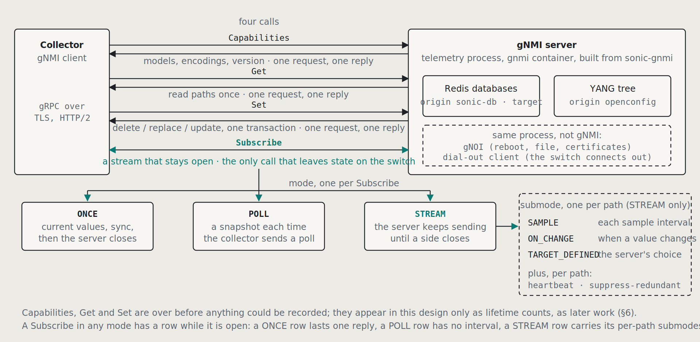
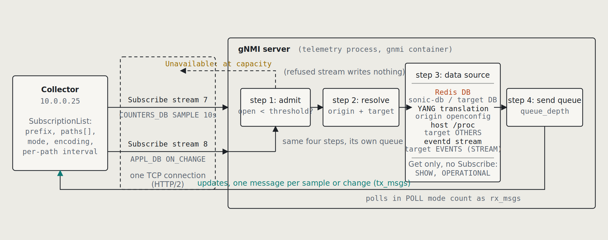
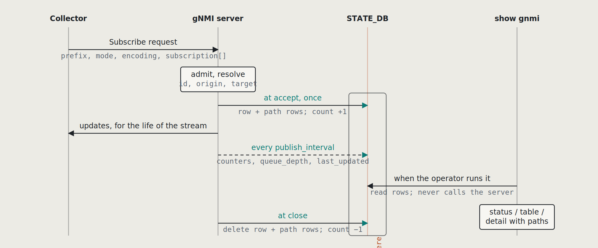
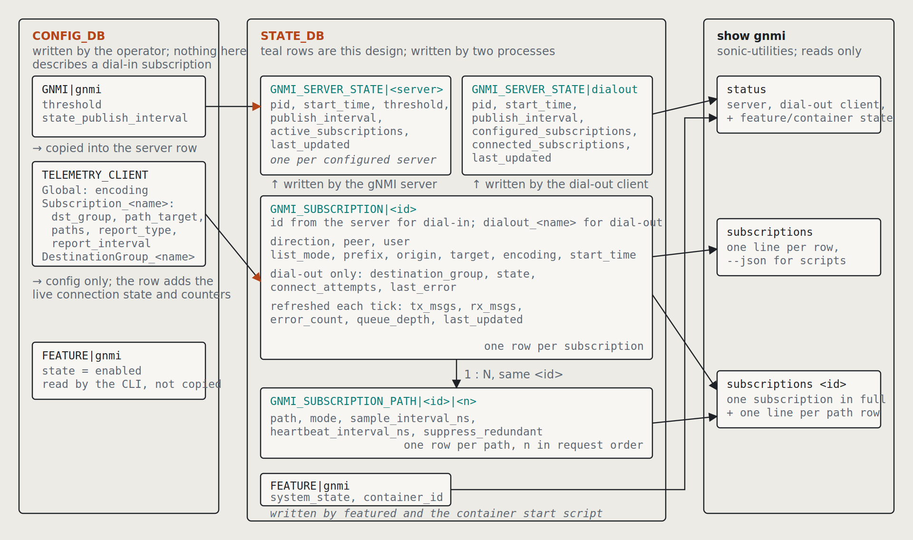
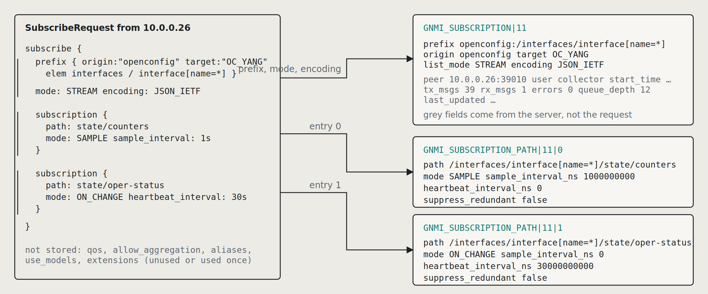
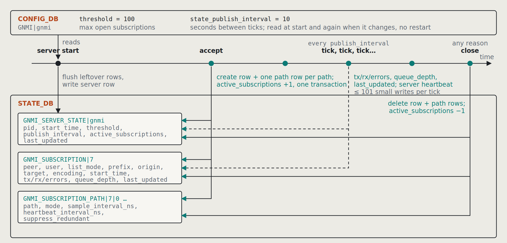
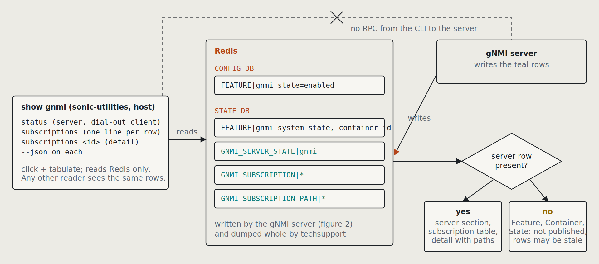

# gNMI Subscription State — Design

## 1. Introduction

### 1.1. Problem

**Background.** gNMI is the gRPC interface a collector uses to read and stream state from the switch. Figure 1 shows its four calls and the three Subscribe modes. Only Subscribe leaves state behind on the switch, so it is the subject of this design.



*Figure 1. Capabilities, Get and Set are one request and one reply, over before anything could be recorded. Subscribe is a stream that stays open, in one of three modes; under STREAM every path has its own submode, interval and flags. That is the state this design publishes.*

Today there is no way to see from the switch which collectors have gNMI subscriptions open, what they subscribed to, in which mode and at what interval, or whether the switch is keeping up. This design adds a switch-side `show` command that answers those questions, with the same output in the techsupport bundle.



*Figure 2. How a gNMI subscription works in general: a collector opens a Subscribe stream over a TCP connection; the server admits it against its limit, resolves it to one of four data sources, and streams updates back from a per-stream send queue. One connection can carry several streams.*

### 1.2. Relation to the OpenConfig telemetry model

OpenConfig has a model for this: [`openconfig-telemetry.yang`](https://github.com/openconfig/public/blob/master/release/models/telemetry/openconfig-telemetry.yang), container `/telemetry-system/subscriptions/dynamic-subscriptions`, one read-only entry per open subscription with the collector's address, the encoding, the sample and heartbeat intervals, the suppress-redundant flag and the subscribed paths. It is the vendor-neutral way for a controller to ask a device what is subscribed, and it is likely to be asked for, so this design keeps the model's names wherever a field overlaps and stores a superset of it; serving the container over gNMI later is then a projection of the same STATE_DB tables, listed in [§6](#6-scope) as later work. The model alone would not answer the ticket: it has no per-path mode or interval, no origin or target, no counters or queue depth and no server state, which is what the switch side needs. [Appendix A](#appendix-a-field-by-field-comparison-with-the-openconfig-telemetry-model) lists every leaf of the model against the schema.

## 2. What already exists

The gNMI server (the `telemetry` process in the `gnmi` container, built from `sonic-gnmi`) already keeps almost everything this feature needs, but only in memory inside the process:

| Have | Where |
|------|-------|
| Every open subscription is an object in the server, and each one gets a number that is unique for the life of the process. | `Server.clients`, `client_subscribe.go` `NewClient` |
| Admission limit on open subscriptions. Each gNMI Subscribe call is one stream, and one TCP connection can carry several streams (HTTP/2 multiplexing). The server counts open streams and refuses a new one with the gRPC error `Unavailable` once the count reaches the limit: the `threshold` field of `GNMI\|gnmi` in CONFIG_DB (passed to the server as `-threshold`), default 100, where 0 means no limit. The subscription id is unique per stream, so two subscriptions on one connection get two rows (§3.4). That needs `-enable_stream_multiplexing`, which is off by default today: without it a second Subscribe on a connection replaces the first. [sonic-net/sonic-gnmi#890](https://github.com/sonic-net/sonic-gnmi/pull/890) makes multiplexing unconditional. | `connection_manager.go` `Add` |
| A record of each subscription in STATE_DB, in a table called TELEMETRY_CONNECTIONS. The table is emptied when the server starts, and a record is removed when its subscription closes. | hash `TELEMETRY_CONNECTIONS`, field `<peer>\|<targets…>\|<RFC3339>` = `"active"` |
| Three counters per subscription: messages sent, messages received, and errors. They are written to the log once, when the subscription closes. | `Client` fields; logged once at `Close()` |
| The parsed subscription request, including which data source (origin and target) it was resolved to. | locals in `Client.Run` |
| The name of the user who opened the subscription. | `common_utils.GetUsername(ctx)` |
| How many updates are waiting to be sent to the collector. | `c.q.Len()` |

**What is missing is structure.** The one piece that reaches STATE_DB today, TELEMETRY_CONNECTIONS, records only that a subscription exists: one hash field per subscription, named by collector address, targets and a one-second timestamp, with the value "active". It cannot carry fields, cannot be addressed per subscription, and its name can collide when a collector opens two streams in the same second. The counters and the queue depth never leave the process.

So this design **adds** proper tables beside that record and publishes what the server already knows. It does not change how subscriptions are tracked, and it does not change the old record.

## 3. Design



*Figure 3. From a Subscribe request to a line on the screen: the request's content is written once at accept, only counters move on the timer, and the CLI reads on demand and never calls the server. Dial-out follows the same lanes with the dial-out client in place of the server.*

### 3.1. Principles

1. Build beside the existing ConnectionManager, which is not changed. Add the tables below beside TELEMETRY_CONNECTIONS, which keeps being written exactly as today, so the change is purely additive; dropping the old hash is a separate step (§6).
2. Redis (STATE_DB) is the only interface between the gNMI server and the CLI. If the server and the CLI come from different image versions, the CLI shows less information, but never fails.
3. Publishing is best effort and never in the path of a stream. If Redis is slow or down, no subscription is failed, delayed or ended. The server row is written when its content changes; only the per-subscription counters are refreshed on a timer, not once per message.
4. A dial-in row exists exactly as long as its subscription; there is no status field that could go stale. A dial-out row exists as long as its configuration entry, because the switch keeps trying to reach the collector, so it is the one kind of row that carries a connection state. A server row exists per configured server in a process, keyed by the server's name; several servers in one process share a pid and start time.

### 3.2. Schema (STATE_DB, default namespace)



*Figure 4. The data model behind show gnmi: three STATE_DB tables, written by the gNMI server for dial-in and by the dial-out client for dial-out, read by the CLI together with the FEATURE entries. Path rows share their subscription's id; the server rows carry counts.*

**`GNMI_SERVER_STATE|<server>`** is one row per configured gNMI server, keyed by the name of the server's CONFIG_DB entry: the single server configured as `GNMI|gnmi` today writes `GNMI_SERVER_STATE|gnmi`, and a second server configured under another key would write its own row with no schema change. A server is one TLS listener together with its Unix socket, with its own limits and totals; several servers in one process share `pid`, `start_time` and `publish_interval`, which every server row repeats so a reader never needs a join. The row is written when the server starts and rewritten whenever a subscription is accepted or closes. Its `last_updated` field is also stamped on every tick, so a reader can tell a live server from a row left behind by one that died: the CLI treats the row as stale when the stamp is older than two publish intervals. It lets the CLI tell the difference between "the server is running and has no subscriptions" and "the server is not running, or this image does not publish this information".

| Field | Description |
|-------|-------------|
| `pid` | Process id of the gNMI server process; per process, so identical on every server row of one process. Subscription ids restart from 1 with the process, so the start time also tells two lives of the server apart. |
| `start_time` | When the server started, in seconds since the epoch. For the gNMI server this is its last start: a certificate rotation rebuilds the server inside the same process, ending every stream, so `start_time` moves while `pid` does not. Subscription ids restart from 1 with the process, so the two stamps together tell lives of the server apart. |
| `threshold` | The limit on admitted Subscribe sessions described in §2, enforced by the existing admission limiter against its own count of admitted sessions, published as `admitted_subscriptions`. It is not compared with `active_subscriptions` or `active_connections`. 0 means no limit. |
| `publish_interval` | The refresh interval, in seconds, that the server is running with (§3.3, Tick). An age of `last_updated` past twice this interval means a stopped or hung server (§3.4). |
| `listen_address` | The TCP address and port this server accepts collectors on, for example `10.0.0.1:50051`. Written at start. A second configured server would have its own; the dialout row leaves it empty, since the switch connects out. |
| `vrf` | The VRF the TCP listener is bound to, `default` or `mgmt`, taken from the server's CONFIG_DB entry (`GNMI\|gnmi` field `vrf`, which the start script passes as `--gnmi_vrf`). Written at start; empty when the server has no TCP listener, Unix socket only. The dialout row leaves it empty: the client has no listener, and the VRF it connects through is the `vrf` field of the TELEMETRY_CLIENT `Global` entry. |
| `unix_socket` | The Unix socket path this server also serves, for local callers without TLS, for example `/var/run/gnmi/gnmi.sock`; empty when none. A socket path has one owner, so with several servers it appears on the row of the one that owns it. |
| `active_subscriptions` | How many subscriptions are open. Written when a subscription is accepted or closes, so it is exact, not sampled. |
| `admitted_subscriptions` | The admission limiter's count, the number `threshold` is enforced against: streams past admission, including those still in the source, authentication or policy checks. Two identical requests from one collector in the same second share a slot, so the count can differ from `active_subscriptions` either way; a refusal is explained by this field reaching `threshold`. Refreshed whenever the row is written. |
| `active_connections` | How many gRPC connections are open on the server's listeners, TCP and Unix socket alike, whether or not they carry a subscription. Written when a connection opens or closes, by the stats handler described in §3.3. Shows a connection flood even when no Subscribe arrives. |
| `waiting_subscriptions` | How many Subscribe requests are waiting for a slot. Always 0 today, because the server refuses at the limit; when admission is changed to block until a subscription closes, it is written on enqueue and dequeue, and this queue length rather than the refused total becomes the number to watch. |
| `subscriptions_accepted` | Lifetime total since the server started: subscriptions accepted. Written at accept. |
| `subscriptions_refused` | Lifetime total since the server started: subscriptions refused at the limit. Written at the refusal, which is the only trace a refusal leaves, since it creates no row. |
| `subscriptions_closed` | Lifetime total since the server started: subscriptions that ended, for any reason. Written at close. |
| `subscriptions_rejected` | Lifetime total since the server started: Subscribe requests turned away before they ran. Either the request itself was wrong (a path that does not exist, an origin conflict between prefix and paths, an unsupported origin or target, an unknown mode), no data client can be built for it (a target or namespace it does not know, or a data source it cannot reach), or the collector was not allowed (authentication failed, or a path is blocked by policy). Some of these checks run after the admission limit has counted the stream; a rejection releases it. These are mostly the collector's mistakes, and the switch recorded nothing about them before this design. The cause of each rejection is named in the server's log line. Written at the rejection. |
| `subscriptions_failed` | Lifetime total since the server started: subscriptions that ended on an error after being accepted; the sum of the `failed_*` counters below, which always add up to it. Written at close. The subscription's own row is deleted at close, so the cause is counted here and nowhere else. |
| `failed_send` | Of `subscriptions_failed`: a send to the collector failed while the collector had not ended the stream, so the switch could not deliver to a peer that was supposedly still there: the collector stopped reading, or the network broke under it. A collector that cancels or whose connection is gone has ended the stream itself, and that is a normal close. The collector's side. Rare in practice: a broken network or a keepalive timeout closes the transport, which cancels the stream before the failed send is seen, so that stream ends as a normal close. |
| `failed_source` | Of `subscriptions_failed`: the data source aborted a stream it had opened, for example the Redis connection was lost or the YANG translation layer returned an error. The switch's side. A request no data client can be built for is turned away before it runs, so it counts in `subscriptions_rejected`, not here. |
| `failed_encode` | Of `subscriptions_failed`: a value could not be encoded for the collector, or the encoded message was larger than the server's send size limit (`max_send_msg_size`, 4 MiB by default). The switch's side: a bug, or a subscription whose single update is too large for the limit. |
| `failed_other` | Of `subscriptions_failed`: a cause outside the list above. Today one: `request`, where the data client accepted the stream and then found the request unusable (a subscription mode or interval it does not serve, or a path its own check rejects) and marked the failure as the request's, which is the collector's mistake. The close log line names the cause. Kept so the `failed_*` fields always add up. |
| `last_updated` | Liveness stamp, in seconds since the epoch, rewritten by the counter timer on every tick (§3.3, Tick). A row older than twice `publish_interval` belongs to a server that stopped or hung (§3.4). |

**`GNMI_SERVER_STATE|dialout`** is the same kind of row for the dial-out client, which is a separate process in the same container. The switch connects out, so the row has no listener and no admission, and it counts configured entries where the dial-in row counts accepted streams. The table lists every field of either row and what each row does with it.

| Field | Dial-in row (`gnmi`) | Dial-out row (`dialout`) |
|-------|----------------------|--------------------------|
| `pid`, `start_time`, `publish_interval`, `last_updated` | Written, as described above. | Written with the same meaning, for the dial-out client process. |
| `listen_address`, `unix_socket` | The TCP address and the Unix socket the server accepts collectors on. | Written empty: the client has no listener. |
| `vrf` | The VRF the TCP listener is bound to. | Written empty. The VRF the client connects through is the `vrf` field of the TELEMETRY_CLIENT `Global` entry. |
| `threshold` | The admission limit. | Written as 0, no limit: nothing is admitted or refused. |
| `active_subscriptions`, `admitted_subscriptions`, `active_connections`, `waiting_subscriptions` | Written. | Not written. The two fields below take their place. |
| `configured_subscriptions` | Not written. | How many Subscription entries TELEMETRY_CLIENT holds. |
| `connected_subscriptions` | Not written. | How many of those entries have a collector connected now. |
| `subscriptions_accepted`, `subscriptions_refused`, `subscriptions_rejected`, `subscriptions_closed` | Lifetime totals. | Not written. The switch does not accept, refuse or reject its own configuration, and an entry lasts as long as it is configured. An entry that cannot be served reads `misconfigured` on its own row. |
| `subscriptions_failed` | The total of the `failed_*` fields. | Not written. The `failed_*` fields are the only failure totals. |
| `failed_connect` | Not written: the server does not dial. | Dials that never reached the collector: unreachable, refused, or the TLS handshake failed. |
| `failed_send` | A send failed while the collector had not ended the stream. A collector that ends the stream is a normal close. | A stream that was up and then broke: a send failed, or the collector ended the stream, which the client also sees on a stream that is not sending at that moment. The client sees only that the stream ended, not why. |
| `failed_source` | The data source aborted a stream it had opened. | The data source aborted a running stream, or a periodic read of it failed, counted once per outage however many reads fail. An entry whose source cannot be opened is not counted: its row says why. |
| `failed_encode` | A value could not be encoded, or was over the send size limit. | The same. |
| `failed_other` | A cause outside the list; today `request`. | A cause outside the list. |

On the dial-out row, a failure seen while an instance is being stopped or replaced is not counted: it comes from the stop. `configured_subscriptions` and `connected_subscriptions` are counted fresh from the client's entries each time the row is written, not kept as running totals, and an entry that reads `misconfigured` is in neither.

The names `gnmi` and `dialout` are reserved: today both are constants in code, since sonic-gnmi.yang models GNMI as a container with a fixed `gnmi` child and no server can be named; when servers become configurable, no server may be called `dialout` (§6).

**`GNMI_SUBSCRIPTION|<id>`** is one row per open subscription. `<id>` is the number the server already assigns to each subscription; a gNMI server with a name other than `gnmi` would write `<name>_<n>`, and dial-out rows are `dialout_<name>`. The row is created when the subscription is accepted, its counters are refreshed each tick, and it is deleted when the subscription closes.

| Field | Written | Description |
|-------|---------|-------------|
| `direction` | start | `dial-in` when a collector subscribed to the server; `dial-out` when the switch's dial-out client pushes to a collector configured in CONFIG_DB `TELEMETRY_CLIENT`. Dial-out rows are keyed `dialout_<name>`, where `<name>` is the configured Subscription name, so the two kinds never collide. |
| `peer` | start | Address and port of the collector, for example `10.0.0.25:52144` or `[fd00::25]:41022`. For dial-out, the destination the client is currently connected to or trying, from the Subscription's destination group; a group with several destinations shows one at a time. Empty on an entry that has not dialed: one waiting for its destination group or its data source, and one whose instance was just replaced, until the new instance dials. |
| `local_address` | start | The listener the stream came in on: the server's TCP address and port, or the Unix socket path. With `peer`, which identifies the collector's connection, this says which streams share a connection and which listener they used; a second listener shows up here without a schema change. For dial-out, the local address of the client's current connection to the collector, shown only while `state` is `connected`: a row that reads `connecting` never carries one, whether a dial is in progress or the data source is failing under a connection that is still up. |
| `server` | start | The name of the server row the stream arrived on, `GNMI_SERVER_STATE\|<server>`, today always `gnmi`; `local_address` says which of that server's sockets. Dial-out rows carry `dialout`. |
| `user` | start | Who opened the subscription: the password user when password authentication succeeded, otherwise the common name of the client certificate the collector presented, which the server verifies only when it requires client certificates. Empty when the collector presented neither, and always empty for dial-out, where the switch is the client. |
| `list_mode` | start | How the collector asked to receive data: `STREAM` (continuous), `POLL` (on request) or `ONCE` (a single snapshot). For dial-out, derived from the configured `report_type`: `periodic` and `stream` both give `STREAM`, since both are continuous streams in gNMI terms. The client serves no other report type: an entry with `once`, or with a value it does not know, is refused and reads `misconfigured`, with no `list_mode`. |
| `prefix` | start | The path part of the request prefix, as the collector sent it, for example `/interfaces/interface[name=*]`; empty when the prefix carried only an origin or a target. The origin and target the prefix carried are the `origin` and `target` fields. |
| `origin` | start | The resolved origin. A collector may put an origin on the prefix, on each path, or on neither; the rule below the table says how one value is chosen. Examples: sonic-db reads Redis directly; openconfig goes through the YANG translation layer; empty means the target chooses the backend. |
| `target` | start | The resolved target. Read from the prefix only; a target on an individual path is ignored, as the gNMI specification requires. Examples: COUNTERS_DB (a Redis database), OTHERS, SHOW, EVENTS, or OC_YANG for the translation layer. |
| `encoding` | start | The wire encoding the collector asked for, for example `JSON_IETF` or `PROTO`. |
| `start_time` | start | When the subscription was accepted, in seconds since the epoch. |
| `destination_group` | start | Dial-out only: the name of the TELEMETRY_CLIENT destination group the Subscription sends to. |
| `state` | change | Dial-out only. `connected`: data is being delivered. `connecting`: it is not, because the client is dialing, waiting to retry, or waiting for its destination group or data source. `misconfigured`: the entry cannot be served as written, and the reason is in `last_error`. There is no `failed`: the client never gives up, so an unreachable collector shows as `connecting` with `connect_attempts` climbing. The table of dial-out cases below lists each case. Dial-in rows have no `state`: they exist only while the stream is open. |
| `connect_attempts` | change | Dial-out only: how many times the client has tried to connect since the entry was configured. Climbing while `state` stays `connecting` is the collector-unreachable signature. |
| `last_error` | change | Dial-out only: why the entry is not connected: the error text of the last failed connect or send, a missing destination group, a data source that cannot be opened, read, or that refused the entry's subscription list; or the text of an update to the entry that was not applied. Empty once connected. |
| `tx_msgs` | tick | Messages sent to the collector. |
| `rx_msgs` | tick | Messages received from the collector: the request, and in POLL mode each poll. Dial-in only: the dial-out stream is one way and its rows do not carry the field. |
| `error_count` | tick | Failures on the stream. For a dial-in row `error_count` always reads 0: a failure ends the stream and the close path deletes the row before the next tick could write the count. For a dial-out row it is live: the row stays through failures, and each failure counted on the dialout server row adds one here: a failed connect, a broken stream, a failed encode, and a data source outage once however long it lasts. |
| `tx_bytes` | tick | Bytes sent to the collector on this stream, as they go on the wire. A message count cannot tell a small update from a copy of a whole table; bytes can, and they are what a bandwidth or CPU question needs. Counted by a gRPC stats handler that sees every message on every stream with its wire length. |
| `rx_bytes` | tick | Bytes received from the collector on this stream, as they go on the wire. Dial-in only: the dial-out stream is one way and its rows do not carry the field. |
| `queue_depth` | tick | Updates the server has produced but not yet sent. A growing number means the collector or the network is slower than the sample rate. |
| `last_updated` | tick | When the counters were last refreshed, in seconds since the epoch. |

**`GNMI_SUBSCRIPTION_PATH|<id>|<n>`** is one row per path of a subscription, numbered from 0 in the order the collector listed them. Rows are written with the subscription row at accept and deleted with it at close; they never change in between. A wildcard is one row, however many entries the server expands it to.

| Field | Written | Description |
|---|---|---|
| `path` | start | The path as the collector sent it, with the request prefix applied, in the form the server writes to its log, for example `COUNTERS_DB/COUNTERS/Ethernet*`. |
| `mode` | start | `SAMPLE` (send every interval), `ON_CHANGE` (send when the value changes) or `TARGET_DEFINED` (server chooses). Empty for POLL and ONCE subscriptions. For a dial-out row it is the mode the entry's data client runs: `periodic` is `SAMPLE` at `report_interval`; `stream` is `ON_CHANGE` for a database target, `TARGET_DEFINED` for `OC_YANG`, where the translation layer picks per path, and `SAMPLE` at `report_interval` for `OTHERS`, whose data client samples only. |
| `sample_interval_ns` | start | Sampling interval in nanoseconds. 0 means the collector left it to the server default. Absent on a POLL or ONCE path row, as are the two fields below: those rows carry the path and an empty mode only, so an absent interval cannot be read as a zero one. |
| `heartbeat_interval_ns` | start | The longest the collector is willing to wait between updates on this path even when nothing changes, in nanoseconds. 0 means none requested. Honoured today by the YANG translation layer. |
| `suppress_redundant` | start | true or false: whether the collector asked to receive only values that changed since the last update. Honoured today by the YANG translation layer; the native SAMPLE path honours it once it sends only changed values, which it does not do today. |

**How origin and target are resolved.** The prefix and each path of a Subscribe request can carry an origin and a target, and sonic-gnmi resolves them to one pair per subscription, which is why the row stores single values. All paths must carry the same origin, and a prefix origin must equal it, or the request is rejected; with no origin on the prefix, the paths' origin is used. The target is taken from the prefix only; a target on a path is ignored. Origin `openconfig` goes to the YANG translation layer, origin `sonic-db` reads Redis with the target naming the database, and any other origin is rejected. With no origin the target chooses: a database name such as `COUNTERS_DB`, `OTHERS` for data outside the databases, or `EVENTS`. An empty target is rejected, and so is `SHOW`, which does not serve Subscribe.

**Why a row per path.** Mode, interval, heartbeat and suppress-redundant are per path in gNMI, and sonic-gnmi honours them per path, so a subscription can mix them. Keeping them as parallel comma-separated lists in the subscription row was considered and rejected: every reader would have to split several strings and pair them by position, a path containing a comma would break it, and the OpenConfig model's `sensor-path` list has the per-row shape anyway. The cost is N+1 keys and writes per subscription instead of one, all in the same transaction and never on the tick.

**Dial-out rows.** The dial-out client reads its configuration from CONFIG_DB `TELEMETRY_CLIENT`: a `Subscription_<name>` entry gives the destination group, the target, the paths, the report type and the report interval, and the `Global` entry gives the encoding, the retry interval and the VRF. Each Subscription entry becomes one row, `GNMI_SUBSCRIPTION|dialout_<name>`, with one path row per configured path, `target` set to the configured target, `prefix` empty, `encoding` from Global, and the per-path interval from `report_interval`. The row is created when the entry appears in CONFIG_DB and deleted when it is removed, whether or not a collector is reachable, which is why these rows carry `state`, `connect_attempts` and `last_error` and dial-in rows do not. Counters come from the per-subscription counts the client already keeps and are refreshed on the same tick as dial-in rows.

Every dial-out subscription configured in CONFIG_DB appears in STATE_DB, including one that is broken or is not sending anything. In that case its row, `GNMI_SUBSCRIPTION|dialout_<name>`, says what is wrong. The table lists each case:

| The CONFIG_DB entry | Its STATE_DB row |
|---|---|
| is newly added and is not valid: a field has a value the client does not accept (for example `report_type` `once`), or the destination group, the target or the paths are missing | `misconfigured`, with the reason in `last_error` and no other fields or path rows. Not counted as configured. |
| was valid and is edited into one that is not valid | Keeps its configuration and its state; `last_error` says the update was not applied. |
| was valid and is edited so that its destination group is removed | Stops, and turns `misconfigured`. |
| is edited so that its new data source cannot be opened | Keeps running; `last_error` says the update was not applied, and the client tries the update again every `retry_interval`. |
| names a destination group that is not configured | `connecting`, with the reason. Not a failure: it starts when the group appears, and returns here if the group is deleted. |
| has a data source that cannot be opened | `connecting`, with the reason and no peer. Not a failure: tried again every `retry_interval`. |
| has a data source that refuses its subscription list | `connecting`, with the refusal. Not tried again until the entry or its destination group is edited. |
| is a periodic report whose data source fails a read | `connecting`, with the error; `failed_source` and `error_count` go up by one per outage. Back to `connected` on the next good read. |
| has an empty name, or a name holding the STATE_DB key separator | No row: the error is only logged. |

The STATE_DB rows are bound to the CONFIG_DB entry, not to the instance serving it. When the destination group or the Global entry changes, the client replaces the instance and keeps the row, its counters and `start_time`; until the new instance dials, the row reads `connecting` with no `peer` and no `local_address`. An edit to the Subscription entry itself makes a new subscription: its rows are written again, and the counters and `start_time` restart. When the client stops cleanly, it removes the rows of its entries; its server row stays, with `last_updated` no longer moving.

**The row against the gNMI Subscribe protobuf.** Every field of the Subscribe messages, and what the row does with it:

| Proto field | Our field | Note |
|---|---|---|
| SubscriptionList.prefix (origin, elem, target) | prefix as sent; origin and target resolved | see the resolution rule above |
| SubscriptionList.mode (STREAM, ONCE, POLL) | list_mode | direct |
| SubscriptionList.encoding | encoding | direct |
| Subscription.path, with the prefix applied | path row `n`: `path` | one row per entry, in request order |
| Subscription.mode (SAMPLE, ON_CHANGE, TARGET_DEFINED) | path row `n`: `mode` | empty for POLL and ONCE |
| Subscription.sample_interval (ns) | path row `n`: `sample_interval_ns` | 0 means server default |
| Subscription.heartbeat_interval (ns) | path row `n`: `heartbeat_interval_ns` | honoured by the YANG translation layer |
| Subscription.suppress_redundant | path row `n`: `suppress_redundant` | honoured by the YANG translation layer; the native SAMPLE path honours it once it sends only changed values |
| SubscriptionList.updates_only | not stored | today the native SAMPLE path uses it to send only changed values; once that path honours `suppress_redundant` instead, `updates_only` changes only what the first response contains, as the specification says |
| SubscriptionList.qos | not stored | the server never reads it |
| SubscriptionList.allow_aggregation | not stored | the server never reads it |
| SubscriptionList.use_models | not stored | checked once at admission against the supported models, then discarded |
| SubscriptionList.use_aliases, SubscribeRequest.aliases | not stored | aliases are not supported by the server |
| SubscribeRequest.extension | not stored | passed to the translation layer; nothing an operator needs to see |
| SubscribeRequest.poll | counted in rx_msgs | each poll message is one received message |
| Path.element | rendered into `path` like `elem` | deprecated in the proto, but the native database path and the blacklist still accept it, so a collector that sends it gets a row that names the path |



*Figure 5. Example 2 mapped onto the rows: the prefix and list-level fields land in the subscription row, each subscription entry becomes one path row, and the server supplies peer, user, start time and counters.*

**Worked examples.** Each example shows the Subscribe request the collector sends (the SubscriptionList in text form), how origin and target resolve, and the STATE_DB content after the server accepts it. The collectors and times are the ones in the §3.4 screen sample. tx_msgs, rx_msgs, tx_bytes, rx_bytes, error_count, queue_depth and last_updated are the values at the most recent tick; every other field is written once, at acceptance.

**Example 1 — a native COUNTERS_DB stream, sampled every 10 s, target on the prefix.** No origin anywhere, so the target chooses the backend: COUNTERS_DB is read directly from Redis. This is subscription 7 in the §3.4 sample.

```
subscribe {
  prefix { target: "COUNTERS_DB" }
  subscription {
    path { elem { name: "COUNTERS" } elem { name: "Ethernet*" } }
    mode: SAMPLE
    sample_interval: 10000000000
  }
  mode: STREAM
  encoding: JSON_IETF
}
```

```
GNMI_SUBSCRIPTION|7
  direction            dial-in
  peer                 10.0.0.25:52144
  local_address        10.0.0.1:50051
  server               gnmi
  user                 collector
  list_mode            STREAM
  prefix               ""
  origin               ""
  target               COUNTERS_DB
  encoding             JSON_IETF
  start_time           1787884680
  tx_msgs              1284
  rx_msgs              1
  tx_bytes             2188416
  rx_bytes             262
  error_count          0
  queue_depth          0
  last_updated         1787884810

GNMI_SUBSCRIPTION_PATH|7|0
  path                   COUNTERS_DB/COUNTERS/Ethernet*
  mode                   SAMPLE
  sample_interval_ns     10000000000
  heartbeat_interval_ns  0
  suppress_redundant     false
```

**Example 2 — an OpenConfig stream with two paths under one prefix and mixed modes.** The origin and target come from the prefix; the paths carry no origin, so there is no conflict. Both paths are served by the YANG translation layer. Each path gets its own row, numbered in request order; 0 for the ON_CHANGE path's sample interval means no sampling applies to it.

```
subscribe {
  prefix {
    origin: "openconfig"  target: "OC_YANG"
    elem { name: "interfaces" }  elem { name: "interface" key { key: "name" value: "*" } }
  }
  subscription {
    path { elem { name: "state" } elem { name: "counters" } }
    mode: SAMPLE
    sample_interval: 1000000000
  }
  subscription {
    path { elem { name: "state" } elem { name: "oper-status" } }
    mode: ON_CHANGE
  }
  mode: STREAM
  encoding: JSON_IETF
}
```

```
GNMI_SUBSCRIPTION|11
  direction            dial-in
  peer                 10.0.0.26:39010
  local_address        10.0.0.1:50051
  server               gnmi
  user                 collector
  list_mode            STREAM
  prefix               /interfaces/interface[name=*]
  origin               openconfig
  target               OC_YANG
  encoding             JSON_IETF
  start_time           1787884771
  tx_msgs              39
  rx_msgs              1
  tx_bytes             1570302
  rx_bytes             318
  error_count          0
  queue_depth          12
  last_updated         1787884810

GNMI_SUBSCRIPTION_PATH|11|0
  path                   /interfaces/interface[name=*]/state/counters
  mode                   SAMPLE
  sample_interval_ns     1000000000
  heartbeat_interval_ns  0
  suppress_redundant     false

GNMI_SUBSCRIPTION_PATH|11|1
  path                   /interfaces/interface[name=*]/state/oper-status
  mode                   ON_CHANGE
  sample_interval_ns     0
  heartbeat_interval_ns  0
  suppress_redundant     false
```

**Example 3 — a POLL subscription with the origin on the path and the target on the prefix.** The prefix carries no origin, so the paths' shared origin sonic-db is used; the target APPL_DB comes from the prefix. A POLL subscription has no per-path mode or interval, so its path rows carry the path and an empty mode only. The request counts one in rx_msgs; every poll message from the collector adds one more and each reply adds one to tx_msgs, so the two counters grow together with rx_msgs one ahead.

```
subscribe {
  prefix { target: "APPL_DB" }
  subscription { path { origin: "sonic-db" elem { name: "PORT_TABLE" } } }
  mode: POLL
  encoding: JSON_IETF
}
```

```
GNMI_SUBSCRIPTION|12
  direction            dial-in
  peer                 10.0.0.30:50212
  local_address        10.0.0.1:50051
  server               gnmi
  user                 netops
  list_mode            POLL
  prefix               ""
  origin               sonic-db
  target               APPL_DB
  encoding             JSON_IETF
  start_time           1787884790
  tx_msgs              6
  rx_msgs              7
  tx_bytes             91404
  rx_bytes             96
  error_count          0
  queue_depth          0
  last_updated         1787884810

GNMI_SUBSCRIPTION_PATH|12|0
  path                   APPL_DB/PORT_TABLE
  mode                   ""
```

**Example 4 — a request that produces no row.** The prefix says origin openconfig and the path says origin sonic-db. The server rejects it with InvalidArgument "Origin conflict between prefix and paths" before admission, so nothing is written to STATE_DB. A request refused at the subscription limit (gRPC Unavailable) leaves no row for the same reason.

```
subscribe {
  prefix { origin: "openconfig" }
  subscription {
    path { origin: "sonic-db" elem { name: "COUNTERS" } }
    mode: SAMPLE
    sample_interval: 5000000000
  }
  mode: STREAM
}
```

**The server row one tick earlier, while examples 1 to 3 are open and before subscription 8 of §3.4 arrived**, showing the count written at acceptance and the `last_updated` stamp written by the timer:

```
GNMI_SERVER_STATE|gnmi
  pid                   2214
  start_time            1787879524
  threshold             100
  publish_interval      10
  listen_address        10.0.0.1:50051
  vrf                   default
  unix_socket           /var/run/gnmi/gnmi.sock
  active_subscriptions  3
  admitted_subscriptions 3
  active_connections    3
  waiting_subscriptions 0
  subscriptions_accepted 56
  subscriptions_refused  2
  subscriptions_closed   53
  subscriptions_rejected 3
  subscriptions_failed   1
  failed_send            1
  failed_source          0
  failed_encode          0
  failed_other           0
  last_updated          1787884800
```

### 3.3. Producer (`gnmi_server`)

The server writes to STATE_DB at five moments. One goroutine does all the writing, in the order the events arrive, so a row cannot come back after its subscription has closed.

| When | What the server writes |
|------|------------------------|
| **Start** | Deletes the rows a previous run left and writes its server row. Retried on the tick until it succeeds. |
| **Accept** | The subscription row, its path rows, and `active_subscriptions` and `subscriptions_accepted` on the server row, in one Redis transaction. A refusal at the limit writes only `subscriptions_refused`, and a rejected request only `subscriptions_rejected`. |
| **Tick** | The counters of every open subscription and the server row's `last_updated`, in one Redis pipeline. A write that did not land is retried on the next tick. The interval is `state_publish_interval` in `GNMI\|gnmi` in CONFIG_DB, in seconds: default 10, from 1 to 3600. The server reads it again every 10 s, so a change needs no restart. The tick cannot be turned off, because `last_updated` is what tells a live server from a dead one. |
| **Close** | Deletes the subscription row and its path rows, and updates `active_subscriptions` and `subscriptions_closed`. When the stream ended on an error, also `subscriptions_failed` and the matching `failed_*` counter. A config reload asked for by a gNMI Set is a planned stop: its streams count as closed, not failed. |
| **Stop** | Deletes the rows of the subscriptions the server still holds; a service stop waits at most 3 s for Redis. The server row stays, with `last_updated` no longer moving. Anything left over is deleted at the next start. |

- **Counters** — Message counts are atomic integers on each subscription. Byte counts come from a gRPC stats handler registered on both servers, which also reports each connection opening and closing: that gives `active_connections` on the server row and `local_address` on each subscription row.
- **Redis** — The publisher has its own connection to STATE_DB, on the Unix socket with TCP as the fallback, and every write has a short timeout. The existing TELEMETRY_CONNECTIONS hash is written as before.
- **Cost** — At the default limit of 100 subscriptions, at most 101 small writes per interval, no matter how many updates are streaming.
- **Dial-out** — The dial-out client is a separate process in the same container and uses the same publishing code. It writes `GNMI_SERVER_STATE|dialout` at start, a row for each Subscription entry in TELEMETRY_CLIENT, the entry's `state`, `peer`, `local_address`, `connect_attempts` and `last_error` at each connect or failure, and the counters on the tick; it deletes the rows when the entry is removed. Its tick reads each entry under the lock that config edits hold (§8).



*Figure 6. Start flushes leftovers and writes the server row; accept creates the rows and increments the count; each tick writes counters and the server row's `last_updated` stamp; close deletes the rows and decrements the count.*

### 3.4. CLI — `show gnmi` (sonic-utilities)

Three commands under `show gnmi` in sonic-utilities, implemented in `show/gnmi.py` with click and tabulate like the other `show` commands, reading STATE_DB and CONFIG_DB through `SonicV2Connector` and never calling the server. Each takes `--json` for machine-readable output; filtering is left to the shell. The tables can also be read over gNMI like any STATE_DB table.

- `show gnmi status`: one block per server row, one today, each joined with the two FEATURE entries for gnmi (`state` in CONFIG_DB, which says whether the feature is switched on, and `state` in STATE_DB, which says whether the container runs; neither says whether the server process is alive, which is what the GNMI_SERVER_STATE row is for), followed by the dial-out client's block.
- `show gnmi subscriptions`: the subscriptions, dial-in and dial-out, in one table.
- `show gnmi subscriptions <id>`: one subscription in full, with a Paths table, one row per path.

Each section states what empty means.



*Figure 7. The CLI reads five Redis entries and never calls the server. If the server row is missing or its stamp is stale it says so and stops trusting the subscription rows.*

```
show gnmi status

gNMI Server: gnmi
────────────────────────────────────────────────────────────────────────────
Feature State:        enabled                Running State:        enabled
PID:                  2214                   Max Subscriptions:    100
Running Since (UTC):  2026-08-28T01:12:04Z   Publish Interval:     10s
Listen Address:       10.0.0.1:50051         VRF:                  default
Unix Socket:          /var/run/gnmi/gnmi.sock
Active Subscriptions: 4                      Active Connections:   3
Admitted:             4                      Waiting Subscriptions: 0
Since Start:          accepted 57, refused 2, rejected 3, closed 53, failed 1
Failed By Cause:      send 1, source 0, encode 0, other 0
Last Updated (UTC):   2026-08-28T02:40:10Z

Dial-out Client
────────────────────────────────────────────────────────────────────────────
PID:                  2301                   Running Since (UTC):  2026-08-28T01:12:10Z
Configured:           1                      Connected:            0
Failures:             connect 37, send 0, source 0, encode 0, other 0
Last Updated (UTC):   2026-08-28T02:40:10Z
```

```
show gnmi subscriptions

ID            Peer             Mode    Target       Paths                                     Interval  Tx    Queue
7             10.0.0.25:52144  STREAM  COUNTERS_DB  COUNTERS_DB/COUNTERS/Ethernet*            10s       1284  0
8             10.0.0.25:52144  STREAM  APPL_DB      APPL_DB/PORT_TABLE                        —         3     0
11            10.0.0.26:39010  STREAM  OC_YANG      /interfaces/interface[name=*]/state (+1)  1s, —     39    12
12            10.0.0.30:50212  POLL    APPL_DB      APPL_DB/PORT_TABLE                        —         6     0
dialout_srv6  10.1.0.50:8080   STREAM  COUNTERS_DB  COUNTERS_DB/COUNTERS/Ethernet*            —         0     0
```

**Reading the table.**

- **Rows 7 and 8** are one collector on one connection with two subscriptions. A subscription has one target, so a collector that wants two targets opens two subscriptions. Both rows show the same `peer` because this server runs with `-enable_stream_multiplexing`; with the default setting the collector needs a second connection (§2), and the two rows differ in the port of `peer`.
- **Row 11** has several paths. Paths shows the first path and how many more there are, and Interval shows one value per path, with a dash for an ON_CHANGE path.
- **Row 12** is a POLL subscription, which has no interval.
- **The last row** is a dial-out subscription, named after its TELEMETRY_CLIENT entry. Peer is the collector it is trying.

Paths are shown with the prefix applied. The table keeps to the columns that fit a terminal; the other fields are in the detail view and in `--json`. Filtering is the shell's job: `show gnmi subscriptions | grep 10.0.0.25`. Naming one subscription switches to the detail view, with one row per path:

```
show gnmi subscriptions 11

Subscription 11
────────────────────────────────────────────────────────────────────────────
Direction:           dial-in                Peer:                10.0.0.26:39010
Local Address:       10.0.0.1:50051         User:                collector
Mode:                STREAM                 Encoding:            JSON_IETF
Origin:              openconfig             Target:              OC_YANG
Prefix:              /interfaces/interface[name=*]
Since (UTC):         2026-08-28T02:39:31Z   Last Updated (UTC):  2026-08-28T02:40:10Z
Tx / Rx / Errors:    39 msgs, 1.5 MB / 1 msg, 318 B / 0
Queue:               12

Paths
────────────────────────────────────────────────────────────────────────────────────
Path                                             SubMode    Interval  Heartbeat  Suppress
/interfaces/interface[name=*]/state/counters     SAMPLE     1s        —          no
/interfaces/interface[name=*]/state/oper-status  ON_CHANGE  —         —          no
```

**Dial-out in the CLI.** The dial-out block of `show gnmi status` shows the client process and how many of its configured subscriptions are connected. The detail view of a dial-out subscription adds State, Attempts, Last Error and Destination Group, which is where a collector that cannot be reached, for example one behind the management VRF, becomes visible from the switch:

```
show gnmi subscriptions dialout_srv6

Subscription dialout_srv6
────────────────────────────────────────────────────────────────────────────
Direction:           dial-out               Peer:                10.1.0.50:8080
Destination Group:   collectors-east        State:               connecting
Attempts:            37                     Last Error:          dial tcp 10.1.0.50:8080: connect: network is unreachable
Mode:                STREAM                 Encoding:            JSON_IETF
Target:              COUNTERS_DB            Since (UTC):         2026-08-28T01:12:10Z
Tx / Rx / Errors:    0 msgs, 0 B / 0 msgs, 0 B / 37
Queue:               0                      Last Updated (UTC):  2026-08-28T02:40:10Z

Paths
────────────────────────────────────────────────────────────────────────────
Path                               SubMode  Interval  Heartbeat  Suppress
COUNTERS_DB/COUNTERS/Ethernet*     ON_CHANGE  —         —          no
```

The commands tell a dead server from a live one by the row's stamp: when `last_updated` is older than twice `publish_interval`, the server has stopped or hung without cleaning up (§8), `show gnmi status` prints the row with `Server State: stale` and the stamp, and `show gnmi subscriptions` warns that its rows may be left over. When the server row is absent, which happens on an image without the producer or before the first write, `show gnmi status` says so instead of printing fields it has no source for, and `show gnmi subscriptions` carries the same warning:

```
show gnmi status

gNMI Server: gnmi
────────────────────────────────────────────────────────────────────────────
Feature State:  enabled
Running State:  enabled
Server State:   not published
Note: the gNMI server has not written its state row. Either it has not
started or has stopped inside the container, or this image predates this
feature. Subscription rows, if any, may be stale.

show gnmi subscriptions

Note: gNMI server state not published; rows below may be stale.
No active gNMI subscriptions.
```

Times are stored as seconds since the epoch and shown as UTC timestamps; intervals are stored in nanoseconds and shown as `10s` or `500ms`. A field the producer did not write renders as a dash, never as 0.

**Techsupport.** `generate_dump` already dumps all of STATE_DB, so the raw rows are in every bundle; `show gnmi status` and `show gnmi subscriptions` are added to the show commands it saves, so the rendered view is there too. Neither fails when there are no subscriptions or no server row.

## 4. Alternatives considered

| Alternative | Why not |
|-------------|---------|
| Replace TELEMETRY_CONNECTIONS with the new tables now | Nothing we can find reads it: not sonic-mgmt, not sonic-utilities, not host services, not our tooling, and nothing on public GitHub beyond its own unit test; and its format, data packed into a field name, cannot carry what the ticket needs. Rejected for the first phase: a reader outside this tree could exist. So the hash keeps being written at accept and close exactly as today, the new tables are added beside it, and dropping it is later work (§6). |
| A host-side collector on a timer, like the SNMP agent state | Paths, modes and intervals exist only inside the gRPC stream. Scanning sockets from the host cannot see them, and cannot tell apart several streams on one connection. |
| Have the CLI call the server over gRPC, for example on its Unix socket | Possible, since the server already serves `/var/run/gnmi/gnmi.sock` without TLS or authentication. Rejected because: (a) the CLI would depend on a path inside the gnmi container's mount, which no other command does; (b) the `show` commands read Redis, and a gRPC client with the gNMI protobufs is a large dependency for one command; (c) STATE_DB can be read by any process on the switch, such as sonic-mgmt tests or a daemon that later reacts to the subscriptions, and a gRPC call serves only the CLI; (d) when the server is stopped an RPC returns a connection error, while a Redis read still shows what is known. The cost is accepted: an RPC would give live counters with no 10 s delay. Listed as a later step in §6. |
| Write to Redis on every streamed update | At scale that is thousands of Redis writes per second for a debugging view. A refresh every 10 s is enough. |
| Key the row by collector address, or by address and timestamp | Neither is unique: one collector can hold several streams, and the timestamp has one-second resolution. The server's subscription id is unique by construction. |
| Put the counters in COUNTERS_DB now | Not needed at this write volume: the tick writes at most about a hundred small fields per publish interval, which STATE_DB handles easily, and keeping one subscription's state in one database keeps the CLI to one read. Moving the tick-written counters there later is listed in §6. |

## 5. Tests

The feature is tested at three levels. Each level checks a different thing, so a failure points at one component.

| Level | Where it runs | What it checks |
|-------|---------------|----------------|
| Unit tests, producer | sonic-gnmi, in Go, against a real Redis server and with the race detector on | Each event in the life of a subscription (start, accept, tick, close, stop) writes or removes the expected STATE_DB rows. Each counter moves for its own cause and for no other: accepted, refused, rejected, closed, and each failure cause. The same for the dial-out client: each `state`, and each failure cause. A Redis outage does not disturb the streams, and publishing resumes when Redis returns. |
| Unit tests, CLI | sonic-utilities, pytest with the mock database the `show` tests use | The command's output for each shape of STATE_DB content: subscriptions present, none, the server row absent or stale, dial-in and dial-out rows, the detail view, and JSON. No switch and no gNMI server are needed. |
| Regression | The existing sonic-gnmi unit tests and the existing sonic-mgmt gNMI and dial-out tests, run unchanged | The feature changes nothing that already works: subscriptions behave as before, and the existing TELEMETRY_CONNECTIONS hash is still written. A benchmark of one streaming subscription with and without the byte counting shows no measurable cost. |
| End to end | sonic-mgmt, on hardware | A real collector against a real switch, in both directions: dial-in subscriptions opened from the test host, and dial-out to a collector on the PTF. The tests cover the normal life of a subscription, the error paths an operator would meet (an unreachable collector, a bad request, a misconfigured entry) and a restart or kill of the process. Every test checks that it leaves no rows behind. |

The end-to-end tests read STATE_DB directly and do not go through the CLI. A failure there is then a producer problem, and the CLI is covered by its own unit tests.

## 6. Scope

**In this design:** the three STATE_DB tables, written by the gNMI server and by the dial-out client; the timer that refreshes the counters, with its interval in CONFIG_DB; the `show gnmi` commands in sonic-utilities; and the tests of §5.

**Not in this design.** Later work, and what would justify each item:

| Item | Trigger |
|------|---------|
| Publish the server's Get and Set counters in the server row | Someone needs request counts other than subscriptions from the CLI or techsupport. |
| A live detail view that asks the server over its Unix socket, with no 10 s delay | Operators need counters fresher than 10 s. It needs a gRPC client in the CLI. |
| Several gNMI servers on one switch, as a keyed list in CONFIG_DB | A customer asks for two servers, for example one per management address. The schema needs no change. The YANG model must refuse `dialout` as a server name. |
| Drop TELEMETRY_CONNECTIONS | The new tables have shipped in a release and no reader of the hash has surfaced. |
| Move the counters written on the tick to COUNTERS_DB | COUNTERS_DB gains a faster backend, or the tick rate or the number of subscriptions outgrows STATE_DB. |
| A bounded history of subscriptions that ended on an error | An operator needs to know which subscriptions failed recently, not only the totals. |
| A per-collector table with lifetime totals | An operator needs a collector's history, not only what it holds now. |
| Serve the OpenConfig `dynamic-subscriptions` container over gNMI, read-only, from GNMI_SUBSCRIPTION (Appendix A) | A collector or tool wants to discover the active subscriptions over gNMI. |

## 7. Repositories changed

| Repo | Change |
|------|--------|
| `sonic-gnmi` | `gnmi_server/server.go`, `gnmi_server/client_subscribe.go`, new `gnmi_server/subscription_state.go`, `dialout/dialout_client/dialout_client.go`, new `dialout/dialout_client/subscription_state.go`, the shared publishing package `substate` and the path helpers in `common_utils` used by both, tests. `connection_manager.go` is untouched. |
| `sonic-utilities` | `show/gnmi.py`, `doc/Command-Reference.md`, `tests/gnmi_show_test.py` with mock STATE_DB data |
| `sonic-mgmt` | `tests/gnmi/test_gnmi_subscription_state.py`, `tests/gnmi/dialout/test_dialout_subscription_state.py`, the helper `tests/common/helpers/gnmi_substate.py` and its unit tests |
| `sonic-buildimage` | `src/sonic-yang-models/yang-models/sonic-gnmi.yang`: the `state_publish_interval` leaf (§9) |
| `SONiC` | this document |

No changes to swss, syncd or host services.

## 8. Limitations

- **Counters** count gRPC messages and bytes, not packets, and can be up to 10 s old. Packets are not visible to the server: one TCP connection carries several streams and the kernel segments the bytes as it likes, so nothing at the packet level could be attributed to one subscription.
- **If the server stops without running its close path**, for example on a crash, subscription rows stay in STATE_DB until the next start flushes them, and the server row stays with its `last_updated` stamp frozen; the CLI flags both by marking the row stale (§3.4).
- **On dial-in rows `error_count`** always reads 0, because a failure ends the stream and removes the row; the field is kept because dial-out rows share the table and there it counts.
- **Path rows are not capped**: a subscription with N paths writes N rows once at accept; the bound is the subscription threshold times the gRPC request-size limit, and the server's own per-path cost is reached well before Redis's.
- **Paths are shown as requested**, not expanded to the paths actually matched.
- **Closed subscriptions are not kept.** What survives a close is the lifetime totals on the server row. The failure itself, with its subscription id, peer, cause and error, is an event, and events are logged by the server rather than stored in a table. A bounded history of failed subscriptions was considered and deferred (§6).
- **Subscription ids restart from 1** when the server restarts; the server start time tells the two apart.
- **A dial-out row shows** the destination the client is on or trying; a destination group with several addresses is shown one at a time.
- **An idle dial-out stream** (an on-change report while nothing changes) sees a collector that ends the stream or closes the connection, and its row goes back to `connecting` at once. A collector that disappears without closing anything, a cable pulled or a path that silently drops, is noticed only when the client next sends, so the row reads `connected` and is counted in `connected_subscriptions` until then. The client has no keepalive; the row reports what the client believes.
- **A dial-out entry whose data source refuses its subscription list** stays `connecting` until the entry or its destination group is edited; nothing retries it. The refusal is in `last_error`, which is the only thing that tells it from an entry that is still trying.
- **The dial-out rows' refresh waits for a config edit in progress.** The tick reads each entry under the lock a TELEMETRY_CLIENT edit holds, and an edit opens the entry's data source under that lock, so a source that is slow to open holds back every dial-out row, `last_updated` included, until it returns.
- **Only the default namespace is covered.**

## 9. Configuration and management

- **CONFIG_DB.** One new optional field, `state_publish_interval` (seconds, 1 to 3600, default 10) in `GNMI|gnmi`, read by the server itself (§3.3, Tick). It gets a leaf in `sonic-gnmi.yang` so that YANG-validated writers (config replace, generic config updater, the CLI) accept it; until that leaf lands only a direct Redis write sets it. `threshold`, the TLS settings and `-enable_stream_multiplexing` are unchanged.
- **STATE_DB.** The three tables of §3.2. STATE_DB tables carry no YANG model, following the SNMP agent precedent.
- **CLI.** `show gnmi status` and `show gnmi subscriptions` (§3.4). No configuration command.

## 10. Warmboot and fastboot

The gnmi container is not on the warmboot or fastboot critical path, and every gNMI stream ends when the server process restarts, so the design adds no state that has to survive a reboot. On a warm or fast boot the server starts as on a cold boot: the startup flush (§3.3) deletes the rows left by the previous run, a SCAN of STATE_DB under three key prefixes and one DEL, run in the publisher's own goroutine after the listeners are up, so it does not delay the server coming up. The first tick is one interval after start and writes at most 101 small fields. No change to the boot sequence, no new dependency between containers, and no data-plane effect.

## 11. Memory consumption

Per open subscription the server keeps the registered row set (its written fields, under 1 KB) and three atomic counters; per server, one bounded queue of 1,024 pending publish operations. At the default limit of 100 subscriptions that is under 200 KB. In Redis, at most one server row, one row per subscription and one per path, deleted at close: under 1 MB at the limit. The dial-out client keeps one row set per configured entry.

## 12. SAI API

None. Nothing in this design touches the ASIC or SAI.

## 13. Open items

- Whether a dial-out row should live as long as its configuration entry, as §3.1 says, or only as long as the connection; raised in code review, kept as designed so that an unreachable collector stays visible.
- Whether the dial-out row repeats `TELEMETRY_CLIENT` fields a reader could join instead; raised in code review, kept so that one row answers the CLI's question without a second read.

## 14. References

- `sonic-gnmi`: `gnmi_server/connection_manager.go`, `gnmi_server/client_subscribe.go`, `gnmi_server/server.go`
- [gNMI spec §3.5 Subscribe](https://github.com/openconfig/reference/blob/master/rpc/gnmi/gnmi-specification.md#35-subscribing-to-telemetry-updates)
- [openconfig-telemetry.yang](https://github.com/openconfig/public/blob/master/release/models/telemetry/openconfig-telemetry.yang) — `/telemetry-system/subscriptions/dynamic-subscriptions` (§1.2)

## Appendix A. Field-by-field comparison with the OpenConfig telemetry model

Every leaf of `dynamic-subscription/state` and its `sensor-paths` list, against the tables in §3.2. Field names follow the model wherever they overlap.

**What OC has and this design keeps**, with aligned names:

| Item | OC `dynamic-subscription/state` | This design | Why the switch needs it |
|------|----------------------------------|-------------|-------------------------|
| Subscription id | `id` (uint64) | key `<id>` (= `Client.id`) | addressable per subscription; unique across multiplexed streams |
| Collector | `destination-address`, `destination-port` | `peer` (`ip:port`) | which collector holds the stream |
| Encoding | `encoding` | `encoding` | collector compatibility, debug |
| Paths | `sensor-paths/sensor-path[path]` | one `GNMI_SUBSCRIPTION_PATH` row per path | what is subscribed |
| Transport | `protocol` | implied `STREAM_GRPC`; `direction` says which side opened it | dial-in and dial-out rows share the table |
| Heartbeat | `heartbeat-interval (s)` | `heartbeat_interval_ns` on each path row | why a quiet ON_CHANGE path still produces updates |
| Suppress redundant | `suppress-redundant` | `suppress_redundant` on each path row | why a SAMPLE path sends fewer updates than its interval implies |

**What OC lacks and this design adds** — the critical part:

| Item | OC `dynamic-subscription/state` | This design | Why the switch needs it |
|------|----------------------------------|-------------|-------------------------|
| Per-path mode | — | `mode` on each path row: `SAMPLE` / `ON_CHANGE` / `TARGET_DEFINED` | `sonic-gnmi` evaluates mode per path (`db_client.go`, `mixed_db_client.go`, `transl_data_client.go`); `ON_CHANGE` versus 1 s `SAMPLE` are very different loads on Redis and on the collector |
| Per-path sample and heartbeat interval | one `sample-interval` and one `heartbeat-interval` per subscription | `sample_interval_ns` and `heartbeat_interval_ns` on each path row | `sonic-gnmi` honours both per path: a subscription can sample counters every second and hold a 30 s heartbeat on an on-change path, and neither can be described with one value per subscription; "at what interval" is the ticket's question |
| Origin / target | — (OpenConfig paths assumed) | `origin`, `target` | `sonic-gnmi` serves `openconfig` (translib), `sonic-db`, native DB targets such as `COUNTERS_DB`, plus `OTHERS`, `SHOW`, `EVENTS`; which backend a subscription drives is the first question when Redis or the switch is busy |
| List mode | — | `list_mode`: `STREAM` / `POLL` / `ONCE` | `POLL`/`ONCE` subscriptions have no interval and must render differently |
| Counters | — | `tx_msgs`, `rx_msgs`, `tx_bytes`, `rx_bytes`, `error_count` | `tx_msgs`/`rx_msgs` show the stream is alive and its rate; `rx_msgs` grows only in POLL mode. `error_count` counts receive, conversion and send failures on the stream: always 0 on a dial-in row, since a failure ends the stream and the close removes the row, and live on a dial-out row, which stays through failures and counts each failed connect, broken stream, failed encode and data source outage |
| Queue depth | — | `queue_depth` | the keeping-up signal: updates produced but not yet sent; grows when the collector or network is slower than the sample rate |
| Authenticated user | — | `user` | who is subscribed: audit, and finding the owner of a noisy collector |
| Server instance state | — (`telemetry-system` has none) | `GNMI_SERVER_STATE`: pid, start time, threshold, active count | separates "no subscriptions" from "server not running / image without the producer"; detects stale rows |

**What OC has and this design does not store**, and why:

| Item | OC `dynamic-subscription/state` | This design | Note |
|------|----------------------------------|-------------|------|
| QoS marking | `originated-qos-marking` | — | `SubscriptionList.qos`; the server never reads it, so there is nothing to explain from it |
| Exclude filter | `sensor-path/state/exclude-filter` | — | no gNMI equivalent |
