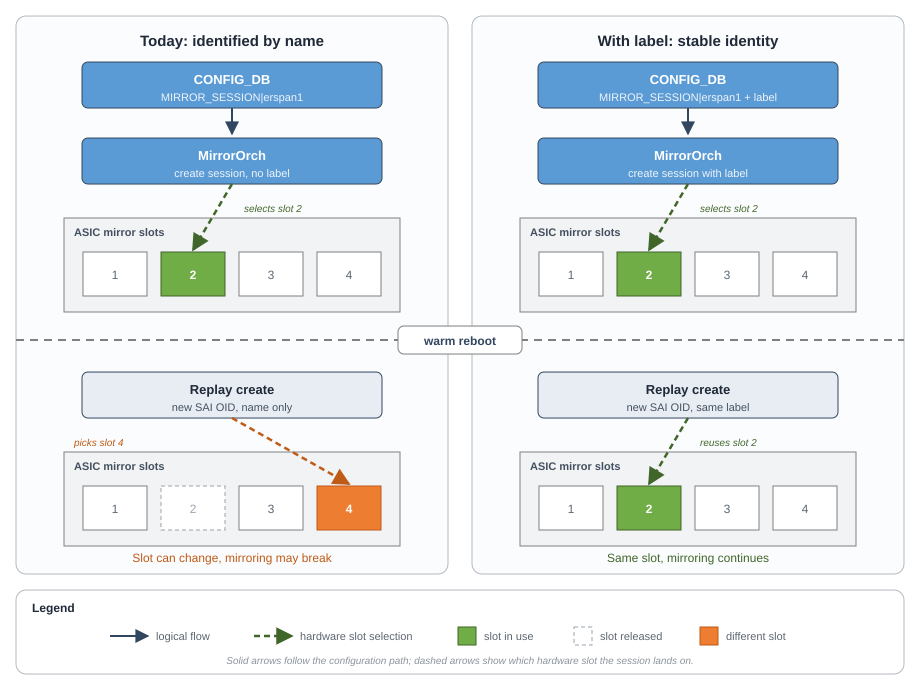
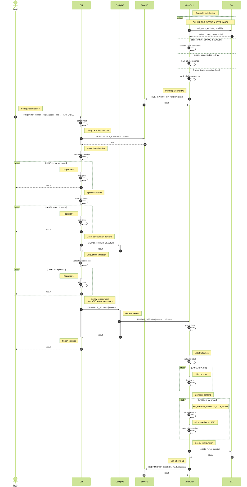
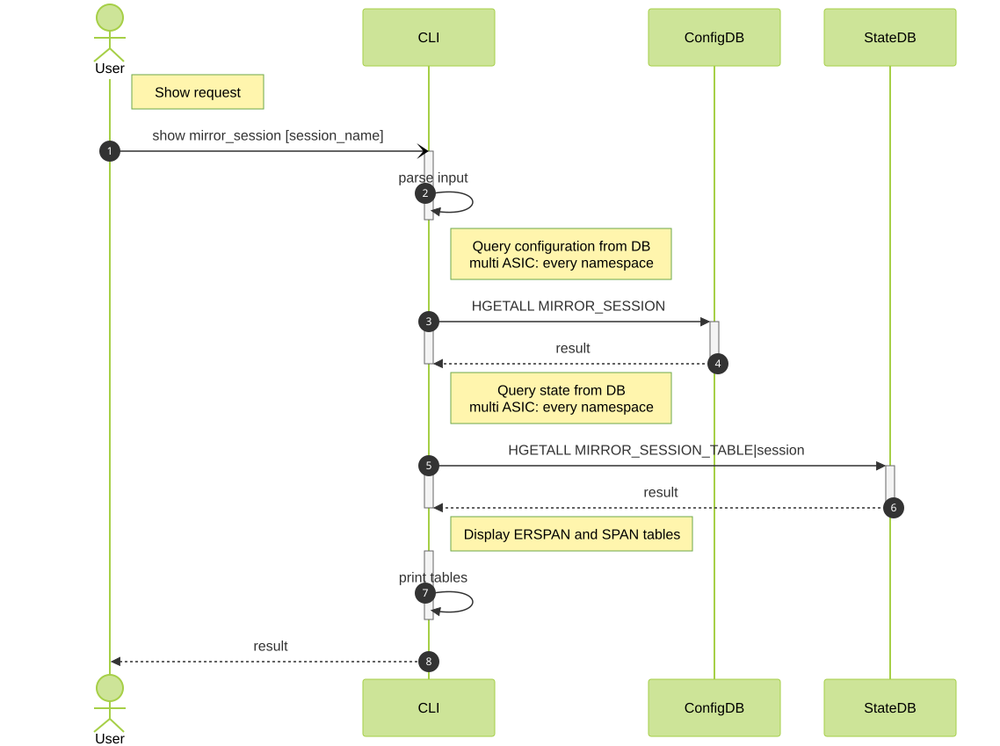

# SONiC Mirror Session Label

High Level Design

Rev. 1.0

## Table of Contents

- [0 General](#0-general)
  - [0.1 Revision](#01-revision)
  - [0.2 Scope](#02-scope)
  - [0.3 Definitions/Abbreviations](#03-definitionsabbreviations)
  - [0.4 Overview](#04-overview)
  - [0.5 Use case](#05-use-case)
- [1 Requirements](#1-requirements)
  - [1.1 Functional Requirements](#11-functional-requirements)
  - [1.2 Configuration and Management Requirements](#12-configuration-and-management-requirements)
  - [1.3 Scalability Requirements](#13-scalability-requirements)
  - [1.4 Performance Requirements](#14-performance-requirements)
  - [1.5 Warm/Fast Boot Requirements](#15-warmfast-boot-requirements)
  - [1.6 Multi-ASIC Requirements](#16-multi-asic-requirements)
- [2 Design](#2-design)
  - [2.1 Background](#21-background)
  - [2.2 Motivation](#22-motivation)
  - [2.3 Flow Diagrams](#23-flow-diagrams)
  - [2.4 SAI API](#24-sai-api)
  - [2.5 Platform API](#25-platform-api)
  - [2.6 Lower Layer API](#26-lower-layer-api)
  - [2.7 Counters](#27-counters)
  - [2.8 Error Handling](#28-error-handling)
  - [2.9 Event Logging](#29-event-logging)
  - [2.10 Configuration and Management](#210-configuration-and-management)
  - [2.11 DB Schema](#211-db-schema)
  - [2.12 Memory Consumption](#212-memory-consumption)
  - [2.13 Restrictions/Limitations](#213-restrictionslimitations)
  - [2.14 Implementation Changes](#214-implementation-changes)
- [3 Test Plan](#3-test-plan)
  - [3.1 Unit Tests](#31-unit-tests)
  - [3.2 Integration and Manual Test Plan](#32-integration-and-manual-test-plan)
- [4 Security](#4-security)
- [Reference Table](#reference-table)

## 0 General

### 0.1 Revision

Table 1: Revision history

| Rev | Date       | Author         | Change Description |
|:----|:-----------|:---------------|:-------------------|
| 1.0 | 2026-09-06 | Nazarii Hnydyn | Initial version    |

### 0.2 Scope

This document describes optional mirror-session label support in SONiC.
It covers the YANG model, CLI, CONFIG_DB, STATE_DB, and the `MirrorOrch`
class. The same label is replayed on create after warm reboot.

Key points:

1. The label is optional on existing SPAN and ERSPAN create
2. The label is passed only when the mirror session is created
3. Duplicate labels are rejected

The following are out of scope:

- A general policy requiring a label on every mirror session
- A new mirror-session modify command
- syncd label matching for VID-to-RID reconciliation

### 0.3 Definitions/Abbreviations

**Abbreviations:**

| Term   | Expansion                                      |
|:-------|:-----------------------------------------------|
| ACL    | Access Control List                            |
| ASIC   | Application-Specific Integrated Circuit        |
| ERSPAN | Encapsulated Remote SPAN                       |
| GCU    | Generic Config Updater                         |
| HLD    | High Level Design                              |
| OA     | Orchestration Agent                            |
| OID    | SAI object identifier                          |
| RID    | Real object identifier                         |
| SAI    | Switch Abstraction Interface                   |
| SDK    | Software Development Kit                       |
| SONiC  | Software for Open Networking in the Cloud      |
| SPAN   | Switched Port Analyzer                         |
| SWSS   | Switch State Service                           |
| VID    | Virtual object identifier                      |
| VRF    | Virtual Routing and Forwarding                 |

**Definitions:**

- CONFIG_DB holds operator configuration, including the mirror session and
  its optional label
- STATE_DB holds operational state published by orchagent, including the
  effective label and whether labeled create is supported
- SPAN is a local mirror session. ERSPAN is a remote encapsulated session
- Warm reboot restarts the control plane while preserving ASIC forwarding
  state
- The `label` field is an operator-provided, opaque, stable string that
  identifies one logical user-created mirror session on one ASIC
- A VID is the object identifier used in ASIC_DB. A RID is the identifier
  syncd uses for the vendor SAI object

### 0.4 Overview

The label is a SONiC configuration field on an existing SPAN or ERSPAN
session. It travels CONFIG_DB to the `MirrorOrch` class, which includes it
when the session is created. STATE_DB reports the effective value and
whether labeled create is supported. The session name stays the CONFIG_DB
key.

### 0.5 Use case

An operator configures an ERSPAN or SPAN session used by production monitoring
and assigns it a stable label. The switch then performs a warm reboot.
The old software stores the label and hardware slot; the new software replays
the session with the same label. SAI reuses the old slot, preserving
the hardware identity referenced by existing mirror bindings.

## 1 Requirements

### 1.1 Functional Requirements

This feature will support the following:

1. Optional label on SPAN and ERSPAN sessions
2. Label syntax and uniqueness validation
3. Label passed only when the mirror session is created
4. Duplicate labels rejected
5. In-place label change rejected
6. Same label replayed after warm reboot

### 1.2 Configuration and Management Requirements

This feature will support the following commands:

1. config section
    * optional `--label` on `config mirror_session erspan add`
    * optional `--label` on `config mirror_session span add`
    * optional `--label` on `config mirror_session add`
2. show section
    * `Label` column in `show mirror_session`

Management interfaces:

- gNMI can address the new YANG leaf through the existing
  `MIRROR_SESSION_LIST` path.
- GCU can carry the field through the existing wildcard mirror-session path.

### 1.3 Scalability Requirements

The feature supports the platform maximum number of mirror sessions. A
label does not add sessions or raise that limit. Uniqueness is enforced
among configured sessions on one ASIC.

### 1.4 Performance Requirements

No per-packet work is introduced. Label processing occurs only during
configuration, mirror-session creation, reconciliation, and warm-reboot
persistence.

The feature shall not increase mirror traffic latency or reduce throughput.
Warm-restart matching scans only the small set of mirror-session candidates.

### 1.5 Warm/Fast Boot Requirements

Warm reboot and fast reboot use the same SONiC create behavior. The session
is recreated from CONFIG_DB, with the label when it is configured.

### 1.6 Multi-ASIC Requirements

Label uniqueness is per ASIC namespace, not chassis-wide. The same label may
be used on different ASICs. The CLI writes the same label in every namespace
where it creates the mirror session.

## 2 Design

### 2.1 Background

The `MirrorOrch` class identifies a configured session by CONFIG_DB session
name and stores the resulting SAI OID. Session create does not pass a stable
operator identity today.

The `SAI_MIRROR_SESSION_ATTR_LABEL` attribute already exists in the SAI
header, with the same label pattern as LAG and VRF. It is not yet in the
SONiC mirror-session YANG model, the CLI, or the `MirrorOrch` class.



###### Figure 1: Mirror session label design

Without a label, a session recreated after warm reboot can land on a different
hardware slot. With a label, create carries the same identity and the session
keeps its slot.

### 2.2 Motivation

Hardware mirror slots are a small, finite per-ASIC resource. During warm reboot
the data plane keeps mirroring into the slot selected in the previous life.
Without a label, some platforms may recreate the session on a different slot
and interrupt or misdirect mirrored traffic even when the new SAI object
carries identical parameters.

### 2.3 Flow Diagrams

#### 2.3.1 Config section



###### Figure 2: Mirror session label config flow

The `MirrorOrch` class queries `SAI_MIRROR_SESSION_ATTR_LABEL` during
initialization, treats an unsuccessful query as supported so a vendor that
implements LABEL without the query is not penalized, and publishes the result
to STATE_DB. The CLI reads that value, then validates syntax and uniqueness,
and reports an error if LABEL is unsupported, the syntax is invalid, or the
label is already in use. A successful write to CONFIG_DB generates a session
notification, and the CLI reports success without waiting for orchagent. The
`MirrorOrch` class then re-validates the label, composes
`SAI_MIRROR_SESSION_ATTR_LABEL` when the field is not empty, creates the
session, and publishes the effective value to STATE_DB. The same sequence
applies to SPAN and ERSPAN. A session configured without `--label` skips these
validations and is created without the label attribute.

#### 2.3.2 Show section



###### Figure 3: Mirror session label show flow

The CLI reads the mirror-session configuration from CONFIG_DB, then overlays
operational state from STATE_DB on every namespace of a multi-ASIC platform.
Both the ERSPAN and SPAN tables always include a Label column taken from that
configuration; the cell is empty when the session has no `--label`. The same
print path is used for every session.

### 2.4 SAI API

No new SAI API function or attribute is introduced.

**SAI attributes which shall be used for the mirror session label:**

| API    | Function                       | Attribute                     |
|:-------|:-------------------------------|:------------------------------|
| OBJECT | sai_query_attribute_capability | SAI_MIRROR_SESSION_ATTR_LABEL |
| MIRROR | create_mirror_session          | SAI_MIRROR_SESSION_ATTR_LABEL |

**LABEL attribute properties:**

| Property             | Value                                            |
|:---------------------|:-------------------------------------------------|
| Value type           | `SAI_ATTR_VALUE_TYPE_CHARDATA`                   |
| Value storage        | `sai_attribute_value_t.chardata`, `char[32]`     |
| Maximum label length | 31 characters plus terminating NUL               |
| Flags                | `CREATE_AND_SET`                                 |
| Default              | Empty string                                     |

**SONiC usage of the attribute:**

| Operation                      | Behavior                                    |
|:-------------------------------|:--------------------------------------------|
| `create_mirror_session`        | Pass LABEL only for a non-empty label       |
| `set_mirror_session_attribute` | Never called for LABEL                      |
| `get_mirror_session_attribute` | Never called for LABEL                      |

### 2.5 Platform API

Not applicable. This feature does not add or modify a SONiC Platform API.

### 2.6 Lower Layer API

Not applicable. This feature does not add or modify a lower-layer API.

### 2.7 Counters

Not applicable. No counter is introduced or changed.

### 2.8 Error Handling

Table 2: Frontend error handling

| Condition                                | Behavior                        |
|:-----------------------------------------|:--------------------------------|
| Invalid syntax or length                 | Reject before writing CONFIG_DB |
| Duplicate label in target ASIC namespace | Reject before writing CONFIG_DB |
| Missing label                            | Accept and omit the field       |

Table 3: Backend error handling

| Condition                           | Behavior                                                           |
|:------------------------------------|:-------------------------------------------------------------------|
| Duplicate label                     | Return `task_invalid_entry`; do not create SAI object              |
| Absent label                        | Treat as unlabeled and omit the SAI attribute                      |
| Explicitly empty label              | Return `task_invalid_entry`, consistent with YANG `length "1..31"` |
| In-place label change               | Return `task_duplicated`; do not issue SAI SET for LABEL           |
| LABEL capability query unavailable  | Log at initialization and continue passing LABEL                   |
| LABEL CREATE explicitly unsupported | Return `task_invalid_entry`; do not create SAI object              |

### 2.9 Event Logging

Table 4: Frontend event logging

| Event                            | Severity  |
|:---------------------------------|:----------|
| Invalid label syntax/length      | ERROR     |
| Duplicate label rejected         | ERROR     |
| Mirror session created/removed   | NOTICE    |

Table 5: Backend event logging

| Event                                              | Severity  |
|:---------------------------------------------------|:----------|
| Invalid label syntax/length rejected by MirrorOrch | ERROR     |
| Duplicate label rejected by MirrorOrch             | ERROR     |
| LABEL CREATE capability query failed               | NOTICE    |
| Mirror session created/removed                     | NOTICE    |

Labels are configuration identifiers, not secrets, and may be included in
diagnostic logs. Logs should include the session name and label but not dump
unrelated packet or customer data.

### 2.10 Configuration and Management

#### 2.10.1 Manifest

Not applicable. The feature is part of core SONiC components and is not an
Application Extension.

#### 2.10.2 YANG Model

Existing YANG model `sonic-mirror-session.yang` at
`sonic-buildimage/src/sonic-yang-models/yang-models` will be extended with a
new schema in order to provide support for the mirror session label.

**Skeleton code:**

```yang
leaf label {
    type string {
        length "1..31" {
            error-message "Mirror session label must be 1..31 characters";
            error-app-tag label-length-invalid;
        }
        pattern '[a-zA-Z0-9_-]+' {
            error-message "Mirror session label must match [a-zA-Z0-9_-]+";
            error-app-tag label-pattern-invalid;
        }
    }
    description
        "Stable identifier used by SAI to reuse the same hardware
         mirror session across warm reboot. When omitted, MirrorOrch does
         not pass SAI_MIRROR_SESSION_ATTR_LABEL";
}
```

The 31-character bound is the largest NUL-terminated string that fits in
the 32-byte SAI `chardata` field.

Uniqueness across list entries cannot be expressed portably with the current
CONFIG_DB-oriented model and shall be enforced by the CLI and
the `MirrorOrch` class.

#### 2.10.3 CLI

The CLI reads `MIRROR_SESSION_LABEL_CAPABLE` under `SWITCH_CAPABILITY|switch`
and rejects `-l|--label` unless the value is `true`. A missing field is treated
as not supported. Query failure is published as `true`, so the option stays
allowed on adapters that do not implement the capability query.

##### 2.10.3.1 Command Structure

**User interface**:

```text
config
|--- mirror_session
|    |--- add [OPTIONS]
|    |--- erspan add [OPTIONS]
|    |--- span add [OPTIONS]

show
|--- mirror_session
```

**Options:**

_config mirror_session add_
_config mirror_session erspan add_
_config mirror_session span add_
1. `-l|--label` - stable identifier used to persist the hardware mirror slot across warm reboot

##### 2.10.3.2 Usage Examples

###### 2.10.3.2.1 Config command group

**The following command creates a labeled ERSPAN session:**

```text
config mirror_session erspan add EVERFLOW_TUNNEL \
    1.1.1.1 2.2.2.2 8 64 0x88be 0 \
    --label EVERFLOW_TUNNEL
```

**The following command creates an unlabeled ERSPAN session:**

```text
config mirror_session erspan add EVERFLOW_LEGACY \
    1.1.1.1 3.3.3.3 8 64 0x88be 0
```

**The following command creates a labeled SPAN session:**

```text
config mirror_session span add LOCAL_MONITOR \
    Ethernet8 Ethernet0 both 0 \
    --label LOCAL_MONITOR
```

**The following command creates an unlabeled SPAN session:**

```text
config mirror_session span add LEGACY_MONITOR \
    Ethernet4 Ethernet12 rx 0
```

**The following commands change a session label by remove and add:**

```text
config mirror_session remove EVERFLOW_TUNNEL
config mirror_session add EVERFLOW_TUNNEL \
    1.1.1.1 2.2.2.2 8 64 0x88be 0 \
    --label EVERFLOW_TUNNEL_V2
```

###### 2.10.3.2.2 Show command group

**The following command shows labeled and unlabeled sessions:**

```text
admin@sonic:~$ show mirror_session
ERSPAN Sessions
Name             Status    SRC IP    DST IP      GRE    DSCP    TTL    Queue  Monitor Port    SRC Port    Direction    Label            Policer    Sample Rate    Truncate Size
---------------  --------  --------  --------  -----  ------  -----  -------  --------------  ----------  -----------  ---------------  ---------  -------------  ---------------
EVERFLOW_LEGACY  active    1.1.1.1   3.3.3.3   35006       8     64        0  Ethernet232
EVERFLOW_TUNNEL  active    1.1.1.1   2.2.2.2   35006       8     64        0  Ethernet232                              EVERFLOW_TUNNEL

SPAN Sessions
Name            Status    DST Port    SRC Port    Direction      Queue  Label          Policer
--------------  --------  ----------  ----------  -----------  -------  -------------  ---------
LEGACY_MONITOR  active    Ethernet4   Ethernet12  rx                 0
LOCAL_MONITOR   active    Ethernet8   Ethernet0   both               0  LOCAL_MONITOR
```

#### 2.10.4 gNMI

No new service is introduced. The new leaf is available through the existing
YANG-backed configuration path:

```text
/sonic-mirror-session:sonic-mirror-session/
  MIRROR_SESSION/MIRROR_SESSION_LIST[name=<name>]/label
```

A patch that changes only `label` on an existing session is not an online
modify operation. Management clients shall delete and recreate the list entry.

### 2.11 DB Schema

#### 2.11.1 CONFIG_DB

```abnf
; defines schema for the optional mirror session label
key = MIRROR_SESSION|session-name ; must be unique

; field = value
label   = mirror-label ; specifies the optional stable identity used across warm reboot

; value annotations
mirror-label = 1*31mirror-label-char
mirror-label-char = ALPHA / DIGIT / "_" / "-"
```

All existing fields and type-specific constraints remain unchanged.

#### 2.11.2 STATE_DB

The `MirrorOrch` class publishes the effective non-empty label:

```abnf
; defines schema for the effective mirror session label
key = MIRROR_SESSION_TABLE|session-name ; must be unique

; field = value
label   = mirror-label ; specifies the effective non-empty label from CONFIG_DB

; value annotations
mirror-label = 1*31mirror-label-char
mirror-label-char = ALPHA / DIGIT / "_" / "-"
```

This field is informational and shall not become the configuration source of
truth. CONFIG_DB remains authoritative after restart.

The `MirrorOrch` class also publishes the per-ASIC LABEL CREATE capability:

```abnf
; defines schema for mirror session label capabilities
key = SWITCH_CAPABILITY|switch ; must be unique

; field                      = value
MIRROR_SESSION_LABEL_CAPABLE = label-capable ; specifies whether labeled sessions are supported

; value annotations
label-capable = "true" / "false"
```

Existing fields on this hash remain unchanged.

#### 2.11.3 Configuration Sample

The following CONFIG_DB fragments show a labeled ERSPAN session and a labeled
SPAN session, including the objects they depend on.

###### 2.11.3.1 ERSPAN

```json
{
    "PORT": {
        "Ethernet8": {
            "admin_status": "up",
            "lanes": "8",
            "speed": "100000"
        },
        "Ethernet232": {
            "admin_status": "up",
            "lanes": "232",
            "speed": "100000"
        }
    },
    "INTERFACE": {
        "Ethernet232": {},
        "Ethernet232|1.1.1.1/24": {}
    },
    "NEIGH": {
        "Ethernet232|2.2.2.2": {
            "neigh": "00:11:22:33:44:55",
            "family": "IPv4"
        }
    },
    "POLICER": {
        "everflow_static_policer": {
            "meter_type": "bytes",
            "mode": "sr_tcm",
            "cir": "12500000",
            "cbs": "12500000"
        }
    },
    "MIRROR_SESSION": {
        "EVERFLOW_TUNNEL": {
            "type": "ERSPAN",
            "src_ip": "1.1.1.1",
            "dst_ip": "2.2.2.2",
            "dscp": "8",
            "ttl": "64",
            "gre_type": "0x88be",
            "queue": "0",
            "policer": "everflow_static_policer",
            "label": "EVERFLOW_TUNNEL"
        }
    },
    "ACL_TABLE": {
        "EVERFLOW": {
            "policy_desc": "EVERFLOW",
            "type": "MIRROR",
            "stage": "ingress",
            "ports": [
                "Ethernet8"
            ]
        }
    },
    "ACL_RULE": {
        "EVERFLOW|RULE_1": {
            "PRIORITY": "1000",
            "IP_TYPE": "IP",
            "MIRROR_INGRESS_ACTION": "EVERFLOW_TUNNEL"
        }
    }
}
```

###### 2.11.3.2 SPAN

```json
{
    "PORT": {
        "Ethernet0": {
            "admin_status": "up",
            "lanes": "0",
            "speed": "100000"
        },
        "Ethernet8": {
            "admin_status": "up",
            "lanes": "8",
            "speed": "100000"
        }
    },
    "POLICER": {
        "span_static_policer": {
            "meter_type": "bytes",
            "mode": "sr_tcm",
            "cir": "12500000",
            "cbs": "12500000"
        }
    },
    "MIRROR_SESSION": {
        "LOCAL_MONITOR": {
            "type": "SPAN",
            "dst_port": "Ethernet8",
            "src_port": "Ethernet0",
            "direction": "BOTH",
            "queue": "0",
            "policer": "span_static_policer",
            "label": "LOCAL_MONITOR"
        }
    }
}
```

#### 2.11.4 Data Sample

When a labeled ERSPAN or SPAN session is applied, CONFIG_DB stores the label,
STATE_DB carries the effective label and the per-ASIC LABEL CREATE capability,
and ASIC_DB carries `SAI_MIRROR_SESSION_ATTR_LABEL` on create when the label is
non-empty. Other existing session fields are unchanged.

STATE_DB (capability):

```text
admin@sonic:~$ redis-cli -n 6 HGETALL "SWITCH_CAPABILITY|switch"
 1) "MIRROR_SESSION_LABEL_CAPABLE"
 2) "true"
```

###### 2.11.4.1 ERSPAN

CONFIG_DB:

```text
admin@sonic:~$ redis-cli -n 4 HGETALL "MIRROR_SESSION|EVERFLOW_TUNNEL"
 1) "type"
 2) "ERSPAN"
 3) "label"
 4) "EVERFLOW_TUNNEL"
```

STATE_DB:

```text
admin@sonic:~$ redis-cli -n 6 HGETALL "MIRROR_SESSION_TABLE|EVERFLOW_TUNNEL"
 1) "type"
 2) "ERSPAN"
 3) "label"
 4) "EVERFLOW_TUNNEL"
```

ASIC_DB:

```text
admin@sonic:~$ redis-cli -n 1 HGETALL "ASIC_STATE:SAI_OBJECT_TYPE_MIRROR_SESSION:oid:0x210000000003d0"
 1) "SAI_MIRROR_SESSION_ATTR_TYPE"
 2) "SAI_MIRROR_SESSION_TYPE_ENHANCED_REMOTE"
 3) "SAI_MIRROR_SESSION_ATTR_LABEL"
 4) "EVERFLOW_TUNNEL"
```

###### 2.11.4.2 SPAN

CONFIG_DB:

```text
admin@sonic:~$ redis-cli -n 4 HGETALL "MIRROR_SESSION|LOCAL_MONITOR"
 1) "type"
 2) "SPAN"
 3) "label"
 4) "LOCAL_MONITOR"
```

STATE_DB:

```text
admin@sonic:~$ redis-cli -n 6 HGETALL "MIRROR_SESSION_TABLE|LOCAL_MONITOR"
 1) "type"
 2) "SPAN"
 3) "label"
 4) "LOCAL_MONITOR"
```

ASIC_DB:

```text
admin@sonic:~$ redis-cli -n 1 HGETALL "ASIC_STATE:SAI_OBJECT_TYPE_MIRROR_SESSION:oid:0x210000000003d1"
 1) "SAI_MIRROR_SESSION_ATTR_TYPE"
 2) "SAI_MIRROR_SESSION_TYPE_LOCAL"
 3) "SAI_MIRROR_SESSION_ATTR_LABEL"
 4) "LOCAL_MONITOR"
```

When CONFIG_DB has no `label`, those `HGETALL` replies have no `label` or
`SAI_MIRROR_SESSION_ATTR_LABEL` pair.

#### 2.11.5 Initial configuration

The initial configuration has no `label` field under `MIRROR_SESSION`. Existing
SPAN and ERSPAN entries remain valid unlabeled sessions. The `MirrorOrch` class
does not pass `SAI_MIRROR_SESSION_ATTR_LABEL` for those sessions. On start it
still queries LABEL CREATE capability and writes `MIRROR_SESSION_LABEL_CAPABLE`
under `SWITCH_CAPABILITY|switch`.

#### 2.11.6 Configuration Migration

No migration is required. The field is optional, and old configurations remain
valid. Older software that does not understand the field may ignore it at the
schema boundary, but an older MirrorOrch reading the field directly rejects it
as unknown. Downgrade procedures should remove `label` fields or use a
configuration version compatible with the target image.

#### 2.11.7 Generic Config Updater

The current patch sorter already includes:

```python
["MIRROR_SESSION", "*", "*"]
```

Therefore `/MIRROR_SESSION/<name>/label` is already accepted by the sorter and
no dedicated `patch_sorter.py` path is required. GCU validation still uses the
updated YANG model. Applying a field-only patch to an existing live session
does not bypass the create-only policy in the `MirrorOrch` class.

### 2.12 Memory Consumption

SONiC stores at most one 31-character string per configured mirror session,
plus normal string/container overhead. The increase is small relative to
existing per-session state.

### 2.13 Restrictions/Limitations

- Hitless hardware-handle reuse is guaranteed only for non-empty labels
- A label is limited to 31 characters because the SAI `chardata` field is
  32 bytes and must hold a terminating NUL. Longer labels
  are rejected at configuration time rather than truncated
- The mirror session `name` leaf allows up to 32 characters, so reusing the
  session name verbatim as the label is not always possible. Operators using
  32-character session names must choose a shorter label
- Labels are unique per SAI switch/ASIC namespace, not globally across a
  chassis
- A label must remain unchanged for the same logical session across warm reboot
- The `MirrorOrch` class does not support online field modification. Direct
  Redis HSET or a field-only GCU patch can make CONFIG_DB diverge from runtime
  state until delete/recreate or service restart

### 2.14 Implementation Changes

#### 2.14.1 sonic-yang-models

**Components:**

1. `yang-models/sonic-mirror-session.yang`
2. `tests/yang_model_tests/tests_config/mirror_session.json`

The existing model already describes SPAN, ERSPAN, sampling, and truncation.
A revision adds an optional `label` leaf under `MIRROR_SESSION_LIST`. YANG tests
cover omitted, valid, and invalid length and pattern values.

#### 2.14.2 sonic-utilities

**Components:**

1. `config/main.py`
2. `utilities_common/mirror.py`
3. `acl_loader/main.py`
4. `tests/config_mirror_session_test.py`
5. `tests/show_mirror_test.py`
6. `doc/Command-Reference.md`

The optional `-l|--label` is added to `config mirror_session add`,
`config mirror_session erspan add`, and `config mirror_session span add`.
The CLI rejects `--label` unless `SWITCH_CAPABILITY|switch`
`MIRROR_SESSION_LABEL_CAPABLE` is `true` on every ASIC that will receive the
session. A missing field is treated as not supported. Unlabeled add is
unchanged. Successful create and remove are logged at NOTICE.
The option is omitted from CONFIG_DB when unused. ERSPAN and SPAN tables in
`show mirror_session` include a `Label` column. Command-Reference and the
config/show tests cover valid values, omitted labels, rejected syntax, and
the capability gate.

Generic Config Updater already accepts fields under `MIRROR_SESSION`. No change
to `generic_config_updater/patch_sorter.py` is required.

#### 2.14.3 sonic-swss

**Components:**

1. `orchagent/mirrororch.h`
2. `orchagent/mirrororch.cpp`
3. `orchagent/mirror/mirror_capabilities.h`
4. `orchagent/mirror/mirror_capabilities.cpp`
5. `tests/mock_tests/mirrororch_ut.cpp`
6. `tests/mock_tests/mock_sai_capability_wrap.cpp`
7. `doc/swss-schema.md`

The `MirrorEntry` class stores an optional `label`. The `MirrorOrch` class
parses it from CONFIG_DB and rejects any value that cannot be represented
losslessly with a terminating NUL, rather than truncating it, so the label
remains usable as a uniqueness key.

On SPAN and ERSPAN create, a non-empty label is passed as the
`SAI_MIRROR_SESSION_ATTR_LABEL` attribute. The validated string is copied
into `attr.value.chardata` with the size taken from that buffer. The
`MirrorOrch` class never issues SET for that attribute. A non-empty label
is published in STATE_DB.

On initialization, after the switch object exists, the `MirrorOrch` class
calls `sai_query_attribute_capability` for `SAI_MIRROR_SESSION_ATTR_LABEL`
and writes `MIRROR_SESSION_LABEL_CAPABLE` under `SWITCH_CAPABILITY|switch`.
The result is handled as follows:

| Query result                  | Published value | MirrorOrch behavior                           |
|:------------------------------|:----------------|:----------------------------------------------|
| Query not successful          | `true`          | Log once, keep passing configured labels      |
| `create_implemented == true`  | `true`          | Pass configured labels                        |
| `create_implemented == false` | `false`         | Reject labeled sessions, `task_invalid_entry` |

An unsuccessful query is therefore not treated as missing support, since
vendors may implement LABEL without implementing the query. When CREATE is
explicitly unimplemented, a labeled session is rejected instead of being
created unlabeled.

Mock tests cover labeled create, unlabeled create, capability publication,
and explicitly unsupported CREATE.

**Skeleton code:**

```cpp
if (!session.label.empty())
{
    attr.id = SAI_MIRROR_SESSION_ATTR_LABEL;
    memset(attr.value.chardata, 0, sizeof(attr.value.chardata));
    memcpy(attr.value.chardata, session.label.data(), session.label.size());
    attrs.push_back(attr);
}
```

## 3 Test Plan

### 3.1 Unit Tests

#### 3.1.1 sonic-buildimage

YANG tests live under `sonic-buildimage/src/sonic-yang-models/tests/`.

Test modules:

- `yang_model_tests/tests/mirror_session.json`
- `yang_model_tests/tests_config/mirror_session.json`

Test cases:

- Accept absent label
- Accept minimum, maximum, alphanumeric, underscore, and hyphen values
- Reject empty explicit value, over-length, spaces, punctuation, and non-ASCII

#### 3.1.2 sonic-utilities

Config and show tests live under `sonic-utilities/tests/`.

Test modules:

- `config_mirror_session_test.py`
- `show_mirror_test.py`

Test cases:

- Serialize `--label` for ERSPAN and SPAN
- Omit `label` when the option is absent
- Reject malformed and duplicate labels
- Validate duplicate behavior per namespace in multi-ASIC mode
- Preserve existing legacy command behavior
- Include a `Label` column in ERSPAN and SPAN tables

#### 3.1.3 sonic-swss

Orchagent tests live under `sonic-swss/tests/`.

Test modules:

- `mock_tests/mirrororch_ut.cpp`

Test cases:

- Parse a valid label into `MirrorEntry`
- Include LABEL exactly once for labeled SPAN and ERSPAN creation
- Omit LABEL for an unlabeled session
- Reject a duplicate before invoking SAI
- Reject or ignore an in-place label change and never call SAI SET
- Publish or remove STATE_DB label if operational visibility is implemented

### 3.2 Integration and Manual Test Plan

#### 3.2.1 Configuration and Creation

1. Create labeled SPAN and ERSPAN sessions
2. Verify CONFIG_DB contains the exact label
3. Verify ASIC_DB create attributes include LABEL
4. Verify each labeled session is active and distinct from the others
5. Create an unlabeled session and verify LABEL is absent from ASIC_DB create
   attributes

Pass criteria:

- All sessions are active
- Only labeled sessions carry LABEL

#### 3.2.2 Negative Configuration

1. Attempt invalid characters, empty explicit input, and 65 characters
2. Attempt the same label on two concurrent sessions in one namespace
3. Attempt a direct HSET/GCU update of the label on an existing session

Pass criteria:

- Invalid and duplicate creates are rejected
- No SAI object is created
- In-place update never issues SAI SET

#### 3.2.3 Warm reboot

1. Create two or more labeled sessions and bind at least one to an ACL
2. Record SAI OIDs and labels
3. Send continuous mirrored traffic
4. Trigger warm reboot
5. Verify new-life SAI OIDs may change but each session still carries the same
   label and remains the intended mirror destination
6. Verify mirror traffic is uninterrupted and bound to the intended session

Pass criteria:

- No mirrored packet loss during warm reboot
- No cross-session binding

#### 3.2.4 Multi-ASIC

Create an ERSPAN session across front-end namespaces and a SPAN session on one
ASIC. Confirm namespace-local label storage and perform warm reboot.

Pass criteria:

- Every affected ASIC independently restores its labeled sessions
- No cross-ASIC uniqueness rejection occurs

## 4 Security

The feature does not introduce a new network listener, privilege boundary,
third-party dependency, secret, or packet parser.

### 4.1 New API

No new externally exposed API is added. Existing CLI, gNMI/YANG, Redis, and
SAI interfaces gain one bounded string field.

### 4.2 New Resources Required

No new operating-system resource or permission is required. The label selects
an existing finite ASIC resource and cannot increase the hardware pool.

### 4.3 Secrets

Labels are not secrets. Documentation should discourage embedding customer
identifiers or confidential data because labels can appear in CONFIG_DB,
STATE_DB, ASIC diagnostics, persisted warm-boot state, and logs.

### 4.4 New Third-Party Resources

The feature does not add a third-party library, dependency, or service.

### 4.5 Threat and Robustness Analysis

- Input is restricted to at most 31 ASCII characters from a small allowlist
- The backend rejects values that do not fit losslessly in the fixed 32-byte
  SAI character array instead of truncating them
- Every copy into a fixed-size SAI character array must be NUL-terminated
- Duplicate checks prevent ambiguous identity within one ASIC
- A missing persisted record fails safely instead of reusing an arbitrary
  hardware slot
- Direct Redis access already requires administrative privilege; nevertheless
  the `MirrorOrch` class performs backend validation and does not trust
  CLI-only checks

## Reference Table

| Item              | Reference                                                               |
|:------------------|:------------------------------------------------------------------------|
| SAI mirror header | <https://github.com/opencomputeproject/SAI/blob/master/inc/saimirror.h> |
