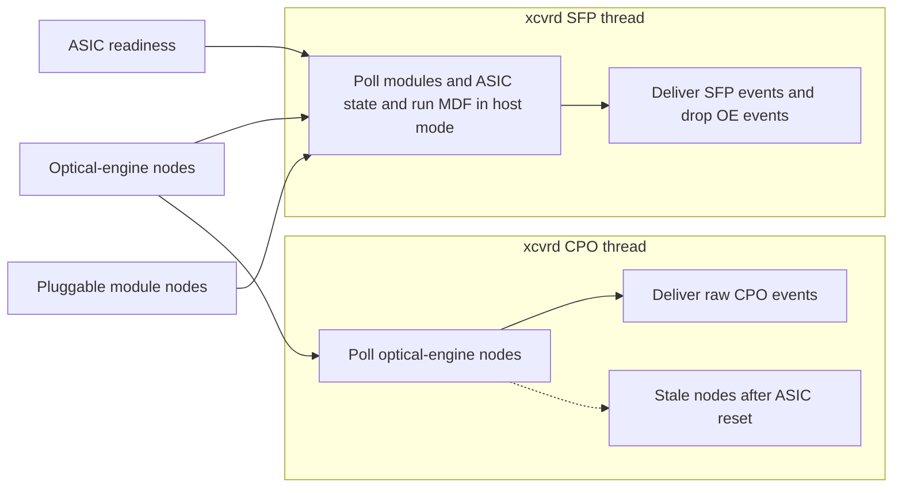
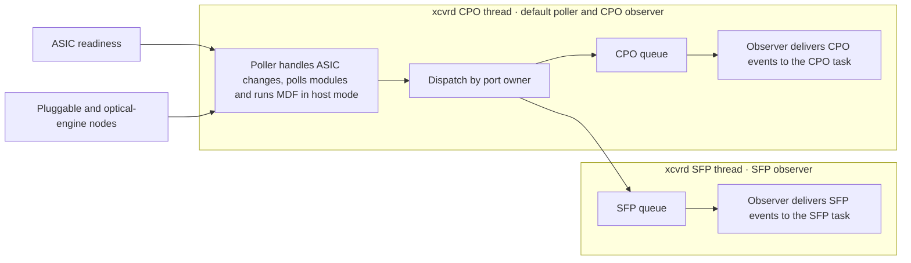

# SONiC Module Change Event Refactor

High Level Design · Draft 0.2

## Table of Contents

- [0 General](#0-general)
- [1 Requirements](#1-requirements)
- [2 Design](#2-design)
- [3 Test Plan](#3-test-plan)
- [4 Security](#4-security)
- [5 NVIDIA Chapters](#5-nvidia-chapters)
- [6 Open Questions](#6-open-questions)
- [Reference Table](#reference-table)

## 0 General

### 0.1 Revision

| Rev | Date | Change |
| --- | --- | --- |
| 0.1 | 2026-11-27 | Initial design for review |
| 0.2 | 2026-11-27 | Clarify event sources, thread roles and fault-indication scope |

### 0.2 Scope

Module insertion, removal and recovery after a switch chip restart on NVIDIA SONiC. Covers pluggable optics and co-packaged optics in legacy and host management modes.

For CPO fault indication, the refactor covers polling the existing fault interrupt and forwarding it to the fault-indication task. Fault decoding, reporting and policy are outside the scope.

### 0.3 Definitions

| Term | Meaning |
| --- | --- |
| CPO | Co-packaged optics. The optical engines sit alongside the switch chip. |
| OE | Optical engine. One engine can serve several ports, called banks. |
| ELS | External laser source. It supplies light to the optical engine. |
| xcvrd | The SONiC service that manages optical modules and updates their status. |
| Legacy mode | The driver manages module bring-up and exposes the result. SONiC reports that status without running the MDF. |
| Host management mode | SONiC manages bring-up for supported modules. It runs the MDF and uses its outcome to decide when to report insertion. Some modules are managed by firmware and use the presence path within the MDF. |
| MDF | Module detection flow. It interprets presence and power signals, powers or resets a module as needed, and determines when it can be managed. |

### 0.4 Overview

xcvrd uses two module event tasks. The **SFP thread** updates pluggable ports, including the service port on Chameleon 6S. The **CPO thread** updates ports served by optical engines. Each task handles the events for its own ports.

The proposal uses **one polling thread**. The poller handles ASIC state changes, polls module events, runs the MDF in host management mode and dispatches events to the owning task. In the **observer** role, each thread delivers events for its own ports to its xcvrd task. The polling thread also acts as the observer for its own ports. By default, the CPO thread is the poller on CPO platforms and the SFP thread is the poller on pluggable-only platforms.

| Mode or condition | Sysfs nodes watched | Events handled |
| --- | --- | --- |
| Legacy, pluggable and CPO | Module `present` | Insertion, removal and module errors. The poller reads `status` and, when needed, `statuserror` after the notification. |
| Host management, software-controlled module or control detection | Module `hw_present` and `power_good` | Presence and power changes feed the MDF, which reports insertion, removal or a module error. |
| Host management, firmware-controlled module | Module `present` | The MDF uses driver presence to report insertion, removal or a module error. |
| Both modes | HW-MGMT `config/asicN_ready` | ASIC down and up drive removal and recovery for that ASIC's modules. |
| Host management, CPO with fault indication | Module `interrupt`, opened once per OE through bank 0 when available | CPO fault notification goes to the existing fault-indication task. |

[Legacy node selection](https://github.com/nvidia-sonic/sonic-buildimage/blob/15d753f15afc11d09d96eb457aa0f9b7760130a3/platform/mellanox/mlnx-platform-api/sonic_platform/module_sysfs.py#L216) · [Host-mode node selection](https://github.com/nvidia-sonic/sonic-buildimage/blob/15d753f15afc11d09d96eb457aa0f9b7760130a3/platform/mellanox/mlnx-platform-api/sonic_platform/module_detection_flow.py#L313) · [CPO fault interrupt](https://github.com/nvidia-sonic/sonic-buildimage/blob/15d753f15afc11d09d96eb457aa0f9b7760130a3/platform/mellanox/mlnx-platform-api/sonic_platform/cpo.py#L113)

### 0.5 Use Cases

- **Plug in or unplug a module.** The SFP thread receives a pluggable module event. A CPO module presence change goes to the CPO thread for all affected banks.
- **One ASIC goes down and comes back.** Its modules are reported removed and recovered on return. Other ASICs continue to report module events.
- **Restart `syncd` on Chameleon 6S.** The optical-engine ports and the service port receive the events they need to recover while the same xcvrd process stays up.

## 1 Requirements

| Area | Requirement |
| --- | --- |
| Coverage | One poller for pluggable and CPO events in legacy and host management modes. |
| Delivery | Route by physical port index and preserve each port's event order. |
| Recovery | Rebuild registrations for the affected ASIC and continue polling the others. |
| Compatibility | Preserve xcvrd APIs, event payloads, configuration, boot behavior and the CPO fault handoff. |
| Resource use | Bound retries, polling waits and queue memory. |

## 2 Design

### 2.1 Background

**Current flow on a CPO platform**

The SFP thread handles ASIC changes and receives the reset events for both port types. It drops events for the optical-engine ports because the CPO thread owns them. The CPO thread can keep reading stale nodes after the reset, flooding logs and missing the events needed for recovery. In host mode it can also report presence before the MDF finishes. The original report records a service-port numbering bug. The Chameleon 6S baseline shown here includes the physical-port indexing fix. [Redmine #5450531](https://redmine.nvidia.com/issues/5450531) · [Chameleon 6S chassis code](https://github.com/nvidia-sonic/sonic-buildimage/blob/15d753f15afc11d09d96eb457aa0f9b7760130a3/platform/mellanox/mlnx-platform-api/sonic_platform/chassis.py#L826)

### 2.2 Motivation

A shared poller gives both tasks the same view of ASIC readiness and module state. Each task keeps responsibility for applying events to its ports.

### 2.3 Flow Diagrams

**Proposed flow on a CPO platform**

On a pluggable-only platform, the SFP thread runs the poller and observes its own events. A CPO-only platform uses the CPO thread for both roles.

| Area | Current | Proposed |
| --- | --- | --- |
| Hardware polling | SFP and CPO threads can both watch the same OE. | One thread polls all modules and watches each OE once. |
| Module detection | The CPO thread can deliver raw presence in host mode. | The poller applies the MDF to both port types in host mode. |
| ASIC recovery | The SFP thread handles readiness. The CPO thread can retain stale nodes. | The poller rebuilds the affected ASIC's registrations and restarts detection as needed. |
| Event delivery | Reset events go to the SFP thread. | Each observer delivers only its own port events. The poller also observes its own events. |

### 2.4 SAI API

The design uses the existing SAI API. ASIC availability for module event handling comes from HW-MGMT.

### 2.5 Platform API

The chassis owns one `ModuleChangeEvent` object. It selects one polling owner at startup from the event tasks xcvrd starts, preferring CPO when present. The existing `get_change_event()` and `get_elsfp_change_event()` APIs keep their `sfp` and `elsfp` responses, error details and wait semantics. The polling caller drives the shared loop and drains its own queue. The other caller waits for its queue. Shutdown wakes the callers and releases the registrations.

| Component | Responsibility |
| --- | --- |
| `ModuleChangeEvent` | Owns the shared polling loop, registrations and queues. It uses the existing port objects to fan out each OE event to its banks and dispatch by physical port index. |
| Management mode handlers | Supply the nodes to watch and interpret module events. The legacy handler reads driver status. The host handler uses the existing MDF and processes reset completion without blocking polling. |
| `AsicReadinessMonitor` | A helper class that observes HW-MGMT readiness and reports per-ASIC transitions in the poller's loop. |

Use a separate monitor class for ASIC readiness and keep recovery actions in `ModuleChangeEvent`. The monitor can evolve with the readiness source, while the poller remains the single owner of registrations, pending module work and event order.

1. **ASIC down.** Stop polling the affected ASIC's module nodes, cancel pending detection work and ignore any late completions from before the reset. Queue removals for the affected ports.
2. **ASIC up.** Reopen nodes as they appear and read current presence. In host mode, run the MDF before reporting insertion. In legacy mode, report fresh driver status. Keep removal ahead of any subsequent insertion for the same port.

### 2.6 Lower Layer API

Use the existing SDK module sysfs nodes and HW-MGMT `config/asicN_ready`. Watch the directory and reread readiness periodically to handle replaced files or missed notifications. A value of `1` permits recovery to begin. In host management mode, the poller reads the CPO interrupt node where supported and forwards assertions to the fault-indication task. [HW-MGMT readiness writer](https://github.com/Mellanox/hw-mgmt/blob/a25447e361e6fdccd6b46423621fe559d5de32da/usr/usr/bin/hw-management-thermal-events.sh#L253)

### 2.7 Counters

Keep existing SONiC counters.

### 2.8 Error Handling

On `ENODEV`, close the stale registration and recheck ASIC readiness. If the ASIC still reads ready but the old module node is gone, recover that module's ports. Retry missing nodes with backoff. If a queue reaches its limit, resync the affected ports for that observer and preserve the removal needed to restart initialization.

### 2.9 Event Logging

Log ASIC transitions and queue overflow. Rate-limit repeated node errors.

### 2.10 Configuration and Management

Use the existing module management mode, CLI, YANG and gNMI.

### 2.11 DB Schema

Use the existing database schema.

### 2.12 Memory Consumption

Use a bounded in-process queue for each active event task.

### 2.13 Restrictions and Limitations

The polling owner's xcvrd work can delay the next poll for both port types. If the driver collapses several changes into one notification, SONiC reconciles from the state it can still observe.

## 3 Test Plan

TBD.

## 4 Security

The design runs inside the existing xcvrd process and uses its current access to platform files. It needs no additional privileges, third-party dependencies or credentials.

## 5 NVIDIA Chapters

The implementation lives in the NVIDIA Mellanox platform API and uses the existing HW-MGMT, SDK and CPO fault-indication interfaces.

## 6 Open Questions

- Which event latency and queue limits should the design meet on the largest supported platform?
- Does xcvrd need a replay when switch services recreate port database entries after a reset? The incident observed port entries being removed while recovery was in progress. [Redmine incident notes](https://redmine.nvidia.com/issues/5450531)

## Reference Table

| Reference | Description |
| --- | --- |
| [SONiC HLD template](https://nvidia.sharepoint.com/sites/NBU-sw/Systems/General/SONiC/HLD/HLD%20Template.md) | Document structure |
| [Redmine #5450531](https://redmine.nvidia.com/issues/5450531) | Reported CPO module-event failures |
| [PR 1425](https://github.com/nvidia-sonic/sonic-buildimage/pull/1425) | Earlier single-poller and queue implementation |
