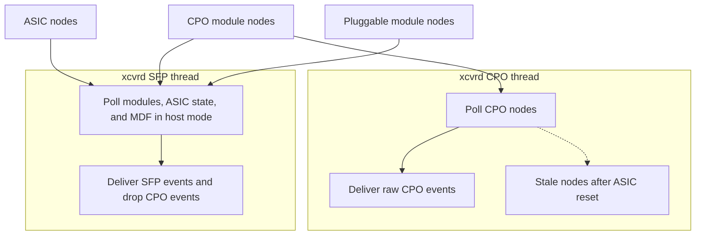
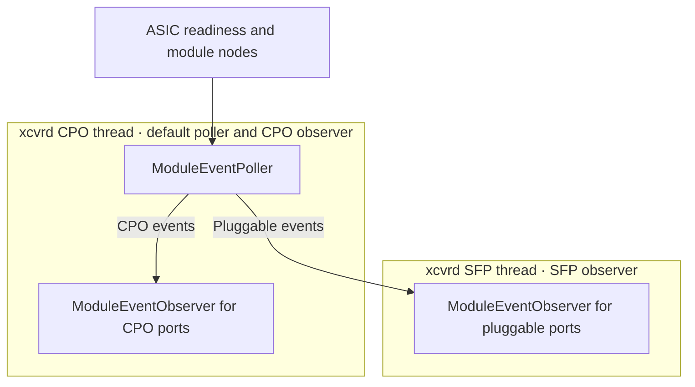
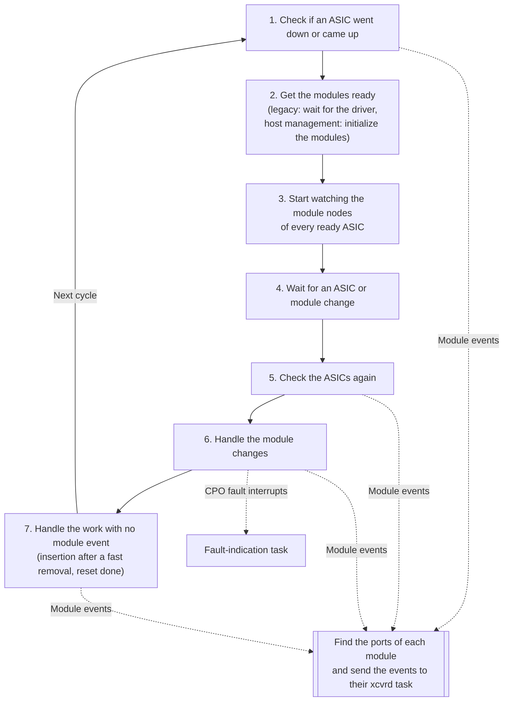
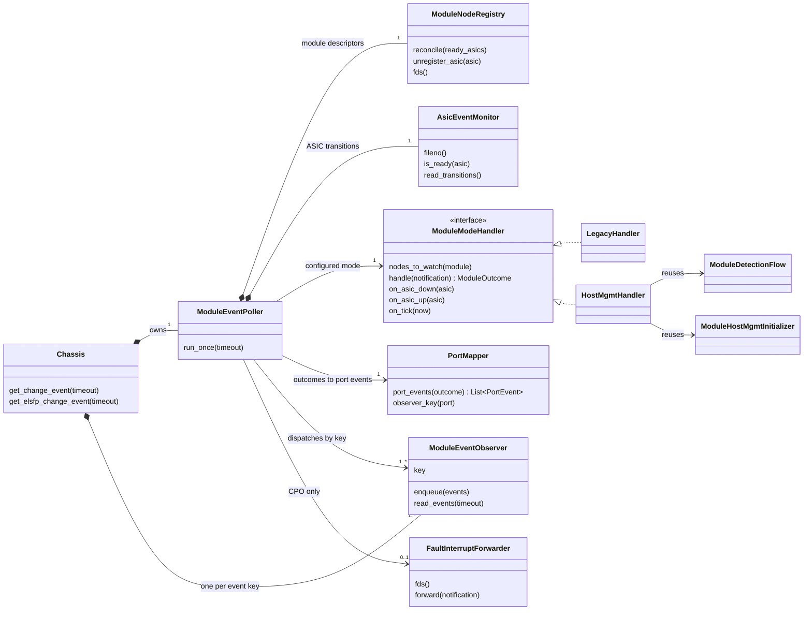
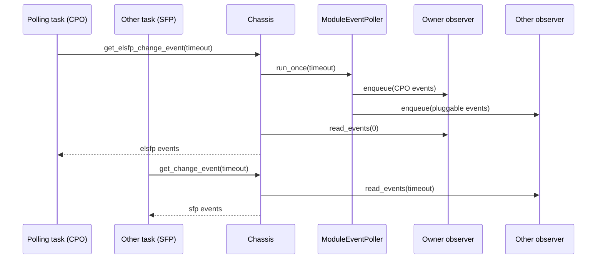
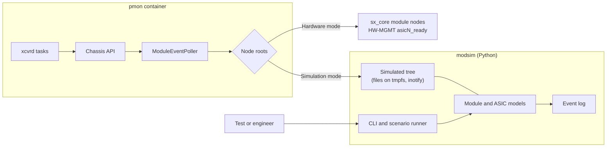
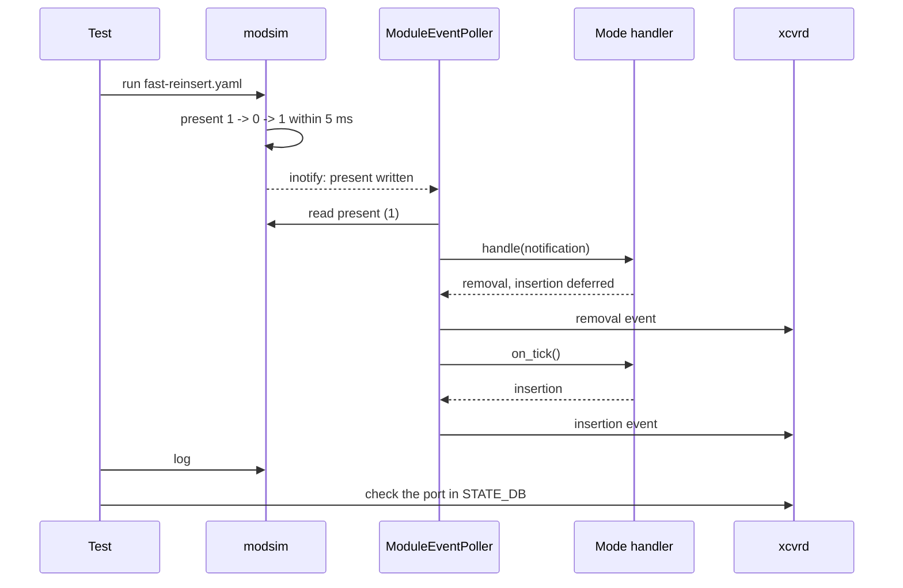

# SONiC Module Change Event Refactor

High Level Design · Draft 0.2

## Table of Contents

- [0 General](#0-general)
- [1 Requirements](#1-requirements)
- [2 Design](#2-design)
- [3 Test Plan](#3-test-plan)
- [4 Security](#4-security)
- [5 NVIDIA Chapters](#5-nvidia-chapters)
- [6 Open Questions](#6-open-questions)
- [Reference Table](#reference-table)

## 0 General

### 0.1 Revision

| Rev | Date | Change |
| --- | --- | --- |
| 0.1 | 2026-11-27 | Initial design for review |
| 0.2 | 2026-11-27 | Clarify event sources, thread roles and fault-indication scope |
| 0.3 | 2026-11-28 | Add the mode handler interface, port mapping, node registry and data types to the class diagram; add the call sequence |
| 0.4 | 2026-11-28 | Add the simulation mode and the modsim simulator |
| 0.5 | 2026-11-28 | Add the testability challenge and requirement; keep the simulator out of SONiC |
| 0.6 | 2026-11-28 | Align the polling stages with the implementation; use a Python simulator with a file tree and inotify |
| 0.7 | 2026-11-28 | Name the polling stages in plain English |

### 0.2 Scope

Module insertion, removal and recovery after a switch chip restart on NVIDIA SONiC. Covers pluggable optics and co-packaged optics in legacy and host management modes.

For CPO fault indication, the refactor covers polling the existing fault interrupt and forwarding it to the fault-indication task. Fault decoding, reporting and policy are outside the scope.

### 0.3 Definitions

| Term | Meaning |
| --- | --- |
| CPO | Co-packaged optics. The optical engines sit alongside the switch chip. |
| OE | Optical engine. One engine can serve several ports, called banks. |
| ELS | External laser source. It supplies light to the optical engine. |
| xcvrd | The SONiC service that manages optical modules and updates their status. |
| Legacy mode | The driver manages module bring-up and exposes the result. SONiC reports that status without running the MDF. |
| Host management mode | SONiC manages bring-up for supported modules. It runs the MDF and uses its outcome to decide when to report insertion. Some modules are managed by firmware and use the presence path within the MDF. |
| MDF | Module detection flow. It interprets presence and power signals, powers or resets a module as needed, and determines when it can be managed. |

### 0.4 Overview

Module change event handling in the NVIDIA platform handles the events below:

| Event Type | Host management mode | Legacy mode |
| --- | --- | --- |
| Module insertion, removal or error (pluggable or CPO) | `hw_present` and `power_good` for software-controlled modules or control detection (MDF); `present` for firmware-controlled modules (MDF) | `present`; read `status` and, when needed, `statuserror` after the notification |
| ASIC down or up (per-ASIC module removal and recovery) | HW-MGMT `config/asicN_ready` | HW-MGMT `config/asicN_ready` |
| CPO fault (hand off to fault-indication task) | Module `interrupt`, opened once per OE through bank 0 when available | — |

Support for host management mode and CPO platforms has made the implementation increasingly complex:

- **Two modes** — legacy and host management. Each mode watches different sysfs nodes and follows different logic.
- **Two threads** — **SfpStateUpdateTask** handles pluggable ports through `chassis.get_change_event()`; **CpoStateUpdateTask** handles CPO ports through `chassis.get_elsfp_change_event()`. Running both threads risks races on shared state that must be guarded with locks.
- **ASIC coupling** — module event polling is tied to switch-ASIC readiness handling.

Most of that logic lives in `chassis.py`. As the file grows, bug fixes, extensions and code review become harder.

The proposal:

- **Dedicated classes** — `ModuleEventPoller`, `ModuleEventObserver`, and `AsicEventMonitor` split responsibilities out of `chassis.py`.
- **Poller and observer** — One thread polls ASIC state, pluggable and CPO modules, runs the MDF, and dispatches events. Each xcvrd task reads from its queue and delivers events for its own ports. The polling thread is also the observer for the ports it owns.

### 0.5 Use Cases

- **Insert or remove a module.** Pluggable events go to the SFP task. A CPO presence change is delivered to the CPO task for every affected bank.
- **An ASIC fails and recovers.** Its modules are reported removed when the ASIC goes down and recovered when it returns. Events on other ASICs are unaffected.
- **Restart `syncd` on CPO platform.** Optical-engine ports and the service port receive the events needed for recovery while xcvrd keeps running.

## 1 Requirements

| ID | Requirement |
| --- | --- |
| REQ-1 | Preserve supported behavior for pluggable and CPO optics in legacy and host management modes, including boot and CPO fault indication. |
| REQ-2 | Deliver insertion, removal, and error events in order for each affected port. In host management mode, report insertion when the module is ready to be managed. |
| REQ-3 | Recover ports after an ASIC restart while xcvrd stays running and other ASICs continue reporting events. |
| REQ-4 | Preserve existing xcvrd interfaces, event formats, and operator configuration. |
| REQ-5 | Make the module event handling easy to test: ASIC and module events can be created on a real switch without hardware action, and the test runs the production code paths. Section 2.14 meets this requirement with the simulation mode. |

## 2 Design

### 2.1 Background

**Current flow on a CPO platform**

- Polling the same CPO nodes from two threads risks races.
- The CPO thread does not watch ASIC readiness, so it can miss ASIC down and recovery events.
- The flow is hard to test. It depends on lower layer capabilities: the switch chip must reset, a module must be inserted or removed, or a fault must occur. These events are slow, need manual action, and are hard to time, for example a removal and an insertion within one poll cycle. Unit tests replace the lower layers with mocks, so they do not show how the flow behaves with the real nodes.

### 2.2 Motivation

A shared poller gives both tasks the same view of ASIC readiness and module state. Each task keeps responsibility for applying events to its ports.

### 2.3 Flow Diagrams

**Proposed flow on a CPO platform**

On a pluggable-only platform, the SFP thread runs the poller and observes its own events. A CPO-only platform uses the CPO thread for both roles.

**Polling stages shared by legacy and host management**

1. **ASIC down or up.** Read the readiness of each ASIC without waiting. On ASIC-down, close the nodes of its modules, let the mode handler cancel its pending work, and report removal. On ASIC-up, let the mode handler restart its modules, mark them for registration, and report insertion.
2. **Get the modules ready.** Let the mode handler bring up what it needs. Legacy waits until the driver nodes are ready. Host management runs the module initializer for every ASIC that is not initialized.
3. **Start watching.** Open the nodes of the marked modules whose ASIC is ready. Legacy watches `present`. Host management selects the nodes listed in section 0.4. Retry a module whose nodes are missing with a backoff. The ASIC watcher starts before the first readiness read.
4. **Wait.** Use one blocking wait for the ASIC watch and the module nodes. Bound the wait so that reset completions and registration retries are handled promptly.
5. **Check the ASICs again.** An ASIC-down found by this poll is applied before the module notifications of the same batch. The nodes of that ASIC are closed, so its notifications are skipped.
6. **Module changes.** Read each notified node. Forward CPO fault interrupts to the existing fault-indication task. Pass the other notifications to the mode handler. Legacy reads the driver status. Host management runs the MDF.
7. **No module event.** Let the mode handler report the work that has no module event of its own: the insertion that follows a fast removal, and the modules that completed a reset.

Each step sends its module events as soon as it has them. It finds the front panel ports of each module (all banks of an OE), and queues the events of each step as one message for each xcvrd task that owns those ports. A removal and the insertion after it are therefore separate events.

| Area | Current | Proposed |
| --- | --- | --- |
| Hardware polling | SFP and CPO threads can both watch the same OE. | One thread polls all modules and watches each OE once. |
| Module detection | The CPO thread can deliver raw presence in host mode. | The poller applies the MDF to both port types in host mode. |
| ASIC recovery | The SFP thread handles readiness. The CPO thread can retain stale nodes. | The poller rebuilds the affected ASIC's registrations and restarts detection as needed. |
| Event delivery | Reset events go to the SFP thread. | Each observer delivers only its own port events. The poller also observes its own events. |

### 2.4 SAI API

The design uses the existing SAI API. ASIC availability for module event handling comes from HW-MGMT.

### 2.5 Platform API

The chassis keeps the existing `get_change_event()` and `get_elsfp_change_event()` APIs, including their `sfp` and `elsfp` responses and wait semantics. It selects the polling owner from the active xcvrd tasks at startup, preferring CPO. The polling caller drives the shared loop and reads its own observer. The other caller waits on its observer. Shutdown wakes the callers and releases the registrations.

The poller depends only on the `ModuleModeHandler` interface, the `PortMapper` and the observer keys. A new management mode adds a handler. A new port type adds a mapping. A new consumer registers an observer under a new key. None of these changes the poller.

- **`ModuleEventPoller`** runs the five stages of section 2.3 inside `run_once()`. The stages are private. It coordinates the other classes and holds no mode-specific or port-specific logic.
- **`ModuleNodeRegistry`** owns the module descriptors and the poll object. It registers nodes only for ready ASICs, removes an ASIC's nodes on ASIC-down, and handles `ENODEV` (section 2.8).
- **`AsicEventMonitor`** tracks readiness per ASIC. It exposes its descriptor so that one blocking wait covers ASIC and module notifications, and it answers readiness queries for the registry.
- **`ModuleModeHandler`** is the contract for a management mode. The chassis selects the implementation at startup.
  - `nodes_to_watch()` returns the nodes listed in section 0.4.
  - `handle()` turns one notification into a `ModuleOutcome`.
  - `on_asic_down()` and `on_asic_up()` let the mode cancel and restart its own state. The handler is the only owner of module readiness and initialization state.
  - `on_tick()` runs every cycle, so that reset completions and wait timeouts are handled without a notification.
- **`LegacyHandler`** watches `present` and reads the driver's module status.
- **`HostMgmtHandler`** selects nodes from the module state and runs the MDF. It reuses the existing `ModuleDetectionFlow` and `ModuleHostMgmtInitializer`. It can defer insertion until reset completes.
- **`PortMapper`** maps a module outcome to its physical ports, expands an OE event to its banks, and names the observer key (`sfp` or `elsfp`) that owns each port.
- **`ModuleEventObserver`** owns one task's bounded queue and delivers its events in the existing API format. It runs in the calling xcvrd thread.
- **`FaultInterruptForwarder`** opens the CPO interrupt node once per OE and forwards assertions to the existing fault-indication task. It exists only on CPO platforms in host management mode.

The data passed between the classes:

| Type | Fields | Produced by | Consumed by |
| --- | --- | --- | --- |
| `ModuleNotification` | module, node, value | `ModuleNodeRegistry` | `ModuleModeHandler` |
| `ModuleOutcome` | module, status, error | `ModuleModeHandler` | `PortMapper` |
| `PortEvent` | port, status, error | `PortMapper` | `ModuleEventObserver` |

On ASIC-down, the poller tells the registry to close that ASIC's module nodes and tells the handler to cancel its pending work. Late completions from before the reset are discarded. Affected ports are reported as removed. On ASIC-up, the registry reopens the nodes as they appear, and the handler recovers each module through its management mode.

**Call sequence**

**Alternative considered.** A dedicated poller thread owned by `Chassis` would make both xcvrd tasks plain observers. It removes the owner selection and the restriction in section 2.13. The platform API already runs its own thread for `WaitSfpReadyTask`. The cost is one more thread in xcvrd and a stop path on shutdown.

### 2.6 Lower Layer API

Use the existing SDK module sysfs nodes and HW-MGMT `config/asicN_ready`. Watch the directory and reread readiness periodically to handle replaced files or missed notifications. A value of `1` permits recovery to begin. In host management mode, the poller reads the CPO interrupt node where supported and forwards assertions to the fault-indication task. [HW-MGMT readiness writer](https://github.com/Mellanox/hw-mgmt/blob/a25447e361e6fdccd6b46423621fe559d5de32da/usr/usr/bin/hw-management-thermal-events.sh#L253)

### 2.7 Counters

Keep existing SONiC counters.

### 2.8 Error Handling

On `ENODEV`, close the stale registration and recheck ASIC readiness. If the ASIC still reads ready but the old module node is gone, recover that module's ports. Retry missing nodes with backoff. If a queue reaches its limit, resync the affected ports for that observer and preserve the removal needed to restart initialization.

### 2.9 Event Logging

Log ASIC transitions and queue overflow. Rate-limit repeated node errors.

### 2.10 Configuration and Management

Use the existing module management mode, CLI, YANG and gNMI.

### 2.11 DB Schema

Use the existing database schema.

### 2.12 Memory Consumption

Use a bounded in-process queue for each active event task.

### 2.13 Restrictions and Limitations

The polling owner's xcvrd work can delay the next poll for both port types. If the driver collapses several changes into one notification, SONiC reconciles from the state it can still observe.

### 2.14 Simulation Mode

Module events depend on hardware actions: an ASIC reset, a module inserted or removed, a power fault. These are slow and hard to repeat in the lab. They are also hard to time, for example a removal and an insertion within one poll cycle. Simulation mode lets a test create these events on a real switch, on demand and in a repeatable order.

**Principle.** The simulator replaces the hardware, not the code. In simulation mode the platform API reads the module nodes and the ASIC readiness files from a simulated tree instead of `sx_core` and HW-MGMT. `ModuleEventPoller`, the mode handlers, the MDF and xcvrd run unchanged. A test therefore exercises the same code that runs in production.

**Selection.** The platform API reads the simulation root once when xcvrd starts, from `/etc/sonic/module_event_simulation`. When the file is absent, it uses the hardware paths. When it is present:

- the `sx_core` module root and the HW-MGMT readiness directory resolve under the simulation root, and
- `ModuleNodeRegistry` learns of node changes through one inotify watch on the simulated tree, instead of `POLLPRI` from `sysfs_notify`. A plain file cannot raise `POLLPRI`.

The notification source is chosen once, at startup. No other code path checks the mode, so hardware mode has no runtime cost.

**Simulator.** `modsim` is a Python script that runs on the switch host. It is an NVIDIA internal tool in its own repository, not part of `sonic-buildimage`. SONiC contains only the selection described above. The simulator writes a tree of plain files on tmpfs, with the same layout as the hardware nodes. It watches the files the MDF writes with inotify, and answers through its module models:

| Simulated node | Model behavior |
| --- | --- |
| `asicN_ready` | Written by the `asic` commands. A change wakes the directory watch. |
| `present`, `hw_present`, `power_good`, `interrupt` | Written and closed by `modsim`. The close wakes the inotify watch of the platform API, as `sysfs_notify` wakes the poll on hardware. |
| `status`, `statuserror` | The legacy status and error code of the module. |
| `power_on`, `hw_reset`, `control`, `power_limit` | Written by the MDF. The model answers as a module does: power good after power on, reset done after a set delay, a control type from the module profile. |
| EEPROM pages | Served from a module profile, for example a capture from a real module. |

A model also simulates node faults, so error handling is testable: a node that is missing, a read that fails with `ENODEV`, and a node that changes again before it is read.

**Commands.**

| Command | Effect |
| --- | --- |
| `modsim start --profile <file>` | Mount the tree with one module model per sx_core module, as the profile describes |
| `modsim asic down\|up <asic>` | Change the readiness of one ASIC |
| `modsim plug <module> [--profile <file>]` | Insert a module |
| `modsim unplug <module>` | Remove a module |
| `modsim fault <module> power-bad\|error <code>\|interrupt` | Raise a module fault |
| `modsim run <scenario>` | Run a timed sequence of the commands above |
| `modsim log` | Print the simulated events and the node reads that followed them |
| `modsim stop` | Unmount the tree |

**Example: fast removal and insertion**

**Workflow.**

1. Start `modsim` on the host with a profile of the platform.
2. Create `/etc/sonic/module_event_simulation` and restart pmon. xcvrd now reads the simulated tree.
3. Run scenarios and check the result in the `modsim` log, the syslog, and the xcvrd tables in `STATE_DB`.
4. Remove the file, restart pmon, and stop `modsim`.

**Scope and limits.**

- The SDK and the SAI still see the real modules. Port link state does not follow the simulated modules. Simulation mode tests the module event flow, not the data path.
- The simulated tree must be visible in the pmon container. Put it under a host directory that is bind-mounted into pmon, such as `/tmp/nv-syncd-shared`.
- Simulation mode replaces only the notification source. The way `sysfs_notify` wakes the poll is not tested.
- The timing of a simulated module, such as the reset delay, comes from the profile. It does not reproduce every real module.
- Simulation mode is for test setups only. The platform API logs a warning at startup when it is active.

## 3 Test Plan

TBD.

## 4 Security

The design runs inside the existing xcvrd process and uses its current access to platform files. It needs no additional privileges, third-party dependencies or credentials.

## 5 NVIDIA Chapters

The implementation lives in the NVIDIA Mellanox platform API and uses the existing HW-MGMT, SDK and CPO fault-indication interfaces.

## 6 Open Questions

- Which event latency and queue limits should the design meet on the largest supported platform?
- How does polling ownership move if the preferred task starts after the other task has called in, or if the owner task stops?
- What does a queue resync send after an overflow, and in which order relative to the preserved removal?
- Does xcvrd need a replay when switch services recreate port database entries after a reset? The incident observed port entries being removed while recovery was in progress. [Redmine incident notes](https://redmine.nvidia.com/issues/5450531)

## Reference Table

| Reference | Description |
| --- | --- |
| [SONiC HLD template](https://nvidia.sharepoint.com/sites/NBU-sw/Systems/General/SONiC/HLD/HLD%20Template.md) | Document structure |
| [Redmine #5450531](https://redmine.nvidia.com/issues/5450531) | Reported CPO module-event failures |
| [PR 1425](https://github.com/nvidia-sonic/sonic-buildimage/pull/1425) | Earlier single-poller and queue implementation |
