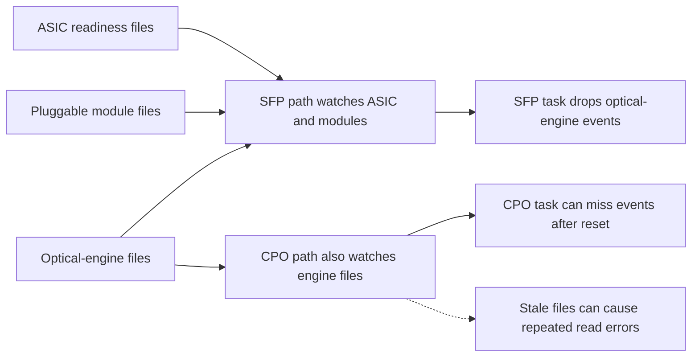
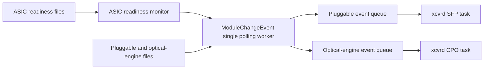

# SONiC Module Change Event Refactor

High Level Design · Draft 0.1

## Table of Contents

- [0 General](#0-general)
- [1 Requirements](#1-requirements)
- [2 Design](#2-design)
- [3 Test Plan](#3-test-plan)
- [4 Security](#4-security)
- [5 NVIDIA Chapters](#5-nvidia-chapters)
- [6 Open Questions](#6-open-questions)
- [Reference Table](#reference-table)

## 0 General

### 0.1 Revision

| Rev | Date | Change |
| --- | --- | --- |
| 0.1 | 2026-11-27 | Initial design for review |

### 0.2 Scope

Module insertion, removal and recovery after a switch chip restart on NVIDIA SONiC. Covers pluggable optics and co-packaged optics in both legacy and host management modes.

### 0.3 Definitions

| Term | Meaning |
| --- | --- |
| ASIC | The switch chip. Each optical module is associated with an ASIC. |
| CPO and OE | Co-packaged optics and the optical engines that serve their ports. One engine can serve several ports, called banks. |
| xcvrd | The SONiC service that consumes module events and updates transceiver state. Its SFP task handles pluggables and its CPO task handles optical engines. |
| Legacy and host management | In legacy mode, SONiC reports the module status exposed by the driver. In host management mode, SONiC also runs a detection flow that can power up the module and wait for reset to finish. |

### 0.4 Overview

SONiC needs to tell each xcvrd task when its optics become available or unavailable. The two tasks already have distinct responsibilities, which the design keeps.

On CPO switches, both tasks can watch the same optical-engine files. Only one path handles ASIC restarts. The other can keep reading stale files, flood the log and miss events needed to bring the optical engines out of low power. [Redmine #5450531](https://redmine.nvidia.com/issues/5450531)

The proposal gives one `ModuleChangeEvent` object ownership of polling and delivery. It runs one worker and feeds the existing xcvrd tasks through separate queues. A small ASIC readiness monitor runs in that worker and reports when an ASIC becomes available or unavailable.

The platform takes on one worker and two bounded queues. Slow work in either xcvrd task can delay its own event delivery. Polling continues independently, and an overflowing queue triggers recovery for the affected ports.

### 0.5 Use Case

When `syncd` restarts on a Chameleon 6S switch, the optical engines and the service port receive the events they need to recover while the same xcvrd process stays up.

## 1 Requirements

- Use one event flow for CPO and pluggable optics in both management modes. Watch each hardware event source once and deliver events by SONiC physical port index.
- Preserve xcvrd's platform API, event keys, status and error payloads, and wait semantics. Keep the existing configuration and management interfaces.
- On systems with multiple ASICs, reconcile only the affected ASIC and keep reporting events from the others. Keep per-port event order and bound the polling retry rate and queue memory.
- Preserve existing warm and fast boot behavior. At startup, discover modules on ready ASICs and register modules on other ASICs when they become ready.

## 2 Design

### 2.1 Background

The reported failure started with an ASIC reset. The SFP path sent reset events under `sfp`, so xcvrd discarded events for optical-engine ports. The CPO path kept polling files removed during the reset and repeatedly hit `ENODEV` (device unavailable). The original report also records a service-port numbering error. The current Chameleon 6S public branch uses physical port indices for ASIC events and still routes them through the SFP path. [Redmine #5450531](https://redmine.nvidia.com/issues/5450531) · [Chameleon 6S chassis code](https://github.com/nvidia-sonic/sonic-buildimage/blob/15d753f15afc11d09d96eb457aa0f9b7760130a3/platform/mellanox/mlnx-platform-api/sonic_platform/chassis.py#L826)

### 2.2 Motivation

Both consumers need the same view of ASIC readiness and module state. In host mode, the CPO path can report raw presence before detection finishes. A shared flow gives both kinds of optics the same reset handling and uses the correct mode to decide when to report insertion.

### 2.3 Flow Diagrams

**Current implementation on a CPO switch**

**Proposed implementation**

### 2.4–2.6 SAI, Platform and Lower Layer APIs

The chassis creates one `ModuleChangeEvent` instance for xcvrd. The existing `get_change_event()` and `get_elsfp_change_event()` methods start it on first use and read from their respective queues. xcvrd shutdown stops the worker, wakes pending callers and closes the files it owns. The existing Linux sysfs, HW-MGMT and SAI interfaces support this design.

| Component | Responsibility |
| --- | --- |
| `ModuleChangeEvent` | Owns the worker, module file registration, recovery and event delivery. It uses existing port objects to map hardware modules to physical ports. Each optical engine is watched through one bank and its event is sent to all its banks. |
| Management mode handlers | Select a handler at startup. The legacy handler reads the driver's presence and error status. The host handler reuses module initialization and detection. Reset waits complete asynchronously so the worker can continue polling. Routing and ASIC recovery are shared. |
| `AsicReadinessMonitor` | Watches `config/asicN_ready`, keeps the last observed state per ASIC and reports transitions to `ModuleChangeEvent`. It runs in the same polling loop and has no module or queue ownership. |

**ASIC handling recommendation.** Put readiness detection in `AsicReadinessMonitor` and keep recovery in `ModuleChangeEvent`. The monitor owns how SONiC detects readiness. The worker closes files, cancels work and publishes events in order. Watch the HW-MGMT directory and periodically reread `asicN_ready` to pick up file replacement or missed notifications. A value of `1` permits recovery to begin. [HW-MGMT readiness writer](https://github.com/Mellanox/hw-mgmt/blob/a25447e361e6fdccd6b46423621fe559d5de32da/usr/usr/bin/hw-management-thermal-events.sh#L253)

1. **ASIC down.** Stop polling its module files, cancel pending module work and invalidate completions from before the reset. Queue removals under the proper port indices and event keys.
2. **ASIC up.** Reopen the files as they become available and read the current module state. In host mode, let detection complete for each present module before queuing its insertion. In legacy mode, use a fresh driver status. Publish removals and later insertions in order, even if both are waiting in the same queue.

| Area | Current implementation | Proposed implementation |
| --- | --- | --- |
| Polling | SFP and CPO paths can both watch the same engine. | One platform worker watches each source. |
| Mode handling | Chassis methods mix mode handling, ASIC recovery and delivery. | Mode handlers supply module status. The same worker manages recovery and delivery. |
| ASIC recovery | The SFP path handles readiness. The CPO path can retain stale files. | A readiness monitor reports transitions. The worker rebuilds affected registrations. |
| Delivery | Reset events go to the SFP task. | Each task receives its own events by physical port index. |

### 2.7–2.9 Counters, Error Handling and Event Logging

Keep existing SONiC counters. On `ENODEV`, drop the stale registration and recheck readiness. If the ASIC still reads ready but the old module file is gone, run removal and recovery for that module's ports. Retry missing files with backoff while continuing to poll healthy modules. Log ASIC transitions and rate-limit repeated errors. If a queue reaches its limit, log it and resync the affected ports for that consumer, preserving the removal needed to restart initialization.

### 2.10–2.13 Configuration, Database, Memory and Limitations

Use the existing mode configuration, CLI, YANG, gNMI and database schema. Use bounded, in-process queues. A readiness change or module swap that the driver collapses before userspace observes it can only be reconciled from the state still visible to SONiC.

## 3 Test Plan

TBD.

## 4 Security

The worker runs inside the existing xcvrd process and uses its current access to platform files. It needs no additional privileges, third-party dependencies or credentials.

## 5 NVIDIA Chapters

The implementation lives in the NVIDIA Mellanox platform API. Keep the existing CPO fault-interrupt handoff to the fault-indication task and use the existing HW-MGMT and SDK interfaces.

## 6 Open Questions

- Which event latency and queue limits should the design meet on the largest supported platform?
- Does xcvrd need a replay when switch services recreate port database entries after a reset? The incident observed port entries being removed while recovery was in progress. [Redmine incident notes](https://redmine.nvidia.com/issues/5450531)

## Reference Table

| Reference | Description |
| --- | --- |
| [SONiC HLD template](https://nvidia.sharepoint.com/sites/NBU-sw/Systems/General/SONiC/HLD/HLD%20Template.md) | Document structure |
| [Redmine #5450531](https://redmine.nvidia.com/issues/5450531) | Reported CPO module-event failures |
| [PR 1425](https://github.com/nvidia-sonic/sonic-buildimage/pull/1425) | Earlier single-poller and queue implementation |
