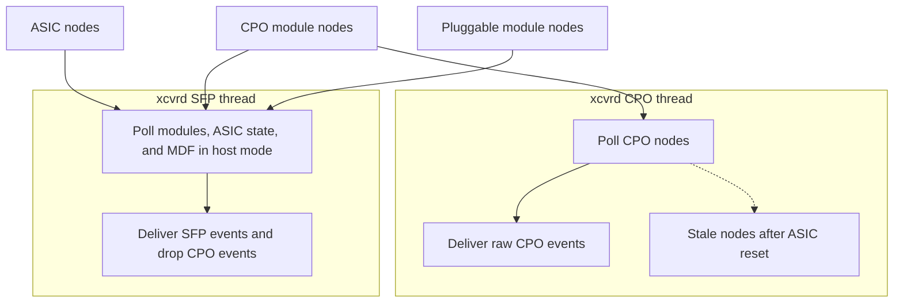
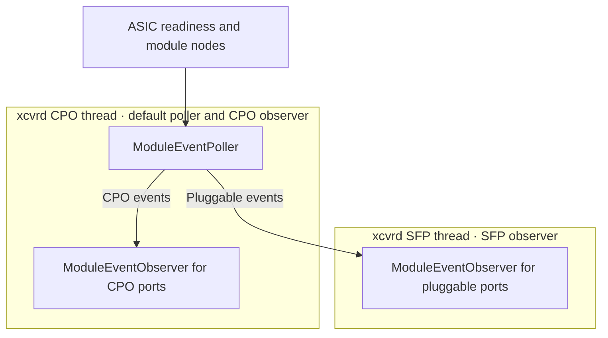
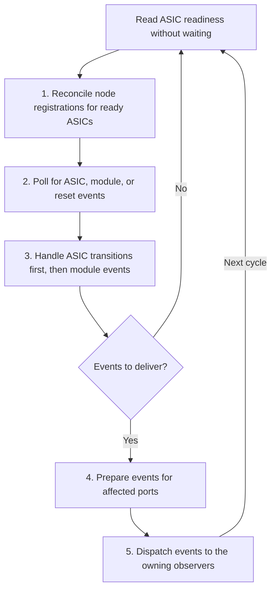
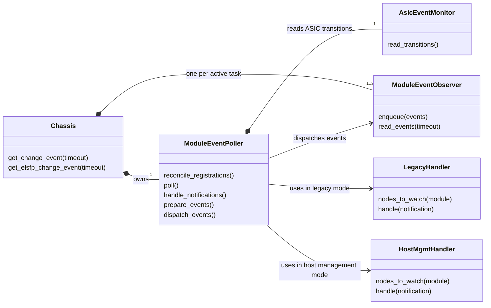

# SONiC Module Change Event Refactor

High Level Design · Draft 0.2

## Table of Contents

- [0 General](#0-general)
- [1 Requirements](#1-requirements)
- [2 Design](#2-design)
- [3 Test Plan](#3-test-plan)
- [4 Security](#4-security)
- [5 NVIDIA Chapters](#5-nvidia-chapters)
- [6 Open Questions](#6-open-questions)
- [Reference Table](#reference-table)

## 0 General

### 0.1 Revision

| Rev | Date | Change |
| --- | --- | --- |
| 0.1 | 2026-11-27 | Initial design for review |
| 0.2 | 2026-11-27 | Clarify event sources, thread roles and fault-indication scope |

### 0.2 Scope

Module insertion, removal and recovery after a switch chip restart on NVIDIA SONiC. Covers pluggable optics and co-packaged optics in legacy and host management modes.

For CPO fault indication, the refactor covers polling the existing fault interrupt and forwarding it to the fault-indication task. Fault decoding, reporting and policy are outside the scope.

### 0.3 Definitions

| Term | Meaning |
| --- | --- |
| CPO | Co-packaged optics. The optical engines sit alongside the switch chip. |
| OE | Optical engine. One engine can serve several ports, called banks. |
| ELS | External laser source. It supplies light to the optical engine. |
| xcvrd | The SONiC service that manages optical modules and updates their status. |
| Legacy mode | The driver manages module bring-up and exposes the result. SONiC reports that status without running the MDF. |
| Host management mode | SONiC manages bring-up for supported modules. It runs the MDF and uses its outcome to decide when to report insertion. Some modules are managed by firmware and use the presence path within the MDF. |
| MDF | Module detection flow. It interprets presence and power signals, powers or resets a module as needed, and determines when it can be managed. |

### 0.4 Overview

Module change event handling in the NVIDIA platform handles below event:

| Event Type | Host mgmt node | Legacy node |
| --- | --- | --- |
| Module insertion, removal or error (pluggable or CPO) | `hw_present` and `power_good` for software-controlled modules or control detection (MDF); `present` for firmware-controlled modules (MDF) | `present`; read `status` and, when needed, `statuserror` after the notification |
| ASIC down or up (per-ASIC module removal and recovery) | HW-MGMT `config/asicN_ready` | HW-MGMT `config/asicN_ready` |
| CPO fault (hand off to fault-indication task) | Module `interrupt`, opened once per OE through bank 0 when available | — |

Support for host management mode and CPO platforms has made the implementation increasingly complex:

- **Two modes** — legacy and host management. Each mode watches different sysfs nodes and follows different logic.
- **Two threads** — **SfpStateUpdateTask** handles pluggable ports through `chassis.get_change_event()`; **CpoStateUpdateTask** handles CPO ports through `chassis.get_elsfp_change_event()`. Running both threads risks races on shared state that must be guarded with locks.
- **ASIC coupling** — module event polling is tied to switch-ASIC readiness handling.

Most of that logic lives in `chassis.py`. As the file grows, bug fixes, extensions and code review become harder.

The proposal:

- **Dedicated classes** — `ModuleEventPoller`, `ModuleEventObserver`, and `AsicEventMonitor` split responsibilities out of `chassis.py`.
- **Poller and observer** — One thread polls ASIC state, pluggable and CPO modules, runs the MDF, and dispatches events. Each xcvrd task reads from its queue and delivers events for its own ports. The polling thread is also the observer for the ports it owns.

### 0.5 Use Cases

- **Insert or remove a module.** Pluggable events go to the SFP task. A CPO presence change is delivered to the CPO task for every affected bank.
- **An ASIC fails and recovers.** Its modules are reported removed when the ASIC goes down and recovered when it returns. Events on other ASICs are unaffected.
- **Restart `syncd` on CPO platform.** Optical-engine ports and the service port receive the events needed for recovery while xcvrd keeps running.

## 1 Requirements

| ID | Requirement |
| --- | --- |
| REQ-1 | Preserve supported behavior for pluggable and CPO optics in legacy and host management modes, including boot and CPO fault indication. |
| REQ-2 | Deliver insertion, removal, and error events in order for each affected port. In host management mode, report insertion when the module is ready to be managed. |
| REQ-3 | Recover ports after an ASIC restart while xcvrd stays running and other ASICs continue reporting events. |
| REQ-4 | Preserve existing xcvrd interfaces, event formats, and operator configuration. |

## 2 Design

### 2.1 Background

**Current flow on a CPO platform**

- Polling the same CPO nodes from two threads risks races.
- The CPO thread does not watch ASIC readiness, so it can miss ASIC down and recovery events.

### 2.2 Motivation

A shared poller gives both tasks the same view of ASIC readiness and module state. Each task keeps responsibility for applying events to its ports.

### 2.3 Flow Diagrams

**Proposed flow on a CPO platform**

On a pluggable-only platform, the SFP thread runs the poller and observes its own events. A CPO-only platform uses the CPO thread for both roles.

**Polling stages shared by legacy and host management**

1. **Register.** Start the ASIC watcher before the initial readiness read. Check readiness before opening module nodes. Register nodes only for ready ASICs. Legacy watches `present`. Host management selects the nodes listed in section 0.4.
2. **Poll.** Use one blocking wait for ASIC and module notifications. Bound the wait so reset completions and registration retries are handled promptly. If work is already pending, such as an ASIC-down found before registration, process it immediately.
3. **Handle.** Apply ASIC-down before any module notification from that ASIC in the same batch. Close its descriptors, cancel pending detection, and report removal. On ASIC-up, mark the ASIC for registration and recheck its modules as nodes appear. Legacy reads driver status. Host management runs the MDF and may wait for reset completion before reporting insertion. Forward CPO fault interrupts to the existing fault-indication task.
4. **Prepare.** Turn module outcomes into xcvrd status and error payloads. Map each outcome to its physical ports and expand an OE event to its affected banks.
5. **Dispatch.** Queue events for the owning observers in per-port order. Deliver removal and reinsertion as separate events.

| Area | Current | Proposed |
| --- | --- | --- |
| Hardware polling | SFP and CPO threads can both watch the same OE. | One thread polls all modules and watches each OE once. |
| Module detection | The CPO thread can deliver raw presence in host mode. | The poller applies the MDF to both port types in host mode. |
| ASIC recovery | The SFP thread handles readiness. The CPO thread can retain stale nodes. | The poller rebuilds the affected ASIC's registrations and restarts detection as needed. |
| Event delivery | Reset events go to the SFP thread. | Each observer delivers only its own port events. The poller also observes its own events. |

### 2.4 SAI API

The design uses the existing SAI API. ASIC availability for module event handling comes from HW-MGMT.

### 2.5 Platform API

The chassis keeps the existing `get_change_event()` and `get_elsfp_change_event()` APIs, including their `sfp` and `elsfp` responses and wait semantics. It selects the polling owner from the active xcvrd tasks at startup, preferring CPO. The polling caller drives the shared loop and reads its own observer. The other caller waits on its observer. Shutdown wakes the callers and releases the registrations.

- **`ModuleEventPoller`** owns the module descriptors and the five stages. At startup it receives one handler for the configured mode. Both modes share polling, event preparation, and dispatch.
- **`LegacyHandler`** watches `present` and interprets the driver's module status.
- **`HostMgmtHandler`** selects nodes based on module state and uses the MDF to interpret notifications. It can defer insertion until reset completes.
- **`ModuleEventObserver`** owns one task's queue and delivers its events in the existing API format. The observer runs in the calling xcvrd thread.
- **`AsicEventMonitor`** tracks readiness per ASIC and reports transitions in the poller's loop. The poller owns the recovery actions.

On ASIC-down, the poller closes that ASIC's module nodes, cancels pending detection, and discards late completions from before the reset. It reports affected ports as removed. On ASIC-up, it reopens the nodes as they appear and recovers each module through its management mode.

### 2.6 Lower Layer API

Use the existing SDK module sysfs nodes and HW-MGMT `config/asicN_ready`. Watch the directory and reread readiness periodically to handle replaced files or missed notifications. A value of `1` permits recovery to begin. In host management mode, the poller reads the CPO interrupt node where supported and forwards assertions to the fault-indication task. [HW-MGMT readiness writer](https://github.com/Mellanox/hw-mgmt/blob/a25447e361e6fdccd6b46423621fe559d5de32da/usr/usr/bin/hw-management-thermal-events.sh#L253)

### 2.7 Counters

Keep existing SONiC counters.

### 2.8 Error Handling

On `ENODEV`, close the stale registration and recheck ASIC readiness. If the ASIC still reads ready but the old module node is gone, recover that module's ports. Retry missing nodes with backoff. If a queue reaches its limit, resync the affected ports for that observer and preserve the removal needed to restart initialization.

### 2.9 Event Logging

Log ASIC transitions and queue overflow. Rate-limit repeated node errors.

### 2.10 Configuration and Management

Use the existing module management mode, CLI, YANG and gNMI.

### 2.11 DB Schema

Use the existing database schema.

### 2.12 Memory Consumption

Use a bounded in-process queue for each active event task.

### 2.13 Restrictions and Limitations

The polling owner's xcvrd work can delay the next poll for both port types. If the driver collapses several changes into one notification, SONiC reconciles from the state it can still observe.

## 3 Test Plan

TBD.

## 4 Security

The design runs inside the existing xcvrd process and uses its current access to platform files. It needs no additional privileges, third-party dependencies or credentials.

## 5 NVIDIA Chapters

The implementation lives in the NVIDIA Mellanox platform API and uses the existing HW-MGMT, SDK and CPO fault-indication interfaces.

## 6 Open Questions

- Which event latency and queue limits should the design meet on the largest supported platform?
- Does xcvrd need a replay when switch services recreate port database entries after a reset? The incident observed port entries being removed while recovery was in progress. [Redmine incident notes](https://redmine.nvidia.com/issues/5450531)

## Reference Table

| Reference | Description |
| --- | --- |
| [SONiC HLD template](https://nvidia.sharepoint.com/sites/NBU-sw/Systems/General/SONiC/HLD/HLD%20Template.md) | Document structure |
| [Redmine #5450531](https://redmine.nvidia.com/issues/5450531) | Reported CPO module-event failures |
| [PR 1425](https://github.com/nvidia-sonic/sonic-buildimage/pull/1425) | Earlier single-poller and queue implementation |
