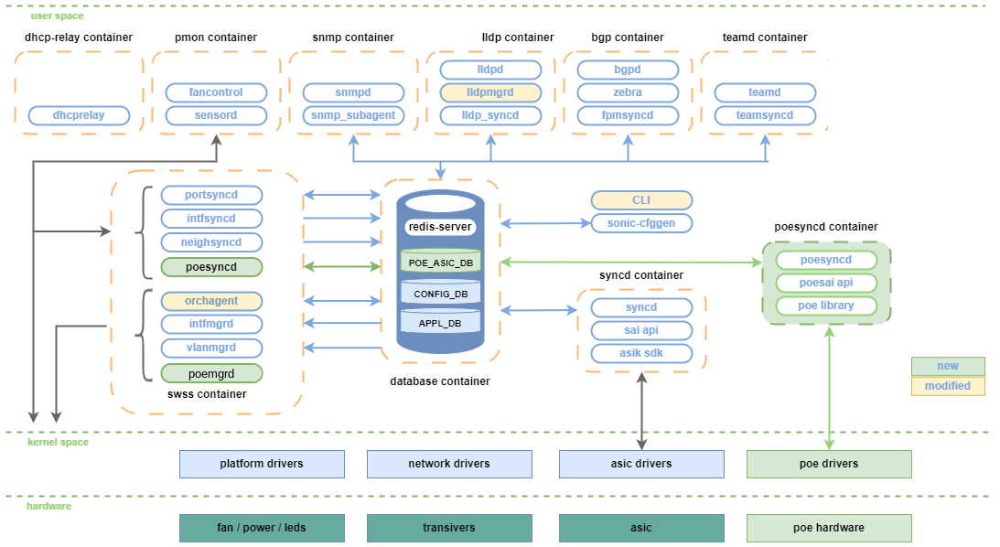
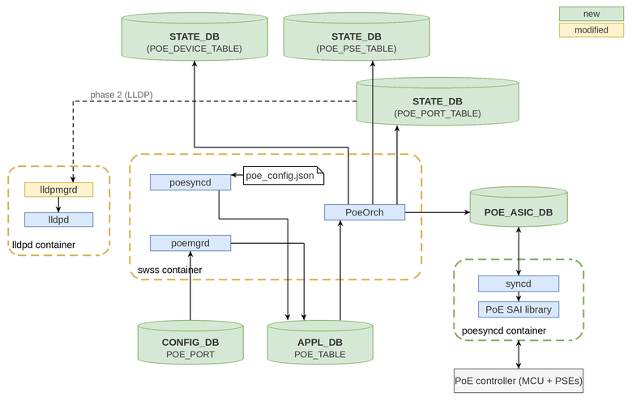
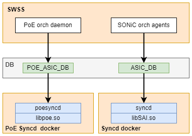
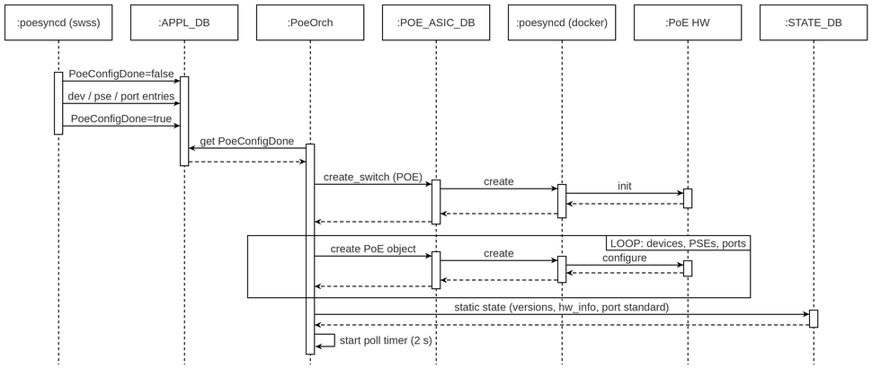
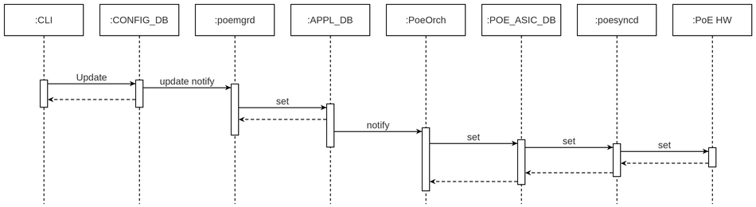
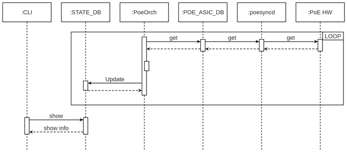

# SONiC PoE #

## Table of Content 

- [Revision](#revision)
- [Scope](#scope)
  - [Deployment models](#deployment-models)
- [Definitions/Abbreviations](#definitionsabbreviations)
- [Overview](#overview)
- [Requirements](#requirements)
- [Design Rationale and Alternatives Considered](#design-rationale-and-alternatives-considered)
- [Architecture Design](#architecture-design)
  - [Components](#components)
  - [PoE interaction](#poe-interaction)
  - [SWSS changes](#swss-changes)
  - [PoE SYNCD](#poe-syncd)
  - [PoE manager](#poe-manager)
  - [PoE platform configuration](#poe-platform-configuration)
  - [Deployment model selection](#deployment-model-selection)
  - [Container lifecycle](#container-lifecycle)
  - [LLDP manager](#lldp-manager-future)
- [High-Level Design](#high-level-design)
  - [PoE flows](#poe-flows)
    - [Initialization](#initialization)
    - [PoE configuration](#poe-configuration)
    - [PoE data collection](#poe-data-collection)
- [SAI API](#sai-api)
- [PoE AI](#poe-abstraction-interface)
- [Configuration and management](#configuration-and-management)
  - [CLI](#cli)
  - [YANG model Enhancements](#yang-model-enhancements)
  - [Config DB Enhancements](#config-db-enhancements)
  - [Application DB Enhancements](#application-db-enhancements)
  - [State DB Enhancements](#state-db-enhancements)
- [Warmboot and Fastboot Design Impact](#warmboot-and-fastboot-design-impact)
- [Memory Consumption](#memory-consumption)
- [Restrictions/Limitations](#restrictionslimitations)
- [Testing Requirements/Design](#testing-requirementsdesign)
- [Open/Action items](#openaction-items)
- [Implementation PRs](#implementation-prs)

### Revision

 | Rev | Date |     Author     | Change Description |
 |:---:|:----:|:--------------:|--------------------|
 | 0.1 | 03-26-2024 | Volodymyr Mytnyk |  Initial version |
 | 0.2 | 04-01-2024 | Volodymyr Mytnyk |  Add SWSS changes, include LLDP interaction, add example PoE config, mention about warm reboot requirements |
 | 0.3 | 11-04-2026 | Oleksandr Mazur | Address community review: design rationale, deployment models and selection, PoE platform configuration schema, init sequence, corrected data flow (poeorch / POE_ASIC_DB), state tables moved to STATE_DB and split per device / PSE / port, FEATURE table integration, YANG model, LLDP scope, warm boot. Align document with the implementation PRs. |

### Scope  

This document describes the design of the PoE (Power over Ethernet) feature in SONiC: the components, DB schema,
SAI interface, CLI and platform integration needed to configure PoE ports and report PoE device, PSE and port state.

In scope of this design:

- Configuration of PoE ports (admin state, power limit, priority) via CLI / CONFIG_DB;
- Reporting of PoE device, PSE and port operational state via STATE_DB and CLI;
- PoE controller managed through the SAI PoE API (`saipoe.h`) by a dedicated PoE syncd instance;
- Platform description of the PoE hardware via a SONiC platform file (`poe_config.json`).

Out of scope (future enhancements):

- LLDP / CDP power negotiation (see [LLDP manager](#lldp-manager-future));
- Integrated-MCU deployment model implementation (described below, not implemented in the first phase);
- SNMP (PoE-MIB) support. All PoE configuration and state is in Redis DB, so it can be added on top of this design.

#### Deployment models

Two hardware deployment models are considered. The design is the same for both down to the SAI API; they differ only
in which SAI/syncd instance owns the PoE objects.

| Model | Hardware | PoE SAI owner | ASIC DB | Status |
|-------|----------|---------------|---------|--------|
| Separate-MCU | PoE controller (MCU + PSEs) is external to the NPU, with its own vendor PoE SAI library | Dedicated `poesyncd` container (syncd instance with `SAI_SWITCH_TYPE_POE`), same pattern as `gbsyncd` for gearbox / external PHY | `POE_ASIC_DB` | Implemented (phase 1) |
| Integrated-MCU | PoE controller is managed by the NPU SDK, and the NPU vendor SAI implements `SAI_API_POE` | Existing NPU `syncd` | `ASIC_DB` | Future. Requires the PoE switch context to be selectable, see [Deployment model selection](#deployment-model-selection) |

### Definitions/Abbreviations 

|                          |                                |
|--------------------------|--------------------------------|
| PoE                      | Power over Ethernet (IEEE 802.3af/at/bt) |
| PSE                      | Power Sourcing Equipment: the chip that supplies power to a group of ports (typically 4-8 ports per PSE) |
| PD                       | Powered Device: the device connected to a PoE port |
| PoE device               | PoE controller (MCU) that manages one or more PSEs; maps to the SAI `POE_DEVICE` object |
| MCU                      | Microcontroller running the PoE controller firmware |
| PoE AI                   | PoE Abstraction Interface: the SAI PoE API (`saipoe.h`) |
| poesyncd (swss)          | Config loader process in the SWSS container that publishes `poe_config.json` to APPL_DB (gearbox analog: `gearsyncd`) |
| poesyncd (container)     | Dedicated syncd container running the PoE SAI library (gearbox analog: `gbsyncd`) |

### Overview 

Ethernet switches (e.g. campus platforms) often come with Power over Ethernet (PoE) support. From the NPU SAI/SDK
point of view PoE is an external function: it is provided by a separate PoE controller, usually an MCU managing several
PSE chips, and it is typically supplied by a different vendor than the NPU.

The SAI community standardized a PoE API ([SAI PR #1977](https://github.com/opencomputeproject/SAI/pull/1977), `saipoe.h`)
with a dedicated switch type `SAI_SWITCH_TYPE_POE`. This design uses that API and integrates PoE into SONiC the same way
external PHYs (gearbox) are integrated: configuration flows through CONFIG_DB → manager → APPL_DB → orchagent → ASIC DB → syncd → SAI.

### Requirements

- The PoE feature is included in the image via the `INCLUDE_POE` build option (`rules/config`);
- At runtime, the PoE syncd container is controlled through the `FEATURE` table, state `disabled` by default
  (see [Container lifecycle](#container-lifecycle));
- PoE is active only on platforms that provide a `poe_config.json` platform file; on other platforms no PoE object is created;
- PoE configuration persists across SONiC reboot (CONFIG_DB);
- Support CLI configuration as described in [config section](#config-commands) and [show section](#show-commands);
- PoE device, PSE and port operational state are available in STATE_DB;
- Warm boot: PoE configuration and PD power are not disrupted by warm reboot (see [Warmboot](#warmboot-and-fastboot-design-impact));
- LLDP: advertisement of PoE power information is a follow-up phase; LLDP/CDP power negotiation is out of scope
  (see [LLDP manager](#lldp-manager-future)).

### Design Rationale and Alternatives Considered

PoE is a per-port hardware feature, so the question is whether it should be managed like other platform peripherals
(fan, PSU, transceiver) through the platform API in PMON (`sonic-platform-common`, PDDF), or like forwarding hardware
through SAI and syncd. This was raised during the community review of this HLD.

**Chosen: SAI PoE API + dedicated syncd instance (gbsyncd model).**

- **A standard vendor interface already exists.** `saipoe.h` was accepted by the SAI community and defines PoE
  device, PSE and port objects with create/set/get semantics. PoE vendors implement a SAI library; SONiC does not need
  a new per-platform plugin API.
- **Multi-vendor isolation.** The PoE controller and its library usually come from a different vendor than the NPU
  SDK. A separate SAI instance in its own container lets the PoE library be built, upgraded and restarted independently
  of the NPU SAI, without linking two vendors' SDKs into one process. The same reasoning drove `gbsyncd` for
  external PHYs.
- **PoE is configuration-heavy, not just monitoring.** Ports have user configuration (admin state, power limit,
  priority) that needs the standard SONiC config pipeline: CONFIG_DB persistence, YANG validation, manager → APPL_DB →
  orchagent, and warm-restart support. The PMON platform API is mainly a read/monitor interface. Using it would mean
  building a separate config path, persistence and warm-boot handling for PoE alone.
- **Reuse of syncd infrastructure.** sairedis/syncd already provide object tracking, restart/warm-boot handling,
  vslib-based virtual testing (`SAI_VS_SWITCH_TYPE_POE`) and the multi-context mechanism (`context_config.json`) used for
  gearbox.

**Alternative 1: PMON daemon + platform API / PDDF.** A `poed` daemon in PMON would talk to the PoE controller through
new platform API classes. Rejected because:
it needs a new platform API that every PoE vendor implements per platform (instead of one SAI library per controller);
it bypasses the orchagent pipeline, so configuration handling, ordering and warm restart have to be built again;
and it splits PoE logic between a vendor plugin and a SONiC daemon with no standard object model.

**Alternative 2: PoE objects in the existing NPU syncd.** This works when the NPU vendor's SAI implements
`SAI_API_POE` (Integrated-MCU model) and is kept as a supported deployment model (see
[Deployment models](#deployment-models)). It cannot be the only option, because in most platforms the PoE controller
and its library do not come from the NPU vendor.

**When this design does not apply.** A platform with no SAI PoE library for its controller cannot use this feature until
a library exists. A simple vendor library implementing `saipoe.h` on top of the controller's host protocol is the
expected integration path.

### Architecture Design 

To isolate PoE functionality from the existing SONiC design, the following changes are made:

- SWSS container: new `poesyncd` config loader, `poemgrd` manager and `PoeOrch` in orchagent;
- New `poesyncd` container: a syncd instance linked with the vendor PoE SAI library;
- Database container: new `POE_ASIC_DB`, `POE_COUNTERS_DB`, `POE_FLEX_COUNTER_DB` and new PoE tables in CONFIG_DB,
  APPL_DB and STATE_DB.



#### Components

| Component | Container | Role |
|-----------|-----------|------|
| `poesyncd` (config loader) | swss | Reads the platform `poe_config.json` once at start, writes PoE device / PSE / port mapping to APPL_DB `POE_TABLE`, then sets `PoeConfigDone`. Same role as `gearsyncd`. |
| `poemgrd` | swss | Subscribes to CONFIG_DB `POE_PORT` and forwards user configuration to APPL_DB `POE_TABLE`. Does not access any ASIC DB. |
| `PoeOrch` | swss (orchagent) | Creates the PoE switch, device, PSE and port SAI objects. Applies `POE_TABLE` changes via SAI. Periodically reads PoE state through SAI and publishes it to STATE_DB. It is the only writer of `POE_ASIC_DB`. |
| syncd (`poesyncd` container) | poesyncd | Standard syncd instance serving the PoE SAI context, linked with the vendor PoE SAI library. |
| PoE SAI library | poesyncd | Vendor implementation of `saipoe.h`, including the transport to the controller (I2C/UART/SPI, etc.). |

> Naming note: in the implementation, the config loader binary in SWSS and the PoE syncd container are both
> called `poesyncd`. They are different components (see [Definitions](#definitionsabbreviations)).

#### PoE interaction



#### SWSS changes

To support the separate PoE SAI, the SWSS container is extended following the SONiC architecture: `PoeOrch` in
orchagent handles all PoE SAI requests and PoE initialization. orchagent creates a second switch object of type
`SAI_SWITCH_TYPE_POE` in sairedis context 1 (`SAI_REDIS_SWITCH_ATTR_CONTEXT`). sairedis maps that context to `POE_ASIC_DB`
and the `poesyncd` container through `context_config.json`.



`poesyncd` (config loader) and `poemgrd` run as supervisord programs in the SWSS container. `poemgrd` is a critical process.

#### PoE SYNCD

New PoE SYNCD container components:
- *syncd*: the standard syncd binary started for the PoE context (`-x context_config.json -g 1`). It syncs PoE objects between `POE_ASIC_DB` and the PoE controller;
- *PoE SAI library*: vendor implementation of the PoE Abstraction Interface (see [PoE AI section](#poe-abstraction-interface)). It contains the low-level PoE logic and the transport to and from the hardware;

As long as the library implements `saipoe.h`, it can be changed per board/vendor without changing SONiC. The service
is managed by `poesyncd.service` / `poesyncd.sh`, which follow `gbsyncd.sh` (common `syncd_common.sh` start/stop,
warm/fast/cold shutdown via `syncd_request_shutdown`, optional platform pre-shutdown hook
`plugins/poesyncd_request_pre_shutdown`).

#### PoE manager

`poemgrd` is the config manager for PoE. It:

- subscribes to the CONFIG_DB `POE_PORT` table;
- writes the per-port configuration (`enabled`, `pwr_limit`, `priority`) to APPL_DB `POE_TABLE:<ifname>`;
- removes the APPL_DB entry when the CONFIG_DB entry is removed.

`poemgrd` does not access `POE_ASIC_DB` and does not collect state. Programming SAI and collecting operational data
are done by `PoeOrch` (see [PoE flows](#poe-flows)).

#### PoE platform configuration

The PoE hardware of a platform is described by a SONiC platform file. This file is defined by SONiC (not by the PoE
vendor) and plays the same role as `port_config.ini` / `gearbox_config.json`:

```
/usr/share/sonic/device/<platform>/<hwsku>/poe_config.json
```

The file is present only on PoE-capable SKUs. Its presence is what marks the platform as PoE capable.

**Consumers:**

| Consumer | Use |
|----------|-----|
| `poesyncd-platform.sh` (host) | If the file is missing, sets `FEATURE\|poesyncd` to `disabled`. The PoE syncd container is not started. |
| `poesyncd` config loader (swss) | Parses the file and publishes device / PSE / port entries to APPL_DB `POE_TABLE`, then `PoeConfigDone`. |
| orchagent (`init_poe`, `PoeOrch`) | Checks presence of the file. orchagent never parses it; it reads the parsed data from APPL_DB. |

**Schema.** The root is a JSON array with one element per PoE device (PoE controller / MCU).

| Field | Type | Mandatory | Description |
|-------|------|-----------|-------------|
| `hw_info` | string | yes | Opaque device locator passed to the vendor library in `SAI_POE_DEVICE_ATTR_HARDWARE_INFO` (e.g. bus/address or device name). Its format is defined by the PoE SAI library. |
| `power_limit_mode` | `"port"` \| `"class"` | no | Initial `SAI_POE_DEVICE_ATTR_POWER_LIMIT_MODE`. If absent, the library default is used. |
| `pse_list` | array | yes | PSEs managed by this device. |
| `pse_list[].pse_index` | uint | yes | PSE index, used for `SAI_POE_PSE_ATTR_ID`. Must be unique across the whole platform (see [Restrictions](#restrictionslimitations)). |
| `port_mapping_list` | array | yes | PoE ports managed by this device. |
| `port_mapping_list[].interface` | string | yes | SONiC interface name (`PORT` table key). |
| `port_mapping_list[].front_panel_index` | uint | yes | PoE port index in the controller, used for `SAI_POE_PORT_ATTR_FRONT_PANEL_ID`. |
| `port_mapping_list[].power_priority` | `"crit"` \| `"high"` \| `"low"` | no | Platform default priority, applied at port creation. |
| `port_mapping_list[].power_limit` | uint | no | Platform default power limit (watts), applied at port creation. |

The device index (`dev:<n>`) is the position of the device in the root array.

Single device with two PSEs (excerpt):

```json
[
  {
    "hw_info": "mcu1",
    "power_limit_mode": "port",
    "pse_list": [
      { "pse_index": 0 },
      { "pse_index": 1 }
    ],
    "port_mapping_list": [
      { "interface": "Ethernet0", "front_panel_index": 1, "power_priority": "crit" },
      { "interface": "Ethernet1", "front_panel_index": 2, "power_priority": "high" },
      ...
      { "interface": "Ethernet15", "front_panel_index": 16, "power_priority": "low" }
    ]
  }
]
```

Two PoE devices (e.g. two controllers, each with its own PSEs and ports):

```json
[
  {
    "hw_info": "mcu1",
    "pse_list": [ { "pse_index": 0 }, { "pse_index": 1 } ],
    "port_mapping_list": [
      { "interface": "Ethernet0",  "front_panel_index": 1 },
      ...
      { "interface": "Ethernet23", "front_panel_index": 24 }
    ]
  },
  {
    "hw_info": "mcu2",
    "pse_list": [ { "pse_index": 2 }, { "pse_index": 3 } ],
    "port_mapping_list": [
      { "interface": "Ethernet24", "front_panel_index": 1 },
      ...
      { "interface": "Ethernet47", "front_panel_index": 24 }
    ]
  }
]
```

A complete example for the virtual switch is provided in `device/virtual/x86_64-kvm_x86_64-r0/poe_vs/poe_config.json`.

#### Deployment model selection

The deployment model is selected by platform files in the HWSKU directory. No runtime detection is needed:

| HWSKU file / setting | Separate-MCU | Integrated-MCU (future) |
|----------------------|--------------|-------------------------|
| `poe_config.json` | present | present |
| `context_config.json` | contains a second context (`guid 1`, `dbAsic: POE_ASIC_DB`) served by the `poesyncd` container | no PoE context; the PoE switch is created in the NPU context (`guid 0`, `ASIC_DB`) |
| `FEATURE\|poesyncd` | enabled by the operator | stays disabled |

Startup logic:

1. `poesyncd-platform.sh` runs before the `poesyncd` service. If `poe_config.json` does not exist, it sets
   `FEATURE|poesyncd` state to `disabled` and exits, so the container is never started on non-PoE platforms.
2. orchagent `init_poe()` creates the PoE switch (`SAI_SWITCH_TYPE_POE`) only if `poe_config.json` exists and the
   loader has set `PoeConfigDone`. In phase 1 the switch is always created in context 1 (Separate-MCU).
3. For Integrated-MCU (future), orchagent will take the context from the HWSKU instead of the fixed value 1.
   Proposed: an optional `"sai_context"` field in `poe_config.json`, default `1`. The PoE switch is then served by the
   existing NPU syncd and the `poesyncd` container is not used.

#### Container lifecycle

The `poesyncd` container is integrated in the `FEATURE` table like other SONiC services:

```
FEATURE|poesyncd
    state        = "disabled"   ; default. Set to "enabled" by the operator on PoE platforms
    auto_restart = "enabled"
    delayed      = "False"
```

- The entry exists only in images built with `INCLUDE_POE=y` (`init_cfg.json.j2`).
- `config feature state poesyncd enabled|disabled` starts/stops the container through the standard feature framework.
- Even if enabled, `poesyncd-platform.sh` disables the feature on platforms without `poe_config.json`.
- `poesyncd` is started after `swss` (peer service) and stopped with it, the same as `gbsyncd`.

#### LLDP manager (future)

LLDP integration is not part of the first phase. The plan is:

| Phase | LLDP behavior |
|-------|---------------|
| Phase 1 (this design's implementation PRs) | No LLDP changes. |
| Phase 2 (follow-up) | `lldpmgrd` reads per-port PoE state (`POE_PORT_TABLE` in STATE_DB: status, class, power limit, consumption) and configures `lldpd` to advertise the IEEE 802.3 Power via MDI TLV. Read-only advertisement, no negotiation. |
| Future | Power negotiation: PD power request / PSE power allocation through LLDP (802.3at/bt DLL classification) and CDP. Requires a write path from LLDP to `POE_PORT` and arbitration with user-configured limits; will be covered by a separate HLD. |

### High-Level Design 

This section covers the high level design of the built-in SONiC PoE feature.

- Modules changed:
  - sonic-swss: new `poesyncd` config loader, `poemgrd`, `PoeOrch`; orchagent creates the PoE switch;
  - sonic-sairedis: vslib support for `SAI_SWITCH_TYPE_POE` (virtual PoE switch for testing);
  - sonic-swss-common: new DB IDs and table names (`schema.h`);
  - sonic-buildimage: `docker-poesyncd`, service scripts, `INCLUDE_POE` build option, database config, YANG model, VS PoE platform;
  - sonic-utilities: `show poe ...` / `config poe ...` CLI.
- Existing syncd is not modified: the `poesyncd` container runs the unmodified syncd binary with the PoE context.
- Existing DB schema is not changed; only new DBs and tables are added.
- Docker dependency: `poesyncd` depends on `swss` (same as `gbsyncd`).
- Build dependency: the `poesyncd` container image is built only with `INCLUDE_POE=y`.
- Platform dependency: a platform must provide `poe_config.json`, a `context_config.json` with the PoE context, and a
  PoE SAI library in its `poesyncd` container. Platforms without PoE are not affected.
- Scalability/performance: state is polled every 2 seconds (`POE_PORT_UPD_INTERVAL`) with one bulk `get` per device,
  PSE and port. For a 48-port system this is about 50 SAI get calls per interval, handled by the PoE syncd instance,
  which is separate from the NPU syncd.
- Serviceability: all components log to syslog (`poesyncd`, `poemgrd`, `orchagent`, PoE `syncd`). `sairedis` recording
  for context 1 is available like any other context.

#### PoE flows

##### Initialization



PoE device, PSE and port objects are created only at initialization, from the platform file data. User
configuration in CONFIG_DB `POE_PORT` is then applied on top of them through the configuration flow below.

##### PoE configuration

Configuration flow:
  1. The user configures PoE with the SONiC CLI;
  2. The CLI validates the input (YANG) and updates CONFIG_DB `POE_PORT|<ifname>`;
  3. `poemgrd` (subscribed to `POE_PORT`) writes the change to APPL_DB `POE_TABLE:<ifname>`;
  4. `PoeOrch` consumes `POE_TABLE` and calls `set_poe_port_attribute` (ADMIN_ENABLED_STATE / POWER_LIMIT / POWER_PRIORITY), which sairedis writes to `POE_ASIC_DB`;
  5. syncd in the `poesyncd` container applies the change through the PoE SAI library to the controller.



##### PoE data collection

"Show" flow:
  1. Every 2 seconds `PoeOrch` reads device, PSE and port attributes with SAI `get` (through `POE_ASIC_DB` / syncd);
  2. `PoeOrch` updates `POE_DEVICE_TABLE`, `POE_PSE_TABLE` and `POE_PORT_TABLE` in STATE_DB;
  3. The SONiC CLI reads and displays PoE information from STATE_DB.



### SAI API 

The PoE API is defined in [`saipoe.h`](https://github.com/opencomputeproject/SAI/blob/master/inc/saipoe.h)
([SAI PR #1977](https://github.com/opencomputeproject/SAI/pull/1977), merged):

- New switch type `SAI_SWITCH_TYPE_POE`;
- New API `SAI_API_POE` (`sai_poe_api_t`);
- New object types `SAI_OBJECT_TYPE_POE_DEVICE`, `SAI_OBJECT_TYPE_POE_PSE`, `SAI_OBJECT_TYPE_POE_PORT`.

The PoE switch is created by orchagent with `SAI_SWITCH_ATTR_INIT_SWITCH=true`, `SAI_SWITCH_ATTR_TYPE=SAI_SWITCH_TYPE_POE`,
`SAI_SWITCH_ATTR_SWITCH_HARDWARE_INFO` and `SAI_REDIS_SWITCH_ATTR_CONTEXT=1`.

### PoE Abstraction Interface

`PoeOrch` uses the SAI PoE API. The vendor PoE SAI library in the `poesyncd` container implements it.

#### Device Capabilities

| Capabilities      | SAI attributes                        | Flags | Notes |
| ----------------- | ------------------------------------- | ----- | ----- |
| Hardware Info     | SAI_POE_DEVICE_ATTR_HARDWARE_INFO     | CREATE_ONLY | from `poe_config.json` `hw_info` |
| PSE List          | SAI_POE_DEVICE_ATTR_POE_PSE_LIST      | READ_ONLY | |
| PoE Port List     | SAI_POE_DEVICE_ATTR_POE_PORT_LIST     | READ_ONLY | |
| Total Power       | SAI_POE_DEVICE_ATTR_TOTAL_POWER       | READ_ONLY | watts |
| Power Consumption | SAI_POE_DEVICE_ATTR_POWER_CONSUMPTION | READ_ONLY | milliwatts |
| Version           | SAI_POE_DEVICE_ATTR_VERSION           | READ_ONLY | firmware version |
| Power Limit Mode  | SAI_POE_DEVICE_ATTR_POWER_LIMIT_MODE  | CREATE_AND_SET | port / class |

#### PSE Capabilities

| Capabilities    | SAI attributes                     | Flags |
| --------------- | ---------------------------------- | ----- |
| PSE ID          | SAI_POE_PSE_ATTR_ID                | MANDATORY_ON_CREATE, CREATE_ONLY |
| Device          | SAI_POE_PSE_ATTR_DEVICE_ID         | MANDATORY_ON_CREATE, CREATE_ONLY |
| PSE SW Version  | SAI_POE_PSE_ATTR_SOFTWARE_VERSION  | READ_ONLY |
| PSE HW Version  | SAI_POE_PSE_ATTR_HARDWARE_VERSION  | READ_ONLY |
| PSE Temperature | SAI_POE_PSE_ATTR_TEMPERATURE       | READ_ONLY (Celsius) |
| PSE Status      | SAI_POE_PSE_ATTR_STATUS            | READ_ONLY |

#### Port Capabilities

| Capabilities       | SAI attributes                        | Flags |
| ------------------ | ------------------------------------- | ----- |
| Front Panel ID     | SAI_POE_PORT_ATTR_FRONT_PANEL_ID      | MANDATORY_ON_CREATE, CREATE_ONLY |
| Device             | SAI_POE_PORT_ATTR_DEVICE_ID           | MANDATORY_ON_CREATE, CREATE_ONLY |
| Standard           | SAI_POE_PORT_ATTR_STANDARD            | READ_ONLY |
| Admin Enable State | SAI_POE_PORT_ATTR_ADMIN_ENABLED_STATE | CREATE_AND_SET |
| Power Limit        | SAI_POE_PORT_ATTR_POWER_LIMIT         | CREATE_AND_SET |
| Power Priority     | SAI_POE_PORT_ATTR_POWER_PRIORITY      | CREATE_AND_SET |
| Power Consumption  | SAI_POE_PORT_ATTR_CONSUMPTION         | READ_ONLY (`sai_poe_port_power_consumption_t`: mW, mV, mA, class A/B) |
| Status             | SAI_POE_PORT_ATTR_STATUS              | READ_ONLY |

### Configuration and management 

#### Manifest (if the feature is an Application Extension)
Feature is not an Application Extension

#### CLI

##### Show commands

- `show poe status`: per PoE device

```
admin@sonic:~$ show poe status
  Id    PoE ports  Total power    Power consump    Power available    Power limit mode    HW info    Version
----  -----------  -------------  ---------------  -----------------  ------------------  ---------  ---------
   0           16  100.000 W      10.000 W         90.000 W           port                mcu1       0.1.2.3
   1           16  100.000 W      10.000 W         90.000 W           class               mcu2       0.1.2.3
```

- `show poe pse status`: per PSE

```
admin@sonic:~$ show poe pse status
  Id  Status    Temperature    SW ver            HW ver
----  --------  -------------  ----------------  ----------------
   0  active    25.000 C       0.1.2.3           4.5.6.7
   1  active    25.000 C       0.1.2.3           4.5.6.7
```

- `show poe interface status [<ifname>]`: per port operational state

```
admin@sonic:~$ show poe interface status
Port         Status      En/Dis    Priority    Protocol          Class A    Class B  PWR Consump    PWR limit    Voltage    Current
-----------  ----------  --------  ----------  --------------  ---------  ---------  -------------  -----------  ---------  ---------
Ethernet1    delivering  enable    crit        802.3bt Type 3          2          4  10.000 W       50.000 W     50.000 V   0.200 A
Ethernet2    searching   enable    low         802.3bt Type 3          0          0  0.000 W        50.000 W     0.000 V    0.000 A
```

- `show poe interface configuration [<ifname>]`: per port configuration

```
admin@sonic:~$ show poe interface configuration
Port         En/Dis      Power limit  Priority
-----------  --------  -------------  ----------
Ethernet1    enable               50  crit
Ethernet2    enable               50  low
```

##### Config commands

- config poe interface status \<ifname\> {enable | disable}
- config poe interface priority \<ifname\> {crit | high | low}
- config poe interface power-limit \<ifname\> \<power_limit\>

Examples:
```
$ sudo config poe interface status Ethernet0 enable
$ sudo config poe interface priority Ethernet0 high
$ sudo config poe interface power-limit Ethernet0 25
```

The CLI reference is updated in [Command-Reference.md](https://github.com/sonic-net/sonic-utilities/blob/master/doc/Command-Reference.md) by the CLI PR.

#### YANG model Enhancements

New module `sonic-poe.yang` models the CONFIG_DB `POE_PORT` table. The interface name is a leafref to `PORT`.

```yang
module sonic-poe {
    yang-version 1.1;
    namespace "http://github.com/sonic-net/sonic-poe";
    prefix poe;

    import sonic-types { prefix stypes; }
    import sonic-port  { prefix port; }

    organization "SONiC";
    contact "SONiC";
    description "PoE YANG Module for SONiC OS";

    revision 2024-06-13 {
        description "First Revision";
    }

    container sonic-poe {
        container POE_PORT {
            description "Power over Ethernet configuration (POE_PORT table in config_db.json)";

            typedef poe-priority {
                type enumeration {
                    enum crit;
                    enum high;
                    enum low;
                }
            }

            list POE_PORT_LIST {
                key "ifname";

                leaf ifname {
                    type leafref {
                        path /port:sonic-port/port:PORT/port:PORT_LIST/port:name;
                    }
                    description "Interface name from the PORT table in config_db.json";
                }
                leaf enabled {
                    type stypes:mode-status;
                    default disable;
                    description "PoE status on port. [enable/disable]";
                }
                leaf pwr_limit {
                    mandatory true;
                    type string {
                        length 1..255;
                    }
                    description "Power limit on PoE port. [0..999]";
                }
                leaf priority {
                    type poe-priority;
                    default high;
                    description "Port priority level. [crit/high/low]";
                }
            }
        }
    }
}
```

The `FEATURE|poesyncd` entry is covered by the existing `sonic-feature.yang`; no change is needed.

#### Config DB Enhancements  

##### POE_PORT
~~~
    ;Stores PoE port configuration
    key         = POE_PORT|ifname         ; ifname, must be present in PORT table and in poe_config.json
    ; field     = value
    enabled     = "enable" / "disable"    ; enable/disable PoE on port, default "disable"
    pwr_limit   = 1*3DIGIT                ; power limit on PoE port, watts
    priority    = "crit" / "high" / "low" ; port priority level, default "high"
~~~

Example:
```json
{
  "POE_PORT": {
    "Ethernet0": {
      "enabled": "enable",
      "pwr_limit": "50",
      "priority": "high"
    }
  }
}
```

##### FEATURE

`FEATURE|poesyncd` is added; see [Container lifecycle](#container-lifecycle).

#### Application DB Enhancements  

APPL_DB is used only to pass configuration to orchagent. It holds no operational state.

##### POE_TABLE
~~~
    ; Platform PoE device (written by poesyncd config loader)
    key               = POE_TABLE:dev:<dev_id>
    id                = 1*2DIGIT                 ; device index (position in poe_config.json)
    hw_info           = STRING                   ; SAI_POE_DEVICE_ATTR_HARDWARE_INFO
    power_limit_mode  = "port" / "class"         ; optional

    ; Platform PSE (written by poesyncd config loader)
    key               = POE_TABLE:pse:<pse_index>
    device_id         = 1*2DIGIT                 ; owning device
    pse_index         = 1*3DIGIT

    ; PoE port (mapping written by poesyncd config loader, configuration written by poemgrd)
    key               = POE_TABLE:<ifname>
    device_id         = 1*2DIGIT                 ; owning device (loader)
    front_panel_index = 1*3DIGIT                 ; PoE port index in controller (loader)
    interface         = ifname                   ; (loader)
    enabled           = "enable" / "disable"     ; (poemgrd)
    pwr_limit         = 1*3DIGIT                 ; (loader default / poemgrd)
    priority          = "crit" / "high" / "low"  ; (loader default / poemgrd)

    ; Loader completion flag
    key               = POE_TABLE:PoeConfigDone
    success           = "true" / "false"
~~~

#### State DB Enhancements

All PoE operational state is in STATE_DB, split into device, PSE and port tables. `PoeOrch` writes them: static
fields at initialization, dynamic fields every 2 seconds. They are cleared on cold start by `swss.sh`.

##### POE_DEVICE_TABLE
~~~
    ; PoE device (controller) state
    key            = POE_DEVICE_TABLE|<dev_id>
    ; field        = value
    hw_info        = STRING                   ; hardware info (static)
    version        = STRING                   ; device firmware version (static)
    total_ports    = 1*3DIGIT                 ; number of PoE ports (static)
    total_pwr      = 1*5DIGIT                 ; total power budget, W
    pwr_consump    = 1*5.3DIGIT               ; total power consumption, W
    pwr_limit_mode = "port" / "class"         ; current power limit mode
~~~

##### POE_PSE_TABLE
~~~
    ; Per-PSE state
    key            = POE_PSE_TABLE|<pse_index>
    ; field        = value
    sw_ver         = STRING                              ; PSE software version (static)
    hw_ver         = STRING                              ; PSE hardware version (static)
    temperature    = 1*3DIGIT                            ; PSE temperature, Celsius
    status         = "active" / "fail" / "not present"   ; PSE status
~~~

##### POE_PORT_TABLE
~~~
    ; Per-port state
    key            = POE_PORT_TABLE|ifname
    ; field        = value
    fp_port        = 1*3DIGIT                ; PoE front panel port (static)
    protocol       = STRING                  ; IEEE standard, e.g. "802.3bt Type 3" (static)
    status         = "off" / "searching" / "delivering" / "fail" ; port status
    enabled        = "enable" / "disable"    ; applied admin state
    priority       = "crit" / "high" / "low" ; applied priority
    pwr_limit      = 1*3DIGIT                ; applied power limit, W
    class_a        = 1*DIGIT                 ; assigned class, pair set A
    class_b        = 1*DIGIT                 ; assigned class, pair set B
    pwr_consump    = 1*3.3DIGIT              ; power consumption, W
    voltage        = 1*3.3DIGIT              ; output voltage, V
    current        = 1*3.3DIGIT              ; output current, A
~~~

### Warmboot and Fastboot Design Impact  

**Goal.** PoE configuration is preserved and powered devices keep power during a warm reboot or a swss / PoE syncd
warm restart. The SONiC control plane must not reset the PoE controller or turn ports off while it restarts.

**Responsibilities:**

| Component | Warm shutdown | Warm start |
|-----------|---------------|------------|
| `poesyncd` (config loader), `poemgrd` | Registered with `WarmStart` (`swss` group); no state to save. | Re-publish the same APPL_DB data (idempotent). |
| orchagent / `PoeOrch` | Standard orchagent warm shutdown. | Re-creates the PoE switch and the device / PSE / port objects with the same attributes. sairedis/syncd compare them with the saved view, so no hardware reprogramming happens. CONFIG_DB is then re-applied through `POE_TABLE`; unchanged values result in no SAI `set`. |
| `poesyncd` container (syncd) | `poesyncd.sh` calls `syncd_request_shutdown -g 1 -x context_config.json --warm` (and the optional platform `poesyncd_request_pre_shutdown`). `POE_ASIC_DB` is kept. | syncd starts in warm mode for context 1 and restores its view from `POE_ASIC_DB`. |
| PoE SAI library | Must not turn off ports or reset the controller on warm shutdown. | Must attach to the running controller on warm `create_switch` without changing port state. |
| PoE controller (MCU) | Keeps supplying power on its own while the host is restarting. | n/a |

`POE_ASIC_DB` is flushed and the PoE STATE_DB tables are cleared only on cold start (`swss.sh`), the same as `GB_ASIC_DB`.
STATE_DB is rebuilt by the first poll after start. CONFIG_DB is the source of truth for user configuration.

**Fastboot.** The PoE context is shut down with `--fast` and started cold. Whether PDs keep power during fast reboot
depends on the controller (power is kept by the MCU if it is not reset by the platform). There is no PoE dependency on
the fastboot data plane path.

**Cold reboot.** Whether PDs keep power during a cold reboot is a platform/controller capability ("perpetual PoE")
and is outside SONiC control. On start, the configuration from CONFIG_DB is re-applied.

### Memory Consumption
No memory is consumed when the feature is not built (`INCLUDE_POE=n`). On a non-PoE platform with the feature built,
`poesyncd` (config loader) exits immediately, `PoeOrch` is created but idle, and the `poesyncd` container is not
started. Memory use does not grow while the feature is disabled by configuration.

### Restrictions/Limitations  

- PSE indexes (`pse_index`) must be unique across all PoE devices of a platform. PSE keys in APPL_DB and STATE_DB are
  not scoped by device in this version.
- PoE devices, PSEs and the port mapping are defined only by `poe_config.json` and are created at initialization;
  hot-adding PoE hardware is not supported.
- Only the Separate-MCU deployment model is implemented in phase 1.
- Legacy (pre-standard) PDs: the control plane does not restrict them; support depends on the controller and SAI library.
- Power budget changes caused by PSU insertion/removal are handled by the PoE controller hardware. SONiC only reports
  the resulting `total_pwr`.
- No LLDP / CDP power negotiation (see [LLDP manager](#lldp-manager-future)).

### Testing Requirements/Design  

PoE functionality is covered by unit and system tests.

#### Unit Test cases

- sonic-swss: `PoeOrch` mock tests with a mocked PoE SAI API (object creation from `POE_TABLE`, set path, state polling);
  `poesyncd` loader parsing of valid and invalid `poe_config.json`.
- sonic-utilities: show/config CLI tests with mocked CONFIG_DB and STATE_DB (`tests/poe_test.py`).
- sonic-yang-models: `sonic-poe.yang` tests (valid config, invalid interface, invalid priority, power limit range).

#### Virtual switch testing

The VS platform provides a PoE HWSKU (`poe_vs`) with `poe_config.json` and a PoE context in `context_config.json`.
sairedis vslib implements `SAI_VS_SWITCH_TYPE_POE`, so the whole pipeline (CLI → CONFIG_DB → poemgrd → PoeOrch →
POE_ASIC_DB → poesyncd → vslib) can be tested in a VS image and in sonic-swss DVS tests.

#### System Test cases

On systems with PoE hardware (sonic-mgmt):
- PoE feature enable/disable through the `FEATURE` table;
- Per-port enable/disable, priority and power limit, verified in STATE_DB and on the PD;
- PD detection and classification for 802.3af/at/bt PDs;
- Warm reboot: no PD power loss, configuration preserved;
- Cold reboot: configuration restored from CONFIG_DB.

### Open/Action items

- Integrated-MCU deployment model: make the PoE SAI context selectable (proposed `sai_context` field in `poe_config.json`).
- `SAI_POE_PORT_ATTR_POWER_LIMIT` unit is not documented in `saipoe.h` (and its description reads "power limit mode");
  to be clarified with the SAI community. SONiC uses watts in CONFIG_DB.
- Scope PSE keys by device (`<dev_id>|<pse_index>`) to remove the global PSE index uniqueness requirement.
- LLDP Power via MDI TLV advertisement (phase 2).
- `pwr_limit` is a string in `sonic-poe.yang` while the CLI and orchagent handle it as an integer; align the YANG type.

### Implementation PRs

| Repository | PR |
|------------|----|
| SAI | [opencomputeproject/SAI#1977](https://github.com/opencomputeproject/SAI/pull/1977) (merged) |
| sonic-swss-common | [sonic-net/sonic-swss-common#894](https://github.com/sonic-net/sonic-swss-common/pull/894) |
| sonic-sairedis | [sonic-net/sonic-sairedis#1404](https://github.com/sonic-net/sonic-sairedis/pull/1404) |
| sonic-swss | [sonic-net/sonic-swss#3238](https://github.com/sonic-net/sonic-swss/pull/3238) |
| sonic-buildimage | [sonic-net/sonic-buildimage#19636](https://github.com/sonic-net/sonic-buildimage/pull/19636) |
| sonic-buildimage (YANG) | [sonic-net/sonic-buildimage#21005](https://github.com/sonic-net/sonic-buildimage/pull/21005) |
| sonic-utilities | [sonic-net/sonic-utilities#4819](https://github.com/sonic-net/sonic-utilities/pull/4819) |
