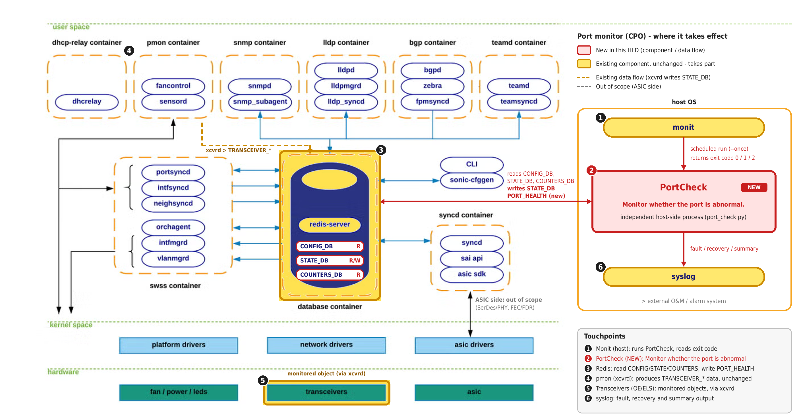
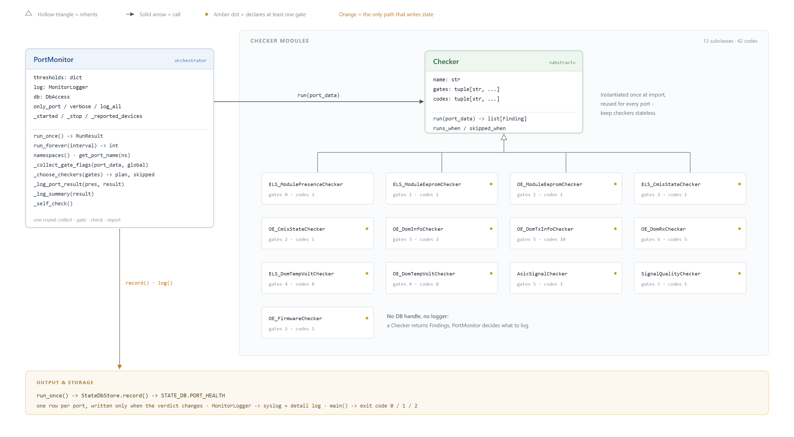
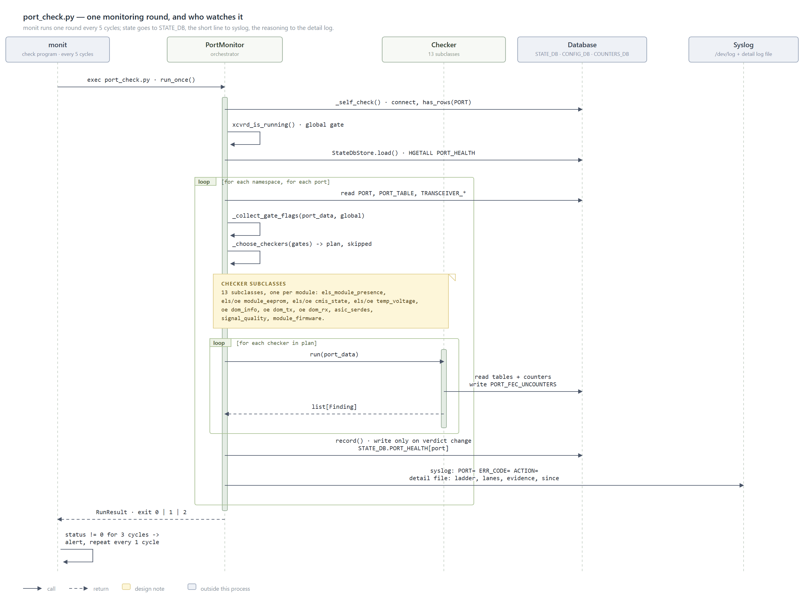

# Port Monitoring for CPO

## Table of Content

- [1. Revision](#1-revision)
- [2. Scope](#2-scope)
- [3. Definitions/Abbreviations](#3-definitionsabbreviations)
- [4. Overview](#4-overview)
- [5. Requirements](#5-requirements)
- [6. Architecture Design](#6-architecture-design)
- [7. High-Level Design](#7-high-level-design)
  - [7.1 Internal Architecture and Data Model](#71-internal-architecture-and-data-model)
    - [7.1.1 Processing Pipeline](#711-processing-pipeline)
    - [7.1.2 Findings and Results](#712-findings-and-results)
  - [7.2 Checkers](#72-checkers)
    - [7.2.1 Checker Inventory](#721-checker-inventory)
    - [7.2.2 Fault Code Registry](#722-fault-code-registry)
  - [7.3 Gates and Execution Rules](#73-gates-and-execution-rules)
    - [7.3.1 Gate Inventory](#731-gate-inventory)
    - [7.3.2 Execution Rules](#732-execution-rules)
    - [7.3.3 Exception Isolation and Data Validity](#733-exception-isolation-and-data-validity)
  - [7.4 Verdict Model](#74-verdict-model)
  - [7.5 State Persistence and Change Detection](#75-state-persistence-and-change-detection)
    - [7.5.1 Purpose of Persistence](#751-purpose-of-persistence)
    - [7.5.2 PORT_HEALTH Fields](#752-port_health-fields)
    - [7.5.3 Verdict Change Detection](#753-verdict-change-detection)
    - [7.5.4 State Update Rules](#754-state-update-rules)
    - [7.5.5 Handling a Failed Database Write](#755-handling-a-failed-database-write)
  - [7.6 Logging and Alerting](#76-logging-and-alerting)
    - [7.6.1 Two Channels](#761-two-channels)
    - [7.6.2 Syslog Line](#762-syslog-line)
    - [7.6.3 Detail Log Line](#763-detail-log-line)
    - [7.6.4 Gate Ladder](#764-gate-ladder)
    - [7.6.5 Recovery Log](#765-recovery-log)
    - [7.6.6 Suspended Verdicts and Whole-Round Lines](#766-suspended-verdicts-and-whole-round-lines)
    - [7.6.7 Repetition Policy](#767-repetition-policy)
  - [7.7 Threshold Configuration](#77-threshold-configuration)
    - [7.7.1 Configuration File Path](#771-configuration-file-path)
    - [7.7.2 Required Entries](#772-required-entries)
    - [7.7.3 Validation and Failure Grading](#773-validation-and-failure-grading)
  - [7.8 CLI, Exit Codes and Monit Integration](#78-cli-exit-codes-and-monit-integration)
    - [7.8.1 Options](#781-options)
    - [7.8.2 Single-Round and Periodic Run](#782-single-round-and-periodic-run)
    - [7.8.3 JSON Output](#783-json-output)
    - [7.8.4 Exit Codes and Run Result](#784-exit-codes-and-run-result)
    - [7.8.5 Monit Integration](#785-monit-integration)
  - [7.9 Future Proofing](#79-future-proofing)
  - [7.10 Supported Platforms and Modules](#710-supported-platforms-and-modules)
  - [7.11 Performance and Reliability](#711-performance-and-reliability)
- [8. SAI API](#8-sai-api)
- [9. Configuration and management](#9-configuration-and-management)
  - [9.1 Config DB Enhancements](#91-config-db-enhancements)
  - [9.2 State DB Enhancements](#92-state-db-enhancements)
- [10. Warmboot and Fastboot Design Impact](#10-warmboot-and-fastboot-design-impact)
- [11. Memory Consumption](#11-memory-consumption)
- [12. Restrictions/Limitations](#12-restrictionslimitations)
- [13. Testing Requirements/Design](#13-testing-requirementsdesign)
  - [13.1 Unit Test cases](#131-unit-test-cases)
  - [13.2 System Test cases](#132-system-test-cases)
- [14. Open/Action items](#14-openaction-items)

### 1. Revision


| Rev | Date       | Author     | Change Description |
| --- | ---------- | ---------- | ------------------ |
| 0.1 | 2026-11-17 | LongChao06 | Initial version    |

### 2. Scope

This HLD describes `PortMonitor` (`port_check.py), a host-side health monitor for ports on switches built with co-packaged optics (CPO). A CPO port depends on an external laser source (ELS), an optical engine (OE), a fibre connection, PHY/SerDes signal and link quality. A fault in any of them shows up as a different symptom in a different database table.

**In scope:**

* Module presence, identity (EEPROM), CMIS state machine and firmware status of the OE and ELS.
* OE and ELS Digital Optical Monitoring (DOM) data: optical power, TX bias, temperature, supply voltage and their alarm/warning flags.
* ASIC-side SerDes/PHY signal status and FEC/FDR link quality, read from `COUNTERS_DB`.
* The Gate precondition model, the single-verdict result model, state persistence, change detection and log control.
* Threshold configuration, command-line interface, exit codes and Monit integration.

**Out of scope:** CPO modules other than the Broadcom Bailly module ; data-plane forwarding configuration; module firmware internals and upgrade; direct access to the ASIC (`syncd`, SDK).

### 3. Definitions/Abbreviations


| Term                | Definition                                                                                               |
| ------------------- | -------------------------------------------------------------------------------------------------------- |
| CPO                 | Co-packaged Optics                                                                                       |
| OE                  | Optical Engine                                                                                           |
| ELS                 | External Laser Source                                                                                    |
| CMIS                | Common Management Interface Specification                                                                |
| DOM                 | Digital Optical Monitoring                                                                               |
| LOS                 | Loss of Signal                                                                                           |
| ASIC / PHY / SerDes | Application-Specific Integrated Circuit / Physical Layer / Serialiser-Deserialiser                       |
| FEC / FDR           | Forward Error Correction / FEC Deferred Decoding Radius                                                  |
| xcvrd               | SONiC transceiver management daemon; produces the data consumed here                                     |
| Monit               | SONiC process-monitoring framework; runs external checks periodically and alerts on exit codes           |

### 4. Overview

On a CPO switch, each front-panel port depends on an ELS, an OE, a fibre connection and ASIC-side lanes. Diagnosis today relies on engineers reading database tables and comparing logs by hand, with no common basis for judging health and results that are hard to reproduce.

This HLD proposes `PortMonitor`, a standalone host-side process. It reads port, module and counter state directly from the SONiC databases, without using `xcvrd`'s in-process interfaces, and evaluates it with 13 independent *Checkers*, each guarded by *Gates* that skip it when its input data is not valid (for example, a shut-down port, an absent module or a stopped `xcvrd`). All Findings for a port are sorted by severity: the most severe becomes the port's verdict and every other code is listed in `active_codes`. The last verdict per port is stored in a new `STATE_DB|PORT_HEALTH` table to detect changes and control logging, and the result of each round is returned to Monit as a process exit code.

Design goals:

- Read port configuration, operational state, OE/ELS DOM information, hardware status and FEC/FDR statistics from the SONiC databases.
- Decide, from the port state and the preconditions of each check, whether the check is worth running, avoiding both meaningless checks and duplicate alarms.
- Aggregate every anomalous result (OE/ELS TX power high alarm, OE/ELS RX power low alarm, OE RX LOS and so on) per port into a uniformly formatted message.
- Emit anomalies through Syslog, keep the previous result in `STATE_DB|PORT_HEALTH`, and use it to detect change and control duplicate logging.
- Return the result to Monit through the process exit code.

### 5. Requirements

- `PortMonitor` shall read port configuration, operational state, OE/ELS DOM data, hardware status and FEC/FDR statistics only from the SONiC databases, with no additional collection channel.
- It shall use Gates to decide per port whether each check can run, and isolate each Checker from the failures of the others.
- It shall give each port exactly one verdict (the most severe Finding) and list every other code hit in `active_codes`; there is no root-cause suppression.
- It shall report through Syslog (one brief line) and a detail log (the complete line and evidence), use `STATE_DB|PORT_HEALTH` to detect verdict changes, and by default log every faulty port on every round, with an option to log on change only.
- It shall return its result to Monit as an exit code (0 PASS, 1 FAIL, 2 ERROR), where only severity `ERR` or above fails a round.
- All thresholds shall come from an external JSON file, delivered per platform and hwsku. A missing or unusable file shall cause a hard failure, with no built-in defaults.
- It shall run as an independent process decoupled from `xcvrd`, consume data only, and report each port's namespace so that multi-ASIC systems are supported.
- It shall support the Broadcom Bailly CPO module. On any other platform it shall exit with code 0 without checking.

### 6. Architecture Design

This HLD proposes no change to existing SONiC architecture. `PortMonitor` is a new, standalone, read-only process: it does not modify `xcvrd` or any other daemon, is not in the data path, and writes only to the new `PORT_HEALTH` table. Monit invokes it periodically; Syslog carries its output.


*<div align="center">Figure 1: Where PortMonitor (labelled PortCheck) takes effect in the SONiC architecture (new component in red).</div>*

`PortMonitor` (labelled PortCheck in the figure, touchpoint 2) is the only new component: an independent host-side process that Monit runs in one-shot mode (1), which returns exit code 0, 1 or 2 and sends fault, recovery and summary output to Syslog (6). It reads CONFIG_DB, STATE_DB and COUNTERS_DB and writes only `PORT_HEALTH` in STATE_DB (3), using the transceiver data that `xcvrd` produces in the `pmon` container (4) for the OE and ELS transceivers (5); it does not access the ASIC (`syncd`, SDK) directly, and its ASIC-side checks use `COUNTERS_DB` data only.

### 7. High-Level Design


*<div align="center">Figure 2: PortMonitor UML class diagram (selected classes).</div>*

Figure 2 shows the five main classes. `PortMonitor` loads the thresholds and drives each round: for every port it creates a `PortData` snapshot, runs the Checkers selected by their Gates and records the verdict through `StateDbStore` (`PORT_HEALTH`). `MonitorLogger` writes the Syslog and detail-log output, and `Checker` is the abstract base of the 13 concrete Checkers (not drawn).

#### 7.1 Internal Architecture and Data Model

##### 7.1.1 Processing Pipeline

`PortMonitor` reads directly from the databases. One round passes through these stages:


*<div align="center">Figure 3: PortMonitor sequence diagram.</div>*

All results of a port are sorted by severity and all of them are reported: the most severe becomes `error_code` and the rest are written to `active_codes`.

##### 7.1.2 Findings and Results

A Checker does not emit alarms directly. It returns uniform `Finding` objects:


| Field      | Type     | Description                                     |
| ---------- | -------- | ----------------------------------------------- |
| `port`     | str      | Logical port name                               |
| `code`     | str      | Fault code (a key of the`ISSUES` registry)      |
| `severity` | Severity | Decided by the registry, not by the Checker     |
| `action`   | str      | Decided by the registry                         |
| `lanes`    | str      | Lane mask, for example`0x01`                    |
| `msg`      | str      | Description, defaulting to the registry summary |
| `evidence` | str      | Evidence chain in`key=value;key=value` form     |

The same code hit on several lanes is merged into one Finding, with `lanes` taking the union. A port's Findings form one `PortResult`: `port`, `namespace`, `findings`, `skipped` (checker and blocking Gate), `gated`, `gated_by`, `changed`, `first_seen` and `change_count`. Both outputs (Syslog and detail log) use it, so they share one judging and persistence path. All `PortResult` entries form one `RunResult`: result, exit code, worst severity, duration, `data_unavailable`, self-check error, counts of changed and recovered ports, and the three most frequent issues.

A Gate-skipped check yields **no conclusion**. It is neither "normal" nor "abnormal" and is reported separately from "checked and healthy".

#### 7.2 Checkers

##### 7.2.1 Checker Inventory

Each Checker is responsible for one class of check and declares its `name`, `gates` (any one firing skips it), `codes` (the fault codes it can produce) and `runs_when` (the positive form of `gates`, derived automatically and used by `--list-checks`). There are 13 Checkers:


| No. | Checker                   | Checks (data source and abnormal condition)                                                                               | Declared Gates                                                                                                                        | Fault codes                                                         |
| --- | ------------------------- | ------------------------------------------------------------------------------------------------------------------------- | ------------------------------------------------------------------------------------------------------------------------------------- | ------------------------------------------------------------------- |
| 1   | `els_module_presence`     | ELS present:`TRANSCEIVER_INFO` entry exists                                                                               | none                                                                                                                                  | `MODULE_PRESENCE_ABSENT`, `ELS_MODULE_PRESENCE_ABSENT`              |
| 2   | `els_module_eeprom`       | ELS identity:`els_vendor_pn`, `els_vendor_sn` in `TRANSCEIVER_INFO` valid                                                 | ELS\_MODULE\_ABSENT                                                                                                                   | `ELS_MODULE_EEPROM_BAD_ID`                                          |
| 3   | `oe_module_eeprom`        | OE identity: manufacturer, model, serial in`TRANSCEIVER_INFO` valid                                                       | ELS\_MODULE\_ABSENT                                                                                                                   | `OE_MODULE_EEPROM_BAD_ID`                                           |
| 4   | `els_cmis_state`          | `els_module_low_power_state` in `TRANSCEIVER_STATUS_FLAG` is "High power mode"                                            | ELS\_MODULE\_ABSENT, CPO\_PORT\_ADMIN\_DOWN                                                                                           | `ELS_CMIS_SW_NOT_READY`                                             |
| 5   | `oe_cmis_state`           | `cmis_state` in `TRANSCEIVER_STATUS_SW` is normal                                                                         | ELS\_MODULE\_ABSENT, CPO\_PORT\_ADMIN\_DOWN                                                                                           | `OE_CMIS_SW_NOT_READY`                                              |
| 6   | `oe_module_dom_info`      | `TRANSCEIVER_DOM_SENSOR` has tx power, rx power, temperature; `TRANSCEIVER_DOM_THRESHOLD` has txpower, rxpower, temp, vcc | CPO\_PORT\_ADMIN\_DOWN, ELS\_MODULE\_ABSENT, CPO\_CMIS\_SM\_NOT\_READY                                                                | `OE_MODULE_NO_DOM_INFO`, `OE_MODULE_NO_DOM_THRESHOLD`               |
| 7   | `oe_module_dom_tx`        | TX power/bias alarm and warning, fault and LOS flags in`TRANSCEIVER_DOM_FLAG` are `True`                                  | CPO\_PORT\_ADMIN\_DOWN, ELS\_MODULE\_ABSENT, ELS\_NO\_DOM, ELS\_NO\_DOM\_THRESHOLD, CPO\_CMIS\_SM\_NOT\_READY                         | The 8 TX power/bias alarms,`OE_MODULE_TX_FAULT`, `OE_MODULE_TX_LOS` |
| 8   | `oe_module_dom_rx`        | RX power alarm/warning and LOS flags in`TRANSCEIVER_DOM_FLAG` are `True`                                                  | CPO\_PORT\_ADMIN\_DOWN, ELS\_MODULE\_ABSENT, ELS\_NO\_DOM, **CPO\_FIBER\_ABSENT**, ELS\_NO\_DOM\_THRESHOLD, CPO\_CMIS\_SM\_NOT\_READY | The 4 RX power alarms,`OE_MODULE_RX_LOS`                            |
| 9   | `els_module_temp_voltage` | `els_temp`/`els_vcc` high/low alarm and warning in `TRANSCEIVER_DOM_FLAG` are `True`                                      | CPO\_PORT\_ADMIN\_DOWN, ELS\_MODULE\_ABSENT, ELS\_NO\_DOM, ELS\_NO\_DOM\_THRESHOLD                                                    | The 8 ELS temperature/voltage alarms                                |
| 10  | `oe_module_temp_voltage`  | `temp`/`vcc` high/low alarm and warning in `TRANSCEIVER_DOM_FLAG` are `True`                                              | CPO\_PORT\_ADMIN\_DOWN, ELS\_MODULE\_ABSENT, ELS\_NO\_DOM, ELS\_NO\_DOM\_THRESHOLD                                                    | The 8 OE temperature/voltage alarms                                 |
| 11  | `asic_serdes`             | `phy_rx_signal_detect`, `phy_rx_lock` in `PORT_PHY_ATTR` (`COUNTERS_DB`) are `True`                                       | CPO\_PORT\_ADMIN\_DOWN, ELS\_MODULE\_ABSENT, **CPO\_FIBER\_ABSENT**, CPO\_CMIS\_SM\_NOT\_READY, CPO\_NO\_COUNTERS\_OID                | `ASIC_SIGNAL_ASSERT`                                                |
| 12  | `signal_quality`          | Uncorrectable FEC frames in`COUNTERS_DB` keep growing over consecutive samples; FDR critical bins populated               | ELS\_MODULE\_ABSENT, CPO\_PORT\_ADMIN\_DOWN, **CPO\_PORT\_OPER\_DOWN**, CPO\_NO\_COUNTERS\_OID, CPO\_CMIS\_SM\_NOT\_READY             | `SIGNAL_WARNING`                                                    |
| 13  | `module_firmware`         | `datapath_firmware_fault`, `module_firmware_fault` in `TRANSCEIVER_STATUS_FLAG` are `True`                                | ELS\_MODULE\_ABSENT, CPO\_PORT\_ADMIN\_DOWN                                                                                           | `OE_MODULE_FW_FAULT`                                                |

Deliberate design choices:

- Only `oe_module_dom_rx` and `asic_serdes` depend on `CPO_FIBER_ABSENT`: with no light coming in, measuring receive power and SerDes lock is meaningless.
- Only `signal_quality` depends on `CPO_PORT_OPER_DOWN`: while the port is not up, FEC/FDR counters are not judged.
- All checks except the presence and EEPROM checks declare `CPO_PORT_ADMIN_DOWN`, so that an administratively shut-down port raises no alarm from them.

A measured value **below** its threshold is abnormal, and a value equal to it is not. A flag is abnormal only when it is `True`; a missing flag is not itself a fault, because missing data is handled by the Gates.

##### 7.2.2 Fault Code Registry

The registry holds 42 codes. Severity comes from `Severity` (the eight Syslog levels EMERG, ALERT, CRIT, ERR, WARNING, NOTICE, INFO, DEBUG). `ERR` and above (EMERG, ALERT, CRIT, ERR) make the round FAIL; `WARNING` and below do not affect the exit code.


| Fault code                                     | Level   | Recommended action        | Meaning                                             |
| ---------------------------------------------- | ------- | ------------------------- | --------------------------------------------------- |
| `ELS_MODULE_PRESENCE_ABSENT`                   | ERR     | CHECK\_MODULE\_ATTACHMENT | ELS not present (CPO port)                          |
| `OE_MODULE_EEPROM_BAD_ID`                      | ERR     | VENDOR\_ESCALATION        | OE module identity unreadable                       |
| `ELS_MODULE_EEPROM_BAD_ID`                     | ERR     | VENDOR\_ESCALATION        | ELS module identity unreadable                      |
| `OE_CMIS_SW_NOT_READY`                         | ERR     | VENDOR\_ESCALATION        | OE CMIS state machine not ready                     |
| `ELS_CMIS_SW_NOT_READY`                        | ERR     | VENDOR\_ESCALATION        | ELS CMIS state machine not ready                    |
| `OE_MODULE_NO_DOM_INFO`                        | ERR     | VENDOR\_ESCALATION        | No DOM data from the OE                             |
| `OE_MODULE_NO_DOM_THRESHOLD`                   | ERR     | VENDOR\_ESCALATION        | No DOM thresholds from the OE                       |
| `OE_MODULE_TX_POWER_LOW_ALARM` / `_HIGH_ALARM` | ERR     | CHECK\_FIBER\_ATTACHMENT  | TX power low / high alarm                           |
| `OE_MODULE_TX_POWER_LOW_WARN` / `_HIGH_WARN`   | WARNING | CHECK\_FIBER\_ATTACHMENT  | TX power low / high warning                         |
| `OE_MODULE_TX_BIAS_LOW_ALARM` / `_HIGH_ALARM`  | ERR     | VENDOR\_ESCALATION        | TX bias low / high alarm                            |
| `OE_MODULE_TX_BIAS_LOW_WARN` / `_HIGH_WARN`    | WARNING | VENDOR\_ESCALATION        | TX bias low / high warning                          |
| `OE_MODULE_TX_FAULT`                           | WARNING | VENDOR\_ESCALATION        | OE TX fault flag asserted                           |
| `OE_MODULE_TX_LOS`                             | WARNING | VENDOR\_ESCALATION        | OE TX LOS flag asserted                             |
| `OE_MODULE_RX_POWER_LOW_ALARM` / `_HIGH_ALARM` | ERR     | CHECK\_FIBER\_ATTACHMENT  | RX power low / high alarm                           |
| `OE_MODULE_RX_POWER_LOW_WARN` / `_HIGH_WARN`   | WARNING | CHECK\_FIBER\_ATTACHMENT  | RX power low / high warning                         |
| `OE_MODULE_RX_LOS`                             | WARNING | CHECK\_FIBER\_ATTACHMENT  | OE RX LOS flag asserted                             |
| `OE_MODULE_TEMP_HIGH_ALARM` / `_LOW_ALARM`     | ERR     | CHECK\_THERMAL            | OE temperature high / low alarm                     |
| `OE_MODULE_TEMP_HIGH_WARN` / `_LOW_WARN`       | WARNING | CHECK\_THERMAL            | OE temperature high / low warning                   |
| `OE_MODULE_VOLTAGE_HIGH_ALARM` / `_LOW_ALARM`  | ERR     | VENDOR\_ESCALATION        | OE voltage high / low alarm                         |
| `OE_MODULE_VOLTAGE_HIGH_WARN` / `_LOW_WARN`    | WARNING | VENDOR\_ESCALATION        | OE voltage high / low warning                       |
| `ELS_MODULE_TEMP_HIGH_ALARM` / `_LOW_ALARM`    | ERR     | CHECK\_THERMAL            | ELS temperature high / low alarm                    |
| `ELS_MODULE_TEMP_HIGH_WARN` / `_LOW_WARN`      | WARNING | CHECK\_THERMAL            | ELS temperature high / low warning                  |
| `ELS_MODULE_VOLTAGE_HIGH_ALARM` / `_LOW_ALARM` | ERR     | VENDOR\_ESCALATION        | ELS voltage high / low alarm                        |
| `ELS_MODULE_VOLTAGE_HIGH_WARN` / `_LOW_WARN`   | WARNING | VENDOR\_ESCALATION        | ELS voltage high / low warning                      |
| `OE_MODULE_FW_FAULT`                           | WARNING | UPGRADE\_FW               | OE firmware fault                                   |
| `ASIC_SIGNAL_ASSERT`                           | ERR     | VENDOR\_ESCALATION        | SerDes lane out of lock (light present, no signal)  |
| `SIGNAL_WARNING`                               | WARNING | VENDOR\_ESCALATION        | Uncorrectable codewords present, or FDR degradation |

`SIGNAL_WARNING` is capped at WARNING on purpose: a poor pre-FEC BER is a quality warning, not a verdict that the port is unusable, and it must not turn the whole round into FAIL.

#### 7.3 Gates and Execution Rules

##### 7.3.1 Gate Inventory

Gates confirm that the input data is valid before a Checker runs. There are 10 Gates in layers L1 to L9 (L1 is the outermost):


| Layer | Gate                      | Fires when                                                                          | Data source                                          |
| ----- | ------------------------- | ----------------------------------------------------------------------------------- | ---------------------------------------------------- |
| L1    | XCVRD\_STATUS             | No`xcvrd` process is running, so all `TRANSCEIVER_*` tables have stopped refreshing | Process probe (`psutil` scans name and command line) |
| L1    | CPO\_CMIS\_SM\_NOT\_READY | `cmis_state` is failed or not yet ready                                             | `STATE_DB` `TRANSCEIVER_STATUS_SW`                   |
| L2    | CPO\_PORT\_ADMIN\_DOWN    | `admin_status` is not up                                                            | `CONFIG_DB` `PORT`                                   |
| L3    | ELS\_MODULE\_ABSENT       | The ELS of the port has no entry in`TRANSCEIVER_INFO`                               | `STATE_DB` `TRANSCEIVER_INFO`                        |
| L4    | CPO\_FIBER\_ABSENT        | RX LOS is`True` on every lane                                                       | `STATE_DB` `TRANSCEIVER_DOM_FLAG`                    |
| L5    | CPO\_PORT\_OPER\_DOWN     | `netdev_oper_status` is not up                                                      | `STATE_DB` `PORT_TABLE`                              |
| L5    | ELS\_NO\_DOM              | `TRANSCEIVER_DOM_SENSOR` has no tx power, rx power or temperature                   | `STATE_DB` `TRANSCEIVER_DOM_SENSOR`                  |
| L5    | ELS\_NO\_DOM\_THRESHOLD   | `TRANSCEIVER_DOM_THRESHOLD` has no txpower, rxpower, temp or vcc                    | `STATE_DB` `TRANSCEIVER_DOM_THRESHOLD`               |
| L6    | CPO\_NO\_COUNTERS\_OID    | `COUNTERS_PORT_NAME_MAP` has no OID for the port                                    | `COUNTERS_DB` `COUNTERS_PORT_NAME_MAP`               |
| L9    | NO\_RX\_LOW\_THRESHOLD    | The threshold file lacks`fiber.rx_low_dbm`                                          | Threshold configuration file                         |

- Gates are evaluated from the lowest layer upward, and the first one that fires short-circuits the rest, so the operator sees the outermost cause rather than its symptoms.
- L9 is a missing configuration, not a hardware condition: without a lower bound there is no way to decide what "low" means, so the fibre check is skipped as a whole.

##### 7.3.2 Execution Rules

Each Checker declares its own Gate dependencies. For each round, `PortMonitor` walks `ALL_CHECKERS` and builds the execution plan from the Gate states:

- None of the relevant Gates fired: run the Checker.
- Any relevant Gate fired: skip it and record it in `skipped` (which Checker, and which Gate blocked it).
- Several Gates fired at once: the one with the highest layer (the smallest number) becomes the skip reason.

Examples:

- `CPO_PORT_OPER_DOWN` affects only `signal_quality`; it does not cause every check to be skipped.
- `ELS_NO_DOM` blocks the checks that depend on DOM data; the rest run as usual.
- `CPO_PORT_ADMIN_DOWN` is a port-level short circuit: every Checker on that port that declares it is skipped, and the stored verdict is frozen (section 7.5.4).
- `XCVRD_STATUS` is a global short circuit: no port is judged this round and `DATA_UNAVAILABLE=true`.

##### 7.3.3 Exception Isolation and Data Validity

Every Checker runs inside its own exception handler. When one raises, the exception is recorded in the detail log and the remaining Checkers and ports continue, so a single failing check cannot take down the whole port or the whole round. The port's verdict is still based on the other available results. Only a failed self-check aborts the round (`db_unreachable`, `no_port_inventory`), because no verdict can then be trusted.

Data sources and preconditions are confirmed before checking: the database connection is healthy, the port inventory is available (`CONFIG_DB` `PORT` or `STATE_DB` `PORT_TABLE` is non-empty) and `xcvrd` is running. Module presence, CMIS state, DOM data and counter OID are then used layer by layer to decide whether each check runs. This separates "data missing or stale" from "port faulty": the former shows up as a skipped Gate, and only the latter becomes a fault code.

#### 7.4 Verdict Model

There is deliberately no root-cause suppression. All Findings of a port are sorted by severity. The most severe becomes the port's single verdict (`error_code`, `severity`, `action`, `lane_mask`), and every code hit, in descending severity, is listed in `active_codes`. A broken fibre and the RX alarms it causes are therefore all reported, most severe first. Earlier revisions suppressed symptoms through 28 rules; those rules could never change the verdict, because every suppressed code already ranked below its root cause, and they made the Syslog and `STATE_DB` code lists disagree. Only `ERR` and above make a port (and the round) fail; `WARNING` and below are reported without affecting the exit code.

#### 7.5 State Persistence and Change Detection

##### 7.5.1 Purpose of Persistence

`STATE_DB|PORT_HEALTH` is the monitor's memory across rounds and across restarts. At the start of each round `StateDbStore.load()` reads it exactly once (one `HGETALL` per namespace, not per port), each port is compared with the current verdict, and only a changed verdict is written back. Consequently `change_count` counts verdict **changes**, not rounds: a fault present for a day still has `change_count` 1.

##### 7.5.2 PORT_HEALTH Fields


| Field            | Meaning                                                                               | Rewritten when                                            |
| ---------------- | ------------------------------------------------------------------------------------- | --------------------------------------------------------- |
| `error_code`     | Fault code of the most severe Finding; empty when healthy or frozen                   | Verdict changes                                           |
| `severity`       | `OK`, or one of `EMERG`, `ALERT`, `CRIT`, `ERR`, `WARNING`, `NOTICE`, `INFO`, `DEBUG` | Verdict changes                                           |
| `action`         | Action of the most severe Finding;`NO_ACTION` when healthy                            | Verdict changes (derived with`error_code`)                |
| `lane_mask`      | Lane mask of the most severe Finding, for example`0x01`                               | Verdict changes                                           |
| `active_codes`   | All codes hit this round, in descending severity, comma-separated                     | Verdict changes                                           |
| `first_seen`     | Start time of the current verdict                                                     | Verdict changes, with the two exceptions in section 7.5.4 |
| `change_count`   | Number of verdict changes                                                             | Verdict changes (+1)                                      |
| `gated_by`       | The Gate that blocked the whole port; empty means the port is being judged            | On freeze and on unfreeze                                 |
| `retained_codes` | While frozen, the former`active_codes`                                                | On freeze only                                            |

`message`, `evidence` and `last_seen` are deliberately not stored: the reasoning stays in the detail log and the table holds only the verdict, so the two cannot drift apart.

**`first_seen` and `change_count` do not start at zero.** When the table has no row for a port, the old row is `{}`, which necessarily differs from a healthy row (`severity` is `""` versus `"OK"`). **The first round therefore writes a row for every port**, with `first_seen` set to that moment and `change_count` 1. For healthy ports `first_seen` records the last time the verdict changed, including the first write, and is never empty.

A faulty port, a healthy port and a port frozen by a Gate (the fault has not gone away, it is no longer judged):

```
127.0.0.1:6379[6]> HGETALL "PORT_HEALTH|Ethernet40"                         (faulty)
 "error_code" "ASIC_SIGNAL_ASSERT"  "severity" "ERR"  "action" "VENDOR_ESCALATION"  "lane_mask" "0xf0"
 "active_codes" "ASIC_SIGNAL_ASSERT,OE_MODULE_RX_POWER_LOW_ALARM,OE_MODULE_TX_POWER_LOW_ALARM,OE_MODULE_RX_LOS,OE_MODULE_TX_LOS"
 "first_seen" "2026-10-30T06:43:18"  "change_count" "3"  "gated_by" ""  "retained_codes" ""
127.0.0.1:6379[6]> HGETALL "PORT_HEALTH|Ethernet0"                          (healthy)
 "error_code" ""  "severity" "OK"  "action" "NO_ACTION"  "lane_mask" ""  "active_codes" ""
 "first_seen" "2026-10-30T06:40:53"  "change_count" "1"  "gated_by" ""  "retained_codes" ""
127.0.0.1:6379[6]> HGETALL "PORT_HEALTH|Ethernet40"                         (frozen)
 "error_code" ""  "severity" "OK"  "action" "NO_ACTION"  "lane_mask" ""  "active_codes" ""
 "first_seen" "2026-10-30T06:43:18"  "change_count" "3"  "gated_by" "CPO_PORT_ADMIN_DOWN"
 "retained_codes" "ASIC_SIGNAL_ASSERT,OE_MODULE_RX_POWER_LOW_ALARM"
```

Comparing the rows shows the division of labour: `severity` only says what the port is judged to be right now, while `gated_by` and `retained_codes` answer "why is it quiet". Consumers decide whether a port is faulty from `severity` alone, which is why it falls back to `OK` while frozen; otherwise an operator would repair a port that can no longer be measured.

##### 7.5.3 Verdict Change Detection

`verdict_unchanged()` compares five items only, as strings, treating a field missing from the old row as empty: `severity`, `error_code`, `active_codes`, `lane_mask` and `gated_by`.

`gated_by` has to be among them; otherwise "just became quiet" and "has been quiet all along" would produce identical rows, the first freeze would neither be written nor reported, and the Gate name would be lost. The other four fields are excluded for their own reasons: `action` is derived from `error_code`; `retained_codes` only has a value while frozen, when `gated_by` has already changed; and `first_seen` and `change_count` are the *result* of the comparison, so comparing them would compare a value against itself. Measured values (a temperature of 75.0 versus 75.1) are excluded as well, otherwise every cycle-to-cycle jitter would count as a new fault. This is also why `message` and `evidence` are not persisted: what is not stored cannot become inconsistent.

##### 7.5.4 State Update Rules

`StateDbStore.record()` runs four steps in order, each short-circuiting the ones after it:

1. **The port was not judged this round.** When `port_result.gated_by` is non-empty, the row is replaced by a frozen row. The four verdict fields are cleared, `severity` falls back to `OK`, `gated_by` records the Gate name, and the former `active_codes` (or, if empty, the old `retained_codes`, and failing that the old `error_code`, for compatibility with rows from older versions) move into `retained_codes`. `first_seen` and `change_count` are **carried over unchanged**: it is the same fault, merely paused.
2. **The five items are unchanged.** Return immediately: no write, no counter change, no `first_seen` change. This is the normal case while a fault is stable and the reason the table does not grow every round; `--log-all` only increases the number of log lines, not the number of writes.
3. **The five items changed.** First compute what recovered:

   ```
   old = old active_codes ∪ old retained_codes
   new = new active_codes ∪ new retained_codes
   recovered = old - new
   ```

   Both sides include `retained_codes`; otherwise a fault that was repaired while the port was shut down would vanish silently. Then `first_seen` becomes the current time, with **two exceptions** that stop an old fault looking new: the port is still frozen this round (no new measurement, so no new event), or the previous round was frozen, judging has resumed, and `new - old` is empty (the same codes are present). Finally `change_count` becomes the old value plus 1.
4. **Write to the database.** The new row enters the in-memory dictionary only if the write succeeded (section 7.5.5).


| This round                                | Write       | `first_seen`                 | `change_count` | Syslog                                                                |
| ----------------------------------------- | ----------- | ---------------------------- | -------------- | --------------------------------------------------------------------- |
| A Gate blocks the port for the first time | Frozen row  | Carried over                 | Carried over   | `MONITOR_SUSPENDED` (NOTICE), only when `retained_codes` is non-empty |
| Still blocked by the same Gate            | No          | -                            | -              | None                                                                  |
| Gate released, same codes still present   | Yes         | Carried over                 | +1             | Normal fault line                                                     |
| Gate released, codes added or removed     | Yes         | Current time                 | +1             | Normal fault line                                                     |
| Fault cleared                             | Healthy row | Current time (recovery time) | +1             | `ERR_CODE=ERR_CODE_RECOVERED` (NOTICE)                                |
| Verdict unchanged, port faulty            | No          | -                            | -              | One line per round with`--log-all` (default)                          |
| Verdict unchanged, port healthy           | No          | -                            | -              | None                                                                  |

Two points are easy to get wrong. **A frozen port is never reported as recovered**, because `retained_codes` count as "still has a problem"; the unfreeze round reports `RECOVERED=` only once the Gate is released and the codes are genuinely gone. And **the global Gate `XCVRD_STATUS` does not go through `record()`**: when `data_unavailable` is set, `run_once()` returns a synthetic "unchanged" result and no field of the table is touched, because at that moment not even the stored row can be trusted to describe the same instant.

##### 7.5.5 Handling a Failed Database Write

There is one guard in `record()`:

```python
written = self.db.write_row(DB_STATE, T_PORT_HEALTH, port_result.port, row, port_result.namespace)
if written:
    self.rows[key] = row
```

When the write fails, memory keeps the old row, and the next round judges the state as "changed" again and **logs it once more**; the value returned by `changed` does not depend on the write result. This is a deliberate trade-off: better to say the same thing twice than to treat a verdict that never reached the database as already reported. The cost is that a persistently failing write produces one fault line per round. On seeing that pattern, check the write permission on `PORT_HEALTH` and the key type (`WRONGTYPE`) before suspecting the judging logic.

#### 7.6 Logging and Alerting

##### 7.6.1 Two Channels

There are two channels, and they carry **two different lines**, not one line routed twice:

- **Syslog**: one brief line for the operator, answering "which port, which fault, what to do". The field set is deliberately small so that the line fits any terminal.
- **`/var/log/cpo_port_monitor.log`** (detail log): the complete line for the same verdict, with the Gate ladder, the evidence chain and the counters, used to explain afterwards how the verdict was reached.

This determines where to look when troubleshooting: Syslog carries **no** `SEVERITY`, `LANES`, `MSG`, `EVIDENCE`, `SINCE` or `CHANGE_COUNT`. The two lines are produced by `_format_brief_line` and `_format_verdict_line` respectively.

##### 7.6.2 Syslog Line

`SysLogHandler` writes to `/dev/log` (`SOCK_DGRAM`, facility `LOG_USER`, identifier `port_monitor`). The format string is `%(name)s[%(process)d]: %(message)s`, and rsyslog adds the timestamp:

```
Oct 30 06:05:00 sw1 port_monitor[12345]: PORT_CHECK: PORT=Ethernet0 ERR_CODE=OE_MODULE_TX_POWER_HIGH_ALARM ACTION=CHECK_FIBER_ATTACHMENT.
```


| Field      | Required | Description                                                                                                        |
| ---------- | -------- | ------------------------------------------------------------------------------------------------------------------ |
| `PORT`     | Yes      | Logical port name                                                                                                  |
| `NS`       | No       | Multi-namespace deployments only; always directly after`PORT`                                                      |
| `ERR_CODE` | Yes      | Fault code of the most severe Finding                                                                              |
| `ACTION`   | Yes      | Recommended action.**The value carries a trailing period** (`ACTION=%s.`), which a `field=value` parser must strip |

The identifier is `port_monitor` while the message prefix is `PORT_CHECK:`, so a `grep` has to try both. Severity is not in the text but in the Syslog priority: `_py_level()` maps `Severity` to Python's logging levels (`CRIT` and above to `critical`, `ERR` to `error`, `WARNING` to `warning`, `NOTICE` to `notice`, `INFO` to `info`, `DEBUG` to `debug`). An alert rule can count lines at `error` priority without parsing any field; a literal `SEVERITY=ERR` never appears in Syslog.

##### 7.6.3 Detail Log Line

The detail log writes the same verdict in full. `_detail_formatter()` adds the prefix, with milliseconds separated by a comma:

```
2026-10-30 06:05:00,255 ERROR PORT_CHECK: PORT=Ethernet0 SEVERITY=ERR ERR_CODE=OE_MODULE_TX_POWER_HIGH_ALARM ACTION=CHECK_FIBER_ATTACHMENT LANES=0x01 ACTIVE_CODE=OE_MODULE_TX_POWER_HIGH_ALARM MSG="TX power high alarm" EVIDENCE="tx1powerHAlarm=True;txPower=3.1" SINCE=2026-10-30T06:05:00 CHANGE_COUNT=1
```

The field order is fixed so that the same `field=value` reader can parse this line:


| Field                   | Required      | Description                                                                                                |
| ----------------------- | ------------- | ---------------------------------------------------------------------------------------------------------- |
| `PORT`, `NS`            | Yes, optional | Logical port name; namespace in multi-namespace deployments                                                |
| `SEVERITY`              | Yes           | Severity of the most severe Finding (`Severity` enum name)                                                 |
| `ERR_CODE`, `ACTION`    | Yes           | Fault code and recommended action.**No trailing period on this line**; it is added only to the Syslog line |
| `LANES`                 | No            | Mask of the lanes that triggered the Finding                                                               |
| `PORTS`                 | No            | Reserved.`PortResult.device_ports` is never assigned, so `PORTS=` never appears                            |
| `ACTIVE_CODE`           | No            | All codes hit by the port this round, comma-separated, most severe first                                   |
| `MSG`                   | Yes           | Description, truncated to 200 characters, embedded double quotes replaced by single quotes                 |
| `EVIDENCE`              | No            | Evidence chain in`key=value;key=value` form, double quotes replaced by single quotes                       |
| `SINCE`, `CHANGE_COUNT` | No, yes       | `first_seen`; number of changes to the verdict or evidence chain                                           |

`MonitorLogger` always attaches a handler to stderr. It uses the detail-log format string but receives the Syslog message. With Syslog disabled (`--no-syslog`, or a container without `/dev/log`), the terminal therefore shows the **brief** line with a timestamp and level prepended, and no `SEVERITY=`. Each line is finally truncated by `truncate()` to 1000 characters (997 plus `...`), so with a very long `EVIDENCE` it is the trailing `CHANGE_COUNT` that is dropped; a detail line ending in `...` is truncation, not a generation bug.

##### 7.6.4 Gate Ladder

`gate_line()` writes the Gate states to the detail log only:

```
2026-10-30 06:05:00,255 DEBUG GATE L2 CPO_PORT_ADMIN_DOWN=false for Ethernet0 (raw=false)
2026-10-30 06:05:00,256 DEBUG GATE L3 ELS_MODULE_ABSENT=false for Ethernet0 (raw=false)
```

The layer number comes from `GATE_LAYER`; a Gate absent from that table prints as `L-`, and `raw=unknown` means the value could not be read. The whole ladder is printed on the round in which the verdict changed, on every round with `-m DEBUG` (`verbose` is `log_level == "DEBUG"`), and with `--log-all false` also on rounds that carry a Finding or recovery. Printing a dozen-plus lines every five minutes for an untouched fault would bury the verdict line they belong to.

Gate lines go through `log.detail()` and **never reach Syslog**; `-m DEBUG` opens the `debug()` path, not the Gate lines. What `-m DEBUG` adds are two kinds of detail lines, which state checker by checker which Gate blocked it:

```
PORT_CHECK: PORT=Ethernet0 ACTIVE_GATES=CPO_PORT_ADMIN_DOWN
PORT_CHECK: PORT=Ethernet0 CHECK=ElsDomThreshold SKIPPED_BY=ELS_NO_DOM REASON=<gate reason>
```

The detail log empties itself once `DETAIL_LOG_MAX_BYTES` (250 MiB by default) is reached, keeping a single path and inode and avoiding any dependency on an external logrotate; a value of 0 disables the cap.

##### 7.6.5 Recovery Log

`_format_recovery_line()` is emitted with `log.log(Severity.NOTICE, ...)`, so it appears on **both** channels:

```
2026-10-30 06:05:00,255 NOTICE PORT_CHECK: PORT=Ethernet0 ERR_CODE=ERR_CODE_RECOVERED ACTION=NO_ACTION RECOVERED=OE_MODULE_RX_POWER_LOW_ALARM
```

The field order is `PORT`, `ERR_CODE`, `ACTION`, optional `NS`, `RECOVERED`, so `NS` comes **after** `ACTION`, unlike in the fault line. The line has **no** trailing period, and several codes recovering together are comma-separated in `RECOVERED=`. The level is NOTICE rather than INFO on purpose: `-m` defaults to NOTICE, so with INFO the one line the operator is waiting for ("it is fixed") would be the line the default level filters out.

##### 7.6.6 Repetition Policy

By default (`--log-all` true) the program **writes a line for every faulty port on every round**; `--log-all false` returns to change-only output:


| Mode              | Syslog                                         | Detail log                                                      | When to use                                          |
| ----------------- | ---------------------------------------------- | --------------------------------------------------------------- | ---------------------------------------------------- |
| Default           | One brief line per faulty port, every round    | One complete line every round; the ladder only on change rounds | Silence means healthy; "still broken" stays visible  |
| `--log-all false` | Only on the round in which the verdict changed | Complete line and ladder on that round only                     | A fault lasting a day leaves one line instead of 288 |

In both modes there is at most one fault line per faulty port per round, with identical text; only the frequency differs. The default is true because with change-only output silence has two meanings, "everything is fine" and "the program is not running", which cannot be told apart.

#### 7.7 Threshold Configuration

##### 7.7.1 Configuration File Path

In order of precedence: the path given by `--thresholds`; `/usr/share/sonic/device/<platform>/<hwsku>/port_health_thresholds.json` (platform and hwsku from `sonic_py_common.device_info`); and, when platform and hwsku cannot be obtained, `/usr/share/sonic/hwsku/port_health_thresholds.json`. The code contains no built-in default thresholds.

##### 7.7.2 Required Entries


| Key path           | Type   | Consequence if missing                                                                         |
| ------------------ | ------ | ---------------------------------------------------------------------------------------------- |
| `fiber.rx_low_dbm` | number | The`NO_RX_LOW_THRESHOLD` Gate is set and the minimum receive-power check is skipped as a whole |
| `fdr.critical_bin` | number | The FDR criterion is unavailable and the related sub-check is skipped                          |

```json
{ "fiber": { "rx_low_dbm": -30.0 }, "fdr": { "critical_bin": 7 } }
```

The values show the format only; they are not recommended production values.

##### 7.7.3 Validation and Failure Grading

Validation checks that the file exists, is valid JSON, has an object at the top level, and has the required keys as numbers. Failures are graded in two levels:


| Failure type                                                       | Handling                                                                                                      | Exit code                     |
| ------------------------------------------------------------------ | ------------------------------------------------------------------------------------------------------------- | ----------------------------- |
| File missing, unreadable, invalid JSON, or top level not an object | `ConfigError` is raised and the round is aborted                                                              | **2**                         |
| A required key is missing or not numeric                           | The round continues; the Gate is set, the related check is skipped and the problem is reported once per round | 0 or 1, from the other checks |

A broken file means the program itself cannot be trusted (exit code 2); a missing key means one check fewer, and verdicts are still produced.

#### 7.8 CLI, Exit Codes and Monit Integration

##### 7.8.1 Options

`main()` handles things in this order, which decides which options take effect: `--list-checks` returns first, then the platform (HWSKU) gate (section 7.10), threshold loading, logger creation, and finally single-round or resident mode by `--interval`.


| Option                     | Default                         | Actual behaviour                                                                                                                                         |
| -------------------------- | ------------------------------- | -------------------------------------------------------------------------------------------------------------------------------------------------------- |
| `--once`                   | -                               | **Parsed but never read.** A single round runs because `--interval` is absent; the switch only makes the Monit configuration read as intended            |
| `--interval N`             | none                            | Resident mode, one round every N seconds (values below 2 become 2). Selects resident mode even together with`--once`                                     |
| `--json`                   | off                             | Structured result on stdout;**single-round mode only**, ignored in resident mode                                                                         |
| `--port NAME`              | all                             | Keep only that port, which must exist in`CONFIG_DB` `PORT` or `STATE_DB` `PORT_TABLE`. A misspelt name is not an error; it gives "0 ports checked, PASS" |
| `--thresholds PATH`        | see 7.7.1                       | Alternative threshold file                                                                                                                               |
| `--detail-log PATH`        | `/var/log/cpo_port_monitor.log` | Detail log path                                                                                                                                          |
| `--no-detail-log`          | off                             | Write no file; detail lines go to stderr                                                                                                                 |
| `--detail-log-max-bytes N` | 262144000 (250 MiB)             | Empty the file at that size and write a truncation marker; 0 means no cap                                                                                |
| `-m, --log-level L`        | NOTICE                          | DEBUG, INFO, NOTICE, WARNING or ERROR; affects Syslog and stderr only, the detail log is always at DEBUG                                                 |
| `--no-syslog`              | off                             | Disables`/dev/log` only; the stderr handler is always attached                                                                                           |
| `--log-all [true/false]`   | **true**                        | Bare`--log-all` means true; `false`, `0`, `no`, `off` mean output only on change; any other value is an argument error                                   |
| `--list-checks`            | off                             | Print the check catalogue and return,**before the HWSKU gate**, so it runs on any machine                                                                |
| `--version`                | -                               | Prints`portmonitor 6.0.0` (the prefix is `portmonitor`, not the file name)                                                                               |

##### 7.8.2 Single-Round and Periodic Run

`port_check.py` runs one round and returns 0, 1 or 2. This is the path Monit takes: it passes no `--interval` and does not need `--once`.

`port_check.py --interval 30` runs resident. The loop is `run_once()` followed by a sleep sliced into one-second steps, so `SIGTERM` and `SIGINT` exit within the current second. The return value is the **last** round's exit code, not an aggregate, and is usually meaningless when the process is killed. In resident mode `--json` produces no output, `--once` is meaningless and `PORT_HEALTH` is updated as usual. Under Monit this mode is not needed, since Monit provides the periodicity; it suits standalone resident deployment or manual observation.

##### 7.8.3 JSON Output

`port_check.py --json` works in single-round mode only, and prints **nothing at all** (not `{}`) when the port list is empty. The twelve top-level keys are:


| Key                                            | Meaning                                                                          |
| ---------------------------------------------- | -------------------------------------------------------------------------------- |
| `result`, `exit_code`                          | `PASS`, `FAIL` or `ERROR`; same as the process exit code                         |
| `worst_severity`                               | Most severe level in the round;`null` when nothing is wrong                      |
| `duration_ms`                                  | Elapsed time for the round                                                       |
| `data_unavailable`, `self_check_error`         | Whether`XCVRD_STATUS` was set; reason for a self-check failure (`null` normally) |
| `ports_checked`, `ports_failed`, `gated_ports` | Ports checked, failed, and skipped wholesale by a Gate                           |
| `changed_ports`                                | Ports whose verdict changed this round                                           |
| `top_issues`                                   | Descriptions of the (at most three) most frequent codes                          |
| `ports`                                        | One entry per port                                                               |

```json
{ "result": "FAIL", "exit_code": 1, "worst_severity": "ERR", "duration_ms": 4210,
  "data_unavailable": false, "self_check_error": null, "ports_checked": 64, "ports_failed": 1,
  "gated_ports": 55, "changed_ports": 1, "top_issues": ["TX power low alarm"],
  "ports": [ { "port": "Ethernet0", "namespace": "", "severity": "ERR", "failed": true,
      "gated": false, "gated_by": null, "changed": true, "first_seen": "2026-10-30T06:12:24",
      "change_count": 1,
      "active": [ { "code": "OE_MODULE_TX_POWER_LOW_ALARM", "severity": "ERR",
          "action": "CHECK_FIBER_ATTACHMENT", "lanes": "0x01",
          "message": "TX power low alarm", "evidence": "tx1powerLAlarm=True" } ],
      "skipped": [] } ] }
```

- Every `active` entry has exactly six fields (`code`, `severity`, `action`, `lanes`, `message`, `evidence`). There are no `suppressed` fields, because every Finding is an effective one.
- `gated_by` and `first_seen` are `null`, not empty strings (`port_to_dict()` applies `or None`); a parser must not test for `""` alone.
- `failed` is true only for `ERR` and above (`FAIL_MAX = ERR`), so a WARNING-only port has `failed=false` and the round is still `PASS`. To decide whether there was a problem this round, look at `worst_severity`, not `result` alone.
- Each `skipped` entry is `{"checker": ..., "gate": ...}`; `gated=true` means not one check ran for the port.

##### 7.8.4 Exit Codes and Run Result


| Exit code | `result` | Trigger                                                                                     |
| --------- | -------- | ------------------------------------------------------------------------------------------- |
| 0         | `PASS`   | No port failed (WARNING-level Findings may exist, and many ports may be Gate-skipped)       |
| 1         | `FAIL`   | At least one port has a Finding at`ERR` or above (EMERG, ALERT, CRIT, ERR)                  |
| 2         | `ERROR`  | Self-check failed (`db_unreachable`, `no_port_inventory`) or the threshold file is unusable |

A Gate-blocked port is not a faulty port, and a skipped Checker alone never makes the round FAIL. When `xcvrd` is not running the round is marked `DATA_UNAVAILABLE=true` and judging is skipped, so unrefreshed `TRANSCEIVER_*` data cannot raise a false alarm. Exit code 2 means "the monitor itself is broken" and must be kept apart from "the port is broken" (1).

The `RunResult` aggregates `result`, `exit_code`, the worst level, the number of ports checked, failed, gated and changed, the recovery count, `data_unavailable`, the top three issues and the elapsed time. Syslog gets one line every round, as proof that the program ran; the detail log gets the complete line:

```
PORT_CHECK: SUMMARY RESULT=PASS.
PORT_CHECK: SUMMARY RESULT=PASS EXIT=0 WORST=- PORTS_CHECKED=64 PORTS_FAILED=0 GATED_PORTS=55 CHANGED_PORTS=0 RECOVERED=0 DATA_UNAVAILABLE=false TOP="-" DURATION_MS=154
```

##### 7.8.5 Monit Integration

The monitor integrates with the existing SONiC Monit mechanism and is run periodically by Monit:

```
check program PortCheck with path "/usr/local/bin/port_check.py"
    every 5 cycles
    if status != 0 for 3 cycle then alert repeat every 1 cycles
```

#### 7.9 Future Proofing

New Checkers are added by declaring `name`, `gates` and `codes` and returning standard Findings, and new Gates or fault codes by extending the Gate ladder and the fault-code registry. They reuse the existing verdict, persistence, logging and exit-code paths without any schema change. Support for further CPO modules is follow-on work (section 7.10).

#### 7.10 Supported Platforms and Modules

This version supports the Broadcom Bailly CPO module only. Its OE/ELS has its own DOM field layout, its own set of valid CMIS state values and its own alarm register positions; with a different module those premises no longer hold, so the checking logic follows Bailly and is not generalised. Support for other modules is follow-on development and out of scope for this version. The platform is currently recognised by HWSKU, to be replaced by a hardware ID.

On a non-target platform the program opens no database connection, reads no threshold file, creates no logger and exits with code 0. Monit then sees `status OK`, although nothing was checked.

#### 7.11 Performance and Reliability

- The port-name-to-OID mapping is built once per round.
- `PORT_HEALTH` history is loaded once per namespace at the start of the round (one `HGETALL` per namespace, not per port).
- Only ports whose verdict changed are written, and unchanged faults are not written again; whether the *log* repeats is decided separately by `--log-all`.
- A Checker exception affects neither the other Checkers nor the other ports in the same round, and a failed self-check aborts the round so that no unreliable result is produced (section 7.3.3).

### 8. SAI API

There are no changes to SAI API in this HLD.

### 9. Configuration and management

This HLD adds the `port_check.py` command-line interface (section 7.8) and the threshold file (section 7.7). It does not change any existing SONiC CLI command.

#### 9.1 Config DB Enhancements

This HLD proposes no changes to CONFIG_DB; `PortMonitor` only reads `PORT|<port>.admin_status`.

#### 9.2 State DB Enhancements

The HLD adds one STATE_DB table, `PORT_HEALTH`, with key `PORT_HEALTH|<port>` and the nine fields defined in section 7.5.2. It is written only by `PortMonitor`. Every other table is read-only: STATE_DB `TRANSCEIVER_INFO`, `TRANSCEIVER_STATUS_SW`, `TRANSCEIVER_STATUS_FLAG`, `TRANSCEIVER_DOM_SENSOR`, `TRANSCEIVER_DOM_THRESHOLD`, `TRANSCEIVER_DOM_FLAG` and `PORT_TABLE`, and COUNTERS_DB `COUNTERS`, `PORT_PHY_ATTR` and `COUNTERS_PORT_NAME_MAP`.

### 10. Warmboot and Fastboot Design Impact

There is no warmboot/fastboot design impact for this HLD. `PortMonitor` is a read-only process outside the data plane. If the `PORT_HEALTH` history is unavailable after a restart, the first round writes a row for every port, and with the default `--log-all` true faulty ports are logged on every round regardless.

### 11. Memory Consumption

There should be no noteworthy change in memory consumption. Under Monit the process is short-lived and holds only a per-round snapshot and the `PORT_HEALTH` history; the table adds one small hash per port in STATE_DB.

### 12. Restrictions/Limitations

1. **Only the Broadcom Bailly CPO module is supported** (section 7.10). On a non-target platform the program exits 0 and checks nothing.
2. **`XCVRD_STATUS` depends on `psutil`.** When `psutil` is unavailable the probe returns "running", preferring extra checks to a false data-unavailable verdict, so a genuine `xcvrd` crash is not caught by the Gate on such a host.
3. **The FEC criterion needs three consecutive samples** 3 seconds apart, so a round costs at least 6 extra seconds; this avoids a false alarm from a single jitter.
4. **Round duration scales linearly with port count**: about 150 to 400 ms measured on 64 ports, excluding the FEC confirmation delay. A Monit `timeout` of at least 120 seconds is recommended.
5. **The detail log is emptied when it reaches its cap** and keeps no history; for long-term retention, collect Syslog externally.
6. **A missing threshold file exits with code 2** and there are no defaults, so the file must be placed under the hwsku directory before first deployment.
7. **Polling is periodic, not event-driven**, so detection latency depends on the Monit interval and the `xcvrd` update frequency.

### 13. Testing Requirements/Design

#### 13.1 Unit Test cases


| Category      | Test                                                                   | Expected result                                                                                                                                   |
| ------------- | ---------------------------------------------------------------------- | ------------------------------------------------------------------------------------------------------------------------------------------------- |
| Basic         | Healthy port                                                           | PASS;`PORT_HEALTH` severity `OK`; the first round writes a row for every port with `change_count` 1                                               |
| Module        | ELS absent; EEPROM identity invalid; CMIS state not ready (OE and ELS) | Matching fault code; dependent Checkers skipped                                                                                                   |
| DOM           | DOM data or thresholds missing                                         | `OE_MODULE_NO_DOM_*` fault; DOM-dependent Checkers skipped                                                                                        |
| Flags         | TX/RX/temperature/voltage/firmware flag`True`                          | Matching codes and lane mask; WARN codes do not fail the round                                                                                    |
| ASIC          | PHY lock lost; uncorrectable FEC frames growing                        | `ASIC_SIGNAL_ASSERT` (ERR); `SIGNAL_WARNING` (WARNING only, round stays PASS)                                                                     |
| Gates         | Each Gate fires in turn                                                | Declared Checkers skipped with the Gate recorded in`skipped`; others run                                                                          |
| Gates         | Several Gates at once                                                  | Lowest-layer Gate recorded as the reason                                                                                                          |
| Gates         | `CPO_FIBER_ABSENT`; `CPO_PORT_OPER_DOWN`                               | Only`oe_module_dom_rx` and `asic_serdes`; only `signal_quality`, respectively                                                                     |
| Global Gate   | `xcvrd` stopped                                                        | `XCVRD_NOT_RUNNING`, `DATA_UNAVAILABLE=true`, no write to `PORT_HEALTH`                                                                           |
| Verdict       | Several codes on one port                                              | Most severe is`error_code`; all codes in `active_codes`, severity-first; no suppression                                                           |
| Registry      | Same code on several lanes                                             | One Finding with the union of lanes                                                                                                               |
| Persistence   | Same fault over several rounds                                         | No write,`change_count` unchanged; one line per round by default, none with `--log-all false`                                                     |
| Change        | Active code set changes; fault clears                                  | `change_count` +1 and `first_seen` reset; `ERR_CODE_RECOVERED` at NOTICE                                                                          |
| Freeze        | Port shut down, then brought up with same or repaired codes            | Frozen row keeps`first_seen`; never reported recovered while frozen; repaired codes reported on unfreeze                                          |
| Write failure | STATE_DB write fails                                                   | In-memory history not updated; change logged again next round                                                                                     |
| Logging       | Syslog and detail lines                                                | Brief line has trailing period on`ACTION` and no `SEVERITY`; detail line has all fields; 1000-character truncation; detail log empties at the cap |
| Configuration | Threshold file broken; one key missing                                 | Exit code 2; single Gate set, one check skipped,`THRESHOLD_INVALID` once                                                                          |
| Robustness    | A Checker raises an exception; database unreachable; no port inventory | `CHECKER_FAILED` logged and others continue; exit code 2 for the self-check failures                                                              |
| Output        | `--json`, `--list-checks`, `--port`                                    | Twelve top-level keys,`null` for unset `gated_by`/`first_seen`; full catalogue; single port checked                                               |
| Platform      | Non-target platform                                                    | Exit code 0, no checks                                                                                                                            |

#### 13.2 System Test cases


| Test Case                                                                                                                                                                                                                                                                             |
| ------------------------------------------------------------------------------------------------------------------------------------------------------------------------------------------------------------------------------------------------------------------------------------- |
| On a CPO switch with Monit enabled, run`port_check.py --once`; confirm exit code 0 with all ports healthy and `PORT_HEALTH` holding a row for every port.                                                                                                                             |
| Disconnect a fibre; confirm the most severe code is the verdict, the related RX codes appear in`active_codes`, and the fault is logged on every round by default and only once with `--log-all false`. Reconnect it; confirm the NOTICE recovery line and `PORT_HEALTH` back to `OK`. |
| Shut down a port with an active fault, then bring it up; confirm the frozen row (`gated_by`, `retained_codes`), no false recovery, and `first_seen` kept.                                                                                                                             |
| Stop`xcvrd`; confirm `XCVRD_NOT_RUNNING`, `DATA_UNAVAILABLE=true`, no change to `PORT_HEALTH` and no false FAIL.                                                                                                                                                                      |
| Run on a non-target platform; confirm exit code 0 with no checks. Remove the threshold file; confirm exit code 2 with`SELF_CHECK_FAILED` on stderr only.                                                                                                                              |
| Run`port_check.py --json` and `--list-checks`; confirm the output matches section 7.8.                                                                                                                                                                                                |
| Verify Monit raises an alert after three consecutive non-zero exit codes.                                                                                                                                                                                                             |

### 14. Open/Action items

1. Define support for CPO modules other than Broadcom Bailly (DOM field layout, CMIS states, alarm registers), and replace the HWSKU platform check by a hardware ID.
2. Define recommended production values and units for `fiber.rx_low_dbm` and `fdr.critical_bin` from field data.
3. Define `PORT_HEALTH` key organisation for multi-ASIC (multi-namespace) systems.
4. Align the component naming: the design name `PortMonitor`, the script `port_check.py`, the Monit service `PortCheck`, the Syslog identifier `port_monitor` and the message prefix `PORT_CHECK`.
5. Remove or give meaning to the unused `--once` option and the reserved `PORTS` field.
