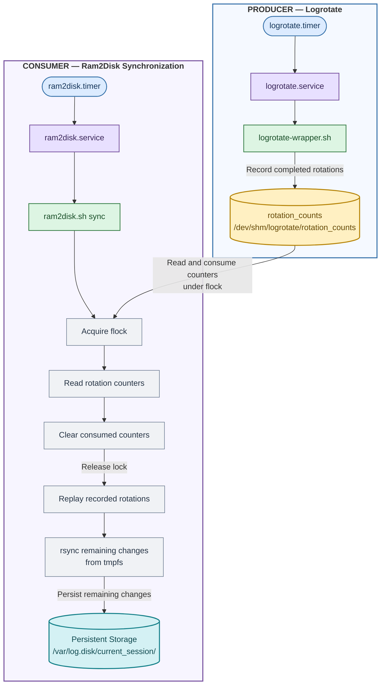

# Ram2Disk Design

## Revision

| Rev | Date | Author | Change Description |
|---|---|---|---|
| 0.1 | 7/29/2026 | Gaurav Nagesh | Initial Version |
| 0.2 | 10/12/2026 | Gaurav Nagesh | Clarify on warm/fast reboot, feature enablement flag, flow diagram & minor corrections

## Table of Contents

- [Revision](#revision)
- [Glossary](#glossary)
- [Scope/Purpose](#scopepurpose)
- [Architecture / Design](#architecture--design)
  - [Overview](#overview)
  - [Storage Layout on Disk](#storage-layout-on-disk)
  - [Why Each Boot Needs a Separate Session Directory](#why-each-boot-needs-a-separate-session-directory)
  - [Ram2Disk Modes of Operation](#ram2disk-modes-of-operation)
    - [Periodic Sync](#periodic-sync)
    - [Boot Restore](#boot-restore)
    - [Orderly Pre-shutdown](#orderly-pre-shutdown)
  - [Need for Rotation Detection and Why Plain rsync Is Not Sufficient](#need-for-rotation-detection-and-why-plain-rsync-is-not-sufficient)
  - [Approach 1: Infer Rotation by Comparing Files](#approach-1-infer-rotation-by-comparing-files)
  - [Approach 2: Record Rotation Events from logrotate](#approach-2-record-rotation-events-from-logrotate)
  - [Trade-offs between the two approaches](#trade-offs-between-the-two-approaches)
    - [Approach 1](#approach-1)
    - [Approach 2](#approach-2)
    - [Design Decision](#design-decision)
- [Ram2Disk Implementation Details](#ram2disk-implementation-details)
  - [Feature Enablement and Runtime Activation](#feature-enablement-and-runtime-activation)
  - [File Hierarchy](#file-hierarchy)
  - [Systemd Integration](#systemd-integration)
  - [Producer-Consumer Flow](#producer-consumer-flow)
  - [Reason for dpkg-divert of the original logrotate binary](#reason-for-dpkg-divert-of-the-original-logrotate-binary)
  - [Behaviour During Unclean Power Loss](#behaviour-during-unclean-power-loss)
  - [Behaviour During Warm/Fast Reboot](#behaviour-during-warmfast-reboot)
- [Conclusion](#conclusion)
- [Additional Notes](#additional-notes)
  - [ram2disk Commands and Examples](#ram2disk-commands-and-examples)
    - [1\] Periodic Sync](#1-periodic-sync)
    - [2\] Boot-Time Restore](#2-boot-time-restore)
    - [3\] Final Shutdown Sync](#3-final-shutdown-sync)
  - [logrotate Wrapper Example](#logrotate-wrapper-example)
  - [Rotation Counter File Example](#rotation-counter-file-example)
  - [Note on rsync internals](#note-on-rsync-internals)

## Glossary

| Term | Meaning |
|---|---|
| **EROFS** | Read-only filesystem error |
| **tmpfs** | Temporary File System that is RAM based |
| **rsync** | Remote synchronization utility |

## Scope/Purpose

The Ram2Disk service is designed for SONiC devices that use `tmpfs` for `/var/log` and require log persistence across system reboots, shutdowns, or unexpected power loss. Since tmpfs is volatile, logs stored only in memory are lost when the system stops running. However, retaining these logs is important for debugging, post-incident analysis and understanding failures across boot sessions.

Currently, `/var/log` resides on disk (disk-backed) on most SONiC devices. However, frequent log appends, log rotation, compression, and metadata updates create sustained write activity. Moving `/var/log` to `tmpfs` can reduce disk wear and lower the likelihood of read-only filesystem (EROFS) issues caused by storage failures or filesystem degradation.

We therefore need a service, called **ram2disk** that:

- Periodically copies logs from the tmpfs-backed `/var/log` to persistent disk in batches
- Performs a final synchronization during an orderly shutdown or reboot
- Restores active logs early during boot so logging can continue across sessions
- Retains previous boot sessions for later analysis
- Minimizes disk writes while preserving the same logical rotation history as
  `/var/log`

Ram2Disk relies on `rsync` utility program for the purpose of backing up logs to disk in a sequential manner in batches. It addresses the log-persistence requirement for devices where /var/log is already configured, or is intended to be configured, on tmpfs. It preserves logs across boot sessions by synchronizing them to persistent storage and restoring them during startup.

This feature does not, by itself, migrate `/var/log` from disk to `tmpfs` on all SONiC devices. The decision to use `tmpfs` still remains platform-specific via the pre-existing `logs_inram` kernel cmdline flag. The Ram2Disk functionality is enabled selectively in the image for required platforms through a new build time flag.

## Architecture / Design

### Overview

**ram2disk** separates active, frequently written logs from persistent historical
storage as follows:

- `/var/log` is backed by **tmpfs** and is the live source used by logging services
- `/var/log.disk` is the disk-backed destination used to preserve logs.
- Periodic synchronization copies changes from **tmpfs** to disk.

**Example view of system when ram2disk is enabled:**

```bash
admin@sonic:~$ df -h
Filesystem      Size  Used Avail Use% Mounted on
tmpfs           988M  116K  988M   1% /var/log
/dev/loop1      3.9G  3.1M  3.7G   1% /var/log.disk
```

```bash
sudo losetup -l /dev/loop1
NAME       SIZELIMIT OFFSET AUTOCLEAR RO BACK-FILE                   DIO LOG-SEC
/dev/loop1         0      0         1  0 /host/disk-img/var-log.ext4   0     512
```

> **Note:** When `/var/log` is not mounted on **tmpfs**, i.e., it is already
> disk-backed, then this is already the final copy and `/var/log.disk` will not
> exist and work as normal.

### Storage Layout on Disk

```bash
/var/log.disk/
|-- current_session/               # Live mirror of /var/log for this boot
|   |-- syslog
|   |-- syslog.1
|   |-- syslog.2.gz
|   |-- frr/bgpd.log
|   `-- ...
|-- session_<timestamp1>/          # Archived previous boot1
|-- session_<timestamp2>/          # Archived previous boot2
|-- legacy_<timestamps>/           # (optional) stray files from a non-tmpfs boot
`-- .boot_id
```

- **`current_session/`** is the persistent mirror of the current boot's
  `/var/log`. Its active and rotated files are kept aligned with the tmpfs source
  during periodic synchronization.
- **`session_<timestampN>`** stores an immutable log snapshot from a past completed
  boot. Multiple session directories may be retained for historical analysis.
- **`legacy_<timestampN>`** contains the log files from when the device was running in non-tmpfs mode (logs_inram=off), before transitioning to tmpfs mode (logs_inram=on). These files are moved into a timestamped directory to distinguish legacy logs persisted on disk from logs managed by the current ram2disk logging mechanism. If no legacy entries are found, no directory is created.
- **`.boot_id`** records the boot associated with **`current_session/`**. It allows
  **ram2disk** to detect a new boot and is also used to derive the archived session
  timestamp.

### Why Each Boot Needs a Separate Session Directory

Logrotate archive numbering is meaningful only within the current log history. A
new boot starts with a fresh tmpfs-backed `/var/log` and begins creating files such
as:

```bash

Before Reboot / Shutdown :
Logs are in sync between the two

tmpfs /var/log/                                 Disk /var/log.disk/
-----------------                               ----------------
syslog                                           syslog
syslog.1                                         syslog.1
syslog.2.gz                                      syslog.2.gz
...                                              ...
...                                              ...
syslog.100.gz                                    syslog.100.gz


After Reboot / Shutdown :
tmpfs will be initially empty and slowly start to fill up as shown below 


Example1 : sync here will overwrite disk files 
tmpfs /var/log/                                  Disk /var/log.disk/
---------------                                 --------------
syslog                                           syslog
                                                 syslog.1
                                                 syslog.2.gz
                                                 ...
                                                 ...
                                                 syslog.100.gz


Example2 : sync here will overwrite disk files 
tmpfs /var/log/                                  Disk /var/log.disk/
---------------                                 --------------
syslog                                           syslog
syslog.1                                         syslog.1
                                                 syslog.2.gz
                                                 ...
                                                 ...
                                                 syslog.100.gz


Example3 : sync here will overwrite disk files 
tmpfs /var/log/                                  Disk /var/log.disk/
---------------                                 --------------
syslog                                           syslog
syslog.1                                         syslog.1
syslog.2.gz                                      syslog.2.gz
                                                 ...
                                                 ...
                                                 syslog.100.gz

                                          
```

The persistent disk may already contain archives from a much older history,
possibly extending to `syslog.100.gz` or beyond. Reusing the same disk directory
across boots would mix two independent numbering sequences. The new boot's
`syslog.1` and `syslog.2.gz` would not correspond to the old files with those
names, and rotation replay could no longer reliably keep tmpfs and disk aligned.

Copying every historical archive from disk back into tmpfs at boot does not make
sense as it increases boot-time work and mixes historical logs with the new boot's
active rotation sequence.

For these reasons, the previous boot's **`current_session/`** directory is moved to
a separate **`session_<timestamp>/`** directory. Only active logs are restored to
tmpfs. The new boot then starts with a fresh **`current_session/`**, while older
sessions remain available on disk for analysis without interfering with current
log rotation.

### Ram2Disk Modes of Operation

#### Periodic Sync

- Determine rotations since the previous sync.
- Replay equivalent renames in **`current_session/`**
- Run **rsync** from `/var/log/` to **`current_session/`**
- Remove old sessions or archives when disk usage is too high.

#### Boot Restore

- Restore active, non-rotated logs from the previous **`current_session/`** into
  tmpfs.
- Rename the previous **`current_session/`** to a timestamped session directory
  **`session_<timestamp1>/`**
- Create a fresh **`current_session/`** for the new boot.

#### Orderly Pre-shutdown

- Perform one final rotation replay and rsync without cleanup to sync all the logs
  to disk before shutdown

### Need for Rotation Detection and Why Plain rsync Is Not Sufficient

Log files are continuously appended, while logrotate periodically renames and
compresses them:

```bash
syslog       -> syslog.1
syslog.1     -> syslog.2.gz
syslog.2.gz  -> syslog.3.gz
```

**rsync** cannot clearly distinguish these files and end up copying/overwriting
files which are redundant. So, if **ram2disk** runs rsync after this shift without
first applying the same rename operations to the disk copy, rsync sees files at
new paths and may transfer archive contents again.

The central design problem is therefore not only copying changed bytes.
**ram2disk** must know how many rotations occurred between sync runs and replay
those rename operations on the persistent mirror before running rsync.

Now there are two approaches in how **ram2disk** can determines the number of
logrotate cycles that occurred since the previous sync:

- **Approach 1** - detects the rotation count indirectly by comparing archive files
  in tmpfs and on disk
- **Approach 2** - detects the rotation count directly using the logrotate verbose
  option

The approaches differ only in how **ram2disk** determines the number of logrotate
cycles that occurred since the previous sync. Both approaches use the general
architecture, storage layout and lifecycle described above.

### Approach 1: Infer Rotation by Comparing Files

It maintains explicit lists of logs whose rotation behavior is known and uses a
function called **`detect_shift`** to infer how many rotations occurred since the
previous sync.

For each configured rotating log, **`detect_shift`** tests candidate shifts from 1
through 8. For a candidate shift `N`, it compares the sizes of two consecutive
compressed archives:

```bash
tmpfs:  base.(N+2).gz and base.(N+3).gz
disk:   base.2.gz     and base.3.gz
```

If both size and checksum pairs match for two consecutive files, the function
assumes that the disk's former `.2.gz` and `.3.gz` files shifted by `N` positions
in tmpfs. The **`mirror_renames`** function then replays that many rotations in the
persistent **`current_session/`** tree before rsync runs.

Using two consecutive files reduces the chance that unrelated archives with the
same size/checksum produce a false match.

### Approach 2: Record Rotation Events from logrotate

Instead of writing our own algorithm for detecting rotation, Approach 2 obtains the
information directly from logrotate itself. Logrotate with verbose output enabled
(`-v`) will provide all information needed. So, we write a wrapper on top of
logrotate called **`logrotate-wrapper.sh`**.

For a normal logrotate invocation, the wrapper:

1. Runs the real logrotate binary with verbose output enabled (`-v`).
2. Captures verbose diagnostics.
3. Parses the `rotating log <base_filename> ...` entries emitted for rotations that
   actually happen.
4. Increments a per-file counter in
   **`/dev/shm/logrotate/rotation_counts`**.
5. Returns the real logrotate exit code and preserves requested verbose or error
   output.

**Example:**

`/dev/shm/logrotate/status`:

```bash
logrotate state -- version 2
"/var/log/syslog" 2026-7-31-3:0:0
"/var/log/dpkg.log" 2026-7-31-3:0:0
"/var/log/auth.log" 2026-7-31-3:0:0
"/var/log/syslog_counter.log" 2026-7-31-3:0:0
"/var/log/apt/term.log" 2026-7-31-3:0:0
"/var/log/frr/bgpd.log" 2026-7-31-3:0:0
"/var/log/apt/history.log" 2026-7-31-3:0:0
"/var/log/telemetry.log" 2026-7-31-3:0:0
"/var/log/alternatives.log" 2026-7-31-3:0:0
"/var/log/swss/sairedis.rec" 2026-7-31-3:0:0
```

`/dev/shm/logrotate/rotation_counts`:

```bash
/var/log/syslog 2
/var/log/auth.log 1
/var/log/frr/bgpd.log 3
/var/log/swss/sairedis.rec 1
```

Counter access is protected with **`flock`**, allowing logrotate and **ram2disk** to
update or consume the counter file without corrupting it.


### Trade-offs between the two approaches


#### Approach 1 

- Does not modify or wrap the system's logrotate executable contents from disk.
- ram2disk must manually maintain the list of logs that may rotate. A new or
  renamed logrotate target can be missed until the script is updated.
- Detection duplicates work already performed by logrotate. logrotate knows
  exactly which files it rotated, while this approach reconstructs that event
  afterward.
- Limitation on the maximum number of log rotations detected
- It needs two prior consecutive `.gz` archives. Newly introduced logs or logs
  with shallow retention may not provide enough history for detection.
- Logs with different logrotate policies require separate handling or explicit
  categorization.


#### Approach 2

- Uses logrotate as the source of truth for which files actually rotated.
- Removes the fixed eight-rotation detection limit.
- Naturally supports newly added logrotate targets under `/var/log`

- Requires system integration through a diverted logrotate wrapper. Packaging,
  upgrades, removal, and recovery procedures must preserve `logrotate.real`.
- Depends on the format of logrotate's verbose output. A logrotate upgrade that
  changes the `rotating log ...` diagnostic format could stop event extraction.

#### Design Decision

Approach 2 is selected. Approach 2 delegates rotation-count detection to the component that performs the
rotation. By forcing logrotate verbose mode internally and recording actual
rotation events, ram2disk receives more accurate input without independently
reconstructing what logrotate already knows. ram2disk remains responsible only for
replaying those known rotations on the disk mirror and synchronizing changed data.


## Ram2Disk Implementation Details

### Feature Enablement and Runtime Activation

Ram2Disk enablement is controlled through two independent mechanisms: a build-time feature flag and the runtime kernel cmdline flag. These mechanisms serve different purposes and must not be treated as interchangeable.

- A new build-time flag `enable_ram2disk=y` controls whether the Ram2Disk feature is enabled in a SONiC image and will be disabled by default. When enabled, the image build includes the Ram2Disk service integration and the associated logrotate divert/wrapper required for log synchronization and restoration. When disabled, the image retains the existing logrotate configuration without the Ram2Disk-specific divert/wrapper or feature integration. This flag allows Ram2Disk to be enabled selectively on supported platforms without introducing a platform-wide change to logrotate behavior. It also allows logging in RAM to remain enabled independently of Ram2Disk.

- The `logs_inram=on` kernel command-line parameter controls whether `/var/log` is configured to use `tmpfs` during initramfs initialization. During initramfs initialization, when `logs_inram` is enabled for the platfrom and the image was built with `enable_ram2disk=y`, the creation of the persistent log filesystem `host/disk-img/var-log.ext4` takes place according to the existing design and the system establishes the `/var/log.disk` mountpoint which is then used by the Ram2Disk service.

The `logs_inram` flag is independent of the build-time `enable_ram2disk` flag. For example, a Switch-BMC platform may have `/var/log` to remain on `tmpfs` but may not require Ram2Disk feature persistence. In this case, logging in RAM can remain enabled while `enable_ram2disk` is disabled, preserving the platform's existing logging configuration without enabling the Ram2Disk service integration.

- Service Start Condition - For images built with both Ram2Disk feature and `logs_inram` enabled, the systemd service uses `ConditionPathIsMountPoint=/var/log.disk` as its runtime start condition. This ensures that the synchronization and restoration operations are executed only when the required persistent log filesystem mount is available.

The presence of this mountpoint is a prerequisite for service execution, not the mechanism that enables the Ram2Disk feature itself. Feature inclusion is controlled by `enable_ram2disk=y`, while the `logs_inram` determines whether the initramfs creates the runtime environment required by the ram2disk service.

Therefore, Ram2Disk feature operations requires both flags to be enabled. If the build-time flag is disabled, logging in RAM can still operate independently, without the Ram2Disk-specific logrotate divert/wrapper and service integration.

### File Hierarchy

Files in `ram2disk/`:

| File | Responsibility |
|---|---|
| `logrotate-wrapper.sh` | Producer that detects completed rotations and records per-file counts |
| `logrotate-counter-functions.sh` | Shared counter and locking library used by the producer and consumer |
| `ram2disk.sh` | Consumer that reads rotation counts, replays renames, synchronizes logs, restores logs, and performs cleanup |
| `ram2disk.service` | Runs the periodic `ram2disk.sh sync` operation |
| `ram2disk.timer` | Schedules the periodic service |
| `ram2disk-restore.service` | Runs boot-time restore before rsyslog begins writing |


### Systemd Integration

- `ram2disk.timer` : Schedules `ram2disk.service` every three minutes, starting at
  minute 5.
- `ram2disk.service` : Runs `/usr/local/bin/ram2disk.sh sync` after logrotate (not strictly) and only
  when `/var/log.disk` is mounted.
- `ram2disk-restore.service` : Runs `/usr/local/bin/ram2disk.sh restore` during boot,
  after the required mounts are available and before `rsyslog.service` and
  `syslog.socket`.

### Producer-Consumer Flow

The implementation uses the following flow:




`logrotate-wrapper.sh` is the **producer** of rotation-count information.
`ram2disk.sh` is the **consumer**. Both use functions from
`logrotate-counter-functions.sh` so counter updates and consumption follow the
same locking and file-update rules.


`logrotate-wrapper.sh`: Rotation Count Producer

The wrapper is installed in place of the stock logrotate command by using
`dpkg-divert`. The original executable remains available as `/usr/sbin/logrotate.real`


### Reason for dpkg-divert of the original logrotate binary

I could have avoided renaming and replacing the original from `/usr/sbin/logrotate` to `/usr/sbin/logrotate.real` and using `logrotate-wrapper.sh` as `/usr/sbin/logrotate` by just replacing the executable call in the `logrotate.service` file as shown 

```
ExecStart=/usr/sbin/logrotate --state /dev/shm/logrotate/status /etc/logrotate.conf

to instead using the wrapper directly like this 

ExecStart=/usr/local/bin/logrotate-wrapper.sh --state /dev/shm/logrotate/status /etc/logrotate.conf 
```

Now in this, whenever logrotate.timer would trigger the logroate.service and the wrapper would execute and populate the `/dev/shm/logrotate/rotation_counts` but if for any other purpose, say during troubleshooting we wanted to manually force a logroate, we/a user currently do `logrotate -f /etc/logrotate.conf` and the logrotation will happen but will not be recorded in the `rotation_counts` file and will break the ram2disk syncing mechanism. 

We could document and suggest to use the `logrotate-wrapper.sh` moving forword from now on instead of directly using logrotate but it is difficult to always keep in mind and follow it as well as prevent any other future service/nettasks which might use logrotate directly. So in order to avoid this, no matter how `logrotate` is invoked (directly by a user or any other service/task/script in the future) should populate the `rotation_counts` file and not break ram2disk. Hence the reason for using `dpkg-divert` which will help prevent overwrites to the wrapper during upgrade of logrotate package. 

### Behaviour During Unclean Power Loss

The log-rotation counters are maintained in `/dev/shm`, which is volatile and gets cleared during a power loss or reboot. If an unexpected power loss occurs after log rotation updates the counters but before the next periodic sync (every 3 minutes), the pre-shutdown procedure will not execute, and the latest in-memory logs may not be persisted to disk. However, this does not affect recovery or subsequent operations. On the next boot, ram2disk restores the active logs from the persisted disk state into tmpfs and logging resumes normally. Since the counters are only relevant to tracking logs currently in memory, they are no longer needed once that in-memory state is lost and recreated. <u>The only expected impact is the potential loss of log data generated since the last successful sync after a power loss. However, the device recovers and continues operating as expected after system boot.</u>

### Behaviour During Warm/Fast Reboot

During a normal shutdown, the ram2disk pre-shutdown routine is triggered when `syslog.socket` stops, allowing the latest in-memory logs to be synced to disk. However, warm/fast reboot uses a direct `kexec` path that bypasses this normal shutdown sequence, so the pre-shutdown routine is not triggered automatically. As a result, log data generated since the last successful sync (up to the 3-minute sync interval) may not be persisted to `/var/log.disk/current/` before the reboot. These unsynced logs are retained in `/host/logs_before_reboot/` as part of the existing warm/fast reboot design.

To ensure consistent log preservation, the warm/fast reboot scripts in the `sonic-utilities` repository will be updated to explicitly invoke the ram2disk pre-shutdown routine whenever the ram2disk feature is enabled, before executing kexec. This ensures that the latest in-memory logs are synced to persistent storage before the reboot, while preserving the existing warm/fast reboot log-retention behaviour. This change is not expected to have any noticeable performance impact on warm/fast reboot, as log copying is already part of the existing mechanism, this change only adjusts the destination directory. Additionally, the overhead of checking whether the ram2disk feature is enabled is minimal.

## Conclusion

Normal log writes occur in tmpfs, persistent writes are batched by
ram2disk, and logrotate's own rotation decisions are reused to keep the disk mirror
aligned. This reduces avoidable archive retransfers, preserves logs across orderly
reboots, retains prior boot sessions for analysis, and minimizes the custom logic
needed to infer rotation behavior.


## Additional Notes

### ram2disk Commands and Examples

The main script accepts three operating modes :
```bash
/usr/local/bin/ram2disk.sh --help
Usage: /usr/local/bin/ram2disk.sh {sync|restore|pre-shutdown}
```

#### 1] Periodic Sync

```bash
/usr/local/bin/ram2disk.sh sync
```

This mode:

1. Reads recorded logrotate counts.
2. Replays those rotations in `/var/log.disk/current_session/`.
3. Runs rsync from tmpfs to disk.
4. Cleans old sessions or archives if disk usage is above the configured limit (Default is 80% of disk usage).

Example rsync command used by the script:

```bash
rsync -a --inplace --no-whole-file /var/log/ /var/log.disk/current_session/
```

Important options:

- `-a` preserves the directory tree, timestamps, permissions, ownership, and other
  file attributes.
- `--inplace` updates the destination file directly instead of creating a complete
  temporary replacement file.
- `--no-whole-file` enables rsync's delta-transfer behavior even for a local copy,
  reducing the amount of changed data written to disk.

#### 2] Boot-Time Restore

```bash
/usr/local/bin/ram2disk.sh restore
```

This restores active logs from the previous `current_session/` directory into tmpfs,
archives the previous boot as `session_<timestamp>/`, creates a new `current_session/`, and
records the new boot ID. Rotated archives are excluded from the restore.

#### 3] Final Shutdown Sync

```bash
/usr/local/bin/ram2disk.sh pre-shutdown
```

This replays pending rotations and performs a final rsync before shutdown or
reboot. It skips cleanup so shutdown is not delayed by deleting historical data.


### logrotate Wrapper Example

Callers continue to invoke logrotate normally:

```bash
/usr/sbin/logrotate /etc/logrotate.conf
```

The wrapper internally runs the real binary with verbose detection:

```bash
/usr/sbin/logrotate.real -v /etc/logrotate.conf
```

If the caller explicitly requests debug mode, the wrapper passes it through
without recording rotations:

```bash
/usr/sbin/logrotate --debug /etc/logrotate.conf
```

### Rotation Counter File Example

The wrapper stores one path and accumulated rotation count per line in:

```text
/dev/shm/logrotate/rotation_counts
```

Example:

```text
/var/log/syslog 2
/var/log/auth.log 1
/var/log/frr/bgpd.log 3
/var/log/swss/sairedis.rec 1
```

This means:

- `syslog` rotated twice since the last successful counter consumption.
- `auth.log` rotated once.
- `frr/bgpd.log` rotated three times.
- `swss/sairedis.rec` rotated once.

During the next sync, ram2disk replays the indicated number of rotations for each
path in `/var/log.disk/current_session/` before invoking rsync. The current implementation
then resets the consumed counters to zero.


### Note on rsync internals

ram2disk uses:

```bash
rsync -a --inplace --no-whole-file /var/log/ /var/log.disk/current_session/
```

- **`-a` / `--archive`** recursively copies the directory tree and preserves
  file attributes such as permissions, ownership, and timestamps.
- **`--no-whole-file`** forces rsync's delta-transfer algorithm for this local
  copy so matching destination blocks can be reused and only changed data needs
  to be transferred.
- **`--inplace`** updates the existing destination file directly instead of
  creating a complete temporary replacement, reducing temporary space and
  avoiding writes to unchanged matching regions.
- In normal working, rsync buffers changed data and generally writes
  it in batches of up to **256 KiB**. Actual storage I/O can still vary because
  of partial buffers and the filesystem or block layer.
