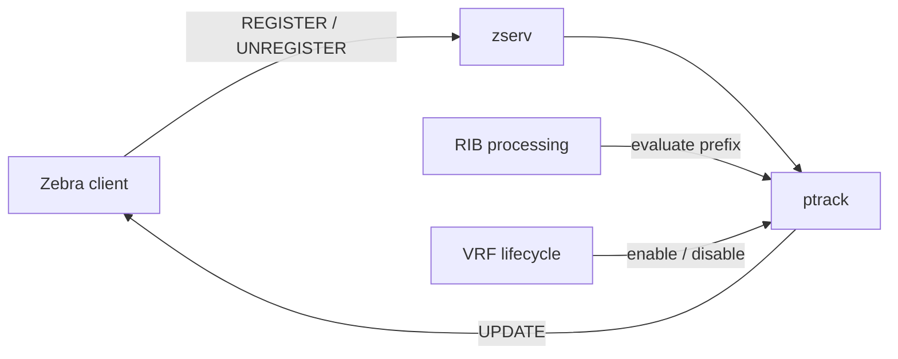
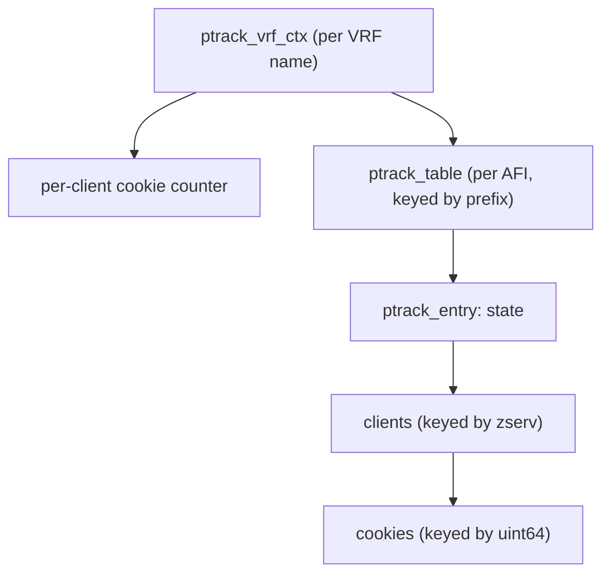
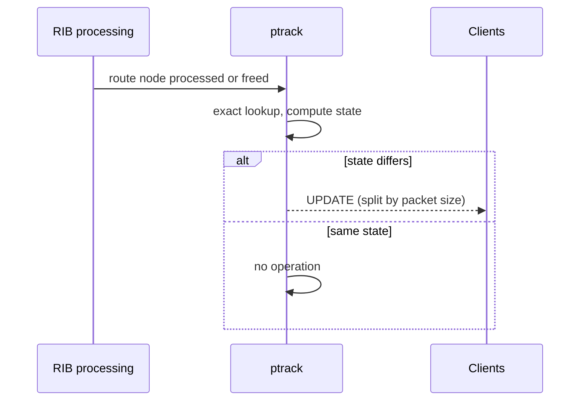

# Zebra Prefix Tracking (ptrack) HLD

# Table of Contents
- [Revision](#revision)
- [About this Manual](#about-this-manual)
- [Definitions/Abbreviations](#definitionsabbreviations)
- [1 Requirements Overview](#1-requirements-overview)
  - [1.1 Functional requirements](#11-functional-requirements)
  - [1.2 Scalability](#12-scalability)
  - [1.3 Warm Restart requirements](#13-warm-restart-requirements)
- [2 Modules Design](#2-modules-design)
  - [2.1 Architecture](#21-architecture)
  - [2.2 Semantics](#22-semantics)
  - [2.3 VRF identity](#23-vrf-identity)
  - [2.4 Data structures](#24-data-structures)
  - [2.5 ZAPI messages](#25-zapi-messages)
  - [2.6 Register and unregister handling](#26-register-and-unregister-handling)
  - [2.7 Flip notification](#27-flip-notification)
  - [2.8 VRF lifecycle](#28-vrf-lifecycle)
  - [2.9 Client disconnect](#29-client-disconnect)
  - [2.10 Zebra restart and startup gate](#210-zebra-restart-and-startup-gate)
- [3 Configuration](#3-configuration)
- [4 Limitations](#4-limitations)

# Revision

| Rev | Date | Author | Change Description |
| - | - | - | - |
| 0.1 | Nov-02-2026 | Sriniketh J | Initial version |

# About this Manual

This document describes Zebra Prefix Tracking (ptrack) in FRR Zebra RIB. A zebra client subscribes to an exact IPv4 or IPv6 prefix in a VRF, and zebra notifies the client each time the prefix flips between REACHABLE and UNREACHABLE.

NHT does not fit this need: it does a longest-prefix match and reports the resolving route. Ptrack is a lighter exact-match service.

Client behavior is out of scope.

# Definitions/Abbreviations

| Term | Description |
| - | - |
| ptrack         | Zebra Prefix Tracking, the feature in this document |
| NHT            | Nexthop Tracking, the existing zebra nexthop registration feature |
| ZAPI           | Zebra API between zebra and its clients |
| zserv          | Zebra Server |
| Cookie         | 64-bit client-supplied value attached to a subscription. Opaque to zebra |
| REACHABLE      | The VRF is active and the exact prefix has at least one route entry |
| UNREACHABLE    | Any other case |

# 1 Requirements Overview

## 1.1 Functional requirements

- Subscribe to an exact IPv4 or IPv6 prefix in a VRF and receive REACHABLE/UNREACHABLE notifications.
- Identify the VRF by name, so subscriptions survive VRF delete and re-add.
- Notify only when the state flips.
- Allow multiple clients, and multiple cookies per client, on the same prefix.
- Remove all subscriptions of a client when it disconnects.

## 1.2 Scalability

Up to **16384** cookies per client per VRF, shared by IPv4 and IPv6.

## 1.3 Warm Restart requirements

Ptrack state lives in zebra memory and is lost on zebra restart. Clients re-register. After a restart, zebra holds initial replies until its startup processing is done (see #2.10).

# 2 Modules Design

## 2.1 Architecture

Ptrack is entirely inside zebra (bgp container). No new process, container or database table.

## 2.2 Semantics

- REACHABLE: the VRF is active and the exact prefix has at least one route entry in the VRF default table that is not being removed.
- Route type, nexthop state (inactive nexthops count), route selection and FIB installation are ignored.
- Exact match only. Unicast only. Default and non-default VRFs supported.
- Host bits are masked by zebra, so `10.1.1.5/24` and `10.1.1.0/24` share one entry. UPDATE carries the masked prefix, so clients must match on the cookie.
- No debounce. A prefix that is already UNREACHABLE produces no message when its VRF goes down.

## 2.3 VRF identity

`vrf_id` changes across VRF delete and add, so subscriptions are keyed by the VRF name in the message payload. The `vrf_id` in the ZAPI header is dummy.

Storage is kept at router level, outside `zebra_vrf`, keyed by name. Each `zebra_vrf` points to its ptrack context when the VRF appears, so route evaluation is a direct pointer access.

## 2.4 Data structures

- Prefix level: one `route_table` per AFI, as `rnh_table` does for NHT.
- Client and cookie levels: rbtrees. A cookie node is about 40 bytes.
- The cookie limit is a variable, configuration support later.

## 2.5 ZAPI messages

Three messages are appended to `zebra_message_types_t`. Names are proposed.

| Message | Direction | Payload |
| - | - | - |
| `ZEBRA_PREFIX_TRACK_REGISTER`   | client to zebra | VRF name, prefix, cookie count, cookies |
| `ZEBRA_PREFIX_TRACK_UNREGISTER` | client to zebra | Same as REGISTER |
| `ZEBRA_PREFIX_TRACK_UPDATE`     | zebra to client | VRF name, prefix, state, cookie count, cookies |

- UPDATE is sent once per client per flip. If the cookies exceed the packet size, it is split into multiple messages with the same prefix and state.

## 2.6 Register and unregister handling

**Register**
1. Parse and validate the whole message (vrf, length, family, prefix length, AFI).
2. Check the cookie limit against the non-duplicate cookies.
3. Mask the prefix.
4. Insert the cookies.
5. Compute the current state from the RIB, store it, and send it to the client.

**Unregister**: remove the existing cookies and skip unknown ones. Free the client node on its last cookie, and the prefix entry on its last client.

**Rejection**: A rejected REGISTER (over the limit, bad prefix, unsupported AFI, unknown VRF, malformed) is logged and dropped whole, with no reply.

A duplicate cookie changes nothing, and zebra re-sends the current state for it.

## 2.7 Flip notification

After a route node is processed or freed, zebra does an exact lookup in the ptrack table of the VRF, computes the state, and compares it with the stored state. On a flip it stores the new state and sends UPDATE to every client of the prefix. There is no tree walk.

## 2.8 VRF lifecycle

- **VRF disable**: before the VRF delete update, all tracked prefixes of the VRF are forced to UNREACHABLE and flips are notified. This also applies when the VRF is retained, if the client doesn't retract.
- **VRF enable / re-add**: zebra attaches the context by name and re-evaluates all tracked prefixes, because retained routes produce no RIB event. No client re-subscribe is needed.

## 2.9 Client disconnect

On client close, zebra walks all VRF contexts, AFI tables and prefixes, and removes the client and its counters.

## 2.10 Zebra restart and startup gate

Zebra sends no reply until its startup processing is done. Entries are still stored and updated meanwhile, so nothing is queued.

- **GR mode**: stale routes are retained, so state is already accurate and the gate is open when clients connect.
- **Non-GR mode**: the gate opens after the stale-route sweep. An event on the zebra event loop then sends the current state of every entry to all its clients and cookies. Clients that left in the meantime are already removed.

# 3 Configuration

No CLI, YANG, CONFIG_DB, SAI or SWSS change. Ptrack is inbuilt into FRR zebra.

# 4 Limitations

1. Exact-prefix match only. If a client needs to track 2 different prefixes for the same cookie then it has to be seperate requests.
2. 16384 cookies per client per VRF, shared by IPv4 and IPv6. An over-limit REGISTER is dropped on the whole with no reply
3. UPDATE carries the masked prefix. Clients must match from the cookie.
