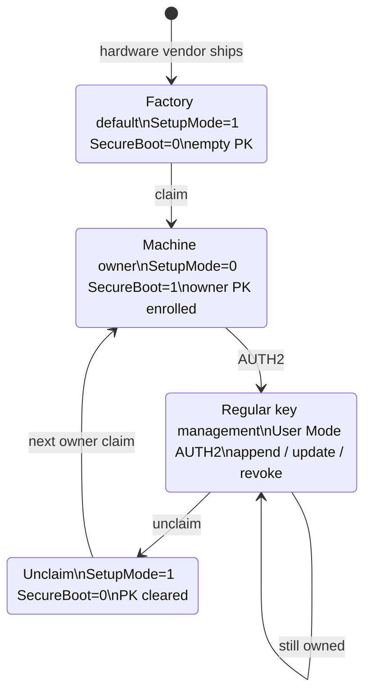
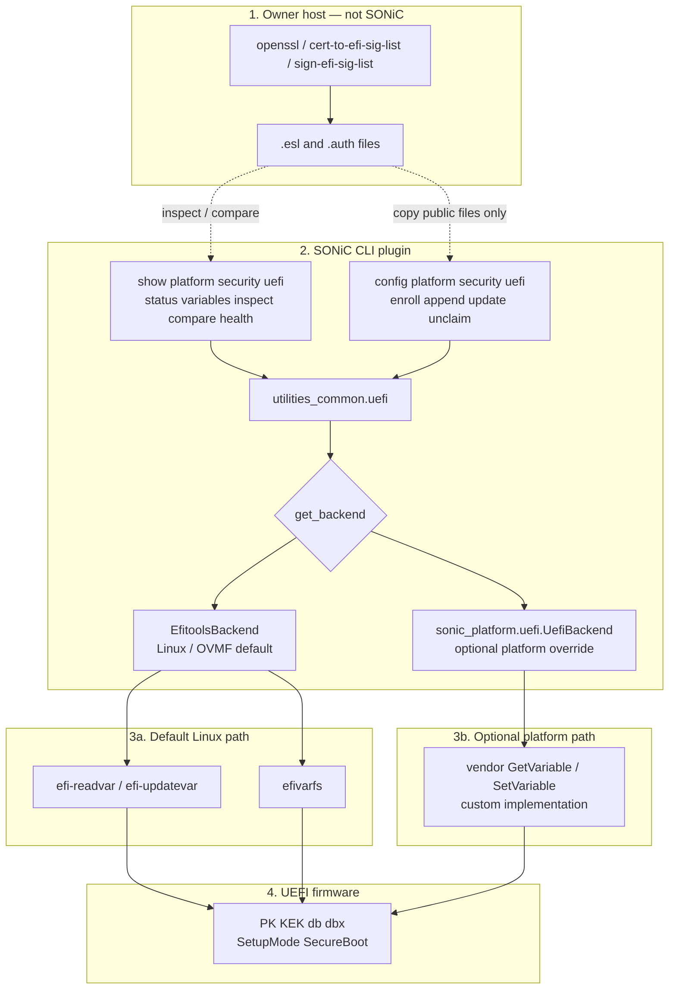

<!-- omit in toc -->
# High Level Design Document

***Revision***

|  Rev  | Date           | Author      | Change Description |
| :---: | :------------: | :---------: | ------------------ |
|  0.1  |   08/25/2023   | Sachin Naik | Initial version    |
|  0.2  |   11/05/2026   | Sachin Naik | Ownership claim/unclaim (OVMF). After-claim PK/KEK/db/dbx samples |
|  0.3  |   11/06/2026   | Sachin Naik | Claim PK is a self-signed AUTH2; dbx/db/KEK remain unsigned ESL |
|  0.4  |   11/12/2026   | Sachin Naik | Cross-references use section names, not TOC numbers |
|  0.5  |   11/12/2026   | Sachin Naik | Secure Boot enable/disable is claim/unclaim only; no firmware-menu knob |
|  0.6  |   11/12/2026   | Sachin Naik | Secure Boot toggle: other UEFI may offer a non-auth switch; this HLD does not |
|  0.7  |   11/12/2026   | Sachin Naik | SignatureOwner GUID is optional; efitools defaults to zeros |
|  0.8  |   11/12/2026   | Sachin Naik | CLI: inspect/compare/health, append, keep unclaim separate from update pk |
|  0.9  |   11/12/2026   | Sachin Naik | Replace UEFI class image with CLI plugin block diagram |
|  0.10 |   11/12/2026   | Sachin Naik | Platform UefiBackend is a custom path, not efivarfs |
|  0.11 |   11/12/2026   | Sachin Naik | Ownership section: Secure Boot state transition diagram |


<!-- omit in toc -->
## Table of Contents
- [Abbreviation](#abbreviation)
- [Scope of this HLD](#scope-of-this-hld)
- [1 Requirements](#1-requirements)
- [2 Overview](#2-overview)
- [3 UEFI components](#3-uefi-components)
  - [3.1 UEFI firmware](#31-uefi-firmware)
  - [3.2 UEFI keys](#32-uefi-keys)
  - [3.3 Authenticated variable](#33-authenticated-variable)
  - [3.4 UEFI modes and Secure Boot flag](#34-uefi-modes-and-secure-boot-flag)
  - [3.5 Secure Boot enable and disable](#35-secure-boot-enable-and-disable)
- [4 Factory default state](#4-factory-default-state)
- [5 Ownership](#5-ownership)
  - [5.1 Ownership model](#51-ownership-model)
  - [5.2 Claim workflow](#52-claim-workflow)
  - [5.3 Enroll keys in Setup Mode](#53-enroll-keys-in-setup-mode)
  - [5.4 Verify ownership claim](#54-verify-ownership-claim)
- [6 UEFI key management](#6-uefi-key-management)
  - [6.1 AUTH2 write models](#61-auth2-write-models)
  - [6.2 Generation of keys and authenticated variable](#62-generation-of-keys-and-authenticated-variable)
  - [6.3 Apply AUTH2 on the device](#63-apply-auth2-on-the-device)
  - [6.4 Append](#64-append)
  - [6.5 Update](#65-update)
  - [6.6 Remove](#66-remove)
  - [6.7 Revoke](#67-revoke)
  - [6.8 Show keys](#68-show-keys)
- [7 Unclaim](#7-unclaim)
  - [7.1 Clear PK (return to Setup Mode)](#71-clear-pk-return-to-setup-mode)
  - [7.2 Factory reset](#72-factory-reset)
  - [7.3 Transfer to another owner](#73-transfer-to-another-owner)
- [8 SONIC implementation](#8-sonic-implementation)
- [9 SONiC CLI commands](#9-sonic-cli-commands)
- [10 Test considerations](#10-test-considerations)


## Abbreviation

| Abbreviation | Description                                  |
| ------------ | -------------------------------------------- |
| PK           | Platform Key.                                |
| KEK          | Key Exchange Key                             |
| db           | UEFI Signature Key Database                  |
| dbx          | Forbidden Signature Key Database              |
| UEFI         | Unified Extensible Firmware Interface        |
| RoT          | Root of Trust                                |
| TPM          | Trusted platform module                      |
| SetupMode    | UEFI global: 1 = Setup Mode, 0 = User Mode   |
| SecureBoot   | UEFI global: 1 = enforcement on, 0 = off     |
| AUTH2        | `EFI_VARIABLE_AUTHENTICATION_2` (timestamp + PKCS#7 + ESL) |
| ESL          | `EFI_SIGNATURE_LIST`                         |


## Scope of this HLD

The **main intent** of this HLD is how a **UEFI platform** is used for Secure Boot key management: Setup Mode claim, User Mode AUTH2 updates of PK/KEK/db/dbx, unclaim by clearing PK, and boot verification against db/dbx. That is standard UEFI (Authenticated Variables and UEFI runtime `GetVariable` / `SetVariable`). Linux **efitools** (`efi-readvar` / `efi-updatevar`) and efivarfs are how the OS talks to that firmware.

**OVMF** is the open reference so anyone can reproduce the model on QEMU/KVM. **Cisco platforms implement this same UEFI model** in their firmware (same variable names, Setup Mode / User Mode, AUTH2). This HLD is not a Cisco-only protocol and not a new SONiC Secure Boot stack. Firmware remains firmware; SONiC does not reimplement OVMF or UEFI runtime.

**SONiC's code contribution is the CLI plugin** (`show` / `config platform security uefi …` in sonic-utilities). The plugin is a thin wrapper over efitools so the NOS can show and apply ESL/AUTH2 files the owner built off-box. It does not generate keys, does not build AUTH2, does not take a `.key`, and does not replace platform firmware.

| Piece | Role in this HLD | Who implements it |
| ----- | ---------------- | ----------------- |
| UEFI Authenticated Variables, Setup Mode / User Mode, `SecureBoot` | How key management and boot verification work | UEFI platform firmware (OVMF as the open reference; Cisco and others that implement the same UEFI model) |
| openssl, `cert-to-efi-sig-list`, `sign-efi-sig-list` | Owner host: keys and AUTH2 / ESL | Owner tooling (efitools), not SONiC |
| `efi-readvar`, `efi-updatevar`, efivarfs | OS path to UEFI runtime services | Linux / efitools, not SONiC |
| `show platform security uefi …` / `config platform security uefi …` CLI plugin | Operator interface on the NOS | **SONiC** |

[UEFI components](#3-uefi-components) through [Unclaim](#7-unclaim) are the UEFI platform model (what firmware must do, what OVMF does, what Cisco platforms implement). [SONIC implementation](#8-sonic-implementation) and [SONiC CLI commands](#9-sonic-cli-commands) are the SONiC CLI plugin on top of that model.

## 1 Requirements
SONiC runs on switching hardware from multiple vendors. Some of this hardware implements a hardware root of trust and UEFI firmware, which helps establish Secure Boot. The hardware vendor ships the machine. The **platform owner** must be able to take ownership of that machine: enroll their own Platform Key, constrain boot to owner-trusted images, and later manage PK, KEK, db, and dbx under their own policy (rotate keys, add signers, revoke compromised keys).

This requires a SONiC **CLI plugin** that can show and apply UEFI Secure Boot variables (the plugin calls efitools; see Scope):
1. Ownership claim (enroll dbx, db, KEK, then PK while the device is in Setup Mode).
2. Show enrolled PK, KEK, db, and dbx, and show `SetupMode` / `SecureBoot`.
3. Add, replace, remove, and revoke those keys after claim (AUTH2).
4. Unclaim: clear PK to return to Setup Mode for factory reset or transfer to another owner.

## 2 Overview
The UEFI Secure Boot feature is introduced in UEFI spec version 2.3.1 onwards. It verifies image integrity and authenticity before load. The spec also describes how UEFI keys are managed.

**This community HLD follows the OVMF model** as the open UEFI reference (QEMU/KVM). Cisco platforms implement the same UEFI key-management model in firmware. Variable access is UEFI runtime services, exposed to Linux as efivarfs and used through `efi-readvar` / `efi-updatevar`. The SONiC CLI plugin is the NOS-side code in this design; it wraps those tools. Platforms that cannot use this UEFI/efitools path are out of scope here.

TPM measured boot is out of scope.

## 3 UEFI components

### 3.1 UEFI firmware
Typically the UEFI is a modern replacement for traditional BIOS. This HLD uses **OVMF** (Open Virtual Machine Firmware) as the open reference: QEMU/KVM firmware that implements UEFI Authenticated Variables, Setup Mode / User Mode, and `SecureBoot`. Cisco platforms implement that same UEFI model. Behavior called out below (including when `SecureBoot` becomes 1) is the OVMF reference so the community can test it without vendor firmware.

### 3.2 UEFI keys
UEFI keys are types of UEFI variables. These are cryptographic keys used in Unified Extensible Firmware Interface (UEFI) firmware. These are asymmetric cryptographic keys that come with public and private key pairs. The private keys are used for signing data and public keys are enrolled in the UEFI device for verifying signed data.

There are multiple keys involved in the UEFI secure boot implementations. The platform owner sets the policies around these keys.


**1.	Platform Key(PK):** The PK establishes trust between the **platform owner** and UEFI firmware. The owner enrolls the public PK during ownership claim ([Ownership](#5-ownership)), not before the VM is provisioned. The PK private key stays with the owner and is used to authorize later PK and KEK AUTH2 updates.

**2.	Key Exchange Key(KEK)**: KEK authorizes changes to db and dbx. The owner enrolls the public KEK (unsigned ESL during claim; AUTH2 signed by PK after claim). The KEK private key stays with the owner and is used to authorize db and dbx AUTH2 updates, including NOS signing keys.

**3.	Signature Database (Db):** It contains secure boot verification keys that are used to verify the signed image artifacts during system boot(Ex: bootloader and kernel).

**4.	Forbidden Signature Database(Dbx):** These contain keys that are revoked. These keys are used during the secure boot process to prevent the booting of certain bootloaders or images which are signed by the private part of these keys.

### 3.3 Authenticated variable
These are a special type of UEFI variable that supports cryptographic authentication and integrity verification. The authenticated variable enables a secure way of storing and accessing UEFI variables within the UEFI environment and ensures that the UEFI variable remains tamper-proof and authentic. Since authenticated variables are signed objects, the UEFI firmware can verify them before accessing or updating them.

UEFI Secure Boot databases (PK, KEK, db, dbx) are time-based authenticated variables. An update is an AUTH2 object: a timestamp, a PKCS#7 signature, and the new signature list (ESL). Firmware verifies the signature against the currently enrolled trust source, then writes the ESL. In Setup Mode (no PK), firmware accepts **unsigned ESL** for **KEK, db, and dbx**. The **first PK** is a **self-signed AUTH2** (signed by the PK being enrolled); firmware verifies it against the certificate in that payload ([Factory default state](#4-factory-default-state) and [Ownership](#5-ownership)).

Once a PK is enrolled, the platform is in User Mode. From that point, **any** add, replace, remove, or revoke of PK, KEK, db, or dbx **must** be an AUTH2 authenticated variable. Firmware must reject unsigned ESL, raw certificates, and any payload that does not verify.

| Variable | After claim, AUTH2 must be signed by |
| -------- | ------------------------------------ |
| PK       | Current PK                           |
| KEK      | Current PK                           |
| db       | A currently enrolled KEK             |
| dbx      | A currently enrolled KEK             |

Private keys never go on the DUT. openssl / `sign-efi-sig-list` stay on the owner host. The switch only runs `efi-readvar` / `efi-updatevar` on the file the owner copies in.

### 3.4 UEFI modes and Secure Boot flag
UEFI reports two global variables. They are not the same object: `SetupMode` is whether a Platform Key is enrolled; `SecureBoot` is whether firmware is currently verifying boot images. This HLD does **not** treat `SecureBoot` as a separate operator switch. Enable and disable follow claim and unclaim ([Secure Boot enable and disable](#35-secure-boot-enable-and-disable)).

| Variable | Role | Values |
| -------- | ---- | ------ |
| `SetupMode` | Whether a Platform Key is enrolled | `1` = Setup Mode (no PK). `0` = User Mode (PK present) |
| `SecureBoot` | Whether firmware verifies boot images against db/dbx | `1` = enforcing. `0` = not enforcing |

**Setup Mode** (`SetupMode=1`): No PK is enrolled. This is the factory and provisioning state. Firmware accepts KEK, db, and dbx as unsigned signature lists. The first PK must be a self-signed AUTH2. `SecureBoot` is `0`. Firmware does not reject unsigned boot images.

**User Mode** (`SetupMode=0`): A PK is enrolled. Updates to PK and KEK must be AUTH2 objects signed by the current PK. Updates to db and dbx must be AUTH2 objects signed by a KEK. Enrolling the platform owner's self-signed PK AUTH2 is the standard UEFI transition from Setup Mode to User Mode. That PK enrollment is the ownership claim: the owner's PK becomes the root of the key hierarchy. It does not require a reboot (`SetupMode` becomes `0` on the same `SetVariable`).

**Secure Boot flag**: `SecureBoot` is not the same variable as `SetupMode`. It is computed at POST. After claim, `SetupMode=0` immediately but `SecureBoot` stays `0` until the **next reboot**. After unclaim, `SetupMode=1` immediately but `SecureBoot` stays `1` until the next reboot. The running OS is not re-checked. Enroll of dbx/db/KEK/PK does **not** require a reboot between those writes.

Enforcing Secure Boot is both flags together after that reboot: `SetupMode=0` and `SecureBoot=1`.

### 3.5 Secure Boot enable and disable

This HLD has **no independent Secure Boot on/off**. Enforcement is a consequence of ownership: claim turns it on, unclaim turns it off.

Other UEFI firmware may provide an explicit enable/disable (firmware setup checkbox, `SecureBootEnable`, or a similar switch) while PK stays enrolled. That write is not AUTH2.

**Why an explicit non-auth model is a problem.** Anyone with serial or KVM at boot can interrupt POST (ESC, DEL, F2, or a similar hotkey), open the firmware menu, and turn Secure Boot off without the PK private key. Escape or other control sequences on the firmware console can also land in that menu. Enforcement then becomes a UI switch instead of an authenticated ownership operation.

**SONiC CLI.** `show platform security uefi status` reads `SetupMode` and `SecureBoot`. There is no `config platform security uefi secureboot enable` or `disable`.

- **Enable:** ownership claim (dbx, db, KEK, then self-signed PK AUTH2). After reboot, `SecureBoot=1`.
- **Disable:** unclaim (empty-PK AUTH2 signed by the current PK). After reboot, `SecureBoot=0`.

**Custom UEFI (platform firmware, not the SONiC plugin).** Stock OVMF may still expose the setup-menu path above. A production UEFI that implements this HLD must **not** provide an unauthenticated Secure Boot on/off:

- No boot-interrupt hotkey or setup menu that sets `SecureBoot=0` (or `SecureBootEnable`) while PK remains.
- No OS-writable Secure Boot enable flag independent of PK.
- The only authenticated way to start enforcement is claim (enroll PK). The only authenticated way to stop it is unclaim (clear PK).

That firmware policy is the custom-UEFI part of this design. The SONiC CLI does not implement it; it only shows the flags and applies ESL/AUTH2. Platforms that keep a firmware “Secure Boot: Disabled” switch while PK is present do not match this HLD.

## 4 Factory default state
OVMF factory default is Setup Mode with empty PK/KEK/db/dbx so the owner can enroll keys. The platform is not yet constrained to owner-signed images. Do not enroll a PK before claim ([Enroll keys in Setup Mode](#53-enroll-keys-in-setup-mode)).

| Attribute | Factory default |
| --------- | --------------- |
| UEFI mode | Setup Mode (`SetupMode = 1`) |
| Secure Boot | Disabled (`SecureBoot = 0`) |
| PK, KEK, db, dbx | Not enrolled (empty) |
| Firmware | OVMF (unsigned or test-signed as shipped with the VM) |
| SONiC / bootloader | A bootable image so the claim path can run. Install the owner-signed image before PK. |

There is no end-user CLI that only enables or disables Secure Boot. Enable is ownership claim; disable is unclaim ([Secure Boot enable and disable](#35-secure-boot-enable-and-disable)).

`efi-readvar` lists PK, KEK, db, and dbx. It does not print `SetupMode` or `SecureBoot`. Read those from efivarfs. The first four bytes are attributes; the following byte is the value (`1` or `0`).

```bash
efi-readvar PK            # expect empty / length 0

od -An -tu1 -j4 -N1 \
  /sys/firmware/efi/efivars/SetupMode-8be4df61-93ca-11d2-aa0d-00e098032b8c
# expect 1  Setup Mode

od -An -tu1 -j4 -N1 \
  /sys/firmware/efi/efivars/SecureBoot-8be4df61-93ca-11d2-aa0d-00e098032b8c
# expect 0  Secure Boot disabled
```

## 5 Ownership

The platform ships from the **hardware vendor** in factory default. The **machine owner** takes it with **claim**, then does **regular key management** under that PK. **Unclaim** returns the machine toward factory default so a later owner can claim.



`SecureBoot=1` after the reboot that follows claim. `SecureBoot=0` after the reboot that follows unclaim. There is no separate Secure Boot on/off ([Secure Boot enable and disable](#35-secure-boot-enable-and-disable)).

### 5.1 Ownership model
The UEFI platform provides the variable store (OVMF as the open reference; Cisco platforms implement the same model). The platform owner owns the machine after claim.

| Role | Responsibility |
| ---- | -------------- |
| **UEFI firmware** | Starts in **Setup Mode** with empty PK/KEK/db/dbx. Implements standard Authenticated Variables (OVMF reference; Cisco platforms implement the same UEFI model). Does not retain the owner's private keys. |
| **Platform owner** | Generates PK, KEK, and db (and dbx) off the device. Holds private keys. Signs ONIE and SONiC. Builds ESL/AUTH2. Enrolls keys. Sets boot policy in db/dbx. |
| **SONiC** | CLI **plugin** only: show variables and apply the owner's files (unsigned ESL for dbx/db/KEK in Setup Mode; self-signed PK AUTH2 for claim; AUTH2 after claim). The plugin calls `efi-readvar` / `efi-updatevar`. Does not generate or store owner private keys. |

This HLD is the **owner-provisioned PK** model on OVMF: factory is Setup Mode, owner PK is last during claim.

Ownership claim is one ordered procedure. PK is last. Enrolling PK leaves Setup Mode and enters User Mode immediately (`SetupMode=0`). `SecureBoot=1` and db/dbx image checks apply on the **next reboot**, not during the enroll writes. Enrolling PK against an ONIE or SONiC image that db will not verify can leave the VM unbootable on that reboot.

### 5.2 Claim workflow
Do these steps **in order**. Stay in Setup Mode until PK is written.

```
  Off device
    1. Generate PK, KEK, db (and dbx) as in Generation of keys and authenticated variable
    2. Sign ONIE / SONiC with a key that will be enrolled in db
  On device  (Setup Mode)
    3. Confirm SetupMode = 1, SecureBoot = 0, PK empty
    4. Install the owner-signed OS that db will trust
    5. Enroll dbx, db, KEK, then PK (no reboot between these writes)
  After PK
    6. Verify SetupMode = 0 and keys present
    7. Reboot, then verify SecureBoot = 1
```

1. **Generate keys** off the device ([Generation of keys and authenticated variable](#62-generation-of-keys-and-authenticated-variable)). Private keys stay on the owner host. Only public certificates are written to the device.

2. **Sign boot artifacts** with a private key whose certificate will be in db: ONIE and the owner's SONiC. In the secure-upgrade path the same db key signs shim and the SONiC image; `sonic-installer` / ONIE verify the new image against db before write.

3. **Confirm factory default** on the device ([Factory default state](#4-factory-default-state)): `SetupMode = 1`, `SecureBoot = 0`, PK empty.

4. **Install owner-signed ONIE and SONiC** before PK. Once SONiC is running, `sonic-installer` can replace the image (verify against db before write). USB is only if SONiC is not running.

5. **Enroll keys.** dbx, db, KEK, then PK. No reboot between these writes. PK last: that write enters User Mode (`SetupMode = 0`) immediately.

6. **Verify NVRAM.** `SetupMode = 0` and PK / KEK / db present. `SecureBoot` is still `0` until reboot.

7. **Reboot once.** Then `SecureBoot = 1` and OVMF verifies shim / OS against db. This is when claim enforcement starts.

### 5.3 Enroll keys in Setup Mode
While `SetupMode = 1`, firmware accepts **unsigned ESL** for **dbx, db, and KEK**. The **first PK** is a **self-signed AUTH2**: it is signed by the PK being enrolled. There is no enrolled PK yet, so firmware verifies that AUTH2 against the certificate in the payload, writes PK, and enters User Mode immediately (`SetupMode = 0`). That mode change does not require a reboot.

Enroll **dbx, db, KEK, then PK**. PK is last.

```
  Setup Mode
       │  1. DBx.esl   →  dbx   (unsigned ESL, `-e`)
       │  2. DB.esl    →  db    (unsigned ESL, `-e`)
       │  3. KEK.esl   →  KEK   (unsigned ESL, `-e`)
       │  4. PK.auth   →  PK    (last, self-signed AUTH2, `-f`)
       ▼
  User Mode (SetupMode = 0) immediately
  SecureBoot = 1 and image check on next reboot
```

**Owner host — build ESLs and the self-signed PK AUTH2:**

```bash
# SignatureOwner is optional (omit -g and efitools uses all-zero GUID).
uuidgen --random > GUID.txt
SIGNATURE_OWNER="$(< GUID.txt)"
VENDOR_GUID_GLOBAL=8be4df61-93ca-11d2-aa0d-00e098032b8c
cert-to-efi-sig-list -g "$SIGNATURE_OWNER" PK.crt  PK.esl
cert-to-efi-sig-list -g "$SIGNATURE_OWNER" KEK.crt KEK.esl
cert-to-efi-sig-list -g "$SIGNATURE_OWNER" db.crt  DB.esl
sign-efi-sig-list -g "$VENDOR_GUID_GLOBAL" -k PK.key -c PK.crt PK PK.esl PK.auth
```

dbx may be empty or a SHA-256 ESL of a revoked digest. Concatenate multiple KEK or db certificates into one ESL before enroll if the owner has more than one. Private keys stay on the owner host; only the public ESL/AUTH2 files go to the device.

**Device — enroll.** dbx, db, and KEK are unsigned ESL. PK is the self-signed AUTH2:

```bash
efi-updatevar -e -f DBx.esl dbx
efi-updatevar -e -f DB.esl  db
efi-updatevar -e -f KEK.esl KEK
efi-updatevar -f PK.auth PK
```

`-e` prepends an empty AUTH2 header (no PKCS#7) and writes the ESL. That is valid for dbx, db, and KEK in Setup Mode. Do **not** enroll PK as unsigned ESL (`-e`). The claim PK must be a self-signed AUTH2 (`-f`).

After PK is written, further PK/KEK/db/dbx changes must be AUTH2 as in [UEFI key management](#6-uefi-key-management). A reboot is not required to finish the four enroll writes or to enter User Mode. A reboot is required before `SecureBoot=1` and before OVMF enforces db on the bootloader.

### 5.4 Verify ownership claim
Immediately after PK (no reboot required for this check):

```bash
od -An -tu1 -j4 -N1 \
  /sys/firmware/efi/efivars/SetupMode-8be4df61-93ca-11d2-aa0d-00e098032b8c
# expect 0  User Mode

efi-readvar PK
efi-readvar KEK
efi-readvar db
```

If PK is missing, the platform is still in Setup Mode. Do not treat KEK/db enrollment alone as a completed claim.

Then reboot. OVMF computes `SecureBoot` at POST:

```bash
od -An -tu1 -j4 -N1 \
  /sys/firmware/efi/efivars/SecureBoot-8be4df61-93ca-11d2-aa0d-00e098032b8c
# expect 1  Secure Boot enabled
```

## 6 UEFI key management

This section is **after ownership claim** (User Mode, `SetupMode=0`). Setup Mode claim enrollment is [Enroll keys in Setup Mode](#53-enroll-keys-in-setup-mode). Private keys stay on the owner host. Only public certificates (ESL / AUTH2) are written to the device. All samples below are the **OVMF** path: `sign-efi-sig-list` on the owner host, `efi-updatevar -f` on the VM (`-e` is Setup Mode dbx/db/KEK only; claim PK is `-f`).

| Variable | AUTH2 signed by | VendorGuid (`sign-efi-sig-list -g`) | Typical use after claim |
| -------- | --------------- | ----------------------------------- | ----------------------- |
| PK       | Current PK      | `EFI_GLOBAL_VARIABLE` `8be4df61-93ca-11d2-aa0d-00e098032b8c` | Rotate or add a Platform Key |
| KEK      | Current PK      | same `EFI_GLOBAL_VARIABLE`          | Add/rotate who may change db/dbx |
| db       | An enrolled KEK | `EFI_IMAGE_SECURITY_DATABASE` `d719b2cb-3d3a-4596-a3bc-dad00e67656f` | Add/rotate boot signers |
| dbx      | An enrolled KEK | same `EFI_IMAGE_SECURITY_DATABASE`  | Blacklist a signer or image |

AUTH2 `EFI_TIME` must be later than the last successful write of that variable.

### 6.1 AUTH2 write models

OVMF implements two UEFI write models. They differ only by `EFI_VARIABLE_APPEND_WRITE` on the AUTH2. There is no per-certificate delete.

| Model | `sign-efi-sig-list` | `efi-updatevar` | Effect |
| ----- | ------------------- | --------------- | ------ |
| **Append** | `-a` | `-f file.auth <var>` | Add the ESL to the existing variable. Current certificates stay. |
| **Update** (replace) | no `-a` | `-f file.auth <var>` | Replace the **entire** variable with this ESL. Certificates not in the ESL are gone. |

| Operation | Write model | PK | KEK | db | dbx |
| --------- | ----------- | -- | --- | -- | --- |
| Add a certificate | Append | yes | yes | yes | yes (forbidden cert) |
| Replace the store | Update | yes | yes | yes | yes |
| Remove a certificate | Update of the remaining ESL | yes (must leave a PK or it is unclaim) | yes | yes | use update of remaining dbx |
| Revoke a signer or image | Append to dbx | — | — | — | yes |
| Show | `efi-readvar` | yes | yes | yes | yes |

### 6.2 Generation of keys and authenticated variable

Key and AUTH2 creation happens **off the device**. dbx is not a key pair; it is a list of forbidden certificates and/or image hashes.

```bash
openssl req -newkey rsa:2048 -nodes -keyout PK.key -new -x509 -sha256 -days 365 -subj "/CN=Platform key/" -out PK.crt
openssl req -newkey rsa:2048 -nodes -keyout KEK.key -new -x509 -sha256 -days 365 -subj "/CN=Key Exchange Key/" -out KEK.crt
openssl req -newkey rsa:2048 -nodes -keyout db.key -new -x509 -sha256 -days 365 -subj "/CN=Database key/" -out db.crt
```

Private keys stay on the owner host. Public certificates are wrapped as x509 and enrolled.

The two `-g` flags are different. Do not swap them.

- `sign-efi-sig-list -g` is the UEFI **VendorGuid** of the variable (table above). That one is required: PK/KEK use `EFI_GLOBAL_VARIABLE`, db/dbx use `EFI_IMAGE_SECURITY_DATABASE`.
- `cert-to-efi-sig-list -g` is **SignatureOwner**, a label on each ESL entry. It is **not** required for AUTH2. Firmware verifies the PKCS#7 against the enrolled PK or KEK; it does not use this GUID. If `-g` is omitted, efitools writes an all-zero SignatureOwner (`00000000-0000-0000-0000-000000000000`). A non-zero value (for example `uuidgen`) only helps `efi-readvar` tell your entries apart from others.

```bash
# optional owner tag; omit -g on cert-to-efi-sig-list to get zeros
uuidgen --random > GUID.txt
SIGNATURE_OWNER="$(< GUID.txt)"
VENDOR_GUID_GLOBAL=8be4df61-93ca-11d2-aa0d-00e098032b8c
VENDOR_GUID_IMAGE=d719b2cb-3d3a-4596-a3bc-dad00e67656f
```

Update AUTH2 (no `-a`) signed by the **currently enrolled** PK or KEK:

```bash
# PK  (signed by current PK)
cert-to-efi-sig-list -g "$SIGNATURE_OWNER" PK.crt PK.esl
sign-efi-sig-list -g "$VENDOR_GUID_GLOBAL" -k PK.key -c PK.crt PK PK.esl PK.auth

# KEK (signed by current PK)
cert-to-efi-sig-list -g "$SIGNATURE_OWNER" KEK.crt KEK.esl
sign-efi-sig-list -g "$VENDOR_GUID_GLOBAL" -k PK.key -c PK.crt KEK KEK.esl KEK.auth

# db  (signed by current KEK)
cert-to-efi-sig-list -g "$SIGNATURE_OWNER" db.crt db.esl
sign-efi-sig-list -g "$VENDOR_GUID_IMAGE" -k KEK.key -c KEK.crt db db.esl db.auth

# dbx forbidden cert (signed by current KEK). Add -a to append instead of replace.
cert-to-efi-sig-list -g "$SIGNATURE_OWNER" revoked.crt revoked.esl
sign-efi-sig-list -g "$VENDOR_GUID_IMAGE" -k KEK.key -c KEK.crt dbx revoked.esl dbx.auth
```

Add `-a` on `sign-efi-sig-list` to build an **append** AUTH2. That flag does not change VendorGuid. SignatureOwner stays whatever was in the ESL (zeros if `cert-to-efi-sig-list` had no `-g`).

### 6.3 Apply AUTH2 on the device

Copy only the `.auth` file. Do not copy `.key`.

```bash
efi-updatevar -f PK.auth  PK
efi-updatevar -f KEK.auth KEK
efi-updatevar -f db.auth  db
efi-updatevar -f dbx.auth dbx
```

Or `sudo config platform security uefi update <var> <file.auth>`. The CLI does not re-sign. Append vs replace is already in the AUTH2 (`-a` or not).

OVMF writes NVRAM immediately (`efi-readvar` shows the new list). A reboot is not required for the variable store. A reboot is required before a **db/dbx** change affects the next firmware image check (`SecureBoot=1`). PK/KEK changes apply to the next AUTH2 immediately.

### 6.4 Append

Append adds certificates. Existing entries remain. `sign-efi-sig-list -a`.

#### Append PK

Some OVMF builds keep a single PK. If append PK is rejected, use [Update](#65-update) instead. After a successful append, either enrolled PK can sign later PK/KEK AUTH2. User Mode continues.

```bash
openssl req -newkey rsa:2048 -nodes -keyout PK2.key -new -x509 -sha256 -days 365 \
  -subj "/CN=Platform key 2/" -out PK2.crt
cert-to-efi-sig-list -g "$SIGNATURE_OWNER" PK2.crt PK2.esl
sign-efi-sig-list -g "$VENDOR_GUID_GLOBAL" -k PK.key -c PK.crt -a PK PK2.esl pk.append.auth
efi-updatevar -f pk.append.auth PK
```

#### Append KEK

```bash
openssl req -newkey rsa:2048 -nodes -keyout KEK2.key -new -x509 -sha256 -days 365 \
  -subj "/CN=Key Exchange Key 2/" -out KEK2.crt
cert-to-efi-sig-list -g "$SIGNATURE_OWNER" KEK2.crt KEK2.esl
sign-efi-sig-list -g "$VENDOR_GUID_GLOBAL" -k PK.key -c PK.crt -a KEK KEK2.esl kek.append.auth
efi-updatevar -f kek.append.auth KEK
```

#### Append db

```bash
openssl req -newkey rsa:2048 -nodes -keyout db2.key -new -x509 -sha256 -days 365 \
  -subj "/CN=Database key 2/" -out db2.crt
cert-to-efi-sig-list -g "$SIGNATURE_OWNER" db2.crt db2.esl
sign-efi-sig-list -g "$VENDOR_GUID_IMAGE" -k KEK.key -c KEK.crt -a db db2.esl db.append.auth
efi-updatevar -f db.append.auth db
```

#### Append dbx (forbidden cert)

See [Revoke](#67-revoke). Append is the usual revoke write so existing dbx entries stay.

### 6.5 Update

Update replaces the whole store. Do not pass `-a`. Certificates omitted from the ESL are no longer enrolled. Sign with the **currently** enrolled PK or KEK. After a PK update, later PK and KEK AUTH2 must be signed by the **new** PK. After a KEK update, later db and dbx AUTH2 must be signed by a **remaining** KEK.

#### Update PK (stay in User Mode)

ESL is the new PK certificate. This is **not** unclaim. Unclaim is an empty PK ESL (returns Setup Mode, [Unclaim](#7-unclaim)); do not use that unless you intend to leave User Mode.

```bash
openssl req -newkey rsa:2048 -nodes -keyout newPK.key -new -x509 -sha256 -days 365 \
  -subj "/CN=Platform key/" -out newPK.crt
cert-to-efi-sig-list -g "$SIGNATURE_OWNER" newPK.crt newPK.esl
sign-efi-sig-list -g "$VENDOR_GUID_GLOBAL" -k PK.key -c PK.crt PK newPK.esl pk.update.auth
efi-updatevar -f pk.update.auth PK
```

#### Update KEK

ESL is the complete new KEK list. Concatenate every KEK certificate that must remain.

```bash
openssl req -newkey rsa:2048 -nodes -keyout newKEK.key -new -x509 -sha256 -days 365 \
  -subj "/CN=Key Exchange Key/" -out newKEK.crt
cert-to-efi-sig-list -g "$SIGNATURE_OWNER" newKEK.crt newKEK.esl
sign-efi-sig-list -g "$VENDOR_GUID_GLOBAL" -k PK.key -c PK.crt KEK newKEK.esl kek.update.auth
efi-updatevar -f kek.update.auth KEK
```

#### Update db

ESL is the complete new db. Include every certificate that must still verify shim / OS.

```bash
openssl req -newkey rsa:2048 -nodes -keyout newdb.key -new -x509 -sha256 -days 365 \
  -subj "/CN=Database key/" -out newdb.crt
cert-to-efi-sig-list -g "$SIGNATURE_OWNER" newdb.crt newdb.esl
# cat extra.esl newdb.esl > DB.update.esl   # if more certs must remain
sign-efi-sig-list -g "$VENDOR_GUID_IMAGE" -k KEK.key -c KEK.crt db newdb.esl db.update.auth
efi-updatevar -f db.update.auth db
```

#### Update dbx

Replace the whole forbidden list. Prefer [Revoke](#67-revoke) unless you intend to drop existing dbx entries.

```bash
cert-to-efi-sig-list -g "$SIGNATURE_OWNER" revoked.crt revoked.esl
sign-efi-sig-list -g "$VENDOR_GUID_IMAGE" -k KEK.key -c KEK.crt dbx revoked.esl dbx.update.auth
efi-updatevar -f dbx.update.auth dbx
```

### 6.6 Remove

UEFI has no per-certificate delete. Remove is an **update** (no `-a`) whose ESL is every certificate that must **remain**. Append cannot remove. Signers are the same as update.

**Warning (db):** Removing a db certificate that currently signs the running bootloader (shim) is potentially destructive if `SecureBoot=1`. The next reboot will fail OVMF image verification. The running NOS is not killed immediately. Linux CLI cannot recover that state. Recovery is OVMF Setup (clear PK). Do not remove the only signer of the installed bootloader until a replacement signer is in db.

#### Remove a PK certificate

Drop PK2, keep the original PK. Sign with a currently enrolled PK. User Mode continues. An empty PK ESL is unclaim (Setup Mode), not this sample.

```bash
cert-to-efi-sig-list -g "$SIGNATURE_OWNER" PK.crt PK.esl
sign-efi-sig-list -g "$VENDOR_GUID_GLOBAL" -k PK.key -c PK.crt PK PK.esl pk.remove.auth
efi-updatevar -f pk.remove.auth PK
```

#### Remove a KEK certificate

Drop KEK2, keep KEK. Later db/dbx AUTH2 must be signed by a remaining KEK.

```bash
cert-to-efi-sig-list -g "$SIGNATURE_OWNER" KEK.crt KEK.esl
sign-efi-sig-list -g "$VENDOR_GUID_GLOBAL" -k PK.key -c PK.crt KEK KEK.esl kek.remove.auth
efi-updatevar -f kek.remove.auth KEK
```

#### Remove a db certificate

Example: db has three entries; drop the second.

```bash
efi-readvar -v db -o DB-orig.esl
sig-list-to-certs DB-orig.esl DB-orig
openssl x509 -inform der -in DB-orig-1.der -out DB-orig-1.pem
openssl x509 -inform der -in DB-orig-2.der -out DB-orig-2.pem
openssl x509 -inform der -in DB-orig-3.der -out DB-orig-3.pem
# discard DB-orig-2.pem
cert-to-efi-sig-list -g "$SIGNATURE_OWNER" DB-orig-1.pem DB-orig-1.esl
cert-to-efi-sig-list -g "$SIGNATURE_OWNER" DB-orig-3.pem DB-orig-3.esl
cat DB-orig-1.esl DB-orig-3.esl > DB.remain.esl
sign-efi-sig-list -g "$VENDOR_GUID_IMAGE" -k KEK.key -c KEK.crt db DB.remain.esl db.remove.auth
efi-updatevar -f db.remove.auth db
```

### 6.7 Revoke

dbx is the forbidden signature database. When `SecureBoot=1`, OVMF checks dbx **before** db. A dbx match refuses the image even if the same cert is still in db. Removing a cert from db only stops it granting trust. Putting it in dbx **blocks** it.

Revoke is an **append** AUTH2 (`-a`) so existing dbx entries stay. KEK signs; VendorGuid is `EFI_IMAGE_SECURITY_DATABASE`.

**Warning:** If that cert or hash currently signs the running boot chain and `SecureBoot=1`, the next reboot will fail OVMF verification. Prefer: enroll the replacement db cert, then append the old cert/hash to dbx, then remove it from db.

| Entry | ESL | Effect |
| ----- | --- | ------ |
| Forbidden certificate | X.509 of the revoked signer (`cert-to-efi-sig-list`) | Any image signed by that private key is refused |
| Forbidden digest | SHA-256 of one PE/COFF image (`hash-to-efi-sig-list`) | That binary is refused; other images from the same signer can still boot if they remain in db |

#### Revoke a certificate (blacklist a signer)

```bash
cert-to-efi-sig-list -g "$SIGNATURE_OWNER" compromised.crt compromised.esl
sign-efi-sig-list -g "$VENDOR_GUID_IMAGE" -k KEK.key -c KEK.crt -a dbx compromised.esl dbx.revoke.auth
efi-updatevar -f dbx.revoke.auth dbx
```

#### Revoke one image (blacklist a hash)

```bash
hash-to-efi-sig-list -g "$SIGNATURE_OWNER" compromised.efi compromised.hash.esl
sign-efi-sig-list -g "$VENDOR_GUID_IMAGE" -k KEK.key -c KEK.crt -a dbx compromised.hash.esl dbx.hash.revoke.auth
efi-updatevar -f dbx.hash.revoke.auth dbx
```

dbx does not remove the certificate from db. After a compromise, append to dbx, then omit that cert from a db [Update](#65-update) or [Remove](#66-remove).

### 6.8 Show keys

```bash
efi-readvar PK
efi-readvar KEK
efi-readvar db
efi-readvar dbx
```

`SetupMode` / `SecureBoot` are not printed by `efi-readvar`. Use `show platform security uefi status` or the efivarfs `od` commands in [Factory default state](#4-factory-default-state).

## 7 Unclaim

Unclaim returns OVMF from User Mode to **Setup Mode** so the platform can be factory-reset or claimed by a **new owner**. In the OVMF model that write is a PK **update** AUTH2 whose ESL is **empty**, signed by the **currently enrolled PK**. That is not the same as [Update](#65-update) “update PK” with a new certificate (that stays in User Mode).

Private keys never go on the VM. The current owner builds `PK.empty.auth` on the owner host.

### 7.1 Clear PK (return to Setup Mode)

```bash
VENDOR_GUID_GLOBAL=8be4df61-93ca-11d2-aa0d-00e098032b8c
: > empty.esl
sign-efi-sig-list -g "$VENDOR_GUID_GLOBAL" -k PK.key -c PK.crt PK empty.esl PK.empty.auth
efi-updatevar -f PK.empty.auth PK
```

Or `sudo config platform security uefi unclaim PK.empty.auth`. Do **not** use `update pk` with a new PK certificate for this.

OVMF result:

| When | `SetupMode` | `SecureBoot` | PK | KEK / db / dbx |
| ---- | ----------- | ------------ | -- | -------------- |
| Immediately after empty PK | `1` | often still `1` until POST | empty | often still present |
| After reboot | `1` | `0` | empty | often still present |

A reboot is not required for the PK clear itself. A reboot is required before `SecureBoot=0` (OVMF computes `SecureBoot` at POST). Unsigned images can boot after that.

OVMF does **not** always erase KEK/db/dbx when PK is deleted. Treat leftover databases as untrusted. The next claim must overwrite them in Setup Mode ([Enroll keys in Setup Mode](#53-enroll-keys-in-setup-mode): unsigned ESL for dbx, db, KEK, then a self-signed PK AUTH2) before the new PK.

Verify after the empty-PK write:

```bash
od -An -tu1 -j4 -N1 \
  /sys/firmware/efi/efivars/SetupMode-8be4df61-93ca-11d2-aa0d-00e098032b8c
# expect 1

efi-readvar PK
# empty / length 0
```

Then reboot and confirm `SecureBoot=0`.

### 7.2 Factory reset

Goal: same as [Factory default state](#4-factory-default-state) so a later owner can claim.

1. Current owner builds `PK.empty.auth` ([Clear PK (return to Setup Mode)](#71-clear-pk-return-to-setup-mode)) and applies it.
2. Confirm `SetupMode=1`. Reboot. Confirm `SecureBoot=0`, PK empty.
3. While still in Setup Mode, overwrite leftover stores with empty or new unsigned ESL so old db signers cannot remain after the next PK:

```bash
: > empty.esl
efi-updatevar -e -f empty.esl dbx
efi-updatevar -e -f empty.esl db
efi-updatevar -e -f empty.esl KEK
```

4. Leave the VM in Setup Mode (no PK). That is factory default. A future owner runs [Ownership](#5-ownership).

If step 3 is skipped, old KEK/db/dbx may still be in NVRAM. They are not enforced while `SecureBoot=0`, but they can surprise the next claim unless overwritten before PK.

### 7.3 Transfer to another owner

The current owner does **not** give `PK.key` / `KEK.key` / `db.key` to the next owner. The next owner generates a new hierarchy and claims.

```
  Owner A (User Mode)
    1. Build PK.empty.auth signed by A's PK
    2. efi-updatevar -f PK.empty.auth PK
    3. Reboot; SetupMode=1, SecureBoot=0
  Setup Mode
    4. Overwrite dbx, db, KEK (unsigned ESL) — empty, or owner B's lists
    5. Owner B installs B-signed ONIE/SONiC (db will trust B)
    6. Owner B enrolls B's dbx, db, KEK, then PK last (Ownership)
  Owner B (User Mode)
    7. Reboot; SetupMode=0, SecureBoot=1
```

Owner B's claim is the same procedure as first claim. PK last. If owner B enrolls PK while owner A's db is still present, the next boot may still trust A's images or fail B's images. Always replace db (and KEK/dbx) in Setup Mode **before** B's PK.

## 8 SONIC implementation

The UEFI platform (OVMF reference; Cisco firmware that implements the same model) owns key storage and verification. Linux efitools talk to UEFI runtime services. SONiC does not replace either. The **SONiC contribution is the CLI plugin**. It dispatches show/enroll/append/update/unclaim to that path:

- show status: efivarfs `SetupMode` / `SecureBoot` (`efi-readvar` does not print these)
- show variables: `efi-readvar`
- inspect / compare: parse AUTH2/ESL on the host; does not apply
- enroll dbx/db/KEK in Setup Mode: `efi-updatevar -e` with an unsigned ESL
- enroll PK (claim): `efi-updatevar -f` with a self-signed PK AUTH2
- append in User Mode: `efi-updatevar -a -f` with AUTH2 (`sign-efi-sig-list -a`; revoke is append to dbx)
- update / remove in User Mode: `efi-updatevar -f` with AUTH2 (replace the whole store)
- unclaim: `efi-updatevar -f` of an empty-PK AUTH2 signed by the current PK ([Unclaim](#7-unclaim)). Separate from `update pk` (that stays in User Mode)

The plugin is a thin wrapper (getVariable / setVariable). The **default** backend is efitools + efivarfs (Linux / OVMF). AUTH2/ESL files are still built on the owner host with openssl and `sign-efi-sig-list`. Private keys never go on the DUT. A platform package may replace `EfitoolsBackend` with `sonic_platform.uefi.UefiBackend`; the CLI commands stay the same. That override is a **custom** GetVariable / SetVariable implementation. It is not required to use efitools or efivarfs.



The Linux kernel provides efivarfs, which exposes EFI runtime variables as files. Mount it to access the variables:

```
sudo mount -t efivarfs none /sys/firmware/efi/efivars

Ex: UEFI key variables represented as sysfs file

/sys/firmware/efi/efivars/PK-8be4df61-93ca-11d2-aa0d-00e098032b8c
/sys/firmware/efi/efivars/KEK-8be4df61-93ca-11d2-aa0d-00e098032b8c
/sys/firmware/efi/efivars/db-d719b2cb-3d3a-4596-a3bc-dad00e67656f
/sys/firmware/efi/efivars/dbx-d719b2cb-3d3a-4596-a3bc-dad00e67656f
```


On Linux/OVMF, efivarfs files are often `FS_IMMUTABLE`. `efi-updatevar` fails until the immutable bit is cleared. The CLI will clear it around the write when it can; otherwise it returns that error.

## 9 SONiC CLI commands

This is the SONiC contribution. The plugin is apply-only for writes. AUTH2/ESL files are built on the owner host. The CLI does not create AUTH2, does not take a private key, and does not retry on firmware reject. Writes need `sudo` / config privilege and `-y` to skip the confirm prompt.

```
show platform security uefi status
show platform security uefi variables {all,pk,kek,db,dbx}
show platform security uefi inspect <file.auth|file.esl>
show platform security uefi compare <var> <file.auth|file.esl>
show platform security uefi health

config platform security uefi enroll [-y] <var> <file.esl>
config platform security uefi enroll [-y] pk <file.auth>
config platform security uefi append [-y] <var> <file.auth>
config platform security uefi update [-y] <var> <file.auth>
config platform security uefi unclaim [-y] PK.empty.auth
```

`<var>` is one of `pk`, `kek`, `db`, `dbx`. There is no CLI that only toggles `SecureBoot` ([Secure Boot enable and disable](#35-secure-boot-enable-and-disable)).

| Command | Role |
| ------- | ---- |
| `status` | `SetupMode` and `SecureBoot` from efivarfs |
| `variables` | Enrolled PK/KEK/db/dbx (`efi-readvar`) |
| `inspect` | Dump AUTH2/ESL layout (EFI_TIME, PKCS#7 digest/key OIDs, certs or hashes). Does not apply. Empty ESL is the unclaim payload |
| `compare` | Diff current store vs a file (what append would add, what update would drop). Does not apply |
| `health` | Hygiene warnings (Setup Mode leftover keys, expiry, db/dbx overlap). Firmware may still trust expired certs |
| `enroll` | Setup Mode: unsigned ESL for dbx/db/kek (`efi-updatevar -e`); `enroll pk` is the claim self-signed AUTH2 (`-f`) |
| `append` | User Mode AUTH2 with `efi-updatevar -a`. Revoke is `append dbx` |
| `update` | User Mode AUTH2 replace (`efi-updatevar -f`). Remove is `update` of the remaining ESL. `update pk` with a **new certificate** stays in User Mode |
| `unclaim` | Empty-PK AUTH2; returns to Setup Mode ([Unclaim](#7-unclaim)) |

`unclaim` is a separate command on purpose. The efitools write is the same shape as `update pk` (AUTH2 `-f` to PK), but the operator intent is not. `update pk` with a new cert rotates the Platform Key and **stays in User Mode**. `unclaim` applies an **empty** PK ESL, returns to Setup Mode, and is how Secure Boot is turned off in this HLD. A distinct verb, confirm prompt (“return to Setup Mode”), and a file argument that is only `PK.empty.auth` keep those two operations from being confused. `inspect` of that file shows `ESL: empty`.

This CLI was exercised on OVMF: `status`, `variables`, `inspect`, `compare`, `health`, Setup Mode `enroll` of dbx/db/kek then `enroll pk` (`SetupMode` 1→0 with no reboot), then `unclaim` (`SetupMode` 0→1 with no reboot).

Return values follow normal SONiC CLI:

- success: exit 0. show prints; config prints nothing extra after efitools succeeds.
- failure: non-zero exit and an error on stderr. The CLI surfaces the efitools / firmware reason.

Expected failures for enroll/append/update/unclaim: missing file; not root; efivarfs not mounted; wrong mode (unsigned ESL after PK, or unsigned PK in Setup Mode); AUTH2 signature rejected (wrong PK/KEK, timestamp not newer, malformed AUTH2); immutable efivarfs; firmware reject.

## 10 Test considerations
The sonic-mgmt can cover UEFI key management including at least:

1. Factory default: `SetupMode=1`, `SecureBoot=0`, PK empty ([Factory default state](#4-factory-default-state)).
2. Ownership claim: enroll dbx, db, KEK as unsigned ESL, then self-signed PK AUTH2, with no reboot between writes; `SetupMode=0` and keys present immediately; after reboot `SecureBoot=1` ([Ownership](#5-ownership)).
3. After claim, unsigned ESL writes are rejected. Unsigned PK ESL is rejected in Setup Mode.
4. Add, update, remove, and revoke AUTH2 for PK, KEK, db, and dbx ([UEFI key management](#6-uefi-key-management)).
5. Remove/revoke of an in-use db signer is documented as destructive; next boot fails verification when `SecureBoot=1`.
6. Unclaim: empty-PK AUTH2; `SetupMode=1` immediately; after reboot `SecureBoot=0` ([Unclaim](#7-unclaim)). `update pk` with a new cert must not be treated as unclaim.
7. Factory reset: after unclaim, overwrite leftover KEK/db/dbx in Setup Mode ([Factory reset](#72-factory-reset)).
8. Transfer: owner B claims with B's keys after A's unclaim; B's db is enrolled before B's PK ([Transfer to another owner](#73-transfer-to-another-owner)).
9. No independent Secure Boot toggle: there is no `secureboot enable` / `disable` CLI. `SecureBoot` becomes `1` only after claim plus reboot, and `0` only after unclaim plus reboot ([Secure Boot enable and disable](#35-secure-boot-enable-and-disable)).
10. `unclaim` is not `update pk` with a new certificate. `inspect` of `PK.empty.auth` shows an empty ESL. `compare` / `health` do not apply files.
