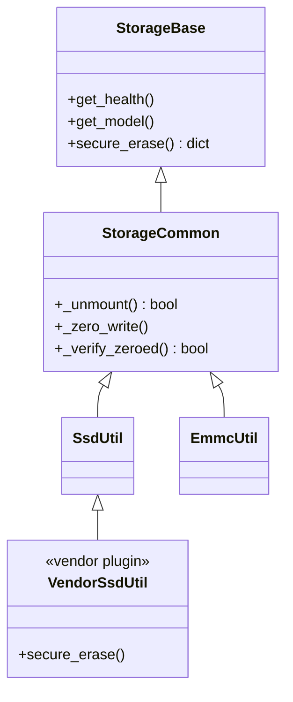
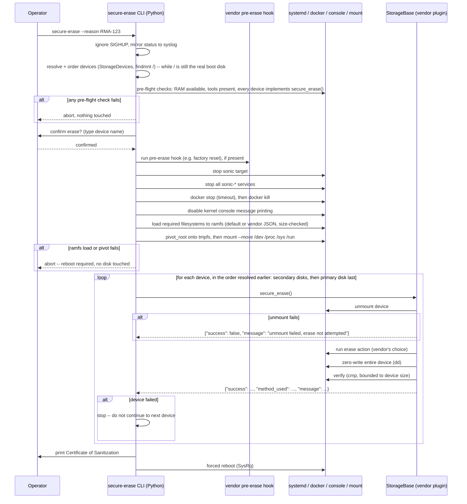

# NIST-Compliant Secure Erase — HLD

### Rev 0.1 ###

### Revision ###

| Rev | Date | Author | Change Description |
|:---:|:---:|:---:|---|
| 0.1 | 2026-10-12 | Pavan Balthila | Initial version |

## Motivation

SONiC has no built-in way to securely and irrecoverably sanitize onboard storage (SSD/eMMC/USB) before a device is decommissioned, RMA'd, or repurposed — operators today have to do this manually, outside of SONiC, with no guarantee the running system doesn't interfere with the erase, that the erase actually happened, or that it meets any recognized sanitization standard.

This design adds a `secure_erase()` Platform API capability — implemented per block storage device (SSD/eMMC/USB) — and a `secure-erase` CLI to invoke it, sanitizing data per NIST SP 800-88 Rev.1 guidelines. It safely quiesces the system, pivots its own execution onto a RAM-resident filesystem before touching any disk, then erases and verifies — so the operation is safe to run even against the disk the system is currently booted from, not just a secondary disk.

---

## Flow Summary

- Before anything is touched, the orchestrator resolves and orders every target device (secondary disks first, primary/boot disk last) while `/` still refers to the real disk, and validates available RAM, required tools, and that every device actually implements `secure_erase()` — aborting here if anything fails.
- A vendor pre-erase hook then runs, for anything vendor-specific that must happen before quiesce (e.g. a factory reset).
- The orchestrator quiesces the system: stops the `sonic` target, stops all `sonic-*` services, stops then kills all docker containers, and disables kernel message printing to console.
- It loads the required filesystems into a ramfs — a default list, or a vendor override via JSON, size-checked against a configured threshold — then pivots onto that ramfs (`pivot_to_ramfs`), moving the remaining needed filesystems into the new root right after (these are mounted, not copied).
- From that point, execution is fully RAM-resident and safe to keep running even after a disk is erased.
- For each device, in the order already resolved, the orchestrator calls that device's `secure_erase()` — if any device fails, it stops immediately rather than continuing to the next one.
- `secure_erase()` itself does all of it for its device in one method: unmount (aborting that device's erase if unmount fails), run the erase (the vendor's own choice of method), zero-write the entire device, then verify with a full byte-for-byte compare against zero.
- Only block storage devices are in scope — no separate non-block/flash handling.
- Once every device is verified, the orchestrator prints a sanitization certificate and force-reboots the device.

---

## Design

### 1. Scope: block storage devices only

This design covers SSD/eMMC/USB — ordinary block devices, already auto-discovered today via `StorageDevices` (`/sys/block/*` scan). That mechanism is reused as-is and needs no changes; there is no separate registration mechanism for non-block storage.

For platforms with multiple disks, the orchestrator distinguishes the primary/boot disk from secondary disks by resolving which block device backs the root filesystem (e.g. via `findmnt /`), using the list `StorageDevices` already provides — this is purely an orchestrator-side detail used to decide erase order, not a new Platform API method. This has to happen before the ramfs pivot (§5): `findmnt /` means something different once `/` has been pivoted onto the tmpfs, so the order must be resolved and captured first.

### 2. `StorageBase.secure_erase()` — one method per disk, start to finish

A vendor implements a single method that does the whole job for its device — unmount, run the vendor-specific erase command, zero-write the entire device, verify — and returns a plain result:

```python
class StorageBase(object):
    ...
    def secure_erase(self):
        """
        Unmounts, erases per NIST SP 800-88 Rev.1 guidelines, and verifies this device.
        Destructive/irreversible. The vendor implementation decides the erase method
        internally (NIST clear vs. purge, which tool, etc.) -- nothing about it is
        parameterized by the caller.

        Must only be called after the system has already pivoted onto a RAM-resident
        root (see the pre-erase orchestrator, §5) — otherwise this call, and the
        process running it, can vanish along with the disk it's erasing.

        Returns:
            A dict:
                {
                    "success": bool,
                    "method_used": <human-readable description of the erase method actually run>,
                    "message": <human-readable detail, or error text on failure>
                }

        Raises:
            NotImplementedError if this disk/vendor implementation does not support secure erase
        """
        raise NotImplementedError
```

The unmount, zero-write, and verification steps are identical for every disk type, so they live once as shared helpers on `StorageCommon` (`_unmount()`, `_zero_write()`, `_verify_zeroed()`) — a vendor's `secure_erase()` calls those and only has to supply the actual erase action itself.

### 3. Example vendor implementation

```python
# device/<vendor>/<platform>/plugins/ssd_util.py
class SsdUtil(GenericSsdUtil):
    def secure_erase(self):
        if not self._unmount():
            return {"success": False, "method_used": "n/a", "message": "unmount failed, erase not attempted"}

        subprocess.check_call(["hdparm", "--yes-i-know-what-i-am-doing", "--sanitize-block-erase", self.device_name])
        self._zero_write()

        if not self._verify_zeroed():
            return {"success": False, "method_used": "hdparm sanitize-block-erase + zero-write", "message": "verification failed"}
        return {"success": True, "method_used": "hdparm sanitize-block-erase + zero-write", "message": "erase completed and verified"}
```

### 4. Vendor pre-erase hook (runs first, before anything else)

Some vendors need to do something specific to them before secure-erase starts quiescing the system at all. This is an optional, checked-for script, run as the very first step:

```python
def run_pre_erase_hook(platform):
    hook = "/usr/share/sonic/device/{}/pre_erase_hook".format(platform)
    if os.path.exists(hook):
        subprocess.check_call([hook])
```

Default is a no-op — a vendor that doesn't need one simply doesn't ship the file. A vendor might use this hook to run their own factory-reset logic before anything else starts.

### 5. Pre-flight validation, quiesce, pivot to ramfs, then erase in order

Once the operator has confirmed, the CLI runs a single orchestrator, strictly in this order:

1. Ignore `SIGHUP` (`signal.signal(signal.SIGHUP, signal.SIG_IGN)`) and start mirroring every status line to syslog, not just the console — so a dropped operator session (SSH/console) can't kill the process mid-flight, and the outcome is still recoverable after reconnecting even if nobody was watching when it finished.
2. Resolve and order every target device while `/` still refers to the real boot disk: get the list from `StorageDevices`, resolve the primary/boot disk via `findmnt /`, and order secondary disks first, primary last. This must happen now, not after the pivot (step 10) — `findmnt /` reports the tmpfs afterwards, not the original boot disk.
3. Validate preconditions, and abort before touching anything if any fail: enough available RAM for the ramfs budget, required tools present, and every resolved device actually implements `secure_erase()` (hasn't been left raising `NotImplementedError`).
4. Run the vendor pre-erase hook (§4), if present.
5. Stop the `sonic` target.
6. Stop all `sonic-*` services.
7. Stop, then kill, all docker containers (`docker stop` with a timeout, then `docker kill` anything still running).
8. Disable kernel message printing to console, so kernel messages don't land on the operator's screen mid-erase.
9. Load the required filesystems into a ramfs: resolve the filesystem list — a built-in default, or a vendor override via a JSON config file naming explicit mounts — check their total size against a configured threshold, and copy them into a tmpfs. `/dev`, `/proc`, `/sys`, and `/run` are **not** copied — they're live kernel views, not real files — only empty mountpoints for them are created now; they get mounted into the new root in the next step.
10. `pivot_to_ramfs`: `pivot_root` onto the tmpfs, then `mount --move` `/dev /proc /sys /run` from the old root into the new one. `/proc` in particular must be available before anything else runs: `StorageCommon`'s I/O-counter helpers and the final forced reboot (step 12) both depend on it. Abort here — before touching any disk — if either the ramfs load or the pivot itself fails.
11. For each device, in the order resolved in step 2, call its `secure_erase()` (§2). If any device fails — including a failed unmount inside `secure_erase()` itself — stop immediately rather than continuing to the next device. Most platforms only have one disk, so this keeps the failure policy simple instead of designing elaborate partial-failure handling for a rare case.
12. Once every device reports success, print the Certificate of Sanitization and force a reboot via SysRq.

Vendor override of the ramfs filesystem list:

```json
// device/<vendor>/<platform>/secure_erase_ramfs.json (optional)
{
    "filesystems": ["/", "/usr"],
    "max_size_gb": 6
}
```

If absent, the orchestrator falls back to a built-in default (the root filesystem, since that's always needed to keep Python/`sonic_platform`/`click` running). Either way, it computes the real on-disk size of every listed filesystem first and refuses to proceed if the total exceeds `max_size_gb` — a RAM-fit safety check before committing to the pivot. `/dev /proc /sys /run` are mounted rather than copied (step 9), so they don't count toward this budget.

### 6. Erasure and verification

After its own vendor-specific erase command, every `secure_erase()` call (§2) always also does an explicit zero-write pass over the whole device, then verifies the result with a full byte-for-byte compare — so a command that reports "success" but didn't actually change anything gets caught, and the end state is unambiguous (every byte on the device is verified zero), not just a statistical sample.

##### Default Erasure (Zero-Writing)

```bash
dd if=/dev/zero of=/dev/sda bs=1M status=progress
```

##### Verification

```bash
cmp -n "$(blockdev --getsize64 /dev/sda)" /dev/zero /dev/sda
```

The `-n` is required: `/dev/zero` never reaches EOF, so an unbounded `cmp` against a finite block device would always report a length mismatch (`cmp: EOF on /dev/sda`) — even on a perfectly-zeroed disk — and exit non-zero regardless of whether the data actually matches. Limiting the comparison to exactly the device's real size (`blockdev --getsize64`) makes the exit code a correct pass/fail signal: `0` means every byte compared equal to zero, any other code means it didn't.

### 7. End state

There is no "return to service" path. Once every device's `secure_erase()` has reported success, the orchestrator prints a **Certificate of Sanitization** (device model/serial, NIST SP 800-88 Rev.1 compliant erase method used, pass/fail per device) and forces an immediate reboot via SysRq (`echo b > /proc/sysrq-trigger`), bypassing a normal shutdown since the disk it would sync against is gone. The device is expected to come back up into a rescue/reinstall flow, not resume normal operation.

---

## Class diagram



---

## Sequence diagram



---

## Summary of changes needed

| Component | Change |
|---|---|
| `sonic_platform_base/sonic_storage/storage_base.py` | Add `secure_erase()` (PD-abstract, no erase-type parameter — the vendor decides the method internally; default raises `NotImplementedError`) |
| `sonic_platform_base/sonic_storage/storage_common.py` | Add shared `_unmount()` (returns bool), `_zero_write()`, `_verify_zeroed()` helpers so vendors don't duplicate unmount/erase-verification logic in every `secure_erase()` override |
| `device/<vendor>/<platform>/plugins/ssd_util.py` / `emmc_util.py` | Implement `secure_erase()`: unmount (abort if it fails), run vendor erase action, zero-write, verify |
| `device/<vendor>/<platform>/pre_erase_hook` (new, optional) | Vendor-specific pre-erase hook, run first, before any quiesce step (e.g. factory reset) |
| `device/<vendor>/<platform>/secure_erase_ramfs.json` (new, optional) | Vendor override of the default ramfs filesystem list and size threshold |
| `sonic-utilities/secureerase/main.py` | CLI resolves and orders target devices, confirms with the operator, then runs the orchestrator: pre-flight validation (RAM, tools, `secure_erase()` support) before touching anything, pre-erase hook, quiesce (stop target/services/dockers, disable console logging), load fs to ramfs, `pivot_to_ramfs` with `/dev /proc /sys /run` moved in (abort on failure), loop calling `secure_erase()` per device in resolved order (stop immediately on any device failure), certificate, forced reboot |
