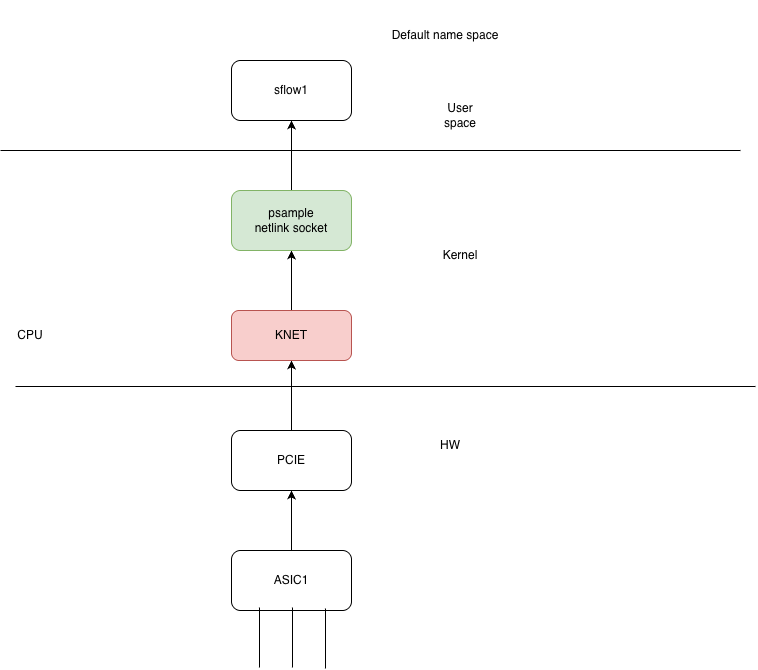
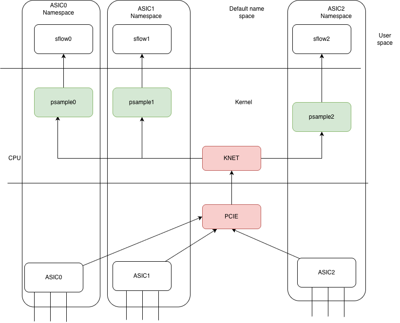

# sFlow Support on T2 Chassis in Packet Mode

## Table of Contents

1. [Revision History](#1-revision-history)
2. [Scope](#2-scope)
3. [Definitions and Abbreviations](#3-definitions-and-abbreviations)
4. [Overview and Use Case](#4-overview-and-use-case)
5. [Requirements](#5-requirements)
6. [Architecture](#6-architecture)
7. [High-Level Design](#7-high-level-design)
8. [SAI API and SDK Changes](#8-sai-api-and-sdk-changes)
9. [Configuration and Management](#9-configuration-and-management)
10. [Warmboot and Fastboot Impact](#10-warmboot-and-fastboot-impact)
11. [Memory Consumption](#11-memory-consumption)
12. [Restrictions, Limitations, and Non-Requirements](#12-restrictions-limitations-and-non-requirements)
13. [Testing Requirements](#13-testing-requirements)
14. [Open Questions and Action Items](#14-open-questions-and-action-items)

## 1. Revision History

| Version | Date | Author | Description |
| --- | --- | --- | --- |
| 0.1 | 2026-10-20 | Sridhar Talari Rajagopal, Cisco | Initial draft for sFlow support on T2 chassis in packet mode. |
| 0.2 | 2026-10-23 | Sridhar Talari Rajagopal, Cisco | Cleaned up document structure and terminology; added revision history and unit and system test tables. |
| 0.3 | 2026-10-27 | Sridhar Talari Rajagopal, Cisco | Editorial cleanup: fixed typos and wording, restructured the high-level design, feature enablement, and design choices sections, and populated open questions. |

## 2. Scope

This document describes the high-level design changes required to support sFlow on a T2 chassis operating in packet mode (`DEVICE_METADATA.localhost.switch_type = chassis-packet`).
The scope includes suppport of ingress sampling on designated line-card front-panel interfaces and delivery of sFlow datagrams to IPv4 and IPv6 collectors through front-panel ports.
It builds on the existing single-node sFlow HLD and does **not** replace that design for fixed or VOQ systems.

## 3. Definitions and Abbreviations

| Term | Definition |
| --- | --- |
| APPL_DB | SONiC application database. |
| ASIC | Application-specific integrated circuit. |
| ASIC namespace | The Linux network namespace associated with an ASIC instance. |
| CONFIG_DB | SONiC configuration database. |
| hsflowd | Host sFlow daemon that builds and exports sFlow datagrams. |
| KNET | Kernel network driver used to deliver packets from the ASIC to the CPU. |
| LC | Line card. |
| psample | Linux kernel packet-sampling framework that exposes samples over a generic netlink (genetlink) group. |
| SAI | Switch Abstraction Interface. |
| SDK | Software development kit. |
| sFlow | A standards-based technology for monitoring network traffic using sampling. |
| T2 chassis | The modular chassis platform (supervisor and line cards) targeted by this design. |
| VOQ | Virtual output queue. |

## 4. Overview and Use Case

sFlow provides traffic visibility on switches and routers by sampling packets and exporting the samples to a collector.
The existing SONiC sFlow design is described in the [SONiC sFlow HLD](https://github.com/sonic-net/SONiC/blob/master/doc/sflow/sflow_hld.md).

A T2 chassis in packet mode runs a SONiC stack per ASIC instance.
See the [SONiC Multi-ASIC HLD](https://github.com/sonic-net/SONiC/blob/master/doc/multi_asic/SONiC_multi_asic_hld.md) for the underlying architecture.

The target use case is to monitor ingress traffic on selected line-card front-panel interfaces and export the resulting sFlow datagrams through a front-panel port.

## 5. Requirements

| ID | Requirement |
| --- | --- |
| R1 | Sample ingress traffic on designated line-card front-panel interfaces only. |
| R2 | Support sampling configuration (rate) at the port level. |
| R3 | Inject and forward sFlow datagrams through a front-panel port to the collector. |
| R4 | Support both IPv4 and IPv6 collectors. |
| R5 | Provide a configuration CLI to enable/disable and configure sFlow per ASIC namespace. |
| R6 | Provide a show CLI to display sFlow state per ASIC namespace. |

## 6. Architecture

The architecture extends existing SONiC sFlow support shown above to the T2 chassis packet-mode deployment.

The design consists of the following changes:

- Instantiate a separate `sflow` container per namespace.
- Instantiate a psample genetlink socket per namespace.
- Demultiplex sample packets received in the KNET driver to the corresponding genetlink socket, based on the incoming interface.
- Enhance the configuration CLI to take the namespace into consideration.
- Enhance the show CLI to take the namespace into consideration.

## 7. High-Level Design

The logical data path for each ASIC namespace is:

1. An ASIC samples ingress traffic on an enabled line-card front-panel interface.
2. The sample is demultiplexed to the corresponding ASIC namespace.
3. The sFlow processing path in that namespace forms a datagram for the configured collector.
4. The datagram is injected and forwarded through a front-panel port toward the collector.

### 7.1. Per-ASIC Components

The following components are instantiated once per line-card ASIC:

| Component | Function |
| --- | --- |
| `sflowmgrd` | Translates CONFIG_DB to the APPL_DB `SFLOW_SESSION_TABLE` and starts/stops `hsflowd`. |
| `sfloworch` | Creates SAI samplepacket objects and sets `SAI_PORT_ATTR_INGRESS_SAMPLEPACKET_ENABLE`. |
| ASIC / psample | The ASIC posts samples on the genetlink psample `packets` group. |
| `hsflowd` | Builds sFlow v5 datagrams and sends them over UDP to the collector. |

### 7.2. Sampling and Namespace Handling

Sampling is limited to designated ingress front-panel interfaces. Backplane and internal interfaces are outside the scope of this design.

Sample processing must preserve the association between the sample, its source interface, and its ASIC namespace. Namespace demultiplexing must prevent samples from being attributed to a different ASIC or interface.

### 7.3. Collector Delivery

The export path must support IPv4 and IPv6 collector addresses and use front-panel connectivity. The management-port collector path is outside the scope of this design.

### 7.4. Implementation Dependencies

| Area | Design Status |
| --- | --- |
| Feature integration | Extend existing SONiC sFlow support; Application Extension manifest is not applicable. |
| Modules and repositories | so nic-buildimage, sonic-utilities. |
| SWSS and syncd | No changes anticipated |
| Database schemas | No changes anticipated. |
| Linux interfaces and dependencies | psample genetlink socket per namespace. |
| Containers and build dependencies | No changes anticipated . |
| Platform dependencies | T2 packet-mode sample delivery and front-panel injection support must be confirmed. |
| Serviceability | No changes. |
| Scale and performance | Supported port count, collector count, sample throughput, and CPU limits are TBD. |

### 7.5. Feature Enablement

The sFlow feature is disabled by default in `init_cfg.json.j2`. The `FEATURE` table entry is what starts the `sflow@N` units, so the units are controlled by the feature state and not by `config sflow enable`.

- `config feature state sflow enabled|disabled` performs multi-ASIC writes. It loops over every namespace's CONFIG_DB (`db.cfgdb_clients`), first checks that the feature exists and has the same state in all of them, and then writes the state to all of them.
- `config sflow enable` sets `admin_state=up` in the host namespace's CONFIG_DB only. On a packet-mode chassis this is replaced by the per-ASIC behavior described in [Section 9.2](#92-cli-and-yang-models).

### 7.6. Design Choices

| Choice | Selected approach |
| --- | --- |
| sFlow instances | One `hsflowd` instance per ASIC namespace rather than a single instance per line card. It does not help as collector IP is reachable  via front panel interface |
| CLI scope | The CLI operates per namespace (`-n asicN`) rather than globally per line card. We can either have per-namespace commands only, or introduce a global view that aggregates per-namespace states. |

## 8. SAI API and SDK Changes

No SAI API changes are currently expected. Sample demultiplexing per ASIC namespace is required.

## 9. Configuration and Management

### 9.1. Application Extension Manifest

Not applicable.

### 9.2. CLI and YANG Models

The design requires port-level sampling configuration and IPv4 and IPv6 collector configuration.

**`config sflow [-n <asicN>]`**

On a T2 packet-mode chassis, `-n` is **mandatory** and the namespace must be valid.

| Command | Notes |
|---|---|
| `config sflow -n asicN enable` | Writes `admin_state` to that ASIC's CONFIG_DB. On a packet-mode chassis it no longer touches the host `sflow` unit. |
| `config sflow -n asicN disable` | Disables sFlow on that ASIC. |
| `config sflow -n asicN polling-interval <0\|5-300>` | Sets the counter polling interval. |
| `config sflow -n asicN sample-direction <rx\|tx\|both>` | Sets the global default sampling direction. |
| `config sflow -n asicN drop-monitor-limit <pps>` | Still writes with the raw DB connection, not the namespace-scoped validated one. |
| `config sflow -n asicN interface enable <ifname\|all>` | `ifname` must exist in `asicN`, or the command fails with "not present in namespace". |
| `config sflow -n asicN interface disable <ifname\|all>` | Same interface check. |
| `config sflow -n asicN interface sample-rate <ifname\|all> <rate>` | Same interface check. |
| `config sflow -n asicN interface sample-direction <ifname\|all> <rx\|tx\|both>` | Same interface check. |
| `config sflow -n asicN collector add <name> <ip> [--port 6343] [--vrf default\|mgmt]` | Adds a collector. |
| `config sflow -n asicN collector del <name>` | Removes a collector. |
| `config sflow -n asicN agent-id add <ifname>` | Sets the agent-id interface. |
| `config sflow -n asicN agent-id del` | Removes the agent-id interface. |

The `-n` option is not mandatory on other platforms: on a single-ASIC system `-n` is rejected, and on a non-packet-mode multi-ASIC system it is optional.

**`show sflow [-n <asicN>]`**

- `show sflow` shows the global settings. On a packet-mode chassis without `-n`, it prints every ASIC under an `=== asicN ===` banner.
- `show sflow interface` shows per-interface settings and also accepts `-n`.
- `-n` can be given on the group or on `interface`. An invalid namespace is rejected, as is `-n` on a single-ASIC system.
- On other platforms, `show sflow` behaves as before.

**Unchanged:**

- `config feature state sflow enabled|disabled` is unchanged. It already writes to all namespaces.
- `config sflow ...` is guarded by the same `ADHOC_VALIDATION` and YANG-validation behavior as before. Validated writes now go to the selected ASIC.

Any changes must preserve compatibility with existing saved configurations. If CLI changes are required, update the [SONiC Command Reference](https://github.com/sonic-net/sonic-utilities/blob/master/doc/Command-Reference.md).

### 9.3. CONFIG_DB

Any schema changes, namespace ownership rules, and validation rules are TBD. Configuration handling must define how the common sampling rate is applied across designated ports and how inconsistent settings are handled.

### 9.4. Other Management Interfaces

Requirements for SNMP, REST, and gNMI exposure are TBD.

## 10. Warmboot and Fastboot Impact

Warmboot and fastboot behavior must be validated with sFlow enabled and disabled. The expected configuration restoration sequence, sampling recovery behavior, and collector export recovery time are TBD.

### 10.1. Performance Impact

Measure control-plane and data-plane downtime against the existing platform baseline. The feature must meet the platform's established reboot requirements; specific acceptance thresholds are TBD.

The implementation review must identify any new CPU processing, I/O, dependency initialization, or blocking operations in the boot path. Whether sFlow startup can be deferred and whether any additional boot-time cost requires optimization are TBD.

## 11. Memory Consumption

Quantitative memory estimates are TBD. Measure memory usage with the feature disabled, enabled without traffic, and enabled under sustained sampling load.

No additional runtime memory usage is expected when the feature is excluded from the build. When disabled by configuration, the feature must not exhibit unbounded memory growth. Sample processing and export must remain bounded during collector or injection failures.

## 12. Restrictions, Limitations, and Non-Requirements

### 12.1. Limitations

This design targets T2 chassis operating in packet mode. Supported scale, performance limits, and platform-specific constraints are TBD.

### 12.2. Non-Requirements

The following are outside the scope of this design:

- Sampling on backplane or internal interfaces.
- Egress traffic sampling.
- Collector delivery through the management port.
- Hardware-based sFlow.

## 13. Testing Requirements

The following tables define proposed test coverage, not execution results. Test framework ownership, fixtures, statistical tolerances, and performance thresholds are TBD.

### 13.1. Unit Test Cases

Use mocks or fixtures for configuration, namespace metadata, sample delivery, and export interfaces where appropriate.

| Test ID | Area | Test Case | Expected Result |
| --- | --- | --- | --- |
| UT-01 | Port configuration | Enable and disable ingress sampling on a designated front-panel port. | Sampling state is applied to the intended port and removed when disabled. |
| UT-02 | Interface eligibility | Attempt to enable sampling on backplane or internal interfaces. | Unsupported interfaces are not programmed for sampling. |
| UT-03 | Sampling rate | Configure the common sampling rate on multiple designated ports. | Each enabled port receives the configured common rate. |
| UT-04 | Configuration validation | Supply invalid rates, invalid collector addresses, and inconsistent per-port rates. | Invalid values are rejected; inconsistent rates follow the policy finalized in Section 14. |
| UT-05 | Namespace demultiplexing | Deliver samples with valid metadata for multiple ASIC namespaces. | Each sample is assigned to the correct namespace and source interface. |
| UT-06 | Invalid sample metadata | Deliver malformed samples or samples with unknown namespace or interface metadata. | Samples are handled safely without incorrect attribution or process failure; diagnostics follow the finalized design. |
| UT-07 | IPv4 export | Process a sample with an IPv4 collector configured. | The export path forms a datagram for the configured IPv4 destination. |
| UT-08 | IPv6 export | Process a sample with an IPv6 collector configured. | The export path forms a datagram for the configured IPv6 destination. |
| UT-09 | Front-panel injection | Exercise export with a mocked front-panel injection interface. | The datagram is submitted to the intended front-panel export path. |
| UT-10 | Export failure | Simulate injection errors or an unavailable export interface. | Failures do not crash sample processing or cause unbounded buffering. |
| UT-11 | Configuration lifecycle | Add, update, and remove port and collector configuration. | Processing reflects the latest configuration and releases stale state. |

### 13.2. System Test Cases

Run on a supported T2 chassis in packet mode with traffic generation and collector capture available. Record topology, ASIC namespaces, software version, port configuration, and collector addresses for each run.

| Test ID | Area | Test Case | Expected Result |
| --- | --- | --- | --- |
| ST-01 | Ingress sampling | Send traffic into an enabled designated front-panel interface. | The collector receives samples attributed to the correct ingress interface. |
| ST-02 | Port isolation | Send traffic into enabled and disabled front-panel interfaces. | Samples are exported only for enabled interfaces. |
| ST-03 | Excluded traffic | Exercise backplane/internal traffic and traffic that only egresses a designated interface. | Excluded interfaces and egress-only traffic do not generate samples. |
| ST-04 | Sampling rate | Send a sufficiently large packet population at the agreed common rate, including 1 in 10,000 if adopted. | The observed sampling ratio falls within the agreed statistical tolerance. |
| ST-05 | Multiple ASICs | Sample traffic concurrently on ports belonging to different ASIC namespaces. | Samples retain correct namespace and interface attribution without cross-namespace leakage. |
| ST-06 | IPv4 collector | Export samples to a reachable IPv4 collector. | Valid sFlow datagrams arrive at the configured IPv4 collector. |
| ST-07 | IPv6 collector | Export samples to a reachable IPv6 collector. | Valid sFlow datagrams arrive at the configured IPv6 collector. |
| ST-08 | Export path | Capture exported datagrams on the front-panel and management paths. | Datagrams use the intended front-panel path; no sFlow export uses the management port. |
| ST-09 | Configuration persistence | Save and reload port and collector configuration. | Supported settings are restored and sampling resumes with correct attribution and delivery. |
| ST-10 | Collector failure | Remove collector reachability, sustain sampling, and restore reachability. | Forwarding remains stable, resource usage remains bounded, and export recovers after reachability returns. |
| ST-11 | Service recovery | Restart affected sFlow services or containers while sampling is active. | Sampling and export recover with the configured port, namespace, and collector state. |
| ST-12 | Warmboot | Perform warmboot with sFlow enabled and repeat with it disabled. | Configuration and export recover; forwarding disruption meets existing platform requirements. |
| ST-13 | Fastboot | Perform fastboot with sFlow enabled and repeat with it disabled. | Configuration and export recover; boot time and forwarding disruption meet existing platform requirements. |
| ST-14 | Scale and soak | Exercise the agreed maximum port and collector scale under sustained sampling load. | CPU, memory, sample loss, and export throughput remain within agreed limits without unbounded growth. |
| ST-15 | Regression | Exercise existing sFlow configurations and normal forwarding with the feature enabled and disabled. | Existing supported behavior and forwarding meet the platform baseline. |

## 14. Open Questions and Action Items

| # | Item | Owner |
| --- | --- | --- |
| 1 | Define collector configuration ownership, route selection, source address selection, and injection behavior across namespaces. | TBD |
| 2 | Define how the common sampling rate is applied across designated ports and how inconsistent per-port rates are handled (see UT-04). | TBD |
| 3 | Reconcile the CLI with the stated non-requirements: `sample-direction` accepts `tx` and `both`, and `collector add` accepts `--vrf mgmt`, while egress sampling and management-port collector delivery are out of scope (Section 12.2). Decide whether to restrict these options on packet-mode chassis. | TBD |
| 4 | Confirm repositories and modules to be changed, and ownership of each change. | TBD |
| 5 | Define CONFIG_DB schema changes, if any, and namespace validation rules. | TBD |
| 6 | Confirm platform support for T2 packet-mode sample delivery and front-panel injection. | TBD |
| 7 | Define serviceability (logging, counters, diagnostics) for namespace attribution and export failures. | TBD |
| 8 | Define scale and performance targets, warmboot/fastboot acceptance thresholds, and quantitative memory estimates. | TBD |
| 9 | Define SNMP, REST, and gNMI exposure requirements. | TBD |

