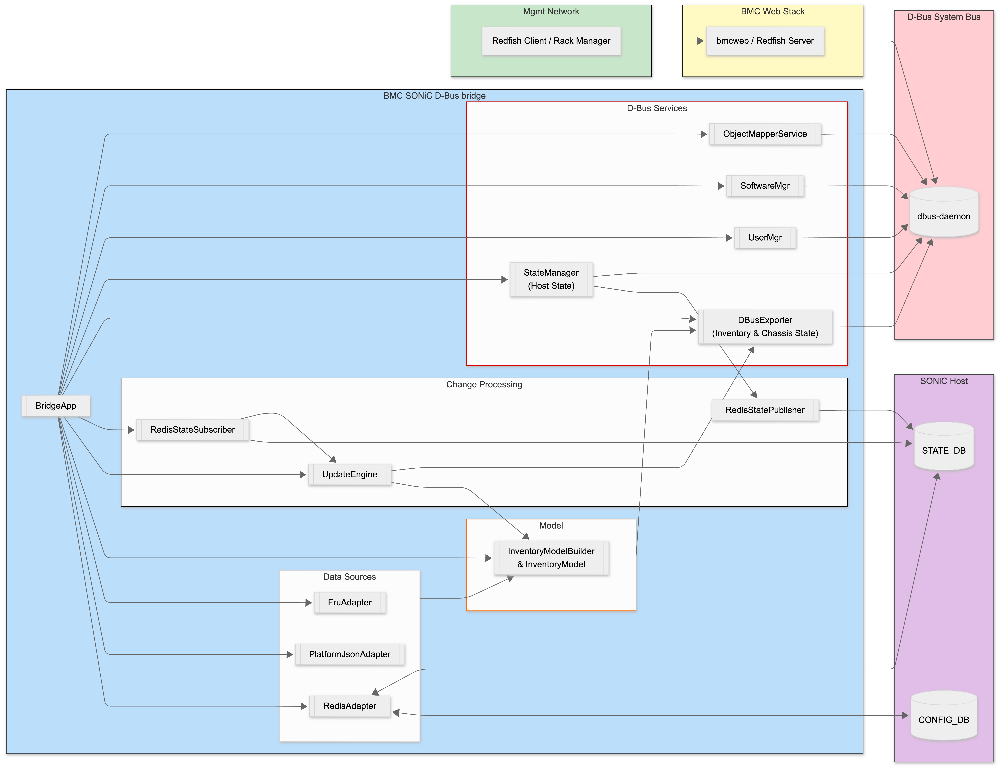
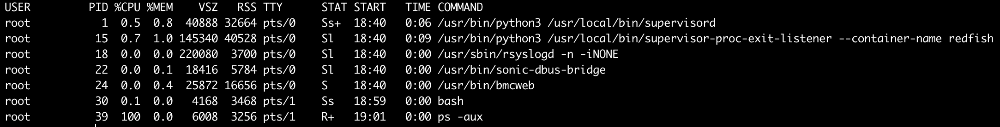
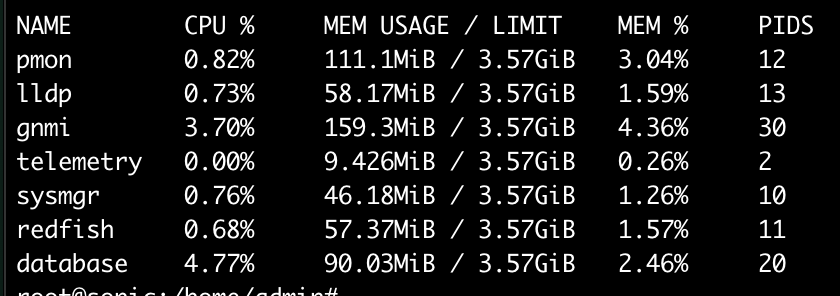
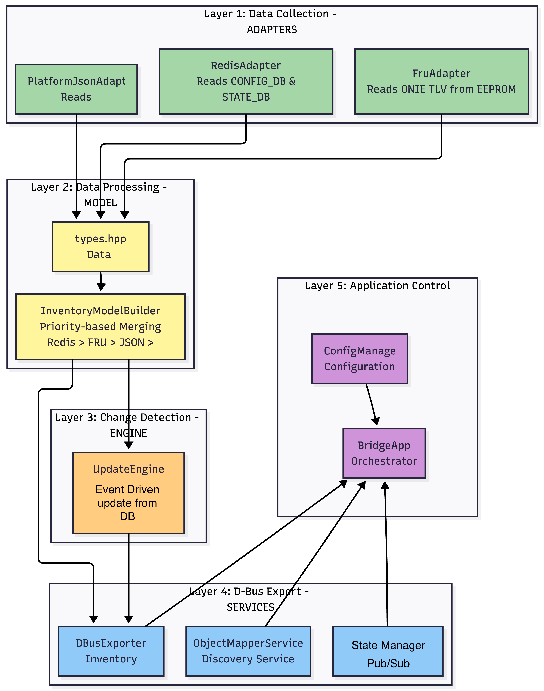
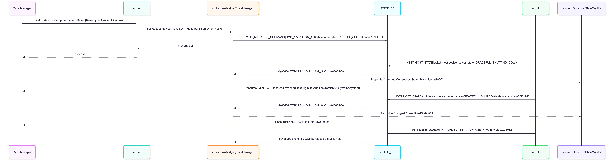
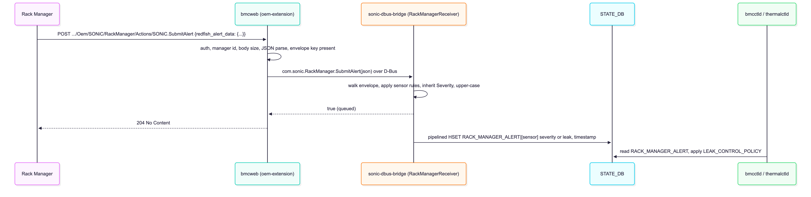
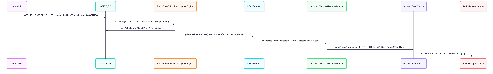

# SONiC Redfish with D-Bus Bridge

## Table of Content

1. [Revision](#1-revision)
   1. [Related documents](#11-related-documents)
   2. [Implementation PRs](#12-implementation-prs)
2. [Scope](#2-scope)
   1. [Supported Redfish API Endpoints](#21-supported-redfish-api-endpoints)
3. [Definitions / Abbreviations](#3-definitions--abbreviations)
4. [Overview](#4-overview)
5. [Requirements](#5-requirements)
   1. [Functional Requirements](#51-functional-requirements)
   2. [Non-Functional Requirements](#52-non-functional-requirements)
   3. [Compatibility & Out-of-Scope Items](#53-compatibility--out-of-scope-items)
6. [Architecture Design](#6-architecture-design)
   1. [Deployment in SONiC / BMC Environment](#61-deployment-in-sonic--bmc-environment)
   2. [Docker Container Deployment (docker-sonic-redfish)](#62-docker-container-deployment-docker-sonic-redfish)
      1. [Container Structure](#621-container-structure)
      2. [Process Architecture](#622-process-architecture)
      3. [Resource Utilization](#623-resource-utilization)
      4. [Docker Resource Utilization on BMC](#624-docker-resource-utilization-on-bmc)
   3. [Layered Architecture](#63-layered-architecture)
      1. [Core Components](#631-core-components)
      2. [Data Adapters](#632-data-adapters)
      3. [Model and Update Components](#633-model-and-update-components)
      4. [D-Bus Export Components](#634-d-bus-export-components)
      5. [Rack Manager Ingest Components](#635-rack-manager-ingest-components)
   4. [bmcweb Extensions](#64-bmcweb-extensions)
   5. [External Dependencies and Interfaces](#65-external-dependencies-and-interfaces)
7. [High-Level Design](#7-high-level-design)
   1. [Module Responsibilities](#71-module-responsibilities-and-high-level-design)
   2. [Startup Flow](#72-startup-flow-initial-inventory-build--object-creation)
   3. [Runtime Update Flow](#73-runtime-update-flow-redis-change-to-d-bus-update)
   4. [Host Power Control Flow](#74-host-power-control-flow-computersystemreset-to-rack_manager_command)
   5. [Rack Manager Alert and Telemetry Flow](#75-rack-manager-alert-and-telemetry-flow)
   6. [Leak Detection and Redfish Event Flow](#76-leak-detection-and-redfish-event-flow)
   7. [Error Handling and Health Reporting](#77-error-handling-and-health-reporting)
   8. [Scalability and Performance Considerations](#78-scalability-and-performance-considerations)
   9. [SONiC Redfish to RedisDB mapping](#79-sonic-redfish-to-redisdb-mapping)
8. [Memory Consumption](#8-memory-consumption)
9. [Restrictions / Limitations](#9-restrictions--limitations)
10. [Open / Action Items](#10-open--action-items-if-any)
11. [Testing Requirements / Design](#11-testing-requirements--design)

## 1. Revision


| Version | Date        | Author      | Description                               |
| --------- | ------------- | ------------- | ------------------------------------------- |
| 0.1     | 10-Mar-2026 | Chinmoy Dey | Initial design document for sonic-redfish |
| 0.2     | 09-Oct-2026 | Chinmoy Dey | Aligned with the sonic-redfish implementation. Covers `docker-sonic-redfish` packaging on host networking, the SONiC OEM `RackManager` alert and telemetry actions, leak detection resources and events, and the Switch-Host power state, control and event flow |

### 1.1 Related documents


| Document Name                                | Link                                                                                                     | State |
| :--------------------------------------------- | :--------------------------------------------------------------------------------------------------------- | ----- |
| SONiC-BMC-OS HLD                             | [https://github.com/sonic-net/SONiC/pull/2043](https://github.com/sonic-net/SONiC/pull/2043)             |  |
| sonic-redfish HLD (this document)            | [https://github.com/sonic-net/SONiC/pull/2281](https://github.com/sonic-net/SONiC/pull/2281)             |  |
| SONiC BMC platform management and monitoring | [pmon-bmc-design.md](../bmc/sonicBMC/pmon-bmc-design.md) / [https://github.com/sonic-net/SONiC/pull/2215](https://github.com/sonic-net/SONiC/pull/2215) |  |
| SONiC BMC Redfish API and D-Bus test plan    | [sonic-mgmt docs/testplan/redfish/SONiC_BMC_Redfish_Test_Plan.md](https://github.com/sonic-net/sonic-mgmt/blob/master/docs/testplan/redfish/SONiC_BMC_Redfish_Test_Plan.md) / [https://github.com/sonic-net/sonic-mgmt/pull/23346](https://github.com/sonic-net/sonic-mgmt/pull/23346) |  |
| Redfish Certificate Provisioning HLD         | [https://github.com/sonic-net/SONiC/pull/2461](https://github.com/sonic-net/SONiC/pull/2461)             |  |
| sonic-redfish repository README              | [https://github.com/sonic-net/sonic-redfish/blob/master/README.md](https://github.com/sonic-net/sonic-redfish/blob/master/README.md) |  |
| SONiC OEM Redfish Extension contract         | [https://github.com/sonic-net/sonic-redfish/blob/master/oem-extension/README.md](https://github.com/sonic-net/sonic-redfish/blob/master/oem-extension/README.md) |  |
| sonic-redfish test framework                 | [https://github.com/sonic-net/sonic-redfish/blob/master/tests/README.md](https://github.com/sonic-net/sonic-redfish/blob/master/tests/README.md) |  |
| DMTF Redfish specification                   | [https://www.dmtf.org/standards/redfish](https://www.dmtf.org/standards/redfish)                         | - |
| OpenBMC phosphor-dbus-interfaces             | [https://github.com/openbmc/phosphor-dbus-interfaces](https://github.com/openbmc/phosphor-dbus-interfaces/tree/master/yaml/xyz/openbmc_project) | - |

### 1.2 Implementation PRs

The Redfish APIs used by the [SONiC BMC platform management and monitoring](../bmc/sonicBMC/pmon-bmc-design.md) HLD are implemented through the following pull requests in [sonic-net/sonic-redfish](https://github.com/sonic-net/sonic-redfish) (bug fixes and CI changes are not listed):

| Repo              | PR title                                                                                           | State  |
| ----------------- | -------------------------------------------------------------------------------------------------- | ------ |
| sonic-redfish     | [[sonic-redfish] Sonic Redfish support with OpenBMC D-Bus](https://github.com/sonic-net/sonic-redfish/pull/1) |  |
| sonic-redfish     | [Redfish OEM Extension for SONiC BMC with Schema Mapping to Redis & D-Bus](https://github.com/sonic-net/sonic-redfish/pull/3) |  |
| sonic-redfish     | [Event subscription mechanism for sonic-redfish](https://github.com/sonic-net/sonic-redfish/pull/4) |  |
| sonic-redfish     | [Leak Detection: Adding leak detection support for Sonic Redfish (backward compatibility)](https://github.com/sonic-net/sonic-redfish/pull/8) |  |
| sonic-redfish     | [BMC host power state events watcher](https://github.com/sonic-net/sonic-redfish/pull/37) |  |

## 2. Scope

`sonic-redfish` runs on the **BMC** side and exposes BMC information such as SONiC inventory, host state, firmware versions and leak sensor state through **OpenBMC-compatible D-Bus objects**. This allows **openbmc/bmcweb** (a Redfish server, aligned with DMTF specifications) to serve **Redfish APIs** without requiring a full OpenBMC stack on the BMC.

The primary goal behind `sonic-redfish` is to provide an **OpenBMC like environment**, enabling OpenBMC compatible services (ie. bmcweb) to operate seamlessly within **SONiC on the BMC**.

The scope covered by the current implementation is:

- Chassis and system inventory (serial, manufacturer, model, part number, base MAC address).
- Switch-Host power state reporting, host power control (`ComputerSystem.Reset`) and host power events.
- Firmware inventory (switch NOS, BMC firmware, BIOS).
- SONiC OEM `RackManager` actions for the external Rack Manager to push **alerts** and **telemetry** for the liquid cooling loop.
- Leak detection resources and Redfish **event subscriptions** for leak events.

This document covers the Redfish side only. The platform daemons that produce and consume the Redis tables (`bmcctld`, `thermalctld`), the leak control policy and the Redis table definitions are specified in the [SONiC BMC platform management and monitoring](../bmc/sonicBMC/pmon-bmc-design.md) HLD.

### 2.1 Supported Redfish API Endpoints

Identifiers use the bmcweb defaults: the Manager is `bmc`, the ComputerSystem is `system` and the Chassis is `chassis`.

#### Service Root & Discovery

- **GET /redfish/v1**
  - **Purpose**: Service root discovery and switch identification.
  - **Response**: `Product` is `SONiCBMC-<base MAC>` (for example `SONiCBMC-aa:18:f1:e4:27:60`), read from CONFIG_DB by `sonic-dbus-bridge`. It falls back to `SONiCBMC` when the MAC is unavailable.

#### Firmware Management

- **GET /redfish/v1/UpdateService/FirmwareInventory**
  - **Purpose**: Rack Manager queries switch firmware versions.
  - **Response**: Three read-only members: `switch` (STATE_DB `BMC_FW_INVENTORY|SONIC_OS`), `bmc` (`/etc/sonic/sonic_version.yml`) and `bios` (STATE_DB `BMC_FW_INVENTORY|BIOS`). Missing sources are reported as `N/A`. `Updateable` is always `false`.

#### System Power State and Control

- **GET /redfish/v1/Systems/system**
  - **Purpose**: Rack Manager reads the Switch-Host power state.
  - **Response**: `PowerState` is `On`, `Off`, `PoweringOn` or `PoweringOff`. `sonic-dbus-bridge` mirrors it from the authoritative STATE_DB `HOST_STATE|switch-host` hash that `bmcctld` maintains. The `PowerState` of `GET /redfish/v1/Chassis/chassis` follows the same source.
- **POST /redfish/v1/Systems/system/Actions/ComputerSystem.Reset**
  - **Purpose**: Rack Manager controls the power state of the Switch-Host.
  - **Behaviour**: bmcweb writes the requested transition on the bridge's `State.Host` object (`State.Chassis` for `ForceOff`). `sonic-dbus-bridge` publishes a `RACK_MANAGER_COMMAND|CMD_<id>` row into STATE_DB which `bmcctld` executes. The resulting power state change comes back through `HOST_STATE|switch-host` and is pushed to event subscribers.
  - **Supported Reset Types**: `On` publishes `POWER_ON`, `ForceOff` publishes `POWER_OFF`, `GracefulShutdown` publishes `GRACEFUL_SHUT` and `PowerCycle` publishes `POWER_CYCLE`. Every other `ResetType` (`ForceOn`, `ForceRestart`, `GracefulRestart`, `Nmi`, ...) is rejected with `400 Base.ActionParameterNotSupported`. `ResetActionInfo` advertises only these four values.
  - **Errors**: a full bridge command queue is reported as `409`, and a bridge that is not on the bus as `503` with `Retry-After`.

#### Rack Manager Alert and Telemetry (SONiC OEM)

- **GET /redfish/v1/Managers/bmc/Oem/SONiC/RackManager**
  - **Purpose**: OEM resource (`#SonicManager.v1_0_0.RackManager`) advertising the two actions below. The same fragment is merged into `GET /redfish/v1/Managers/bmc` under `Oem.SONiC.RackManager`.
- **POST /redfish/v1/Managers/bmc/Oem/SONiC/RackManager/Actions/SONiC.SubmitAlert**
  - **Purpose**: Rack Manager posts alerts for inlet liquid temperature, flow rate, pressure and rack level leak with a `Severity` of `Normal` / `Minor` / `Major` / `Critical`.
  - **Persistence**: `RACK_MANAGER_ALERT|<SensorName>` in STATE_DB. **Response**: `204 No Content`.
- **POST /redfish/v1/Managers/bmc/Oem/SONiC/RackManager/Actions/SONiC.SubmitTelemetry**
  - **Purpose**: Periodic telemetry from the Rack Manager for the same four measurements (value, unit, severity). The cadence is decided by the Rack Manager.
  - **Persistence**: `RACK_MANAGER_DATA|<SensorName>` in STATE_DB. **Response**: `204 No Content`.
- The payload contract (`SonicManager.v1_0_0.json` schema, request envelopes, error responses) is documented in the [SONiC OEM Redfish Extension README](https://github.com/sonic-net/sonic-redfish/blob/master/oem-extension/README.md).

#### Leak Detection and Event Subscription

- **GET /redfish/v1/Chassis/chassis/LeakDetectors** and **GET /redfish/v1/Chassis/chassis/LeakDetectors/{DetectorId}**
  - **Purpose**: One `LeakDetector` per `LIQUID_COOLING_INFO|*` sensor with `DetectorState` (`OK` / `Warning` / `Critical` / `Unavailable`), `LeakDetectorType` (`Moisture` / `FloatSwitch`) and `Status`. The deprecated `ThermalSubsystem/LeakDetection/LeakDetectors` URI is kept for pre-2025.4 clients.
- **POST /redfish/v1/EventService/Subscriptions**
  - **Purpose**: Rack Manager subscribes for leak and host power events (push style, `Protocol: Redfish`, `Destination` is the Rack Manager listener URL).
  - **Leak events**: `Environmental.1.1.0.LeakDetectedCritical`, `LeakDetectedWarning` and `LeakDetectedNormal`, each carrying `OriginOfCondition` pointing at the leak detector resource under `/redfish/v1/Chassis/chassis`.
  - **Host power events**: `ResourceEvent.1.3.0.ResourcePoweringOn`, `ResourcePoweredOn`, `ResourcePoweringOff` and `ResourcePoweredOff` with `OriginOfCondition` `/redfish/v1/Systems/system`.
  - The Rack Manager should subscribe without a `RegistryPrefixes` filter and match on `MessageId`. Subscriptions created with `RegistryPrefixes` (`Environmental`, `ResourceEvent`) or `ResourceTypes` (`LeakDetector`, `ComputerSystem`) are accepted.

#### Security & Certificate Management

- Authentication, certificate provisioning, rotation and mTLS client identity are specified in the [Redfish Certificate Provisioning HLD](https://github.com/sonic-net/SONiC/pull/2461) and are not repeated here.

Out of scope for this document (but possible future work):

- Detailed sensor, fan and PSU telemetry and control.
- Log services, event logs and firmware update workflows beyond `FirmwareInventory`.
- Advanced thermal management and cooling optimization algorithms.

## 3. Definitions / Abbreviations

- **CONFIG_DB / STATE_DB** – SONiC Redis databases (index 4 and 6) containing configuration and runtime state on the BMC.
- **Device Metadata** – `DEVICE_METADATA|localhost` hash in CONFIG_DB.
- **Chassis State** – `CHASSIS_STATE|chassis0` hash in STATE_DB.
- **Host State** – `HOST_STATE|switch-host` hash in STATE_DB, owned by `bmcctld`, the authoritative Switch-Host power state.
- **BMC** – Board Management Controller (ASPEED platform in this design).
- **Switch-Host** – The main switch CPU board whose power is controlled by the BMC.
- **Rack Manager** – External rack management controller that consumes the Redfish API and pushes alerts and telemetry to the BMC.
- **bmcweb** – The OpenBMC Redfish HTTP server, reused from upstream with a small build-time patch set.
- **sonic-dbus-bridge** – The SONiC daemon that exposes Redis, FRU and platform data as OpenBMC style D-Bus objects and forwards Redfish actions back into Redis.
- **D-Bus** – D-Bus IPC on the BMC system bus.
- **ObjectMapper** – Service providing `GetObject` / `GetSubTree*` discovery for bmcweb, implemented in-process by the bridge.
- **OEM** – Vendor specific Redfish extension. The SONiC OEM namespace is `Oem.SONiC`.
- **bmcctld / thermalctld** – SONiC platform daemons on the BMC, see [pmon-bmc-design.md](../bmc/sonicBMC/pmon-bmc-design.md).

## 4. Overview

A separate implementation of a standard **Redfish server** is not required, as this functionality is already provided by **[bmcweb](https://github.com/openbmc/bmcweb)**. The existing bmcweb service can therefore be used directly to serve **[Redfish APIs](https://www.dmtf.org/standards/redfish)**.

bmcweb retrieves system data through the **D-Bus system bus**, sourcing information from **[OpenBMC-compliant D-Bus objects](https://github.com/openbmc/phosphor-dbus-interfaces/tree/master/yaml/xyz/openbmc_project)**. These D-Bus paths are normally created by **[OpenBMC phosphor-* services](https://github.com/orgs/openbmc/repositories?q=phosphor)**, which are not present in SONiC.

> The `sonic-redfish` design addresses this gap by reusing the **bmcweb** codebase from the public repository (pinned commit) and introducing a `sonic-dbus-bridge` service to expose the required `OpenBMC-compatible D-Bus` objects. A small set of build-time patches wires three SONiC additions into bmcweb: the **SONiC OEM extension** (Rack Manager alerts and telemetry), **leak detection resources and events**, and **Switch-Host power events** together with the supported `ResetType` set.

The motivations for introducing `sonic-dbus-bridge` can be listed as follows :-

* **OpenBMC Standard Compliance**: bmcweb (industry-standard Redfish server) is hardcoded to expect [xyz.openbmc_project.* D-Bus interfaces](https://github.com/openbmc/phosphor-dbus-interfaces/tree/master/yaml/xyz/openbmc_project). sonic-dbus-bridge implements these exact interfaces, while existing SONiC services use incompatible org.SONiC.* interfaces.
* **Mimicking OpenBMC**: sonic-dbus-bridge mimics OpenBMC D-Bus interfaces (xyz.openbmc_project.*) to expose SONiC platform data for standard Redfish APIs, creating the illusion that all [phosphor-* services](https://github.com/orgs/openbmc/repositories?q=phosphor) exist in SONiC without actually porting them.
* **Data Model Mismatch**: Existing SONiC solutions are action-oriented (RPC methods for internal container-to-host control), but Redfish requires a property-based, inventory data model. sonic-dbus-bridge provides the data-oriented interface that external management tools expect.
* **Keep bmcweb Pristine**: Establishes D-Bus as the singular standardized integration layer, ensuring bmcweb remains nearly unmodified and upstream-compatible, so no fork. SONiC specific routes live in separate source trees that are copied into bmcweb at build time.
* **Hardware Data Aggregation**: Translates SONiC's distributed hardware data (Redis CONFIG_DB/STATE_DB, FRU EEPROMs, platform.json, `sonic_version.yml`) into unified OpenBMC compatible D-Bus objects that bmcweb can discover and consume.
* **Bidirectional Communication**: Enables both read (inventory and power state queries) and write (host power control, Rack Manager alerts and telemetry) operations via Redfish GET/POST, bridging external management tools to SONiC's internal state in Redis where the platform daemons act on it.
* **Graceful Degradation**: Designed to tolerate missing data sources (Redis down, FRU unreadable, platform.json absent) with safe fallbacks, ensuring Redfish endpoints remain available even in degraded mode, which is critical for production BMC reliability.

In this architecture, `sonic-dbus-bridge` provides the integration layer. It is a BMC side service that enables SONiC on BMC to expose an OpenBMC style management interface without running a full OpenBMC stack. The service reads platform and runtime state information from SONiC's Redis databases, merges it with FRU and platform metadata, and exposes the resulting data as standard OpenBMC D-Bus objects representing inventory, firmware, leak sensors and host state.

The **bmcweb** daemon consumes these D-Bus interfaces and exposes them through the corresponding **Redfish APIs** (for example, `/redfish/v1/Chassis` and host power control actions). Although this document may illustrate the design using one or two example APIs/D-Bus objects, the same approach applies generally to all supported **Redfish APIs**.

At a high level, `sonic-dbus-bridge`:

1. Reads platform information from SONiC (Redis, FRU EEPROMs, `platform.json`, `sonic_version.yml`).
2. Builds a consolidated `InventoryModel` with clear data-source precedence.
3. Creates OpenBMC-style D-Bus objects for chassis, system, host and chassis state, firmware versions, leak sensors and the Redfish user.
4. Mirrors the authoritative Switch-Host power state from STATE_DB `HOST_STATE|switch-host` onto the `State.Host` and `State.Chassis` interfaces, and forwards Redfish power requests into STATE_DB as `RACK_MANAGER_COMMAND` rows.
5. Receives Rack Manager alert and telemetry JSON from bmcweb over the `com.sonic.RackManager` D-Bus interface and persists it into STATE_DB.
6. Keeps D-Bus properties in sync with Redis using an event-driven update engine. Leak and host state changes emit `PropertiesChanged` signals that bmcweb turns into Redfish events.

## 5. Requirements

### 5.1 Functional Requirements

- Provide OpenBMC-compatible D-Bus objects for chassis and system inventory, including the base MAC address.
- Provide `xyz.openbmc_project.State.Host` and `xyz.openbmc_project.State.Chassis` interfaces that mirror the Switch-Host power state published by `bmcctld` in `HOST_STATE|switch-host`.
- Provide `xyz.openbmc_project.Software.Version` objects for the switch NOS, BMC firmware and BIOS versions.
- Provide `xyz.openbmc_project.Inventory.Item.LeakDetector` objects for every `LIQUID_COOLING_INFO|*` sensor and emit `PropertiesChanged` on state changes.
- Reflect changes in `HOST_STATE`, `RACK_MANAGER_COMMAND`, `CHASSIS_STATE` and `LIQUID_COOLING_INFO` into D-Bus without polling.
- Publish host power transition requests into STATE_DB (`RACK_MANAGER_COMMAND`) for `bmcctld` to consume and track each command to its `DONE` or `FAILED` result.
- Deliver leak detector and Switch-Host power state changes to Redfish event subscribers.
- Expose the SONiC OEM `RackManager` actions and persist alerts and telemetry into STATE_DB (`RACK_MANAGER_ALERT`, `RACK_MANAGER_DATA`) following the platform DB schema.
- Provide `xyz.openbmc_project.User.Manager` so bmcweb can authorise the Redfish account.

### 5.2 Non-Functional Requirements

- Event-driven updates with typical propagation latency below 1 second.
- Robust startup when some data sources (FRU, platform.json, Redis, `HOST_STATE`) are missing.
- No blocking operations in the D-Bus dispatch path. Redis writes for Rack Manager payloads happen on a worker thread with a bounded queue.
- Deterministic, reproducible builds (pinned bmcweb and sdbusplus revisions).

### 5.3 Compatibility & Out-of-Scope Items

- Read-only access to CONFIG_DB. Write access is limited to dedicated STATE_DB tables (`RACK_MANAGER_COMMAND`, `RACK_MANAGER_ALERT`, `RACK_MANAGER_DATA`).
- Does not replace SONiC CLI/REST/gNMI. It is an additional management surface on the BMC.
- The Redfish container is intended for liquid cooled BMC platforms and ships disabled in `FEATURE` by default.
- Authentication, certificate provisioning and mTLS authorisation are covered by the [Redfish Certificate Provisioning HLD](https://github.com/sonic-net/SONiC/pull/2461).

## 6. Architecture Design

### 6.1 Deployment in SONiC / BMC Environment

- **Redis** serves as the primary data source and command channel, accessed via the hiredis library for both synchronous queries and keyspace-notification subscriptions. The bridge connects over TCP (`127.0.0.1:6379`) first and falls back to the host Unix socket bind mounted into the container.
- **D-Bus system bus** (via sdbusplus) provides the IPC mechanism for exposing inventory and state to bmcweb. The container bind mounts the host's `/var/run/dbus`. The bridge's D-Bus policy files are installed on the BMC host.
- **bmcweb** consumes the D-Bus interfaces to implement Redfish APIs, relying on ObjectMapper for service discovery and standard OpenBMC interfaces for data access. SONiC specific routes (OEM actions, leak detection) call the bridge directly.
- **sonic-dbus-bridge**, a sonic-redfish service, runs on the BMC (ASPEED) and claims six well-known names on the system bus:

  | Bus name                                | Objects                                                                                 |
  | --------------------------------------- | --------------------------------------------------------------------------------------- |
  | `xyz.openbmc_project.Inventory.Manager` | Chassis, system, firmware versions, leak sensors                                        |
  | `xyz.openbmc_project.ObjectMapper`      | `/xyz/openbmc_project/object_mapper`                                                    |
  | `xyz.openbmc_project.User.Manager`      | `/xyz/openbmc_project/user`, `/xyz/openbmc_project/user/bmcweb`                         |
  | `xyz.openbmc_project.State.Host`        | `/xyz/openbmc_project/state/host0`                                                      |
  | `xyz.openbmc_project.State.Chassis`     | `/xyz/openbmc_project/state/chassis0` (served from the same connection as `State.Host`) |
  | `com.sonic.RackManager`                 | `/com/sonic/RackManager` (`SubmitAlert` / `SubmitTelemetry` methods)                    |

- **Platform daemons** (`bmcctld`, `thermalctld`) are the producers and consumers on the Redis side: `thermalctld` publishes `LIQUID_COOLING_INFO`, `bmcctld` consumes `RACK_MANAGER_COMMAND` and `RACK_MANAGER_ALERT`, reports the command result in `RACK_MANAGER_COMMAND|CMD_<id>` and publishes `HOST_STATE|switch-host`.



> The **`sonic-dbus-bridge`** service is the only new daemon introduced in this design. bmcweb is reused from upstream with build-time patches. No existing SONiC component is modified.

### 6.2 Docker Container Deployment (docker-sonic-redfish)

The `sonic-redfish` components are packaged and deployed as a single Docker image named **docker-sonic-redfish**, running as the container **`redfish`**, which is included in the SONiC BMC image (`sonic-aspeed-arm64.bin`). This follows the standard SONiC containerization model:

- The Debian packages are built from the `src/sonic-redfish` submodule of sonic-buildimage. The image and its `FEATURE` entry are included when `INCLUDE_REDFISH=y`.
- The `redfish` entry in the `FEATURE` table starts `disabled`. It is turned on with `config feature state redfish enabled` on liquid cooled platforms.
- The container runs on host networking and bind mounts the host Redis and D-Bus sockets, `/etc/sonic`, `/host/machine.conf` and `/var/lib/bmcweb`.
- bmcweb only serves on a socket handed over by systemd socket activation. Inside the container `bmcweb-start.sh` reads the port from CONFIG_DB `REDFISH|config` (`port`, default 443) and execs the `bmcweb-activate` helper, which binds that port and hands the socket to bmcweb the same way. A port change takes effect when bmcweb or the `redfish` service is restarted.

#### 6.2.1 Container Structure

The `docker-sonic-redfish` image bundles all components required for Redfish API support:


| Component         | Package                             | Description                                                            |
| :------------------ | :------------------------------------ | :----------------------------------------------------------------------- |
| bmcweb            | `bmcweb_1.0.0_arm64.deb`            | Upstream OpenBMC Redfish HTTP server with the SONiC patch set          |
| sonic-dbus-bridge | `sonic-dbus-bridge_1.0.0_arm64.deb` | SONiC-to-OpenBMC D-Bus bridge daemon, its D-Bus policy files and the `bmcweb-activate` socket activation helper |
| bmcweb-start.sh   | sonic-buildimage `dockers/docker-sonic-redfish` | Reads the Redfish port from CONFIG_DB and starts bmcweb through `bmcweb-activate` |
| rsyslogd          | Base image                          | Forwards container logs to the host syslog                             |
| supervisord       | Base image                          | Process manager for container services (standard SONiC pattern)        |
| `bmcweb` account  | Created in the image                | Local account used for Redfish authentication                          |
| dbus-daemon, redis-server | Host                        | The host system bus and Redis sockets are bind mounted. Neither runs inside the container |

#### 6.2.2 Process Architecture

Inside the `redfish` container, **supervisord** manages the following processes with dependent startup ordering:




| Process                       | Depends on                     | Description                                                 |
| :------------------------------ | :----------------------------- | :---------------------------------------------------------- |
| supervisord                   | -                              | Process manager (PID 1)                                     |
| supervisor-proc-exit-listener | -                              | Monitors critical process exits for the `redfish` container |
| rsyslogd                      | -                              | Log forwarding                                              |
| sonic-dbus-bridge             | `rsyslogd:running`             | Reads SONiC data sources, exposes OpenBMC D-Bus objects     |
| bmcweb                        | `sonic-dbus-bridge:running`    | Redfish HTTP server, started by `bmcweb-start.sh` through `bmcweb-activate` on the configured port |

`sonic-dbus-bridge` and `bmcweb` are critical processes. Either exiting marks the container unhealthy and triggers the feature auto-restart policy.

#### 6.2.3 Resource Utilization

The `redfish` container is designed for minimal resource consumption on the constrained BMC hardware (Aspeed AST2720/AST2700, typically 4 GB RAM).

**Design considerations for resource efficiency:**

- All D-Bus operations use non-blocking I/O via Boost.Asio. Redis reads in the update path are short `HGETALL` / `HGET` calls.
- Event-driven updates (Redis keyspace notifications) minimize CPU usage compared to polling.
- The number of D-Bus objects is small and bounded (chassis, system, chassis state, host state, three firmware objects, one object per leak sensor, one user).
- No large in-memory caches: the InventoryModel holds only the current snapshot of a small, fixed set of inventory fields.

#### 6.2.4 Docker Resource Utilization on BMC

The following measurements were captured on BMC hardware (Aspeed AST2720, 4 GB RAM) showing CPU, memory usage, and container sizes for all SONiC BMC Docker containers including `redfish`.

**Docker Stats (CPU and Memory Usage):**



### 6.3 Layered Architecture

The `sonic-dbus-bridge` architecture consists of the following key components:

#### 6.3.1 Core Components

##### 6.3.1.1 ConfigManager

- Holds the daemon configuration: Redis host/port/DB indices, `platform.json` path, FRU EEPROM paths, log level and D-Bus service names.
- `config.yaml` is installed and accepted on the command line, but the YAML parser is not yet implemented. Compiled-in defaults are used (see [Restrictions](#9-restrictions--limitations)).

##### 6.3.1.2 BridgeApp (orchestrator)

- Main process entry point.
- Opens the D-Bus connections and claims the bus names, initialises the ObjectMapper, creates data adapters and the model.
- Builds the initial inventory, creates the D-Bus objects, the host and chassis state objects, the Rack Manager receiver and the user manager.
- Attaches StateManager to UpdateEngine, starts UpdateEngine and RedisStateSubscriber, and manages shutdown.

##### 6.3.1.3 Types (data types)

- Defines normalized data structures (`DeviceMetadata`, `ChassisState`, `HostStateInfo`, `RackManagerCommandInfo`, `ChassisInfo`, `SystemInfo`, `LeakSensorInfo`, `FirmwareVersionInfo`, `InventoryModel`, `DataSourceHealth`) used across all layers.

#### 6.3.2 Data Adapters

##### 6.3.2.1 PlatformJsonAdapter

- Reads the static platform description from `platform.json` (chassis name, part number, hardware version) and exposes it in a normalized form to the model layer.

##### 6.3.2.2 RedisAdapter

- Connects to SONiC Redis CONFIG_DB (4) and STATE_DB (6).
- Reads `DEVICE_METADATA|localhost`, `CHASSIS_STATE|chassis0`, `BMC_FW_INVENTORY|SONIC_OS`, `BMC_FW_INVENTORY|BIOS`, discovers `LIQUID_COOLING_INFO|*` leak sensors and reads the BMC firmware version from `/etc/sonic/sonic_version.yml`.
- Reads `HOST_STATE|switch-host` and `RACK_MANAGER_COMMAND|CMD_<id>` on demand for StateManager.

##### 6.3.2.3 FruAdapter

- Reads FRU EEPROMs (ONIE TLV) to extract serial number, part number, manufacturer and model. The values enrich the inventory when CONFIG_DB fields are missing.

#### 6.3.3 Model and Update Components

##### 6.3.3.1 InventoryModelBuilder

- Merges data from Redis, FRU and platform.json into a single `InventoryModel` and tracks the source of each field.
- Precedence: chassis identity fields use CONFIG_DB `DEVICE_METADATA` > FRU > platform.json > `Unknown`. System identity fields use FRU > CONFIG_DB > `Unknown`. The base MAC comes from CONFIG_DB `mac` only.

##### 6.3.3.2 UpdateEngine

- Maintains a cached view of `DEVICE_METADATA`, `CHASSIS_STATE` and the derived leak detector state per sensor.
- On a Redis change it re-reads the affected hash, and only if something actually changed rebuilds the model or refreshes the single leak sensor and asks DBusExporter to update D-Bus.
- Forwards `HOST_STATE|switch-host` snapshots and `RACK_MANAGER_COMMAND|CMD_<id>` status changes to StateManager.
- Timer based polling exists as a fallback but is disabled.

##### 6.3.3.3 RedisStateSubscriber

- Dedicated thread subscribed to STATE_DB keyspace notifications for `DEVICE_METADATA`, `CHASSIS_STATE`, `HOST_STATE|switch-host`, the `RACK_MANAGER_COMMAND|*` pattern (`PSUBSCRIBE`, so dynamic `CMD_<id>` keys are covered) and every `LIQUID_COOLING_INFO|<sensor>` discovered at startup.
- Requires Redis keyspace notifications to be enabled, which is the SONiC default.

#### 6.3.4 D-Bus Export Components

##### 6.3.4.1 DBusExporter

- Owns and updates the OpenBMC style D-Bus objects under `xyz.openbmc_project.Inventory.Manager`:

  | Object path                                        | Interfaces and properties                                                                                                          |
  | -------------------------------------------------- | ---------------------------------------------------------------------------------------------------------------------------------- |
  | `/xyz/openbmc_project/inventory/system/chassis`    | `Inventory.Item.Chassis` (`Type`), `Inventory.Decorator.Asset` (`SerialNumber`, `PartNumber`, `Manufacturer`, `Model`), `Inventory.Item.NetworkInterface` (`MACAddress`) |
  | `/xyz/openbmc_project/inventory/system/system0`    | `Inventory.Item.System`, `Inventory.Decorator.Asset` (`SerialNumber`, `Manufacturer`, `Model`)                                     |
  | `/xyz/openbmc_project/software/{switch,bmc,bios}`  | `Software.Version` (`Version`, `Purpose`), `Software.Activation` (`Activation=Active`)                                             |
  | `/xyz/openbmc_project/sensors/leak/<sensor>`       | `Inventory.Item.LeakDetector` (`DetectorState`, `Type`), `State.Decorator.OperationalStatus` (`Functional`), `Inventory.Item` (`Present`, `PrettyName`) |

- Leak sensor updates use `set_property`, which emits `PropertiesChanged`. bmcweb's leak monitor turns this into a Redfish event.

##### 6.3.4.2 ObjectMapperService

- Minimal in-process implementation of `xyz.openbmc_project.ObjectMapper` (`GetObject`, `GetSubTree`, `GetSubTreePaths`) with every object exported by the bridge registered, so bmcweb can discover them.

##### 6.3.4.3 StateManager

- Exposes `/xyz/openbmc_project/state/host0` (`xyz.openbmc_project.State.Host`: `RequestedHostTransition`, `CurrentHostState`, `AllowedHostTransitions`) and `/xyz/openbmc_project/state/chassis0` (`xyz.openbmc_project.State.Chassis`: `RequestedPowerTransition`, `CurrentPowerState`) under the `State.Host` and `State.Chassis` bus names.
- `CurrentHostState` is seeded from `HOST_STATE|switch-host` at startup and follows every update from `bmcctld` through the mapping table in `host_state_mapping.hpp` (see [7.4](#74-host-power-control-flow-computersystemreset-to-rack_manager_command)). `CurrentPowerState` is derived from it. The bridge never sets the host state optimistically from a request.
- Validates a requested transition, queues it (at most 10 entries, overflow raises `xyz.openbmc_project.Common.Error.Unavailable`), maps it to `POWER_ON`, `POWER_OFF`, `GRACEFUL_SHUT` or `POWER_CYCLE` and publishes it through RedisStatePublisher.
- Runs one command at a time. The action slot is released when `bmcctld` reports `DONE` or `FAILED` for the pending `RACK_MANAGER_COMMAND|CMD_<id>`, or after a 600 s timeout.

##### 6.3.4.4 RedisStatePublisher

- Writes `RACK_MANAGER_COMMAND|CMD_<id>` rows (`command`, `status=PENDING`, `result`, `timestamp`) into STATE_DB following the platform DB schema.

##### 6.3.4.5 UserMgr

- Exposes `xyz.openbmc_project.User.Manager` and one `User.Attributes` object for the `bmcweb` account. User creation and deletion through Redfish are not supported.

#### 6.3.5 Rack Manager Ingest Components

##### 6.3.5.1 RackManagerReceiver

- Claims `com.sonic.RackManager` and exposes `/com/sonic/RackManager` with two methods, `SubmitAlert(s json) -> b` and `SubmitTelemetry(s json) -> b`.
- Parses the JSON on the D-Bus dispatch thread, enqueues the resulting STATE_DB writes (bounded queue) and returns `true` when queued. A single worker thread persists them with pipelined `HSET` commands.

##### 6.3.5.2 FieldMapping (sensor rules)

- Declarative table that maps a Rack Manager field name to the canonical STATE_DB sensor name and unit defined in the platform DB schema:

  | Field pattern (case-insensitive) | Canonical sensor key suffix  | Unit              | Telemetry value field |
  | -------------------------------- | ---------------------------- | ----------------- | --------------------- |
  | `.*InletTemperature`             | `Inlet_liquid_temperature`   | `C`               | `InletTemperature`    |
  | `.*FlowRate`                     | `Inlet_liquid_flow_rate`     | `gallons_per_min` | `value`               |
  | `.*LiquidPressure`               | `Inlet_liquid_pressure`      | `psi`             | `value`               |
  | `.*Leak.*`                       | `Rack_level_leak`            | -                 | -                     |

- Adding a new Rack Manager measurement only requires a new row.

### 6.4 bmcweb Extensions

bmcweb is cloned at a pinned commit and a short patch series (`patches/`) is applied at build time. Patches only wire in code. The SONiC route implementations live in separate directories of the sonic-redfish repository and use only public bmcweb helpers:

- **`oem-extension/`** – Routes for `Oem.SONiC.RackManager` and the `SubmitAlert` / `SubmitTelemetry` POST handlers, which validate the request (privilege, manager id, body size, JSON) and forward the body verbatim to `com.sonic.RackManager`, plus the `SonicManager.v1_0_0.json` schema. Contract: [oem-extension/README.md](https://github.com/sonic-net/sonic-redfish/blob/master/oem-extension/README.md).
- **`rmc-events/`** – Routes for `LeakDetection`, the `LeakDetectors` collection and members (canonical and deprecated URIs), and two D-Bus signal monitors. `DbusLeakDetectorMonitor` matches `PropertiesChanged` on `LeakDetector` objects and emits `Environmental.1.1.0.LeakDetected*` events. `DbusHostStateMonitor` matches `PropertiesChanged` of `CurrentHostState` on `host0` and emits `ResourceEvent.1.3.0.ResourcePowering{On,Off}` / `ResourcePowered{On,Off}` events with `OriginOfCondition` `/redfish/v1/Systems/system`. Both go through bmcweb's `EventServiceManager`.
- **`patches/`** – Debian packaging for bmcweb, `Product = SONiCBMC-<base MAC>` at the service root, registration of the extensions above, the `LeakDetection` / `LeakDetectors` navigation links, the `Environmental` / `ResourceEvent` registry prefixes and `LeakDetector` / `ComputerSystem` resource types for subscriptions, the supported `ResetType` set for `ComputerSystem.Reset`, and two SONiC robustness fixes (the serial console lookup that needs systemd on the bus is optional, and a property write while the bridge is off the bus returns `503` instead of `404`).

Repository layout and build instructions are in the [sonic-redfish README](https://github.com/sonic-net/sonic-redfish/blob/master/README.md).

### 6.5 External Dependencies and Interfaces

- **Redis** (hiredis): CONFIG_DB and STATE_DB on the BMC, keyspace notifications enabled.
- **D-Bus system bus** (sdbusplus, statically linked at a pinned revision).
- **bmcweb** at a pinned upstream commit with the SONiC patch set.
- **Platform daemons**: `thermalctld` (producer of `LIQUID_COOLING_INFO`), `bmcctld` (consumer of `RACK_MANAGER_COMMAND` / `RACK_MANAGER_ALERT`, producer of the `RACK_MANAGER_COMMAND` status and result, `HOST_STATE`, `BMC_FW_INVENTORY`), see [pmon-bmc-design.md](../bmc/sonicBMC/pmon-bmc-design.md).

## 7. High-Level Design

### 7.1 Module Responsibilities and High-Level Design

The `sonic-dbus-bridge` is organized into distinct functional blocks, each with clear responsibilities:



#### 7.1.1 Orchestration and Configuration

- **BridgeApp** serves as the main orchestrator, coordinating the initialization sequence, managing component lifecycle, and providing health monitoring across all subsystems.
- **ConfigManager** centralizes configuration for Redis connections, platform file locations, logging levels and D-Bus service names.

#### 7.1.2 Data Source Integration

- **Data Adapters** provide abstraction layers for the data sources: Redis (device metadata, chassis state, host state, command results, firmware versions, leak sensor state), `platform.json` (static descriptors), FRU EEPROMs (manufacturer serial numbers, part numbers) and `sonic_version.yml` (BMC firmware version).
- Each adapter encapsulates source-specific access patterns and presents normalized data structures to upper layers.

#### 7.1.3 Data Consolidation and Modeling

- **InventoryModelBuilder** merges information from multiple sources using the per-field precedence rules in [6.3.3](#633-model-and-update-components) and tracks data provenance for each field.
- The resulting unified InventoryModel provides a single source of truth for chassis, system, firmware and leak sensor properties.

#### 7.1.4 Change Detection and Synchronization

- **UpdateEngine** maintains cached snapshots of critical Redis data and detects changes by comparing current state with previous values, then triggers a model rebuild or a targeted leak sensor update. Host state and command status changes are handed to StateManager.
- **RedisStateSubscriber** enables event-driven operation by subscribing to keyspace notifications, eliminating the need for continuous polling.

#### 7.1.5 D-Bus Interface Export

- **DBusExporter** translates the InventoryModel into OpenBMC-compatible D-Bus objects representing chassis inventory, system information, firmware versions and leak detectors, and emits `PropertiesChanged` for leak detector state.
- **ObjectMapperService** registers all exported objects with the in-process ObjectMapper, enabling service discovery by bmcweb.

#### 7.1.6 Host State Management

- **StateManager** mirrors the authoritative Switch-Host state (`HOST_STATE|switch-host`) onto the `State.Host` and `State.Chassis` interfaces and provides host power control. Validated requests are translated into `RACK_MANAGER_COMMAND` rows published to STATE_DB by **RedisStatePublisher** for consumption by `bmcctld`, and each command is tracked until `bmcctld` reports `DONE` or `FAILED`.

#### 7.1.7 Rack Manager Ingest and User Management

- **RackManagerReceiver** accepts alert and telemetry JSON from bmcweb over `com.sonic.RackManager`, classifies entries with the **FieldMapping** sensor rules and persists them to STATE_DB from a worker thread. Severity values are normalised to upper case so that `thermalctld` and `bmcctld` recognise them.
- **UserMgr** exposes the single Redfish account and its privilege so bmcweb can authorise authenticated requests.

#### 7.1.8 External Integration Points

- **Redis** serves as the primary data source and command channel. **D-Bus** provides the IPC mechanism for exposing inventory and state to bmcweb and for receiving Rack Manager payloads from it. **bmcweb** consumes the D-Bus interfaces to implement the Redfish APIs.

### 7.2 Startup Flow (Initial Inventory Build & Object Creation)

During startup, BridgeApp loads configuration, connects to D-Bus, and initializes the data adapters for Redis, platform.json, and FRU EEPROMs. Once all sources have been read, it calls InventoryModelBuilder to construct an initial InventoryModel that merges and normalizes chassis/system information, then adds firmware versions and leak sensors. DBusExporter creates the OpenBMC-style objects on the system bus, and ObjectMapperService registers them so they are discoverable. At this point the BMC is ready for bmcweb to serve Redfish inventory, chassis, system power state, firmware and leak detection resources.

**Startup Sequence:**

1. BridgeApp opens the system bus connections and claims `Inventory.Manager`, `ObjectMapper`, `User.Manager`, `State.Host`, `State.Chassis` and `com.sonic.RackManager`.
2. Adapters connect to Redis, load `platform.json` and scan FRU EEPROMs. Health is recorded per source.
3. BridgeApp calls `InventoryModelBuilder::build`, then reads firmware versions and discovers `LIQUID_COOLING_INFO|*` leak sensors.
4. DBusExporter creates chassis, system, software and leak sensor objects. Each is registered in the ObjectMapper.
5. StateManager reads `HOST_STATE|switch-host`, creates `/xyz/openbmc_project/state/host0` and `/xyz/openbmc_project/state/chassis0` with the mapped initial state and connects RedisStatePublisher to STATE_DB.
6. RackManagerReceiver registers `/com/sonic/RackManager` and UserMgr creates the user objects (both non-fatal on failure).
7. UpdateEngine starts in event-driven mode with StateManager attached, and RedisStateSubscriber subscribes to the STATE_DB keys and the `RACK_MANAGER_COMMAND|*` pattern. Failure to subscribe is fatal.
8. The health report is logged and the event loop runs. supervisord then starts bmcweb.

![Startup sequence][Startup]

#### 7.2.1 API Request and Data Fetch Sequence

**GET /redfish/v1/Chassis – Phase-1 vs Phase-2**

##### Phase 1 – Basic Chassis Identity from sonic-dbus-bridge

1. A Redfish client / Rack Manager sends `GET /redfish/v1/Chassis`.
2. bmcweb's Chassis handler asks the ObjectMapper (`xyz.openbmc_project.ObjectMapper`) for D-Bus objects that implement `xyz.openbmc_project.Inventory.Item.Chassis` under `/xyz/openbmc_project/inventory`.
3. Because `sonic-dbus-bridge` registered its objects at startup, ObjectMapper returns the chassis object path (`/xyz/openbmc_project/inventory/system/chassis`) and the owning service `xyz.openbmc_project.Inventory.Manager`.
4. bmcweb then calls `org.freedesktop.DBus.Properties.GetAll` on that path for interfaces like `Inventory.Item.Chassis` and `Inventory.Decorator.Asset`, and reads `CurrentPowerState` from `/xyz/openbmc_project/state/chassis0` through the `xyz.openbmc_project.State.Chassis` bus name.
5. It maps those properties to Redfish fields (Id, Name, SerialNumber, PartNumber, Manufacturer, Model, ChassisType, PowerState) and returns the JSON payload for `/redfish/v1/Chassis/chassis`, including links to `ThermalSubsystem` and `LeakDetectors`.

##### Phase 2 – Backing Objects

The HTTP and ObjectMapper flow stays the same, but the set of D-Bus objects behind it expands. Leak detectors are backed today, and power/thermal, sensors and PSU objects may follow, either from sonic-dbus-bridge or additional services. For `/redfish/v1/Chassis/chassis/LeakDetectors`, bmcweb validates the chassis via ObjectMapper, calls `GetSubTreePaths` for `Inventory.Item.LeakDetector` under `/xyz/openbmc_project/sensors/leak`, and fetches each detector's properties on member GET.

![Startup sequence][DataFetch2]

### 7.3 Runtime Update Flow (Redis change to D-Bus update)

1. A platform daemon writes a subscribed STATE_DB hash (for example `thermalctld` updates `LIQUID_COOLING_INFO|leakage1`).
2. Redis publishes the keyspace event. RedisStateSubscriber re-reads the hash and calls `UpdateEngine::onRedisFieldChange` for each field.
3. UpdateEngine compares with its cache and, only if something actually changed, rebuilds the InventoryModel (`CHASSIS_STATE`) or refreshes the single leak sensor (`LIQUID_COOLING_INFO`).
4. DBusExporter updates the D-Bus object. For leak sensors `set_property` emits `PropertiesChanged`.
5. Subsequent bmcweb requests observe the new values, and bmcweb's leak monitor generates a Redfish event when `DetectorState` changed.

`HOST_STATE|switch-host` and `RACK_MANAGER_COMMAND|CMD_<id>` notifications travel the same path but are handed to StateManager instead of DBusExporter, see [7.4](#74-host-power-control-flow-computersystemreset-to-rack_manager_command).

### 7.4 Host Power Control Flow (ComputerSystem.Reset to RACK_MANAGER_COMMAND)



1. The Rack Manager sends `POST /redfish/v1/Systems/system/Actions/ComputerSystem.Reset` with a `ResetType`.
2. bmcweb accepts `On`, `ForceOff`, `GracefulShutdown` and `PowerCycle` and rejects every other value with `400 Base.ActionParameterNotSupported`. It writes the matching D-Bus transition on the bridge:

   | `ResetType`        | D-Bus write                                                                | `RACK_MANAGER_COMMAND` `command` |
   | ------------------ | -------------------------------------------------------------------------- | -------------------------------- |
   | `On`               | `host0` `RequestedHostTransition` = `State.Host.Transition.On`             | `POWER_ON`                       |
   | `ForceOff`         | `chassis0` `RequestedPowerTransition` = `State.Chassis.Transition.Off`     | `POWER_OFF`                      |
   | `GracefulShutdown` | `host0` `RequestedHostTransition` = `State.Host.Transition.Off`            | `GRACEFUL_SHUT`                  |
   | `PowerCycle`       | `host0` `RequestedHostTransition` = `State.Host.Transition.Reboot`         | `POWER_CYCLE`                    |

3. StateManager validates the transition and queues it. A full queue (10 entries) is refused with `xyz.openbmc_project.Common.Error.Unavailable`, which bmcweb reports as `409`. If the bridge is not on the bus at all, bmcweb answers `503` with `Retry-After`.
4. When no other command is in flight, StateManager maps the transition and RedisStatePublisher writes a new row:

   ```text
   redis-cli -n 6 HGETALL 'RACK_MANAGER_COMMAND|CMD_1775041067_000002'
   command               = GRACEFUL_SHUT
   status                = PENDING
   result                =
   timestamp             = 2026-05-08T12:37:47.766120Z
   ```

5. `bmcctld` picks up the pending command, moves `status` through `IN_PROGRESS` to `DONE` or `FAILED` (with a reason in `result`, for example `CRITICAL_LEAK_PRESENT`) and publishes the Switch-Host state to `HOST_STATE|switch-host`, as specified in [pmon-bmc-design.md](../bmc/sonicBMC/pmon-bmc-design.md).
6. On every `HOST_STATE|switch-host` notification the bridge re-reads the hash, maps it to `CurrentHostState` and emits `PropertiesChanged`. `CurrentPowerState` on `chassis0` follows (`On`, `Off`, `TransitioningToOn`, `TransitioningToOff`):

   | `device_power_state`                       | `device_status`      | `CurrentHostState`       | Redfish `PowerState` | Redfish event          |
   | ------------------------------------------ | -------------------- | ------------------------ | -------------------- | ---------------------- |
   | `POWERING_ON`, `POWER_CYCLING`             | ignored              | `TransitioningToRunning` | `PoweringOn`         | `ResourcePoweringOn`   |
   | `POWERING_OFF`, `GRACEFUL_SHUTTING_DOWN`   | ignored              | `TransitioningToOff`     | `PoweringOff`        | `ResourcePoweringOff`  |
   | `POWERED_ON`, `POWER_CYCLE`                | `ONLINE`             | `Running`                | `On`                 | `ResourcePoweredOn`    |
   | `POWERED_OFF`, `GRACEFUL_SHUTDOWN`         | `OFFLINE`            | `Off`                    | `Off`                | `ResourcePoweredOff`   |
   | any stable state                           | conflicting          | follows `device_status`  |                      |                        |
   | unrecognised                               | `ONLINE` / `OFFLINE` | `Running` / `Off`        |                      |                        |
   | unrecognised                               | unrecognised         | unchanged                |                      | none                   |

7. On the `RACK_MANAGER_COMMAND|CMD_<id>` status notification the bridge logs `DONE` at NOTICE or `FAILED` at ERR and releases the action slot so the next queued request can be published. A command that reaches neither state within 600 s is logged at ERR and the slot is released anyway.
8. bmcweb's `DbusHostStateMonitor` turns each `CurrentHostState` change into a `ResourceEvent.1.3.0` message (`Severity` `OK`, `OriginOfCondition` `/redfish/v1/Systems/system`) and `EventServiceManager` delivers it to every matching subscription. `GET /redfish/v1/Systems/system` reports the same state as `PowerState`.

The state and `ResetType` tables are defined once in `sonic-dbus-bridge/include/host_state_mapping.hpp` and are covered by unit tests.

### 7.5 Rack Manager Alert and Telemetry Flow



- bmcweb authenticates the request, checks the manager id, body size and JSON syntax, requires the envelope key (`redfish.*` for `SubmitAlert`, `.*Alarms.*` for `SubmitTelemetry`) and forwards the body verbatim as one string argument. A D-Bus transport error (bridge down) yields `503`. A `false` reply (unparseable payload or queue full) yields `500`.
- The bridge walks the envelope recursively. Each object may carry a `Severity` that is inherited by descendants. Entries matching the leak rule become a `Rack_level_leak` record, numeric members matching a measurement rule become per-sensor records. Wrapper names and nesting depth do not affect the result. Keys that match no rule are dropped.
- Alerts are stored as `RACK_MANAGER_ALERT|<sensor>` (`severity` or `leak`, `timestamp`). Telemetry is stored as `RACK_MANAGER_DATA|<sensor>` (value, `unit`, `severity` or `leak`, `timestamp`). `204` means the payload was parsed and queued, not persisted.
- `bmcctld` dispatches `RACK_MANAGER_ALERT` severities through `LEAK_CONTROL_POLICY`. `RACK_MANAGER_DATA` is used to observe when a critical condition clears. Example payloads, resulting rows and the full error table are in the [oem-extension README](https://github.com/sonic-net/sonic-redfish/blob/master/oem-extension/README.md).

> **Design decision – JSON blob over D-Bus.** The body is forwarded as one string argument rather than typed D-Bus arguments so that the D-Bus interface stays stable while the Rack Manager contract grows. New fields only need a new sensor rule in the bridge.

### 7.6 Leak Detection and Redfish Event Flow



1. `thermalctld` maintains one `LIQUID_COOLING_INFO|<sensor>` hash per leak sensor (see [pmon-bmc-design.md](../bmc/sonicBMC/pmon-bmc-design.md)). The bridge discovers these at startup and creates a `LeakDetector` object per sensor.
2. The bridge derives the D-Bus state from the hash:

   | `leaking` | `leak_severity` | `DetectorState` | Redfish `Status.Health` |
   | --------- | --------------- | --------------- | ----------------------- |
   | `No`      | any             | `OK`            | `OK`                    |
   | `Yes`     | `MINOR`         | `Warning`       | `Warning`               |
   | `Yes`     | other           | `Critical`      | `Critical`              |
   | other / `N/A` | any         | `Unavailable`   | `OK`, no event          |

   `Functional` is `false` when `leak_sensor_status` is `Fault`. `Type` is `FloatSwitch` when the platform type contains `float`, otherwise `Moisture`.
3. On a keyspace notification the UpdateEngine updates the D-Bus object only on a real change, so repeated identical writes do not generate duplicate events.
4. bmcweb's `DbusLeakDetectorMonitor` maps `Critical` / `Warning` / `OK` to `Environmental.1.1.0.LeakDetectedCritical` / `LeakDetectedWarning` / `LeakDetectedNormal` with `OriginOfCondition` `/redfish/v1/Chassis/chassis/ThermalSubsystem/LeakDetection/LeakDetectors/<sensor>`, and `EventServiceManager` delivers the event to every subscription created through `POST /redfish/v1/EventService/Subscriptions`.

### 7.7 Error Handling and Health Reporting

- Adapters and managers log detailed errors and update an internal `DataSourceHealth` map (CONFIG_DB, STATE_DB, platform.json, FRU EEPROM). A summarized health report is emitted at the end of initialization.
- Missing sources degrade gracefully: inventory fields fall back per the precedence rules, firmware versions show `N/A`, no leak sensors means an empty `LeakDetectors` collection, an unavailable MAC keeps `Product=SONiCBMC`.
- If `HOST_STATE|switch-host` is absent at startup the bridge assumes the Switch-Host is `Running` and logs a warning until `bmcctld` reports. An unrecognised `HOST_STATE` value is logged and the current state is kept.
- Failures in optional components (RackManagerReceiver, UserMgr) are logged but do not prevent base inventory from operating. Failure to claim a D-Bus name or to start the Redis subscriber is fatal and supervisord restarts the daemon.
- bmcweb distinguishes transport failures (`503`) from payload rejection (`500`) so operators can tell a stopped bridge from a malformed Rack Manager request. A `ComputerSystem.Reset` issued while the bridge is restarting is reported as `503` with `Retry-After` rather than `404`.

### 7.8 Scalability and Performance Considerations

- All D-Bus operations use non-blocking I/O via Boost.Asio on a single event loop. Redis subscription and Rack Manager persistence run on their own threads.
- The number of D-Bus objects is small and bounded (one chassis, one system, one chassis state, one host state, three software objects, one object per leak sensor, one user).
- Event-driven updates minimize Redis load compared to periodic polling. The bridge only re-reads the hash that changed.
- Host power commands are serialised: one command is in flight and at most 10 are queued, matching the single Switch-Host that `bmcctld` controls.

### 7.9 SONiC Redfish to RedisDB mapping


| Redfish API Endpoint                                                                | Redfish Property     | Source                   | Redis Key / File                     | Field            | D-Bus Path                                         | D-Bus Interface                                          | D-Bus Property          |
| ------------------------------------------------------------------------------------- | ---------------------- | ------------------------ | ------------------------------------ | ---------------- | -------------------------------------------------- | -------------------------------------------------------- | ----------------------- |
| **SERVICE ROOT**                                                                    |                      |                          |                                      |                  |                                                    |                                                          |                         |
| `/redfish/v1`                                                                       | `Product`            | CONFIG_DB (4)            | `DEVICE_METADATA\|localhost`         | `mac`            | `/xyz/openbmc_project/inventory/system/chassis`    | `xyz.openbmc_project.Inventory.Item.NetworkInterface`    | `MACAddress` (`SONiCBMC-<mac>`) |
| **CHASSIS**                                                                         |                      |                          |                                      |                  |                                                    |                                                          |                         |
| `/redfish/v1/Chassis/{ChassisId}`                                                   | `SerialNumber`       | CONFIG_DB (4) > FRU      | `DEVICE_METADATA\|localhost`         | `serial_number`  | `/xyz/openbmc_project/inventory/system/chassis`    | `xyz.openbmc_project.Inventory.Decorator.Asset`          | `SerialNumber`          |
| `/redfish/v1/Chassis/{ChassisId}`                                                   | `PartNumber`         | CONFIG_DB (4) > FRU > platform.json > `hwsku` | `DEVICE_METADATA\|localhost` | `part_number`  | `/xyz/openbmc_project/inventory/system/chassis`    | `xyz.openbmc_project.Inventory.Decorator.Asset`          | `PartNumber`            |
| `/redfish/v1/Chassis/{ChassisId}`                                                   | `Manufacturer`       | CONFIG_DB (4) > FRU      | `DEVICE_METADATA\|localhost`         | `manufacturer`   | `/xyz/openbmc_project/inventory/system/chassis`    | `xyz.openbmc_project.Inventory.Decorator.Asset`          | `Manufacturer`          |
| `/redfish/v1/Chassis/{ChassisId}`                                                   | `Model`              | CONFIG_DB (4) > FRU      | `DEVICE_METADATA\|localhost`         | `model` > `platform` | `/xyz/openbmc_project/inventory/system/chassis` | `xyz.openbmc_project.Inventory.Decorator.Asset`          | `Model`                 |
| `/redfish/v1/Chassis/{ChassisId}`                                                   | `ChassisType`        | CONFIG_DB (4)            | `DEVICE_METADATA\|localhost`         | `type`           | `/xyz/openbmc_project/inventory/system/chassis`    | `xyz.openbmc_project.Inventory.Item.Chassis`             | `Type`                  |
| `/redfish/v1/Chassis/{ChassisId}`                                                   | `PowerState`         | STATE_DB (6)             | `HOST_STATE\|switch-host`            | `device_power_state`, `device_status` | `/xyz/openbmc_project/state/chassis0` | `xyz.openbmc_project.State.Chassis`                 | `CurrentPowerState` (derived from `CurrentHostState`) |
| **SYSTEM**                                                                          |                      |                          |                                      |                  |                                                    |                                                          |                         |
| `/redfish/v1/Systems/{SystemId}`                                                    | `SerialNumber`       | FRU > CONFIG_DB (4)      | EEPROM TLV `0x23` / `DEVICE_METADATA\|localhost` | `serial_number` | `/xyz/openbmc_project/inventory/system/system0` | `xyz.openbmc_project.Inventory.Decorator.Asset`      | `SerialNumber`          |
| `/redfish/v1/Systems/{SystemId}`                                                    | `Manufacturer`       | FRU > CONFIG_DB (4)      | EEPROM TLV `0x2B` / `DEVICE_METADATA\|localhost` | `manufacturer`  | `/xyz/openbmc_project/inventory/system/system0` | `xyz.openbmc_project.Inventory.Decorator.Asset`      | `Manufacturer`          |
| `/redfish/v1/Systems/{SystemId}`                                                    | `Model`              | FRU > CONFIG_DB (4)      | EEPROM TLV `0x2E` / `DEVICE_METADATA\|localhost` | `platform`      | `/xyz/openbmc_project/inventory/system/system0` | `xyz.openbmc_project.Inventory.Decorator.Asset`      | `Model`                 |
| `/redfish/v1/Systems/{SystemId}`                                                    | `PowerState`         | STATE_DB (6)             | `HOST_STATE\|switch-host`            | `device_power_state`, `device_status` | `/xyz/openbmc_project/state/host0` | `xyz.openbmc_project.State.Host`                        | `CurrentHostState`      |
| `/redfish/v1/Systems/{SystemId}/Actions/ComputerSystem.Reset`                       | `ResetType`          | STATE_DB (6) (write)     | `RACK_MANAGER_COMMAND\|CMD_<id>`     | `command`, `status`, `result`, `timestamp` | `/xyz/openbmc_project/state/host0` (`chassis0` for `ForceOff`) | `xyz.openbmc_project.State.Host` (`State.Chassis` for `ForceOff`) | `RequestedHostTransition` (`RequestedPowerTransition`) |
| `/redfish/v1/Systems/{SystemId}/Actions/ComputerSystem.Reset`                       | command result       | STATE_DB (6) (read)      | `RACK_MANAGER_COMMAND\|CMD_<id>`     | `status`, `result` | `/xyz/openbmc_project/state/host0`               | `xyz.openbmc_project.State.Host`                         | (logged, releases the action slot) |
| **FIRMWARE INVENTORY**                                                              |                      |                          |                                      |                  |                                                    |                                                          |                         |
| `/redfish/v1/UpdateService/FirmwareInventory/switch`                                | `Version`            | STATE_DB (6)             | `BMC_FW_INVENTORY\|SONIC_OS`         | `version`        | `/xyz/openbmc_project/software/switch`             | `xyz.openbmc_project.Software.Version`                   | `Version` (`Purpose=Host`) |
| `/redfish/v1/UpdateService/FirmwareInventory/bmc`                                   | `Version`            | BMC file                 | `/etc/sonic/sonic_version.yml`       | `build_version`  | `/xyz/openbmc_project/software/bmc`                | `xyz.openbmc_project.Software.Version`                   | `Version` (`Purpose=BMC`) |
| `/redfish/v1/UpdateService/FirmwareInventory/bios`                                  | `Version`            | STATE_DB (6)             | `BMC_FW_INVENTORY\|BIOS`             | `version`        | `/xyz/openbmc_project/software/bios`               | `xyz.openbmc_project.Software.Version`                   | `Version` (`Purpose=Other`) |
| `/redfish/v1/UpdateService/FirmwareInventory/{Id}`                                  | `Updateable`         | -                        | -                                    | -                | `/xyz/openbmc_project/software/{id}`               | `xyz.openbmc_project.Software.Activation`                | `Activation=Active` (always `false`) |
| **LEAK DETECTION**                                                                  |                      |                          |                                      |                  |                                                    |                                                          |                         |
| `/redfish/v1/Chassis/{ChassisId}/LeakDetectors`                                     | `Members`            | STATE_DB (6)             | `LIQUID_COOLING_INFO\|*`             | key suffix       | `/xyz/openbmc_project/sensors/leak/{id}`           | `xyz.openbmc_project.Inventory.Item.LeakDetector`        | (discovery via ObjectMapper) |
| `/redfish/v1/Chassis/{ChassisId}/LeakDetectors/{Id}`                                | `DetectorState`      | STATE_DB (6)             | `LIQUID_COOLING_INFO\|{id}`          | `leaking`, `leak_severity` | `/xyz/openbmc_project/sensors/leak/{id}` | `xyz.openbmc_project.Inventory.Item.LeakDetector`        | `DetectorState`         |
| `/redfish/v1/Chassis/{ChassisId}/LeakDetectors/{Id}`                                | `LeakDetectorType`   | STATE_DB (6)             | `LIQUID_COOLING_INFO\|{id}`          | `type`           | `/xyz/openbmc_project/sensors/leak/{id}`           | `xyz.openbmc_project.Inventory.Item.LeakDetector`        | `Type`                  |
| `/redfish/v1/Chassis/{ChassisId}/LeakDetectors/{Id}`                                | `Status.Health`      | derived                  | -                                    | -                | `/xyz/openbmc_project/sensors/leak/{id}`           | derived from `DetectorState`                             | -                       |
| **REDFISH EVENTS**                                                                  |                      |                          |                                      |                  |                                                    |                                                          |                         |
| EventService -> Subscribers                                                         | `MessageId`          | -                        | -                                    | -                | `/xyz/openbmc_project/sensors/leak/{id}`           | D-Bus Signal: `PropertiesChanged`                        | `DetectorState` -> `Environmental.1.1.0.LeakDetected{Critical,Warning,Normal}` |
| EventService -> Subscribers                                                         | `OriginOfCondition`  | -                        | -                                    | -                | -                                                  | `/redfish/v1/Chassis/chassis/ThermalSubsystem/LeakDetection/LeakDetectors/{id}` | -            |
| EventService -> Subscribers                                                         | `MessageId`          | -                        | -                                    | -                | `/xyz/openbmc_project/state/host0`                 | D-Bus Signal: `PropertiesChanged`                        | `CurrentHostState` -> `ResourceEvent.1.3.0.ResourcePowering{On,Off}` / `ResourcePowered{On,Off}` |
| EventService -> Subscribers                                                         | `OriginOfCondition`  | -                        | -                                    | -                | -                                                  | `/redfish/v1/Systems/system`                             | -                       |
| **SONiC OEM RACK MANAGER**                                                          |                      |                          |                                      |                  |                                                    |                                                          |                         |
| `/redfish/v1/Managers/{ManagerId}/Oem/SONiC/RackManager/Actions/SONiC.SubmitAlert`  | request body         | STATE_DB (6) (write)     | `RACK_MANAGER_ALERT\|<SensorName>`   | `severity` or `leak`, `timestamp` | `/com/sonic/RackManager`          | `com.sonic.RackManager`                                  | method `SubmitAlert(s)->b` |
| `/redfish/v1/Managers/{ManagerId}/Oem/SONiC/RackManager/Actions/SONiC.SubmitTelemetry` | request body      | STATE_DB (6) (write)     | `RACK_MANAGER_DATA\|<SensorName>`    | `value`/`InletTemperature`, `unit`, `severity` or `leak`, `timestamp` | `/com/sonic/RackManager` | `com.sonic.RackManager`                      | method `SubmitTelemetry(s)->b` |

**NOTE**

- **CONFIG_DB**: Redis Database 4 (User configuration)
- **STATE_DB**: Redis Database 6 (Runtime state)
- **`-`**: Not applicable, derived or hardcoded value
- **`{id}`**: Variable identifier (e.g., `leakage1`, `bmc`, `bios`, `switch`)
- **`{ChassisId}`**: `chassis`. **`{SystemId}`**: `system`. **`{ManagerId}`**: `bmc`
- **`<SensorName>`**: `Inlet_liquid_temperature`, `Inlet_liquid_flow_rate`, `Inlet_liquid_pressure`, `Rack_level_leak`
- The Redis table definitions (`RACK_MANAGER_COMMAND`, `RACK_MANAGER_ALERT`, `RACK_MANAGER_DATA`, `HOST_STATE`, `LIQUID_COOLING_INFO`) are owned by [pmon-bmc-design.md](../bmc/sonicBMC/pmon-bmc-design.md) (sections 2.1.2.1, 2.2.1.1 and 2.2.2.1) and are not repeated here.

## 8. Memory Consumption

Memory usage is dominated by the sdbusplus connections and their object servers, the Redis connection contexts, the in-memory InventoryModel, FRU/platform JSON data and the D-Bus interface vtables. The footprint is expected to be small and stable: the only growable structures are the Rack Manager job queue and the host power action queue, which are both bounded, and the leak sensor list, which is fixed at startup. No unbounded data structures are used.

## 9. Restrictions / Limitations

- `config.yaml` is installed and accepted on the command line, but the YAML parser is not implemented. The bridge runs with compiled-in defaults.
- Runtime propagation is implemented for STATE_DB keys only. Identity changes in CONFIG_DB `DEVICE_METADATA|localhost` after startup require a bridge restart.
- `CHASSIS_STATE|chassis0` is still read by the bridge and exported on the `Inventory.Manager` connection, but bmcweb resolves chassis power state through the `State.Chassis` bus name, where it is derived from the Switch-Host state. No platform daemon produces `CHASSIS_STATE` today.
- `ResetType` values other than `On`, `ForceOff`, `GracefulShutdown` and `PowerCycle` are rejected with `400`. `ResetActionInfo` advertises the same four values.
- One host power command is in flight at a time. Requests beyond the 10-entry queue are rejected, and a command that `bmcctld` never completes blocks the queue for up to 600 s.
- Leak sensors are discovered once at startup. Sensors added to `LIQUID_COOLING_INFO` later require a bridge restart.
- The `OriginOfCondition` of leak events uses the deprecated nested `ThermalSubsystem/LeakDetection/LeakDetectors` URI rather than the canonical `Chassis/chassis/LeakDetectors/<id>` member. Both URIs are served.
- Rack Manager alert and telemetry acceptance is fire-and-forget: `204` means the payload was parsed and queued, not persisted.
- Assumes a reachable SONiC Redis instance with standard DB indices (4 and 6) and keyspace notifications enabled.

## 10. Open / Action Items (if any)

- **YAML configuration parsing** in ConfigManager and a CONFIG_DB keyspace subscription for `DEVICE_METADATA|localhost`.
- **Chassis state source**: retire the `CHASSIS_STATE` backed object in DBusExporter now that `State.Chassis` follows the Switch-Host state.
- **Leak events**: use the canonical `LeakDetectors` member URI in `OriginOfCondition` and discover new `LIQUID_COOLING_INFO|*` sensors at runtime.
- **Rack Manager reachability** (`RACK_MANAGER_STATE|rack-manager`) derived from telemetry cadence.
- **Extend the design** to cover sensors, fans(if any), PSUs and additional Redfish resources.
- **Reconciliation after crash**: on restart the bridge rebuilds all D-Bus objects from Redis and seeds the host state from `HOST_STATE|switch-host`. A `RACK_MANAGER_COMMAND` row that was pending before the restart is no longer tracked by the bridge and is left to `bmcctld`. Verify behaviour of in-flight Redfish requests across a bridge restart.

## 11. Testing Requirements / Design

* Integration tests (`tests/redfish-api`, pytest, JSON-driven cases) run `sonic-dbus-bridge`, `bmcweb`, Redis and D-Bus in a container and cover the service root, chassis, the `ComputerSystem` resource (collection, `PowerState`, `Actions`), OEM actions end-to-end into STATE_DB, leak detectors, the leak event flow including the `OriginOfCondition` URI, `ResetActionInfo` and the Switch-Host power event flow driven through `HOST_STATE|switch-host`.
* Unit tests (`tests/unit-tests`, gtest) cover the inventory precedence rules, the Rack Manager field mapping and the Switch-Host state and `ResetType` mapping tables.
* Both suites run from `make all` and in CI. See the [sonic-redfish test framework README](https://github.com/sonic-net/sonic-redfish/blob/master/tests/README.md).

`NOTE` : End-to-end tests on BMC hardware are covered by the sonic-mgmt [SONiC BMC Redfish API and D-Bus test plan](https://github.com/sonic-net/sonic-mgmt/blob/master/docs/testplan/redfish/SONiC_BMC_Redfish_Test_Plan.md).

[Startup]: ./images/Startup.png
[DataFetch1]: ./images/DataFetch1.png
[DataFetch2]: ./images/DataFetch2.png
