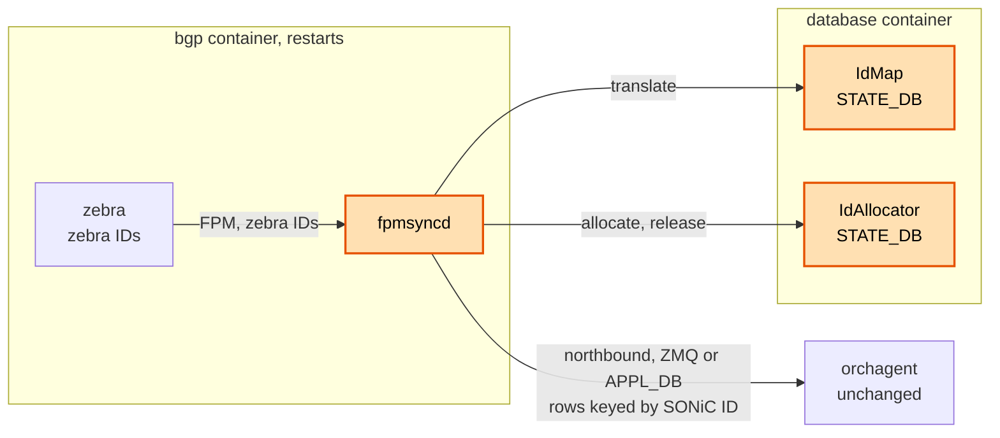
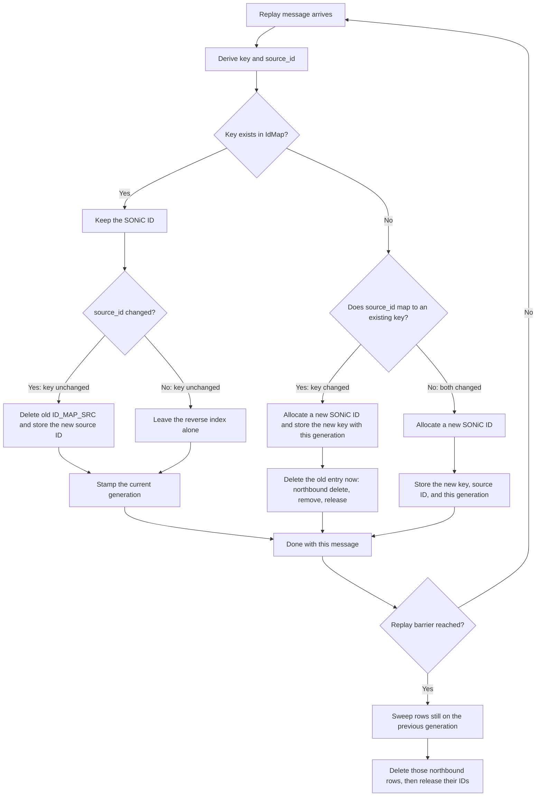
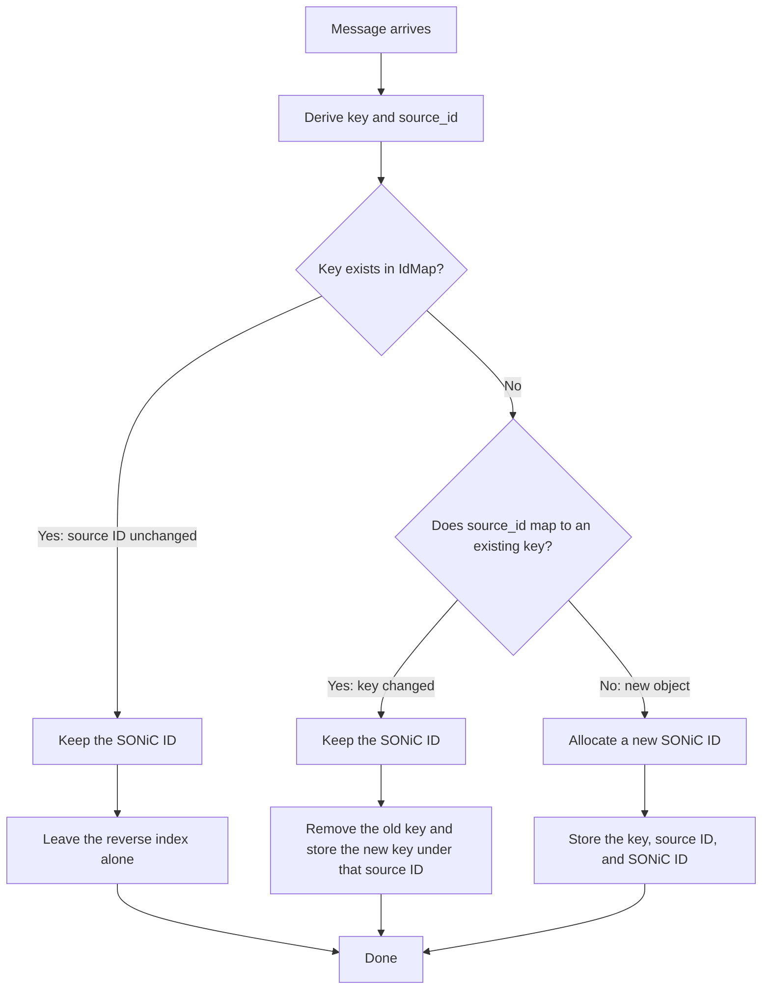
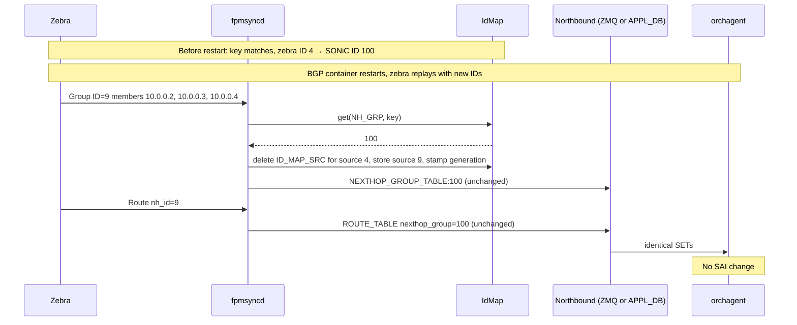
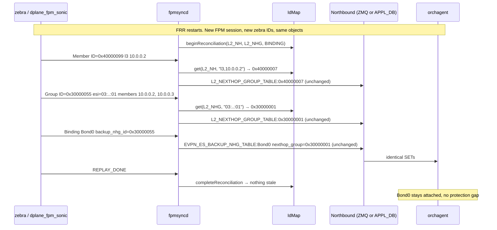

# Generic Stable ID Allocation and Reconciliation (IdAllocator / IdMap) — SONiC High-Level Design

## Table of Contents

- [1. Revision](#1-revision)
- [2. Scope](#2-scope)
- [3. Definitions / Abbreviations](#3-definitions--abbreviations)
- [4. Overview](#4-overview)
- [5. Requirements](#5-requirements)
- [6. Architecture Design](#6-architecture-design)
- [7. High-Level Design](#7-high-level-design)
  - [7.1 IdAllocator](#71-idallocator)
  - [7.2 IdMap](#72-idmap)
  - [7.3 ID translation in fpmsyncd](#73-id-translation-in-fpmsyncd)
  - [7.4 ECMP next-hop groups](#74-ecmp-next-hop-groups)
  - [7.5 Bridge-port protection objects](#75-bridge-port-protection-objects)
  - [7.6 FPM session start and reconciliation](#76-fpm-session-start-and-reconciliation)
  - [7.7 DB schema changes](#77-db-schema-changes)
- [8. SAI API](#8-sai-api)
- [9. Configuration and management](#9-configuration-and-management)
  - [9.1 Manifest (if the feature is an Application Extension)](#91-manifest-if-the-feature-is-an-application-extension)
  - [9.2 CLI / YANG model Enhancements](#92-cli--yang-model-enhancements)
  - [9.3 Config DB Enhancements](#93-config-db-enhancements)
- [10. Warmboot and Fastboot Design Impact](#10-warmboot-and-fastboot-design-impact)
- [11. Memory Consumption](#11-memory-consumption)
- [12. Restrictions / Limitations](#12-restrictions--limitations)
- [13. Testing Requirements / Design](#13-testing-requirements--design)
  - [13.1 Unit test cases](#131-unit-test-cases)
  - [13.2 System test cases](#132-system-test-cases)
- [14. Open / Action items](#14-open--action-items)
- [15. References](#15-references)

---

## 1. Revision

| Rev | Date | Author | Change Description |
|---|---|---|---|
| 0.1 | 2026-10-13 | Amit Grover - Cisco<br>Patrice Brissette - Cisco | Initial draft: generic SONiC ID allocation mechanism |
| 0.2 | 2026-11-02 | Patrice Brissette - Cisco | Clarified terminology and design behavior |
| 0.3 | 2026-11-02 | Patrice Brissette - Cisco | Clarified the generic allocation and reconciliation scope |

---

## 2. Scope

This document defines a generic ID allocation and reconciliation mechanism for SONiC applications. An application can use this mechanism when its source IDs are volatile but its own IDs must remain stable across restarts, reconnects, or replay cycles.

The mechanism is independent of any application, object type, key format, or replay protocol. The caller defines:

- a **type**, which selects an ID pool and mapping scope;
- a stable **key**, which identifies the same logical object across source restarts;
- a volatile **source ID**, when incoming messages refer to the object by an ID assigned by the source;
- the event that starts reconciliation and the barrier that completes it;
- the dependency order for deleting stale objects and releasing their IDs.

The design provides:

- `IdAllocator`, a generic `sonic-swss-common` class that allocates IDs per type and preserves allocator state in Redis;
- `IdMap`, a generic `sonic-swss-common` class that maps typed keys and source IDs to stable IDs;
- a generation-based reconciliation API that identifies mappings not refreshed during a replay;
- lifecycle rules that prevent duplicate ID allocation and release an ID only after its final reference is removed.

`fpmsyncd` is the first integration and the concrete example in this document. It uses the mechanism for:

- ECMP groups on the `nexthop_group` and RIB/FIB `nhg_fib` paths;
- objects defined by the [Bridge-Port Protection (BPP) HLD](#15-references);
- replay reconciliation after an FPM session starts.

Out of scope:

- Defining application-specific types, stable keys, source IDs, replay barriers, or dependency order. Each caller supplies these values and policies.
- Persisting an application's source IDs. The mechanism maps source IDs to stable IDs; it does not control how the source allocates them.
- Changing consumers of the stable IDs. Consumers continue to treat the IDs as opaque values.
- Coordinating ID pools across producers that have not adopted `IdAllocator`. Such producers require a disjoint reserved range.

For the `fpmsyncd` integration, this document also excludes changes to orchagent, syncd, and SAI; `L2_NEXTHOP_GROUP_TABLE` rows written by `fdbsyncd`; and single-next-hop routes, which do not reference a group.

---

## 3. Definitions / Abbreviations

| Term | Definition |
|---|---|
| **source ID** | Volatile ID assigned by an application's source. It may change when the source restarts or reconnects. |
| **zebra ID** | Source ID that zebra allocates for a next hop or group and sends over FPM. Valid only for the life of the zebra process. |
| **stable ID** | ID allocated by `IdAllocator` and associated with a stable key by `IdMap`. Stable while the key exists. |
| **SONiC ID** | Stable ID that `fpmsyncd` publishes northbound in this document's first integration. |
| **northbound** | The `fpmsyncd` → orchagent path: APPL_DB `ProducerStateTable`, or ZMQ with APPL_DB written asynchronously as a diagnostic copy ([References](#15-references)). |
| **key** | Caller-defined string that identifies an object independently of its source ID. Examples include a canonical member list and an ESI. |
| **type** | Caller-defined name of an ID pool and mapping scope. The `fpmsyncd` integration uses `NH_GRP`, `L2_NH`, `L2_NHG`, and `BINDING`. |
| **generation** | Token returned by `IdMap::beginReconciliation`. `IdMap` records it on every mapping refreshed during the corresponding replay. |
| **APPL_DB** | Redis logical database that carries application state from SONiC producers to consumers such as orchagent. |
| **BPP** | Bridge-Port Protection ([References](#15-references)) |
| **ECMP** | Equal-Cost Multi-Path routing |
| **ES / ESI** | EVPN Ethernet Segment / Ethernet Segment Identifier |
| **FPM** | Forwarding Plane Manager channel, zebra → `fpmsyncd` |
| **NHG** | Next-hop group |
| **RIB / FIB** | Routing Information Base / Forwarding Information Base |
| **RMAC** | Router MAC of a remote VTEP |
| **SAI** | Switch Abstraction Interface |
| **STATE_DB** | Redis logical database that stores persistent operational state |
| **VTEP** | VXLAN Tunnel End Point |
| **ZMQ** | ZeroMQ transport used as an alternative to the Redis northbound path |

---

## 4. Overview

### Problem statement

Many applications receive objects from a source that assigns process-local IDs. After the source restarts, it can assign a different ID to the same logical object or reuse an old ID for a different object. If the application publishes these source IDs, unchanged objects appear to be new, and stale objects cannot be identified safely after replay.

The application therefore needs two related capabilities:

1. allocate an ID that remains stable for the lifetime of a logical object; and
2. reconcile persisted mappings with a replay, then remove objects that the replay did not refresh.

`fpmsyncd` demonstrates this problem. zebra allocates next-hop and next-hop-group IDs from the process-local `id_counter` in `zebra_nhg.c`. When the BGP container restarts, zebra resets the counter and can replay an unchanged object with a different ID. If `fpmsyncd` publishes that ID directly, orchagent rebuilds unchanged ECMP groups and temporarily removes BPP protection.

### Approach

`IdAllocator` allocates stable IDs from caller-defined type pools. `IdMap` associates each stable ID with a caller-defined key and, when needed, the latest source ID. Both classes persist their state in Redis.

During reconciliation, the caller starts a generation and records that generation on every refreshed mapping. After the caller's replay barrier, `IdMap` returns mappings that were not refreshed. The caller then removes those objects in dependency order and releases their IDs.

In the `fpmsyncd` integration, a stable key resolves to the same SONiC ID after a zebra restart. `fpmsyncd` therefore sends unchanged northbound objects, and orchagent makes no change. After the FPM replay barrier, `fpmsyncd` removes objects that the replay did not refresh.

`fpmsyncd` defines the following types and keys:

| Use case | Type | Key |
|---|---|---|
| ECMP group | `NH_GRP` | Canonical member list ([§7.4](#74-ecmp-next-hop-groups)) |
| BPP Member | `L2_NH` | `<type>,<VTEP>` |
| BPP Group | `L2_NHG` | ESI |
| BPP Binding | `BINDING` | `ifname` |

---

## 5. Requirements

| # | Requirement |
|---|---|
| S1 | An object whose type and key are unchanged keeps its stable ID across caller restarts, source restarts, reconnects, and reconciliation cycles. |
| S2 | The design requires no changes to orchagent, syncd, or SAI. |
| S3 | An ID is never issued to two live objects of the same type, including across process restarts. |
| S4 | A caller can translate a message that carries only a source ID to the stable ID. In the `fpmsyncd` integration, this includes route `nh_id`, deletes, and BPP Binding `backup_nhg_id`. |
| S5 | An ID is released only after the caller removes its last reference. It can then be reused, but it is never issued to two live objects. |
| S6 | Objects not refreshed by a replay are removed after the replay barrier, in dependency order. |
| S7 | SONiC IDs written to `L2_NEXTHOP_GROUP_TABLE` stay disjoint from the zebra IDs written by `fdbsyncd` ([BPP](#15-references) §8.6). |
| S8 | An in-place update of an object (same source ID, new content) keeps its stable ID. In the `fpmsyncd` integration, this allows orchagent to update the SAI object in place ([BPP](#15-references) §8.5). |
| S9 | `IdAllocator` and `IdMap` are generic; types and keys are defined by the caller. |
| S10 | All producers of an APPL_DB table keyed by IDs allocate from the same `IdAllocator` type pool. Until a producer adopts the allocator, a reserved range keeps its IDs disjoint (S7). |
| S11 | Route download performance is unchanged. Compared with current behavior, route add, update, and delete operations add no Redis access or northbound messages. Orchagent performs no STATE_DB access on its main thread. Because APPL_DB and STATE_DB share one Redis instance, the design must evaluate whether ID state requires a separate instance to prevent interference with APPL_DB traffic. |
| S12 | The design works unchanged with Redis and ZMQ northbound. `fpmsyncd` never reads APPL_DB for IDs or reconciliation; all ID state is in STATE_DB and memory. |
| S13 | Tables that reference each other (`ROUTE_TABLE` and `NEXTHOP_GROUP_TABLE`; `EVPN_ES_BACKUP_NHG_TABLE` and `L2_NEXTHOP_GROUP_TABLE`) use the same northbound transport, so dependency order is preserved. |

---

## 6. Architecture Design

The generic classes reside in `sonic-swss-common`. The diagram below shows their first integration in `fpmsyncd`; another application can use the same classes with its own types, keys, source IDs, and reconciliation barrier.



| Repository | Module | Change |
|---|---|---|
| sonic-swss-common | `common/idallocator.{h,cpp}`, `common/idallocator_get.lua` | **New** ([§7.1](#71-idallocator)) |
| sonic-swss-common | `common/idmap.{h,cpp}` | **New** ([§7.2](#72-idmap)) |
| sonic-swss | `fpmsyncd` (`RouteSync`) | Translate zebra IDs and reconcile mappings when an FPM session starts ([§7.3](#73-id-translation-in-fpmsyncd)–[§7.6](#76-fpm-session-start-and-reconciliation)) |
| sonic-swss | orchagent | None |
| sonic-buildimage | FRR (BPP patches), `dplane_fpm_sonic` | ESI in the BPP Group message and an end-of-replay message, specified in the [BPP HLDs](#15-references) rev 1.3 |
| sonic-buildimage | `swss.sh` | Clear `ID_ALLOC\|*` and `ID_MAP*` in STATE_DB on a cold swss start, together with APPL_DB |

---

## 7. High-Level Design

### 7.1 IdAllocator

`IdAllocator` allocates IDs separately for each type. It first checks a process-local cache of released IDs. If the cache is empty, it allocates a new ID from persistent state in Redis. The database is selected at construction. All instances that use the same database share the ID space for each type.

```cpp
namespace swss {

class IdAllocator {
public:
    // db is not owned and must outlive this object.
    explicit IdAllocator(DBConnector *db);

    // Next ID for this type: reuse a locally cached free ID first; otherwise allocate a new ID from Redis. IDs start at 1.
    // Throws if Redis fails, type is empty, or max is exceeded.
    uint64_t get(const std::string &type, uint64_t max = UINT64_MAX);

    // Return ID to this allocator's process-local free-ID cache. Throws if type is empty or ID is 0.
    void release(const std::string &type, uint64_t id);
};

}
```

| Key | Redis type | Role |
|---|---|---|
| `ID_ALLOC\|<type>` | integer | High-water counter for new IDs |

On a cache miss, `IdAllocator` runs a Lua script that it loaded once with `SCRIPT LOAD`. Redis `INCR` makes new-ID allocation atomic across processes. On a cache hit, `IdAllocator` returns an ID without accessing Redis:

```lua
-- get: KEYS[1] = ID_ALLOC|<type>, ARGV[1] = max
local id = redis.call('INCR', KEYS[1])
if id > tonumber(ARGV[1]) then
    redis.call('DECR', KEYS[1])
    return redis.error_reply('id space exhausted')
end
return id
```

`get` first checks the in-memory free-ID cache. If an ID is available, `get` removes and returns it without accessing Redis. Otherwise, `get` runs the Lua script, which increments the persistent high-water counter. `release` returns an ID to the process-local cache and does not update Redis. Therefore, release requires no Lua script.

#### Cache and restart behavior

The free-ID cache is volatile and is not restored after a process restart. A new `IdAllocator` starts with an empty cache and allocates new IDs from the Redis high-water counter. IDs left in the old process's cache are no longer available for reuse, which can leave gaps and consume the ID space sooner. This behavior cannot issue the same ID twice. Existing STATE_DB mappings continue to preserve the SONiC IDs of live objects.

Rules:

- `release` is not idempotent. The caller releases an ID once, after removing its last reference.
- Redis serializes new-ID allocations across processes. A released ID is reusable only by the allocator whose process-local cache holds it. Cache hits do not access Redis.

### 7.2 IdMap

For each type, `IdMap` stores `key → (sonic_id, source_id)`. `source_id` is the zebra ID from the latest update. `IdMap` neither allocates IDs nor interprets keys.

```cpp
namespace swss {

struct IdMapEntry {
    std::string key;
    uint64_t sonic_id;
    uint64_t source_id;
};

class IdMap {
public:
    // Use the same DBConnector as IdAllocator.
    explicit IdMap(DBConnector *db);

    // SONiC ID for key, or 0.
    uint64_t get(const std::string &type, const std::string &key) const;

    // Key whose latest source_id is source_id, or empty.
    std::string getKeyBySource(const std::string &type, uint64_t source_id) const;

    // Create or update the mapping and its reverse entry; a generation of 0 leaves it unchanged.
    void store(const std::string &type, const std::string &key,
               uint64_t sonic_id, uint64_t source_id, uint64_t generation = 0);

    // Drop the mapping and its reverse entry. Does not release the ID.
    void remove(const std::string &type, const std::string &key);

    // Start a reconciliation cycle for this type.
    uint64_t beginReconciliation(const std::string &type);

    // Remove and return mappings not stored with this generation.
    // A generation older than the current one removes nothing.
    std::vector<IdMapEntry> completeReconciliation(const std::string &type,
                                                   uint64_t generation);
};

}
```

| Key | Fields | Role |
|---|---|---|
| `ID_MAP\|<type>\|<key>` | `sonic_id`, `source_id`, `generation` | Mapping |
| `ID_MAP_SRC\|<type>\|<source_id>` | `key` | Reverse index for `getKeyBySource` |
| `ID_MAP_GEN\|<type>` | integer | Current generation |

The `|` separator is deliberate: keys contain IPv6 addresses and ESIs, which contain `:`.

Reconciliation uses generations to identify stale mappings. The caller starts a generation and stores each refreshed object with that generation. After the replay barrier, the caller completes the generation. `IdMap` returns mappings that were not refreshed; the caller deletes their northbound objects and releases their IDs. Repeating completion, or completing an older generation, returns no mappings.

`IdMap` does not decide when a refresh is complete. The caller defines the scope, tracks the generation, and completes reconciliation only after processing every update in that cycle. The FPM replay barrier in §7.6 is one use of this generic API.

### 7.3 ID translation in fpmsyncd

`fpmsyncd` owns one `IdAllocator` and one `IdMap`. Both use a dedicated STATE_DB `DBConnector`, separate from the northbound producers. For each type, `fpmsyncd` selects the flow below based on whether reconciliation is active.

`IdMap::store` records the key, source ID, and SONiC ID, then updates the reverse source-ID index. During reconciliation, it also records the current generation.

#### Restart decision

During replay, `fpmsyncd` first looks up the derived key and then the source ID. In the table below, "delete immediately" means that `fpmsyncd` sends the northbound delete, removes the mapping, and releases its SONiC ID while processing the current message. It does not wait for the replay barrier. `fpmsyncd` allocates the new ID before releasing the old one, so the new entry cannot receive the ID that it is replacing.

| Source ID | Key | Action |
|---|---|---|
| Changed | Unchanged | Update the existing entry in place. Keep the SONiC ID. Replace the reverse index by deleting `ID_MAP_SRC` for the old source ID and storing the new source ID. Record the current generation. |
| Unchanged | Changed | The source ID still identifies the old entry. Allocate a new SONiC ID and store the new key with the current generation. Delete the old entry immediately. |
| Unchanged | Unchanged | Record the current generation. Keep the SONiC ID, key, and reverse index unchanged. |
| Changed | Changed | Neither lookup finds an entry. Allocate a new SONiC ID and store the new key with the current generation. The barrier sweep deletes entries that still carry the previous generation. |

#### Figure 7-1: Reconciliation / replay flow

During replay, look up the key first. The restart decision table defines the behavior for all four combinations of key and source ID.



#### Normal-operation decision

Outside replay, a live zebra object keeps the same source ID. If its key changes, `fpmsyncd` treats it as the same object: it keeps the SONiC ID and moves the mapping to the new key. Normal operation neither records a generation nor performs a sweep. A source-ID change is handled only by the restart decision table.

| Source ID | Key | Action |
|---|---|---|
| Unchanged | Unchanged | Keep the SONiC ID and reverse index unchanged. Do not record a generation. |
| Unchanged | Changed | Keep the SONiC ID. Remove the old key and store the new key under the same source ID. |

#### Figure 7-2: Normal operation flow

The normal-operation decision table is the rule. Look up the key first.



- In normal operation, a key change under the same source ID keeps the SONiC ID (S8).
- During replay, a matching key keeps its SONiC ID (S1).
- A message that carries only a zebra ID is translated by calling `getKeyBySource` and then `get` (S4). This rule applies to every field that references a group, not only to table keys.
- A delete sends the northbound delete, removes the mapping, and then releases the ID (S5).
- Translation happens before the row is handed to the northbound producer, so it is independent of the transport (S12).

### 7.4 ECMP next-hop groups

**Key.** `fpmsyncd` builds the key from the canonical member list written to `NEXTHOP_GROUP_TABLE` and prefixes it with the address family. Each member contributes its `nexthop`, `ifname`, and `weight`, plus its label or VNI when present. `fpmsyncd` sorts the members before building the key. An IP-address list alone is not unique because the same gateway on two interfaces represents two different groups. zebra deduplicates its groups by content, so two live zebra-owned groups never share a key.

**Translation.** When `fpmsyncd` receives `RTM_NEWNEXTHOP` for a group, it allocates or recovers the SONiC ID. It writes this ID to `ROUTE_TABLE.nexthop_group` when translating the route's `nh_id`. zebra deletes a group only after deleting its last route, so `RTM_DELNEXTHOP` can safely release the ID.

**RIB/FIB groups (`nhg_fib`).** The RIB/FIB path ([SONiC#2060](#15-references)) uses a separate FPM message, `RTM_NEWNHGFIB`, and maintains a dependency graph (`depends[]`, `dependents[]`) for Prefix Independent Convergence (PIC). The same translation rules apply: the group uses the key defined above, and every group ID in the dependency lists is translated to its SONiC ID. PIC updates a group in place under the same zebra ID, so the group keeps its SONiC ID (S8).

**Restart.** Today the replay writes the same members under a new key and orchagent rebuilds the group. With this design:



> `IdMap` state is in STATE_DB ([§7.7](#77-db-schema-changes)).

**Protocol-owned groups.** A daemon can install a group through the ZAPI next-hop-group API, as BGP PIC does. During normal operation, the group keeps its zebra ID while its members change in place; the source-ID rule handles this case. Across a restart, two such groups can share a key ([O3](#14-open--action-items)).

### 7.5 Bridge-port protection objects

The BPP objects are defined in the [BPP HLD](#15-references) §8.1 and produced by FRR as described in the [FRR BPP HLD](#15-references) §8.3.

| Object | FPM message | Type | Key | Why |
|---|---|---|---|---|
| Member | `RTM_FPM_ADD_L2_NEXTHOP` | `L2_NH` | `<type>,<VTEP>`, e.g. `l3,10.0.0.2` | FRR identifies a Member by `(VTEP, family, type)`; the RMAC is an attribute and does not change the ID |
| Group | `RTM_FPM_ADD_L2_NEXTHOP_GROUP` | `L2_NHG` | ESI | FRR allocates one Group per ES and updates it in place |
| Binding | `RTM_FPM_ADD_EVPN_ES_BACKUP_NHG` | `BINDING` | `ifname` | `backup_nhg_id` is translated through `L2_NHG`; the Binding is recorded with its Group SONiC ID so that the sweep never reads APPL_DB (S12) |

**Why the Group key is the ESI.** Two ESes commonly connect to the same peer leaves and therefore have identical Group members. FRR nevertheless creates one Group per ES (`es->l3_nhg_id`) because peer changes occur independently for each ES. Each Group must be updated without affecting the others. A member-list key would incorrectly merge these Groups and later require them to split. The ESI remains stable across a zebra restart and uniquely identifies the Group. The Group message therefore carries the ESI ([BPP](#15-references) §8.1.3).

**Disjoint IDs.** `fdbsyncd` writes kernel zebra IDs to the same table. zebra reserves four type bits beginning at bit 28, including separate FPM-only tags for BPP Groups and Members ([BPP](#15-references) O4). For both object types, `fpmsyncd` publishes `(tag << 28) | IdAllocator::get(type, 2^28 - 1)`. This keeps its IDs disjoint from kernel IDs (S7).

**Rows.** Each Group row lists the SONiC IDs of its Members in the format defined by [BPP](#15-references) §8.6:

```text
L2_NEXTHOP_GROUP_TABLE:0x40000007 = { remote_vtep:10.0.0.2, type:l3, router_mac:00:00:5e:00:53:02 }
L2_NEXTHOP_GROUP_TABLE:0x40000008 = { remote_vtep:10.0.0.3, type:l3, router_mac:00:00:5e:00:53:03 }
L2_NEXTHOP_GROUP_TABLE:0x30000001 = { nexthop_group:"0x40000007,0x40000008" }
EVPN_ES_BACKUP_NHG_TABLE:Bond0    = { nexthop_group:0x30000001 }
```

**Ordering and deletes.**

- The Group message contains the complete Member list. `fpmsyncd` can therefore resolve Member SONiC IDs by key, regardless of arrival order.
- A Binding whose Group is not yet known is held in `fpmsyncd` and written when the Group arrives.
- `fpmsyncd` counts how many Group rows reference each Member. A Member delete releases the ID only when this count reaches zero. FRR sends the Group update before the Member delete.

**Restart.** Today, `fpmsyncd` flushes all protection rows when a new session starts. The replay recreates them under new IDs, so every protected port temporarily loses its backup. With this design:



> `IdMap` state is in STATE_DB ([§7.7](#77-db-schema-changes)).

If a peer leaves the ES while FRR is down, `fpmsyncd` finds the Group by ESI and rewrites it with the remaining Member. Orchagent applies this change in place. The sweep removes the Member that is no longer listed.

### 7.6 FPM session start and reconciliation

For each new FPM session, `fpmsyncd` starts one generation per type. It records that generation on every replayed object and performs the sweep after a barrier.

| Types | Barrier | Fallback |
|---|---|---|
| `L2_NH`, `L2_NHG`, `BINDING` | `RTM_FPM_EVPN_MH_REPLAY_DONE`, sent by FRR after the last replayed protection object | Hold timer from session start |
| `NH_GRP` | `fpmsyncd` warm-restart route reconciliation when warm restart is enabled; otherwise the hold timer | Hold timer from session start |

The first valid barrier or hold timer triggers the sweep. `fpmsyncd` ignores barriers and timers from older sessions. If the current session ends before either trigger, `fpmsyncd` abandons the generation and performs no sweep. A timer-triggered sweep increments a counter and writes a log message because it indicates that the replay marker was missing.

Sweep order follows the dependencies:

1. Bindings returned by `completeReconciliation(BINDING)`;
2. Group rows returned by `completeReconciliation(L2_NHG)`;
3. Member rows returned by `completeReconciliation(L2_NH)`;
4. `NEXTHOP_GROUP_TABLE` rows returned by `completeReconciliation(NH_GRP)`, once no route in `fpmsyncd`'s in-memory route view references them.

Each ID is released after its delete is sent northbound. The referencing tables share one transport (S13), so the deletes reach orchagent in this order and preserve the BPP detach-before-unreference rule ([BPP](#15-references) §8.5). Consumers also tolerate reordering: RouteOrch retries, `bpProtOrch` parks a Binding, and `L2NhgOrch` retains a referenced Group.

### 7.7 DB schema changes

This design does not change any APPL_DB table or field. SONiC IDs replace zebra IDs in the keys of `NEXTHOP_GROUP_TABLE`, in FPM-produced `L2_NEXTHOP_GROUP_TABLE` rows, and in every field that references a group. These fields include `ROUTE_TABLE.nexthop_group`, `EVPN_ES_BACKUP_NHG_TABLE.nexthop_group`, and the RIB/FIB dependency lists.

The design adds the STATE_DB keys shown below. STATE_DB keeps ID bookkeeping off the northbound path (S11). Like APPL_DB, STATE_DB survives a BGP container restart and is restored on warm reboot.

In the current deployment, APPL_DB and STATE_DB are separate logical databases on the same Redis instance, so they share Redis resources. STATE_DB access is limited to group events and the session-start preload ([§10](#10-warmboot-and-fastboot-design-impact)). O4 tracks whether ID state needs a separate Redis instance to avoid interference with APPL_DB traffic.

```text
ID_ALLOC|{{type}}                  ; integer, high-water counter for new IDs
ID_MAP|{{type}}|{{key}}
    sonic_id   = UINT64            ; ID published northbound
    source_id  = UINT64            ; zebra ID from the latest update
    generation = UINT64            ; last generation that refreshed the row
ID_MAP_SRC|{{type}}|{{source_id}}
    key        = STRING            ; reverse index
ID_MAP_GEN|{{type}}                ; integer, current generation
```

These keys are not producer/consumer tables. Orchagent does not subscribe to them.

---

## 8. SAI API

No change.

---

## 9. Configuration and management

### 9.1 Manifest (if the feature is an Application Extension)

Not applicable.

### 9.2 CLI / YANG model Enhancements

No change. To inspect the mappings in STATE_DB, run `redis-cli -n 6 --scan --pattern 'ID_MAP|*'`.

### 9.3 Config DB Enhancements

No change. The reconciliation hold timer is an `fpmsyncd` constant ([O2](#14-open--action-items)).

---

## 10. Warmboot and Fastboot Design Impact

| Event | Allocator and mapper state | Result |
|---|---|---|
| BGP container restart, `fpmsyncd` restart, FPM reconnect | STATE_DB keeps the counter and mappings. An `fpmsyncd` restart discards the process-local free-ID cache. | Existing objects keep their SONiC IDs. New IDs come from the Redis counter. Released IDs that existed only in the discarded cache can leave gaps. |
| BGP warm restart | State is kept. | Route reconciliation sees unchanged `nexthop_group` values. |
| Warm reboot | STATE_DB is saved and restored. A restarted process begins with an empty free-ID cache. | Existing objects keep their SONiC IDs, and new IDs come from the Redis counter. This case does not apply to ZMQ northbound, which does not support warm reboot. |
| Cold reboot, fastboot | State is cleared. | IDs restart at 1. Orchagent and SAI also start empty. |
| Cold swss start (`config reload`) | `swss.sh` clears `ID_ALLOC\|*` and `ID_MAP*` together with APPL_DB. | IDs restart at 1. Orchagent and SAI also start empty. |

### Warmboot and Fastboot Performance Impact

- Nothing is added to the boot critical path.
- The barrier delays only the sweep of stale rows, not the programming of replayed rows.

### Route download performance (S11)

- **No per-route Redis access.** `fpmsyncd` keeps `zebra ID → SONiC ID` in memory. Route translation is a local lookup; a route update adds no Redis call and no extra northbound message.
- **ID bookkeeping is outside the route path.** `IdMap` and `IdAllocator` use a dedicated STATE_DB connection. They do not use or flush the northbound Redis pipeline or ZMQ socket. They also add no work to the orchagent main thread.
- **Redis is touched per group, not per route.** A group or member add costs one STATE_DB lookup and, on a miss, one `EVALSHA`. A refresh of known content changes nothing in STATE_DB. Groups are orders of magnitude fewer than routes. Today these operations and APPL_DB use the same Redis instance and share its resources; O4 evaluates whether a separate instance is needed to isolate the APPL_DB flow.
- **Replay preload.** At FPM session start, `fpmsyncd` loads the mappings of its types from STATE_DB in one scan, so the replay is translated from memory.

---

## 11. Memory Consumption

STATE_DB stores two hashes for each ECMP group, BPP Member, and BPP Group, plus two keys for each type. Storage grows with the number of groups, peer VTEPs, and ESes, but not with the number of routes. `fpmsyncd` also keeps the mappings and free-ID cache in memory.

---

## 12. Restrictions / Limitations

- Single-next-hop routes reference no group and are not covered.
- BPP SONiC IDs use 28 bits below the type tag.
- Protocol-owned ECMP groups with identical members may swap SONiC IDs across a restart.
- A crash between a northbound delete and `release` leaks an ID until the next cold start.
- A restart can discard free IDs held only in the process-local cache. These IDs may not be reused, leaving gaps in the ID space.

---

## 13. Testing Requirements / Design

### 13.1 Unit test cases

1. **IdAllocator**: IDs start at 1; types are independent; a released ID is reused; concurrent `get` calls on one database never return the same ID; `max` is enforced; a restart clears the process-local cache; new IDs resume from the Redis counter without duplication.
2. **IdMap**: `store`/`get`/`remove`; `getKeyBySource` follows the latest source ID and returns empty for a superseded ID; `completeReconciliation` returns only unrefreshed rows, ignores an older generation, and is idempotent.
3. **Translation rule**: the same zebra ID with a new key keeps the SONiC ID; a new zebra ID with a known key recovers the existing SONiC ID; if neither is known, a new SONiC ID is allocated.
4. **ECMP**: the same gateways on different interfaces get different IDs; route `nh_id` values are translated; delete releases the ID; RIB/FIB dependency lists carry SONiC IDs.
5. **BPP**: IDs contain type tags; Group rows list Member SONiC IDs; two ESes with the same peers get separate Group IDs and share Member IDs; an RMAC change keeps the Member ID; a Binding waits until its Group arrives; a Member is released only when no Group row references it.
6. **Reconciliation**: sweep on `REPLAY_DONE`; sweep on hold timer with counter incremented; session drop before the barrier sweeps nothing; sweep order Binding → Group → Member → `NH_GRP`; no APPL_DB read during reconciliation (S12).

### 13.2 System test cases

1. **BGP container restart, ECMP**: verify that `NEXTHOP_GROUP_TABLE` keys and `ROUTE_TABLE.nexthop_group` remain unchanged and that no SAI next-hop group is created or removed.
2. **BGP container restart, BPP**: verify that Member, Group, and Binding rows remain unchanged, the protected port never loses its protection NHG, and the primary path does not flap.
3. **Change while down**: remove a peer from one ES while the BGP container is down. After replay, verify that the Group keeps its ID with one fewer Member, the other ES is unchanged, and the stale Member is swept and released.
4. **Coexistence with fdbsyncd**: kernel and FPM rows in `L2_NEXTHOP_GROUP_TABLE` never share a key.
5. **Scale**: restart convergence and STATE_DB memory with many ECMP groups and protected ESes.
6. **Route download performance**: run the route convergence benchmark ([sonic-mgmt#22727](#15-references)) in two configurations: ZMQ northbound and southbound with FIB suppression enabled, and Redis northbound. Compare programming time and `fpmsyncd` CPU with and without this feature, both at cold start and after a BGP restart. Verify no S11 regression and no Redis call per route update.
7. **Transport**: with ZMQ northbound, `NEXTHOP_GROUP_TABLE` and `ROUTE_TABLE` share the socket; no route reaches orchagent before its group; the BPP sweep reaches orchagent in Binding → Group → Member order (S13).

---

## 14. Open / Action items

| # | Item | Notes |
|---|---|---|
| O2 | Hold timer value | Must exceed the worst-case replay time at scale. |
| O3 | Protocol-owned and RIB/FIB groups across restart | Two such groups can have identical members. After a restart, they can exchange SONiC IDs, which moves their routes. Either the daemon must provide a stable key, or the design must accept this churn. This primarily affects RIB/FIB (`nhg_fib`) deployments. |
| O4 | Redis instance isolation for ID state | APPL_DB and STATE_DB currently share a Redis instance. Determine whether a dedicated Redis instance for allocator and mapper state would prevent interference with APPL_DB traffic. Measure the impact before selecting the deployment model. |

---

## 15. References

| Doc | Link |
|---|---|
| Bridge-Port Protection Group HLD: SONiC | [sonic-net/SONiC PR #2556](https://github.com/sonic-net/SONiC/pull/2556) |
| Bridge-Port Protection Group HLD: FRRouting | [sonic-net/SONiC PR #2576](https://github.com/sonic-net/SONiC/pull/2576) |
| Route download performance strategy (large-scale CLOS) | [route-performance strategy](https://github.com/deepak-singhal0408/SONiC/blob/a9f0ec6a6555c6f078c352e4b18ba0a145aff1b3/doc/route-performance/strategies/large-scale-datacenter-clos-fabric.md) |
| ZMQ northbound HLD | [SONiC#1659](https://github.com/sonic-net/SONiC/pull/1659), [SONiC#2230](https://github.com/sonic-net/SONiC/pull/2230) |
| RIB/FIB NHG and PIC HLD | [SONiC#2060](https://github.com/sonic-net/SONiC/pull/2060) |
| Route convergence benchmark | [sonic-mgmt#22727](https://github.com/sonic-net/sonic-mgmt/pull/22727) |
| SONiC HLD template | [hld_template.md](https://github.com/sonic-net/SONiC/blob/master/doc/guidelines/hld_template.md) |
