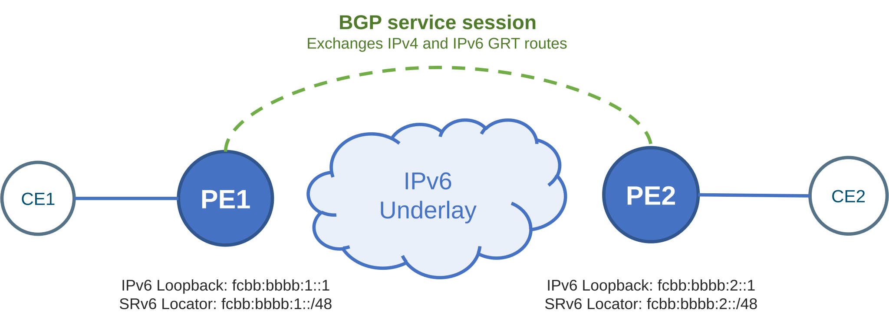
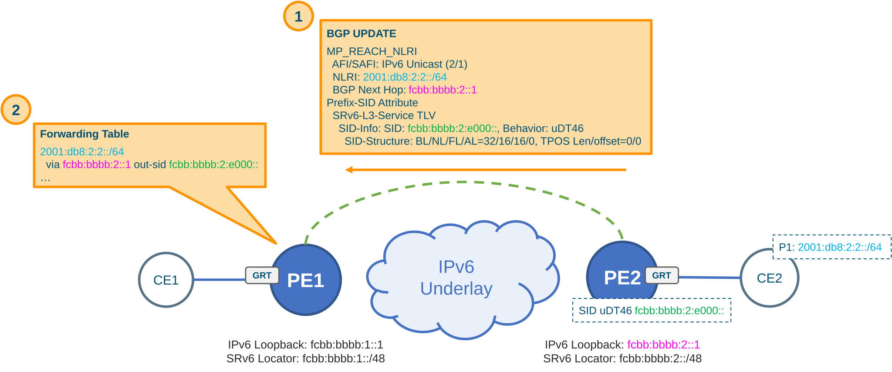
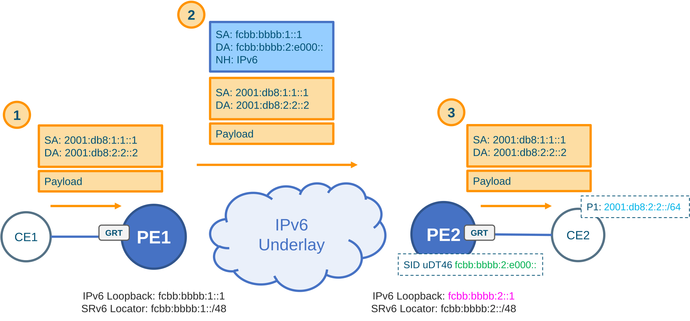
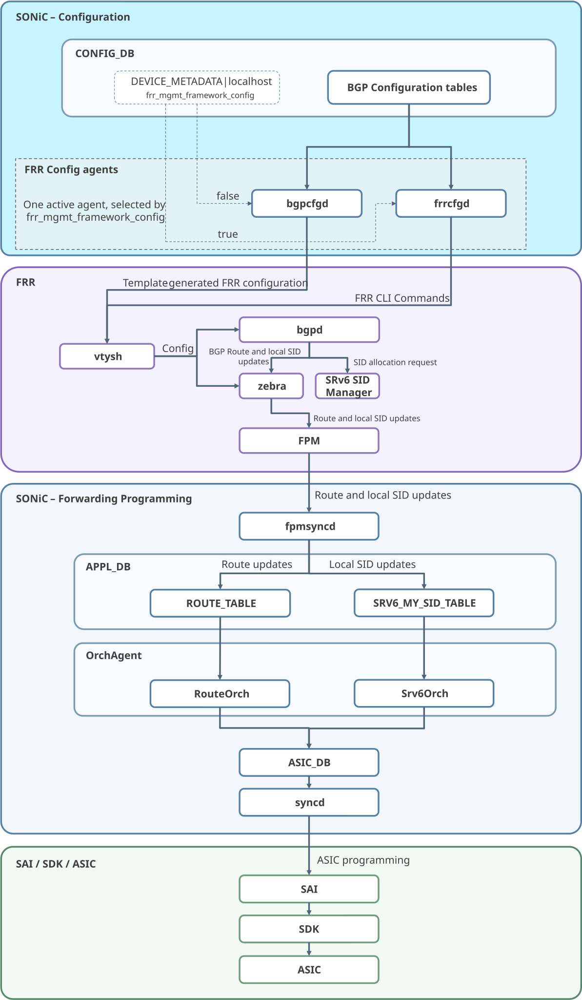
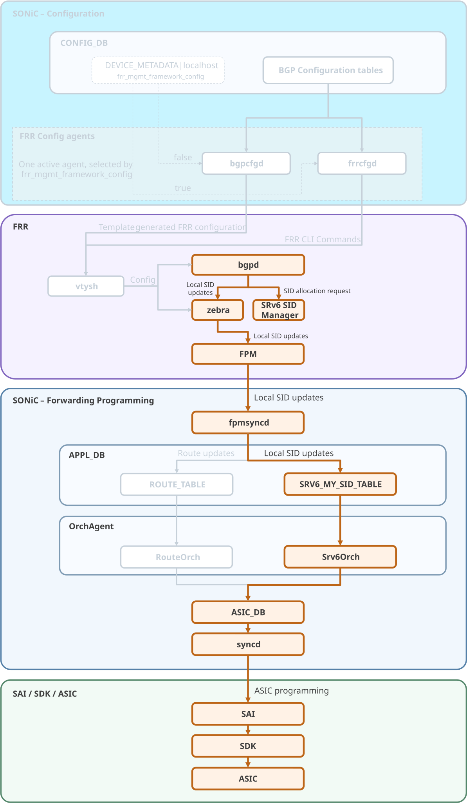
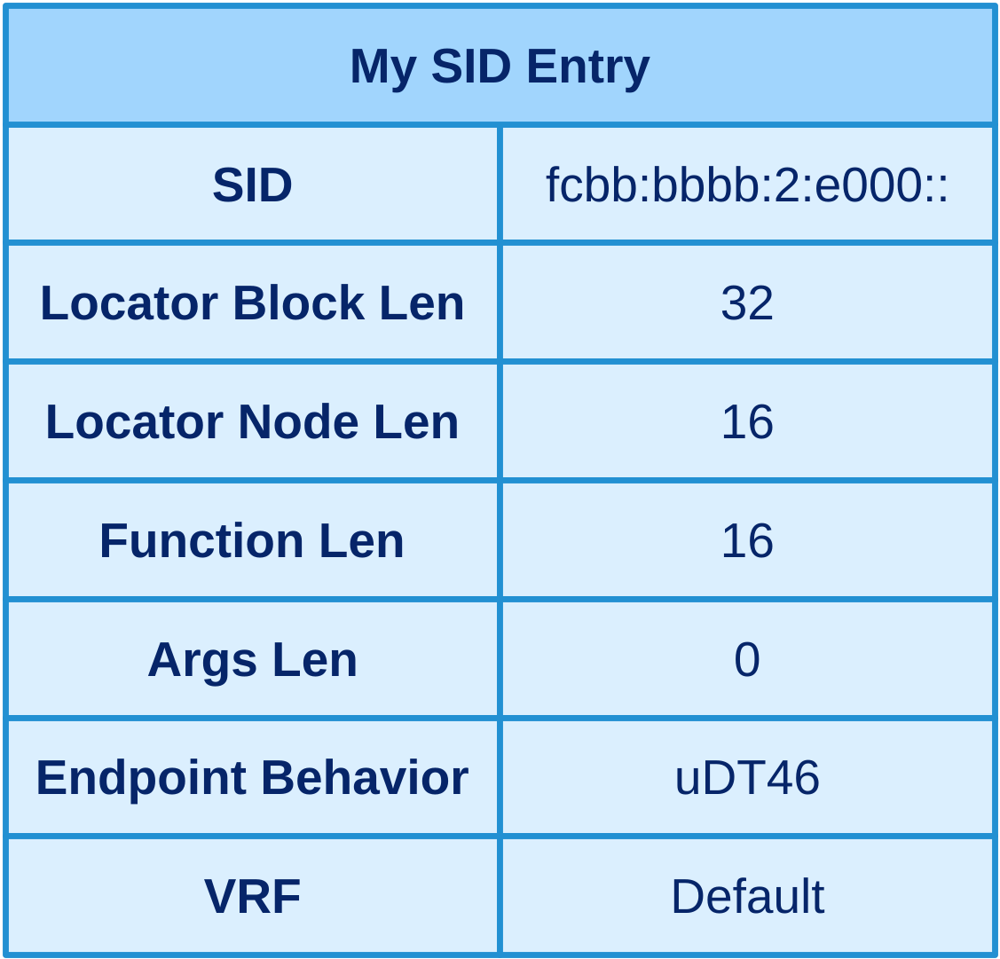
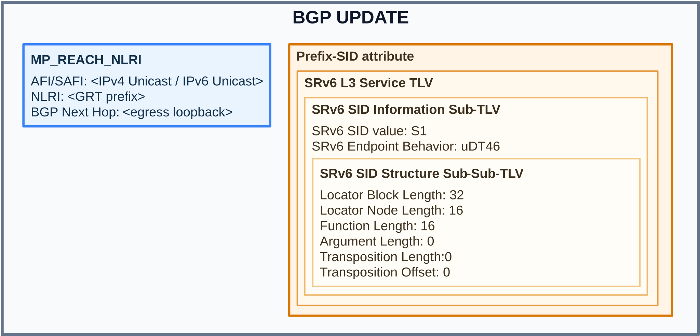
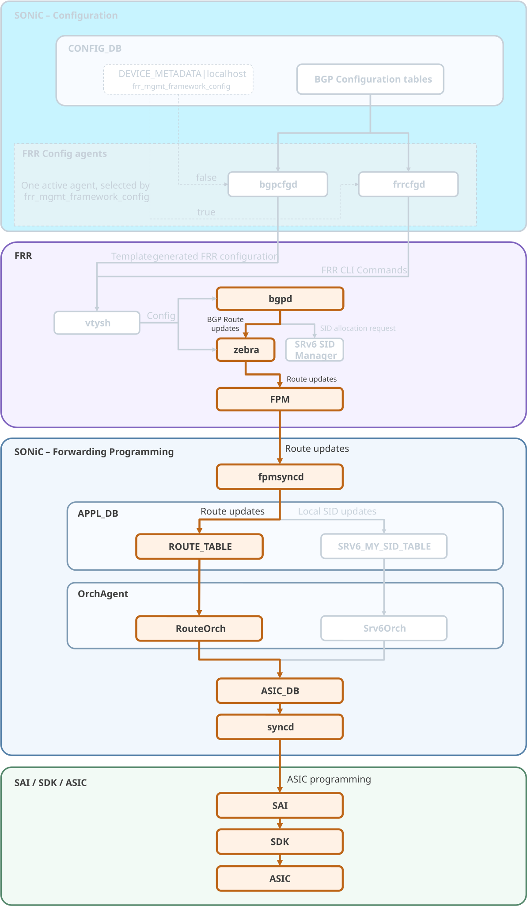
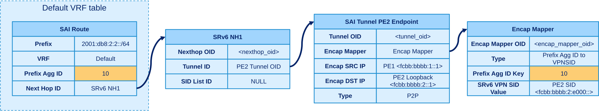
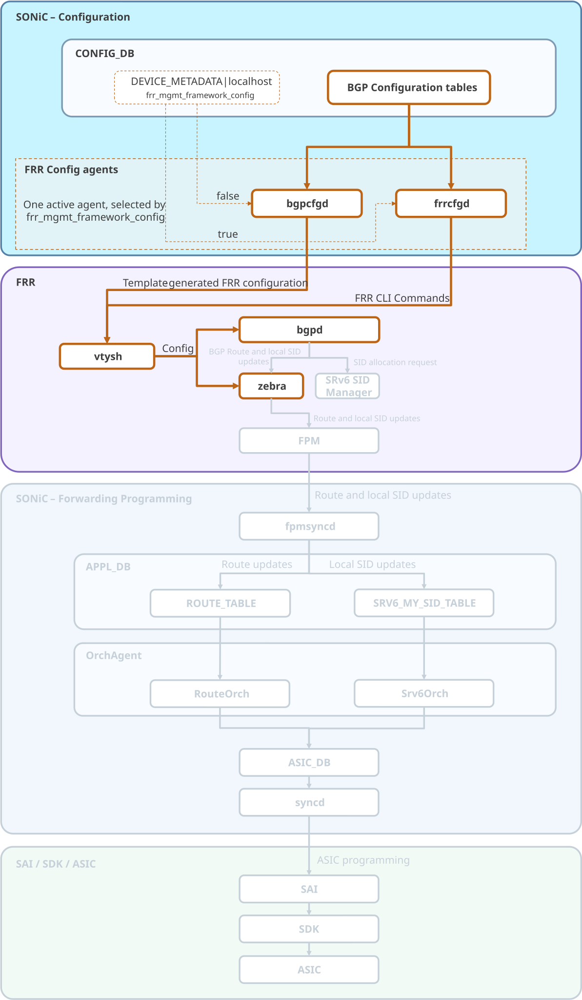

# BGP SRv6 Global Routing Table (GRT) HLD <!-- omit in toc -->

## Table of Contents <!-- omit in toc -->
- [1. Revision](#1-revision)
- [2. Scope](#2-scope)
- [3. Overview](#3-overview)
  - [3.1. Example](#31-example)
    - [3.1.1. Reference Topology](#311-reference-topology)
    - [3.1.2. Control Plane](#312-control-plane)
    - [3.1.3. Data Plane](#313-data-plane)
- [4. Requirements](#4-requirements)
  - [4.1. Functional Requirements](#41-functional-requirements)
    - [4.1.1. Control plane](#411-control-plane)
    - [4.1.2. Data plane](#412-data-plane)
  - [4.2. Configuration and Management Requirements](#42-configuration-and-management-requirements)
- [5. Architecture Design](#5-architecture-design)
- [6. High-Level Design](#6-high-level-design)
  - [6.1. Egress router](#61-egress-router)
  - [6.2. Ingress router](#62-ingress-router)
- [7. Configuration and Management](#7-configuration-and-management)
  - [7.1. Configuration workflow](#71-configuration-workflow)
    - [7.1.1. Agent selection](#711-agent-selection)
    - [7.1.2. bgpcfgd path](#712-bgpcfgd-path)
    - [7.1.3. frrcfgd path](#713-frrcfgd-path)
  - [7.2. BGP SRv6 `CONFIG_DB` Schema](#72-bgp-srv6-config_db-schema)
    - [7.2.1. Shared configuration fields](#721-shared-configuration-fields)
      - [7.2.1.1. Shared fields](#7211-shared-fields)
    - [7.2.2. `bgpcfgd`](#722-bgpcfgd)
      - [7.2.2.1. Configuration schema](#7221-configuration-schema)
      - [7.2.2.2. CONFIG\_DB example](#7222-config_db-example)
      - [7.2.2.3. Resulting FRR configuration](#7223-resulting-frr-configuration)
    - [7.2.3. `frrcfgd`](#723-frrcfgd)
      - [7.2.3.1. Configuration schema](#7231-configuration-schema)
      - [7.2.3.2. CONFIG\_DB example](#7232-config_db-example)
      - [7.2.3.3. Resulting FRR configuration](#7233-resulting-frr-configuration)
  - [7.3. YANG model](#73-yang-model)
    - [7.3.1. `sonic-bgp-device-global` (`bgpcfgd`)](#731-sonic-bgp-device-global-bgpcfgd)
    - [7.3.2. `sonic-bgp-global` (`frrcfgd`)](#732-sonic-bgp-global-frrcfgd)
    - [7.3.3. `sonic-srv6` (both agents)](#733-sonic-srv6-both-agents)
    - [7.3.4. `sonic-bgp-neighbor` and `sonic-bgp-peergroup`](#734-sonic-bgp-neighbor-and-sonic-bgp-peergroup)
  - [7.4. Operational verification](#74-operational-verification)
    - [7.4.1. Example](#741-example)
      - [7.4.1.1. Example 1: IPv6 BGP route table](#7411-example-1-ipv6-bgp-route-table)
      - [7.4.1.2. Example 2: Route details and Service SID](#7412-example-2-route-details-and-service-sid)
- [8. Testing Requirements/Design](#8-testing-requirementsdesign)
  - [8.1. Unit Test cases](#81-unit-test-cases)
  - [8.2. System Test cases](#82-system-test-cases)

## 1. Revision

| Rev  |   Date     |           Author                    | Change Description      |
| :--: | :--------: | :---------------------------------: | :---------------------: |
| 0.1  | 10/22/2026 | Carmine Scarpitta, Ahmed Abdelsalam | Initial version         |

## 2. Scope

This document describes the design for BGP SRv6 Global Routing Table (GRT) support in SONiC. 

BGP SRv6 GRT enables an egress router to advertise eligible IPv4 and IPv6 routes from its Global Routing Table (GRT) with SRv6 Service SIDs. The ingress router uses the advertised SID to encapsulate matching traffic for transport across the IPv6 underlay. 

FRR supports BGP SRv6 GRT with uDT46 SIDs starting with version 10.7.0. SONiC 202611 runs FRR 10.7.1 and therefore includes this capability. SONiC’s existing FRR-to-ASIC path also supports BGP SRv6 GRT: it distributes route and local SID state and programs the corresponding forwarding entries. This HLD addresses the remaining SONiC integration gaps. It adds BGP SRv6 GRT configuration fields to existing `CONFIG_DB` tables and corresponding leaves to existing YANG models, enabling operators to configure the feature, and extends `bgpcfgd` and `frrcfgd` to apply the settings to FRR.

## 3. Overview

The Global Routing Table (GRT) holds a router’s global IPv4 and IPv6 routes. BGP SRv6 GRT uses BGP to advertise eligible routes from the egress router’s GRT to the ingress router, and SRv6 to carry traffic for those routes across the IPv6 underlay. The BGP SRv6 GRT procedures are specified in Sections 5.3 and 5.4 of [RFC 9252](https://www.rfc-editor.org/rfc/rfc9252.html).

An egress router advertises eligible GRT routes with a local SRv6 Service SID. The SID identifies the egress processing and can be reused across eligible IPv4 and IPv6 routes. The ingress router installs the received routes and uses the advertised SID to encapsulate matching packets in an outer IPv6 header. The underlay carries the packets to the egress router, which performs the Service SID’s behavior on the packet. For example, for a uDT46 SID, it removes the outer header, looks up the inner destination in its GRT, and forwards the packet.

### 3.1. Example

#### 3.1.1. Reference Topology

The reference topology is shown below:

<div align="center">
  
</div>

PE1 and PE2 are connected through an IPv6 underlay. PE1’s loopback address is `fcbb:bbbb:1::1`, and its SRv6 locator prefix is `fcbb:bbbb:1::/48`. PE2’s loopback address is `fcbb:bbbb:2::1`, and its SRv6 locator prefix is `fcbb:bbbb:2::/48`.

The underlay must provide IPv6 reachability from each PE to the other PE’s loopback address and SRv6 locator prefix. Any technology may provide this reachability; underlay design is outside the scope of this HLD.

Once the loopbacks are reachable, PE1 and PE2 establish a BGP session using their IPv6 loopback addresses as peer endpoints. The session exchanges IPv4 and IPv6 GRT routes.

#### 3.1.2. Control Plane

<div align="center">
  
</div>
 
In this example, P1 denotes the IPv6 GRT prefix `2001:db8:2:2::/64` behind CE2, and S1 denotes PE2’s local uDT46 Service SID `fcbb:bbbb:2:e000::`.

PE2 allocates local uDT46 Service SID S1 from its SRv6 locator and advertises GRT prefix P1 to PE1 in a BGP UPDATE. The UPDATE carries P1 in the route NLRI and PE2’s IPv6 loopback as the BGP next hop. It also includes a BGP Prefix-SID attribute containing an SRv6 L3 Service TLV. The TLV contains an SRv6 SID Information Sub-TLV, which carries S1 and specifies uDT46 as S1’s endpoint behavior. In this example, the SID Information Sub-TLV also includes a SID Structure Sub-Sub-TLV describing the format of the advertised SID. PE1 receives the UPDATE and learns route P1 with the advertised SID S1. It then installs a forwarding entry for P1 that encapsulates matching packets with S1 as the outer IPv6 destination.

#### 3.1.3. Data Plane

<div align="center">
  
</div>
 
Once PE1 installs the forwarding entry for P1, it can forward traffic for P1 to PE2. Traffic is carried over SRv6. PE1 encapsulates packets whose destination matches P1 in an outer IPv6 packet with SID S1 as the destination address. The IPv6 underlay forwards each encapsulated packet toward PE2’s SRv6 locator prefix. At PE2, uDT46 removes the outer IPv6 header and looks up the inner destination in the GRT. PE2 then forwards the packet toward CE2.

## 4. Requirements

This section lists the functional, configuration, and management requirements for BGP SRv6 GRT.

### 4.1. Functional Requirements

#### 4.1.1. Control plane

* The egress router shall allocate a local Service SID from its configured SRv6 locator and advertise each eligible GRT route with that SID. The local Service SID is instantiated with the uDT46 behavior.
* The ingress router shall receive BGP UPDATEs carrying GRT routes and the advertised Service SID, install the selected routes, and program forwarding so matching packets are encapsulated with that SID as the outer IPv6 destination.

#### 4.1.2. Data plane

* The ingress router shall encapsulate packets matching an installed GRT route in an outer IPv6 packet whose destination is the Service SID advertised by the egress router, then forward them over the IPv6 underlay toward that router.
* The egress router shall receive packets addressed to its local Service SID and process them using the uDT46 Service SID’s behavior: remove the outer IPv6 header, look up the inner destination in the GRT, and forward the inner packet using the route selected by the lookup.

### 4.2. Configuration and Management Requirements

* The operator shall be able to configure the SRv6 locator from which the local Service SID is allocated.
* The operator shall be able to configure BGP to advertise IPv4 and IPv6 GRT routes with the local Service SID, optionally using a route-map to select which routes carry the SID.
* The operator shall be able to configure, for each BGP peer and address family (IPv4 unicast or IPv6 unicast), whether updates to that peer include the local Service SID.

## 5. Architecture Design

BGP SRv6 GRT builds on SONiC’s existing BGP and SRv6 architecture. Upstream FRR supports BGP SRv6 GRT with uDT46 Service SIDs starting with version 10.7.0. SONiC 202611 runs FRR 10.7.1, which supports BGP SRv6 GRT. This HLD adds BGP SRv6 GRT configuration fields to existing `CONFIG_DB` tables and corresponding leaves to existing YANG models, enabling operators to configure the feature in SONiC. It also extends `bgpcfgd` and `frrcfgd` to translate and apply those settings to FRR. This HLD does not modify FRR’s existing BGP SRv6 GRT implementation. The existing FRR-to-ASIC path for route and local SID distribution and forwarding programming also remains unchanged; no new architecture components or SAI APIs are introduced.

Figure below shows how the feature fits into SONiC’s existing architecture.

<div align="center">
  
</div>

* SONiC stores switch configuration, including BGP configuration, in `CONFIG_DB`. A SONiC FRR configuration agent reads relevant entries from `CONFIG_DB` and translates them into FRR configuration.
* SONiC supports two agents for this purpose: `bgpcfgd` and `frrcfgd`. The agents use different configuration models: `bgpcfgd` follows the legacy template-based FRR configuration path, while `frrcfgd` responds to `CONFIG_DB` changes by issuing FRR CLI commands
* The `frr_mgmt_framework_config` field in the `DEVICE_METADATA|localhost` entry selects the active agent: `false` selects `bgpcfgd`, and `true` selects `frrcfgd`.
* Within FRR, `bgpd` manages BGP sessions and exchanges IPv4 and IPv6 GRT routes between PEs, while the SRv6 SID Manager allocates the egress PE’s local Service SID.
* `Zebra` sends route and local SID updates to `fpmsyncd` over FPM. `fpmsyncd` publishes these updates in `APPL_DB`’s `ROUTE_TABLE` and `SRV6_MY_SID_TABLE`, respectively.
* `RouteOrch` and `Srv6Orch` consume the corresponding `APPL_DB` tables and create objects in `ASIC_DB`.
* `syncd` programs the ASIC through SAI and the platform SDK.

## 6. High-Level Design

This section describes the configuration and egress and ingress processing for BGP SRv6 GRT.

### 6.1. Egress router

<div align="center">
  
</div>
 
**Configuration.** The egress router is configured with an SRv6 locator from which its local uDT46 Service SID is allocated. The operator can configure, for each BGP peer and IPv4 or IPv6 unicast address family, whether advertised GRT routes include the local SID. An optional route map can further limit which GRT routes are advertised with the SID. The configuration schema, YANG model, and examples for BGP SRv6 GRT are described in Section [Configuration and Management](#7-configuration-and-management).

**SID allocation and local programming.** `bgpd` requests the SRv6 SID Manager to allocate a local uDT46 Service SID, S1, from the configured locator. After S1 is allocated, Zebra sends the local SID update to `fpmsyncd` over FPM. `fpmsyncd` publishes the SID in `APPL_DB`’s `SRV6_MY_SID_TABLE`. The table key encodes the SID structure lengths—block, node, function, and argument—and the SID:

```
Table: SRV6_MY_SID_TABLE
Key:   SRV6_MY_SID_TABLE:32:16:16:0:<S1>

Fields:
    action = udt46
    vrf    = "default"
```

Here, `action = udt46` specifies that packets addressed to S1 are decapsulated and their inner IPv4 or IPv6 destination is looked up. `vrf = default` selects the default/global VRF for that lookup. `Srv6Orch` consumes the entry and creates the corresponding MySID object in `ASIC_DB`. The object specifies uDT46 behavior and the default/global VRF; `syncd` then programs the ASIC through SAI.  The corresponding SAI MySID entry for S1 and its attributes are shown below.

<div align="center">
  
</div>
 
**Route advertisement.** `bgpd` advertises each eligible GRT route in a BGP UPDATE and includes the locally allocated SID S1 in the UPDATE for each eligible IPv4 or IPv6 route. The UPDATE carries the route prefix in the NLRI and includes a BGP Prefix-SID attribute. The BGP Prefix-SID attribute includes an SRv6 L3 Service TLV. Inside that TLV, an SRv6 SID Information Sub-TLV carries S1 and specifies uDT46 as the endpoint behavior. The SID Information Sub-TLV also carries a SID Structure Sub-Sub-TLV that describes S1’s format, including its block, node, function, and argument lengths.

<div align="center">
  
</div>
 
### 6.2. Ingress router

<div align="center">
  
</div>

**Configuration.** The operator configures the ingress router to establish a BGP session with the egress router and enables the IPv4 and/or IPv6 unicast address family to receive GRT routes from it. Section [Configuration and Management](#7-configuration-and-management) describes the related BGP peer and address-family configuration, `CONFIG_DB` schema, YANG model, and examples.

**Route reception.** Upon receiving a BGP UPDATE from the egress router, the ingress router learns route prefix P1 and Service SID S1. After BGP selects the best path for P1, `Zebra` sends the selected route and its associated SID to `fpmsyncd` over FPM. `fpmsyncd` publishes P1 in `APPL_DB`’s `ROUTE_TABLE`, with S1 in the `vpn_sid` field. For example:

```
Key: ROUTE_TABLE:<P1>

Fields:
    protocol = bgp
    nexthop = <egress PE’s BGP next hop>
    vpn_sid = <S1>
    ...
```

**Forwarding programming.** The corresponding route and SRv6 objects are created in `ASIC_DB`, and syncd then programs them on the ASIC through SAI. As a result, packets matching P1 are encapsulated with S1 as the outer IPv6 destination. The diagram below shows the corresponding SAI objects and the tunnel-map association.

<div align="center">
  
</div>


## 7. Configuration and Management

This section describes how BGP SRv6 GRT is configured in SONiC and how the operator can verify its operational status. BGP SRv6 GRT configuration is stored in `CONFIG_DB`. A SONiC FRR configuration agent reads the relevant entries and applies them to FRR. SONiC supports two agents for this purpose: `bgpcfgd` and `frrcfgd`. The `frr_mgmt_framework_config` field in `DEVICE_METADATA|localhost` selects the active agent. Figure below shows this configuration flow.

<div align="center">
  
</div>

### 7.1. Configuration workflow

#### 7.1.1. Agent selection

The `frr_mgmt_framework_config` field in `DEVICE_METADATA|localhost` selects the agent that manages FRR configuration. A value of `false` selects `bgpcfgd`; `true` selects `frrcfgd`. The agents are alternatives, and the selected agent applies the BGP SRv6 GRT configuration.

#### 7.1.2. bgpcfgd path

When `bgpcfgd` is selected, it monitors the relevant BGP and SRv6 entries in `CONFIG_DB`. For each configuration change, it uses templates to generate the corresponding FRR configuration commands and applies them through `vtysh`. This design extends the relevant `bgpcfgd` handling and templates to support the BGP SRv6 GRT fields.

#### 7.1.3. frrcfgd path

When `frrcfgd` is selected, it subscribes to changes in the relevant `CONFIG_DB` entries. Its event handlers translate those changes into FRR CLI commands and apply them through `vtysh`. This design extends the handlers and command mappings to support the BGP SRv6 GRT configuration.

### 7.2. BGP SRv6 `CONFIG_DB` Schema

This section separates the fields shared by both agents from the agent-specific configuration. Each agent subsection contains its schema, a complete BGP SRv6 `CONFIG_DB` example, and the corresponding FRR configuration excerpt.

#### 7.2.1. Shared configuration fields

These fields are common to both agents. `SRV6_MY_LOCATORS` defines the existing locator object; how the BGP instance references that locator is agent-specific and is documented in the sections for [`bgpcfgd`](#722-bgpcfgd) and [`frrcfgd`](#723-frrcfgd). In the agent-specific schemas below, fields marked `NEW` are introduced by BGP SRv6 GRT; unmarked fields and tables are existing configuration shown for context.

##### 7.2.1.1. Shared fields

###### DEVICE_METADATA table <!-- omit in toc -->

```abnf
key                       = DEVICE_METADATA|localhost

; field                   = value
bgp_asn                   = as-number         ; Local ASN of this router
frr_mgmt_framework_config = "false" / "true"  ; Selects the FRR configuration agent, bgpcfgd or frrcfgd
```

###### SRV6_MY_LOCATORS table <!-- omit in toc -->

```abnf
key                       = SRV6_MY_LOCATORS|locator_name

; field                   = value
prefix                    = inet:ipv6-address ; IPv6 prefix assigned to the locator
format                    = "usid-f3216"      ; Format of SIDs allocated from the locator, optional
```

#### 7.2.2. `bgpcfgd`

##### 7.2.2.1. Configuration schema

###### BGP_DEVICE_GLOBAL table <!-- omit in toc -->

```abnf
key                           = BGP_DEVICE_GLOBAL|SRV6

; field                       = value
bgp_srv6_locator              = SRV6_MY_LOCATORS.locator_name ; Locator from which BGP allocates Service SIDs,
                                                              ; NEW
bgp_srv6_ipv4_sid_advertise   = "true" / "false"              ; Enables Service SID advertisement for eligible
                                                              ; IPv4 GRT routes, NEW
bgp_srv6_ipv4_sid_prefix_list = PREFIX_LIST.prefix_type       ; Selects IPv4 routes to advertise with SRv6
                                                              ; Service SIDs, NEW, optional
bgp_srv6_ipv6_sid_advertise   = "true" / "false"              ; Enables Service SID advertisement for eligible
                                                              ; IPv6 GRT routes, NEW
bgp_srv6_ipv6_sid_prefix_list = PREFIX_LIST.prefix_type       ; Selects IPv6 routes to advertise with SRv6
                                                              ; Service SIDs, NEW, optional
```

###### BGP_NEIGHBOR table (base eBGP neighbor fields plus the SRv6 field) <!-- omit in toc -->

```abnf
key                           = BGP_NEIGHBOR|neighbor

; field                       = value
asn                           = as-number                     ; Remote AS number of the neighbor
local_addr                    = inet:ip-address               ; Local source address for the BGP session,
                                                              ; optional
name                          = string                        ; Neighbor description, optional
encapsulation_type            = "srv6" / "srv6-relax"         ; SRv6 encapsulation mode, NEW, optional,
                                                              ; neighbor-wide
```

###### PREFIX_LIST table <!-- omit in toc -->
Entries used to select routes for SID advertisement.

```abnf
key                           = PREFIX_LIST|prefix_type|ip-prefix

; field                       = value
family                        = "IPv4" / "IPv6"               ; Address family of the prefixes, optional
action                        = "permit" / "deny"             ; Permit or deny the matching prefix
seq                           = uint32                        ; Evaluation order of the prefix-list entry,
                                                              ; optional
ge                            = uint8                         ; Minimum prefix length to match, optional
le                            = uint8                         ; Maximum prefix length to match, optional
```

`bgpcfgd` reads neighbor-wide `encapsulation_type` from `BGP_NEIGHBOR` and renders it in the peer's applicable address-family context or contexts. For SID advertisement, it converts the optional IPv4 and IPv6 prefix-list fields into generated route maps (`BGP_SRV6_ADVERTISE_IPV4` and `BGP_SRV6_ADVERTISE_IPV6`) and applies the corresponding command in each address family.

##### 7.2.2.2. CONFIG_DB example

This example sets `frr_mgmt_framework_config` to `false`, which selects `bgpcfgd`. It configures an IPv6 neighbor, the locator, and IPv6 GRT SID advertisement using a prefix list. The neighbor row supplies the peer ASN and local update source; `bgpcfgd` renders and activates the peer in the IPv6 address family.

```json
{
  "DEVICE_METADATA": {
    "localhost": {
      "bgp_asn": "65001",
      "bgp_router_id": "10.125.1.1",
      "frr_mgmt_framework_config": "false"
    }
  },
  "BGP_DEVICE_GLOBAL": {
    "SRV6": {
      "bgp_srv6_locator": "MAIN",
      "bgp_srv6_ipv6_sid_advertise": "true",
      "bgp_srv6_ipv6_sid_prefix_list": "BGP_SRV6_EXPORT_IPV6"
    }
  },
  "SRV6_MY_LOCATORS": {
    "MAIN": {
      "prefix": "fcbb:bbbb:1::",
      "format": "usid-f3216"
    }
  },
  "BGP_NEIGHBOR": {
    "fcbb:bbbb:2::1": {
      "asn": "65102",
      "local_addr": "fcbb:bbbb:1::1",
      "name": "R2",
      "encapsulation_type": "srv6"
    }
  },
  "PREFIX_LIST": {
    "BGP_SRV6_EXPORT_IPV6|2001:db8:dead::/48": {
      "action": "deny",
      "seq": "1",
      "family": "IPv6"
    },
    "BGP_SRV6_EXPORT_IPV6|::/0": {
      "action": "permit",
      "seq": "255",
      "le": "128",
      "family": "IPv6"
    }
  }
}
```

##### 7.2.2.3. Resulting FRR configuration

The neighbor row produces the remote-AS and update-source commands. `bgpcfgd` applies the neighbor encapsulation setting and activates this IPv6 peer in the IPv6 address family. The IPv6 SID advertisement route map is generated from the configured prefix list:

```
segment-routing
 srv6
  locators
   locator MAIN
    prefix fcbb:bbbb:1::/48
    format usid-f3216
   !
  !
!

ipv6 prefix-list BGP_SRV6_EXPORT_IPV6 seq 1 deny 2001:db8:dead::/48
ipv6 prefix-list BGP_SRV6_EXPORT_IPV6 seq 255 permit ::/0 le 128

route-map BGP_SRV6_ADVERTISE_IPV6 permit 10
 match ipv6 address prefix-list BGP_SRV6_EXPORT_IPV6
!

router bgp 65001
 neighbor fcbb:bbbb:2::1 remote-as 65102
 neighbor fcbb:bbbb:2::1 description R2
 neighbor fcbb:bbbb:2::1 update-source fcbb:bbbb:1::1
 segment-routing srv6
  encap-behavior H_Encaps_Red
  locator MAIN
 !
 address-family ipv6
  neighbor fcbb:bbbb:2::1 encapsulation-srv6
  neighbor fcbb:bbbb:2::1 activate
  sid export auto behavior dt46 route-map BGP_SRV6_ADVERTISE_IPV6
 exit-address-family
!
```

#### 7.2.3. `frrcfgd`

##### 7.2.3.1. Configuration schema

###### BGP_GLOBALS table <!-- omit in toc -->

```abnf
key                          = BGP_GLOBALS|vrf_name

; field                      = value
local_asn                    = as-number                     ; Local ASN for this BGP instance
srv6_locator                 = SRV6_MY_LOCATORS.locator_name ; Locator from which BGP allocates Service SIDs,
                                                             ; NEW, optional
```

###### BGP_GLOBALS_AF table <!-- omit in toc -->

```abnf
key                          = BGP_GLOBALS_AF|vrf_name|afi_safi

; field                      = value
srv6_sid_advertise           = "true" / "false"              ; Enables Service SID advertisement for eligible
                                                             ; routes in this address family, NEW, optional
srv6_sid_advertise_route_map = ROUTE_MAP_SET.name            ; Route map applied to Service SID advertisement,
                                                             ; NEW, optional
```

###### BGP_NEIGHBOR table <!-- omit in toc -->

```abnf
key                          = BGP_NEIGHBOR|vrf_name|neighbor

; field                      = value
asn                          = as-number                     ; Remote AS number of the neighbor
local_addr                   = inet:ip-address               ; Local source address for the BGP session,
                                                             ; optional
name                         = string                        ; Neighbor description, optional
```

###### BGP_NEIGHBOR_AF table <!-- omit in toc -->

```abnf
key                          = BGP_NEIGHBOR_AF|vrf_name|neighbor|afi_safi

; field                      = value
admin_status                 = "up" / "down"                 ; Controls neighbor activation in this address
                                                             ; family, optional
encapsulation_type           = "srv6" / "srv6-relax"         ; SRv6 encapsulation mode, NEW, optional,
                                                             ; AF-specific
```

###### BGP_PEER_GROUP_AF table <!-- omit in toc -->

```abnf
key                          = BGP_PEER_GROUP_AF|vrf_name|peer_group_name|afi_safi

; field                      = value
encapsulation_type           = "srv6" / "srv6-relax"         ; SRv6 encapsulation mode, NEW, optional,
                                                             ; AF-specific
```

###### ROUTE_MAP_SET table <!-- omit in toc -->

```abnf
key                          = ROUTE_MAP_SET|name
```

###### ROUTE_MAP table <!-- omit in toc -->

```abnf
key                          = ROUTE_MAP|name|stmt_name

; field                      = value
route_operation              = "permit" / "deny"             ; Permit or deny routes matching this statement
match_prefix_set             = PREFIX_SET.name               ; Prefix set used to match routes
```

###### PREFIX_SET table <!-- omit in toc -->

```abnf
key                          = PREFIX_SET|name

; field                      = value
mode                         = "IPv4" / "IPv6"               ; Address family of the prefix set
```

###### PREFIX table <!-- omit in toc -->

```abnf
key                          = PREFIX|prefix_set_name|sequence_number|ip_prefix|masklength_range

; field                      = value
action                       = "permit" / "deny"             ; Permit or deny the matching prefix
```

For both agents, `encapsulation_type` controls which routes FRR sends to a peer: `srv6` sends only routes carrying a BGP Prefix-SID; `srv6-relax` sends routes whether or not they carry a Prefix-SID. `bgpcfgd` stores this setting neighbor-wide, while `frrcfgd` stores it per address family.

For SID advertisement, `vrf_name` must be `default` and `afi_safi` must be `ipv4_unicast` or `ipv6_unicast`. A route-map reference requires `srv6_sid_advertise` to be configured.

##### 7.2.3.2. CONFIG_DB example

This example sets `frr_mgmt_framework_config` to `true`, which selects `frrcfgd`. It configures an IPv6 neighbor and IPv6 SID advertisement through a route map and prefix set. The `BGP_NEIGHBOR_AF` row activates the peer in the IPv6 address family and sets its SRv6 encapsulation mode.

```json
{
  "DEVICE_METADATA": {
    "localhost": {
      "bgp_asn": "65001",
      "frr_mgmt_framework_config": "true"
    }
  },
  "BGP_GLOBALS": {
    "default": {
      "local_asn": "65001",
      "srv6_locator": "MAIN"
    }
  },
  "BGP_GLOBALS_AF": {
    "default|ipv6_unicast": {
      "srv6_sid_advertise": "true",
      "srv6_sid_advertise_route_map": "RM_BGP_SRV6_EXPORT_IPV6"
    }
  },
  "SRV6_MY_LOCATORS": {
    "MAIN": {
      "prefix": "fcbb:bbbb:1::",
      "format": "usid-f3216"
    }
  },
  "ROUTE_MAP_SET": {
    "RM_BGP_SRV6_EXPORT_IPV6": {}
  },
  "ROUTE_MAP": {
    "RM_BGP_SRV6_EXPORT_IPV6|10": {
      "route_operation": "permit",
      "match_prefix_set": "BGP_SRV6_EXPORT_IPV6"
    }
  },
  "PREFIX_SET": {
    "BGP_SRV6_EXPORT_IPV6": {
      "mode": "IPv6"
    }
  },
  "PREFIX": {
    "BGP_SRV6_EXPORT_IPV6|10|2001:db8:ffff::/48|exact": {
      "action": "permit"
    }
  },
  "BGP_NEIGHBOR": {
    "default|fcbb:bbbb:2::1": {
      "asn": "65102",
      "local_addr": "fcbb:bbbb:1::1",
      "name": "R2"
    }
  },
  "BGP_NEIGHBOR_AF": {
    "default|fcbb:bbbb:2::1|ipv6_unicast": {
      "admin_status": "up",
      "encapsulation_type": "srv6"
    }
  }
}
```

##### 7.2.3.3. Resulting FRR configuration

The base neighbor row produces the remote-AS and update-source commands. `admin_status: up` activates the IPv6 peer, and the address-family row sets its SRv6 encapsulation. IPv6 SID advertisement uses `RM_BGP_SRV6_EXPORT_IPV6`:

```
ipv6 prefix-list BGP_SRV6_EXPORT_IPV6 seq 10 permit 2001:db8:ffff::/48

route-map RM_BGP_SRV6_EXPORT_IPV6 permit 10
 match ipv6 address prefix-list BGP_SRV6_EXPORT_IPV6
!

router bgp 65001
 neighbor fcbb:bbbb:2::1 remote-as 65102
 neighbor fcbb:bbbb:2::1 description R2
 neighbor fcbb:bbbb:2::1 update-source fcbb:bbbb:1::1
 segment-routing srv6
  encap-behavior H_Encaps_Red
  locator MAIN
 !
 address-family ipv6 unicast
  sid export auto behavior dt46 route-map RM_BGP_SRV6_EXPORT_IPV6
  neighbor fcbb:bbbb:2::1 activate
  neighbor fcbb:bbbb:2::1 encapsulation-srv6
 exit-address-family
!
```

### 7.3. YANG model

The YANG models define the types, constraints, and references for the `CONFIG_DB` fields described in Section [BGP SRv6 CONFIG_DB Schema](#72-bgp-srv6-config_db-schema). They apply to either FRR configuration agent.

#### 7.3.1. `sonic-bgp-device-global` (`bgpcfgd`)

```yang
module: sonic-bgp-device-global
  +--rw BGP_DEVICE_GLOBAL
     +--rw SRV6
        +--rw bgp_srv6_locator?                -> sonic-srv6 locator_name
        +--rw bgp_srv6_ipv4_sid_advertise?     boolean
        +--rw bgp_srv6_ipv4_sid_prefix_list?   -> sonic-bgp-prefix-list prefix_type
        +--rw bgp_srv6_ipv6_sid_advertise?     boolean
        +--rw bgp_srv6_ipv6_sid_prefix_list?   -> sonic-bgp-prefix-list prefix_type
```

These device-level BGP SRv6 leaves are consumed by `bgpcfgd`. Advertisement defaults to `false`. Prefix-list references are optional and select routes for SID advertisement. The local ASN remains in `DEVICE_METADATA|localhost` and is used when rendering BGP configuration.

#### 7.3.2. `sonic-bgp-global` (`frrcfgd`)

```yang
module: sonic-bgp-global
  +--rw BGP_GLOBALS
  |  +--rw BGP_GLOBALS_LIST* [vrf_name]
  |     +--rw vrf_name       string
  |     +--rw srv6_locator?  -> sonic-srv6 locator_name
  +--rw BGP_GLOBALS_AF
     +--rw BGP_GLOBALS_AF_LIST* [vrf_name afi_safi]
        +--rw vrf_name                       string
        +--rw afi_safi                       enumeration
        +--rw srv6_sid_advertise?            boolean
        +--rw srv6_sid_advertise_route_map?  -> sonic-route-map name
```

SID advertisement is constrained to IPv4/IPv6 unicast address families in the default VRF. A route-map reference requires `srv6_sid_advertise` to be configured.

#### 7.3.3. `sonic-srv6` (both agents)

```yang
module: sonic-srv6
  +--rw SRV6_MY_LOCATORS
     +--rw SRV6_MY_LOCATORS_LIST* [locator_name]
        +--rw locator_name  string
        +--rw prefix        inet:ipv6-address
        +--rw format?       enumeration
```


#### 7.3.4. `sonic-bgp-neighbor` and `sonic-bgp-peergroup`

`encapsulation_type` is modeled on the BGP neighbor template row and on the neighbor and peer-group address-family lists. The supported values are `srv6` and `srv6-relax`. Runtime mapping is agent-specific: `bgpcfgd` uses the neighbor-wide `BGP_NEIGHBOR` field, while `frrcfgd` maps `BGP_NEIGHBOR_AF` and `BGP_PEER_GROUP_AF`. The management test PR exercises neighbor AF settings; it does not cover peer-group AF settings.


```yang
module: sonic-bgp-neighbor
  +--rw BGP_NEIGHBOR
  |  +--rw BGP_NEIGHBOR_TEMPLATE_LIST* [neighbor]
  |     +--rw neighbor               union
  |     +--rw encapsulation_type?    enumeration { srv6, srv6-relax }
  +--rw BGP_NEIGHBOR_AF
     +--rw BGP_NEIGHBOR_AF_LIST* [vrf_name neighbor afi_safi]
        +--rw vrf_name             string
        +--rw neighbor             union
        +--rw afi_safi             enumeration
        +--rw encapsulation_type?  enumeration { srv6, srv6-relax }
```

```yang
module: sonic-bgp-peergroup
  +--rw BGP_PEER_GROUP_AF
     +--rw BGP_PEER_GROUP_AF_LIST* [vrf_name peer_group_name afi_safi]
        +--rw vrf_name             string
        +--rw peer_group_name      string
        +--rw afi_safi             enumeration
        +--rw encapsulation_type?  enumeration { srv6, srv6-relax }
```

`BGP_NEIGHBOR_TEMPLATE_LIST` provides the neighbor-wide setting, and explicit per-AF configuration is represented on `BGP_NEIGHBOR_AF` or `BGP_PEER_GROUP_AF` as shown above.

### 7.4. Operational verification

Operators can inspect IPv4 and IPv6 GRT routes, including the SRv6 SID information received with them, using the existing BGP show commands.

| CLI | Description
| :-- | :---------- |
| `show ip bgp network [ipv4-prefix]` | Show IPv4 routes
| `show ipv6 bgp network [ipv6-prefix]` | Show IPv6 routes

#### 7.4.1. Example

##### 7.4.1.1. Example 1: IPv6 BGP route table

```text
> show ipv6 bgp network

BGP table version is 4, local router ID is 1.1.1.1, vrf id 0
Default local pref 100, local AS 65101
Status codes:  s suppressed, d damped, h history, u unsorted, * valid, > best, = multipath,
               i internal, r RIB-failure, S Stale, R Removed
Nexthop codes: @NNN nexthop's vrf id, < announce-nh-self
Origin codes:  i - IGP, e - EGP, ? - incomplete
RPKI validation codes: V valid, I invalid, N Not found

     Network          Next Hop            Metric LocPrf Weight Path
 *>  2001:db8:2:2::/64 fcbb:bbbb:2::1          0         32768 ?

Displayed 1 routes and 1 total paths
```

##### 7.4.1.2. Example 2: Route details and Service SID

```text
> show ipv6 bgp network 2001:db8:2:2::/64

BGP routing table entry for 2001:db8:2:2::/64
Paths: (1 available, best #1, table default)
  Advertised to non peer-group peers:
  fcbb:bbbb:2::1
  65102
    fcbb:bbbb:2::1 from fcbb:bbbb:2::1 (2.2.2.2)
      Origin IGP, localpref 100, valid, internal, multipath, best (Router ID)
      Remote SID: fcbb:bbbb:2:e000::, uDT46, sid structure=[32 16 16 0 0 0]
      Last update: Thu Apr 22 02:13:30 2021
```

## 8. Testing Requirements/Design

This section describes the unit and system tests used to verify the BGP SRv6 GRT design and its integration with SONiC.

### 8.1. Unit Test cases

| Test case	| Description | Expected result
| :-------- | :---------- | :-------------- |
| `CONFIG_DB`/YANG validation: valid BGP SRv6 GRT configuration | Test a valid BGP SRv6 GRT configuration. | The configuration passes `CONFIG_DB`/YANG validation.
| `CONFIG_DB`/YANG validation: invalid BGP SRv6 GRT configuration | Test BGP SRv6 GRT configurations containing unsupported values, such as an unsupported locator format, or references to undefined route maps. | `CONFIG_DB`/YANG validation rejects the invalid configuration.
| `bgpcfgd` configuration handling | Add valid BGP SRv6 GRT configuration to `CONFIG_DB` and verify that `bgpcfgd` generates the corresponding FRR configuration. | The generated FRR configuration reflects the `CONFIG_DB` settings.
| `frrcfgd` configuration handling | Add valid BGP SRv6 GRT configuration to `CONFIG_DB` and verify that `frrcfgd` generates the corresponding FRR configuration. | The generated FRR configuration reflects the `CONFIG_DB` settings.

### 8.2. System Test cases

The system tests use the reference topology, in which PE1 and PE2 are connected through an IPv6 underlay. The underlay provides reachability to each PE’s loopback address and SRv6 locator prefix and carries SRv6 traffic between the PEs. PE1 and PE2 establish the service BGP session using their loopback addresses.

| Test case	| Description | Expected result
| :-------- | :---------- | :-------------- |
| IPv4 GRT route advertisement | Advertise an IPv4 GRT route with its Service SID and verify it at the ingress router. | The ingress router learns the route with its Service SID and installs forwarding for it.
| IPv6 GRT route advertisement | Advertise an IPv6 GRT route with its Service SID and verify it at the ingress router. | The ingress router learns the route with its Service SID and installs forwarding for it.
| SID export policy	| Configure a route-map for SID export and advertise routes that match and do not match the policy. | SONiC applies the configuration to FRR, and SID export follows the configured policy.
| IPv4 data-plane forwarding | Send traffic matching the IPv4 route through the SRv6 path to the egress router.	| The packet is encapsulated toward the Service SID, decapsulated at egress, and its inner destination is looked up in the IPv4 GRT.
| IPv6 data-plane forwarding | Send traffic matching the IPv6 route through the SRv6 path to the egress router.	| The packet is encapsulated toward the Service SID, decapsulated at egress, and its inner destination is looked up in the IPv6 GRT.
