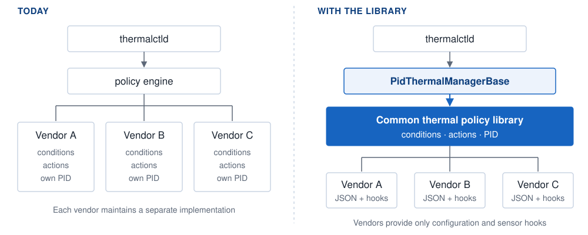
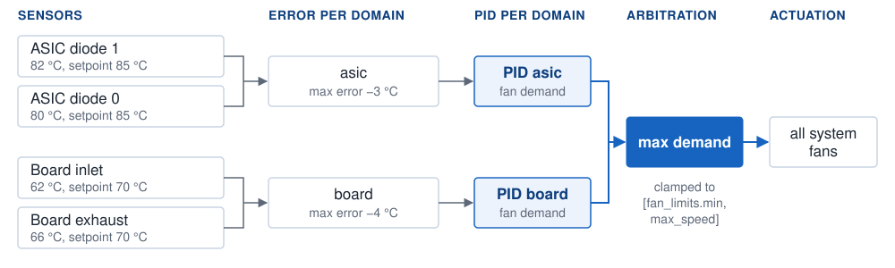
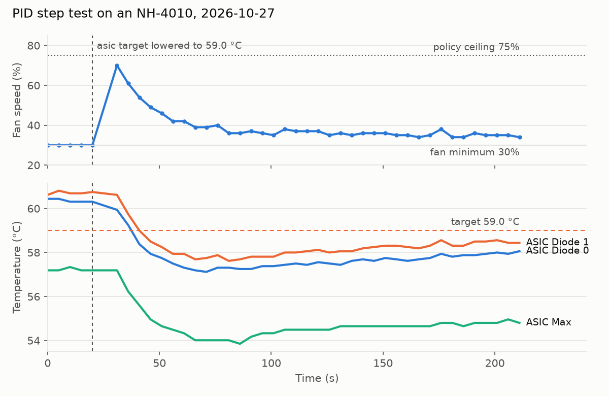

# Common Thermal Policy Library HLD

| Rev | Date | Author | Change |
|-----|------|--------|--------|
| 0.1 | 2026-10-27 | Nodoka Shibasaki | Initial version |

## Problem

`thermalctld` evaluates a platform's `thermal_policy.json` at a fixed interval, as defined in the
[SONiC Thermal Control Design](thermal-control-design.md).
Each policy maps a set of conditions to a set of actions.

`sonic_thermal_control` defines the base classes for conditions and actions but provides no
implementations. Every platform therefore implements its own: Celestica, Micas, Ragile, Tencent
and Allied Telesis platforms each ship a PID fan controller, several of them copies of one
another.

| Problem | Consequence |
|---------|-------------|
| Duplicated implementations | Fixes to one implementation do not propagate to the others. |
| Unvalidated tuning | PID gains are embedded in the policy file and are not validated. Errors surface only as incorrect fan behaviour. |
| Silent failure | When a policy fails to load or raises at runtime, `thermalctld` logs the error and continues to report healthy, leaving the fans uncontrolled. |

## Our Solution

Add a shared, opt-in implementation to `sonic_thermal_control`, consisting of two components:

- **Common thermal policy library:** reusable condition and action types, including a
  multi-domain PID fan controller.
- **`PidThermalManagerBase`:** a `ThermalManagerBase` subclass that registers the library's types,
  routes its logging to syslog, and forces the fans to full speed when the policies cannot run.

A platform adopting the library defines its fan control declaratively in two JSON files and
implements only the sensor-specific hooks.



## Configuration Files

### `thermal_policy.json`

Defines which actions run under which conditions.

```json
{
  "interval": 5,
  "info_types": [
    { "type": "fan_drawer_info" },
    { "type": "thermal_info" }
  ],
  "policies": [
    {
      "name": "fan drawer missing: full speed",
      "conditions": [ { "type": "fandrawer.presence", "op": "<=", "count": 2 } ],
      "actions":    [ { "type": "fan.all.set_speed", "speed": 100 } ]
    },
    {
      "name": "normal operation: PID",
      "conditions": [ { "type": "fandrawer.presence", "op": ">", "count": 2 } ],
      "actions":    [ { "type": "thermal.control_algo", "max_speed": 75 } ]
    }
  ]
}
```

With two or fewer fan drawers present, all fans run at 100%. Otherwise the PID controls the fans,
capped at 75%. All policies whose conditions match are executed, so conditions must be mutually
exclusive.

### `thermal_config.json`

Holds the tuning parameters, validated at load time.

```json
{
  "fan_limits": { "min": 30, "max": 100 },
  "pid_domains": {
    "asic":  { "KP": 10, "KI": 0.1,  "KD": 5   },
    "board": { "KP": 5,  "KI": 0.05, "KD": 2.5, "setpoint": 70 }
  }
}
```

| Key | Meaning |
|-----|---------|
| `fan_limits` | Lower and upper bound, in percent, on the PID's output. Fixed speeds set by `fan.all.set_speed` are not limited by it. |
| `pid_domains` | One PID controller per domain, with its gains. |
| `setpoint` (optional) | A single target temperature for every sensor in the domain. When omitted, each sensor's own setpoint is used. |

Unknown keys are rejected, so a misspelt key fails the load rather than being ignored. Both files
are provided as examples in `sonic_thermal_control/examples/`.

## How It Works

On each pass, every PID domain computes a fan demand, and the highest demand is applied.



1. **Error:** for each domain, the error is the largest `temperature − setpoint` among its sensors.
   A domain with no readable sensor this pass is skipped.
2. **Control:** each domain's PID converts its error into a fan demand. At zero error the demand is
   the middle of `[fan_limits.min, max_speed]`, so the same gains behave slightly differently
   under different ceilings.
3. **Arbitration:** the highest demand is selected and clamped to `[fan_limits.min, max_speed]`.
4. **Actuation:** the result is written to all system fans. PSU fans are not controlled.

The integral term is clamped to the output range to prevent windup, and the sample interval is
measured rather than assumed.

## Features

| Feature | Description |
|---------|-------------|
| Multi-domain PID | Independent controllers and gains per sensor domain (e.g. ASIC, board, optics). |
| Setpoints | Per sensor via the platform API, or per domain via the config. |
| Per-policy ceiling | Optional `max_speed` on `thermal.control_algo`. Defaults to `fan_limits.max`. |
| Presence conditions | `fandrawer.presence`, `fan.presence` and `psu.presence` with a comparison operator and count, e.g. `{"op": "<=", "count": 2}`. |
| Threshold condition | `thermal.over.threshold`: matches when any sensor exceeds its high threshold, or its high-critical threshold with `"threshold": "high_critical"`. |
| Default condition | `default.operation`: always matches. |
| Fixed-speed action | `fan.all.set_speed`. |
| Config validation | Types, ranges, required gains and unknown keys are checked at load. |
| Fail-safe | A failure that stops fan control drives the fans to full speed (see Failure Handling). |
| Logging | Library messages are sent to syslog under the platform's identifier. |

## Platform API

### `ThermalBase` additions

| Method | Default | Description |
|--------|---------|-------------|
| `get_pid_domain()` | `None` | The sensor's PID domain. `None` excludes the sensor from fan control. |
| `get_pid_setpoint()` | `None` | The sensor's target temperature. A domain `setpoint` in the config overrides it; with neither, the sensor is skipped. |

A sensor participates in fan control only if its domain is defined in `thermal_config.json`.
Platforms that implement these methods in a mixin must list the mixin before `ThermalBase` in the
class bases; otherwise the base-class defaults take precedence and the sensor silently drops out
of fan control. With the mixin first, `super().__init__()` reaches the mixin, so the class should
call its platform base's `__init__` explicitly.

No changes to `FanBase` are required.

### Adoption

1. Derive the platform thermal manager from `PidThermalManagerBase`:

   ```python
   from sonic_platform_base.sonic_thermal_control.pid_thermal_manager_base import PidThermalManagerBase

   class ThermalManager(PidThermalManagerBase):
       SYSLOG_IDENTIFIER = 'thermalctld'
   ```

   `SYSLOG_IDENTIFIER` defaults to `thermalctld`. A subclass that overrides `initialize()` must call
   `super().initialize()`.
2. Return that class from `chassis.get_thermal_manager()`.
3. Implement `get_pid_domain()` and `get_pid_setpoint()` for the relevant sensors.
4. Make sure every chassis and transceiver sensor implements `get_temperature()`,
   `get_high_threshold()` and `get_high_critical_threshold()`. All sensors are read on every pass,
   including those outside any PID domain, and a read that raises sends the fans to 100%.
5. Add `thermal_policy.json` and `thermal_config.json` to the device directory.

The library registers its type names (`fan_info`, `thermal_info`, `fan.all.set_speed`,
`thermal.control_algo`, `fandrawer.presence` and the others). A platform adopting it must not
register any of the same names itself, because a duplicate registration fails at import.

## Failure Handling

| Failure | Behaviour |
|---------|-----------|
| `thermal_config.json` missing, or has no `pid_domains` | PID holds the fans at `fan_limits.max`; error logged once. |
| Invalid policy or config file | Load fails; fans at 100% on every pass until `thermalctld` is restarted with a valid file. `thermalctld` loads the policy only at start-up, and without a loaded policy it runs a pass every 60 s. |
| Single sensor read returns no value | Sensor skipped for that pass. |
| A sensor read raises | Fans at 100%; error logged on every pass. |
| No sensor maps to a configured domain, or no domain has a readable sensor | PID holds the fans at `fan_limits.max`; error logged. |
| Exception in a condition or action during a pass | Fans at 100%; error logged. |
| No policy matches | Nothing is written, and the fans keep their last speed. A platform's policies should cover every state, e.g. a full-speed policy for "2 or fewer drawers present", which also covers 0. |

When the PID action fails, it falls back to `fan_limits.max` and the remaining policies still run.
All other failures, including a PID fallback that cannot reach the fans, are handled by
`PidThermalManagerBase`, which sets all fans to 100%. Neither is subject to `max_speed`.

## Impact on Existing Platforms

| Area | Impact |
|------|--------|
| `thermalctld` and the policy engine | No change. |
| Platforms not using `PidThermalManagerBase` | No change. |
| Platforms using it | All Nexthop platforms. Fan speed for each fan-drawer count is unchanged. The fail-safe now reaches 100%; previously it could be held at the normal-operation ceiling. |
| Platform API | Two new `ThermalBase` methods, defaulting to `None`. |
| Syslog | One INFO line per pass recording the applied speed. |
| CLI, YANG, CONFIG_DB, STATE_DB, SAI | No change. |
| Warm and fast reboot | No impact. |
| Memory and CPU | Negligible. |

## Testing

### Unit tests

The unit tests cover:

- the PID controller;
- config validation;
- every condition and action;
- the manager's fail-safe;
- full policy-file loading, including the shipped examples.

### Hardware

Tested on an NH-4010 with the policy above. With the ASIC target lowered 1.75 °C below the
hottest sensor, fans rose to 70% (under the 75% ceiling) and settled at about 35% within a minute,
holding the sensor just below target. With `thermal_config.json` removed, all fans ran at 95% or
above. Other platforms have not yet been tested on hardware.



## Next steps

1. Review of this HLD.
2. Review of the sonic-platform-common PR, followed by the dependent sonic-buildimage PR.
3. Hardware test on the NH-4210, NH-4220 and NH-5010.
4. Trial adoption by another vendor on one platform.
