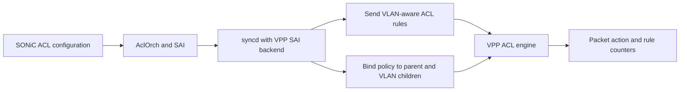
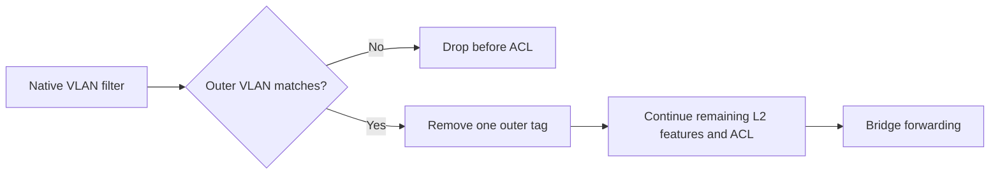

# SONiC-VPP VLAN-Aware ACLs and QinQ Handling — HLD

## Table of Contents

1. [Revision History](#1-revision-history)
2. [Purpose and Scope](#2-purpose-and-scope)
3. [Terms](#3-terms)
4. [Architecture and Design Goals](#4-architecture-and-design-goals)
5. [VLAN Matching and QinQ Handling](#5-vlan-matching-and-qinq-handling)
6. [Interface Binding and Recovery](#6-interface-binding-and-recovery)
7. [Configuration and Compatibility](#7-configuration-and-compatibility)
8. [Operational Impact and Limitations](#8-operational-impact-and-limitations)
9. [References](#9-references)

## 1. Revision History

| Revision | Date | Description |
|----------|------|-------------|
| 0.1 | 2026-10-27 | Initial design covering VLAN-aware ACL matching, QinQ handling, bridged-interface policy inheritance, IPv4/IPv6 rule translation, and recovery from partial binding failures. |

## 2. Purpose and Scope

This design addresses VLAN-aware ACL matching and QinQ handling in SONiC-VPP. The improvements are:

- Match the VLAN associated with the packet at each ingress or egress ACL stage, including native-VLAN and QinQ paths where VPP removes a service tag internally.
- Preserve QinQ customer tags by continuing Layer 2 processing after the native filter validates and removes a matching outer tag.
- Apply a port or LAG policy to the bridged VLAN interfaces that carry its traffic.
- Translate IPv4/IPv6 rules consistently, including rules with only one address prefix or no explicit address family.
- Recover from partly completed ACL binding changes without changing which group owns the policy or losing table order.

The design extends the existing VPP-backed SAI implementation and VPP ACL engine. Existing ACL objects, permit/drop actions, ingress-port matching, logical counters, mirror actions, and the shared default-permit ACL provide the foundation. The [references](#9-references) provide background on VLAN forwarding, ingress-port scoping, and counters.

The scope is regular IPv4/IPv6 ACLs on the VLAN member and routed-subinterface paths described below. Inner-VLAN matching, VLAN priority/tag-type qualifiers, general non-IP ACLs, complete provider-bridging support, and VLAN-aware stateful reflection are outside this design. It does not add a general VLAN-ID translation feature or define every VPP tag-rewrite combination.

## 3. Terms

The following terms describe VLAN/QinQ packet handling and the ACL policy model.

| Term | Meaning in this document |
|------|--------------------------|
| QinQ | A packet with an outer service VLAN tag and an inner customer VLAN tag. |
| VLAN tag rewrite (VTR) | Adding or removing VLAN tags. `POP_1` removes one outer tag; `PUSH_1` adds one. |
| Bridge domain (BD) / PVID | A VPP Layer 2 forwarding domain / the VLAN assigned to an untagged member. SONiC uses the VLAN ID as the BD ID. |
| Effective VLAN | The VLAN used for the current ingress or egress ACL stage. It comes from interface/forwarding context, with packet-header inspection as a fallback. It can differ between stages and from the first tag still visible in the packet. |
| SAI / saivpp | SONiC's switch API / its VPP-backed implementation in `sonic-sairedis`. |
| ACL entry | One logical match-and-action rule. Translation may produce several VPP rules for it. |
| ACL group | A set of tables assigned to a port or LAG. The VPP backend orders them by group-member priority. |
| LAG | A link aggregation group, represented by a VPP bond interface. |
| Bridged child | A VLAN subinterface below a port or LAG, associated with a bridge domain and not with a routed SAI router interface (RIF). |
| Lookup context | The ordered ACL tables VPP uses to classify a packet. |
| Reflection | VPP's permit-and-reflect action, which creates a stateful session. It is separate from packet mirroring. |

## 4. Architecture and Design Goals

VLAN matching and QinQ handling fit into SONiC's existing ACL and VLAN paths. VPP derives the VLAN for the applicable ACL stage from that stage's interface context. The native filter preserves the customer tag when it removes a matching service tag. The SAI backend supplies the VLAN qualifier and installs the policy on the interfaces carrying that traffic.



| Component | Responsibility |
|-----------|----------------|
| VPP ACL plugin in `sonic-platform-vpp` | Determine the packet's effective VLAN and evaluate it together with the rule's other matches. |
| VPP `sonic_ext` plugin | Remove a valid native outer tag once, preserve any customer tag, and continue the remaining Layer 2 processing. |
| `sonic-sairedis` VPP backend | Send VLAN qualifiers through the VPP API, apply policy to bridged VLAN interfaces, translate IPv4/IPv6 rules, and recover unfinished binding work. |

The design has six goals:

1. Use the VLAN context of each ACL stage; removing a service tag must not make a remaining customer tag replace that context.
2. Preserve QinQ customer tags and continue ACL processing after removing a valid native outer tag.
3. Apply the accepted policy to the parent and its bridged VLAN children in each direction.
4. Preserve explicit address prefixes and supported match fields during IPv4/IPv6 translation.
5. Keep user tables in priority order, followed by the existing shared default permit.
6. Report programming failures and retain enough state for a later SAI operation to repair unfinished work.

This is a built-in backend enhancement. It uses the existing syncd/VPP containers and interfaces, without a new service or application extension.

## 5. VLAN Matching and QinQ Handling

VLAN matching uses the relevant ingress or egress VLAN context, and QinQ handling preserves the inner customer tag. Rule translation represents these policies for the applicable IPv4/IPv6 packet types.

### 5.1. Expressing a VLAN Match

SONiC's existing `VLAN_ID` qualifier maps to `SAI_ACL_ENTRY_ATTR_FIELD_OUTER_VLAN_ID`. The VPP ACL rule API carries two additional fields:

```c
u16 outer_vlan_id;
u16 outer_vlan_id_mask;
```

The value selects the VLAN; the mask selects which VLAN-ID bits matter. For an enabled qualifier, both must fit within 12 bits. The VPP-backed SAI implementation and VPP reject bits outside `0x0fff`, normalize the stored value to `value & mask`, and serialize the API fields in network byte order. API dumps return the qualifier as well.

| Qualifier | Meaning |
|-----------|---------|
| Disabled, or mask zero | No VLAN restriction. |
| Nonzero mask and a known packet VLAN | Match when `(packet_vlan & mask) == (rule_vlan & mask)`. |
| Nonzero mask and no packet VLAN identity | Do not match. |

For example, value `200` with mask `0x0fff` matches effective VLAN 200 exactly. A value of zero with a nonzero mask is still an enabled backend match; it is not a disabled field. This rule encoding does not add priority-tagged frame handling or override the native VLAN. The native filter still requires an outer `0x8100` tag's VID to match the member's native VLAN. The normal SONiC ACL JSON syntax accepts configured VLAN IDs starting at 1 and does not expose VID-zero rules or arbitrary masks.

VLAN is part of each ACL rule, evaluated before selecting its action and counter. For example, a higher-priority TCP/443 permit must still win over a lower-priority VLAN-200 drop. This is why VLAN matching belongs inside the ACL engine rather than in an independent drop filter. The current ACL export interface has no hook for an external plugin to add a per-rule match condition.

### 5.2. Finding the Packet's VLAN

Reading the first tag in the current packet buffer is not always enough. A rewrite may have removed the service tag, leaving a customer tag, or the packet may have arrived untagged on an access VLAN.

The matcher uses the receive interface for ingress and the transmit interface for egress. It chooses the first available VLAN source in this order:

| Order | Source | What it tells us |
|-------|--------|------------------|
| 1 | Fixed outer VLAN on a one-tag or two-tag subinterface | The subinterface's configured outer VLAN. This also applies to routed subinterfaces. |
| 2 | The direction's VLAN push configuration | The VLAN assigned by the configured rewrite. |
| 3 | Bridge-domain ID, when it is a valid SONiC VLAN ID | The native/PVID VLAN for a bridged member. |
| 4 | Bounds-checked Ethernet/VLAN header inspection | The outer tag when interface context gives no VLAN. |

The VLAN is evaluated separately for each direction:

| Packet path | VLAN used by the ACL |
|-------------|----------------------|
| Untagged traffic on a native member of VLAN 200 | VLAN 200 from bridge/PVID context. |
| Native QinQ traffic with outer 200 / inner 10, after the service tag is removed | VLAN 200; the remaining customer tag 10 does not replace it. |
| A packet routed from a VLAN-100 subinterface to a VLAN-200 subinterface | VLAN 100 on ingress and VLAN 200 on egress. |

On native egress, this context can still identify VLAN 200 when the transmitted packet retains only customer tag 10. Thus the qualifier is not simply a read of the outermost transmitted tag. Different ingress and egress VLANs are valid; the implementation does not carry one unchanged VID through all forwarding stages.

Ordinary Layer 2 ingress ACL processing runs before input VTR. Output VTR runs before the egress ACL feature chain. The native filter performs its own earlier `POP_1`. The matcher uses the context of each direction despite these different packet views; ACL feature ordering does not change.

On Layer 3 ingress, fallback header inspection can use a saved valid Ethernet-header offset. Egress fallback uses the current output rewrite. An untagged routed interface with no VLAN context has no effective VLAN and cannot match a nonzero VLAN mask. All header reads are bounded by the available packet data.

This selection describes the paths in scope. Separately configured VLAN-ID translation or other rewrite combinations need an explicit definition of which VLAN each ACL stage should match and their own validation.

### 5.3. Preserving QinQ Traffic

Bridged VLAN subinterfaces classify their outer tag without requiring an exact single-tag packet. This admits an additional customer tag. Routed subinterfaces keep exact single-tag classification.

On a native member, the existing filter validates an outer `0x8100` tag against the member's native VLAN and removes one matching tag. Processing then resumes at the remaining Layer 2 features, including ACL processing, with any customer tag intact.



Continuing the existing feature chain prevents the customer tag from being classified again as a native VLAN. The continuation state is initialized after the main plugin state so initialization cannot erase it. These changes preserve the described QinQ path; they do not add complete provider-bridging support.

### 5.4. Lookup Paths, Interface Matches, and Sessions

Both VPP lookup paths enforce the VLAN predicate. Linear lookup checks rules in order. Hash lookup finds candidates by their ordinary IP/L4 key, then verifies the VLAN value/mask before accepting a candidate.

For ingress `IN_PORTS` matching, a bridged child can match either its own interface or its port/LAG parent. Routed children keep exact interface identity. Bridged-child packets use linear lookup even when hash lookup is enabled, because a single exact interface key cannot represent both identities. This applies to all bridged-child packets reaching the matcher, not only VLAN-qualified rules. `IN_PORTS` remains an ingress-only qualifier.

VPP's cached session keys do not contain VLAN identity. A lookup context containing a nonzero VLAN mask therefore bypasses cached-session hits, including sessions created before that VLAN policy was installed. An individual ACL definition or a lookup context cannot combine such a VLAN match with any permit-and-reflect rule, even in different entries. VPP rejects conflicting rule/context/binding changes before installing that combination. Ordinary permit/drop remains supported; VLAN-aware stateful sessions require a separate design.

### 5.5. IPv4/IPv6 Rule Translation

For VLAN-qualified and other supported IP policies, the backend examines the enabled family-specific fields before translating the rule. IPv4/IPv6 prefixes, ICMP/ICMPv6, IPv6 `NEXT_HEADER`, explicit `IP_TYPE`, and exact IP EtherType qualifiers must agree. Conflicting constraints reject the update, regardless of attribute order.

An omitted source or destination becomes an any-address match for the selected family. An explicitly configured prefix is preserved.

| SONiC rule intent | VPP rules produced |
|-------------------|--------------------|
| VLAN-only rule in a table allowing both families | IPv4 and IPv6 variants. |
| IPv6 destination prefix only | One IPv6 rule with an IPv6 source wildcard. |
| IPv6 `NEXT_HEADER=TCP`, without addresses | One IPv6 TCP rule. |
| L4 port match without a protocol, allowing both families | TCP and UDP variants for each family. |
| IPv4 TCP rule with a port match | One IPv4 TCP rule. |

Unsupported port/protocol combinations are rejected. Recognizing IP EtherTypes here does not add general non-IP filtering.

All variants for one logical entry stay together, ahead of lower-priority entries. Existing `IN_PORTS` expansion and counter aggregation still apply: the SAI counter sums the VPP rules belonging to that entry. Rebinding a table reuses its rule definition. Replacing a complete definition can reset its counters.

## 6. Interface Binding and Recovery

VLAN-aware policies need to reach the parent and its bridged VLAN interfaces. The backend tracks both the accepted policy and the bindings successfully installed in VPP, including recovery when an update only partly succeeds.

### 6.1. Policy Ownership and Order

A PORT or LAG ACL group owns the policy for one direction on the parent and its bridged VLAN children. A child belongs to this scope when it has a bridge-domain association and no routed RIF association. Routed children do not inherit the policy. Bridged children have no separate regular ACL owner in this model.

User tables follow descending group-member priority. The existing shared `sonic_acl_default_permit` follows them and permits otherwise unmatched IPv4/IPv6 traffic:

```text
high-priority user table -> lower-priority user table -> default permit
```

An explicit user DROP still wins before the permit. The default ACL is created lazily once per backend instance and reused. Removing a policy detaches its default permit from that interface; it does not delete the shared definition.

VPP appends table bindings. When inserting a user table, the backend temporarily removes the default attachment and restores it after the user tables. This keeps the permit from hiding later tables. An empty group retains its port/LAG association but installs no user tables; clearing a policy removes its attachments.

### 6.2. Assignment and Interface Lifecycle

Existing bridged children are included when assigning the parent's group. A new child replays the parent's recorded table order and default-permit state before activation is requested. If the parent is down, the child can wait for it to come up.

Child creation does not rebuild missing tables from the accepted group. If an earlier failure left the parent with a partial policy, the child can inherit that partial policy. A later successful group update or retry repairs the parent and its current children.

If bridge/rewrite setup or policy inheritance fails, creation reports failure, removes the failed SAI VLAN-member object, and attempts cleanup. Teardown brings the child down before removing its ACLs and forwarding setup. The backend forgets its attachment tracking after successful interface deletion.

An existing PORT/LAG with no stored ACL attribute uses SAI's null default. The backend checks object existence separately, because the getter can return `ITEM_NOT_FOUND` for either an omitted attribute or a missing object. A missing object remains an error.

### 6.3. Recovering a Partly Applied Update

The backend keeps two kinds of information:

| State | What it records |
|-------|-----------------|
| Accepted policy | SAI objects, group membership, port/LAG group ownership, and stored ACL attributes. |
| Binding state | Successfully programmed tables in each direction, their order, default-permit state, and work still awaiting retry, such as tunnel-termination cleanup. |

Recovery compares the installed policy with the required policy and repairs their differences. It relies on the backend's record of successful VPP calls, not a readback of live VPP state. Manual VPP ACL edits are not discovered by this mechanism.

For a group-member change, the backend saves the original members and associated ports, detaches the old policy, then attempts the updated policy on every target. If any step fails, it restores the original accepted membership and attempts recovery across all original ports and children, including targets already detached before the error.

A failed member create removes the new member object. A failed member removal preserves the old object. The requested operation returns failure even if restoring the old policy succeeds.

A failed PORT/LAG replacement attempts to restore the previously accepted group and leaves the stored ACL attribute unchanged. The accepted group's association is removed only after successful detachment. A rejected group assignment loses its attempted association, so later changes to that group cannot take ownership of the port.

For each interface and direction, repair follows this order:

1. Keep the leading tables that already match the required order.
2. Remove the remaining installed tables from the end, stopping if a removal fails. Keep the default permit if a user-table removal fails.
3. Retry obsolete related cleanup and append the required remaining tables.
4. Put the shared permit last, or remove it when no tables are required.

Removing from the end matters. Starting with `[A, B, C, permit]`, removing C and then failing to remove B leaves `[A, B, permit]`. Recovery can append C and restore the permit last without reversing the priority of A and B.

The backend records which bindings succeeded and tracks unfinished work separately for retry. Recovery also removes leftover tentative tables when the old group was empty. An explicit clear repairs stale bindings even when the stored ACL attribute is already null. The opposite direction remains independent.

Updates use several API calls and are not atomic; traffic can see intermediate policy. If VPP keeps failing, restoration is best effort and the error stays visible. There is no background repair worker. A later supported group assignment, member change, replacement, or clear retries the unfinished work.

## 7. Configuration and Compatibility

VLAN-aware ACLs use the existing SONiC `VLAN_ID` qualifier. QinQ handling uses existing VLAN membership and the associated VPP tag rewrites. No standard SAI API, object type, CLI, YANG, or database schema is added.

The backend uses existing SAI ACL tables, entries, groups, group members, counters, and PORT/LAG ingress/egress ACL attributes. The API extension is in VPP's binary ACL rule format, not in standard SAI.

An existing configuration can express a VLAN-qualified rule as follows:

```json
{
  "ACL_RULE": {
    "VLAN_ACL|DROP_VLAN_200": {
      "PRIORITY": "100",
      "PACKET_ACTION": "DROP",
      "VLAN_ID": "200"
    }
  }
}
```

This example assumes a compatible ACL table/type has already been created and bound. It is a rule excerpt, not a complete device configuration. CONFIG_DB, APPL_DB, ASIC_DB, STATE_DB, and the existing counter/logging databases keep their schemas. Inherited attachments and the shared default permit are internal backend state.

The SAI client, generated VPP headers, ACL plugin, and VPP runtime must agree on the complete binary rule format, including the new VLAN fields and the existing interface/mirror fields. The `sonic-sairedis` and `sonic-platform-vpp` components therefore require coordinated deployment and rollback. Mixing old and new API definitions is unsupported; this dependency applies during compilation as well as at runtime.

## 8. Operational Impact and Limitations

The operational impact comes from VLAN matching, rule translation, and interface programming in existing processes. The design does not add a new service, persistent recovery database, or background polling loop.

### 8.1. Memory and Performance

VLAN verification, bridged-child linear lookup, and bypassing cached sessions add packet-processing cost. Existing fragment fallbacks still apply. Policy updates also require more API calls as the number of targets grows. Throughput, memory, and update latency must be measured at the required rule/port/VLAN scale; functional tests do not establish capacity limits.

The VPP API adds two 16-bit fields per rule. Internal rule allocation also grows, subject to alignment. The packet classification tuple stays 48 bytes and requires no new per-packet dynamic allocation. The fields remain part of the compiled rule format even when a rule has no VLAN restriction.

Children share table definitions; inheritance adds interface attachments and lookup contexts rather than a new ACL definition per child. Binding state grows with attached interfaces and tables. Unfinished-operation records are removed after successful cleanup, rather than retained as an event history.

One logical entry can produce multiple rules: applicable IP families × protocol variants × existing ingress-port expansion. For example, an entry covering both families with a port match but no protocol can produce four rules before port expansion. Those rules and counters consume additional memory.

### 8.2. Restart Behavior

Cold initialization restores VLAN-aware policy through the existing SONiC/SAI programming path, rebuilding rule definitions, bridged VLAN attachments, and the shared default permit. Runtime VPP indices and unfinished-operation records are not persistent object identities.

This design adds no warm/fast restart protocol. A supported restart flow must preserve or replay compatible policy and interface state. VLAN-child bindings and additional rule variants can require more VPP API calls during replay. No new service, sleeps, polling loops, or package-download steps are introduced into that path. Warm/fast reboot disruption and replay time require validation against the platform's existing restart contract.

### 8.3. Support Boundaries and Diagnostics

The main boundaries are:

- VLAN matching applies to the IPv4/IPv6 paths described here, not arbitrary non-IP traffic or inner-VLAN/PCP/DEI/TPID qualifiers.
- The described tag paths do not define every VLAN-ID translation or VTR combination. QinQ tag preservation does not imply complete 802.1ad/provider-bridging support.
- Routed children do not inherit the parent's policy or its `IN_PORTS` identity.
- An ACL definition or lookup context cannot combine a nonzero VLAN mask with permit-and-reflect.
- Multi-interface updates are not hitless or atomic, and persistent failures require a later SAI retry.
- Logical counter aggregation is preserved, but continuity across rule replacement or restart is not guaranteed.

For diagnosis, compare accepted group membership with `vppctl show acl-plugin interface` on the parent and children. User tables should precede `sonic_acl_default_permit`. API dumps show the VLAN value/mask; rule counters, packet captures, and traces show whether the intended rule and tag path were used. Backend logs identify failed binds, unbinds, and recovery attempts. Native-filter error counters can increment more than once for one rejected packet, so they are not exact packet counts.

## 9. References

- [VLAN bridge domain and BVI](vlan-bvi-hld.md)
- [VPP ACL ingress-port scoping](vpp_acl_in_ports_HLD.md)
- [SONiC ACL Flex Counters](../acl/ACL-Flex-Counters.md)
