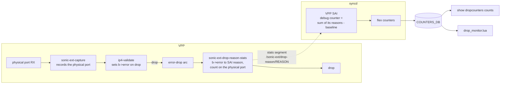

# Configurable Drop Counters on the SONiC VPP Dataplane: High Level Design

## Table of Contents

1. [Revisions](#1-revisions)
2. [Scope](#2-scope)
3. [Definitions](#3-definitions)
4. [Overview](#4-overview)
5. [Requirements](#5-requirements)
6. [Architecture](#6-architecture)
7. [High Level Design](#7-high-level-design)
8. [SAI API](#8-sai-api)
9. [Configuration and Management](#9-configuration-and-management)
10. [Warm Boot and Restart](#10-warm-boot-and-restart)
11. [Memory and Performance](#11-memory-and-performance)
12. [Restrictions and Limitations](#12-restrictions-and-limitations)
13. [Test Plan](#13-test-plan)
14. [Future Work](#14-future-work)
15. [References](#15-references)

---

## 1. Revisions

| Rev | Date | Author(s) | Changes |
|-----|------|-----------|---------|
| 0.1 | 11/05/2026 | Akeel Ali | Initial version. |

---

## 2. Scope

This document describes the high level design for SONiC **configurable drop counters** (SAI debug
counters) on the SONiC VPP dataplane, together with the configurable drop counter **monitor** that
consumes them. Before this work, SONiC-VPP accepted `config dropcounters install`, but every counter
read 0.

The goal of this design is to support the drop reasons that the existing sonic-mgmt tests use, and to
run those tests on the `t0-vpp` and `t1-lag-vpp` testbeds:

- `tests/drop_packets/test_configurable_drop_counters.py`
- `tests/drop_packets/test_configurable_drop_counter_monitor.py`

The work spans `sonic-platform-vpp` (VPP plugins), `sonic-sairedis` (the VPP SAI) and `sonic-mgmt`
(test enablement). See [Architecture](#6-architecture) for each component's role and
[References](#15-references) for the implementation PRs.

**In scope**

- Ingress drop reasons `SIP_LINK_LOCAL` and `DIP_LINK_LOCAL`.
- Counter types `PORT_INGRESS_DROPS` and `SWITCH_INGRESS_DROPS`.
- Exact, per-port attribution to the physical ingress port, including LAG members and VLAN members.
- The configurable drop counter monitor (`config dropcounters enable-monitor`) on VPP.
- A table-driven mapping from VPP drop errors to SAI drop reasons, so that later reasons are added as
  table rows.

**Out of scope**

- Changes to orchagent, the `dropconfig`/`dropstat` CLI, the drop monitor Lua plugin, or the
  CONFIG_DB/STATE_DB/COUNTERS_DB schemas. They are platform-independent and already work.
- Egress counter types (`PORT_EGRESS_DROPS`, `SWITCH_EGRESS_DROPS`).
- Other drop reasons, including `L3_EGRESS_LINK_DOWN` and the `*_ANY` aggregates (see
  [Future Work](#14-future-work)).
- Any change in behavior for the plain virtual switch (`asic_type == vs`).
- Multi-ASIC VPP.

---

## 3. Definitions

| Term | Meaning |
|---|---|
| Debug counter | SAI object (`SAI_OBJECT_TYPE_DEBUG_COUNTER`) that counts drops for a list of drop reasons. SONiC calls these configurable drop counters. |
| Drop reason | SAI enum value such as `SAI_IN_DROP_REASON_DIP_LINK_LOCAL`. SONiC shows it without the prefix (`DIP_LINK_LOCAL`). |
| Counter index | `SAI_DEBUG_COUNTER_ATTR_INDEX`, the counter's slot number (0, 1, 2, ...), assigned by the SAI on create. The counter's value is reported as stat `SAI_PORT_STAT_IN_DROP_REASON_RANGE_BASE + index` on each port, or `SAI_SWITCH_STAT_IN_DROP_REASON_RANGE_BASE + index` on the switch. One counter uses one index, however many ports it covers. |
| `error-drop` | VPP's common drop node. Every intentional drop goes through it, and it runs the `error-drop` feature arc before freeing the buffer. |
| `b->error` | Per-buffer VPP error index (node and error code) that records why a buffer is being dropped. |
| sonic-ext cookie | Per-buffer metadata set by `sonic-ext-capture` on physical ports. It carries `orig_rx_sw_if_index`, the physical port the packet arrived on, through bond and BVI rewrites of the RX interface. |
| Unattributed drop | A drop whose physical ingress port can't be recovered. It counts toward switch counters only. |

---

## 4. Overview

### 4.1 Background: existing SONiC flow (unchanged)

The flow below is existing, platform-independent SONiC behavior, described in the
[SONiC Configurable Drop Counters HLD](../drop_counters/drop_counters_HLD.md). This design doesn't
change it. It shows the SAI calls a platform has to answer, which is where the VPP work comes in.

1. At startup, `DebugCounterOrch` asks the SAI which counter types and drop reasons it supports, and
   publishes the answer to STATE_DB (`show dropcounters capabilities`).
2. `config dropcounters install <name> <type> <reasons>` makes orchagent create a SAI debug counter
   and read back its index.
3. Orchagent adds `..._IN_DROP_REASON_RANGE_BASE + index` to the `DEBUG_COUNTER` flex counter group
   (1 s, read mode), per port or for the switch. syncd writes the values to COUNTERS_DB, and
   `show dropcounters counts` displays them.
4. When the drop monitor is enabled, orchagent also adds every port to the `DEBUG_MONITOR_COUNTER`
   flex counter group (60 s). Its Lua plugin, `drop_monitor.lua`, turns sustained per-port drops into
   persistent-drop alerts.

### 4.2 Gap on SONiC-VPP

The SONiC flow above already ran on VPP, but the platform side didn't back it:

- The VS/VPP SAI advertised a hard-coded list shared with the virtual switch: ingress `L2_ANY`,
  `L3_ANY`, `ACL_ANY`, egress `L2_ANY`, `L3_ANY`, and all four counter types.
- Debug counter objects were only bookkept. No stat was ever filled, so **every counter read 0**.
- VPP already drops the packets the tests send: the `ip_validate` plugin (`ip4-validate`, on the
  `ip4-unicast` arc) drops packets with a link-local source or destination. But VPP has no per-port,
  per-reason drop accounting. Its error counters are per node and switch-wide, and its interface
  `drops` counter isn't broken down by reason.
- `ip4-validate` and `ip6-validate` didn't set `b->error` on the packets they drop, so the reason was
  lost by the time a packet reached `error-drop`.

### 4.3 Summary of the design

1. **VPP records why it dropped a packet.** `ip_validate` now sets `b->error` on every packet it drops,
   as VPP nodes normally do.
2. **A new sonic-ext node counts drops per reason and port.** `sonic-ext-drop-reason-stats` runs on
   the `error-drop` arc. It maps `b->error` to a SAI drop reason and counts the drop against the
   physical ingress port, in per-reason counters exported to the VPP stats segment.
3. **The VPP SAI exposes them as SAI debug counters.** It advertises only the reasons VPP counts, sums
   each counter's reasons from the stats segment, and reports the standard per-port and switch
   debug counter stats. Orchagent, the CLI and the drop monitor work unchanged.

---

## 5. Requirements

| # | Requirement |
|---|---|
| R1 | Advertise only the drop reasons and counter types that VPP actually counts. |
| R2 | Count each dropped packet once, against the physical port it arrived on, including LAG members (RX rewritten to a bond) and VLAN members (RX rewritten to a BVI). |
| R3 | A counter reads 0 when created and when its reason list changes, then increases monotonically. |
| R4 | A switch counter equals the sum over all ports, plus unattributed drops. |
| R5 | Never report a decrease, even if VPP's counters are cleared or VPP restarts. |
| R6 | Adding a reason means adding a mapping row, not a new node. |
| R7 | No cost on the forwarding path; any cost applies only to packets already being dropped. |
| R8 | Counts are exact: `test_configurable_drop_counters.py` expects exactly 1000 for 1000 packets, and the monitor tests compare small bursts with thresholds. |

---

## 6. Architecture

| Component | Repository | Responsibility |
|---|---|---|
| `ip_validate` plugin | sonic-platform-vpp | Set `b->error` on every packet it drops |
| `sonic-ext-drop-reason-stats` node | sonic-platform-vpp (`sonic_ext`) | Classify each drop by reason, attribute it to the physical ingress port, count it |
| `vslib` capability hook | sonic-sairedis | Let a switch implementation answer debug counter capabilities; VS answers unchanged |
| `SwitchVpp` debug counters | sonic-sairedis (`vslib/vpp`) | Advertise capabilities, track counters, compute port and switch stats from the VPP counts |
| sonic-mgmt test lists and marks | sonic-mgmt | Run the target tests on `t0-vpp` and `t1-lag-vpp` |

---

## 7. High Level Design

### 7.1 VPP: recording the drop reason (`ip_validate`)

`ip4-validate` and `ip6-validate` now set `b->error = node->errors[code]` on every packet they drop,
and only count valid packets in their own end-of-frame counter update. VPP's `drop` node already
counts each dropped packet under its `b->error`, so each drop is now counted exactly once in
`show errors`, under its real `ip4-validate` reason. Previously, the drop node also counted it under
whatever stale error the buffer carried. Drop tracing and pcap drop capture also report the right
reason now. Forwarded traffic is unaffected.

### 7.2 VPP: the `sonic-ext-drop-reason-stats` node

A new feature node in the existing `sonic_ext` plugin, on the `error-drop` arc, before `drop`. It
sits next to `sonic-ext-drop-member-stats`, which is unchanged. Neither node modifies the packet.

**Mapping table.** A static table of `{ VPP node name, VPP error string, SAI reason }` rows:

| VPP node | VPP error string | SAI drop reason |
|---|---|---|
| `ip4-validate` | "source address is link-local" | `SIP_LINK_LOCAL` |
| `ip4-validate` | "destination address is link-local" | `DIP_LINK_LOCAL` |

Rows match by error string rather than error code, so other plugins' private enums aren't needed. At
main-loop entry, before workers start, the table is resolved into a vector indexed by VPP error index.
A row whose node isn't loaded is logged and skipped, and its reason shows as unmapped in the CLI.

**Counting.** For each buffer whose `b->error` maps to a reason:

1. The port is the cookie's `orig_rx_sw_if_index` if present, otherwise the RX interface.
2. A sub-interface is resolved to its parent port.
3. If the result is still a bond or a BVI, so no physical port can be recovered, the drop is counted
   at index 0 (unattributed).
4. The node increments a per-reason simple counter (per thread, lock-free) at that `sw_if_index`.

**Counters.** One `vlib_simple_counter_main_t` per reason, exported to the stats segment as
`/sonic-ext/drop-reason/<REASON>`, indexed by `sw_if_index`. The leaf names match the SONiC reason
names. Index 0 (`local0`, never a SAI port) holds unattributed drops. Counter rows are grown and
zeroed in the interface add hook on the main thread, never on a worker.

**Enabling.** The node is enabled on the `error-drop` arc of every interface: existing ones at
main-loop entry, new ones from the interface add hook. Enabling is guarded against adding the node
twice.

**Toggle.** `drop-reason-stats` is a new `sonic_ext` feature, on by default and owned by VPP, set in
the `sonic-ext { }` startup stanza like the other features. When it's off, the node isn't attached,
no counters are created, and the SAI advertises nothing (§7.3). `sonic-ext-capture`, which produces
the cookie, runs while any of its consumers (`punt-via-member`, `drop-member-stats`,
`drop-reason-stats`) is on.

**Debug CLI.** `show sonic-ext drop-reasons [<interface>]` shows the toggle, the mapping state of each
reason, and the non-zero per-port counts. The node also has one `show errors` counter, "drop counted
against a SAI drop reason".

### 7.3 SAI: capabilities

**Shared `vslib` change, no change in behavior.** The hard-coded debug counter answers move from
`VirtualSwitchSaiInterface` into a new virtual `SwitchStateBase::queryDebugCounterCapability()`,
which the existing per-switch fallback calls for every `SAI_OBJECT_TYPE_DEBUG_COUNTER` query. The VS
answers are unchanged.

**VPP answers** (`SwitchVpp::queryDebugCounterCapability`):

| Attribute | Advertised |
|---|---|
| `SAI_DEBUG_COUNTER_ATTR_TYPE` | `PORT_IN_DROP_REASONS`, `SWITCH_IN_DROP_REASONS` |
| `SAI_DEBUG_COUNTER_ATTR_IN_DROP_REASON_LIST` | `SIP_LINK_LOCAL`, `DIP_LINK_LOCAL` |
| `SAI_DEBUG_COUNTER_ATTR_OUT_DROP_REASON_LIST` | none |

- `L2_ANY`, `L3_ANY` and `ACL_ANY` are no longer advertised, because nothing counts them (R1).
- The SAI asks VPP whether `drop-reason-stats` is enabled (`sonic_ext_feature_get`), as it already
  does for other sonic-ext features. If it's off, or VPP predates it, the SAI advertises no reasons
  and no types, and orchagent publishes no drop counter capabilities.

**Port stats capability (needed by the drop monitor).** syncd's regular port counter context, which
the `DEBUG_MONITOR_COUNTER` group uses, only polls stats that `queryStatsCapability(PORT)` reports.
The `DEBUG_COUNTER` group's context skips that check. `SwitchVpp::queryPortStatsCapability` therefore
adds `SAI_PORT_STAT_IN_DROP_REASON_RANGE_BASE + i` for every possible index to the base list. Without
it, syncd rejects every port for the monitor group, and the monitor never runs.

### 7.4 SAI: counter state and statistics

The VPP-specific code is in a new file, `vslib/vpp/SwitchVppDebugCounter.cpp`, with small hooks in
`SwitchVpp.cpp`.

| Event | Behavior |
|---|---|
| Create | Record the counter's index, type and reasons; take a baseline from a fresh stats read |
| Set `IN_DROP_REASON_LIST` | Update the reasons; take a new baseline |
| Remove | Forget the counter; the index is freed as before |
| Port stats read | `RANGE_BASE + index` = the sum of the counter's reasons at the port's `sw_if_index`, minus the baseline |
| Switch stats read | The same sum over every `sw_if_index`, including index 0, minus the baseline |
| Read-and-clear, clear | Rebase the cleared counters: one port's baseline, or every `sw_if_index` for a switch stat |

- **Reading VPP.** A new `vpp_drop_reason_stats_dump()` in `vppxlate` reads
  `/sonic-ext/drop-reason/` from the stats segment and sums the per-thread values. The result is cached
  for 200 ms, so one flex counter poll over all ports costs one stats read. A failed read, for example
  when nothing is exported, counts as 0.
- **Never decreasing (R5).** If a raw count drops below its baseline, because VPP restarted or its
  counters were cleared, the baseline is reset to the raw value.
- **Starting at 0 (R3).** Create and reason changes force a fresh stats read before taking the
  baseline.

---

## 8. SAI API

No new SAI attributes, statistics or header changes. The VPP SAI now implements:

| SAI API | Use |
|---|---|
| `sai_query_attribute_enum_values_capability`, `DEBUG_COUNTER` `TYPE` / `IN_DROP_REASON_LIST` / `OUT_DROP_REASON_LIST` | Advertise the counted reasons and types (§7.3) |
| `create/set/remove_debug_counter` | Track counters and their baselines (§7.4) |
| `get_port_stats_ext`, `SAI_PORT_STAT_IN_DROP_REASON_RANGE_BASE + index` | Per-port counter value |
| `get_switch_stats_ext`, `SAI_SWITCH_STAT_IN_DROP_REASON_RANGE_BASE + index` | Switch counter value |
| `sai_query_stats_capability`, `PORT` | Lists the debug counter port stats, so the monitor group can poll them |
| `READ_AND_CLEAR`, `BULK_READ_AND_CLEAR`, `BULK_CLEAR` stats modes | Rebase the cleared counters |

`objectTypeGetAvailability(DEBUG_COUNTER)` still reports 3 counters.

---

## 9. Configuration and Management

- **No new SONiC configuration, CLI or DB schema.** The existing `config dropcounters ...`,
  `show dropcounters ...` and `sonic-clear dropcounters` commands work as on any platform.
- **VPP startup toggle.** `drop-reason-stats` can be turned off in VPP's `startup.conf`
  (`sonic-ext { drop-reason-stats off }`), or through the existing
  `SONIC_EXT_CONFIG=drop-reason-stats=off` setting in `/etc/sonic/vpp/syncd_vpp_env`. It's documented
  with the other features in the `docker-syncd-vpp` and `docker-sonic-vpp` `startup.conf.tmpl` files.
  Changing it requires a VPP restart.
- **Debug.** `vppctl show sonic-ext drop-reasons [<interface>]` and `vppctl show errors`, inside the
  syncd container.
- **Plain drop counters are unchanged.** `RX_DRP` and the other interface drop counters come from
  VPP's interface `drops` counter, which this design doesn't touch.

---

## 10. Warm Boot and Restart

There's no warm-boot-specific handling. Counter state lives in syncd's memory and in VPP's stats
segment. When syncd recreates debug counters, each one starts from a new baseline. When VPP restarts,
its counters restart from zero, and the SAI rebases rather than reporting a decrease (R5). As with
other SAI statistics on VPP, counts aren't preserved across a VPP restart.

---

## 11. Memory and Performance

- **Forwarding path:** no change. Work happens only for packets already headed to `error-drop`: one
  vector lookup and one per-thread counter increment each (R7).
- **VPP memory:** per reason, a counter vector of `threads × (max sw_if_index + 1) × 8 B` in the
  stats segment. That's about 8 KB in total on the KVM testbeds (2 threads, about 256 interfaces,
  2 reasons). The error-to-reason lookup vector takes 1 byte per registered VPP error, a few KB.
  Nothing is allocated per packet.
- **syncd:** one stats read per flex counter poll (200 ms cache), and per counter a baseline map of a
  few KB at most.

---

## 12. Restrictions and Limitations

- Only `SIP_LINK_LOCAL` and `DIP_LINK_LOCAL` are supported, and only for ingress counter types.
- The supported reason list is static in the SAI. If the VPP mapping for a reason can't be resolved
  (for example `ip_validate` isn't loaded), that reason is still advertised while `drop-reason-stats`
  is on, but reads 0.
- When several checks would drop a packet, VPP records only the first. `ip4-validate` checks the
  source before the destination.
- A drop received on a bond or BVI with no capture cookie is counted switch-wide only.
- The upstream `drop_monitor.lua` iterates over only half of `COUNTERS_PORT_NAME_MAP` (and of the
  debug counter map), on every platform. This isn't caused by this design; the monitor tests work
  around it by using ports the monitor polls.

---

## 13. Test Plan

### 13.1 VPP plugin tests (`make test`, sonic-platform-vpp CI)

New `vppbld/plugins/tests/sonic_ext/test_sonic_ext_drop_reason.py`:

| Test | Checks |
|---|---|
| Link-local destination / source on a routed port | The matching reason counter goes up by exactly N on the ingress port only; the `ip4-validate` error goes up by exactly N, so each drop is counted once |
| Unmapped `ip4-validate` drop | No reason counter changes |
| Forwarded traffic | No reason counter changes |
| CLI and arc | The toggle and the mapping are reported, and the node is on the `error-drop` arc |
| `drop-reason-stats off` at startup | The node isn't attached, nothing is counted, and no stats entries are created |
| Drop on a bond member | Counted against the member port, not the bond |

`test_sonic_ext.py` also lists the new toggle in its feature table and in its "capture off" case.

### 13.2 SAI unit tests (gtest, sonic-sairedis CI)

New `unittest/vslib/TestSwitchVppDebugCounter.cpp`, with the VPP stats read mocked:

- Capabilities: only the counted reasons and types; nothing when `drop-reason-stats` is off.
- The port stats capability lists the debug counter stats.
- A counter starts at 0, counts only its own port, and sums its reasons and VPP threads.
- A reason change restarts from 0, and a counter never goes backwards.
- A switch counter sums every port plus unattributed drops.
- Read-and-clear restarts only the cleared port, or the switch counter.
- A failed stats read reads as 0, and remove frees the index.

The existing VS capability test (`TestVirtualSwitchSaiInterface`) checks that VS answers are unchanged.

### 13.3 sonic-mgmt (KVM `t0-vpp` and `t1-lag-vpp`)

sonic-mgmt [#29006](https://github.com/sonic-net/sonic-mgmt/pull/29006) removes the placeholder VPP
skip for `test_configurable_drop_counters.py`. It adds that module to `t0-vpp` (the module is
t0-only) and `test_configurable_drop_counter_monitor.py` to both `t0-vpp` and `t1-lag-vpp`. No test
code changes are needed. Cases whose reason isn't advertised skip through the tests' own capability
check, so the sonic-mgmt change is safe on images without this feature.

Results with all three changes (combined in a test-only sonic-buildimage PR,
[#30522](https://github.com/sonic-net/sonic-buildimage/pull/30522)):

| Topology | `test_configurable_drop_counters.py` | `test_configurable_drop_counter_monitor.py` |
|---|---|---|
| `t0-vpp` | 4 passed, 2 skipped (`L3_EGRESS_LINK_DOWN` not supported) | 5 passed, 3 skipped (switch-level counters are never monitored, on any platform) |
| `t1-lag-vpp` | not run (t0-only) | 5 passed, 3 skipped (same) |

The full `t0-vpp` and `t1-lag-vpp` PR test suites also pass on the same image, including
`test_drop_counters.py`, which checks the plain drop counters.

---

## 14. Future Work

- **`L3_EGRESS_LINK_DOWN`** (the remaining 2 cases of `test_configurable_drop_counters.py`): map VPP's
  "interface is down" drop, which comes from per-interface output nodes created at runtime, and
  provide a way to bring a link down from the far end on the KVM testbed, which has no fanout.
- **More reasons**, one mapping row and one test each: other `ip4-validate`/`ip6-validate` checks
  (loopback, multicast, class E, unspecified source), IP header errors, TTL, ACL drops, and
  possibly the `L2_ANY`/`L3_ANY`/`ACL_ANY` aggregates.
- **Runtime reason negotiation**, so the SAI only advertises reasons whose VPP mapping resolved.
- **Egress counter types.**
- **Upstream `drop_monitor.lua` fix** for the half-iteration bug (§12), in sonic-swss.

---

## 15. References

- [SONiC Configurable Drop Counters HLD](../drop_counters/drop_counters_HLD.md)
- [SAI debug counter API (`saidebugcounter.h`)](https://github.com/opencomputeproject/SAI/blob/master/inc/saidebugcounter.h)

Implementation PRs:

| Repository | Change | PR |
|---|---|---|
| `sonic-platform-vpp` | `ip_validate` records the drop reason on dropped packets; new `sonic_ext` node counts drops per reason and ingress port | [#334](https://github.com/sonic-net/sonic-platform-vpp/pull/334) |
| `sonic-sairedis` | `vslib`: overridable debug counter capability hook; `vslib/vpp`: debug counters backed by the VPP counts | [#2164](https://github.com/sonic-net/sonic-sairedis/pull/2164) |
| `sonic-mgmt` | Remove the VPP placeholder skip; add the tests to the VPP PR test lists | [#29006](https://github.com/sonic-net/sonic-mgmt/pull/29006) |
