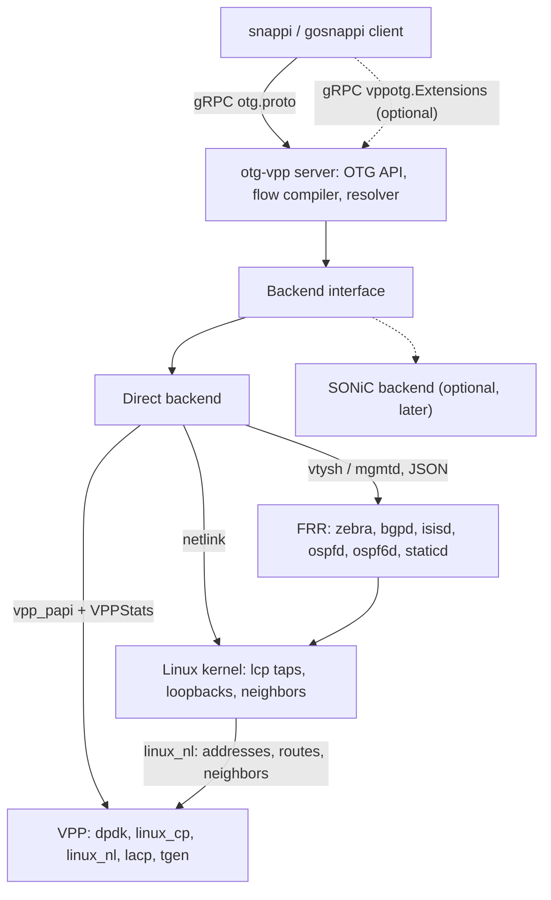
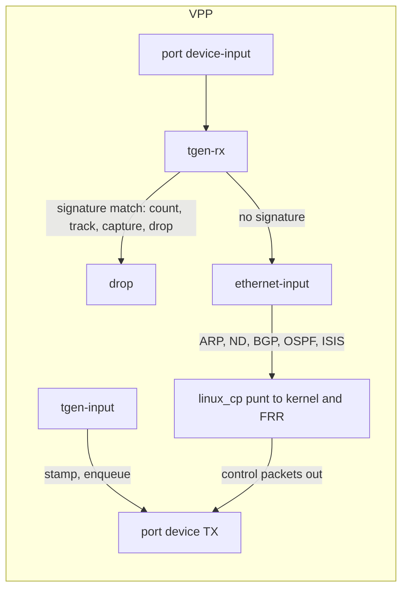
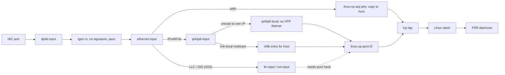
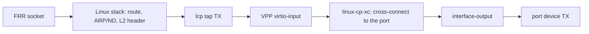

# VPP Open Traffic Generator (vpp-otg) HLD

## Table of Contents

1. [Revisions](#revisions)
2. [Scope](#scope)
3. [Definitions and Abbreviations](#definitions-and-abbreviations)
4. [Background](#background)
5. [Objectives](#objectives)
6. [Architecture](#architecture)
7. [Design Principle: Test Traffic Bypasses Forwarding](#design-principle-test-traffic-bypasses-forwarding)
8. [Control-Plane Packet Path](#control-plane-packet-path)
9. [VPP tgen Plugin](#vpp-tgen-plugin)
10. [otg-vpp Server](#otg-vpp-server)
11. [Direct Backend](#direct-backend)
12. [OTG API Mapping](#otg-api-mapping)
13. [Packaging and Deployment](#packaging-and-deployment)
14. [Repository Layout](#repository-layout)
15. [Optional SONiC Backend](#optional-sonic-backend)
16. [Phasing](#phasing)
17. [Testing](#testing)
18. [Risks and Open Questions](#risks-and-open-questions)
19. [Review Focus](#review-focus)

## Revisions

| Rev | Date | Author(s) |
|-----|------|-----------|
| v0.1 | 11/16/2026 | yue-fred-gao |

## Scope

This document describes a software traffic generator that implements the [Open Traffic Generator (OTG)](https://github.com/open-traffic-generator/models) API. It is built on VPP, FRR, and a new OTG gRPC server. The project lives in a new standalone repository, `vpp-otg`. 

### In scope

- A new VPP plugin (`tgen`) that generates and analyzes test traffic: streams, pacing, field modifiers, signatures, loss and latency, RX trackers, and capture.
- A Python OTG server (`otg-vpp`) that implements `otg.Openapi` over gRPC, compiles OTG flows into streams, and drives VPP, FRR, and the Linux kernel through a `Backend` interface.
- A direct backend for VPP, FRR, and netlink, and an `otg-vpp` container that packages all of the components.
- Emulated devices: Ethernet, IPv4/IPv6, LAG/LACP, BGP, and ISIS (Phase 3); VXLAN, OSPFv2, and OSPFv3 (Phase 4).

### Out of scope

- Changes to the OTG API or model. The implementation conforms to it; see [Objectives](#objectives).
- Latency measured across two separate generator boxes (this would need PTP).
- ISIS/OSPF simulated topologies, in Phases 3 and 4.
- The SONiC/SAI integration. It is described as an optional later backend.

## Definitions and Abbreviations

| Term | Meaning |
|------|---------|
| OTG | Open Traffic Generator, a vendor-neutral traffic generator API and data model |
| snappi / gosnappi | The Python and Go client SDKs generated from the OTG models |
| DUT | Device under test |
| tgen | Traffic generator, here the VPP plugin and its data plane |
| lcp | VPP `linux_cp` plugin; it pairs a VPP interface with a Linux tap |
| Stream | A data-plane unit of generation: template, modifiers, rate, duration |
| Flow | An OTG flow. It compiles into one or more streams (sub-streams) |
| Micro-flow | Packets that share one 5-tuple |
| Signature | A trailer the tgen adds to every generated packet; RX uses it to match packets to their stream |
| Tracker | An RX rule that reads a field at a fixed offset and counts per value, or checks it against an expected value |

## Background

OTG is a declarative API. A client pushes one `Config` (ports, LAGs, devices, flows, captures), changes runtime state with `SetControlState`, and reads `GetMetrics`, `GetStates`, and `GetCapture`. Commercial and free OTG implementations already exist. A VPP-based implementation adds:

- **Low cost.** It runs in software on commodity x86 with DPDK NICs, or in containers over veth.
- **Real routing protocols.** FRR provides BGP, ISIS, and OSPF emulation, so no protocol stack has to be written.
- **Reuse.** It builds on existing sonic-vpp work: VPP packaging, linux_cp, and plugin development experience.

## Objectives

1. **Driven by OTG and compatible with it.** The OTG models define the scope, the API, and the behavior.
   - **Source of truth.** The server implements `otg.proto` from one pinned OTG models release, using Python stubs (`otg_pb2`, `otg_pb2_grpc`) generated from that release. `GetVersion` reports the models version, and moving to a newer models release is a deliberate, versioned change.
   - **Stock clients only.** Unmodified snappi and gosnappi clients, and harnesses built on OTG such as OpenConfig featureprofiles through ondatra's OTG binding, work without any vpp-otg-specific code.
   - **Semantics follow the model text.** The descriptions in the models are the contract. For example, `flow_transmit start` clears metrics, `resume` continues paused flows, an empty name list means all, and `protocol.all start` is a no-op when `auto_start_all` is set. Where the model leaves a choice to the implementation, such as `auto` fields, this HLD documents the choice.
   - **The OTG API is never changed.** No added fields, RPCs, or overloaded meanings. Implementation-specific data and options go through a separate `vppotg.Extensions` gRPC service on the same port.
   - **Unsupported features are reported the OTG way.** They return OTG `Error` (with `kind` and `errors`) or `Warning` responses, never silently ignored. A per-release support matrix lists which OTG objects and fields are implemented.
   - **Compatibility is tested.** CI runs snappi e2e tests plus the applicable upstream OTG conformance and feature tests.
2. **Software only and low cost.** It runs on commodity x86 with DPDK NICs, or in containers.
3. **Layered for reuse.** The plugin, flow compiler, and resolver don't depend on the backend, so a SONiC backend can be added without changing OTG behavior.

## Architecture



| Component | Responsibility |
|-----------|----------------|
| `tgen` VPP plugin | Generates streams at a set rate, adds signatures, matches received packets, computes loss and latency, runs trackers, captures packets |
| otg-vpp API layer | `otg.Openapi` gRPC, validation, OTG error and warning semantics |
| Flow compiler | Turns an OTG flow into a template, modifiers, trackers, and a cookie |
| Resolver | Resolves `auto` fields (gateway MAC, endpoint IPs, labels) at stream start |
| Direct backend | Talks to VPP through vpp_papi and VPPStats, to the kernel through pyroute2 (netlink), and to FRR through vtysh/frr-reload and its JSON output |
| FRR | BGP, ISIS, and OSPF emulation; one FRR router per OTG device |
| linux_cp / linux_nl | Pass control-plane packets between VPP and the kernel; sync kernel addresses, routes, and neighbors into VPP |

## Design Principle: Test Traffic Bypasses Forwarding



- **Streams are complete L2 frames.** They include any VLAN, MPLS, VXLAN, or SRv6 encapsulation, and are enqueued straight to the TX port's device TX node. Received stream packets are consumed at `device-input`, and the tgen never decapsulates.
- **Only `EGRESS` mode exists.** Injecting into the VPP forwarding pipeline (`INGRESS`) and Layer 3 inject with next-hop adjacencies are non-goals.
- **VPP forwarding is used only for the control plane:** connected routes, local delivery and punt through linux_cp, and static routes to multihop or loopback peers.
- **BGP-learned routes are not installed in the tgen FIB.** A zebra route-map allows only connected and static routes, plus optional routes that match peer addresses. DUT tables can be large and are never used for forwarding here.
- **Test and control traffic share the TX port.** Stream rate needs headroom; see [Risks](#risks-and-open-questions).

## Control-Plane Packet Path

### Receive (DUT to FRR)



| Protocol | Path into FRR | Notes |
|----------|---------------|-------|
| ARP | `linux-cp-arp-phy` copies it to the tap | Fills the kernel neighbor table, which the resolver uses for gateway MACs |
| ND (ICMPv6) | Local IPv6 punt to the tap | |
| BGP (TCP 179) | `linux_nl` gives VPP a local receive route for the kernel's address; `ip4-local` has no listener, so `linux-cp-punt-l3` punts to the tap | bgpd sees an ordinary kernel TCP socket |
| OSPFv2/v3 (IP 89) | Link-local multicast `224.0.0.5/6` and `ff02::5/6` matches mfib entries for the host and is punted; unicast OSPF packets take the BGP path | Verify that linux_cp installs `224.0.0.0/24` and `ff02::/16` host mfib entries |
| ISIS (802.3 LLC, DSAP `0xFE`; `01:80:c2:00:00:14/15`, `09:00:2b:00:00:05`) | Goes to `llc-input`/`osi-input`. Stock linux_cp does **not** punt it | **Requirement:** a punt hook in the tgen plugin, or a small VPP patch, that forwards ISIS frames to the paired tap |
| LACP (`0x8809`) | Handled inside VPP by the `lacp` plugin | Never reaches the kernel; state is read from VPP |

### Transmit (FRR to DUT)



The kernel builds the complete frame, and the tap MAC equals the port MAC. `linux-cp-xc` cross-connects the frame to the paired port with no VPP forwarding lookup.

### Requirements

- **Loopback IPs on a paired VPP loopback.** Loopback IPs used as the BGP update-source or VTEP source must be on a VPP loopback interface paired with a tap (`lcp create loopN host-if ...`), so VPP has a receive route and punts packets sent to them. An address only on the kernel's `lo` is unknown to VPP and gets dropped.
- **ISIS punt hook.** ISIS needs the punt hook described in the table above.
- **Smoke test checks:**
  - `show lcp` lists all pairs.
  - The linux-cp punt counters increase while BGP is up.
  - `show ip mfib` / `show ip6 mfib` contain the link-local entries.
  - The ISIS adjacency status is reported.

## VPP tgen Plugin

The plugin is an out-of-tree VPP plugin, built against the `vpp-dev` packages of a pinned upstream VPP release. It does not reuse VPP's `pg`, which is CLI-driven and has no rate control, signatures, or RX analysis.

### Graph nodes

| Node | Type | Role |
|------|------|------|
| `tgen-input` | Input, polling, on each worker | Paces streams, builds packets from templates, applies modifiers, stamps, enqueues to device TX |
| `tgen-rx` | `device-input` feature, enabled only on ports that receive streams | Matches signatures, updates counters and latency, runs trackers, captures, drops |
| `tgen-ctl` | Process node on the main thread | Start/stop/pause/resume, a common start time across workers, drain timers, stats snapshots |
| `tgen-isis-punt` (if needed) | Feature on `llc-input`/`osi-input` | Forwards ISIS frames to the paired lcp tap |

### Binary API (`tgen.api`)

- `tgen_stream_add_del`, and `tgen_stream_enable_disable` (start, stop, pause, resume, with drain on stop).
- `tgen_modifier_add_del` and `tgen_rx_tracker_add_del`.
- `tgen_rx_enable_disable` and `tgen_capture_enable_disable`.
- `tgen_capabilities_get`, which reports: max streams; max modifiers and trackers per stream; supported modifier modes; `max_pps_per_stream`; latency, capture, and payload-CRC support; and hardware pacing.

### Streams

- **Parameters:**
  - TX `sw_if_index`, the RX `sw_if_index` list, the template bytes, and frame size (fixed, increment, random, or weighted).
  - Rate in pps, bps, or percent of line rate.
  - Duration: continuous, fixed packets, fixed seconds, or burst, with a start delay.
  - Signature enable, cookie, and drain timeout.
- **Control, matching OTG semantics:**
  - `start` resets counters and generator state.
  - `stop` keeps counters.
  - `pause` keeps counters and freezes the generator position: sequence number, modifier index, remaining count, elapsed time, and burst phase.
  - `resume` continues from the frozen position.

### Modifiers

- **Fields:** each modifier has an offset, a width of up to 128 bits, a mode (`INC`, `DEC`, `RANDOM`, or `LIST`), start, step, count, a value list, and checksum fixup (IPv4 header, plus the L4 checksum with the pseudo-header).
- **Link groups.** `LINK_GROUP` makes modifiers share one iteration index, so packet *i* carries `(dst_i, label_i)`. This is used for per-prefix labels and SIDs and for paired endpoint fields.

### Signature

```
| magic (4) | cookie (4) | seq (4) | tag (2) | flags (2) | tx_ts_ns (8) | crc16 (2) |   26 bytes, payload trailer
```

| Field | Purpose |
|-------|---------|
| `magic` | One compare rejects non-tgen traffic |
| `cookie` | Stream index plus a generation number, so packets from a deleted or reconfigured stream aren't counted |
| `seq` | Per-stream or per-sub-stream sequence number |
| `tag` | Modifier iteration index, for `metric_tags` |
| `flags` | Sub-stream ID, payload-CRC-present bit |
| `tx_ts_ns` | TX timestamp, written as the last step before enqueue |
| `crc16` | Covers the signature, so payload bytes that happen to look like a signature aren't counted |

- **Placement.** A trailer survives DUT rewrites: TTL, MAC, NAT, VLAN push/pop, and VXLAN or SRv6 encapsulation and decapsulation.
- **Padding.** Ethernet padding can move the trailer away from the end of the frame, so RX searches backward for the magic over the last 64 bytes. The compiler enforces a minimum frame size of headers plus signature.
- **Truncation.** Truncated packets can't be matched; this is documented behavior.

### RX analysis

1. A packet without the magic passes through. Control traffic is unaffected.
2. Check the CRC, then look up the cookie in a hash table to get the stream. Unknown or stale cookies count as `rx_unknown`.
3. Take `rx_ts` from the same constant TSC as TX, so a single box needs no clock synchronization.
4. Update the per-stream RX counters, indexed by the stream from step 2 and the RX port, with one copy per thread so no locks are needed: RX packets and bytes; latency min, max, sum, and count, plus an optional log2 histogram; and first and last RX timestamps. TX keeps matching per-stream counters in `tgen-input`. The server sums sub-streams, RX ports, and threads into the OTG per-flow metrics (`frames_rx`, `bytes_rx`, `loss`, `latency`, `timestamps`).
5. Run the trackers, copy the packet to the port's pcap ring if capture is on, then drop it.

- **Loss.**
  - Loss is `tx - rx`, summed across ports and threads, and is final after a drain interval on stop (default 100 ms). While a flow runs, loss includes packets still in flight.
  - Sequence gaps and duplicates are extra statistics only, because RSS and ECMP cause false gaps.
- **Latency accuracy.**
  - The error includes the RX vector delay, a few microseconds.
  - DPDK hardware RX/TX timestamps and a loopback calibration are later improvements.
  - Cut-through vs store-and-forward is computed at read time.

### RX trackers

| Mode | Behavior | Exposed as |
|------|----------|-----------|
| `BUCKET` | Counts per distinct value: about 64 buckets plus overflow, per thread | OTG `egress_packet` `metric_tags`, reported as flow `tagged_metrics` |
| `EXPECT` | Compares against an expected value and counts match and mismatch | `vppotg.Extensions` only |

- **Structural checks.** `EXPECT` trackers on EtherType, IP protocol, UDP 4789, and the VXLAN I-flag validate the shape of the header stack.
- **Payload CRC.** An optional payload CRC32 counts `payload_corrupt`, exposed through Extensions.
- **Fixed offsets.** A different header layout appears as structural mismatches, not as a parse error.

### Rate control

- **Credit-based pacing**, the same approach as VPP's `pg`. Each `tgen-input` dispatch does this per stream:
  ```c
  credits += (now_tsc - last_tsc) * pkts_per_tsc;   /* 32.32 fixed point */
  credits  = min(credits, max_burst);               /* no catch-up flood after a stall */
  n = min(credits >> 32, VLIB_FRAME_SIZE, remaining, tx_ring_space);
  ```
- **Rate conversion:**
  - pps is used as is.
  - bps becomes `bps / (frame_bytes * 8)`.
  - Percent of line rate becomes `pct * speed / ((frame_bytes + 20) * 8)`, where the 20 bytes are preamble plus inter-packet gap.
- **Burstiness.** The average rate is exact. At high rates, packets leave in small line-rate bursts, bounded by `max_burst` (default about 32). Optional NIC hardware pacing (`rte_eth_set_queue_rate_limit`, `rte_tm`) is reported as a capability.
- **TX ring space** is checked before building packets, so DPDK doesn't drop them silently and TX counters stay accurate.

### Multiple workers

- **TX queues.** Each data port has one TX queue per worker (`num-tx-queues` at least the worker count). `tgen-input` bypasses `interface-output`, so it fills `vnet_hw_if_tx_frame_t` (`queue_id`, `shared_queue`) itself, mirroring `vnet/interface_output.c`.
- **Assignment.** Whole flows are assigned to workers, balanced by rate. This is the default and keeps per-flow order.
- **Splitting.** A flow is split only when its rate exceeds `max_pps_per_stream`:
  - A flow with many micro-flows is split by disjoint value ranges of the modifiers that define the 5-tuple, or of the whole link group. Each micro-flow comes from exactly one worker and TX queue, so its order is preserved. The global order of values on the wire is not.
  - A flow with a single 5-tuple is split packet by packet across workers when its order policy allows it; otherwise it stays on one worker. Above one core's rate, an order-preserving flow is rejected, or capped with a warning.
  - Each sub-stream gets rate / N and, for fixed counts, count / N plus the remainder. Sub-stream IDs go in the signature flags. Metrics are summed into one OTG flow.
- **Order policy.** OTG has no field that says whether a flow cares about order, so the server picks a default and Extensions can override it per flow (`split_policy`):

| Policy | Single 5-tuple flow | Default for |
|--------|---------------------|-------------|
| `preserve_order` | Never split | Flows that contain a TCP header |
| `allow` | Split across workers when the rate needs it | UDP, ICMP, other IP protocols, and non-IP flows |
| `never` | No flow is split, including multi-micro-flow flows | None; for debugging and benchmarks |

- **Reordering statistics** are meaningful only for flows whose micro-flows each come from one worker: unsplit single micro-flow flows, or `preserve_order` flows. For a single 5-tuple flow split under `allow`, out-of-order is not reported, because the generator itself interleaves the sub-streams. Loss and latency stay exact. Reordering statistics are exposed through Extensions.

### Stats

Counters live in the VPP stats segment under `/tgen/stream/<id>/...` and `/tgen/tracker/<id>/...`, kept per thread and summed by the reader.

## otg-vpp Server

The server is a Python 3 package in `vpp-otg/server`.

### Runtime and dependencies

| Need | Library |
|------|---------|
| gRPC server | `grpcio` with `grpc.aio`; stubs generated from the pinned `otg.proto` |
| Config parsing and validation | The generated protobuf messages, and optionally `snappi` |
| Packet templates | `scapy` (MPLS, VXLAN, GRE, SRv6 SRH, custom layers) |
| VPP API and stats | `vpp_papi` and `vpp_papi.VPPStats` from the pinned VPP release; `tgen.api.json` is loaded at runtime |
| Netlink | `pyroute2` |
| FRR | vtysh / `frr-reload.py`, and JSON output |

- **Concurrency.** Blocking calls to vpp_papi, vtysh, and netlink run in a bounded thread pool, so `GetMetrics` stays responsive while `SetConfig` or protocol start is in progress. CPU-heavy compilation of large configs can move to a process pool if profiling shows a need.
- **Shared Python.** VPP make-test and the snappi e2e tests are also Python, so helpers such as packet builders and stats readers are shared.

### API

| RPC | Support |
|-----|---------|
| `SetConfig` / `GetConfig` | Yes |
| `UpdateConfig` | Rejected on running flows in the MVP |
| `SetControlState` | Traffic, port, and protocol (see [OTG API Mapping](#otg-api-mapping)) |
| `SetControlAction` | Later (ping) |
| `GetMetrics` | Port, flow, BGPv4/v6, ISIS, and LACP; OSPF in Phase 4 |
| `GetStates` | IPv4/IPv6 neighbors and BGP prefixes |
| `GetCapture` | Yes |
| `GetVersion` | Reports the server version and the OTG models version |

- **Transport.** gRPC only; clients use the gRPC transport. A REST gateway is later work.
- **Security.** TLS, with optional token authentication.
- **Removed RPCs.** The deprecated `set_transmit_state` and `set_capture_state` are not implemented.

### Backend interface

```python
class Backend(abc.ABC):
    def ports(self) -> list[PortInfo]: ...
    def set_link(self, ports: list[str], up: bool) -> None: ...
    def configure_devices(self, cfg: DeviceConfig) -> None: ...   # IPs, loopbacks, static routes, LAGs, BGP, ISIS, OSPF
    def clear_devices(self) -> None: ...
    def resolve(self, req: ResolveRequest) -> ResolveResult: ...  # gateway MAC, labels, SIDs, VNI, VTEP
    def create_streams(self, streams: list[CompiledStream]) -> None: ...
    def start_streams(self, ids: list[int]) -> None: ...
    def stop_streams(self, ids: list[int], drain: bool = True) -> None: ...
    def pause_streams(self, ids: list[int]) -> None: ...
    def resume_streams(self, ids: list[int]) -> None: ...
    def stream_stats(self, ids: list[int]) -> list[StreamStats]: ...
    def port_stats(self) -> list[PortStats]: ...
    def protocol_metrics(self, req) -> ...: ...
    def protocol_states(self, req) -> ...: ...
    def capture(self, port: str) -> bytes: ...
```

### Flow compiler

- **Header stack to template bytes.** The compiler uses scapy and builds one template per flow. Field offsets for modifiers and trackers come from scapy's layer layout. Phase 3 covers Ethernet, VLAN, IPv4/IPv6, TCP, UDP, ICMP, MPLS, GRE, and custom headers. VXLAN and SRH follow in Phase 4 and later; scapy already has both.
- **Patterns to modifiers.** `increment`, `decrement`, `values`, and `random` become modifiers, with link groups for paired fields.
- **Endpoints.** `tx_rx.port` gives the TX and RX ports. `tx_rx.device` gives IP or route-range endpoints, paired by `mesh` or `one_to_one`.
- **Trackers.** `egress_packet` becomes `BUCKET` trackers plus structural `EXPECT` trackers.
- **Bookkeeping.** The compiler allocates cookies and generations, and enforces the plugin's capabilities. Violations return OTG errors.

### Auto-field resolution: a snapshot at stream start

- **When.** On `flow_transmit start`, the server resolves every `auto` field for the flows being started, builds the final templates and modifiers, then creates and starts the streams.
- **Resolution chain for one packet:**
  1. The VPN label or SRv6 SID, plus the BGP next hop.
  2. The transport label, from BGP-LU or ISIS SR, or none.
  3. The gateway MAC.

  An explicit `gateway_mac` or field `value` overrides any of these.
- **Failure.** Any unresolved field fails the start with an OTG error that names the flow and the field.
- **While running.** Changes are ignored, and the stream keeps sending its snapshot. Convergence tests expect this. A new snapshot is taken on the next start.
- **Labels and SIDs the tgen advertises** become `EXPECT` trackers at start.

## Direct Backend

- **Ports.** Each OTG port `location` is a VPP interface name or an lcp host interface name, mapped to `sw_if_index` through vpp_papi (`sw_interface_dump`).
- **Devices.** These are configured through netlink on the lcp taps:
  - Device IPs.
  - VLAN sub-interfaces, created in VPP and paired through lcp.
  - Secondary MACs and IPs for several devices on one VLAN.
  - Loopbacks on paired VPP loopback interfaces.
  - Static routes to multihop peers.

  `linux_nl` mirrors all of this into VPP.
- **LAGs.** A VPP bond (`create bond mode lacp`) with members, the `lacp` plugin, and an lcp pair on the bond.
- **Gateway MAC.** Read from the kernel neighbor table. If no entry exists, ARP or ND resolution is triggered from the tap.
- **FRR.** Configured through vtysh/`frr-reload` or mgmtd northbound, with one FRR router per OTG device:
  - BGP neighbors and originated route ranges.
  - ISIS and OSPF instances.
  - The FIB-suppression route-map.
- **Metrics and states.** Read on demand from FRR JSON (`show bgp ... json`, `show isis ... json`, `show ip ospf ... json`). Check the exact field names against the shipped FRR version.
- **Streams and stats.** vpp_papi calls to `tgen.api`. `VPPStats` reads `/tgen/...` and the interface counters, and sums them across threads.
- **Netlink.** `pyroute2` handles addresses, routes, neighbors, and VLAN and loopback netdevs.
- **Capture.** VPP writes pcap locally, and the server reads it.

## OTG API Mapping

### SetConfig

| OTG object | Implementation | Phase |
|------------|----------------|-------|
| `ports` | `location` maps to a VPP interface and its lcp pair. `layer1` MTU is applied; speed and FEC are reported only | 3 |
| `lags` | VPP bond plus the `lacp` plugin, with an lcp pair on the bond | 3 |
| `captures` | Per-port capture config (filters, format, buffer size) | 3 |
| `devices[].ethernets` | MAC, MTU, VLAN sub-interfaces, multiple devices per port | 3 |
| `devices[].ethernets[].ipv4/ipv6_addresses` | Address plus gateway; gateway MAC from the neighbor table | 3 |
| `devices[].bgp` | FRR `bgpd` peers and route ranges, with FIB suppression | 3 |
| `devices[].isis` | FRR `isisd` routers, interfaces, and route ranges | 3 |
| `devices[].vxlan` | Encapsulation built into templates, static remote VTEPs, `arp_suppression_cache` | 4 |
| `devices[].ospfv2/ospfv3` | FRR `ospfd`/`ospf6d` | 4 |
| `flows` | Flow compiler, then tgen streams | 3 |

### SetControlState

| Choice | Behavior |
|--------|----------|
| `traffic.flow_transmit { flow_names, state }` | `start` clears metrics and starts from the beginning; `stop` keeps metrics; `pause` keeps metrics and position; `resume` continues a paused flow, and restarts a stopped one from the beginning. An empty list means all flows |
| `port.capture { port_names, state }` | Starts or stops the per-port capture ring |
| `port.link { port_names, state }` | VPP admin state plus the lcp tap |
| `protocol.all { state }` | Starts or stops all FRR instances. A no-op if `auto_start_all` is set |
| `protocol.bgp.peers { peer_names, state }` | FRR neighbor `shutdown` / `no shutdown` |
| `protocol.isis.routers { router_names, state }` | ISIS instance or interfaces up/down |
| `protocol.route { names, state }` | Withdraws or advertises BGP and ISIS route ranges |
| `protocol.lacp` (`admin`, `member_ports`) | Best effort through VPP `lacp`. Unsupported operations return an OTG error |
| `protocol.ospfv2/ospfv3.routers` | Phase 4 |
| `*.simulated_links` | Rejected in Phases 3 and 4 |

### GetMetrics, GetStates, GetCapture

| Request | Source |
|---------|--------|
| Port metrics (frames and bytes TX/RX, rates, link) | VPP interface counters |
| Flow metrics (frames and bytes TX/RX, loss, rates, latency, timestamps, transmit state, `tagged_metrics`) | tgen stats |
| BGPv4/v6 metrics (session state, flaps, routes advertised and received) | FRR JSON |
| ISIS metrics (adjacency state, LSP counts) | FRR JSON |
| LACP metrics | VPP `lacp` |
| `ipv4_neighbors` / `ipv6_neighbors` states | Kernel neighbor table |
| `bgp_prefixes` states | FRR JSON |
| `GetCapture` | Per-port pcap |

## Packaging and Deployment

- **The `otg-vpp` container** is built from `vpp-otg/docker/` and contains:
  - Upstream VPP debs at the pinned version, with `dpdk`, `af_packet`, `linux_cp`, `linux_nl`, and `lacp` enabled.
  - The out-of-tree `tgen` plugin.
  - FRR (`zebra`, `bgpd`, `isisd`, `ospfd`, `ospf6d`, `staticd`).
  - The otg-vpp server.

  Supervisord starts VPP first, then FRR, then the server.
- **Ports.** A startup template creates lcp pairs for each data port and sizes the RX/TX queues to the worker count. Data ports are DPDK PCI devices or af_packet/veth interfaces. The gRPC port is configurable (for example 40051).
- **Optional SR-IOV split of a physical port.** VF0 carries the control plane through lcp and VF1 carries test streams. The NIC schedules between the two, so test traffic doesn't starve BGP, and VF1 can have its own `max_tx_rate`. VF1 needs `spoofchk off`. The receiving VF needs the emulated MACs, or `trust on` with promiscuous mode. Port metrics come from the PF.
- **Targets.** Bare metal or a VM with DPDK NICs, and container testbeds (containerlab, KNE) over veth.

## Repository Layout

```
vpp-otg/
  plugin/tgen/          # VPP plugin (C)
  plugin/tests/         # VPP make-test style tests
  server/               # Python package: otg-vpp (pyproject.toml)
    otg_vpp/
      __main__.py       # grpc.aio server, flags, TLS
      proto/            # generated otg_pb2 / otg_pb2_grpc, vppotg extensions proto
      api/              # otg.Openapi and vppotg.Extensions servicers
      compiler/         # scapy templates, modifiers, trackers
      resolver/
      backend/          # Backend ABC
      backend/direct/   # vpp_papi, pyroute2, FRR
      backend/sonic/    # optional, later (swsscommon)
    tests/              # pytest
  docker/
  docs/                 # HLD, support matrix
  tests/e2e/            # snappi tests, containerlab/KNE topologies
  .github/workflows/
```

- **Releases.** CI publishes the `otg-vpp` image and a `vpp-plugin-tgen` deb.
- **VPP version.** The pinned VPP version is kept in `VPP_VERSION`. VPP patches are avoided; if one is unavoidable, such as for the ISIS punt, it is carried as a small patch set.

## Optional SONiC Backend

This is only needed if ASIC portability, or running as a SONiC device, becomes a requirement. The plugin, compiler, and resolver are reused unchanged. This makes a SONiC device in the production network a traffic generator when it is needed for troubleshooting. cisco-8000 ASIC already supports the built-in tgen. 

- **SAI.** A new header `saiexperimentaltgen.h` defines `SAI_API_TGEN` with the objects `TGEN_STREAM`, `TGEN_FIELD_MODIFIER` (with `LINK_GROUP`), and `TGEN_RX_TRACKER` (with `BUCKET_LIST`), plus stream stats and switch capabilities. `DIRECTION` reserves `INGRESS` for other ASICs.
- **VPP SAI.** `vslib/vpp/SwitchVppTgen.cpp`, `vppxlate` wrappers, a `SaiTgenStats.c` reader, and a syncd flex counter group.
- **TgenOrch** consumes `APPL_DB:TGEN_STREAM_TABLE` and writes state and capabilities to `STATE_DB`.
- **SONiC backend implementation.** It writes the `TGEN_`* tables plus `INTERFACE`, `LOOPBACK_INTERFACE`, `STATIC_ROUTE`, and `BGP_NEIGHBOR`. Gateway MACs come from `NEIGH_TABLE`/`NEIGH_RESOLVE_TABLE`, and stats from `COUNTERS_DB`.
- **API hosting.** Either the same otg-vpp server, or a service registered in `sonic-gnmi` behind `--enable_otg`.

## Phasing

| Phase | Goal | Contents |
|-------|------|----------|
| 0 | Repo and design | `vpp-otg` repo scaffold, CI, this HLD |
| 1 | One container with all components | VPP (dpdk, af_packet, linux_cp, linux_nl, lacp), FRR, Python OTG server skeleton (grpc.aio, TLS, `GetVersion`, Backend, vpp_papi/pyroute2/vtysh connections), supervisord. CI image plus a containerlab smoke test: lcp up, BGP established across veth, `GetVersion` answers |
| 2 | OTG VPP plugin | Streams, pacing, stream control semantics, modifiers and link groups, signature, RX analysis, trackers, capture, multiple workers and splitting, stats, capabilities, `tgen.api.json` for vpp_papi, make-test, benchmark |
| 3 | Core OTG API | `SetConfig` (ports, LAGs, captures, devices with Ethernet/IPv4/IPv6/BGP/ISIS, flows); `SetControlState` (traffic, port capture and link, protocol all/bgp/isis/route/lacp); `GetMetrics` (port, flow, BGP, ISIS, LACP); `GetStates` (neighbors, BGP prefixes); `GetCapture`; snappi e2e suite |
| 4 | More emulated devices | VXLAN tunnels (template encapsulation, static VTEPs, egress tracking), OSPFv2/v3 through FRR |
| Later | Unscheduled | EVPN with kernel-only VXLAN, L3VPN over MPLS/SRv6 with label and SID resolution, REST gateway, live re-resolution and `UpdateConfig` on running flows, event-driven learned routes, SONiC backend |

## Testing

- **Plugin.** VPP make-test cases for each feature: pacing accuracy, modifiers, checksum fixup, signature matching, padding search, trackers, capture, pause/resume, and multi-worker splitting. A benchmark measures pps per core and burstiness.
- **Server.** pytest unit tests for the compiler (golden templates and modifiers for each OTG flow), the resolver, and API validation and error semantics.
- **e2e.** containerlab topologies:
  - Two `otg-vpp` containers back to back.
  - `otg-vpp` connected to a DUT. The DUT can be another container router, or SONiC-VPP.
  - snappi test suites cover the Phase 3 and 4 features.
- **Conformance.** The applicable upstream OTG conformance and feature tests run in CI and feed the support matrix in `docs/`.

## Risks and Open Questions

| # | Item | Notes and options |
|---|------|-------------------|
| 1 | Rate limits | Measure per-core pps (sets `max_pps_per_stream`) and burstiness against `max_burst` on the target NICs |
| 2 | TX contention with the control plane | Cap stream rate per port (for example 99%); dedicated DPDK TX queue for control traffic; generator backs off when the TX ring is full; SR-IOV control/test VF split |
| 3 | ISIS punt | ISIS LLC frames aren't punted by stock linux_cp. A plugin feature on `llc-input`/`osi-input` or a small VPP patch. Validate in Phase 1 |
| 4 | OSPF multicast punt | Verify the linux_cp mfib host entries for `224.0.0.0/24` and `ff02::/16` |
| 5 | Meaning of `auto` labels and SIDs | OTG has `Bgp.L3vpn.V4RouteRange`/`V6RouteRange`, so L3VPN endpoints identify the VPN explicitly. The bottom-of-stack rule (bottom label is the service label) is the fallback. SRv6 SID modeling still needs checking |
| 6 | ISIS/OSPF simulated topologies | Emulated routers are fully covered by FRR. Simulated routers are not, because FRR doesn't originate LSPs or LSAs for routers it isn't. Options: redistribute the prefixes (approximation), one netns plus FRR per simulated router, or a dedicated LSP/LSA generator. Rejected in Phases 3 and 4 |
| 7 | Keeping VPN routes in FRR | `bgp retain route-target all`, or FRR-only import VRFs (later L3VPN work) |
| 8 | EVPN scale | Kernel VNI, bridge, and FDB limits in zebra (later EVPN work) |
| 9 | VPP release to pin | Track sonic-vpp's VPP version so the plugin can later be shared without an ABI rebuild? |
| 10 | GitHub org and license | Apache-2.0 suggested, to match VPP and SONiC |
| 11 | Python server scale | Profile compile time for thousands of flows and very large `values` lists, and metrics polling with thousands of streams. If needed, use a process pool, or move hot paths to C extensions behind the same interfaces |
| 12 | gNMI telemetry for ondatra/featureprofiles | ondatra's OTG binding reads telemetry over gNMI. That would need an OTG gNMI adapter mapping `GetMetrics`/`GetStates` onto OTG YANG paths. Decide whether, and in which phase |

## Review Focus

- **OTG compatibility.** The objectives and the no-extension policy, with the `vppotg.Extensions` service as the only way to reach implementation-specific data.
- **Bypassing forwarding.** Whether sending streams straight to device TX and consuming them at `device-input`, with forwarding kept only for the control plane, is acceptable.
- **Measurement.** The signature format, the loss and latency methods, and the limits on latency accuracy.
- **Multiple workers.** The order policy: single 5-tuple flows split only when order doesn't matter (TCP is order-preserving by default), and multi-micro-flow flows split by value range.
- **Resolution.** Taking a snapshot of `auto` fields at start, with no live updates.
- **Control plane.** The linux_cp packet path, the ISIS punt requirement, and the loopback pairing requirement.
- **Phasing and scope.** Phase boundaries, especially what goes into Phase 3.
