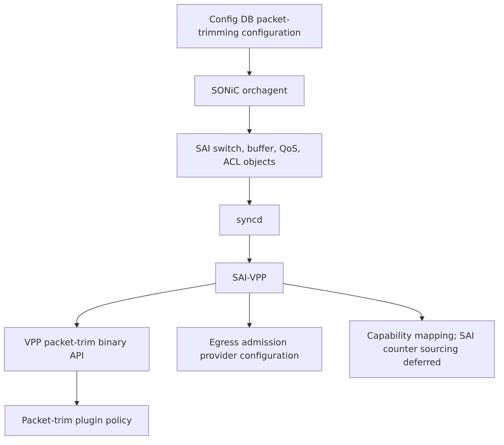

# SONiC-VPP Packet Trimming HLD

## Table of Contents

1. [Revisions](#1-revisions)
2. [Scope](#2-scope)
3. [Definitions](#3-definitions)
4. [Background](#4-background)
5. [Requirements](#5-requirements)
6. [Architecture](#6-architecture)
7. [High-Level Design](#7-high-level-design)
8. [SAI API Mapping](#8-sai-api-mapping)
9. [Configuration and Management](#9-configuration-and-management)
10. [Warmboot and Fastboot](#10-warmboot-and-fastboot)
11. [Memory and Performance](#11-memory-and-performance)
12. [Error Handling](#12-error-handling)
13. [Limitations and Future Work](#13-limitations-and-future-work)
14. [Testing](#14-testing)
15. [Open Items](#15-open-items)
16. [References](#16-references)

## 1. Revisions

| Rev | Date | Author(s) | Changes |
|---|---|---|---|
| v1.0 | 2026-07-31 | Aaron Bernardino | Initial SONiC-VPP packet-trimming design |
| v1.1 | 2026-08-26 | Aaron Bernardino | Document disabling / opt-out behavior (§9.1) |
| v1.2 | 2026-08-31 | Aaron Bernardino | Surface binary-admission and switch-wide-QoS limitations in summary (review: lolyu) |
| v1.3 | 2026-10-19 | Aaron Bernardino | Correct failed-SET rollback, unbound-map defaults, trim-size validation, and recovered policy-cache behavior |
| v1.4 | 2026-10-19 | Aaron Bernardino | Validate switch CREATE policy and modes, correlate trim SET replies, and distinguish internal ports from unresolved front-panel ports |
| v1.5 | 2026-10-26 | Aaron Bernardino | State shaped-queue consequences, omit unsourced trim stats, make global-disable cleanup order-independent, and separate historical PTF results from current component/CI evidence |
| v1.6 | 2026-10-30 | Aaron Bernardino | Document the candidate single-node trim path, downstream output continuation, merged tracing/counters, explicit-disable recovery, and current component-test evidence |

## 2. Scope

This document describes how SONiC-VPP relates to the existing
[SONiC Packet Trimming](../packet_trimming/packet-trimming-design.md) design,
and defines the dataplane architecture implementing it on VPP.

**Increment scope (this change).** A Gate 0 feasibility spike on the live VPP
KVM testbed (see [4. Background](#4-background)) established that the VPP
dataplane has no native egress QoS / queue-admission model, so a blocking SONiC
scheduler cannot by itself produce the admission failure that packet trimming
hangs off. Rather than defer the datapath, this increment **supplies the missing
substrate in software**: the `sonic_ext` VPP plugin gains a generic
per-`{egress port, queue}` token-bucket admission shim on the
`interface-output` feature arc, with a cold trim helper that truncates the
rejected packet, rewrites its DSCP, and retries it on the configured static trim
queue. The binary API accepts generic rate and capacity values, while the
delivered SAI-VPP translation intentionally programs only the two states needed
by the supported topology: an unlimited bucket for a queue with no effective
rate limit and an empty, non-refilling bucket for a queue with any nonzero
scheduler `PIR`. Buffer profiles determine trim eligibility; their size is not
used as bucket depth in this increment. The symmetric core has historical
end-to-end validation; the latest coordinated revisions have component and CI
coverage but still need fresh paired-image qualification
([14.2](#142-system-tests)). SAI-VPP advertises this bounded capability as
**supported**
(`SWITCH_TRIMMING_CAPABLE=true`), at which point the `sonic-mgmt` symmetric suite
runs.

**Candidate revision status (2026-10-30).** The single-node path described below
tracks [sonic-platform-vpp#329](https://github.com/sonic-net/sonic-platform-vpp/pull/329)
at `3d5634362e5cf08f454ad74f80e8b8cb2d1af64c`. Explicit-disable recovery tracks
[sonic-sairedis#2017](https://github.com/sonic-net/sonic-sairedis/pull/2017) at
`3767fa32574a154effd6649573d2c29ba5772c54`. These follow-up changes are under
review, not yet qualified as a paired SONiC image. Earlier implementations used
a separate trim node and arc-end reinjection; that is not the candidate design.

> **Maturity and key limitations (read first).** On VPP, packet trimming in this
> increment is **functionally demonstrated, not yet operationally useful under
> real congestion**, for two reasons that are load-bearing enough to state up
> front (both detailed in [13.2](#132-design-limitations)):
>
> 1. **Binary admission, not occupancy-driven.** The delivered SAI-VPP
>    translation programs each eligible queue's token bucket as either
>    always-admit or always-reject; there is no proportional rate or
>    buffer-occupancy modeling. Every nonzero scheduler `PIR` is treated as
>    blocking, including the test topology's `PIR=1`. With global trimming
>    enabled, **every IP admission attempt on a shaped, trim-eligible queue
>    rejects, even below the configured rate**. Packets larger than `trim_size`
>    lose their trailing payload; smaller packets keep their length but still
>    take the DSCP-rewrite/trim-queue path. Do not configure ordinary finite-rate
>    shapers on trim-eligible queues in this increment. Organic queue buildup
>    does not trigger admission failure
>    ([7.10](#710-scheduler-and-capacity-inputs)).
> 2. **Switch-wide QoS classification, not per-port.** Original-queue
>    classification uses a single switch-wide DSCP-to-queue table built from the
>    first port that has both QoS maps. This is correct only under uniform
>    per-port QoS and is **not safe for heterogeneous-QoS deployments**, where a
>    non-matching port can misclassify the original queue ([6.1](#61-control-plane-flow)).

The capability stays honest by narrowing *what* is advertised rather than gating
the switch capability off: SAI-VPP advertises only the enum values the datapath
honors (`DSCP_VALUE` DSCP resolution, `STATIC` queue resolution), so orchagent
never programs the asymmetric `FROM_TC` or `DYNAMIC` modes VPP does not implement.
Cases that exercise unimplemented behavior are deferred in `sonic-mgmt` through
conditional_mark skips keyed on `asic_type == vpp`. The shared `sonic-sairedis`
virtual-switch base over-advertises every trim enum today; that enum
over-advertisement is corrected on VPP. VPP also omits the eight unsourced trim
statistics from `queryStatsCapability` until scoped sourcing is implemented
(see [7.12](#712-capability-advertisement)).

The delivered increment covers:

- Translating the symmetric packet-trimming switch attributes into VPP state.
- Selecting eligibility from the buffer profile attached to the original queue.
- Classifying the original queue through a switch-wide DSCP-to-queue table.
- Producing a recoverable admission failure from the scheduler's binary
  blocked/unlimited state.
- Truncating eligible IPv4 and IPv6 packets and writing the configured symmetric
  DSCP value.
- Sending the shortened packet through a configured static trim queue on the
  selected physical egress member.

The full target design additionally includes asymmetric `FROM_TC`, dynamic
trim-queue resolution, ACL `DISABLE_TRIM`, SAI switch/port/queue counter
sourcing, and validated replay/persistence behavior. Those items are deferred
as listed in [13.1](#131-integration-status).

This document is a VPP platform adaptation. It does not redefine the existing
SONiC CLI, Config DB schema, YANG model, orchestration, or SAI contract.

The design does not support dynamic trim-queue resolution. That mode requires the
complete DSCP-to-TC-to-queue pipeline to select the trim queue after DSCP
remapping and is left for future work. The shared `sonic-sairedis` virtual-switch
base currently advertises the dynamic mode as supported; VPP advertises only the
`STATIC` mode it honors and omits `DYNAMIC` from the enum (see
[7.12](#712-capability-advertisement)).

## 3. Definitions

| Term | Meaning |
|---|---|
| Admission failure | The selected egress queue's admission provider rejects the packet. In the delivered VPP mapping this means the queue is trim-eligible and has a nonzero scheduler `PIR`, which is represented by an empty, non-refilling bucket |
| Original queue | The egress queue selected for the unmodified packet |
| Trim queue | The egress queue selected for the shortened packet |
| Trim attempt | An eligible original packet reaches the packet-trimming path after original-queue admission fails |
| Trimmed packet | A packet processed by the trim path, whether or not its original length exceeded the configured trim size |
| Admission provider | The VPP feature node that evaluates the programmed per-queue token-bucket state and diverts rejected buffers to packet-trimming policy |
| DSCP | Differentiated Services Code Point |
| TC | Traffic Class |
| LAG | Link Aggregation Group, represented by a VPP BondEthernet interface |
| SAI-VPP | The `sonic-sairedis` virtual switch implementation that translates SAI objects to VPP |
| VPP plugin | The SONiC-local VPP packet-trimming plugin and binary API |

## 4. Background

Packet trimming lets a receiver learn about congestion sooner than it would
after a complete packet drop and retransmission timeout. When admission to a
trim-eligible lossy queue fails, the switch:

1. Keeps at most the configured number of bytes.
2. Assigns a configured DSCP, or resolves DSCP from a configured trim TC.
3. Tries to transmit the shortened packet through a high-priority trim queue.

SONiC already provides the platform-independent control-plane implementation:

```text
CLI / Config DB
    |
    v
switchorch + bufferorch + qosorch + aclorch
    |
    v
SAI switch / buffer profile / QoS / ACL objects
    |
    v
syncd
    |
    v
platform SAI
```

The **pre-change SAI-VPP baseline** is important to state precisely, because the
control-plane capability already existed before this increment:

- The shared `sonic-sairedis` virtual-switch base already advertises full
  packet-trimming capability. It reports the switch, buffer-profile, and stats
  enum capabilities (DSCP `DSCP_VALUE`/`FROM_TC`, queue `STATIC`/`DYNAMIC`,
  buffer action `DROP`/`DROP_AND_TRIM`, and the switch/port/queue trim stats),
  and `SwitchVpp::queryAttributeCapability` reports every attribute as
  create/set/get implemented.
- As a result, `sonic-swss` already computed
  `isSwitchTrimmingSupported() == true` and published
  `SWITCH_CAPABILITY|switch:SWITCH_TRIMMING_CAPABLE=true` on VPP. The
  configuration path was functional at the virtual-object layer: switch,
  buffer-profile, QoS, and ACL objects were accepted and stored.
- What was missing was entirely below SAI: VPP performed no trimming, and the
  trim statistics read back as zero because the base returned no values for
  them.

VPP also has no native equivalent of
`SAI_BUFFER_PROFILE_PACKET_ADMISSION_FAIL_ACTION_DROP_AND_TRIM`.

Because capability was already advertised while the datapath did nothing, the
pre-change platform reported support it did not provide. A Gate 0 feasibility
spike on the live `vms-kvm-vpp-t1-lag` testbed confirmed *why* and established
the implementation direction:

- **Forwarding path (measured).** Front-panel transit egresses through
  `BondEthernetXXX` (mode `xor`, load-balance `l34-inner`) onto member
  interfaces that are **DPDK virtio** ports (`Red Hat Virtio`, one TX queue,
  4096 descriptors). SONiC `EthernetX` ports are VPP **Linux Control Plane
  (LCP) TAP** interfaces paired to those members. (An AF_PACKET
  `host-interface` backend exists in `vpp_init.sh` only for veth-based ports;
  this testbed presents virtio PCI, so it takes the DPDK path.)
- **No QoS / admission substrate (measured).** When this baseline was measured
  the running VPP graph had no policer (the CLI was not even compiled in), no
  scheduler, shaper, HQoS, or per-queue admission node, no per-queue buffer
  accounting, and no congestion/tail-drop counter in the transit path. There is
  no native equivalent of
  `SAI_BUFFER_PROFILE_PACKET_ADMISSION_FAIL_ACTION_DROP_AND_TRIM`. The CoPP
  feature has since enabled the native policer plugin and calls
  `vnet_police_packet()` from `sonic_ext` with per-worker counters, but that is a
  rate policer keyed per policer index (ACL or interface), whereas trim admission
  is keyed per egress `{port, queue}` off the scheduler `PIR`, and VPP still
  exposes no real queue-occupancy signal — so the small per-`{port, queue}`
  bucket remains the simplest fit. Converging trim admission onto the CoPP
  policer once it fits is tracked as future work
  ([13.2](#132-design-limitations)).
- **The SONiC scheduler is a dataplane no-op.** SAI-VPP stores the
  `SAI_SCHEDULER_GROUP` / `SAI_QUEUE` object model so orchagent is satisfied,
  but programs no VPP rate/shaper. The packet-trimming test creates congestion
  by binding a `PIR=1` blocking scheduler to a queue; on VPP that scheduler
  changes no dataplane state, so the "blocked" queue keeps forwarding at line
  rate. Without congestion there is no admission failure, so a trim action
  would never fire.

Consequently, real trimming on VPP first requires an egress per-queue admission
model that reacts to the SONiC scheduler state, so that a blocked queue can
produce a *cannot-admit* result. Rather than treat that as a separate
prerequisite, this design **provides it in software**: a generic
per-`{port, queue}` token-bucket admission shim on the `interface-output` arc
(see [7.1](#71-admission-provider)). The delivered SAI-VPP mapping represents
the test's nonzero `PIR` blocking scheduler with a zero-rate, zero-capacity
bucket, yielding a real, recoverable admission failure; a queue without a rate
limit receives an always-admitting bucket. The cold trim helper
([7.4](#74-truncation-and-header-handling)–[7.6](#76-static-trim-queue-and-retry))
hangs off that failure. Because the shim is generic — it carries no
packet-trimming SAI policy or test constants — it is the minimal substrate
needed and keeps the SONiC-specific logic in SAI-VPP and the plugin control path.

The SAI-VPP translation that drives this datapath is completed and validated for
the symmetric core, so the platform advertises packet trimming as *supported*
(`SWITCH_TRIMMING_CAPABLE=true`). To keep the advertisement honest, VPP corrects
the base's enum over-advertisement — narrowing the advertised trim enum values to
the modes the datapath honors (`DSCP_VALUE`, `STATIC`) so orchagent never
programs an unimplemented mode — rather than gating the switch capability off
(see [7.12](#712-capability-advertisement)).

## 5. Requirements

### 5.1 Functional Requirements

| ID | Requirement | Increment status |
|---|---|---|
| REQ-1 | VPP must trim only after admission to the original queue fails | Delivered |
| REQ-2 | Trimming eligibility must follow the buffer profile attached to the original queue | Delivered |
| REQ-3 | `DROP` must retain normal drop behavior; `DROP_AND_TRIM` must invoke trim policy | Delivered — a `DROP` (or unbound) queue is never made trim-eligible, so the shim does not police it and existing forwarding is unchanged; `DROP_AND_TRIM` marks the queue eligible and invokes trim policy |
| REQ-4 | The trim size must be runtime configurable | Delivered |
| REQ-5 | Symmetric mode must write the configured DSCP value | Delivered |
| REQ-6 | Asymmetric mode must resolve DSCP from the configured trim TC and the selected egress port's TC-to-DSCP map | Deferred |
| REQ-7 | The initial implementation must transmit through the configured static trim queue | Delivered |
| REQ-8 | ACL `DISABLE_TRIM` must suppress trimming for matching packets | Deferred |
| REQ-9 | A packet must enter the trim path no more than once | Delivered |
| REQ-10 | Trim attempts, successful trim transmissions, and trim-queue drops must be counted at the required SAI scopes | Plugin summary counters delivered; SAI scope attribution deferred |
| REQ-11 | LAG traffic must remain associated with the physical member selected before original-queue admission | Delivered |
| REQ-12 | A failed runtime VPP update must be surfaced without committing a failed SAI set; restore the previous policy and explicitly track an unsuccessful dataplane rollback | Delivered for set; create refresh is best effort |

### 5.2 Non-Functional Requirements

- No per-packet heap allocation is allowed in the dataplane path.
- Packet trimming must be inactive when no eligible buffer profile is bound.
- Existing forwarding behavior must remain unchanged while the feature is
  disabled.
- The admission integration point must be generic and must not contain SONiC
  SAI policy.
- The design must not depend on scheduler names, a particular configured rate,
  or constants from the packet-trimming test suite.
- Capability advertisement must reflect only functionality that is initialized
  and usable at runtime.

### 5.3 Non-Goals

- Changes to the generic packet-trimming Config DB schema or CLI.
- A new SONiC application extension.
- Full hardware-MMU emulation in VPP.
- Dynamic trim-queue resolution in the initial implementation.
- Recalculation of IP or transport length and checksum fields after truncation.
- Replacing VPP's existing forwarding, LAG hashing, QoS, or ACL architecture.

## 6. Architecture

> **Scope note.** Sections [6](#6-architecture)–[9](#9-configuration-and-management)
> describe both the full target architecture and the delivered symmetric core.
> Status labels in the detailed sections are authoritative. The delivered path
> is the software admission shim, symmetric DSCP rewrite, static trim queue,
> binary API/CLI, and SAI-VPP programming historically demonstrated end to end. Deferred behavior
> is summarized in [13](#13-limitations-and-future-work).

### 6.1 Control-Plane Flow

<p align="center">
  
</p>

SAI-VPP owns object relationships and translates the platform-independent SAI
contract into compact VPP policy:

- Global trim size, symmetric DSCP value, and static trim queue. The DSCP mode
  and TC value are stored, but `FROM_TC` is not honored in this increment.
- Effective eligibility for each `{egress port, original queue}` pair.
- A switch-wide DSCP-to-queue table composed from the first front-panel port
  that has both `DSCP_TO_TC` and `TC_TO_QUEUE` maps.
- Binary blocked/unlimited admission state derived from the effective scheduler.

Composing one switch-wide DSCP-to-queue table from a single port assumes uniform
per-port QoS. This is **not safe for heterogeneous-QoS deployments**: on a port
whose maps differ from the chosen reference port, original-queue classification
can be wrong. It is masked on the uniform testbed today because a misclassified
queue changes behavior only when it is both trim-eligible and blocking
([13.2](#132-design-limitations)).

ACL trim-disable programming, per-port TC-to-DSCP resolution, and SAI trim
counter sourcing are deferred.

### 6.2 Dataplane Flow

<p align="center">
  
</p>

<p align="center"><sub>Green = symmetric candidate path &nbsp;·&nbsp; dashed amber = deferred target design. Each block is annotated with its step and behaviour; open the PNG for full resolution.</sub></p>

This flowchart shows the candidate path and target extensions; **dashed amber nodes mark elements
deferred in this increment** (see the diagram legend). Specifically, the ACL
trim-disable gate and the asymmetric-DSCP (`FROM_TC`) alternative are deferred:
the datapath applies the symmetric `DSCP_VALUE` only and does not yet honor an
ACL trim-disable flag ([7.5](#75-dscp-resolution), [7.9](#79-acl-disable-trim),
[13.1](#131-integration-status)). Trim eligibility itself (buffer profile
`DROP_AND_TRIM`) is delivered. Counters in the diagram are switch-global
plugin summaries; per-port/per-queue SAI attribution remains target design
([7.11](#711-counters)). A non-eligible or unconfigured queue is never policed
by the shim: it follows the normal downstream feature chain without an
original-packet admission drop. Both admitted and successfully trimmed packets
continue that chain; the trim helper does not dispatch to a separate graph node
or restart the feature arc.

### 6.3 Component Responsibilities

| Component | Responsibility |
|---|---|
| VPP admission/trim output feature | One `interface-output` node resolves eligibility and runs generic per-`{port, queue}` token buckets; its cold helper handles private-chain copying, DSCP rewrite, truncation, and static trim-queue admission, then continues downstream features |
| VPP packet-trim control | Global and per-queue policy state, counters, binary API, and debug CLI; no SAI attribute names or scheduler test constants in the dataplane |
| SAI-VPP | Translate the delivered symmetric policy onto the plugin: global size/DSCP/static queue, per-queue eligibility from the buffer profile, binary blocked/unlimited state from the scheduler, and a switch-wide DSCP-to-queue table. Advertise only `DSCP_VALUE` and `STATIC`, omit unsourced trim stats, and leave scoped sourcing and the asymmetric/ACL modes deferred |
| sonic-swss | No VPP-specific change expected; the generic packet-trimming orchestration and capability publication already function on VPP |
| sonic-mgmt | Make the test setup self-sufficient on the minimal VPP config, clean up test-created buffer bindings/profiles, exempt VPP from the hardware-SKU gate, and skip deferred files/cases on `asic_type == vpp` ([14.2](#142-system-tests), [14.3](#143-enablement-gating)) |

## 7. High-Level Design

### 7.1 Admission Provider

Packet trimming needs a point where an egress packet can be *recoverably*
rejected — rejected while VPP still owns the buffer, so the trim action can run
instead of the packet being freed. VPP has no such point natively, so the plugin
provides one as a software admission shim.

**`sonic-ext-trim-admission`** is a feature node on the `interface-output` arc,
enabled per egress `sw_if_index` whenever that port has at least one
trim-eligible queue. For each packet it resolves the egress `{port, queue}` — the
queue from the packet DSCP via the SAI-pushed DSCP-to-queue table — and runs that
queue's software token bucket:

| Result | Meaning | Action |
|---|---|---|
| Non-eligible / unconfigured queue | not policed | pass straight through the arc (normal traffic is never perturbed) |
| Eligible queue, bucket admits | within rate | continue the arc (normal egress) |
| Eligible queue, bucket rejects | recoverable admission failure | call the cold trim helper in the same node ([7.4](#74-truncation-and-header-handling)) |

The node calls `vnet_feature_next()` exactly once per packet, before admission
checks or copying. A rejected packet enters a `noinline`, cold helper behind the
unlikely admission-failure branch. Success uses the already-resolved downstream
next; neither a trim-only graph detour nor a second admission dispatch is needed.
The node runs before `sonic-ext-egress-mirror`, so that feature sees the final
trimmed packet. Future output features still require explicit ordering and
focused composition tests.

The plugin API and token-bucket implementation accept generic rate/capacity
inputs. The delivered SAI-VPP translation deliberately binarizes them: a queue
with no effective rate limit receives `UINT64_MAX` rate and capacity (always
admit), while any nonzero scheduler `PIR` — including the
`SCHEDULER_BLOCK_DATA_PLANE` profile's `PIR=1` — receives zero rate and capacity
(always reject). The attached buffer profile controls only whether the queue is
trim-eligible; its size does not set the bucket depth in this increment. The
plugin recognizes no scheduler names or test constants, and non-eligible queues
are never policed.

Because the shim is a normal feature-arc node, no VPP core change is required for
the KVM DPDK-virtio backend. Backends that cannot be policed on the
`interface-output` arc (for example the AF_PACKET `host-interface` path) would
reuse the same generic node at their own pre-transmit point.

### 7.2 Packet-Trim Policy State

The VPP plugin maintains:

- One global packet-trimming configuration.
- One eligibility record per effective egress-port/original-queue binding.
- One switch-wide DSCP-to-queue table used for original-queue classification.
- Three switch-global summary counters: admission failures, trimmed packets
  sent, and trimmed packets dropped.

Per-port TC-to-DSCP state for `FROM_TC` and per-port/per-queue counter
attribution are target behavior, not delivered state.

The global configuration contains:

| Field | Meaning |
|---|---|
| `trim_size` | Maximum number of bytes retained |
| `dscp_mode` | Only symmetric `DSCP_VALUE` (wire value 0) is accepted |
| `dscp_value` | Symmetric DSCP value |
| `trim_tc` | Stored TC for the deferred asymmetric egress-map lookup |
| `trim_queue` | Queue index used for the shortened packet |

An eligibility record is active only when the queue's effective buffer profile
uses `DROP_AND_TRIM`.

### 7.3 Original-Queue Admission Failure

On a recoverable admission failure, the admission node has resolved:

- The buffer index.
- The final physical egress `sw_if_index` (`VLIB_TX`).
- The original queue index (kept in local state and the combined trace).
- That the queue is trim-eligible.

The plugin calls the cold trim helper only when the global configuration is
valid and the original queue is trim-eligible and rejects admission. Otherwise,
the packet continues along the normal output arc. The helper is an ordinary
function call within that feature invocation, not another graph dispatch:
successful trimmed packets continue downstream without returning to admission
or carrying a per-buffer marker
([7.6](#76-static-trim-queue-and-retry)).

The target ACL-driven trim-suppression path would add a per-buffer flag to this
decision. It is not present in the delivered node
([7.9](#79-acl-disable-trim)).

### 7.4 Truncation and Header Handling

When a packet is longer than `trim_size`, VPP shortens the buffer chain to at
most `trim_size` bytes, freeing any tail buffers in a chained packet. When a
packet is shorter than or equal to `trim_size`, it is sent at its original
length. In both cases the packet is processed by the trim path and receives the
configured DSCP behavior.

**Multi-segment (jumbo) buffers.** On the KVM/DPDK backend, jumbo frames arrive
scatter-gathered into a chain of VLIB buffers, each backed by a DPDK `rte_mbuf`
(the `interface-output` arc runs with `VLIB_BUFFER_EXT_HDR_VALID` set on RX
buffers). Truncating the chain clears the VLIB `VLIB_BUFFER_NEXT_PRESENT` flag
and frees the tail buffers, but that alone does **not** update the backing
`rte_mbuf`: it still carries the RX-time `nb_segs` and a `->next` pointer to the
now-freed tail segment. `dpdk_validate_rte_mbuf()` only rebuilds the mbuf header
(via `rte_pktmbuf_reset()`, which sets `next = NULL` and `nb_segs = 1`) when
`EXT_HDR_VALID` is clear, and the virtio PMD TX path walks `mb->next` until NULL
rather than trusting `nb_segs`. Without intervention the freed tail therefore
rides onto the wire — a 5000-byte frame trimmed to 256 was observed egressing as
256 + 952 = 1208 bytes. The trim path fixes this by clearing
`VLIB_BUFFER_EXT_HDR_VALID` on the severed segment, forcing the mbuf header to be
rebuilt cleanly so only the retained bytes are transmitted. This case is covered
end to end by `test_packet_size_after_trimming` (jumbo 5000 → 4084 and a second
multi-segment case, 3000 → 256).

The trim path deliberately preserves the original L3/L4 length fields as the
congestion signal — it does **not** recalculate:

- IPv4 total length (the header still reports the pre-trim length).
- IPv6 payload length.
- TCP or UDP length and checksum fields.

The one field that *is* updated is the **IPv4 header checksum**, and only because
the DSCP rewrite ([7.5](#75-dscp-resolution)) changes the ToS byte: the checksum
is recomputed over the 20-byte header so the header stays valid after the DSCP
change, while the (deliberately unmodified) total-length field is unaffected. The
IPv4 header checksum covers only the header, so leaving the truncated payload out
does not invalidate it; IPv6 carries no header checksum. This matches the
existing SONiC packet-trimming validation contract, which inspects the preserved
length fields together with the rewritten DSCP.

### 7.5 DSCP Resolution

For IPv4, VPP rewrites the six DSCP bits in the Type of Service field while
preserving ECN bits. For IPv6, VPP rewrites the DSCP portion of Traffic Class
while preserving ECN bits.

| Mode | Resolution |
|---|---|
| `DSCP_VALUE` | Use the global configured `dscp_value` |
| `FROM_TC` (deferred) | Use `trim_tc` to look up DSCP in the TC-to-DSCP map attached to the selected egress port |

The delivered datapath implements **only** the symmetric `DSCP_VALUE` mode and
always rewrites with the global `dscp_value`; asymmetric `FROM_TC` is deferred
and omitted from the advertised DSCP-resolution enum
([7.12](#712-capability-advertisement), [13.1](#131-integration-status)), so
orchagent never programs it. The `FROM_TC` behavior below is the target design
for a future increment: if asymmetric mode has no usable egress map entry, the
trim operation fails, the packet is dropped, and a configuration/runtime error
counter is incremented. SAI-VPP should reject configurations that are invalid at
programming time.

### 7.6 Static Trim Queue and Retry

The initial implementation uses
`SAI_PACKET_TRIM_QUEUE_RESOLUTION_MODE_STATIC`.

Before mutation, a buffer chain with any shared segment is copied into private
buffers, so truncating one multicast/replicate clone cannot change a sibling's
data or chain links. If that allocation fails, the packet is dropped with a
dedicated node error and increments `trim_drop`.

The cold trim helper in the admission node:

1. Rewrites the packet DSCP ([7.5](#75-dscp-resolution)) and truncates it
   ([7.4](#74-truncation-and-header-handling)).
2. Steers the shortened packet to the configured static `trim_queue` on the **same** physical
   egress interface (`VLIB_TX` is unchanged) and runs that queue's token bucket.
3. If the trim queue admits, returns to the same node's enqueue path, which
   continues to the previously resolved downstream output feature. If the trim
   queue's programmed admission bucket rejects, the packet is dropped.

Under the binary mapping, any nonzero effective `PIR` on the destination trim
queue drops every arriving trimmed copy, even if that queue is not itself
`DROP_AND_TRIM`-eligible. The destination bucket is checked independently of
eligibility ([7.10](#710-scheduler-and-capacity-inputs)).

The one-shot guarantee is **structural**: trimming happens within the current
feature invocation, with no reinjection or re-entry. No trim marker, original
queue sideband, or trim-owned sideband reference is needed. The ordinary VPP
feature cursor is advanced once and explicitly copied to a private chain because
`vlib_buffer_copy()` does not preserve `current_config_index`. Both the frame's
buffer index and the local buffer pointer are replaced before downstream
enqueue. The original queue stays in the combined trace, not per-buffer storage.

### 7.7 Physical Ports and LAGs

For a physical-port egress, the trim retry uses the same physical interface.
For VLAN/sub-interface egress, both admission lookups resolve the parent hardware
interface, where SAI programs the queue policy. `VLIB_TX` remains unchanged so
the VLAN rewrite and transmit path retain the original egress identity.
Deleting an interface clears its stored trim buckets and feature-enabled latch
so a recycled `sw_if_index` cannot inherit stale policy.

For a LAG egress, VPP bond selection occurs before queue admission. The
admission provider records the selected physical member. The trim retry uses
that member directly instead of re-entering bond hashing, which:

- Keeps the original and trimmed packet on one physical port; future
  per-port/per-queue counter sourcing can therefore use that member.
- Avoids moving a congestion notification to a different LAG member.
- Prevents a second flow-hash decision from changing packet ordering.

The delivered plugin records the selected physical `VLIB_TX` member. SAI
port/queue trim counters are not sourced yet; the target attribution is the
physical member and its queues.

### 7.8 Buffer Profile and Queue Relationships

SAI-VPP tracks the object chain from a queue to its attached buffer profile.
Whenever the queue binding or
`SAI_BUFFER_PROFILE_ATTR_PACKET_ADMISSION_FAIL_ACTION` changes, SAI-VPP
recomputes and programs effective eligibility.

Because sonic-vpp creates front-panel ports dynamically as orchagent brings the
switch up — not at switch-create time — SAI-VPP enumerates the ports to program
from the live SAI port-object store on each recompute, rather than from a port
list captured at initialization. A recompute therefore always covers every
front-panel port that currently exists, including ports created after the first
trim-relevant attribute was observed, and a late buffer-profile binding is picked
up by the next recompute rather than being missed.

On a trim-relevant set, SAI-VPP stages the candidate attribute and policy, then
rebuilds and pushes the complete eligibility state. Only a successful push commits
the attribute and object relationships. On failure, SAI-VPP restores the previous
attribute and cached policy and reprograms the previous VPP state. An unsuccessful
rollback is logged and marked pending; the next trim-relevant set must reconcile
that state before applying another change. This preserves metadata's
success-only reference bookkeeping and does not assume orchagent retries a
generic SAI failure. On non-switch create, the object is committed and the trim
refresh is best effort; a failed refresh is logged and marks reconciliation
pending before the next trim-relevant set. Normal orchagent remove
sequencing first unbinds a profile or scheduler through a set (which refreshes
eligibility), then removes the now-unreferenced object; direct object removal
does not itself trigger a trim refresh ([7.13](#713-update-and-remove-ordering)).

### 7.9 ACL Disable Trim

> **Status: deferred (target design).** The ACL trim-disable path is not
> implemented in this increment; SAI-VPP accepts and stores the ACL objects as
> virtual state but does not yet program a per-buffer trim-disable flag into the
> VPP datapath. The `sonic-mgmt` `test_acl_action_with_trimming` case is skipped
> on `vpp` ([14.3](#143-enablement-gating)). The design below is the target for a
> future increment ([13.1](#131-integration-status)).

SAI-VPP extends the existing VPP ACL translation for
`SAI_ACL_ENTRY_ATTR_ACTION_PACKET_TRIM_DISABLE`.

A matching ACL rule sets a per-buffer `trim_disabled` flag. The flag is metadata
only and does not change the packet action by itself. If original-queue admission
later fails, trim policy observes the flag and follows normal drop behavior.

The target implementation must use the same explicit failure propagation and
state-consistency model as other trim-relevant updates.

### 7.10 Scheduler and Capacity Inputs

The plugin admission API supports a byte rate and byte capacity, but the
delivered SAI-VPP translation does not model proportional scheduling or derive a
capacity from the buffer profile. It resolves the queue's effective scheduler
(direct queue binding first, then the parent leaf scheduler group used by
QosOrch) and programs one of two states:

| Effective scheduler | Programmed rate | Programmed capacity | Behavior |
|---|---:|---:|---|
| No scheduler or `MAX_BANDWIDTH_RATE=0` | `UINT64_MAX` | `UINT64_MAX` | Always admit |
| Any nonzero `MAX_BANDWIDTH_RATE` | `0` | `0` | Always reject when trim-eligible |

Any nonzero effective `PIR`, whether bound directly or through a parent
scheduler group, therefore rejects every eligible IP admission attempt, not
only traffic above that rate. Larger packets lose trailing payload through
trimming; packets at or below `trim_size` still take the rewrite/trim-queue
path. A rejecting destination trim queue drops the copy
([7.6](#76-static-trim-queue-and-retry)).

The buffer profile contributes only
`PACKET_ADMISSION_FAIL_ACTION=DROP_AND_TRIM` eligibility. Modeling a
proportional sub-line-rate `PIR`, actual queue occupancy, or buffer-profile
capacity as token-bucket depth is future work.

Full SAI scheduler hierarchy, shared-buffer accounting across ports, headroom,
and hardware-specific threshold behavior remain outside this design.

### 7.11 Counters

The VPP plugin currently maintains three switch-global summary counters and
exposes them through `sonic_ext_trim_counters_get` and `show sonic-ext trim`:

- `trim_admit_fail` — eligible original-queue admission failures.
- `trim_sent` — shortened packets transmitted.
- `trim_drop` — trim attempts dropped because the trim queue rejected the packet
  or a shared buffer chain could not be copied safely.

Per-node counters now reside under `sonic-ext-trim-admission`: admitted,
bypassed, admission-failed/trim-attempted, trim-sent, trim-queue-dropped, and
private-copy-allocation-failed packets. A single trace entry records the original
queue, admission decision, trim queue/size/DSCP, and final outcome. The separate
trim-node counter paths and runtime profile no longer exist; the three API/CLI
summary counters above are unchanged.

The **target** design adds the per-port/per-queue accounting needed to map these
events onto the existing SAI statistics and serve them from `getStatsExt`:

| Event | Counter attribution |
|---|---|
| Eligible original-queue admission failure | `TRIM_PACKETS` on the original queue and physical egress port |
| Trim packet transmitted | `TX_TRIM_PACKETS` on the switch, physical egress port, and trim queue |
| Trim-queue admission failure | `DROPPED_TRIM_PACKETS` on the switch, physical egress port, and trim queue |

Counter reads must be monotonic and safe while workers update them, and a clear
operation resets only the requested scope and statistics.

The target queue-index attribution must match the `sonic-mgmt` counter
assertions: the suite verifies that the switch-level trim-sent counter equals the
sum of the per-port counters and that each port's counter is consistent with its
per-queue counters, and the feature-toggle test reads the queue-level
`trimpacket` counter on the *trim* queue index (`UC` + configured trim queue).

**Delivered scope (initial enablement).** The global plugin summaries are
available through the binary API/CLI, but SAI-VPP does **not** source them
through `getStatsExt`, and the plugin does not yet maintain the per-port and
per-queue breakdown required by the SAI contract. VPP's `queryStatsCapability`
omits all eight switch/port/queue trim-stat IDs rather than advertising zeros
as implemented statistics. Direct trim-stat reads still delegate to the shared
virtual-switch base and return zero; capability narrowing does not implement
sourcing. SAI scoped accounting is deferred, and the `sonic-mgmt` trim-counter
cases are skipped on `vpp`.

### 7.12 Capability Advertisement

Packet-trimming capability on VPP must track the datapath: `sonic-swss` must be
told which trim modes VPP can actually satisfy so orchagent never programs one it
cannot. The shared virtual-switch base advertises packet trimming on VPP:

- `SwitchStateBase::queryAttrEnumValuesCapability` returns the DSCP modes
  (`DSCP_VALUE`, `FROM_TC`), the queue modes (`STATIC`, `DYNAMIC`), and the
  buffer-profile action modes (`DROP`, `DROP_AND_TRIM`).
- `SwitchStateBase::queryStatsCapability` lists the switch, port, and queue trim
  stats as supported.
- `SwitchVpp::queryAttributeCapability` reports every switch trim attribute as
  create/set/get implemented.

Together these make `sonic-swss` publish `SWITCH_TRIMMING_CAPABLE=true`. The
initial enablement **keeps** trimming advertised as supported — the symmetric
datapath is wired and validated ([13.1](#131-integration-status)) — but narrows
the advertised *enum values* and statistics to what VPP implements:

| Seam | Delivered behavior |
|---|---|
| `SwitchVpp::queryAttributeCapability` | Inherits the base: the six `SAI_SWITCH_ATTR_PACKET_TRIM_*` attributes (size, DSCP mode, DSCP value, TC value, queue mode, queue index) stay create/set/get implemented, so `sonic-swss`'s `isSwitchTrimmingSupported()` follows the `set` capability and `SWITCH_TRIMMING_CAPABLE` is `true` |
| `SwitchVpp::queryAttrEnumValuesCapability` | Overrides the base to advertise a single value per trim enum — `DSCP_VALUE` for `SAI_SWITCH_ATTR_PACKET_TRIM_DSCP_RESOLUTION_MODE` and `STATIC` for `SAI_SWITCH_ATTR_PACKET_TRIM_QUEUE_RESOLUTION_MODE` — so orchagent never programs the asymmetric `FROM_TC` or `DYNAMIC` modes VPP does not implement. `DROP`/`DROP_AND_TRIM` buffer-profile actions are left to the base metadata |
| `SwitchVpp::queryStatsCapability` | Filters the two switch, three port, and three queue trim-stat IDs listed in [8.3](#83-statistics). Preserves every non-trim entry and its mode bits, applying the caller's capacity/overflow contract after filtering. Shared non-VPP VS behavior is unchanged |

Advertising the capability is intentional for VPP's role as a software test
platform; the operational limits this advertisement does not itself convey —
trimming is functionally demonstrated, not yet useful under real congestion — are
stated in the "Maturity and key limitations" callout in [§2](#2-scope).

Because the capability stays `true`, the symmetric `packet_trimming` PTF suite
runs on sonic-vpp. Cases that exercise unimplemented behavior — asymmetric
per-port DSCP (`FROM_TC`), `DYNAMIC` queue resolution, ACL disable-trim, trim
counters, GCU config validation, feature/port toggles, port mirroring, SRv6, and
reload/reboot persistence — are deferred in `sonic-mgmt` through
conditional_mark skips keyed on `asic_type == vpp`
([14.3](#143-enablement-gating)), rather than by gating the switch capability to
`false`. This keeps the supported symmetric core enabled while excluding the
out-of-scope cases from the run.

The enum-advertisement decision is factored into a small pure predicate
(`SwitchVpp::getTrimEnumValuesCapability`) that the override calls, so it is
covered directly by a SAI-VPP unit test. Tests of the actual stats-capability
override cover null-list sizing, undersized, exact-sized, and oversized buffers
for all three object types ([14.1](#141-unit-and-component-tests)).

### 7.13 Update and Remove Ordering

For set operations on a trim-relevant object, SAI-VPP:

1. Receives the metadata-validated SAI attribute and resolves available object
   references.
2. Validates the candidate global policy, including the trim-size and six-bit
   DSCP ranges, before changing state or invoking VPP.
3. Stages the candidate attribute and cached policy, retaining the previous
   values. Object relationships still refer to the committed state.
4. Pushes the global policy or full per-`{port, queue}` state and classifier.
   Success commits the attribute and relationships. Failure restores the
   previous local values and re-sends the previous policy to undo partial VPP
   updates before returning the original error.
5. If that rollback also fails, logs and retains a pending-reconciliation flag.
   The next trim-relevant set, except an explicit global disable, first re-sends
   the committed policy; it cannot commit another change while reconciliation
   fails.

The queue sweep stops at the first failed VPP queue API call instead of issuing
another blocking request for every remaining queue and the classifier.
Rollback/reconciliation retains the same fail-fast behavior. This removes
queue-count-dependent timeout amplification; it is not a transaction-wide
deadline.

No automatic orchagent retry of a generic SAI failure is assumed. Local state
remains consistent with metadata even when the VPP connection is unavailable.
Reconciliation is event-driven; there is no timer-driven retry.

**Explicit-disable recovery.** Setting `SAI_SWITCH_ATTR_PACKET_TRIM_SIZE` to
`0` can disable a broken enabled policy without replaying that policy first.
The supported operator sequence is **disable, repair the QoS configuration, then
re-enable**. A successful disable requires both global disabled-policy
programming and cleanup of all eight supported queue slots on every resolved
front-panel port. Unresolved ports or VPP failures remain errors; a failed
disable follows the normal rollback/reconciliation path rather than silently
clearing pending state for an incompletely disabled policy.

Switch CREATE validates and accumulates the whole policy before programming it,
including the disabled default when no trim attributes are supplied. This reset
must succeed even after a previous failed CREATE has discarded its switch state
and pending-rollback flag. Success commits the attributes; failure restores the
previous attributes and policy and attempts dataplane rollback. A failed switch
CREATE also releases the switch state and allocated ID, allowing a clean retry.
Other object creates retain best-effort trim refresh. A failed refresh logs and
marks reconciliation pending, while CREATE remains successful.

After a prior enabled sweep, global disable clears all eight supported queue
slots on each resolved front-panel port without depending on retained queue,
profile, scheduler, or classifier metadata. Cleanup is armed before an enabled
sweep can partially program queues, and stays armed until a disabled sweep
succeeds. Cleanup failures participate in the same rollback/reconciliation
path. Fresh/default-off CREATE and ordinary changes while off do not sweep
queues; re-enable rebuilds current bindings
([9.1](#91-disabling-and-opting-out)).

The three trim SET binary APIs use generation-tagged request contexts. Contexts
are released on reply or timeout, and expired replies cannot complete a newer
request, including a rollback.

Admission and classifier refresh explicitly exclude CPU, fabric, and recycle
ports by `SAI_PORT_ATTR_TYPE`. Logical front-panel ports use the existing
lane-aware resolver if their registry entry is not yet present. An unresolved
front-panel port is reported as a programming failure, not silently treated as
an internal port.

For remove operations, the generic `remove_internal` path removes only the
virtual object state and does not invoke a trim refresh. Normal orchagent
sequencing must first unbind trim-relevant references through a set operation,
which refreshes the VPP policy, and then remove the unreferenced object.

## 8. SAI API Mapping

### 8.1 Switch Attributes

| SAI attribute | VPP mapping |
|---|---|
| `SAI_SWITCH_ATTR_PACKET_TRIM_SIZE` | Global `trim_size` |
| `SAI_SWITCH_ATTR_PACKET_TRIM_DSCP_RESOLUTION_MODE` | Only `DSCP_VALUE` is advertised and accepted; `FROM_TC` is rejected on CREATE and SET before mutation or programming |
| `SAI_SWITCH_ATTR_PACKET_TRIM_DSCP_VALUE` | Symmetric DSCP value in the range 0-63; invalid values are rejected on CREATE and SET before mutation or programming |
| `SAI_SWITCH_ATTR_PACKET_TRIM_TC_VALUE` | Stored for the deferred asymmetric path; not used by the symmetric trim helper |
| `SAI_SWITCH_ATTR_PACKET_TRIM_QUEUE_RESOLUTION_MODE` | Accept `STATIC`; reject `DYNAMIC` on CREATE and SET before changing state or calling VPP. Only `STATIC` is advertised ([7.12](#712-capability-advertisement)) |
| `SAI_SWITCH_ATTR_PACKET_TRIM_QUEUE_INDEX` | Global static trim queue in the range 0-7; the plugin rejects an unsupported queue without changing the previous policy. The validated configuration uses queue 6 |

### 8.2 Buffer Profile and ACL

| SAI attribute/action | VPP mapping |
|---|---|
| `SAI_BUFFER_PROFILE_ATTR_PACKET_ADMISSION_FAIL_ACTION=DROP` | Disable trim eligibility for queues using the profile |
| `SAI_BUFFER_PROFILE_ATTR_PACKET_ADMISSION_FAIL_ACTION=DROP_AND_TRIM` | Enable trim eligibility for queues using the profile |
| `SAI_ACL_ENTRY_ATTR_ACTION_PACKET_TRIM_DISABLE` | **Deferred** — the ACL trim-disable path is not implemented in this increment ([7.9](#79-acl-disable-trim), [13.1](#131-integration-status)); the corresponding `sonic-mgmt` case is skipped on `vpp` |

### 8.3 Statistics

The shared virtual-switch base lists the trim statistics below, but the VPP
override **omits all eight from `queryStatsCapability`** until scoped sourcing
is implemented. The plugin exposes global summaries through its binary API and
debug CLI; **SAI sourcing through `getStatsExt` is deferred**
([7.11](#711-counters), [13.1](#131-integration-status)). Direct requests still
delegate to the base's zero values, so they are not a source of real trim
counts. The `sonic-mgmt` trim-counter cases remain skipped on `vpp`.

- `SAI_SWITCH_STAT_DROPPED_TRIM_PACKETS`
- `SAI_SWITCH_STAT_TX_TRIM_PACKETS`
- `SAI_PORT_STAT_TRIM_PACKETS`
- `SAI_PORT_STAT_DROPPED_TRIM_PACKETS`
- `SAI_PORT_STAT_TX_TRIM_PACKETS`
- `SAI_QUEUE_STAT_TRIM_PACKETS`
- `SAI_QUEUE_STAT_DROPPED_TRIM_PACKETS`
- `SAI_QUEUE_STAT_TX_TRIM_PACKETS`

No SAI API change is required.

## 9. Configuration and Management

This design introduces no new CLI, Config DB, APP DB, State DB, YANG, REST, or
gNMI schema. SONiC-VPP uses the configuration and capability fields defined by
the generic packet-trimming HLD.

The VPP plugin adds `show sonic-ext trim`, which reports:

- The current global trim configuration.
- Configured per-port/per-queue admission buckets, including eligibility,
  binary rate/capacity, and current tokens.
- The three global plugin counters (`sent`, `drop`, and `admit-fail`).

The CLI does not expose per-port TC-to-DSCP resolution or SAI-scoped counters in
this increment.

These commands are for serviceability and do not replace the standard SONiC CLI.

### 9.1 Disabling and Opting Out

Packet trimming is opt-in and disabled by default; it cannot perturb normal
forwarding unless explicitly configured. Five levels of control exist, from
automatic to coarse:

1. **Default off.** The `sonic-ext-trim-admission` feature node is registered on
   the `interface-output` arc but is enabled on no interface at initialization
   ([7.1](#71-admission-provider)). Until a queue is bound to a `DROP_AND_TRIM`
   buffer profile ([7.8](#78-buffer-profile-and-queue-relationships)), the arc is
   enabled on no port and there is zero incremental trim datapath cost.
2. **Per-port/per-queue eligibility.** The arc is
   enabled on a port only while that port has at least one trim-eligible queue.
   Removing eligibility from a port's last eligible queue — by unbinding or
   changing that queue's `DROP_AND_TRIM` buffer-profile binding via SAI SET —
   tears the arc back down and returns the port to zero incremental cost while
   trimming is enabled. Profiles do not need to be removed before global
   disable; control 3 performs independent cleanup.
3. **Global off with structural cleanup.** Setting `SAI_SWITCH_ATTR_PACKET_TRIM_SIZE`
   to `0` clears the global policy (`trim_configured = 0`), after which no packet
   is trimmed switch-wide. If queues were previously armed, SAI-VPP then clears
   effective eligibility for all eight supported slots on each resolved
   front-panel port. The plugin detaches the arc when the last eligible slot is
   cleared, independently of profile-unbind ordering. Success requires cleanup
   to succeed; a failed SET follows rollback and pending reconciliation
   ([7.13](#713-update-and-remove-ordering)). Later changes while off do not
   reattach features, and re-enable resolves the retained current bindings.
   A fresh/default-off switch does not perform this queue sweep.
   This explicit disable remains available while reconciliation is pending,
   without first replaying a broken enabled policy.
4. **Trim-specific runtime off switch.** Packet trimming is registered in the
   plugin's generic per-feature control registry (`foreach_sonic_ext_feature`),
   so `sonic-ext { trim disable }` in `startup.conf` — and the matching
   `show sonic-ext` readout — force the admission node off independently of SAI
   and without disturbing the other `sonic_ext` features. The admission node
   self-gates on this toggle and bypasses at its first per-packet check when it
   is cleared. The registry entry defaults enabled, so trimming stays opt-in
   through the SAI global policy (control 3) rather than through this toggle; the
   switch is a deterministic operator override that takes trimming out of the
   datapath regardless of SAI state.
5. **Whole-plugin disable.** VPP's generic plugin loader honors
   `plugin sonic_ext_plugin.so { disable }` in `startup.conf`, which removes the
   entire `sonic_ext` plugin and all trim behavior. This is a coarse control that
   also disables the plugin's other functions and is not trim-specific.

The per-feature registry toggle above is the trim-specific *runtime* control;
there is no packet-trim-specific *compile-time* flag, as the trim sources are
compiled unconditionally into `sonic_ext_plugin.so`.

## 10. Warmboot and Fastboot

Reload, warmboot, and fastboot persistence are **not validated in this
increment**; `test_trimming_with_reload_and_reboot` and
`test_trimming_during_warm_reboot` are skipped on `vpp`. The latter requires
uninterrupted trimming during warm reboot, which the VPP platform does not support.

The warm constructor rebuilds the cached global policy from recovered switch
attributes, validating the trim size without issuing per-attribute API calls.
A subsequent DSCP-only update therefore preserves the recovered enable state,
size, TC, and trim queue. This cache behavior has focused unit coverage; it does
not establish full reboot or dataplane-persistence support.

The target replay behavior is that switch attributes, queue/profile bindings,
scheduler bindings, and QoS maps trigger the same full-state programming used
at runtime. ACL trim-disable state is deferred and therefore is not rebuilt.
Plugin counters and token-bucket state are process-local and reset when VPP
restarts; no SAI counter persistence is provided. A packet in flight during a
restart may be dropped.

The implementation adds no sleeps or file I/O to the boot path. Broader
warmboot/fastboot behavior remains future validation work.

## 11. Memory and Performance

The per-port state is a vector indexed by VPP `sw_if_index`, with eight fixed
queue slots per entry, plus one switch-wide DSCP-to-queue table:

```text
O((maximum programmed sw_if_index + 1) * SONIC_EXT_TRIM_MAX_QUEUES + 64)
```

Trimming allocates no per-buffer sideband table and stores neither an original
queue nor an "already trimmed" marker in buffer opaque space. PBH retains its
independent sideband table and lifetime; removing trim's use does not remove PBH
storage. The target ACL trim-disable flag is not implemented. Shared chains may
require a private copy allocated from the VPP buffer pool before mutation.

One output-feature dispatch replaces the separate trim-node dispatch and
admission re-entry. The cold, noinline helper separates the mutation code from
the hot loop, while counters and tracing remain in the admission node. The
tradeoff is losing a separate trim `show runtime` line for vector rate and
clocks/packet. No performance gain is claimed without benchmarking.

When no effective queue is eligible, the admission feature is disabled on that
port, so there is no per-packet feature-node cost. Successful SAI global disable
also clears eligibility and removes previously armed features even if profile
bindings remain. Direct plugin global-policy disable, or the independent
feature-registry override, still causes an attached admission node to bypass;
it is the SAI cleanup sequence that also detaches the features. Packets admitted
to their original queue do not enter packet mutation.

The software admission shim does not buffer packets; it only accounts byte
credits and immediately admits or rejects each buffer. Each `{port, queue}` has
one shared bucket with no synchronization. This is safe for the supported
single-worker topology; multi-worker correctness is not validated. A
workers>1 enablement guard or worker-safe accounting is a prerequisite for
future finite-rate support, not part of this binary increment.

## 12. Error Handling

| Error case | Handling |
|---|---|
| Out-of-range scalar values reaching the vendor layer | SAI-VPP rejects trim sizes above 65535 and DSCP values above 63 before modifying state or calling VPP. The plugin independently rejects DSCP values above 63, unsupported DSCP modes, and static trim queues outside 0-7. The debug CLI also rejects size and TC values outside their respective 16-bit and 8-bit ranges. Validation is atomic; no field of the previous policy changes on rejection. Explicit disable requests ignore the other fields. The supported control path programs valid values (size 256/4084, DSCP 48, queue 6) |
| DSCP-to-queue table contains an unsupported queue | SAI-VPP rejects the composed table before sending it and rolls back a failed set. The plugin independently validates the entire table atomically with `INVALID_VALUE`; queues 8/9 must not alias queues 0/1 |
| Queue is multicast or has an out-of-range unicast index | Multicast queues are skipped by `SAI_QUEUE_ATTR_TYPE` so a colliding multicast index cannot overwrite the corresponding unicast admission slot. Unicast indices at or above `SONIC_EXT_TRIM_MAX_QUEUES` (8) are skipped as SUCCESS. Every eligible lossy queue in the supported configuration is unicast and below the cap ([13.2](#132-design-limitations)) |
| `DYNAMIC` queue-resolution mode | Omitted from the advertised enum and explicitly rejected on CREATE and SET without mutation or API calls ([7.12](#712-capability-advertisement)) |
| Queue attributes or bindings are not present during replay | Skip the incomplete queue for that refresh; a later trim-relevant set triggers another full recompute |
| QoS maps are partially or completely unbound | Recompose and push the effective table. An absent DSCP-to-TC map uses the port's `QOS_DEFAULT_TC`; an absent TC-to-queue map sends all traffic to queue 0. A complete reference-port map pair is preferred during incremental replay, followed by a remaining TC-to-queue binding |
| VPP plugin/API programming is unavailable | Capability advertisement is not dynamically probed. A set reports the failure without committing its attribute or cached policy. A failed rollback remains explicitly pending. Switch CREATE requires successful global-policy programming, including a disabled-default reset, and releases state/ID on failure; other object-create refresh remains best effort, with failed refresh logged and marked for reconciliation |
| VPP binary API update fails on a set | Stop a queue sweep on its first failed API call. Restore the previous attribute/cache and reprogram the previous policy, tracking a failed rollback before accepting another trim-relevant set. Global-disable cleanup uses the same failure path ([7.13](#713-update-and-remove-ordering)) |
| Asymmetric DSCP cannot be resolved at runtime (deferred `FROM_TC`) | Target design: drop the trim packet and increment a diagnostic error counter. Not reachable in this increment — only symmetric `DSCP_VALUE` is advertised and honored ([7.5](#75-dscp-resolution)) |
| Egress metadata is missing at admission failure | Pass the packet through unpoliced on the normal `interface-output` arc rather than guessing an interface or queue; the shim adds no drop of its own |
| Trim queue rejects the packet | Drop once, increment the plugin trim-drop counter, and do not retry |
| A shared buffer chain cannot be copied before mutation | Drop without mutating the shared data, increment `trim_drop`, and report the `shared packet copy allocation failed` node error |
| SAI trim counter read | The eight unsourced trim IDs are omitted from VPP stats capabilities. Direct reads still delegate to the base and return zero; SAI sourcing through `getStatsExt` is deferred ([7.11](#711-counters)) |

## 13. Limitations and Future Work

### 13.1 Integration status

The datapath in [6](#6-architecture)–[9](#9-configuration-and-management) is
implemented in the `sonic_ext` plugin. The candidate combines admission and
trimming in one output node, retains the binary API and debug CLI, and has
standalone SDK/framework coverage for one-shot output continuation and
shared-chain safety ([14.1](#141-unit-and-component-tests)). Its coordinated
SONiC image remains subject to fresh qualification; the revision status in
[2](#2-scope) distinguishes this candidate from the earlier merged datapath.

The SAI-VPP translation that drives it from live SONiC configuration is
implemented. The following historical `t1-lag` dev-VM observations confirmed
dataplane programming by reading VPP's own plugin state (`show sonic-ext trim`)
after configuration through CONFIG_DB. They are not fresh-image qualification
of the current coordinated heads; current evidence is separated in
[14.2](#142-system-tests):

1. **Per-`{port, queue}` eligibility** is programmed from
   `SAI_BUFFER_PROFILE_ATTR_PACKET_ADMISSION_FAIL_ACTION` and the
   queue↔buffer-profile binding. **Validated:** with `egress_lossy_profile` set
   to `DROP_AND_TRIM`, VPP reports the lossy queues (`0,1,2,5,6`) eligible and
   the lossless queues (`3,4,7`) bypassed on every front-panel port.
2. **Scheduler state** maps onto the admission shim as binary unlimited/blocked;
   the buffer profile controls eligibility but does not provide bucket depth
   ([7.10](#710-scheduler-and-capacity-inputs)). **Validated:** unlimited
   eligible queues report `UINT64_MAX` rate/capacity and always admit; a queue
   with any nonzero scheduler `PIR` reports zero rate/capacity and drives the
   admission-failure branch.
3. **The global trim policy and switch-wide DSCP-to-queue table** are pushed and
   confirmed in VPP. **Validated:** `show sonic-ext trim` reports `size=256,
   dscp=48 (symmetric), queue=6`.

The remaining integration work, tracked by the feature story, is:

1. Source the switch/port/queue trim counters through `getStatsExt`
   ([7.11](#711-counters)), re-advertise each statistic only once implemented,
   and enable the deferred `sonic-mgmt` trim-counter cases.
2. Complete or validate the deferred surfaces — asymmetric per-port DSCP
   (`FROM_TC`), `DYNAMIC` queue resolution, ACL disable-trim, GCU config,
   feature/port toggles, port mirroring, SRv6, and reload/reboot persistence —
   and remove the corresponding conditional_mark skips
   ([14.3](#143-enablement-gating)).

Capability is advertised as supported (`SWITCH_TRIMMING_CAPABLE=true`) and the
symmetric `packet_trimming` suite is enabled based on the historical `t1-lag`
demonstration and current component/CI evidence. Fresh paired-image PTF
qualification remains pending; the out-of-scope cases above stay skipped on
`vpp` until each is implemented and validated.

### 13.2 Design limitations

- Dynamic trim-queue resolution is not supported in the initial implementation;
  only `STATIC` queue resolution is advertised and honored.
- Only queues 0-7 are supported by the plugin. Unsupported static trim queues
  and DSCP-to-queue table entries are rejected rather than wrapped into that
  range. The supported configuration uses trim queue 6.
- The admission shim models only the token-bucket behavior needed to produce a
  recoverable admission failure; it is not full hardware-MMU or multi-level HQoS
  emulation. Because the delivered translation is binary (always-admit vs
  always-reject), every nonzero effective `PIR` acts as a blocker, not only the
  test topology's `PIR=1`. Admission failure is never driven by organic queue
  occupancy under real traffic. Trimming on VPP is thus functionally
  demonstrated, not yet operationally useful under real congestion
  ([7.10](#710-scheduler-and-capacity-inputs)).
- Real-rate admission is deferred. Before enabling it, define meter units and
  policer-versus-shaper semantics, preserve bucket credit across reprogramming
  instead of granting a fresh burst on each refresh, and enforce a
  multi-worker guard or worker-safe accounting.
- SAI-VPP programs only unicast (or `ALL`) queue objects into the admission
  shim. Multicast queues are skipped by type regardless of index so a colliding
  multicast index cannot overwrite the same-indexed unicast admission slot.
  Unicast queue indices at or above the plugin's
  `SONIC_EXT_TRIM_MAX_QUEUES` (8) are also skipped. The configured trim queue
  and every eligible lossy queue in the supported topology are unicast and below
  the cap.
- Eligibility is recomputed on each trim-relevant attribute change rather than
  cached at initialization ([7.8](#78-buffer-profile-and-queue-relationships)),
  so a binding that lands after an earlier recompute (for example while buffer
  configuration is still replaying on a cold boot) is picked up by the next
  trim-relevant update rather than being missed.
- The IPv4 header checksum is updated after the DSCP rewrite, but IP and
  transport **length** fields are deliberately not recalculated after truncation
  (the original length is the congestion signal —
  [7.4](#74-truncation-and-header-handling)).
- The admission shim uses one token bucket per `{port, queue}` updated on the
  egress worker; multi-worker per-queue bucket sharding is future work and is not
  required by the single-worker KVM topology. This single-worker assumption is
  documented but not currently enforced: because `startup.conf` can request
  multiple workers, refusing to enable trimming (or sharding to per-worker
  buckets) when more than one worker is configured is a cheap safety net tracked
  as a prerequisite to future finite-rate support.
- The global trim policy and the DSCP-to-queue table are switch-wide; per-port
  QoS-map variation is not modeled in the initial implementation, which matches
  the uniform testbed configuration. This design is therefore **not safe for
  heterogeneous-QoS deployments**: a port whose QoS maps differ from the
  reference port can have its original queue misclassified (it only changes
  behavior when the misclassified queue is both trim-eligible and blocking).
- Partial or removed map bindings use the SAI defaults, not a stale table:
  `QOS_DEFAULT_TC` supplies an unmapped DSCP's TC and a missing TC-to-queue map
  selects queue 0. This still uses one reference port's effective table and
  does not add per-port QoS support ([12](#12-error-handling)).
- The first implementation targets the DPDK virtio egress backend used by the
  supported VPP KVM topology. Additional backends (for example the AF_PACKET
  `host-interface` path used for veth ports) may reuse the same generic admission
  node at their own pre-transmit point.
- The candidate continues downstream output features after trimming rather than
  bypassing them. Deferred egress mirroring is ordered after admission and sees
  the trimmed wire form. SDK tests compare forwarded packets with actual mirror
  clones, but the destination is a packet-generator port: this does not qualify
  SONiC Everflow/ERSPAN encapsulation, MACsec, or every output-feature ordering.
  Those compositions still require their own focused validation.
- Advanced interactions such as mirroring and SRv6 are enabled in sonic-mgmt only
  after their focused validation passes.

Future work includes dynamic queue resolution, per-worker bucket sharding,
per-port QoS-map fidelity, broader software QoS scheduling, evaluating the native
CoPP policer (`vnet_police_packet()`) as the admission substrate, a multi-worker
enablement guard, and upstreaming any generic VPP admission-failure integration
through FD.io.

## 14. Testing

### 14.1 Unit and Component Tests

**Target coverage.** The full trim design is intended to be covered by VPP
framework tests and SAI-VPP unit tests:

- VPP dataplane: IPv4/IPv6 TCP/UDP packets; packets larger than, equal to, and
  smaller than the trim size; symmetric and asymmetric DSCP resolution; ECN
  preservation; ineligible buffer profiles; ACL trim disable; original-queue and
  trim-queue admission failure; one-shot retry behavior; physical and LAG-member
  egress attribution; chained-buffer truncation; counter read and clear behavior.
- SAI-VPP: capability query results; switch attribute handling and update
  ordering; buffer-profile-to-queue relationship changes; QoS map create,
  replace, and remove; ACL action create, update, and remove; VPP failure
  propagation and rollback; switch, port, and queue statistic mapping.

**Delivered in this enablement.** The datapath itself was validated on standalone
VPP and on the `t1-lag` dev VM by reading the plugin state directly (`show
sonic-ext trim`, [13.1](#131-integration-status)). The VPP framework module
`test_sonic_ext_trim.py` covers the feature-registry defaults and force-off
override, interface-index reuse, atomic rejection of unsupported queue maps and
trim queues, VLAN egress admission, jumbo truncation, and shared multicast-clone
isolation. Candidate trim-specific SAI-VPP tests live in
`unittest/vslib/TestSwitchVppTrim.cpp`; unrelated switch/LAG tests remain in
`TestSwitchVpp.cpp`. Built under `USE_VPP`, these cover decision logic and
focused state transitions:

- `getTrimEnumValuesCapability` — the trim enum-values advertisement
  ([7.12](#712-capability-advertisement)): `DSCP_VALUE` for the DSCP mode,
  `STATIC` for the queue mode, and no match for unrelated attributes or object
  types.
- `isTrimDataplaneAttr` — the set/create attribute classification that triggers a
  per-queue trim re-resolve, including the port QoS-map bindings and QoS-map
  edits.
- `getLagMemberEgressDisableAction` — pre-existing LAG-member egress logic.
- Trim-size boundaries; failed global updates and queue-profile rebinds;
  partial-dataplane rollback and pending reconciliation; effective defaults after
  QoS-map unbinding; unsupported queue-map rejection; recovered policy-cache
  preservation on a DSCP-only update. VPP API calls are stubbed for these tests.
- Switch CREATE policy accumulation, validation and partial-update rollback;
  failed CREATE state/ID cleanup and retry; unsupported queue-resolution mode
  rejection; lazy front-panel port resolution and explicit internal-port
  exclusion.
- Fresh CREATE resets after discarded failed rollback; unsupported `FROM_TC`
  rejection; binary scheduler rate/capacity values through direct binding,
  leaf-group fallback, precedence, PIR changes, and unbinding.
- Fail-fast queue API errors, possible programming before a lost reply,
  successful/failed rollback, refused candidates during failed reconciliation,
  and recovery; failed best-effort CREATE refresh bookkeeping.
- Default-off no-sweep behavior, both global-disable/profile-unbind orders,
  cleanup without queue-list metadata, re-enable from current bindings, and
  failed disable/partial-enable cleanup with reconciliation. Explicit-disable
  recovery also covers broken enabled bindings, pending reconciliation,
  unresolved ports, and failed global programming or queue cleanup.
- The actual VPP stats-capability override: all eight trim IDs omitted,
  surviving IDs/mode bits preserved, and filtered sizing with null-list,
  undersized, exact-sized, and oversized caller buffers.

`TestSaiVppXlate.c` exercises the actual private counter reply handler without
a live socket: an expired generation must not complete a newer request, while
a valid reply populates its output before publishing completion. It also checks
all three trim SET reply handlers against expired, duplicate, and valid contexts.

**Candidate component evidence (2026-10-30).** Platform
`3d5634362e5cf08f454ad74f80e8b8cb2d1af64c` built against the patched VPP SDK with
`-Wall -Werror`. All **41 selected framework tests passed without skips**:
19 trim/accessor and 22 ECMP/LAG PBH cases. They include combined single-pass
tracing/node counters, operation while bufmon owns the free callback, independent
PBH sideband lifetime, and shared 5000-byte multicast chains trimmed to 384 and
3000 bytes without corrupting untrimmed siblings. Deferred-mirror checks compare
actual copies in 8-, 9-, and 64-packet batches with trimming enabled, disabled,
and re-enabled.

The new callback-independence check fails with the previous plugin; an isolated
invalid-copy-cursor mutant fails the shared-chain regression. The genuine source
and tested plugin were restored before the final 41-test run. At SAI
`3767fa32574a154effd6649573d2c29ba5772c54`, all **134 GTests across ten suites**
passed, including 37 trim cases in the extracted module, plus the production-C
reply-handler runner. These component results do not qualify a fresh SONiC image,
warmboot, ERSPAN/MACsec composition, or representative-scale performance.

The remaining target coverage, including deferred datapath modes and
complete SAI counter sourcing and reboot qualification, is future work
([13.1](#131-integration-status)).

### 14.2 System Tests

The packet-trimming suite is enabled on the VPP `t1-lag` KVM topology in
stages:

1. Runtime configuration and capability tests (not the deferred GCU config
   modules).
2. Symmetric packet size and DSCP tests.
3. Asymmetric `FROM_TC` tests.
4. Feature and port-state toggles.
5. ACL disable trim.
6. Switch, port, and queue counters.
7. Trim-queue congestion.
8. Reload and reboot persistence.
9. Mirror and SRv6 interactions.

Target regression coverage includes normal forwarding, LAG hashing and
failover, QoS mapping, ACL actions, and the existing SONiC-VPP regression
suites.

**Current paired-candidate status (2026-10-30).** Validation-only
[sonic-buildimage#30446](https://github.com/sonic-net/sonic-buildimage/pull/30446)
at `53186f4adbd0f8db17d838d46b01a2378dad751f` pins the platform and SAI revisions
listed in [2](#2-scope). It forces candidate source builds under the unchanged
monthly VPP version, preserves the clean-version gate, compares copied sources,
and checks that the syncd Docker plugin matches the newly built deb. Fresh
paired-image and VPP sanity qualification remain pending; the component results
above and historical PTF results below are not substitutes.

**Historical PTF evidence (recorded 2026-07-30).** Stages 1–2 were demonstrated
on `vms-kvm-vpp-t1-lag` with trimming capability `true`. The original result
table did not record immutable image/source revisions; it does **not** qualify
the current coordinated PR heads or the later CREATE, validation, rollback,
reply-correlation, stats-capability, and global-disable fixes:

| Test | Result |
|---|---|
| `test_trimming_configuration` | pass |
| `test_packet_size_after_trimming` (single-segment 400→256) | pass |
| `test_packet_size_after_trimming` (jumbo/multi-segment 5000→4084, 3000→256) | pass |
| `test_dscp_remapping_after_trimming` (trimmed and small-untrimmed) | pass |

The jumbo case exercised the multi-segment DPDK mbuf fix in
[7.4](#74-truncation-and-header-handling). The asymmetric module, both GCU
config modules, counters, ACL disable-trim, feature/port toggles, reload/reboot
persistence, mirror, and SRv6 remain out of scope for this increment and are
tracked as future work in
[13.1](#131-integration-status).

**Historical test-layer self-sufficiency.** That run required no manual
`redis-cli` preparation. Three `sonic-mgmt` gaps surfaced on the minimal
`Force10-S6000` config and were closed in the test helpers:

- The per-block-queue `queue{1,3}_{uplink,downlink}_lossy_profile` BUFFER_PROFILEs
  the suite references ship only in the real Mellanox SN5640 / Arista 7060X6 QoS
  templates. `set_buffer_profile_for_block_queue` now creates the profile when it
  is absent (idempotent no-op on the real SKUs), so the block-queue scheduler
  wiring is available on VPP.
- `config load` of the pre-test backup is a merge, so a test-created
  `BUFFER_QUEUE|<intf>|<trim-queue>` reference is not removed on platforms whose
  base config lacks it (VPP). Teardown now clears those references before
  deleting `trim_queue_test_profile`, so post-test YANG validation stays clean.
- The blocking-queue setup can also create lossy buffer profiles and
  `BUFFER_QUEUE` bindings on VPP. Teardown records those bindings, removes them,
  and deletes only profiles created by the fixture before restoring the backup.

With those fixes, the three in-scope cases passed with zero setup/teardown errors.

**Current component and CI evidence (2026-10-26).** This is separate from the
historical PTF run:

| Layer / revision | Evidence |
|---|---|
| Platform `80eb737e84940e89a5bf5027ef5373c76165cbb6` | Earlier component validation passed 12 VPP framework tests, including scalar rejection, disable, interface lifecycle, VLAN, jumbo chains, and shared clones. This is not a runtime rerun of the latest SAI cleanup |
| SAI `c4e4774bcd8b3869ed0cde7a3285a2fe69d51289` | 94 selected GTests across eight suites plus the production-C callback runner passed after the fixes. All nine focused cases were rerun after final assertions, along with the exact spelling/log-entry checks. Eight behavioral cases failed against the old implementation; the default-off guard already passed |
| Matching-artifact CI [1258357](https://dev.azure.com/mssonic/build/_build/results?buildId=1258357) | All 15 jobs passed on actual SAI PR merge `47e3c5a6cd2c12ef77467964bf7d5d93ff2aff2f`, using platform artifact build `1256009`. This manual validation includes VS and VPP SAI compatibility jobs; it is not the automatic PR gate or a DUT-image PTF run |
| Management `fa5bdf156f8e97ff83d0df8bb65a77f0aa2b77bf` | T0/T1 fixture-direction regressions and applicable hooks passed; current PR CI is green. This does not prove the DUT PTF cases ran |
| Fresh paired-image PTF | **Pending** for the above platform, SAI, and management revisions. Record exact image/source/artifact hashes, executed cases, setup/teardown, normal forwarding, and actual feature detachment before closing current-head qualification |

### 14.3 Enablement Gating

The suite is gated by two mechanisms that act at different granularities:

1. The `sonic-mgmt` `conditional_mark` packet-trimming rule (OR-combined
   conditions). On the VPP testbed `asic_type` is `vpp` (not `vs`) and `hwsku`
   is `Force10-S6000`, so the hardware-SKU allowlist disjunct is the one that
   would otherwise skip the suite; it is amended to exempt VPP (see the
   implemented enablement below). This is the primary gate for **scoping** the
   suite on VPP: it selects exactly the in-scope symmetric cases to run and
   defers every out-of-scope case, keyed on `asic_type == vpp`.
2. The suite's own `skip_if_packet_trimming_not_supported` fixture, which reads
   `STATE_DB SWITCH_CAPABILITY|switch:SWITCH_TRIMMING_CAPABLE` and skips the
   whole suite when it is not `true`.

Mechanism 2 is a coarse on/off switch, and it is **satisfied** on VPP:
`SWITCH_TRIMMING_CAPABLE` is `true` (the shared virtual-switch base reports the
switch trim capability as implemented; VPP narrows the advertised trim
*enum values* to the modes the datapath honors and omits unsourced trim stats — see
[7.12](#712-capability-advertisement)), so the fixture does not skip. Case-level
scoping is therefore performed entirely by Mechanism 1: `conditional_mark` runs
the in-scope symmetric cases on VPP and defers the rest. The suite is brought up
in the stages listed in [14.2](#142-system-tests), deferring each
not-yet-validated stage through `conditional_mark` rather than by gating the
switch capability off.

**Delivered enablement.** The `packet_trimming` `conditional_mark`
rule is updated so exactly the three in-scope symmetric cases run on VPP:

- The hardware-SKU allowlist disjunct becomes
  `hwsku not in [<4 real SKUs>] and asic_type != 'vpp'`, so the SKU gate no
  longer skips the suite on VPP while every non-VPP platform keeps its prior
  behavior.
- The deferred cases are skipped on VPP with per-test / per-file rules keyed on
  `asic_type in ['vpp']`: the whole `test_packet_trimming_asymmetric.py` module,
  both `test_packet_trimming_config_asymmetric.py` and
  `test_packet_trimming_config_symmetric.py`,
  and the symmetric `test_acl_action_with_trimming`, `test_trimming_with_srv6`,
  `test_stability_during_feature_toggles`,
  `test_trimming_during_port_admin_toggle`,
  `test_trimming_during_warm_reboot`, `test_trimming_with_reload_and_reboot`, `test_trimming_counters`,
  `test_trimming_counters_with_feature_toggle`, and
  `test_port_mirror_with_trimming` cases. Each carries a reason pointing at the
  deferral in [13.1](#131-integration-status) and the tracking issue.

This was validated by driving the plugin's own `find_all_matches` /
`evaluate_conditions` logic against the deployed rule file with the DUT's real
facts: on VPP the three in-scope cases run and all deferred/asymmetric cases
skip; on the real SN5640 SKU every case still runs; on a non-listed SKU and on
the generic `vs` KVM every case still skips. The longest-match-per-mark
semantics keep the VPP disjunct and the general rule mutually exclusive per
platform, so there is no cross-interference.

The local KVM harness cannot exercise a `conditional_mark`-enforcing `pytest`
run because its `dut_basic_facts` ansible module is incompatible with the
harness ansible-core (`No module named ansible.module_utils.parse_utils`), which
is why in-harness runs use `--ignore-conditional-mark` and select cases with
`-k`. The rule is therefore validated at the plugin-decision level and behaves
normally in standard CI, where DUT fact-gathering works.

## 15. Open Items

Gate 0 (feasibility) is **resolved positively**: the VPP egress backend is DPDK
virtio with LCP TAP control-plane interfaces and has no native QoS/admission
substrate, so this design supplies that substrate as a generic software admission
shim in the `sonic_ext` plugin ([7.1](#71-admission-provider)) and builds the
trim action on top of it. The former open question — whether the backend could
supply recoverable admission directly or needed a software shim — is answered:
the shim approach is implemented and validated on standalone VPP.

The remaining integration details and their current status are tracked by the
feature story ([13.1](#131-integration-status)):

1. **Resolved.** SAI-VPP maps the SONiC scheduler onto the shim as open/closed:
   no effective rate limit admits, while any nonzero
   `MAX_BANDWIDTH_RATE` (including `SCHEDULER_BLOCK_DATA_PLANE`) programs a
   zero-rate, zero-capacity bucket and rejects. The buffer profile controls
   eligibility only. A proportional sub-line-rate `PIR` and real buffer capacity
   are not modeled ([7.10](#710-scheduler-and-capacity-inputs)).
2. Add the target per-`{port, queue}` counters and `getStatsExt` sourcing, then
   confirm the queue-index attribution expected by the `sonic-mgmt` counter
   assertions (which read `trimpacket` on the trim-queue index)
   ([7.11](#711-counters)).
3. **Resolved.** The [7.12](#712-capability-advertisement) capability-narrowing
   override is in place: `SWITCH_TRIMMING_CAPABLE` is advertised `true` for the
   symmetric core, with the trim enum values restricted to `DSCP_VALUE` and
   `STATIC` so orchagent never programs the asymmetric modes VPP does not
   implement, and the eight unsourced trim statistics omitted. Out-of-scope
   cases are deferred in `sonic-mgmt` via
   `conditional_mark` rather than by gating the capability off
   ([14.3](#143-enablement-gating)).

These items do not change the SONiC configuration or SAI contract, nor the
generic packet-trimming design described above.

## 16. References

- [SONiC Packet Trimming HLD](../packet_trimming/packet-trimming-design.md)
- [SONiC-VPP LAG Member Egress Disable HLD](vpp-lag-member-egress-disable-HLD.md)
- [SONiC HLD Template](../guidelines/hld_template.md)
- [sonic-buildimage issue #25789](https://github.com/sonic-net/sonic-buildimage/issues/25789)
- [Single-node trim and output continuation: sonic-platform-vpp#329](https://github.com/sonic-net/sonic-platform-vpp/pull/329)
- [SAI trim recovery and test extraction: sonic-sairedis#2017](https://github.com/sonic-net/sonic-sairedis/pull/2017)
- [Paired-candidate validation only: sonic-buildimage#30446](https://github.com/sonic-net/sonic-buildimage/pull/30446)
- [SAI repository](https://github.com/opencomputeproject/SAI)
- [FD.io VPP](https://github.com/FDio/vpp)
