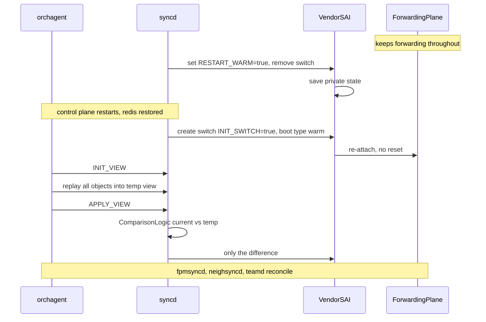
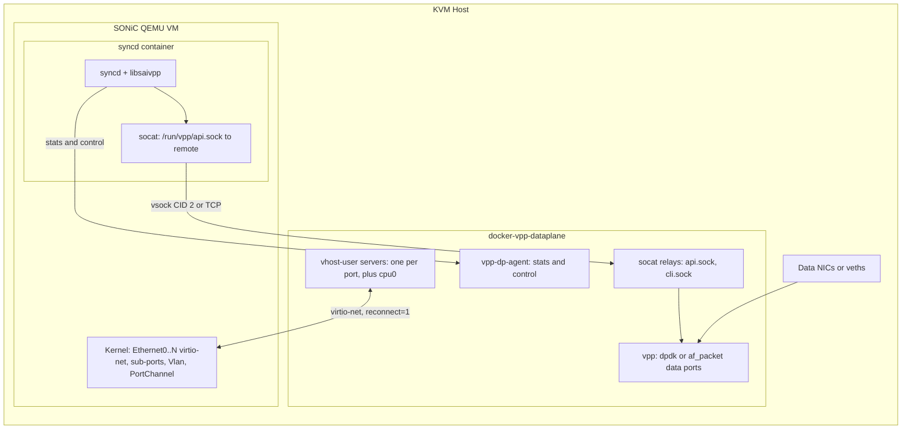
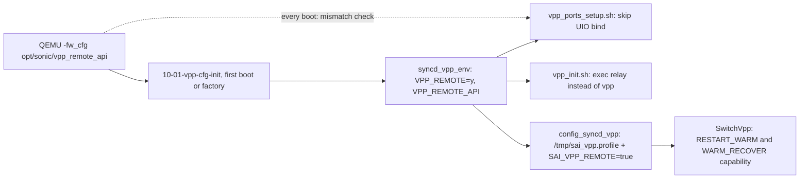
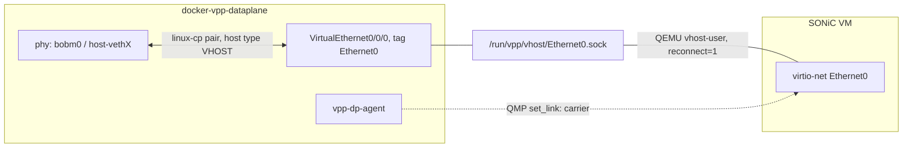
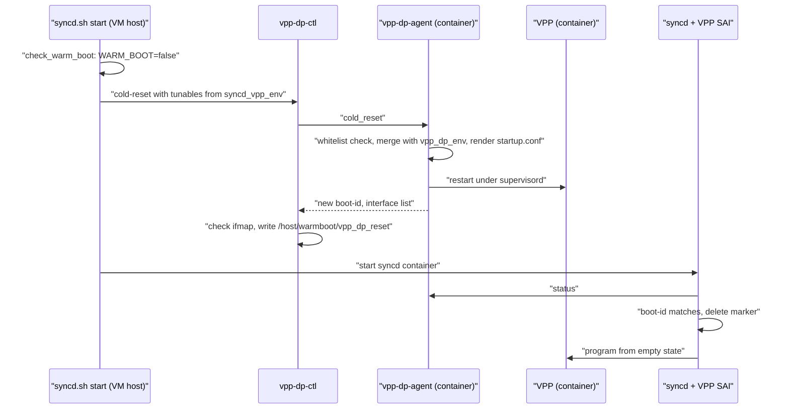
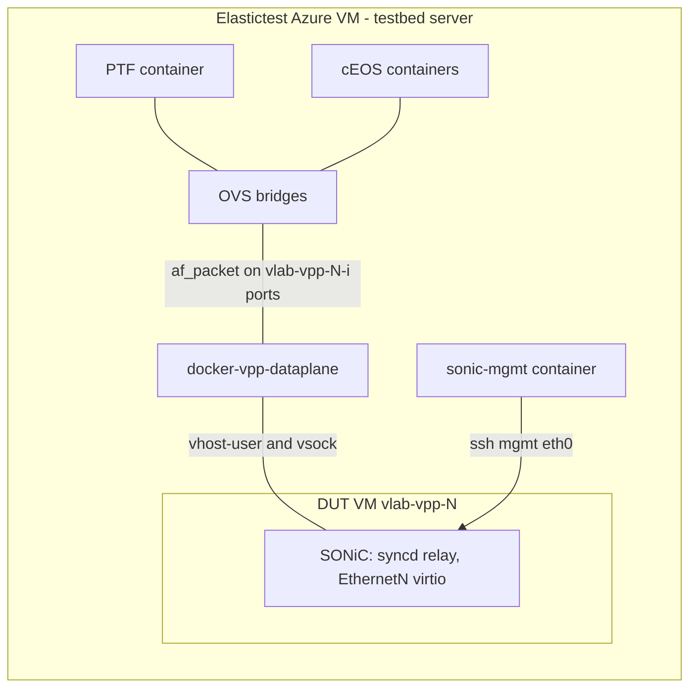
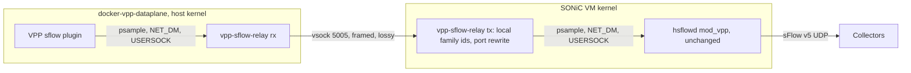

# Remote VPP Dataplane and Warm Boot in SONiC-VPP — High Level Design

## Revision History

| Rev | Date | Author(s) | Changes |
|-----|------|-----------|---------|
| v0.1 | 11/12/2026 | Yue Gao (yuega2@cisco.com) | Initial draft: remote VPP dataplane, remote flag, SAI warm boot save/restore, sonic-mgmt testbed |

## Table of Contents

- [Revision History](#revision-history)
- [1. Objectives](#1-objectives)
- [2. Scope](#2-scope)
- [3. Definitions and Abbreviations](#3-definitions-and-abbreviations)
- [4. Background](#4-background)
  - [4.1 SONiC warm boot in brief](#41-sonic-warm-boot-in-brief)
  - [4.2 SONiC-VPP today and why it cannot warm boot](#42-sonic-vpp-today-and-why-it-cannot-warm-boot)
- [5. Requirements](#5-requirements)
  - [5.1 Requirements on the VPP SAI](#51-requirements-on-the-vpp-sai)
  - [5.2 Requirements on the VPP dataplane process](#52-requirements-on-the-vpp-dataplane-process)
  - [5.3 Platform and deployment requirements](#53-platform-and-deployment-requirements)
- [6. Design](#6-design)
  - [6.1 New topology and target architecture](#61-new-topology-and-target-architecture)
  - [6.2 Phase 1 (Part 0 and Part A) — Remote flag and disaggregation](#62-phase-1-part-0-and-part-a--remote-flag-and-disaggregation)
  - [6.3 Phase 2 (Part B) — Warm boot](#63-phase-2-part-b--warm-boot)
  - [6.4 Phase 3 (Part C) — CI jobs and gating](#64-phase-3-part-c--ci-jobs-and-gating)
  - [6.5 Phase 4 (Part D) — sFlow samples and drop reports](#65-phase-4-part-d--sflow-samples-and-drop-reports)
- [7. sonic-mgmt Verification](#7-sonic-mgmt-verification)
  - [7.1 Functional parity on the remote testbed](#71-functional-parity-on-the-remote-testbed)
  - [7.2 Warm restart and warm reboot](#72-warm-restart-and-warm-reboot)
  - [7.3 New remote-dataplane tests](#73-new-remote-dataplane-tests)
  - [7.4 Negative and robustness tests](#74-negative-and-robustness-tests)
  - [7.5 sFlow](#75-sflow)
- [8. Open Items](#8-open-items)
- [9. References](#9-references)

---

## 1. Objectives

Make SONiC-VPP support warm restart and warm reboot, meaning the SONiC control plane restarts while forwarding continues without loss:

- **Separate lifecycles.** Run the VPP dataplane outside the SONiC VM, in its own container on the KVM host. A SONiC restart, from a single container up to a full VM reboot, then no longer restarts VPP.
- **Remote connections.** Connect SONiC to that VPP remotely:
  - the VPP binary API and CLI are relayed across the VM boundary;
  - each SONiC port's host interface (`Ethernet0`, ...) is a cross-VM virtual NIC, not a local tap;
  - the data ports belong to the VPP container.
- **Both modes supported, local by default.** One `sonic-vpp.img` supports both VPP modes, and both stay fully supported and tested:
  - **local mode:** VPP runs inside the SONiC VM's syncd container, as today. This is the default when no flag is given, and its behaviour and tests are unchanged.
  - **remote mode:** VPP runs in a separate container on the KVM host. It is opt-in, selected by a single flag the host passes at deployment.
- **Warm boot in the SAI.** Have the VPP SAI advertise warm-boot support in remote mode and implement it: save its state at warm shutdown, re-attach to the running VPP at warm start without reprogramming it, and reconcile through the standard syncd apply-view flow.
- **Verification.** Prove the result with the standard sonic-mgmt warm-reboot tests, which measure data-plane loss with PTF traffic during the restart.

## 2. Scope

In scope:
- The remote mode flag and how it reaches the VM, the syncd container and the SAI.
- A host-side `docker-vpp-dataplane` container and a host launcher.
- The cross-VM transports: the API/CLI relay, vhost-user host interfaces, and a stats/control agent.
- VPP SAI changes: the host-interface backend, remote stats, warm-boot capability, state save/restore, and reconciliation.
- VPP changes: a linux-cp `VHOST` host type that pairs a phy with an existing vhost-user interface, and re-subscribing to MAC events.
- The sonic-mgmt testbed and jobs for a remote-VPP DUT.
- sFlow packet samples and drop reports in remote mode, through a netlink relay over vsock (Phase 4).

Out of scope:
- Running VPP on a different physical host from the SONiC VM. The transports are chosen for a VPP container on the same KVM host.
- Fast-reboot and express-reboot.
- Warm boot in local mode, with VPP inside the VM. The SAI explicitly reports it as unsupported (§6.2.4).
- Hitless VPP upgrade. VPP itself restarting is a cold event for SONiC.

## 3. Definitions and Abbreviations

| Term | Meaning |
|------|---------|
| Local mode | Today's layout: VPP runs inside the `syncd` container in the SONiC VM. The default. |
| Remote mode | VPP runs in `docker-vpp-dataplane` on the KVM host. Enabled by the remote flag. |
| KVM host | The machine running the SONiC QEMU VM and the VPP container. In CI, the Elastictest Azure VM. |
| LCP | VPP linux-cp plugin. It pairs a VPP interface with a host netdev for punt and inject. |
| Host interface (hostif) | The SONiC kernel netdev for a port (`Ethernet0`), created through `SAI_OBJECT_TYPE_HOSTIF`. |
| vhost-user | virtio backend in user space; here VPP is the backend for the VM's virtio-net NICs. |
| vsock | virtio socket transport between a VM and its host; CID 2 is the host. |
| fw_cfg | QEMU firmware configuration interface; readable in the guest under `/sys/firmware/qemu_fw_cfg`. |
| VID / RID | sairedis virtual object ID (what orchagent uses) / real object ID (what the vendor SAI returns). |
| Apply view | syncd's comparison of the replayed (temporary) view with the current view, issuing only the differences. |

## 4. Background

### 4.1 SONiC warm boot in brief

SONiC warm boot restarts the control plane while the ASIC keeps forwarding with its existing tables. Afterwards it reconciles in two stages: first at the SAI object level, then at the protocol level.

**1. Warm shutdown.**
- orchagent is frozen with no pending tasks (the restart check).
- The Redis databases are saved: APPL_DB, CONFIG_DB, STATE_DB and ASIC_DB. ASIC_DB holds `ASIC_STATE` (every SAI object and attribute) and the VID/RID maps.
- syncd sets `SAI_SWITCH_ATTR_RESTART_WARM=true` and removes the switch.
- The vendor SAI saves whatever private state it needs and leaves the hardware running. In vslib, which the VPP SAI is built on, `VirtualSwitchSaiInterface::writeWarmBootFile()` serializes every object and attribute to `SAI_WARM_BOOT_WRITE_FILE`.

**2. Warm start of syncd.**
- syncd uses the warm start type when warm restart is enabled and `SAI_WARM_BOOT_READ_FILE` exists (`Syncd.cpp` ~L358–380).
- With `SAI_KEY_BOOT_TYPE=warm`, vslib reads the warm-boot file and `warm_boot_initialize_objects()` rebuilds the switch state.
- `Syncd::performWarmRestart()` re-creates the switch with `SAI_SWITCH_ATTR_INIT_SWITCH=true` and requires the RID to match the saved one. This re-attaches to the hardware and resets nothing.
- The restored `ASIC_STATE` becomes syncd's *current view*.

**3. Replay and apply view.**
- orchagent sends `INIT_VIEW` and then replays everything from the restored APPL_DB and CONFIG_DB. syncd records the replay into a *temporary view* and does not call the SAI.
- orchagent sends `APPLY_VIEW`. `Syncd::applyView()` runs `ComparisonLogic`, which matches temporary-view objects to current-view objects and produces the minimal list of `create`, `remove` and `set` operations. Only that list reaches the SAI; if nothing changed, the SAI sees almost no calls.

**4. Protocol reconciliation.**
- fpmsyncd waits for BGP graceful-restart End-of-RIB, then removes stale routes.
- neighsyncd reconciles neighbors after `restore_neighbors.py` re-probes them.
- teamd resumes LACP within the partner's timeout.
- Each daemon's progress is reported in `WARM_RESTART_TABLE`.



The vendor SAI therefore has two obligations. It must **save** enough state at warm shutdown and **restore** it at warm start, so that later incremental SAI calls can find the hardware objects they modify. The forwarding plane must also **survive** the restart of everything above it.

### 4.2 SONiC-VPP today and why it cannot warm boot

In local mode, VPP runs inside the `syncd` container of the SONiC VM:
- supervisord starts `vpp_init.sh` from `docker-syncd-vpp/conf/vpp_init.conf`;
- `vpp_ports_setup.sh` binds the VM's data NICs to DPDK;
- the factory hook `10-01-vpp-cfg-init` generates `/etc/sonic/vpp/syncd_vpp_env` and `sonic_vpp_ifmap.ini`.

The SAI and VPP are coupled through three channels that need a shared kernel:

| Channel | Today | Why it blocks warm boot / remote VPP |
|---------|-------|--------------------------------------|
| Binary API | Unix socket `/run/vpp/api.sock`, hardcoded in `SaiVppXlate.c` | Local path only |
| Host interfaces | `vs_create_hostif_tap_interface()` sends `lcp_itf_pair_add_del` (host type TAP), and linux-cp's `lcp_itf_pair_create()` creates a VPP tap whose kernel end is `Ethernet0`, then pairs it with the phy. Sub-ports, BVIs, bonds and loopbacks create more LCP taps at runtime. | The tap's kernel end must be in the same kernel as VPP |
| Counters | `stat_segment_connect_r()` maps VPP's stats segment (shared memory, fd passed by `SCM_RIGHTS`) | Cannot cross a VM |

The lifecycles are coupled as well. Restarting syncd, swss or the VM restarts VPP, so forwarding stops and VPP comes back empty. Every SONiC restart is a cold restart for the data plane. Two pieces of SAI state make this worse:
- VPP allows a single MAC-event subscriber, and only the process that subscribed first can subscribe again (see the comment in `SwitchVpp.cpp` ~L130).
- `SwitchVpp` holds VPP-assigned handles that are not part of vslib's saved state.

## 5. Requirements

### 5.1 Requirements on the VPP SAI

| ID | Requirement |
|----|-------------|
| SAI-1 | Advertise warm-boot support only when it can be delivered. In remote mode, `sai_query_attribute_capability` must report `SAI_SWITCH_ATTR_RESTART_WARM` and `SAI_SWITCH_ATTR_WARM_RECOVER` as implemented. In local mode it must report them as not implemented, and setting `RESTART_WARM=true` must fail so syncd falls back to cold. |
| SAI-2 | **Save state.** At warm shutdown, save the SAI object view (vslib) and every piece of private state that cannot be derived from SAI objects: VPP-assigned handles (sw_if_index, ACL, PBH, policer, BFD, tunnel and NAT indexes, FDB entries) and counter baselines. |
| SAI-3 | **Restore state.** At warm start, restore the saved state and rebuild every derived in-memory index, such as `SaiObjectDB`, from the restored SAI objects. VPP must not be programmed during this step. |
| SAI-4 | **Validate.** Check the restored handles against the running VPP (dumps, tags, VPP boot identity). On any mismatch, fail the warm start and fall back to cold. |
| SAI-5 | **Reconcile.** Apply the apply-view differences as correct incremental VPP changes against restored objects, which requires idempotent create, set and remove handlers. |
| SAI-6 | **Re-attach.** Reconnect to the running VPP, re-subscribe to interface, BFD and MAC events, and re-send current port oper status. |
| SAI-7 | **Cold boot means clean VPP.** On every cold start in remote mode (config reload, cold reboot, non-warm service restart, or syncd's own fallback to cold), reset VPP with the VM's tunables so its state matches the empty SAI DB. |
| SAI-8 | Work remotely: host interfaces without local taps, and counters without the shared stats segment. |

### 5.2 Requirements on the VPP dataplane process

| ID | Requirement |
|----|-------------|
| DP-1 | **Different lifecycle.** VPP's container is independent of SONiC: it keeps running when syncd, swss, any SONiC container, or the whole SONiC VM restarts. VPP itself is restarted only when SONiC asks for it on a cold event (SAI-7), never during a warm restart. |
| DP-2 | **Continue forwarding.** During a SONiC restart, VPP keeps forwarding transit traffic with its last programmed FIB, L2, ACL and tunnel state. |
| DP-3 | **Owns the data ports.** Data NICs (PCI/DPDK or veth/af_packet) are attached to VPP, not to the SONiC VM. |
| DP-4 | **Host interfaces survive SONiC restarts.** The per-port host-interface link is re-established automatically when the VM comes back. While it is down, only punted CPU traffic is lost. |
| DP-5 | **Stable control endpoint.** The API and CLI are reachable at a fixed address that the restarted SONiC reconnects to. |
| DP-6 | **Client cleanup.** When a SONiC client disappears, including on a VM crash, VPP releases that client and its event subscriptions quickly, so the next syncd can subscribe again. |
| DP-7 | **Remote stats and control.** Counters and a reset/status control are reachable without shared memory. |

### 5.3 Platform and deployment requirements

| ID | Requirement |
|----|-------------|
| PL-1 | The same image supports both modes. Local mode stays the default; the host selects remote mode. |
| PL-2 | The mode is chosen once per deployment and stays consistent across the env file, the ifmap, `config_db.json` and the SAI profile. A mismatch must be reported, never silently switched. |
| PL-3 | Guest memory sharing must not require a large host hugepage reservation by default, so it fits CI VMs. |
| PL-4 | Existing local-mode behaviour and tests stay unchanged. |
| PL-5 | The host owns VPP's resources (NICs, vhost sockets, hugepages, CPUs) and the port map. The VM owns only a whitelisted set of VPP tunables, applied on cold reset. |

## 6. Design

### 6.1 New topology and target architecture



Components:
- **`docker-vpp-dataplane` (KVM host):**
  - runs VPP, which owns the data ports;
  - is the vhost-user server for one virtio-net NIC per SONiC port, plus one `cpu0` NIC for dynamic host interfaces;
  - relays its Unix API/CLI sockets to vsock or TCP (vsock is prefered and selected);
  - runs `vpp-dp-agent` for stats and control.
- **SONiC VM:** runs everything SONiC runs today, except VPP:
  - in the `syncd` container, a socat relay provides `/run/vpp/api.sock` and `/run/vpp/cli.sock`, so the SAI, `vppctl` and `vpp_api_test` are unchanged;
  - the virtio NICs are renamed to `Ethernet0..N` and act as the SONiC host interfaces.

Behaviour across a SONiC restart:
- **vhost-user reconnect.** VPP is the vhost-user server and QEMU connects as a client with `reconnect=1`. When the VM goes away, VPP sees those host-interface links go down; when it comes back, QEMU reconnects. Transit forwarding never depends on these links.
- **Transparent API relay.** VPP binary-API socket clients use only the socket; `sock_init_shm` is never called by the SAI. A per-connection relay (`fork`) is therefore transparent, and each SAI connection (command and event) is a separate VPP client. When syncd exits, its connection closes and VPP cleans up the client.
- **Stats via the agent.** The stats segment is shared memory, so it is served by `vpp-dp-agent` instead.

Memory model:
- **Shared guest RAM.** vhost-user requires the guest RAM to be shared with VPP (`share=on`). VPP maps guest memory and reads and writes the virtio rings and buffers directly, for the punt path in both directions.
- **Transit stays in VPP.** Transit traffic never touches guest memory; it uses VPP's own buffer pool, with hugepages inside the container.
- **memfd by default.** The default guest backend is `memory-backend-memfd,share=on`: normal pages, no host reservation (PL-3). A hugetlbfs backend is optional for performance setups; it requires the whole VM RAM to be reserved as hugepages.

### 6.2 Phase 1 (Part 0 and Part A) — Remote flag and disaggregation

Goal: a remote-mode SONiC VM, selected by a host-provided flag, with the same functional behaviour as local mode, proven by the existing sonic-mgmt PR tests.

Phase 1 has three parts:
- **Part 0, the remote flag (§6.2.1–§6.2.4).** It selects the mode: with the flag set, the VM starts no VPP, the API is remote, and the SAI advertises warm boot. Part 0 is implemented first, because the rest of Phase 1 builds on it.
- **Part A, disaggregation (§6.2.5–§6.2.10).** It moves the data ports, the host interfaces and the counters across the VM boundary, and defines who configures and resets the remote VPP.
- **The sonic-mgmt testbed (§6.2.11).** The remote-mode `vm_set` deployment and the remote t0 and t1-lag testbeds, so the existing PR tests can gate Phase 1.



#### 6.2.1 Flag source: QEMU fw_cfg

- **Host side:**
  - `-fw_cfg name=opt/sonic/vpp_remote_api,string=vsock:2:5002` is required; its presence turns on remote mode.
  - `-fw_cfg name=opt/sonic/vpp_remote_cli,string=vsock:2:5004` is optional.
  - `-fw_cfg name=opt/sonic/vpp_remote_agent,string=vsock:2:5003` gives the `vpp-dp-agent` address.
  - `-fw_cfg name=opt/sonic/vpp_ifmap,file=<path>` carries the port map rendered by the launcher (§6.2.10).
  - libvirt passes the same through `<qemu:commandline>`.
- **Value format:** `vsock:<cid>:<port>` (or `tcp:<host>:<port>` as backup option).
- **Guest side:** the existing factory hook `sonic-platform-modules-vpp/.../factory-default-hooks.d/10-01-vpp-cfg-init` gains `detect_vpp_mode()`, called before `setup_ports_list()`:
  1. `modprobe qemu_fw_cfg`, then read `/sys/firmware/qemu_fw_cfg/by_name/opt/sonic/vpp_remote_api/raw` (and `vpp_remote_cli`).
  2. Validate against `^(vsock:[0-9]+:[0-9]+|tcp:[A-Za-z0-9.-]+:[0-9]+)$`. `syncd_vpp_env` is sourced as shell, so the value must be validated, the same as `VPP_WORKERS` today.
  3. Write `VPP_REMOTE=y`, `VPP_REMOTE_API=...`, `VPP_REMOTE_CLI=...` and `VPP_REMOTE_AGENT=...` after the env file is truncated. Local mode writes none of them.
  4. In remote mode, `eth1..ethN` are host-interface NICs, not data ports. `VPP_DPDK_PORTS` stays empty with `DPDK_DISABLE=y`. The hook copies `sonic_vpp_ifmap.ini` from the `opt/sonic/vpp_ifmap` fw_cfg blob instead of generating it, and sizes `port_config.ini` and `config_db.json` from it (§6.2.10).
- **Latched at first boot:** `config-setup` runs factory hooks only from `generate_config factory`. That is first boot with no `config_db.json`, no minigraph and ZTP off, or an explicit `config-setup factory`.
  - This is fine for CI, because sonic-mgmt `refresh-dut` recreates the disk on every deploy.
  - Changing the mode of an installed VM is a deliberate `config-setup factory`, which also regenerates the ifmap and `config_db.json` consistently (PL-2).
- **Every-boot guard:** `vpp_ports_setup.sh start` already runs before `syncd.service`. It compares whether the fw_cfg entry exists with `VPP_REMOTE` and, on mismatch, logs an error pointing to `config-setup factory`.
- **Kernel:** `CONFIG_FW_CFG_SYSFS` is excluded only for `marvell-prestera-armhf` in `kconfig-exclusions`, so amd64 has the module. Fallback: an SMBIOS type-11 OEM string, read from `/sys/firmware/dmi/entries/11-0/raw`.
- **Container:** `syncd_vpp_env` already reaches the syncd container with `--env-file` (`docker_image_ctl.j2.patch`).

#### 6.2.2 Do not start the internal VPP

- `vpp_init.sh`: if `VPP_REMOTE=y`, `exec /usr/local/bin/vpp_remote_relay.sh`. supervisord (`autorestart=true`) then supervises the relay in place of VPP.
- `vpp_remote_relay.sh`:
  - `socat UNIX-LISTEN:/run/vpp/api.sock,fork,unlink-early,mode=770,group=vpp VSOCK-CONNECT:<cid>:<port>`, and the same for `cli.sock` when configured.
  - For `tcp:`, use `TCP:<host>:<port>,nodelay,keepalive,keepidle=5,keepintvl=2,keepcnt=3`.
    - Nagle must be off for the many small API request/reply messages.
    - Keepalive releases a crashed VM's connections quickly (DP-6).
    - vsock resets connections when the guest goes away, so it needs neither option.
    - vsock is prefered option.
- `socat` is added to `docker-syncd-vpp/Dockerfile.j2`.
- `vpp_ports_setup.sh` skips UIO binding in remote mode.
- `config_syncd_vpp()` keeps `vpp_api_check "/run/vpp/api.sock"`, which now also confirms the remote VPP is reachable before syncd starts.
- **Decision: socat rather than native TCP in VPP.** VPP's `clib_socket` accepts `tcp:<host>:<port>` for both `socksvr` and `vl_socket_client_connect`, but:
  - `vppctl` is `AF_UNIX`-only;
  - `clib_socket` sets neither `TCP_NODELAY` nor keepalive;
  - native TCP would rule out vsock.
  With socat, VPP and the SAI keep their Unix sockets unchanged.

#### 6.2.3 The SAI profile carries the flag

When `VPP_REMOTE=y`, `config_syncd_vpp()` copies `$HWSKU_DIR/sai_vpp.profile` to `/tmp/sai_vpp.profile`, appends the following, and passes `-p /tmp/sai_vpp.profile`:

```
SAI_VPP_REMOTE=true
SAI_WARM_BOOT_READ_FILE=/var/warmboot/sai-warmboot.bin
SAI_WARM_BOOT_WRITE_FILE=/var/warmboot/sai-warmboot.bin
```

In local mode the profile is unchanged.

#### 6.2.4 The SAI advertises warm boot from the profile

- **Read the flag.** The `SwitchVpp` constructor sets `m_vppRemote` from `m_switchConfig->m_profileMap["SAI_VPP_REMOTE"] == "true"`, the same way `loadPortConfig()` reads the profile.
- **Answer the capability query.** In `SwitchVpp::queryAttributeCapability()`, for `SAI_OBJECT_TYPE_SWITCH` with `SAI_SWITCH_ATTR_RESTART_WARM` or `SAI_SWITCH_ATTR_WARM_RECOVER`, return `create_implemented=false` and `set_implemented=get_implemented=m_vppRemote`. Today the function returns `true` for everything.
- **Reject warm restart in local mode.** `set(SAI_SWITCH_ATTR_RESTART_WARM=true)` returns `SAI_STATUS_NOT_SUPPORTED`. syncd already treats that failure as "fall back to cold restart" (`Syncd.cpp` ~L7049).

#### 6.2.5 Host-side VPP container `docker-vpp-dataplane`

- **Build:** `platform/vpp/docker-vpp-dataplane/`, from the same VPP debs as `docker-syncd-vpp`, built as `target/docker-vpp-dataplane.gz`.
- **Startup config:** it reuses `vpp_init.sh` and `startup.conf.tmpl` with the same env key names, read from `vpp_dp_env` (§6.2.10) instead of `syncd_vpp_env`. The scripts are extended to:
  - emit one vhost-user host interface for each port in `VPP_HOSTIF_PORTS`, plus one for `cpu0`, in the startup config:
    ```
    create vhost-user socket /run/vpp/vhost/Ethernet0.sock server renumber 0
    set interface tag VirtualEthernet0/0/0 Ethernet0
    set interface mtu 9216 VirtualEthernet0/0/0
    set interface state VirtualEthernet0/0/0 up
    ```
    - `renumber` keeps the name stable whatever the creation order.
    - The tag is the SONiC port name, which linux-cp uses to find the host interface (§6.2.9).
    - MTU 9216 means punted jumbo frames are never dropped on the way to the guest, whatever the port MTU.
    - The interface stays admin up permanently, as linux-cp does for its taps.
    - `gso` is not set. The guest segments TCP in software, which is enough for punt traffic.
  - force `NO_LINUX_NL=y`, because netlink from the guest kernel is not visible here.
- **supervisord programs:**
  - `vpp`;
  - `socat VSOCK-LISTEN:5002,fork UNIX-CONNECT:/run/vpp/api.sock`, or `TCP-LISTEN` with the options in §6.2.2;
  - the same relay for `cli.sock` on port 5004;
  - `vpp-dp-agent`.
- **`vpp-dp-agent`:** a new service listening on vsock port 5003 (or TCP). Its commands:
  - `stats_dump <pattern>` reads the local stats segment and returns name/type/values;
  - `status` returns the VPP pid, start time, boot-id and interface list, used to detect a VPP restart and to check the port map;
  - `cold_reset <tunables>` re-renders startup.conf from the host-owned values plus the whitelisted tunables sent by the VM, restarts VPP with empty state, and returns the new boot-id;
  - `stop` stops VPP, so the dataplane stops forwarding until the next `cold_reset`.

  Details are in §6.2.10. The agent also mirrors each phy's link state onto the guest NIC's carrier (§6.2.9).

#### 6.2.6 Host launcher

`platform/vpp/start_sonic_vpp_vm.sh` reuses the port injection and `pci_bind_unbind` logic from `start_sonic_vpp.sh`:

1. Start `docker-vpp-dataplane`:
   - privileged, with hugepages for VPP's buffer pool and DPDK;
   - `/run/vpp/vhost` bind-mounted, which also holds the QEMU QMP socket;
   - the data NICs (PCI or veth) moved into it.
2. Start QEMU with:
   - `-object memory-backend-memfd,id=mem,size=<RAM>,share=on` and `-numa node,memdev=mem` (`--hugepages` switches to hugetlbfs);
   - for each port: `-chardev socket,path=/run/vpp/vhost/EthernetN.sock,reconnect=1`, `-netdev vhost-user,id=EthernetN` and `-device virtio-net-pci,addr=<fixed slot>,mac=<mac>,speed=<mbps>,duplex=full`;
   - `-device vhost-vsock-pci,guest-cid=<N>`;
   - `-qmp unix:/run/vpp/vhost/qmp.sock,server=on,wait=off`. The socket is in the directory bind-mounted into the container, so the agent can call `set_link` (§6.2.9);
   - the `-fw_cfg` entries from §6.2.1.

A topology file lists each port's name, data NIC, PCI slot and MAC, plus the default VPP tunables. It is the single source for the QEMU arguments and for the two files the launcher renders from it (§6.2.10):
- `vpp_dp_env`, passed to `docker-vpp-dataplane` with `--env-file`;
- `sonic_vpp_ifmap.ini`, passed to the VM as the `opt/sonic/vpp_ifmap` fw_cfg blob.

#### 6.2.7 SONiC VM side

- Rename the virtio NICs to `EthernetN` by PCI slot, using a new hwsku file `sonic_vpp_hostif_map.ini`. This runs as a systemd unit or udev rule before syncd.
- Load the `vsock` and `vmw_vsock_virtio_transport` modules.

#### 6.2.8 libsaivpp changes

- **API connection:** add reconnect with backoff to the command and event connections in `SaiVppXlate.c`, because the remote end can now go away independently of syncd.
- **Host interface backend:** factor `vs_create_hostif_tap_interface()` and `vs_remove_hostif_tap_interface()` behind a `HostIfBackend` interface:
  - `LocalTapBackend` is today's behaviour.
  - `RemoteVhostBackend` differs from today in only two places:
    - it sends the same `lcp_itf_pair_add_del` as today (`config_lcp_hostif()` in `SaiVppXlate.c`) with `host_if_type = LCP_API_ITF_HOST_VHOST` instead of TAP. linux-cp then finds the existing vhost interface by its tag (§6.2.9), so the SAI needs no vhost interface name or index;
    - before pairing, it waits for the guest kernel netdev `EthernetN`, renamed by §6.2.7.

    MAC, MTU, admin and IPv6 handling are unchanged, because they act on the guest's `EthernetN` exactly as on today's tap (§6.2.9).
- **Dynamic LCP pairs in remote mode:**

| Today | Remote mode |
|-------|-------------|
| Sub-port tap `Ethernet0.10` (`SwitchVppRif.cpp` ~L2344) | The same LCP call with host type VHOST. linux-cp's existing sub-interface branch creates the VPP sub-interface on the parent's vhost interface and skips netlink. intfmgrd creates the kernel `Ethernet0.10` in the guest, on top of the `Ethernet0` virtio NIC |
| BVI tap `tap_Vlan<id>` (`SwitchVppFdb.cpp` ~L2081), bond tap `be<id>` (~L2717) | Pair with a placeholder VPP loopback; punts already go to the member host interface through sonic_ext aggr-tap-redirect / punt-via-member |
| Loopback `tap_Loopback*` + tc redirect into `LoopbackN` (`SwitchVppRif.cpp` ~L1660) | `cpu0` host path (below), with the guest `tc` redirect into `LoopbackN` |
| VXLAN decap BVI `tap_bvi<bd_id>` + tc `skbedit ptype host` and `mirred` redirect into the tenant VRF device (`TunnelManager::create_decap_host_path`, sonic-sairedis [#2093](https://github.com/sonic-net/sonic-sairedis/pull/2093)) | `cpu0` host path (below), with the guest `tc` rule unchanged: `skbedit ptype host` plus `mirred ingress redirect dev <Vrf>`, the VRF found through `get_kernel_vrf()`. IPv6 is disabled on the guest VLAN device, as on today's tap |

**`cpu0` host-path multiplexing.** Loopbacks and decap BVIs have no guest NIC of their own. Each one gets a dot1q sub-interface of the single `cpu0` vhost NIC. The VLAN ID is not negotiated between the two sides, because the SAI runs in the guest and creates both ends:
1. **Allocate** a VLAN ID from the SAI's `cpu0` pool (1–4094).
2. **VPP side,** over the existing API:
   - `create_sub_interface("VirtualEthernet0/0/<cpu0>", vid, vid)`;
   - `sw_interface_tag_add_del(sub_if, "<host name>")`, where the host name is the local-mode tap name (`tap_Loopback0`, `tap_bvi32768`);
   - `lcp_itf_pair_add_del(phy = loopback or BVI, host_if_name = "<host name>", type = VHOST)`. linux-cp finds the sub-interface by its tag (§6.2.9).
3. **Guest side:**
   - `ip link add link cpu0 name cpu0.<vid> type vlan id <vid>`, with IPv6 disabled;
   - the same `tc` rule local mode puts on the tap, now on `cpu0.<vid>`.
4. **Record** the VLAN ID against the SAI object. On removal, the pair, the VPP sub-interface, the guest VLAN device and the `tc` rule are removed, and the ID is freed.

VPP pushes the dot1q tag on punt, and the guest VLAN device strips it. Inject goes in reverse through the VPP sub-interface and lcp-xc. The container startup config creates only the untagged `cpu0` interface. One `cpu0` NIC carries up to 4094 host paths; beyond that, QinQ on the same NIC or a second `cpu` NIC extends it without a design change.

- **Stats:** a remote backend for `vpp_stats_dump()` in `SaiVppStats.c` calls `vpp-dp-agent` and keeps the `handle_stat_one`/`handle_stat_two` callbacks. `SaiIntfStats.c`, `SaiAclStats.c` and `SaiRouteStats.c` are unchanged. Each poll sends one batched request per pattern.

#### 6.2.9 Host interfaces: linux-cp `VHOST` type, attributes and carrier

In remote mode linux-cp creates no tap. Each port's host interface is the vhost-user interface created at container start (§6.2.5). linux-cp pairs it with the phy, and the guest's virtio NIC on the same socket becomes `EthernetN`.



- **Punt:** linux-cp punt or sonic_ext punt-via-member sends the frame out of the paired host interface. VPP writes it into the guest's virtio RX ring, and `Ethernet0` receives it.
- **Inject:** frames sent on `Ethernet0` arrive through the virtio TX ring on `VirtualEthernet0/0/0`. lcp-xc then sends them out of the phy.
- **Transit** traffic never uses this path.

##### New linux-cp host type `VHOST`

`lcp_itf_pair_create()` does two separate things:
1. It creates the host interface with `tap_create_if()`.
2. It registers the pair by calling `lcp_itf_pair_add()`. That sets up the pair DB, the host-to-phy cross-connect features, IPv4/IPv6 punt redirect, adjacencies, the ARP feature nodes, and the `pair_add_fn` callbacks that sonic_ext hooks into.

Step 2 needs only a VPP `sw_if_index` that carries Ethernet frames, which a vhost-user interface does. A new host type keeps step 2 and replaces step 1 with a lookup. It is carried as VPP patch `0030-linux-cp-vhost-host-type.patch`. Every place that changes already branches on `lip_host_type`:

| Place | Today | `LCP_ITF_HOST_VHOST` |
|-------|-------|----------------------|
| `lcp.api` enum, `api_decode/encode_host_type()` | TAP, TUN | Add `LCP_API_ITF_HOST_VHOST = 2` |
| `lcp_itf_pair_create()` | `tap_create_if()` | Find the interface whose tag equals `host_if_name`, and fail if there is none. Use `vif_index = ~0` and set it admin up |
| `lcp_itf_pair_create()`, sub-interface branch | VPP sub-interface on the host, plus a kernel VLAN device through netlink | Keep the VPP sub-interface and skip netlink. intfmgrd creates `Ethernet0.10` in the guest |
| `lcp_itf_pair_add()`, `lip_db_by_vif` | always set | Skipped, because there is no local kernel ifindex |
| `lcp_itf_set_link_state()`, `lcp_interface_sync.c` | netlink on the local kernel through `lip_vif_index` | No-op |
| `lcp_itf_pair_link_up_down()` | `tap_set_carrier()`, `tap_set_speed()` | Skipped; the carrier is mirrored by the agent (below) |
| `lcp_itf_pair_delete_by_index()` | `tap_delete_if()`, or delete the sub-interface | Remove the pair only and keep the vhost interface; sub-interfaces are still deleted |
| `lcp_itf_l3_feat_names[]`, `lcp_itf_route_path_flags[]` | rows for TAP and TUN | A VHOST row, the same as TAP (L2, `FIB_ROUTE_PATH_DVR`) |
| `lcp_node.c` punt-xc (~L129) | `== LCP_ITF_HOST_TAP` rewinds to the Ethernet header | Test for "L2 host", meaning not TUN |

- **Lookup by tag.** The SAI sends the same `(phy, "Ethernet0", type)` it sends today. The guest never knows the vhost interface's `sw_if_index`, which VPP assigns at runtime and which can change when VPP restarts. The binding from host interface to port lives only in the container's startup config, rendered from the topology file.
- **Why a host type rather than a separate sonic_ext API.** Each special case becomes an explicit type check, not an inference from a sentinel `vif_index`. Create, delete, sub-ports and `show lcp` all use the normal linux-cp paths, and sonic_ext's lcp-xc, host-xc and aggr-tap-redirect hooks work unchanged.
- **Cost.** It is a patch to linux-cp core, and the enum changes the `lcp.api` message CRCs. The SAI and the remote VPP are built from the same VPP tree, so they still match. The host type is a reasonable upstream proposal, which would drop the patch.

##### Host interface attribute handling

Nothing is propagated from the VPP phy to the vhost interface or to the guest. Each of the three objects is configured directly, as with today's tap:

| Attribute | VPP phy | VPP `VirtualEthernet0/0/N` | Guest `EthernetN` (virtio-net) |
|-----------|---------|----------------------------|--------------------------------|
| MAC | SAI `sw_interface_set_mac()` | Irrelevant: punt and inject are L2 cross-connects that keep the router MAC | SAI `SIOCSIFHWADDR` at hostif create; intfmgrd `ip link set address` for RIF MACs. QEMU's `mac=` is only the initial value |
| MTU | SAI `SAI_PORT_ATTR_MTU`, `sw_interface_set_mtu()` | Fixed at 9216 in the startup config | portmgrd `ip link set mtu`; intfmgrd for sub-ports |
| Admin | SAI `SAI_PORT_ATTR_ADMIN_STATE` | Permanently up | portmgrd and intfmgrd `ip link set up/down` |
| Carrier | NIC link state | n/a | Mirrored by `vpp-dp-agent` through QMP `set_link` |
| Speed | NIC | n/a | Static `speed=`/`duplex=` on `virtio-net-pci`, from the topology file. Cosmetic: SONiC takes speed from CONFIG_DB |

VPP's vhost-user negotiates these virtio features, which make the guest side behave like a tap:
- `VIRTIO_NET_F_CTRL_VQ`, so a guest MAC change is accepted. QEMU handles the control queue itself, and VPP does no MAC filtering.
- No `VIRTIO_NET_F_MTU`, so the guest's `max_mtu` is 65535 and portmgrd can set 9100.
- `VIRTIO_NET_F_MRG_RXBUF`, so jumbo frames travel in chained ring buffers in both directions.

##### Carrier mirroring

With a tap, linux-cp sets the kernel netdev's carrier from the phy's link state. A virtio NIC's link-status bit belongs to QEMU, and neither the vhost-user backend nor the guest can change it. Without mirroring, `Ethernet0` would stay up while the phy is down, and kernel routes, neighbor resolution and anything else watching the carrier would be wrong. SONiC's own oper status, which comes from the SAI notification, is not affected either way.

- **Mechanism.** `vpp-dp-agent` holds its own local VPP API connection and subscribes to interface events for the phys. On each link change it sends QMP `set_link {"name": "<netdev id>", "up": <bool>}` to `/run/vpp/vhost/qmp.sock`. The phy-to-netdev-id mapping comes from the topology file, through `vpp_dp_env`.
- **Resync.** The agent pushes the full link state when it starts, after every `cold_reset`, and whenever the QMP socket reconnects, which is what happens on a VM restart.
- **Under libvirt** (sonic-mgmt), `sonic.xml.j2` adds the same `-qmp` socket through `<qemu:commandline>`. The netdev ids are libvirt's `hostnetN`, so the topology file maps each port to its `hostnetN`.
- **Warm restart.** The guest carrier stays as the agent last set it, and the SAI re-sends oper status (SAI-6), so the two views converge.

##### Alternative considered: linux-cp tap plus a tc splice

Here linux-cp keeps creating a normal tap in the VPP container, and QEMU uses an ordinary tap backend (`-netdev tap,ifname=vnet-Ethernet0,vhost=on`, or libvirt `<interface type='ethernet'>`). A tap connects one program to the kernel stack, not two programs to each other, so a host-side helper splices the two kernel ends together with `tc` ingress `mirred redirect` in both directions, or with a Linux bridge.


- **Gains:**
  - No linux-cp changes.
  - No shared guest memory (`share=on`).
  - Standard QEMU and libvirt tap networking.
  - Sub-ports work through the splice.
- **Costs:**
  - **The tap lifetimes don't match.** The linux-cp tap belongs to an SAI-managed pair and is recreated on every cold SONiC start, while the QEMU tap lives and dies with the VM. A host agent must watch netlink on both sides and reinstall the splice every time. With vhost-user, the socket is created once and QEMU's `reconnect=1` heals the link with no helper.
  - **netns plumbing.** `tc mirred` needs both ends in one netns, so one tap must be moved between the container and the host. Two DUTs on one server each need their own netns, because both want an `Ethernet0`.
  - **The carrier problem remains.** linux-cp sets the host-side tap's carrier, not the guest's, so QMP `set_link` is still required. linux-cp's MTU and admin sync also act on the wrong netdev.
  - **Dynamic taps have no guest counterpart.** BVI, bond and loopback taps have no matching guest NIC.
  - **Two extra kernel crossings** per punted packet.
- **Decision:** vhost-user with the `VHOST` host type. The splice stays an option if shared guest memory is not available on some host. It is local to the launcher and does not change the SAI.

#### 6.2.10 Dataplane lifecycle and configuration ownership

In local mode, `vpp_init.sh` renders VPP's startup.conf from `syncd_vpp_env` inside the syncd container, and VPP restarts with that container, so every cold SONiC start gets a clean VPP. In remote mode neither holds: startup.conf is rendered in `docker-vpp-dataplane`, and VPP outlives syncd. SONiC still controls the dataplane: every cold event resets VPP with the VM's tunables, and only a warm restart leaves it untouched.

**Configuration ownership.** The keys of today's `syncd_vpp_env` are split by who may set them:

| Owner | Keys | Where they live | When applied |
|-------|------|-----------------|--------------|
| Host, fixed at deployment | `VPP_DPDK_PORTS`, `DPDK_DISABLE`, `VPP_HOSTIF_PORTS` (vhost sockets), hugepages, CPU set and `main-core`, `SONIC_NUM_PORTS` and the port map | Topology file, rendered by the launcher into `vpp_dp_env` | Container start |
| VM, sent on every cold reset | `VPP_WORKERS`, `PERPORT_BUF`, `SONIC_EXT_CONFIG`, `VPP_DEFAULT_RX_MODE` | VM `syncd_vpp_env` (defaults from `vpp_dp_env` when unset) | `cold_reset` |
| Both, forced | `NO_LINUX_NL=y` | Both files | Always |

- The VM must not choose host devices or memory, so `vpp-dp-agent` accepts only the whitelisted tunables. It rejects any other key, and rejects `VPP_WORKERS` larger than the container's CPU set allows. A rejected request fails the reset; it is not partially applied.
- The agent keeps the last applied tunables, so `cold_reset` with no payload re-applies them.
- In remote mode `is_ip_nbr_active()` in `SwitchVppNbr.cpp` always returns true, whatever `NO_LINUX_NL` says. Neighbors must be programmed by the SAI, because netlink cannot cross the VM, and a stale env value must not silently turn that off.
- **`VPP_CONF_DB` and `vppcfgd`:** in local mode `vppcfgd` renders `/etc/sonic/vpp/startup.conf` from CONFIG_DB `PLATFORM|vpp` in the VM. The remote VPP never reads that file, and `PLATFORM|vpp` holds a full startup config, including host-owned sections. In Phase 1, `vppcfg_load.py` is a no-op in remote mode and `VPP_CONF_DB` is ignored with a log line. Mapping `PLATFORM|vpp` onto the tunable whitelist is an open item (§8).

**Port map.** The VM cannot discover the host's NIC names or the vhost interface names. The launcher therefore renders `sonic_vpp_ifmap.ini` (port to phy hwif, as in local mode) from the same topology file as `vpp_dp_env`, and passes it as the `opt/sonic/vpp_ifmap` fw_cfg blob. The factory hook copies it into the hwsku directory (§6.2.1), so the port map and the remote flag come from one source. At every cold reset, `vpp-dp-ctl` checks the agent's `status` interface list against the ifmap. It fails the reset if any phy hwif is missing, or if any port has no vhost interface tagged with its name (PL-2).

**Reset and stop hooks in `syncd.sh`.** This follows the vendor pattern already in `files/scripts/syncd.sh`: `startplatform` resets the Mellanox ASIC (`reset_mellanox_drivers`), and `stopplatform2` stops the BlueField dataplane (`bfnet.sh stop`) on non-warm stops. Both run on the VM host from `syncd.service`, after `check_warm_boot` has read `WARM_RESTART_ENABLE_TABLE`. A `vpp` block is added to each:

```bash
function reset_vpp_dataplane() {
    . /etc/sonic/vpp/syncd_vpp_env
    [[ x"$VPP_REMOTE" == x"y" ]] || return 0
    debug "Cold start: resetting remote VPP dataplane"
    /usr/bin/vpp-dp-ctl cold-reset --env /etc/sonic/vpp/syncd_vpp_env \
        --boot-id-out /host/warmboot$DEV/vpp_dp_reset || exit 1
}
```

- `startplatform` calls `reset_vpp_dataplane` when `sonic_asic_platform` is `vpp` and `WARM_BOOT` is not `true`.
- `stopplatform2` calls `vpp-dp-ctl stop` under the same conditions. This stops stale forwarding while SONiC is down, which matters on a cold reboot.
- `vpp-dp-ctl` is a small client shipped in `sonic-platform-modules-vpp`. It connects straight to `VPP_REMOTE_AGENT` over vsock or TCP, because `startplatform` runs before the syncd container and its relays exist. It has a bounded timeout and exits non-zero on failure, so `syncd.service` fails and swss does not start against a stale dataplane.
- In local mode both calls return immediately.

| SONiC event | Stop hook | Start hook | Result |
|-------------|-----------|------------|--------|
| `config reload`, cold `reboot`, non-warm `systemctl restart swss/syncd` | `stop` | `cold_reset` | Clean VPP with the current tunables |
| First boot | none | `cold_reset` | Clean VPP |
| VM crash or power-off | none (VPP keeps forwarding stale state) | `cold_reset` | Clean VPP |
| `warm-reboot`, swss/syncd warm restart | none | none | VPP untouched (Phase 2) |
| `fast-reboot` | none (fast sets the warm-restart flag, so VPP keeps forwarding while the VM reboots) | none | syncd starts with `-t fast`, a cold SAI init. The SAI safety net resets VPP before programming (§6.3.7) |
| Warm requested but syncd falls back to cold internally | none | none | Caught by the SAI safety net below |

**SAI safety net.** syncd can still start cold after `startplatform` saw `WARM_BOOT=true`: `Syncd::performStartupLogic` forces cold when the warm-boot file is missing or on the very first syncd run. A bare `docker restart syncd` also skips `syncd.sh`. To cover these cases, `reset_vpp_dataplane` records the boot-id returned by the reset in `/host/warmboot/vpp_dp_reset`, which the syncd container sees as `/var/warmboot/vpp_dp_reset`. On a cold `initialize_default_objects` in remote mode, `SwitchVpp` asks the agent for `status`:
- **The boot-id matches the recorded one:** this start already reset VPP. The SAI deletes the file and continues.
- **The file is missing or the boot-id differs:** the SAI calls `cold_reset` with no payload, so the last applied tunables are reused, and waits for VPP before programming.



VPP is restarted under supervisord inside the container, not by restarting the container. For forwarding state the result is the same, but the agent and the API relays keep running, and the VM never needs access to the host's docker socket. The vhost-user ports drop while VPP restarts, and QEMU reconnects them on its own (`reconnect=1`). SONiC sees one link flap, which is expected on a cold start.

#### 6.2.11 sonic-mgmt testbed

The Phase 1 exit criteria run the existing sonic-mgmt PR tests in remote mode, so the remote-mode deployment in sonic-mgmt is part of Phase 1. It lives in the separate sonic-mgmt repo.

Today each Elastictest KVM job runs on one Azure VM, the testbed server. It holds:
- the `sonic-mgmt` container;
- the PTF container;
- the cEOS neighbor containers;
- the DUT as a nested libvirt KVM VM.

The DUT's ports are virtio NICs whose host-side taps `vlab-vpp-N-<i>` connect through OVS. In remote mode, this Azure VM becomes the KVM host.



**`vm_set` role changes:**
- **`start_sonic_vm.yml`:** for a DUT with `vpp_remote: true`, start `docker-vpp-dataplane` first, using the image from the same build as `sonic-vpp.img`. The matching stop and remove tasks clean it up.
- **Data ports:** the `vlab-vpp-N-<i>` front-panel ports keep their OVS wiring, so the PTF port mapping is unchanged, but they are handed to the VPP container, as veths attached with af_packet.
- **Topology file:** rendered from the testbed's port list, as the input to the launcher logic in §6.2.6. It produces `vpp_dp_env` and the `opt/sonic/vpp_ifmap` blob.
- **`sonic.xml.j2`, `vpp_remote` branch:**
  - keep the mgmt interface;
  - make the front-panel interfaces `<interface type='vhostuser'>` with `mode='client'`, reconnect enabled, and a fixed PCI slot;
  - add `<memoryBacking><source type='memfd'/><access mode='shared'/></memoryBacking>` and `<vsock model='virtio'>`;
  - add the `-fw_cfg` arguments from §6.2.1, and a `-qmp` socket in the bind-mounted vhost directory for carrier mirroring (§6.2.9);
  - keep `virtio-net-pci.ctrl_vlan=off`.
- **vCPU budget:** VPP's cores move from the DUT to the server. Reduce `vpp_vcpus` and pin the container's cores.

**Testbeds:** `vtestbed.yaml` and `veos_vtb` get two new testbeds, mirroring the local ones. Existing VPP testbeds stay in local mode.
- `vms-kvm-vpp-remote-t0`, with DUT `vlab-vpp-remote-01`;
- `vms-kvm-vpp-remote-t1-lag`, with DUT `vlab-vpp-remote-02`.

Both DUTs set `vpp_remote: true`. During Phase 1, the two PR test lists run on these testbeds on demand; continuous CI and PR gating follow in Phase 3.

#### 6.2.12 Phase 1 exit criteria

Remote flag (Part 0):
- [ ] With no fw_cfg entry, the image behaves exactly as today: local VPP and unchanged local-mode tests (PL-1, PL-4).
- [ ] With the fw_cfg entry:
  - [ ] `syncd_vpp_env` has `VPP_REMOTE=y`;
  - [ ] no `vpp` process runs in the VM;
  - [ ] `vppctl show version` inside syncd returns the remote VPP's version;
  - [ ] syncd starts and creates the switch against the remote VPP.
- [ ] A mode mismatch after first boot is logged by `vpp_ports_setup.sh`.
- [ ] Unit tests cover the capability query and the `RESTART_WARM` set, with and without `SAI_VPP_REMOTE`.

Disaggregation (Part A):
- [ ] `start_sonic_vpp_vm.sh` brings up a remote-mode VM. `Ethernet0..N` are vhost-user virtio NICs, and the data ports are attached to VPP in the container.
- [ ] Punt and inject work on every host-interface type: physical port, sub-port, port channel, VLAN/BVI and loopback. BGP, ARP/ND, LACP and LLDP come up.
- [ ] Host interfaces (§6.2.9):
  - [ ] `show lcp` lists every port pair with host type `vhost`, and no tap is created for physical ports or sub-ports;
  - [ ] deleting a pair, including on a cold SONiC restart, keeps the vhost interface;
  - [ ] the guest `EthernetN` has the router MAC and the configured MTU, and a jumbo frame (9100) is punted and injected intact;
  - [ ] taking a phy's link down (for example the peer cEOS port or PTF veth) makes the guest `EthernetN` lose carrier within a second, and it comes back on link up;
  - [ ] after a VM restart the guest carrier matches the phy link state;
  - [ ] every loopback and VXLAN decap BVI gets a `cpu0` sub-interface tagged with its host name, a guest `cpu0.<vid>` and the `tc` rule. Traffic to a loopback address, and to a tenant-VRF address over an L3VNI, reaches the guest socket. Removing the object removes all of these.
- [ ] `show interfaces counters`, RIF counters, ACL counters and route flow counters report values through `vpp-dp-agent`.
- [ ] Restarting the syncd container or the VM leaves the `docker-vpp-dataplane` container, the agent and the relays running, and QEMU reconnects the vhost links.
- [ ] Lifecycle (§6.2.10):
  - [ ] `config reload`, a cold reboot and a non-warm `systemctl restart syncd` each change the VPP boot-id and leave no stale VPP objects;
  - [ ] `stopplatform2` stops VPP forwarding on cold stops;
  - [ ] tunables changed in the VM's `syncd_vpp_env` (for example `VPP_WORKERS`) take effect after the next cold reset;
  - [ ] a non-whitelisted key, an unreachable agent or an ifmap mismatch fails `syncd.service` with a clear log, and swss does not start;
  - [ ] a bare `docker restart syncd` is caught by the SAI safety net, which resets VPP.
- [ ] Local mode is unchanged.

sonic-mgmt (§6.2.11, §7.1):
- [ ] `testbed-cli.sh add-topo` and `refresh-dut` deploy `vms-kvm-vpp-remote-t0` and `vms-kvm-vpp-remote-t1-lag` from a clean server, and remove them without leftovers.
- [ ] Every test in the t0-vpp and t1-lag-vpp PR test lists that passes in local mode also passes in remote mode, with the same skips. No test is skipped or marked xfail for remote mode only, with one exception:
  - `sflow/test_sflow.py` (t0-vpp list) is expected to fail in remote mode until Phase 4 is complete (§6.5). In remote mode, VPP's sFlow netlink messages stay in the host kernel, so hsflowd in the VM receives no samples. Its failures are recorded as known and do not block the Phase 1 exit. sFlow configuration (sflowmgrd, the SAI and the VPP API) still has to work.
- [ ] The same lists on the local testbeds `vms-kvm-vpp-t0` and `vms-kvm-vpp-t1-lag` show no regression (PL-4).

### 6.3 Phase 2 (Part B) — Warm boot

Goal: a warm restart of swss/syncd and a full warm reboot of the VM, with no data-plane loss.

#### 6.3.1 VPP event re-subscribe

- New VPP patch `0029-l2-macs-events-allow-resubscribe.patch`. It drops the stale `want_l2_macs_events` subscriber when its API client disconnects, or lets a new client take over the subscription.
- Check that interface and BFD event registrations are cleaned up the same way.

#### 6.3.2 Cold start

Cold start is set up in Phase 1 (§6.2.10): `startplatform` in `syncd.sh` resets VPP through `vpp-dp-ctl` before syncd starts, and the SAI safety net in `initialize_default_objects` catches cold starts the script did not see. Either way VPP matches the empty SAI DB before anything is programmed (SAI-7). Phase 2 adds the boot-id to the warm-boot state, so a warm start against a VPP that was reset or restarted underneath SONiC fails validation and falls back to cold (SAI-4).

#### 6.3.3 Warm start sequence

`SwitchVpp` overrides `warm_boot_initialize_objects()`, which is called from `VirtualSwitchSaiInterface` ~L659. It calls the base and then runs the steps below. None of them program VPP, and `vs_recreate_hostif_tap_interfaces` is skipped in vhost mode.

1. Rebuild the derived indices from the restored `m_objectHash` (§6.3.4).
2. Load and validate the saved components (§6.3.5).
3. Rebuild the `cpu0` host paths (§6.2.8). VPP kept the `cpu0` sub-interfaces, but a VM reboot lost the guest's VLAN devices and `tc` rules.
   - Dump VPP's sub-interfaces on `cpu0`. Each one's VLAN ID and tag (`tap_Loopback0`, `tap_bvi32768`) give back the VLAN ID map and the allocator state, so the map is not saved separately.
   - Validate: a sub-interface with no tag, a tag matching no restored loopback or decap BVI, or a restored object with no sub-interface fails the warm start (SAI-4).
   - Recreate `cpu0.<vid>` and its `tc` rule in the guest where it is missing. A swss/syncd-only warm restart finds them still present.
4. Re-subscribe to VPP events.
5. Re-send the current port oper status as notifications.

The create, set and remove handlers must be idempotent against restored objects, so that the apply-view differences become correct incremental VPP changes (SAI-5).

#### 6.3.4 Rebuilding derived state: `SaiObjectDB`

The `SwitchStateBase` constructor copies `warmBootState->m_objectHash` directly into `m_objectHash` (`SwitchStateBase.cpp` ~L44). The side effects of `SwitchVpp::create_internal`, `set_internal` and `remove_internal` therefore never run on the warm path.

- **`SaiObjectDB` is filled only by those side effects:** `create_or_update` at `SwitchVpp.cpp` L1958 and L2823, `remove` at L2379, and the switch create in `SwitchVppTrim.cpp` ~L194. Without a fix it is empty after a warm start, and these lookups fail:
  - next-hop group to members;
  - route entry to its next-hop group and counter (L984, L1020);
  - tunnel map to entries and tunnels;
  - tunnel to term entries;
  - VLAN to members.
- **Fix: new `SaiObjectDB::rebuild(const ObjectHash&)`.** For each child type in `sai_child_relation_defs`, and each object of that type, rebuild the `sai_attribute_t` array from the `SaiAttrWrap::getAttr()` values and call `create_or_update(type, id, n, attrs, true)`.
  - The order doesn't matter, because missing parents are created on the fly (`SaiObjectDB.cpp` L156–159).
  - `SaiObjectDB` is a pure index over SAI objects, so it is rebuilt, never saved.
- **`m_trim.refreshAfterCreate`** (L1960) programs VPP, so it stays skipped.
- **Audit rule:** every side effect in `create_internal`, `set_internal` and `remove_internal` must be classified as one of:
  - a derived index, rebuilt in step 1;
  - VPP programming, skipped on warm;
  - a saved component.

  A comment at the top of those functions records this rule.

#### 6.3.5 Saving and restoring private state

Each stateful part of the SAI implements one interface:

```cpp
class VppWarmBootComponent
{
    public:
        virtual ~VppWarmBootComponent() = default;
        virtual const char* warmBootKey() const = 0;
        virtual uint32_t warmBootVersion() const = 0;
        virtual nlohmann::json warmBootSave() const = 0;
        virtual bool warmBootLoad(const nlohmann::json& j) = 0;
        virtual bool warmBootValidate() = 0;    // cross-check against VPP dumps
};
```

| State | Examples | Handling |
|-------|----------|----------|
| VPP-assigned handles | registry sw_if_index, `m_acl_swindex_map`, `m_tunterm_acl_swindex_map`, PBH `m_table_index_map`, `TunnelManager` / SRv6 / IPIP data, `m_policer_map`, `m_bfd_info_map`, NAT state, `m_vpp_fdb_entries`, mirror sessions | Saved, restored, validated |
| Counter baselines | `m_rifStatsBaseMap`, `m_routeCounterStatsBaseMap`, `m_routeCounterStatsCarryMap`, ACE/PBH/NAT counter info | Saved and restored |
| Derived from SAI objects | `SaiObjectDB`, `m_acl_tbl_rules_map`, `m_acl_tbl_grp_*`, `m_trap_map`, `m_sflow_port_to_samplepacket`, `CRMTracker` counts | Rebuilt (§6.3.4) |
| Transient caches | `m_routeStatsCache`, `m_sub_if_admin_up_pending` | Start empty |
| Not serializable | `m_hostif_info_map` (tap fds), `m_portConfigMap` | Re-created / reloaded |

- **Components:**
  - `VppInterfaceRegistry`, `TunnelManager`, `TunnelManagerSRv6`, `TunnelManagerIpIp`, `SwitchVppPbh`, `SwitchVppTrim` and `SwitchVppNat`;
  - the maps that live directly in `SwitchVpp`, after grouping them into small structs (ACL, policer, BFD, mirror, FDB, stats baselines).
- **Restore order:** the registry first, because everything resolves sw_if_index through it. Then tunnels, then ACL, PBH, NAT and the rest.
- **File format:** the private state goes into the existing vslib warm-boot file, so it can never drift from the SAI view.
  - `SwitchStateBase::dump_switch_database_for_warm_restart()` becomes virtual. `SwitchVpp` appends one line per component, `SAI_VPP_STATE <key> <json {version,data}>`, the same way `SAI_VS_FDB_INFO` lines are written today (`SwitchStateBase.cpp` ~L3494).
  - `readWarmBootFile()` stores these lines in a new `WarmBootState::m_extState` map.
- **Tagging:** where VPP supports tags (ACL tag, policer name, `sw_interface_tag_add_del`), VPP objects are tagged with their SAI OID, so validation is a cheap match from tag to handle.
- **Failure handling:** a missing component, a version mismatch, a failed validation, or a changed VPP boot-id (agent `status`) fails the warm start. The fallback is a cold reset of VPP and a cold boot (SAI-4).

#### 6.3.6 SONiC integration

- The warm-boot file keys and `SAI_VPP_REMOTE` come from the generated profile (§6.2.3). `/var/warmboot` in the syncd container must persist across a full VM reboot, as it does for `warm-reboot` on hardware.
- Enable `warm_restart` for swss and syncd on the vpp platform, and check the `warm-reboot` and `fast-reboot` platform guards in sonic-utilities.
- Three supported flows:
  - `config warm_restart enable swss` plus a swss/syncd restart;
  - a full VM `warm-reboot`;
  - a full VM `fast-reboot` (§6.3.7).
- BGP graceful restart uses the standard SONiC configuration.

#### 6.3.7 fast-reboot and express-reboot

SONiC has two more reboot types between cold and warm:

| | cold | fast-reboot | warm-reboot | express-reboot |
|---|---|---|---|---|
| Data plane during reboot | down | forwards until the new ASIC init | forwards throughout | forwards throughout |
| ASIC reset after boot | yes | yes | no | no |
| syncd start type | cold | `fast`, a cold-style init | `warm`, restore from the warm-boot file | `express`, replay plus SAI adoption |
| SAI state across reboot | none | none | saved and restored | none: the vendor SAI matches the replay against hardware |
| Control plane | full restart | warm-restart infrastructure, BGP GR | warm reconcile | warm reconcile |

**fast-reboot is supported in remote mode.**
- `scripts/fast-reboot` sets `FAST_RESTART_ENABLE_TABLE|system` and `config warm_restart enable system`. syncd is shut down with type `FAST`, which keeps the data plane running on switch removal.
- Because the warm-restart flag is set, the `syncd.sh` hooks (§6.2.10) neither stop nor reset VPP at shutdown, so VPP keeps forwarding while the VM reboots.
- syncd then starts with `-t fast`, and `performStartupLogic()` skips the warm path for fast. The VPP SAI sees a cold `initialize_default_objects`. The safety net finds no reset marker from this start and calls `cold_reset` before programming, so VPP matches the empty SAI DB (SAI-7).
- The traffic gap runs from that reset until reprogramming finishes: VPP restart plus replay, typically a few seconds against fast-reboot's 30-second budget.
- No SAI save or restore is involved, so fast-reboot needs only Phase 1 plus the platform enablement in §6.3.6. It is verified in Phase 2, next to warm-reboot, because both share the reboot scripts and tests.

**Alternative considered: express-reboot instead of warm.**
- Express keeps the data plane through the reboot without saving SAI state:
  - before shutdown, syncd sets `SAI_SWITCH_ATTR_FAST_API_ENABLE=true` and pre-shuts down;
  - after boot, syncd starts with `-t express`, and orchagent replays the full configuration;
  - the vendor SAI adopts the hardware objects that match the replay;
  - at `APPLY_VIEW`, syncd sets `FAST_API_ENABLE=false` (`onApplyViewInFastFastBoot()`), and the SAI sweeps what was not reclaimed.
- For the VPP SAI, this would replace the component save, restore and `SaiObjectDB` rebuild (§6.3.4–§6.3.5) with content matching of every created object against VPP dumps (routes, next hops, ACLs, policers, tunnels, FDB), followed by a sweep.
  - Objects that VPP identifies only by handle, such as ACLs, policers and tunnels, are hard to match reliably by content.
  - `scripts/fast-reboot` currently allows express only on `cisco-8000` and `marvell-teralynx`.
- **Decision:** warm-reboot. syncd's own warm path restores the exact SAI view, and the VPP SAI only validates handles, rather than rediscovering objects. Express stays an option if per-object adoption turns out simpler than state save for some object types.

#### 6.3.8 Phase 2 exit criteria

- [ ] Unit tests:
  - [ ] a save/load round-trip per component;
  - [ ] `SaiObjectDB::rebuild()` gives the same `get_child_objs()` result for every parent as cold creation;
  - [ ] an end-to-end test with `SwitchVppTestHarness`: cold-program objects, warm-dump them, build a new warm `SwitchVpp`, then check that the internal state matches and that no VPP programming calls were made.
- [ ] A swss/syncd warm restart and a full VM `warm-reboot` complete. `show warm_restart state` reaches `reconciled` for every daemon, and VPP keeps its pid.
- [ ] Zero data-plane loss for transit traffic during both flows, measured with PTF. CPU-path recovery stays within the protocol timers.
- [ ] Incremental changes made during the restart (a route added or withdrawn, a neighbor changed) are applied correctly after reconciliation.
- [ ] A forced validation failure (for example, VPP restarted during the SONiC restart) falls back to a cold start cleanly.
- [ ] After a VM `warm-reboot`, the `cpu0` VLAN ID map is rebuilt from VPP's sub-interface dump with the same VLAN IDs. The guest `cpu0.<vid>` devices and `tc` rules are recreated, and loopback and L3VNI host traffic recovers without any VPP change.
- [ ] fast-reboot (§6.3.7):
  - [ ] VPP keeps forwarding while the VM reboots;
  - [ ] VPP is reset once after boot (the boot-id changes) and reprogrammed;
  - [ ] PTF-measured data-plane downtime is within the fast-reboot budget (30 s);
  - [ ] `show warm_restart state` reaches `reconciled`.

### 6.4 Phase 3 (Part C) — CI jobs and gating

Goal: the remote-VPP testbeds from §6.2.11 run continuously in Elastictest, including the Phase 2 warm-boot tests, and gate PRs.

#### 6.4.1 Jobs

- The nightly pipeline `.azure-pipelines/sonic_vpp/sonic-vpp-nightly.yml` runs both remote testbeds first: the t0-vpp and t1-lag-vpp PR test lists, plus the warm-boot tests in §7.2.
- After that, optional PR jobs `t0_vpp_remote_elastictest` and `t1_lag_vpp_remote_elastictest` (`continueOnError: true`) run the same PR test lists as their local-mode counterparts.
- The VPP skip conditions for warm reboot in `tests_mark_conditions.yaml` are relaxed for remote-VPP testbeds only.
- If Phase 4 is not complete when the remote PR jobs become required, `sflow/test_sflow.py` gets a temporary xfail condition in `tests_mark_conditions.yaml`, keyed on the remote-VPP testbeds and pointing to §6.5. It is the only remote-only condition, and Phase 4 removes it.
- The local-mode jobs `t0_vpp_elastictest` and `t1_lag_vpp_elastictest` are unchanged.

#### 6.4.2 Phase 3 exit criteria

- [ ] Both remote testbeds pass the t0-vpp and t1-lag-vpp PR test lists and the warm-boot tests in §7.2 in the nightly run for a sustained period. Until Phase 4 is complete, the only exception is `sflow/test_sflow.py`.
- [ ] The two remote PR jobs then become required.
- [ ] The local-mode jobs and their results are unchanged.

### 6.5 Phase 4 (Part D) — sFlow samples and drop reports

Goal: sFlow packet sampling and drop reporting work in remote mode as they do in local mode, with hsflowd and the VPP sflow plugin unchanged.

#### 6.5.1 sFlow today (local mode)

The SAI only configures sFlow. `SwitchVppSflow.cpp` sets enable, sampling rate and direction per port through the VPP API. It also turns on switch-wide drop monitoring, which is metered by the VPP policer bound to SONiC's `drop_monitor_limit` (VPP patch 0028). The VPP sflow plugin then reports on three netlink channels in its own kernel:

| Channel | Content | Port identification |
|---|---|---|
| genetlink `psample`, groups 3 and 4 (ingress, egress) | Sampled packet headers, sampling rate, sequence number | `IIFINDEX` and `OIFINDEX` hold the VPP `sw_if_index` |
| genetlink `NET_DM`, alert group | Dropped packet headers, with trap group and trap name (`vpp_<node>`, `vpp_<error>`) | `NET_DM_ATTR_IN_PORT` holds the linux-cp tap's ifindex, from `lcp_itf_pair_get_vif_index_by_phy()`. It falls back to the VPP `hw_if_index` when there is no tap (`sflow.c`, `send_discard_sample`) |
| `NETLINK_USERSOCK`, group 29 | Per-interface counters and status | `IFINDEX` = `sw_if_index`, `PORTNAME` = VPP hw name, `OSINDEX` = the tap's ifindex, when one exists |

hsflowd runs in the sflow container with host networking and with `mod_vpp { osIndex=on }` (`enable_mod_vpp.sh`). It listens on all three channels. It uses the `OSINDEX` values from the USERSOCK feed to translate a VPP `sw_if_index` into the Linux ifindex of `EthernetN`, and then exports sFlow v5 to the collectors configured in CONFIG_DB.

This relies on two things: VPP and hsflowd share one kernel, and the tap's ifindex is valid in that kernel.

#### 6.5.2 What breaks in remote mode

- **Transport.** Netlink does not cross the VM boundary. VPP's multicasts land in the kernel of the host running the container, so hsflowd in the VM receives nothing. The host would also need the `psample` and `drop_monitor` modules loaded, because VPP resolves those genetlink family ids at startup.
- **Port identity.** A `VHOST` pair has no `vif_index` (§6.2.9). USERSOCK therefore carries no `OSINDEX`, and the `NET_DM` input port falls back to the `hw_if_index`. Even a host ifindex would mean nothing in the guest.

Until Phase 4, sFlow configuration still succeeds in remote mode, but no samples or drop reports reach the collectors (§6.2.12).

#### 6.5.3 Design: sFlow relay over vsock



**Container side, `vpp-sflow-relay rx`** (a supervisord program in `docker-vpp-dataplane`):
- Runs in the container's network namespace and joins the groups hsflowd joins today: `psample` groups 3 and 4, the `NET_DM` alert group and USERSOCK group 29.
- Decodes each message into its message type and attributes, instead of forwarding raw `nlmsghdr`s, because genetlink family ids differ between kernels.
- Tags each `NET_DM` message's input port with the VPP interface name. The name comes from `sw_interface_dump` over the local API, so drops are mapped on every interface, not only on sampled ports.
- Streams the records to the VM on vsock port 5005 (or TCP), with length-prefixed framing.
- Is lossy by design. VPP already bounds the volume with its sampling FIFOs and the drop-monitor policer. The relay adds a bounded queue, drops records when the queue is full or no VM is connected, and counts what it drops.
- Caches the latest USERSOCK record for each interface and replays the cache whenever a VM connects. hsflowd then has a complete port table straight away, instead of after the next polling interval.

**VM side, `vpp-sflow-relay tx`** (a supervisord program in the sflow container, started only when `VPP_REMOTE=y`; host network, `CAP_NET_ADMIN`):
- Resolves the local `psample` and `NET_DM` family ids, and multicasts each record to the same groups. VPP already does this from user space today, so hsflowd sees the same messages it does in local mode. The guest loads `psample` and `drop_monitor` as it does today. The host kernel needs nothing beyond the relay's own sockets.
- Rewrites port identities into guest ifindexes, using `sonic_vpp_ifmap.ini` (VPP hwif name to SONiC port name) and `if_nametoindex()`:

  | Channel | Rewrite |
  |---|---|
  | USERSOCK | Adds `OSINDEX` = ifindex of the guest `EthernetN`, found from `PORTNAME` |
  | `NET_DM` | Sets `NET_DM_ATTR_IN_PORT` to the guest ifindex, found from the VPP name added by the rx side |
  | `psample` | None. `IIFINDEX` and `OIFINDEX` stay VPP `sw_if_index` values, which `mod_vpp` translates through the corrected USERSOCK table |

- Records for an interface with no ifmap entry are passed on unchanged and counted.
- Reconnects to the rx side with backoff.

Ports: the relay's default vsock port 5005 is added to the `vpp_dp_env` port list, and the VM learns it from a new fw_cfg entry, `opt/sonic/vpp_remote_sflow`, added to the §6.2.1 set in Phase 4.

**Alternative considered: patch the VPP sflow plugin to write to a socket.** This saves one hop and the host-side netlink use. The VM side still needs the re-emit and the port rewrite, though, and the plugin would diverge further from upstream. **Decision:** the relay. It leaves both VPP and hsflowd unchanged.

**Alternative considered: run hsflowd on the host or in the container.** It would have to follow the collectors, agent IP and polling settings in CONFIG_DB, the SONiC port names and the management VRF from outside the VM. **Rejected.**

#### 6.5.4 Lifecycle

- **Configuration** (enable, rate, direction, drop policer) goes through the SAI and the API relay, unchanged.
- **syncd or swss warm restart, VM warm reboot:** VPP keeps its sFlow configuration and keeps sampling. `rx` keeps running and drops records while no VM is connected. When `tx` reconnects, the cached USERSOCK replay restores hsflowd's port table. Samples are lost only while the VM side is down, and the SAI has nothing extra to save or restore (`m_sflow_port_to_samplepacket` is rebuilt, §6.3.5).
- **`cold_reset`:** VPP restarts with no sFlow configuration, `rx` clears its cache and rejoins the groups, and the SAI reprograms sFlow along with everything else.
- **Local mode:** neither relay program runs, and hsflowd receives directly from VPP, as today.

#### 6.5.5 Phase 4 exit criteria

- [ ] `sflow/test_sflow.py` passes on `vms-kvm-vpp-remote-t0` with the same skips as local mode. Any temporary remote-only sFlow condition from Phase 3 (§6.4.1) is removed.
- [ ] `sflow/test_sflow_drop_monitor_limit.py` passes in both modes.
- [ ] Sampled packets reach the collector with the input and output ifIndex of the correct guest `EthernetN`, for ingress and egress sampling.
- [ ] Dropped packets (for example an ACL drop, or a packet to an unknown destination) reach the collector as discard samples, with the correct input ifIndex and the `vpp_<node>` / `vpp_<error>` reason. Drop reports are capped by the `drop_monitor_limit` policer.
- [ ] Counter samples carry the right ifIndex for every port, and appear within one polling interval after a VM restart.
- [ ] Samples resume after a syncd warm restart, a VM `warm-reboot` and a `cold_reset`, with no sFlow reconfiguration in SONiC.
- [ ] Local-mode sFlow tests show no regression (PL-4).

## 7. sonic-mgmt Verification

All tests run on the remote testbeds `vms-kvm-vpp-remote-t0` and `vms-kvm-vpp-remote-t1-lag` unless noted.

### 7.1 Functional parity on the remote testbed

This is the Phase 1 gate. The pass criterion is relative to local mode: every test that passes in local mode must pass in remote mode, with the same skips taken from `tests_mark_conditions.yaml`. No skip or xfail condition may be keyed on remote mode.

Known exception: `sflow/test_sflow.py`, in the t0-vpp list, is expected to fail in remote mode until Phase 4 (§6.5) is complete. Its result is recorded, not gated. It becomes part of the parity gate again at the Phase 4 exit (§7.5).

| Test | Testbed | Purpose |
|------|---------|---------|
| The t0-vpp PR test list (`pr_test_scripts.yaml`) | `vms-kvm-vpp-remote-t0` | Remote mode is functionally equivalent to local mode for t0 |
| The t1-lag-vpp PR test list (`pr_test_scripts.yaml`) | `vms-kvm-vpp-remote-t1-lag` | Remote mode is functionally equivalent to local mode for t1-lag: LAG, BGP with many neighbors, ECMP |
| Both lists on the existing local testbeds | `vms-kvm-vpp-t0`, `vms-kvm-vpp-t1-lag` | Local mode has no regression (PL-4), and gives the baseline of what "passes in local mode" means for the same build |

### 7.2 Warm restart and warm reboot

| Test | Purpose |
|------|---------|
| `platform_tests/test_advanced_reboot.py::test_warm_reboot` | A full VM warm reboot with PTF traffic. Measures data-plane downtime (expected zero) and control-plane recovery. This is the main acceptance test for Phase 2. |
| `platform_tests/test_advanced_reboot.py::test_warm_reboot_sad` | Warm reboot with preboot and in-boot failures (neighbor down, LAG member down, route changes): reconciliation of changes made during the restart |
| `platform_tests/test_advanced_reboot.py::test_cancelled_warm_reboot` | A cancelled warm reboot leaves the system consistent |
| `platform_tests/test_reboot.py::test_warm_reboot` | Warm reboot followed by full health checks |
| `platform_tests/test_advanced_reboot.py::test_fast_reboot` | fast-reboot with PTF traffic. Downtime is within the 30 s budget, VPP's boot-id changes exactly once, and the control plane recovers (§6.3.7) |
| `platform_tests/test_advanced_reboot.py::test_cancelled_fast_reboot` | A cancelled fast-reboot leaves the system consistent, and VPP is not reset |
| `platform_tests/test_reboot.py::test_fast_reboot` | fast-reboot followed by full health checks |
| `platform_tests/test_service_warm_restart.py::test_service_warm_restart` | Per-service warm restart (swss, syncd, bgp, teamd) |
| `platform_tests/test_cont_warm_reboot.py::test_continuous_reboot` | Repeated warm reboots: no leaked VPP clients, subscriptions or handles |
| `upgrade_path/test_warmboot_data_consistency.py` / `common/snapshot_comparison/warm_vs_cold.py` | Redis state after warm boot matches the cold-boot state |

### 7.3 New remote-dataplane tests

These are new tests under `tests/vpp/remote/`:

| Test | Purpose |
|------|---------|
| `test_vpp_survives_sonic_restart` | Record the VPP pid and `show version` through the agent; restart syncd, swss and then the VM; check that VPP's pid is unchanged and PTF traffic flows throughout (DP-1, DP-2) |
| `test_hostif_reconnect` | After a VM restart, every `EthernetN` vhost link comes back up, and BGP, LACP and LLDP re-establish (DP-4) |
| `test_hostif_carrier` | Shut the neighbor side of a link (cEOS interface or PTF veth). The DUT's kernel `EthernetN` loses carrier, kernel routes through it are withdrawn, and `show interfaces status` reports oper down. Restoring the link brings both back. Repeated after a VM restart (§6.2.9) |
| `test_cpu0_host_paths` | A BGP session to a loopback address and, on an EVPN L3VNI setup, a ping or BGP session to a tenant-VRF address of the DUT both reach the guest through `cpu0.<vid>`. The VPP sub-interface tags match the guest VLAN devices. The same holds after a VM `warm-reboot`, with unchanged VLAN IDs (§6.2.8, §6.3.3) |
| `test_hostif_attributes` | The guest `EthernetN` MAC equals the router MAC and its MTU follows `config interface mtu`. A 9100-byte ping to the DUT's interface IP succeeds, which exercises jumbo punt and inject (§6.2.9) |
| `test_cold_boot_resets_vpp` | Parametrized over `config reload`, a cold reboot and a non-warm `systemctl restart syncd`. Each one makes `cold_reset` run: the VPP boot-id changes, stale objects are gone, and VPP stops forwarding between the stop and the reset (SAI-7) |
| `test_dp_tunables` | A changed `VPP_WORKERS` in the DUT's `syncd_vpp_env` is reflected in `show threads` on the remote VPP after `config reload` (PL-5) |
| `test_warm_capability` | syncd logs show `SAI_VPP_REMOTE=true` and that the warm restart path was taken; on the local testbed, a warm-restart attempt falls back to cold (SAI-1) |
| `test_remote_counters` | Interface, RIF, ACL and route flow counters advance under traffic and survive a warm restart without jumping (SAI-8, counter baselines) |

### 7.4 Negative and robustness tests

| Test | Purpose |
|------|---------|
| Restart VPP during a SONiC warm restart | Boot-id validation fails and the DUT falls back to cold cleanly (SAI-4) |
| Kill the VM (hard power-off) | With TCP, keepalive releases the stale VPP clients within seconds; with vsock, the transport resets them. The next syncd subscribes to MAC events successfully (DP-6) |
| Corrupt or remove `SAI_VPP_STATE` lines from the warm-boot file | Warm start is refused and the cold fallback is taken |
| Delete a `cpu0` sub-interface, or remove its tag, in VPP before a warm restart | Host-path validation fails, and the cold fallback is taken (§6.3.3) |
| Mode mismatch (fw_cfg added or removed after first boot) | `vpp_ports_setup.sh` logs the mismatch error, and nothing switches silently (PL-2) |
| Agent unreachable at cold start | `syncd.service` fails with a clear `vpp-dp-ctl` error, swss does not start, and the service recovers once the agent is back |
| Non-whitelisted or out-of-range tunable (for example `VPP_DPDK_PORTS`, or too many workers) | `cold_reset` is rejected, nothing is applied, and the failure is logged (PL-5) |
| Ifmap names a hwif the remote VPP does not have | The cold reset fails the port-map check, and syncd does not start (PL-2) |
| Warm-boot file removed before a warm restart, and a bare `docker restart syncd` | syncd starts cold; the SAI safety net finds no matching reset marker and resets VPP (SAI-7) |

### 7.5 sFlow

These are the Phase 4 tests (§6.5). Until Phase 4 is complete, every test that needs samples or drop reports to reach a collector is expected to fail on the remote testbeds. The configuration-only `test_sflow_drop_monitor_limit.py` should already pass in Phase 1.

| Test | Testbed | Purpose |
|------|---------|---------|
| `sflow/test_sflow.py` | `vms-kvm-vpp-remote-t0` | The existing collector, polling, interface, agent-id and reboot cases pass with the same skips as local mode |
| `sflow/test_sflow_drop_monitor_limit.py` | both remote testbeds | Valid and invalid `drop_monitor_limit` values are applied and rejected as in local mode |
| New `tests/vpp/remote/test_sflow_remote.py::test_drop_reports` | `vms-kvm-vpp-remote-t0` | Traffic dropped by an ACL, and traffic to an unknown destination, is reported to the collector as discard samples with the correct input ifIndex and reason, at no more than the policer rate |
| New `tests/vpp/remote/test_sflow_remote.py::test_sflow_survives_restart` | `vms-kvm-vpp-remote-t0` | Samples and counter records resume with correct ifIndexes after a syncd warm restart, a VM `warm-reboot` and a `cold_reset`, and the relay's drop counter is reported |

## 8. Open Items

- Final default ports (API 5002, agent 5003, CLI 5004, sFlow relay 5005) and whether the topology file also sets them.
- The sFlow relay's queue depth, and whether its drop counter is reported through USERSOCK `SFLOW_VPP_ATTR_DROPS` or only logged (§6.5.3).
- The `vpp-dp-agent` implementation language and protocol (line JSON or a binary format), and whether it authenticates when TCP is used.
- The `vpp-dp-ctl cold-reset` timeout, kept within `syncd.service`'s start timeout.
- Upstreaming the linux-cp `VHOST` host type (§6.2.9), so the VPP patch can be dropped.
- How long CPU-path traffic is lost during a full VM warm reboot compared with BGP graceful-restart and LACP timers. To be measured in Phase 2.

## 9. References

- [SONiC warm reboot design](https://github.com/sonic-net/SONiC/blob/master/doc/warm-reboot/SONiC_Warmboot.md)
- [SONiC-VPP HLD](SONICVPP-HLD.md)
- [VPP linux-cp plugin](https://s3-docs.fd.io/vpp/master/developer/plugins/lcp.html)
- [QEMU vhost-user](https://qemu-project.gitlab.io/qemu/interop/vhost-user.html), [QEMU fw_cfg](https://qemu-project.gitlab.io/qemu/specs/fw_cfg.html)
- sonic-mgmt: `tests/platform_tests/test_advanced_reboot.py`, `ansible/roles/vm_set/templates/sonic.xml.j2`
