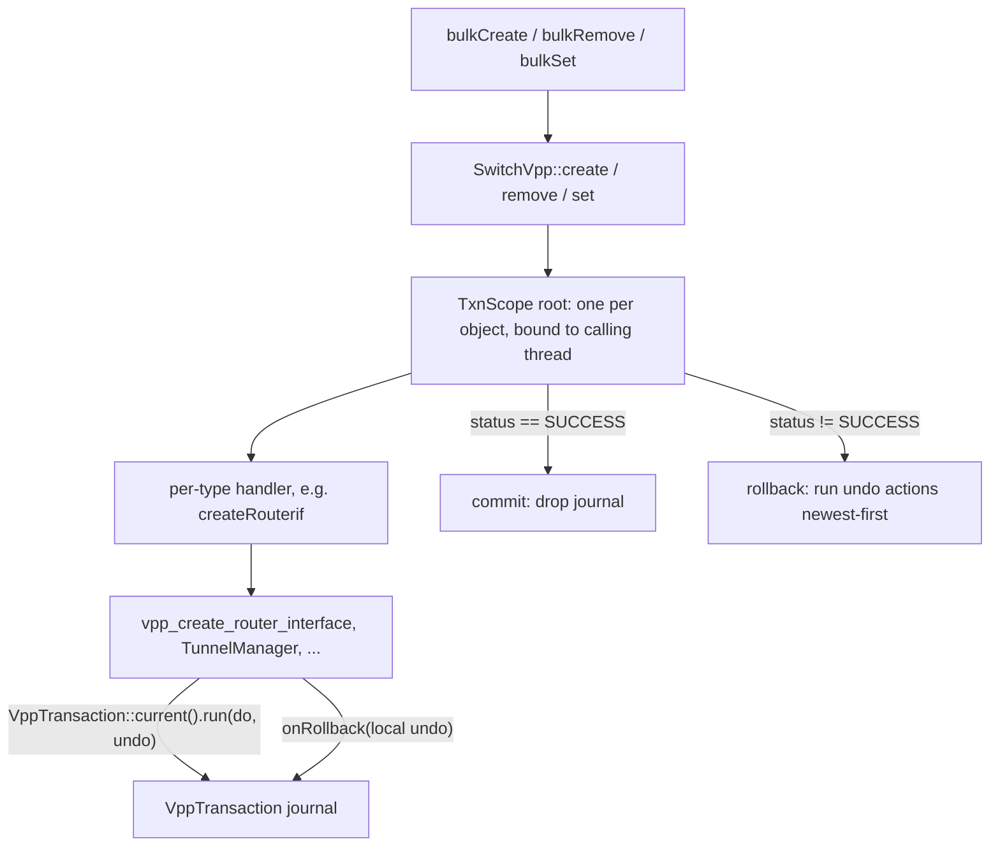
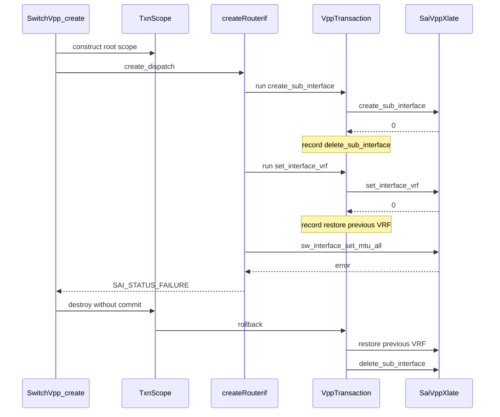

# VPP SAI Transaction Rollback HLD

## Table of Contents

1. [Revisions](#revisions)
2. [Scope](#scope)
3. [Definitions and Abbreviations](#definitions-and-abbreviations)
4. [Background](#background)
5. [Problem Statement](#problem-statement)
    - [Goals](#goals)
6. [Proposed Solution](#proposed-solution)
7. [Design Details](#design-details)
8. [Caller Conventions](#caller-conventions)
9. [Pilot Migrations](#pilot-migrations)
10. [Threading Model](#threading-model)
11. [Testing](#testing)
12. [Code References](#code-references)
13. [Risks and Open Questions](#risks-and-open-questions)
14. [Future Work](#future-work)

## Revisions

| Rev | Date | Author(s) |
|-----|------|-----------|
| v0.1 | 11/19/2026 | TBD |

## Scope

This document describes the high level design for transaction rollback in the VPP SAI implementation in `sonic-sairedis`, under `vslib/vpp`.

When a single SAI request needs several VPP API calls and one of them fails, the calls that already succeeded must be undone. Otherwise VPP is left partly programmed while the SAI layer reports failure. This design adds a common per-request transaction log for that cleanup, replacing the hand-written rollback code in individual handlers.

### In scope

- A `VppTransaction` journal of undo actions, scoped to one SAI `create`, `remove`, or `set` request.
- An RAII guard, `TxnScope`, that commits on success and rolls back on failure, with nested savepoints.
- Tracking the active transaction per thread.
- Undo actions for both `SaiVppXlate` calls and local C++ state (resource pools, interface registry, internal maps).
- Caller conventions for writing undo actions.
- Migrating two pilot handlers: router interface (RIF) create and VXLAN decap create.
- Unit tests and fault injection tests.

### Out of scope

- Generating undo actions automatically from `SaiVppXlate` call signatures.
- Making a whole bulk request all-or-nothing. Each object in a bulk request is still its own transaction, as SAI bulk semantics require.
- Running SAI requests concurrently. Per-thread tracking keeps that option open, but the locking it would need is listed under [Future Work](#future-work).
- Migrating the remaining hand-written rollback code (see [Future Work](#future-work)).
- Changes to orchagent, syncd, SAI headers, or the VPP plugins.

## Definitions and Abbreviations

**VPP**: Vector Packet Processing.

**SAI**: Switch Abstraction Interface.

**SaiVppXlate**: The C translation layer (`vslib/vpp/vppxlate/SaiVppXlate.c`) that turns SAI-level operations into VPP binary API messages.

**Transaction**: The set of VPP calls and local state changes made while handling one SAI object operation.

**Undo action**: A closure, written by the caller, that reverses one step that already succeeded.

**Journal**: The ordered list of undo actions recorded by a transaction.

**Savepoint**: A position in the journal that a nested step can roll back to without discarding earlier work.

**RAII**: Resource Acquisition Is Initialization. A C++ idiom where an object acquires a resource in its constructor and releases it in its destructor, so cleanup runs on every exit from a scope, including early returns and exceptions. `TxnScope` uses it to roll back a transaction that was not committed.

**RIF**: Router interface.

**BVI**: Bridge virtual interface.

## Background

`SwitchVpp` receives SAI requests through `create`, `remove`, and `set` in `SwitchVpp.cpp`. Each dispatches by object type to a handler such as `createRouterif`, `addIpRoute`, or `TunnelManager::create_vpp_vxlan_decap`. A handler typically makes several `SaiVppXlate` calls in sequence, for example:

1. create a sub-interface or BVI,
2. create the Linux control plane (LCP) tap pair,
3. attach the interface to a bridge domain,
4. bind it to a VRF,
5. set MTU, MPLS, admin state, and loopback action,
6. enable IPv6.

Most `SaiVppXlate` functions take an `is_add` / `enable` flag, so the reverse of a step is usually the same function with the flag flipped. Some calls return an index (ACL, policer, tunnel `sw_if_index`). Some overwrite a value, and reversing them means restoring the previous value.

Bulk requests (`bulkCreate`, `bulkRemove`, `bulkSet`) loop over the single-object entry points and report a status per object.

### How orchagent handles a failed SAI call

Orchagent decides whether to retry from the SAI status code, in `handleSaiCreateStatus`, `handleSaiSetStatus`, and `handleSaiRemoveStatus` (`src/sonic-swss/orchagent/saihelper.cpp`):

| SAI status | create | set | remove |
|------------|--------|-----|--------|
| `INSUFFICIENT_RESOURCES`, `TABLE_FULL`, `NO_MEMORY`, `NV_STORAGE_FULL` | retry | retry | treated as success |
| `OBJECT_IN_USE` | treated as success | treated as success | retry |
| `ITEM_ALREADY_EXISTS` | treated as success | treated as success | treated as success |
| `ITEM_NOT_FOUND`, `ADDR_NOT_FOUND` | treated as success | treated as success | treated as success |
| Any other status, including `SAI_STATUS_FAILURE` | failed, no retry | failed, no retry | failed, no retry |

- **Failed, no retry:** `handleSaiFailure` logs the error, publishes a `sai-operation-failure` event, records a SAI failure status (re-logged every second), and asks syncd for a SAI dump. Orchagent does not abort, and the request is dropped.
- **Retry:** `parseHandleSaiStatusFailure` tells the orch to keep the request in its consumer's `m_toSync` queue. The queue is processed again when new data arrives for that table and on every one-second idle timeout of the main loop (`orchdaemon.cpp` calls `doTask()` on every orch). There is no retry limit and no backoff.
- A retry repeats the whole orch-level operation, so the SAI call is issued again from scratch. For objects identified by an OID, sairedis allocates a new OID.
- Not every orch uses these helpers. Some check the status themselves and return `false` (retry) or throw. Orchagent's main retry path is actually for dependencies that are not ready yet (port not created, next hop not resolved), not for SAI status codes.

Most VPP SAI handlers return `SAI_STATUS_FAILURE` for any VPP error, so orchagent does not retry them today, even when the VPP error means "out of memory" or "table full".

#### When a remove is dropped

- Orchagent usually returns before its own bookkeeping cleanup, so the upper-level object stays in its tables (for example, `m_syncdNeighbors` in `NeighOrch::removeNeighbor`). Some orchs throw instead (for example, `intfsorch.cpp` on router interface removal).
- The sairedis client keeps the object in its metadata, because `Meta::remove` only drops it on success. A later create of the same entry key is rejected as already existing.
- `SwitchVpp::remove` only calls `remove_internal` after the handler succeeds, so the object also stays in `m_objectHash`.

Nobody asks to remove the object again, so a half-removed object stays until config reload or reboot.

## Problem Statement

Rollback after a partial failure is implemented separately in each handler today, in at least five different styles:

- `SwitchVpp::rollbackRifCreate` with a `RifCreateState` struct of 12 progress flags.
- A `rollback` lambda with a `bridge_created` flag in `TunnelManager::create_vpp_vxlan_decap`.
- A `rollback_bd_bvi` lambda and `rollback_l2_vxlan_tunnels` in `TunnelManager`.
- `rollbackRoute` in route replacement (`SwitchVppRoute.cpp`).
- Trim create/set re-programming.

Most handlers have no rollback at all.

This causes the following problems:

- **Incomplete cleanup.** For example, the VXLAN decap rollback lambda removes the BVI and the bridge domain, but does not undo the BVI IPv4/IPv6 address adds or the tunnel's bridge-domain membership.
- **Flags drift from the code.** Each new step has to be added in three places: the step, a progress flag, and the rollback function. Missing any one of them causes a leak.
- **Ordering is ad hoc.** Each rollback function picks its own undo order.
- **No common logging.** When cleanup fails, it is hard to tell from syslog which steps ran.
- **Error-prone retrofitting.** Adding rollback to an existing handler means restructuring it around flags or `goto` labels.
- **Retries run into leftovers.** When orchagent retries a create or set (resource-full statuses), the second attempt finds the first attempt's partial VPP state. It can then fail with a status that is not retried, or leak the old partial object.

### Goals

- A failed create or set leaves VPP and the VPP SAI layer's local state as they were before the request, so an orchagent retry starts clean and can succeed.
- A failed remove is undone as far as the handler can rebuild what it deleted (see [Remove policy](#remove-policy)).
- A handler never hides a partial failure behind a status orchagent treats as success (`ITEM_NOT_FOUND`, `ITEM_ALREADY_EXISTS`, `ADDR_NOT_FOUND`, `OBJECT_IN_USE` on create or set).

## Proposed Solution

Each SAI object operation runs inside a transaction. After each step succeeds, the handler records the matching undo action in the transaction's journal. If the operation returns a non-success status, the journal runs newest-first. If the operation succeeds, the journal is discarded.

The caller still writes each undo action; nothing is generated automatically. A `run(do, undo)` helper keeps the common symmetric add/delete case to one statement, and recording the undo right next to the step it reverses keeps the two in sync.



Handlers that have not been migrated record nothing. Rollback then does nothing, so their behavior is unchanged and handlers can be migrated one at a time.

## Design Details

### Components

New files `vslib/vpp/VppTransaction.h` and `vslib/vpp/VppTransaction.cpp`:

```cpp
class VppTransaction {
public:
    // Active transaction of the calling thread; a no-op instance when none is active.
    static VppTransaction& current();

    // Record an undo for something that already succeeded. undo returns 0 on success (VPP convention).
    void onRollback(std::string desc, std::function<int()> undo);

    // Run do_fn; if it returns 0, record undo_fn. Returns do_fn's result.
    template <class Do, class Undo>
    int run(std::string desc, Do do_fn, Undo undo_fn);

    size_t savepoint() const;                  // current journal depth
    sai_status_t rollbackTo(size_t savepoint); // undo newest-first down to savepoint
    sai_status_t rollback();                   // rollbackTo(0)
    void commit();                             // clear journal
};

class TxnScope {
public:
    TxnScope();               // root on this thread, or a savepoint if one is active
    ~TxnScope();              // rolls back to its start if not committed
    void commit();            // root: clear journal; nested: keep entries for the parent
    sai_status_t rollback();  // undo entries recorded since this scope started
    VppTransaction& txn();
};
```

Each journal entry holds a description (for logging) and the undo closure.

### Request lifecycle

The current bodies of `SwitchVpp::create`, `remove`, and `set` move into private `create_dispatch`, `remove_dispatch`, and `set_dispatch` functions. The public functions become thin wrappers:

```cpp
sai_status_t SwitchVpp::create(...)
{
    serviceDeferredOperStatusResync();   // not part of this request; runs outside the scope

    TxnScope scope;
    sai_status_t status = create_dispatch(...);
    if (status == SAI_STATUS_SUCCESS)
    {
        scope.commit();
    }
    return status;   // ~TxnScope rolls back if not committed
}
```

Because the bulk functions call these wrappers once per object, each object in a bulk request gets its own transaction without any extra change.

`serviceDeferredOperStatusResync()` is called today at the start of each `create`, `remove`, and `set` body. It moves into the wrappers, before the scope opens, because the link-state resync it may run is not triggered by the request and must not be rolled back with it (see [Deferred work](#deferred-work)).



### Nesting and savepoints

A `TxnScope` created while another scope is active on the same thread does not start a new transaction. It records the current journal depth as a savepoint.

- If the nested scope commits, its entries stay in the journal and belong to the outer transaction.
- If it is destroyed without committing, it rolls back only to its savepoint.

This supports handlers that try an optional sub-step and continue if it fails. For example, the VLAN member path tolerates a failure to set up the L2 punt classify tables. The failed sub-step is cleaned up while the rest of the request carries on.

### Rollback semantics

- Undo actions run newest-first, so later steps that depend on earlier ones (for example, an IP address on an interface) are undone before the earlier step (deleting the interface).
- If an undo action fails, its description and return code are logged, and the remaining undo actions still run. Rollback is best-effort.
- The SAI request returns its original error status. If any undo failed, an "incomplete cleanup" error is logged, but the returned status is not changed.
- On rollback, each undo is logged as it runs: NOTICE when it succeeds, ERROR when it fails or throws. The cleanup sequence is visible in syslog.
- Undo actions run on the thread that owns the transaction, synchronously, before the SAI call returns.

### Interaction with SAI object state

In the pilot handlers, VPP is programmed before `create_internal` / `set_internal` / `remove_internal` update `m_objectHash` and `m_object_db`, and a failure returns before those updates. So the handler's own failures need no undo for SAI object state. An enclosing scope can still roll back after the handler succeeds, so a handler records an undo for its `create_internal` (RIF create does). A handler that updates SAI object state before a step that can still fail must record an undo for that update during migration. Local state that handlers change earlier (interface registry, bridge-domain ID pool, stats base maps, pending admin-state maps) is recorded with `onRollback`.

### Remove policy

Rollback of a remove is best-effort, limited to the information the remove handler has.

- A remove request runs inside a transaction like any other request. Each step that the handler knows how to reverse records an undo action.
- Undoing a remove step means re-creating what it deleted. The handler gets no create arguments in a remove request, so if an undo is needed, the handler must rebuild those arguments from local state: the SAI attributes in `m_objectHash` / `m_object_db`, `m_ifaceRegistry`, the TunnelManager tables, or values it reads from VPP before deleting.
- If the handler cannot rebuild a step's arguments, it records no undo for that step. When a later step fails, that part stays deleted.
- The request still returns the failure status, and the rollback journal is logged, so the leftover state is visible in syslog alongside orchagent's SAI failure event.

Rolling back keeps VPP consistent with sairedis and orchagent, which still consider the object present after a failed remove (see [When a remove is dropped](#when-a-remove-is-dropped)). It does not make the object removable again, because orchagent does not retry.

The pilots are both create paths, so no remove handler is migrated in this phase.

## Caller Conventions

These rules are documented in `VppTransaction.h`.

**Symmetric add/delete.** Use `run`:

```cpp
VppTransaction::current().run("ip route add",
    [p]() mutable { return ip_route_add_del(&p, true); },
    [p]() mutable { return ip_route_add_del(&p, false); });
```

**Capture arguments by value.** Existing code reuses stack structs between calls. For example, `TunnelManager` uses `bvi_ip_prefix` for the IPv4 address and then overwrites it for the IPv6 address. An undo action that captured it by reference would remove the wrong address.

**Calls that return an index or handle** (`vpp_acl_add_replace`, `vpp_vxlan_tunnel_add_del`, `create_bond_interface`, `vpp_ipip_tunnel_add`). Make the call, then record the undo with the returned value:

```cpp
uint32_t acl_index;
if (vpp_acl_add_replace(&acl, &acl_index, false) == 0)
{
    VppTransaction::current().onRollback("acl add",
        [acl_index]() { return vpp_acl_del(acl_index); });
}
```

**Set operations.** Read or keep the previous value first, then record an undo that restores it (RIF create already reads `previous_state` and `previous_mpls`).

**Local state.** Use `onRollback` with a closure that returns 0, for example to free a bridge-domain ID back to `dynamic_bd_id_pool` or to remove an entry from `m_ifaceRegistry`.

**Remove handlers.** Undoing a remove step means re-creating what it deleted. If an undo is needed, rebuild the create arguments from local state (SAI attributes, interface registry, manager tables) before deleting, and capture them by value in the undo action. If they cannot be rebuilt, record no undo; that step is best-effort. See [Remove policy](#remove-policy).

**No cross-thread hand-off.** No request hands work to another thread today. If one ever does, that work cannot record undo actions for the request: they would go into the other thread's transaction, or be dropped. See [Threads that touch SwitchVpp today](#threads-that-touch-switchvpp-today).

**Deferred work is a sub-task.** When a request triggers a deferred task (such as a pending sub-interface admin up), record an undo that restores both the VPP state and the deferred bookkeeping, so the task goes back on its pending list. See [Deferred work](#deferred-work).

## Pilot Migrations

### RIF create

`SwitchVppRif.cpp`, `createRouterif` and `vpp_create_router_interface`:

- Remove the progress flags in `RifCreateState` and the `rollbackRifCreate` function. Each step records its own undo instead.
- When the CREATE creates the interface itself (sub-port sub-interface, VLAN BVI), it records undo actions for the interface, its LCP pair, and its bridge attach. Deleting the interface also drops its VRF, MTU, MPLS, admin, loopback, and IPv6 settings, so no undo is recorded for those, as before. The undo for the interface also removes it from `m_ifaceRegistry` and from `m_sub_if_admin_up_pending`, but only if the delete succeeds.
- When the CREATE configures an existing interface (port, LAG), it records undo actions that restore the previous VRF, MTU, MPLS, loopback action, IPv6 enable, and admin state.
- `createRouterif` opens no scope of its own; it records into the request's transaction from `SwitchVpp::create`. Unit tests that call it directly open the scope in their helper, the same way the wrapper does.
- The cleanup at the end of `createRouterif` (`m_ifaceRegistry.clearRifOid`, `m_rifStatsBaseMap.erase`) becomes a local undo action, recorded before the calls because they can fail after a partial update.
- After `create_internal` succeeds, `createRouterif` records an undo that calls `remove_internal`, so rolling back an enclosing scope also removes the SAI object.
- `RifCreateState` keeps only `hwif`, `interface_created`, and `resync_children`.
- `vpp_resync_sub_interface_admin_state` returns the sub-interfaces it applied. `createRouterif` passes that list to `deferSubInterfaceAdminUp`, which records, for each one, an undo that sets it admin down and puts it back in `m_sub_if_admin_up_pending` (see [Deferred work](#deferred-work)). The helper does not record anything itself, because the port admin-state path (`setPort`) and `createHostif` also call it and are not migrated yet. They get the undo when they are migrated.
- When `vpp_router_interface_set_vrf` registers a virtual router that VPP did not know yet (the default table, or a kernel VRF table), it records an undo that calls `vpp_del_ip_vrf`. It also records an undo for the binding, even for an interface the CREATE created, so the interface leaves the table before the table is deleted. Only callers that pass `RifCreateState` get these undos. The loopback path in `vpp_add_lpb_intf_ip_addr` passes none and does not undo its binding, so its registration is kept.
- Still without undo, as before: the bond MAC write, `ensureMplsTable`, the NAT zone, and `install_pending_decap_host_paths`.
- Behavior change: undo order becomes strictly newest-first. For a BVI, the LCP pair is now deleted before the bridge detach. The end state is the same.

### VXLAN decap create

`TunnelManager.cpp`, `create_vpp_vxlan_decap`:

- Replace the `rollback` lambda and the `bridge_created` flag with transaction records for: bridge-domain ID allocation, BVI create, interface list refresh, admin up, bridge attach, VRF binding, the BVI IPv4 and IPv6 address adds, and the tunnel's bridge-domain membership.
- This fixes the current gaps: today the IP address adds and the tunnel attach are not undone.

## Threading Model

The active transaction is stored in a `static thread_local VppTransaction*` in `VppTransaction.cpp`, read through `VppTransaction::current()`.

- The outermost `TxnScope` on a thread sets the pointer, and restores the previous value when it is destroyed.
- Each thread has its own transaction and journal, so if SAI requests are ever dispatched from a thread pool, one request's rollback cannot touch another request's journal.
- Code that runs with no active scope (the VPP event / MAC-learn thread, switch init) gets a no-op transaction. `run` still makes the call but records nothing. `onRollback` logs a debug message and drops the undo.

### Threads that touch SwitchVpp today

- **Request thread.** Runs `create`, `remove`, and `set` for SAI requests, holding `m_apimutex`.
- **VPP event thread** (`SwitchVpp::vppProcessEvents`). Waits for VPP events (link state, MAC learn/age/move, BFD), refreshes the cached link speed on link-up, and puts each event on the vslib event queue. It does not program VPP for a SAI request and does not use transactions.
- **vslib event queue thread.** Applies those events in `syncOnPlatformEvent`, holding `m_apimutex`. Link and BFD notifications can call `SwitchVpp::set()` from this thread. That call gets its own root transaction on this thread, like any request.

No request hands part of its work to another thread today. The [no cross-thread hand-off](#caller-conventions) convention keeps it that way.

### Deferred work

Some work requested earlier is deferred until a condition is met, and then runs inside whichever request meets it.

**Rule: deferred work that a request triggers is a sub-task of that request.** If the request fails, its rollback puts the deferred work back in its original state. That means both the VPP state and the deferred bookkeeping: the task goes back on its pending list, so it runs again the next time the condition is met. The code that applies a deferred task records the undo action, in the same way as any other step.

Example, `m_sub_if_admin_up_pending`. This set holds sub-interfaces whose admin up VPP refused while the parent port was down. When a request brings the parent up, `vpp_resync_sub_interface_admin_state` applies the admin up to each pending sub-interface of that parent and removes it from the set.

1. Request A creates the RIF on `Ethernet0.100` with admin up. `Ethernet0` is down, so VPP refuses, and `Ethernet0.100` goes into the pending set. A succeeds.
2. Request B brings `Ethernet0` up. The resync sets `Ethernet0.100` admin up and removes it from the set. B's handler then records, for each sub-interface the resync applied, an undo that sets it admin down and puts it back in the set (`deferSubInterfaceAdminUp`).
3. A later step in B fails. Rollback runs newest-first: `Ethernet0.100` goes back to admin down and back in the pending set, then `Ethernet0` goes back down. Everything is as it was after request A.

A request's own additions to a deferred list are undone the same way. For example, if request C adds `Ethernet4.200` to the pending set and then fails, its rollback removes the entry along with the sub-interface.

**Exception: work the request does not trigger.** `serviceDeferredOperStatusResync()` runs the one-time link-state resync that the VPP event thread requests at startup. It only reads link state from VPP into the SAI oper status, does not depend on anything the request changes, and runs at the start of a request only because it needs `m_apimutex`. It is called before the request's scope opens (see [Request lifecycle](#request-lifecycle)), so it is never part of a request's rollback.

Today SAI requests reach `SwitchVpp` one at a time, so per-thread tracking behaves the same as a single per-switch transaction. It costs about the same and does not tie the design to `SwitchVpp`: `TunnelManager` and other helpers need no back-pointer to find the transaction.

Per-thread tracking alone does not make concurrent requests safe. See [Future Work](#future-work).

## Testing

### Unit tests: `unittest/vslib/TestVppTransaction.cpp`

- Undo actions run newest-first.
- `commit` discards the journal.
- A failing undo is logged and the remaining undo actions still run.
- Nested scope commit keeps its entries for the parent; nested scope rollback undoes only to its savepoint.
- Destroying a scope without committing (early return) rolls back.
- `run` records an undo only when the step returns 0.
- With no active scope, `run` makes the call and records nothing.
- Per-thread isolation: two threads, each with its own scope; rolling back one leaves the other's journal intact.

### Fault injection: `MockVppXlate`

`unittest/vslib/MockVppXlate` already records every `SaiVppXlate` call in order and can be set to fail chosen calls. For each pilot:

- For every N, make the Nth VPP call fail.
- Check through `calls` / `callsTo()` that each earlier step was undone, in reverse order.
- Check that local state (interface registry entries, bridge-domain ID pool) is back to its starting values.
- Deferred work: create a sub-interface while its parent is down, so it goes into the pending set. Then make a request that brings the parent up fail after the resync, and check that the sub-interface is admin down again and back in `m_sub_if_admin_up_pending`.
- Update the existing rollback expectations in `TestSwitchVppRif.cpp` for the new newest-first order.

Run:

```bash
./unittest/vslib/tests --gtest_filter='*SwitchVpp*:*VppTransaction*'
```

## Code References

| Area | File |
|------|------|
| Transaction journal and scope guard (new) | `src/sonic-sairedis/vslib/vpp/VppTransaction.h`, `VppTransaction.cpp` |
| SAI entry points and bulk loops | `src/sonic-sairedis/vslib/vpp/SwitchVpp.cpp` |
| RIF create pilot | `src/sonic-sairedis/vslib/vpp/SwitchVppRif.cpp`, `SwitchVpp.h` |
| VXLAN decap pilot | `src/sonic-sairedis/vslib/vpp/TunnelManager.cpp` |
| VPP API translation | `src/sonic-sairedis/vslib/vpp/vppxlate/SaiVppXlate.c`, `SaiVppXlate.h` |
| Build | `src/sonic-sairedis/vslib/Makefile.am`, `src/sonic-sairedis/unittest/vslib/Makefile.am` |
| Tests | `src/sonic-sairedis/unittest/vslib/TestVppTransaction.cpp` (new), `TestSwitchVppRif.cpp`, `MockVppXlate.h` |

## Risks and Open Questions

- **Undo is best-effort.** If VPP rejects an undo (for example, because the VPP connection dropped), VPP can still be left partly programmed. That is no worse than today, and the full journal is logged.
- **Incorrect captures.** A by-reference capture of a reused struct makes an undo act on the wrong object. This is mitigated by the convention, review, and fault injection tests that check undo arguments.
- **Order change in RIF rollback.** Newest-first undo issues a few more VPP calls than today's shortcut. Existing tests that check the exact call sequence need updating.
- **Remove coverage.** Rolling back a remove depends on the handler rebuilding create arguments from local state. Where local state is incomplete, a failed remove leaves the object partly deleted in VPP while sairedis and orchagent still consider it present. Orchagent does not retry, so that state lasts until config reload.
- **Index changes on re-create.** Re-creating a deleted VPP object in a remove undo can give it a new index (`sw_if_index`, ACL index). Handlers that do this must update local references to the new index.
- **Side effects outside VPP.** Some steps touch Linux state through LCP (tap devices, netlink). Undoing the VPP call usually undoes these as well, but this should be checked per handler during migration.

## Future Work

- Migrate the remaining hand-written rollbacks: `rollback_bd_bvi` and `rollback_l2_vxlan_tunnels` in `TunnelManager`, `rollbackRoute` in `SwitchVppRoute.cpp`, and Trim create/set.
- Add transaction records to other handlers that make several VPP calls: LAG and LAG member, VLAN member, ACL table/entry, mirror session, PBH, NAT, SRv6.
- Map VPP errors to SAI statuses. Translate VPP errors that mean resource exhaustion (out of memory, table full) to `SAI_STATUS_INSUFFICIENT_RESOURCES` or `SAI_STATUS_TABLE_FULL` instead of `SAI_STATUS_FAILURE`, so orchagent retries them. Do this only for handlers whose rollback is complete, so each retry starts clean.
- Concurrent SAI request handling. Beyond per-thread transactions, this would need:
  - locks on `SwitchVpp` state (`m_objectHash`, `m_ifaceRegistry`, `dynamic_bd_id_pool`, stats maps);
  - serialized use of the single VPP API request connection (`vat_main` in `SaiVppXlate.c`), or one connection per thread;
  - per-object or per-interface serialization, so that a rollback restoring a previous value (MTU, admin state, VRF) cannot overwrite a change made by another thread.
