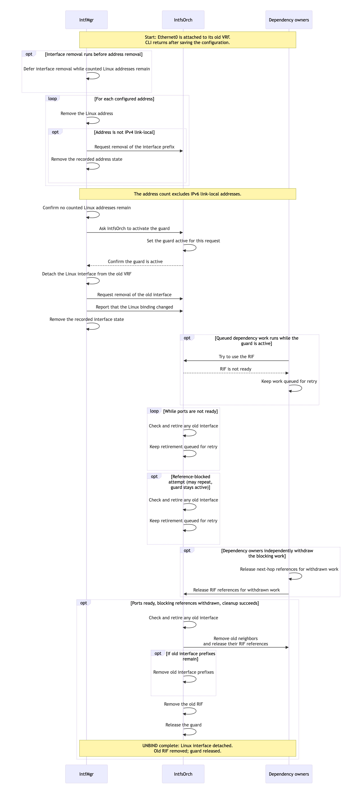
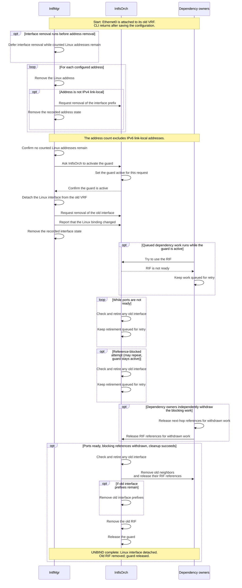
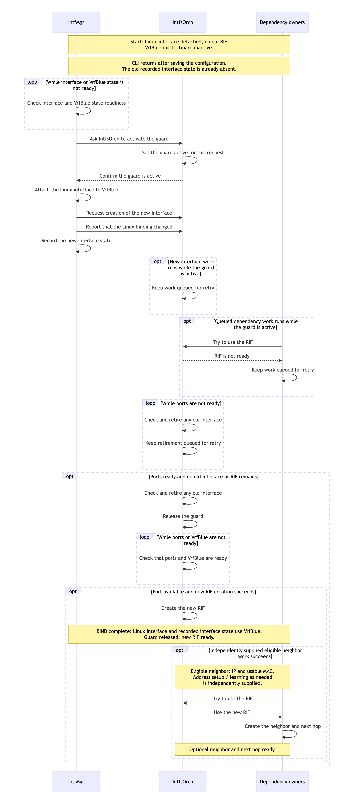
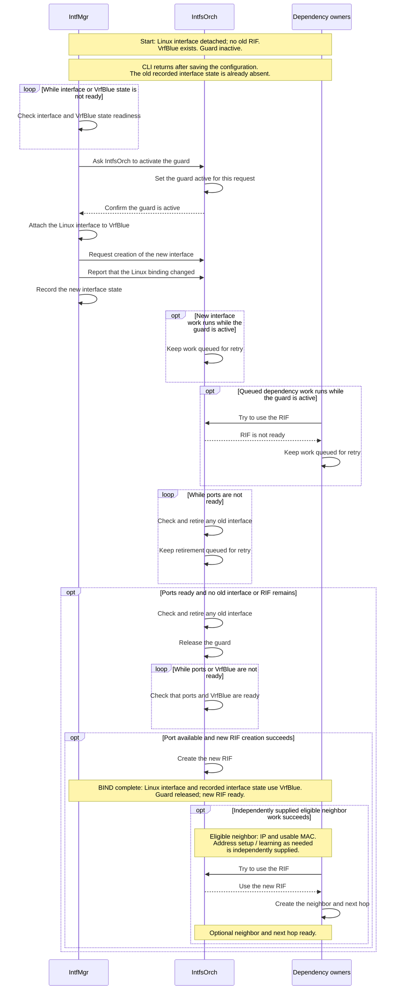
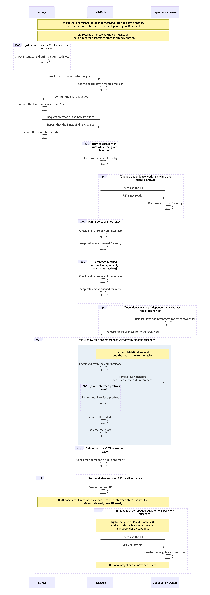
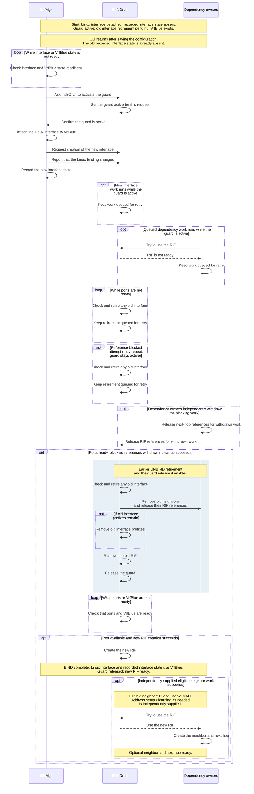

# SONiC VRF Bind Guard High-Level Design

## Revision history

| Rev | Date       | Author     | Change Description |
| --- | ---------- | ---------- | ------------------ |
| 0.1 | 2026-09-28 | Bojun-Feng | Initial draft. Describes the VRF bind guard and interface retirement approach. |
| 0.2 | 2026-10-28 | Bojun-Feng | Rewrite for readability and structure; add table of contents, definitions, and schema example. |

## Table of contents

- [Revision history](#revision-history)
- [Definitions and abbreviations](#definitions-and-abbreviations)
- [1. Overview](#1-overview)
  - [1.1 Existing behavior](#11-existing-behavior)
  - [1.2 Failure during a VRF change](#12-failure-during-a-vrf-change)
- [2. Scope and requirements](#2-scope-and-requirements)
- [3. Architecture and design](#3-architecture-and-design)
  - [3.1 Component responsibilities](#31-component-responsibilities)
  - [3.2 Guarding new work](#32-guarding-new-work)
  - [3.3 Retiring the old interface](#33-retiring-the-old-interface)
- [4. DB schema and request protocol](#4-db-schema-and-request-protocol)
  - [4.1 Coordination records](#41-coordination-records)
  - [4.2 Request processing](#42-request-processing)
- [5. Lifecycle examples](#5-lifecycle-examples)
  - [5.1 UNBIND](#51-unbind)
  - [5.2 Clean BIND](#52-clean-bind)
  - [5.3 BIND while earlier UNBIND retirement is pending](#53-bind-while-earlier-unbind-retirement-is-pending)
- [6. Retained work and retry](#6-retained-work-and-retry)
  - [6.1 Interface retirement](#61-interface-retirement)
  - [6.2 Neighbor replay](#62-neighbor-replay)
  - [6.3 Retry wakeups](#63-retry-wakeups)
- [7. Restart and recovery](#7-restart-and-recovery)
- [8. Test plan](#8-test-plan)
  - [8.1 Unit tests](#81-unit-tests)
  - [8.2 Integration and failure tests](#82-integration-and-failure-tests)
  - [8.3 State and forwarding checks](#83-state-and-forwarding-checks)
- [9. References](#9-references)

## Definitions and abbreviations

| Term | Definition |
| --- | --- |
| `VRF` | Virtual Routing and Forwarding instance. |
| `RIF` | Switch Abstraction Interface (SAI) router interface managed by `IntfsOrch`. |
| `BIND` / `UNBIND` | Interface VRF transition operations (`config interface vrf bind` and `config interface vrf unbind`). |
| `APPL_DB` `INTF_TABLE` | Application database table carrying interface-level (`INTF_TABLE:<alias>`) and interface-prefix (`INTF_TABLE:<alias>:<prefix>`) entries from `IntfMgr` to `IntfsOrch`. |
| `STATE_DB` `INTERFACE_TABLE` | State database table holding `IntfMgr`'s recorded interface state (`INTERFACE_TABLE\|<alias>`) and recorded address state (`INTERFACE_TABLE\|<alias>\|<prefix>`). |
| `STATE_DB` `INTERFACE_GUARD_TABLE` | State database table (`INTERFACE_GUARD_TABLE\|<alias>`) retaining the current VRF bind guard request, applied transition state, and acknowledgment state per interface alias. |
| `APPL_DB` `INTF_GUARD_TABLE` | Application database state table (`INTF_GUARD_TABLE:<alias>`) carrying guard requests with `id` and `action` (`prepare`, `applied`, or `cancel`), written by `IntfMgr` and consumed by `IntfsOrch`. |
| `INTF_GUARD_ACK` | `STATE_DB` notification channel used by `IntfsOrch` to wake `IntfMgr` after writing guard acknowledgment fields. |
| `Dependency owners` | `orchagent` consumers that create, reuse, or withdraw objects referencing an interface's RIF (`RouteOrch`, `NeighOrch`, `NhgOrch`, `FgNhgOrch`, and `MuxCableOrch`, according to the covered paths in Section 3.2). |

## 1. Overview

### 1.1 Existing behavior

When a SONiC interface changes its virtual routing and forwarding instance (VRF), `IntfMgr` and `IntfsOrch` process the transition asynchronously across two processes. `IntfMgr` updates the Linux network device's VRF binding (`master` or `nomaster`), publishes interface updates to `APPL_DB` `INTF_TABLE`, and updates recorded interface state in `STATE_DB` `INTERFACE_TABLE` (`INTERFACE_TABLE|<alias>`). Inside `orchagent`, `IntfsOrch` consumes `APPL_DB` `INTF_TABLE` interface work on its own schedule to remove the old SAI router interface (RIF) and create the new RIF.

Because `IntfMgr` updates the Linux binding and recorded interface state without waiting for `IntfsOrch` to finish removing the old RIF, the Linux interface can enter a new VRF while `orchagent` still owns the old RIF. During that window, kernel route and neighbor changes are published to `APPL_DB` for the new VRF, and `RouteOrch` and `NeighOrch` consume those updates independently of `IntfsOrch`.

### 1.2 Failure during a VRF change

While the Linux interface is already in the new VRF and `orchagent` still holds the old RIF, incoming route and neighbor updates for the new VRF arrive in `APPL_DB`. Because `RouteOrch`, `NeighOrch`, and `IntfsOrch` consume separate `APPL_DB` tables independently, `RouteOrch` can receive a connected route before `IntfsOrch` observes the interface transition, programming the route against the old RIF without queuing it for retry. Similarly, `NeighOrch` can create a neighbor or next hop while old RIF removal is pending. Both paths resolve the interface alias to the old RIF and attach references that prevent `IntfsOrch` from removing the old RIF and creating the new RIF.

`orchagent` cannot prevent this mismatch simply by requiring a route's VRF to match its outgoing RIF's VRF, because legitimate cross-VRF features such as steady-state VRF route leaking and VPN decapsulation install routes whose outgoing RIF belongs to another VRF. Nor can a local removal check inside `IntfsOrch` catch route updates that reach `RouteOrch` before `IntfsOrch` sees the interface change. Preventing the mismatch requires coordinating `IntfMgr` and `orchagent` before the Linux VRF binding changes.

## 2. Scope and requirements

During a VRF transition, SONiC must prevent new routes, neighbors, next hops, or interface prefixes from attaching to an interface's old RIF while still allowing existing references on the old RIF to drain. The old RIF must finish retiring before the new RIF is created, and new desired work for the interface must stay queued for retry until the new RIF is ready.

The existing CLI and `CONFIG_DB` interface are retained. `BIND` and `UNBIND` remain independent operations, and `UNBIND` can finish without a later `BIND`. Steady-state cross-VRF route leaking continues to use the existing route and next-hop model, and a transition on one interface does not block unrelated interfaces.

This design applies to non-loopback interfaces (physical ports, VLAN interfaces, LAG interfaces, and sub-ports) transitioning out of or into a named VRF, or recovering an interrupted transition, while preserving their existing manager and orchestrator readiness requirements. Removing an interface already in the default VRF does not invoke the transition guard when no interrupted transition is pending, and loopback processing remains separate.

## 3. Architecture and design

To close the asynchronous window between Linux and `orchagent`, this design introduces a VRF bind guard keyed by interface alias. Across guarded transitions, the guard enforces two ordering rules: confirmation that the guard is active in `IntfsOrch` precedes the Linux VRF binding change in `IntfMgr`, and old interface retirement precedes new RIF creation.

Before changing a guarded Linux VRF binding, `IntfMgr` asks `IntfsOrch` to activate the guard and waits for confirmation. While the guard is active, `IntfsOrch` and dependency owners (`RouteOrch`, `NeighOrch`, and next-hop-group owners `NhgOrch` and `FgNhgOrch`) keep new `SET` work queued for retry while allowing withdrawals and cleanup to drain existing references on the old RIF. Once `IntfMgr` updates the Linux binding and `IntfsOrch` finishes retiring the old RIF, `IntfsOrch` releases the guard so ordinary processing can create the new RIF and use it for current desired work.

### 3.1 Component responsibilities

`IntfMgr` coordinates the guard request, changes the Linux interface binding (`master` or `nomaster`), publishes interface work to `APPL_DB` `INTF_TABLE`, and updates recorded interface state in `STATE_DB` `INTERFACE_TABLE`. Recorded interface state is `IntfMgr`'s interface-level `STATE_DB` entry (`INTERFACE_TABLE|<alias>`), including its `vrf` field. It is distinct from interface prefixes, which are address entries processed through `APPL_DB` (`INTF_TABLE:<alias>:<prefix>`) and tracked by `IntfsOrch`; address entries also have separate recorded address state in `STATE_DB` (`INTERFACE_TABLE|<alias>|<prefix>`).

`IntfsOrch` maintains the guard, retires the old interface, and creates the new RIF. Dependency owners (`RouteOrch`, `NeighOrch`, and next-hop-group owners `NhgOrch` and `FgNhgOrch`) retain their object references and retry responsibilities, and `NeighOrch` removes old neighbors during retirement.

CLI return, recorded interface state, and RIF readiness are separate completion points. The CLI returns after saving the configuration in `CONFIG_DB`. `IntfMgr` updates recorded interface state after changing the Linux binding without waiting for old RIF removal, while `IntfsOrch` completes old RIF retirement and new RIF creation asynchronously.

### 3.2 Guarding new work

Before changing a guarded Linux binding, `IntfMgr` asks `IntfsOrch` to activate the guard. A matching acknowledgment in state `guarded` or `retired` confirms that the guard is active. `IntfMgr` can then change the Linux binding whether or not old interface retirement has finished.

While the guard is active, `IntfsOrch` keeps interface-level and interface-prefix `SET` operations queued. On covered dependency paths (`RouteOrch` route processing, `NeighOrch` neighbor and single/bulk neighbor-enable processing, `NhgOrch` group and link-up validation, and ordinary `MuxCableOrch` activation requests), owners check the guard before creating or reusing objects that reference the interface, including cached neighbors, next hops, and next-hop groups; legacy `RouteOrch` ECMP and `FgNhgOrch` link-state callbacks remain separate from this guard. Cleanup and withdrawal paths retain access to the old RIF so they can find it and release existing references. A guarded operation remains pending with its retry owner and is excluded from hardware submission and bulk-success accounting.

### 3.3 Retiring the old interface

To retire an old interface, `IntfsOrch` first waits for all ports to be ready, including when no old interface or RIF remains. When an old interface is present, `IntfsOrch` asks `NeighOrch` to remove old neighbors and release their RIF references, removes any remaining old interface prefixes, performs applicable proxy-ARP cleanup, and removes the old RIF.

Existing reference accounting determines when these operations can finish. Dependency owners independently release next-hop references and RIF references as withdrawn work arrives; `BIND` and `UNBIND` do not generate those withdrawals. When a retirement attempt returns incomplete, `IntfsOrch` keeps retirement queued for retry. The guard remains active until retirement completes and the current request permits guard release. Cleanup follows the existing owners and SAI error handling, including terminal errors.

## 4. DB schema and request protocol

### 4.1 Coordination records

Because `IntfMgr` and `IntfsOrch` run as independent processes, the guard coordinates transitions through internal `APPL_DB` and `STATE_DB` records. `IntfMgr` retains one current request per interface alias in `STATE_DB` `INTERFACE_GUARD_TABLE|<alias>` and allocates a monotonically increasing `request_id` from that record.

- **Guard invocation:** In addition to named-VRF creation and removal, `IntfMgr` uses the guard when creating an interface with a retained `request_id` while recorded interface state in `STATE_DB` `INTERFACE_TABLE|<alias>` is absent, or when `kernel_pending` indicates retained unfinished Linux binding work, so any prior transition finishes retiring first.
- **Request publication (`IntfMgr` to `IntfsOrch`):** `IntfMgr` persists the request in `STATE_DB` `INTERFACE_GUARD_TABLE|<alias>` before publishing a `SET` with `id` and `action` (`prepare`, `applied`, or `cancel`) through the `APPL_DB` `INTF_GUARD_TABLE` state table, keyed by `<alias>`.
- **Validation and acknowledgment (`IntfsOrch` to `IntfMgr`):** For each `APPL_DB` request update, `IntfsOrch` validates its `id` and `action` against the retained `STATE_DB` record before processing it. After writing acknowledgment fields to that record, `IntfsOrch` sends an `INTF_GUARD_ACK` notification to wake `IntfMgr`.
- **Acknowledgment readback:** `IntfMgr` then reads the retained `INTERFACE_GUARD_TABLE|<alias>` record to check the acknowledged ID and state.

| Database / Table | Writer | Fields | Meaning |
| --- | --- | --- | --- |
| `STATE_DB` `INTERFACE_GUARD_TABLE\|<alias>` | `IntfMgr` | `request_id` | Monotonically increasing identity allocated from retained state; retries of the same `prepare` retain the request ID. |
| `STATE_DB` `INTERFACE_GUARD_TABLE\|<alias>` | `IntfMgr` | `action` | Current request action (`prepare`, `applied`, or `cancel`); notification ID and action must match the retained current request. |
| `STATE_DB` `INTERFACE_GUARD_TABLE\|<alias>` | `IntfMgr` | `target_vrf` | Current request's target VRF name (for example, `VrfBlue` in Section 5.2, or empty for `nomaster`). |
| `STATE_DB` `INTERFACE_GUARD_TABLE\|<alias>` | `IntfMgr` | `kernel_pending` | Set before a guarded Linux binding change and cleared after updating recorded interface state; if processing is interrupted or replaced, this field keeps unfinished Linux binding work guarded. |
| `STATE_DB` `INTERFACE_GUARD_TABLE\|<alias>` | `IntfMgr` | `applied_id`, `applied_vrf` | Latest applied request and its target VRF (or empty for `nomaster`), preserving pending retirement across `DEL`-to-`SET` coalescing and newer request cancellations. |
| `STATE_DB` `INTERFACE_GUARD_TABLE\|<alias>` | `IntfsOrch` | `id`, `state` | Acknowledged request identity and progress state (`guarded`, `retired`, or `released`). |
| `STATE_DB` `INTERFACE_GUARD_TABLE\|<alias>` | `IntfsOrch` | `retired_id` | Retirement completion identity compared with `applied_id` to determine whether an applied transition's pending retirement remains unfinished. |
| `APPL_DB` `INTF_GUARD_TABLE:<alias>` (state-table entry) | `IntfMgr` | `id`, `action` | Request fields delivered by `ProducerStateTable` / `ConsumerStateTable`; `id` and `action` are validated against `INTERFACE_GUARD_TABLE\|<alias>`. |
| `STATE_DB` `INTF_GUARD_ACK` (notification channel) | `IntfsOrch` | Operation `ack`; data `<alias>`; no field/value pairs | Wakeup after the acknowledgment fields in `INTERFACE_GUARD_TABLE\|<alias>` are updated; `IntfMgr` reads that record to check `id` and `state`. |

Example `STATE_DB` `INTERFACE_GUARD_TABLE|Ethernet0` record after retirement for request `1` is complete and `IntfMgr` has applied request `2`, a `BIND` to `VrfBlue`. `IntfsOrch` has acknowledged request `2` as `guarded` but has not completed its retirement check (`applied_id` `2` > `retired_id` `1`):

```text
STATE_DB  INTERFACE_GUARD_TABLE|Ethernet0
    request_id     = "2"
    action         = "applied"
    target_vrf     = "VrfBlue"
    kernel_pending = "0"
    applied_id     = "2"
    applied_vrf    = "VrfBlue"
    id             = "2"
    state          = "guarded"
    retired_id     = "1"
```

### 4.2 Request processing

The three request actions coordinate the guard lifecycle across the retained request record:

- `prepare` asks `IntfsOrch` to activate the guard for the interface. `IntfsOrch` validates the request against the retained record, marks the guard active for this request, and writes its acknowledgment. `IntfMgr` proceeds with the Linux binding change only with a matching `guarded` or `retired` acknowledgment. Retries of the same `prepare` keep the same `request_id`.
- `applied` reports that `IntfMgr` changed the Linux binding. After updating the Linux binding, `IntfMgr` publishes ordinary interface work and records `applied_id` and `applied_vrf`. `IntfsOrch` then completes retirement and releases the guard for the current request.
- `cancel` ends a `prepare` that did not change the Linux binding. Any earlier applied request's unfinished retirement still completes before guard release, as described in Section 6.1.

Acknowledgment states distinguish guard progress: `guarded` means the guard is active; `retired` means old interface retirement has completed but the guard is still active; `released` means the guard is inactive. When a replacement request arrives, `IntfsOrch` transfers the active guard to the new request without allowing new work between requests. After release, the terminal request record remains in `STATE_DB` so stale `APPL_DB` guard notifications cannot act on a new RIF and an older queued `INTF_TABLE` interface entry cannot recreate a mismatched VRF binding.

## 5. Lifecycle examples

The three sequence diagrams illustrate `Ethernet0` `UNBIND` and named-VRF `BIND` lifecycles. They show representative interleavings where `APPL_DB` consumers run independently, Linux operations and `orchagent` object changes follow their successful paths, and readiness or reference waits can repeat. In these diagrams, `UNBIND complete` marks old RIF removal and guard release; `BIND complete` marks new RIF creation after guard release. Object readiness (“Old RIF removed”, “new RIF ready”, and optional neighbor and next hop readiness) follows successful SAI/API handling.

### 5.1 UNBIND

For `Ethernet0`, `config interface vrf unbind` removes the interface configuration and configured addresses. `IntfMgr` processes address removal and defers interface removal while counted Linux addresses remain (excluding IPv6 link-local addresses). For each configured address, `IntfMgr` removes the Linux address, and for addresses other than IPv4 link-local it also requests removal of the interface prefix and removes the recorded address state (IPv4 link-local address removal is local to Linux in this path). `IntfsOrch` may consume interface-prefix removal before the guard is active or during retirement.

Once no counted Linux addresses remain and `IntfsOrch` confirms the guard is active, `IntfMgr` detaches the Linux interface from the old VRF (`nomaster`). Before requesting removal of the old interface, reporting `applied`, and removing the recorded interface state, `IntfMgr` checks that applicable link-local neighbor cleanup succeeded; a failure leaves those three updates pending. After `IntfMgr` publishes them, `IntfsOrch` completes retirement asynchronously and releases the guard.



<details>
<summary>Mermaid source</summary>



</details>

Sub-port `UNBIND` removes configured addresses and the old interface configuration, waits for old recorded interface state to disappear, and then recreates the sub-port configuration in the default VRF by omitting the VRF field. While the `Ethernet0` diagram above ends once the old RIF is removed and the guard is released, sub-port recreation continues into new default-VRF RIF creation after old RIF retirement completes.

### 5.2 Clean BIND

A clean `BIND` starts with the Linux interface detached, recorded interface state absent, no old RIF, and the guard inactive, with `VrfBlue` as the target VRF. Before saving the new interface configuration, `config interface vrf bind` removes configured addresses and the old interface configuration, then waits for old recorded interface state to disappear. After checking interface and `VrfBlue` state readiness and confirming the guard is active, `IntfMgr` attaches the Linux interface to `VrfBlue` (`master`), publishes the new interface request and `applied` update, and records the new interface state.

In `IntfsOrch`, the retirement check waits for all ports to be ready, establishes that no old interface or RIF remains, and releases the guard. Ordinary interface processing then verifies port and `VrfBlue` readiness and creates the new RIF (`BIND complete`). Address configuration and neighbor learning arrive independently; when eligible neighbor work with a valid neighbor IP and a usable MAC is supplied, `NeighOrch` uses the new RIF to create the neighbor and next hop.



<details>
<summary>Mermaid source</summary>



</details>

### 5.3 BIND while earlier UNBIND retirement is pending

As in Section 5.2, `config interface vrf bind` waits only for old recorded interface state to disappear. A new `BIND` can therefore begin when the Linux interface is already detached and recorded interface state is absent, while the guard remains active and old interface retirement from the earlier `UNBIND` is still pending. When `IntfMgr` issues the new `BIND` request, `IntfsOrch` transfers the active guard to the current request without a gap. After matching confirmation, `IntfMgr` attaches the Linux interface to `VrfBlue` and records the new interface state while old interface retirement remains pending. New RIF creation and dependency work wait for retirement and guard release.

The old neighbors, interface prefixes, and RIF belong to the earlier `UNBIND`, whereas guard release uses the validated current `BIND` request. After retirement and guard release, new RIF creation and the optional neighbor work follow the same conditions as a clean `BIND`.



<details>
<summary>Mermaid source</summary>



</details>

## 6. Retained work and retry

### 6.1 Interface retirement

`IntfsOrch` retains pending retirement separately from the ordinary interface consumer queue. If an interface `DEL` and a later `SET` coalesce in the `APPL_DB` state-table delivery path before `IntfsOrch` consumes the `DEL`, the ordinary interface entry alone no longer shows the `DEL`, but `applied_id` in `STATE_DB` still records the pending retirement. `IntfsOrch` compares `applied_id` with `retired_id` to determine whether retirement is unfinished, including when a newer `prepare` is canceled. Canceling that newer request therefore preserves the earlier pending retirement.

### 6.2 Neighbor replay

`NeighOrch` similarly separates desired neighbor input from its hardware cache. After successful old neighbor removal during retirement, `NeighOrch` requeues a previously consumed desired `SET` if no newer `SET` or `DEL` is already pending for that neighbor. Desired `SET` operations that are still pending remain queued while the guard is active. After guard release and new RIF creation, ordinary retries process current desired neighbor work against the new RIF.

### 6.3 Retry wakeups

`INTF_GUARD_ACK` prompts `IntfMgr` to read the retained `STATE_DB` record and retry pending work. `IntfMgr` also retries on timeout and after other events.

## 7. Restart and recovery

Recovery depends on whether the guard records in `STATE_DB` survive. After an `intfmgrd` or `orchagent` restart, or a `config reload`, the components use the recovery sequence below when retained requests are present. If a cold reboot or another initialization path clears those records, there is no previous guard request to reconstruct; the components follow the normal SONiC initialization path.

Warm reboot and fast reboot may restore other Redis state while filtering `STATE_DB`. The current reboot filter does not retain `INTERFACE_GUARD_TABLE`, so the retained-state algorithm below does not establish recovery of an in-flight transition across those reboots. Support for that case requires explicit preservation of the required records and validation of the relevant reboot path.

During startup with retained `STATE_DB` state, `IntfsOrch` reconstructs active guard requests and terminal request records from `STATE_DB` `INTERFACE_GUARD_TABLE` before dependency work can use a RIF. Reconstructing active requests preserves admission blocking for in-flight transitions, while reconstructing terminal records ensures stale `APPL_DB` notifications cannot act on a RIF after restart.

`IntfMgr` reconciles retained `prepare` requests and unfinished Linux binding work (`kernel_pending`) with `CONFIG_DB` configuration and recorded interface state in `STATE_DB` `INTERFACE_TABLE`. When a retained removal was interrupted, `IntfMgr` resumes and completes that removal before processing a replacement request for a different VRF, recovering applicable link-local neighbor cleanup from the old `APPL_DB` `INTF_TABLE` interface entry. An orphan `prepare` with no pending removal can be canceled. Validation covers supported reload and restart interleavings with retained database state.

## 8. Test plan

### 8.1 Unit tests

- Exercise `prepare`, `applied`, and `cancel` processing, verifying that retries of the same `prepare` keep the same `request_id`. Verify that notifications are validated against retained `request_id` and `action` fields and that `IntfMgr` changes the Linux binding only after an acknowledgment whose `id` matches the current request, including when a stale acknowledgment is injected.
- Inject stale requests and acknowledgments across replacement and release, verifying that replacement requests transfer the active guard without an unguarded gap and that retained terminal records reject stale `APPL_DB` notifications after guard release.
- Verify that a matching `guarded` or `retired` acknowledgment precedes the Linux binding change, old RIF removal precedes new RIF creation, and interface-level and interface-prefix `SET` operations stay queued while the guard is active.
- Verify that on covered dependency paths (`RouteOrch` route processing, `NeighOrch` neighbor and single/bulk neighbor-enable processing, `NhgOrch` group and link-up validation, and ordinary `MuxCableOrch` activation requests), owners block new object creation and cached neighbor, next-hop, and next-hop-group reuse while the guard is active, and allow cleanup and withdrawal lookups to release existing references. Verify that guard-blocked work remains pending without being submitted for hardware programming or counted as successfully processed in a bulk operation.
- Verify that `IntfMgr` and `IntfsOrch` wait while interface or target-VRF state is not ready, and that `IntfsOrch` keeps retirement queued when ports are not ready (including clean `BIND` when no old interface or RIF remains). Verify that retirement also stays queued while external next-hop or RIF references remain held and completes after ports become ready and dependency owners withdraw their references.

### 8.2 Integration and failure tests

- Exercise default-to-named, named-to-default, and named-to-named VRF transitions, standalone `UNBIND` completing without a later `BIND`, `prepare` cancellation, and overlapping `BIND` while earlier `UNBIND` retirement is pending. Cover physical ports, VLAN interfaces, LAG interfaces, and sub-ports (distinguishing sub-port default-VRF recreation from the `Ethernet0` `UNBIND` endpoint) across IPv4 and IPv6, including addressless interfaces, IPv6 link-local addresses (excluded from the counted-address gate), and IPv4 link-local addresses.
- Cover direct/connected routes, gateway routes, ECMP, fine-grained ECMP, and cached object reuse. Verify both desired neighbor replay cases in `NeighOrch`: requeuing a previously consumed desired `SET` after successful old neighbor removal when not superseded by a newer `SET` or `DEL`, and keeping a desired `SET` that arrives while guarded queued until the new RIF is created.
- Force `DEL`-to-`SET` interface coalescing before `IntfsOrch` consumes the `DEL` and verify that comparing `applied_id` with `retired_id` preserves pending retirement across a canceled newer `prepare`, while rejecting a stale queued interface `SET` whose VRF does not match the completed transition.
- Inject Linux command failures, link-local neighbor cleanup failures (verifying that the final three `UNBIND` updates stay pending), and SAI failures including terminal errors.
- Test lost `INTF_GUARD_ACK` notifications and continuous input to confirm timer and event retry wakeups.
- Run supported reload/restart interleavings with retained database state across `prepare`, `kernel_pending`, `applied`, and retirement to verify startup reconstruction, interrupted removal completion before different-VRF replacement, and orphan `prepare` cancellation.

### 8.3 State and forwarding checks

Validation compares guarded behavior with existing SONiC behavior and checks each completion point separately:

- Inspect the Linux kernel, FRR, `APPL_DB`, `STATE_DB`, `ASIC_DB`, SAI object identities and reference counts, and data-plane packet forwarding independently across each transition.
- Verify that `IntfMgr` updates recorded interface state without waiting for old RIF removal, that unrelated interfaces continue to progress while an interface is guarded, and that steady-state cross-VRF route leaking continues to forward traffic using the existing route and next-hop model.

## 9. References

- [sonic-buildimage#27608](https://github.com/sonic-net/sonic-buildimage/issues/27608): Connected route in the new VRF programmed against the old RIF while VRF removal is pending
- [sonic-swss#4645](https://github.com/sonic-net/sonic-swss/pull/4645) and backport [sonic-swss#4803](https://github.com/sonic-net/sonic-swss/pull/4803): Defer connected route processing after `IntfsOrch` starts interface removal, and [cross-VRF route-leaking discussion on why route VRF cannot be required to match outgoing RIF VRF](https://github.com/sonic-net/sonic-swss/pull/4645#discussion_r3439874875)
- [sonic-buildimage#28619](https://github.com/sonic-net/sonic-buildimage/issues/28619): Connected route reaches `RouteOrch` before `IntfsOrch` observes the VRF rehome, bypassing the removal-in-progress check
- [sonic-buildimage#29919](https://github.com/sonic-net/sonic-buildimage/issues/29919): Neighbor or next hop created on the old RIF while VRF removal is pending and connected routes are deferred
