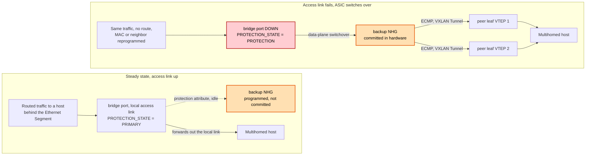
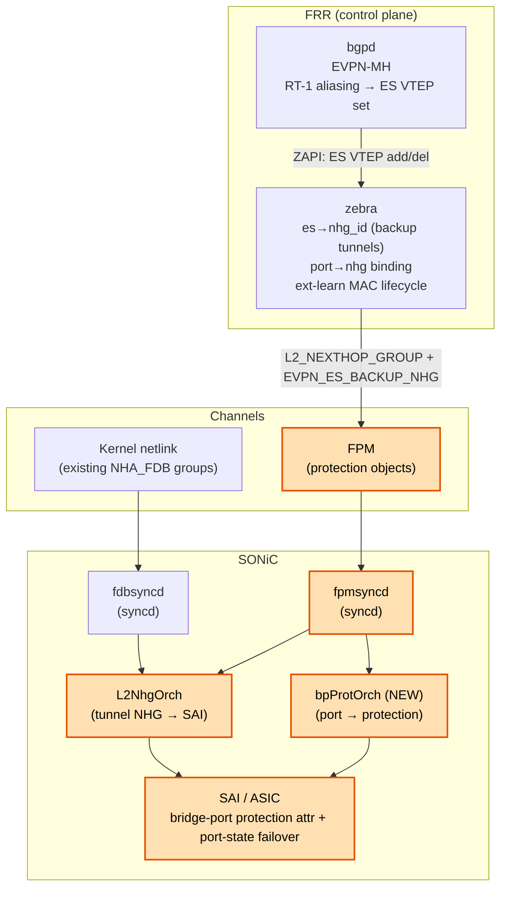
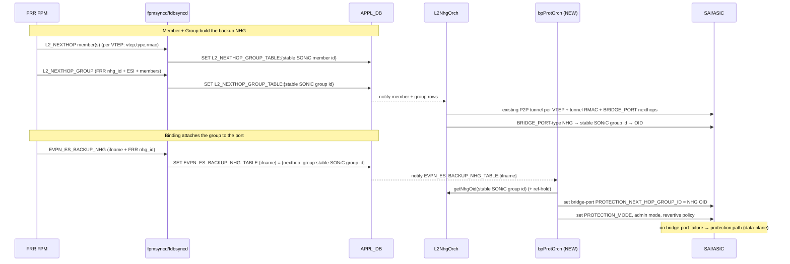
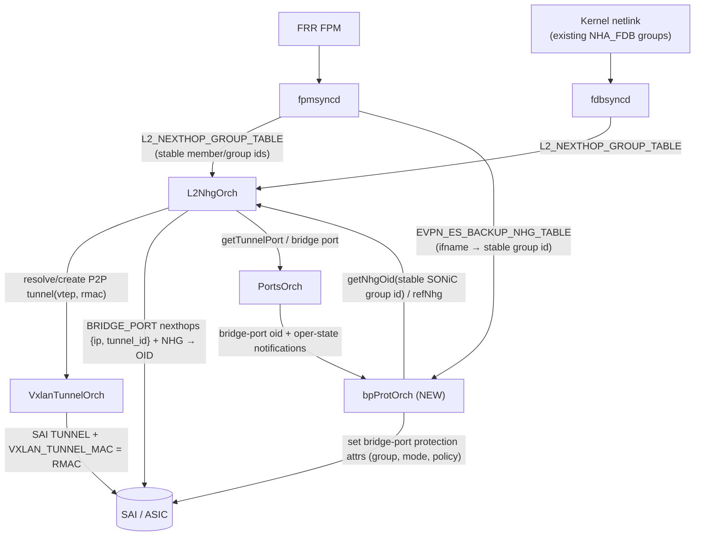
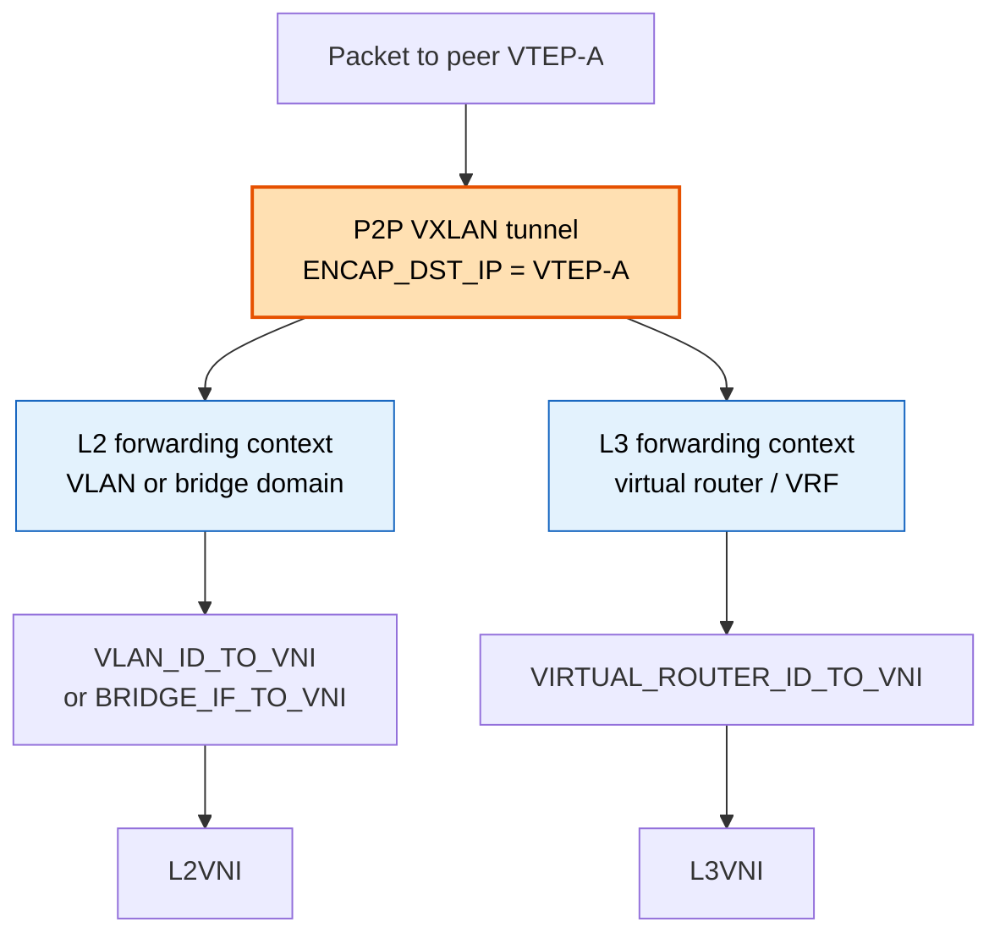
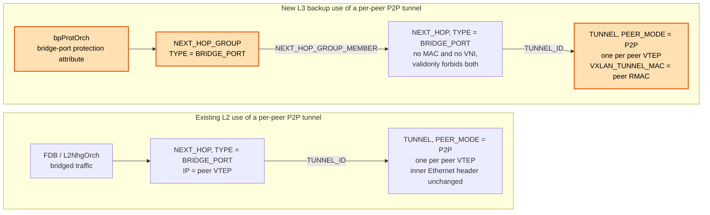
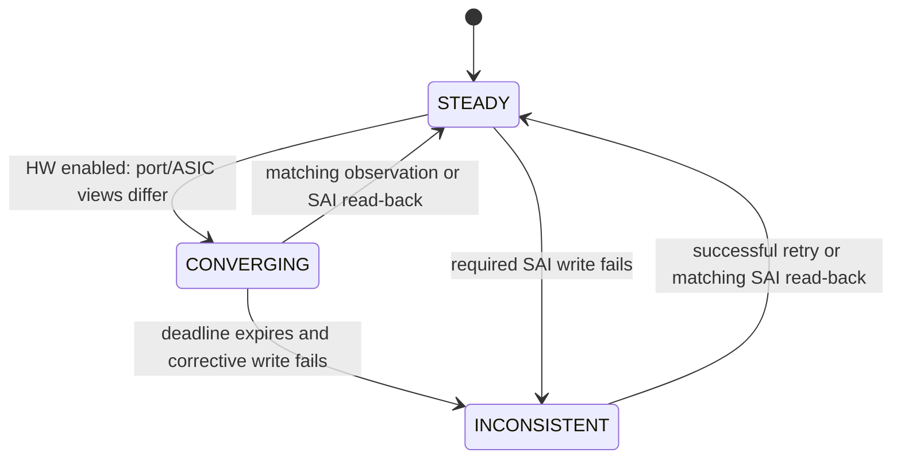
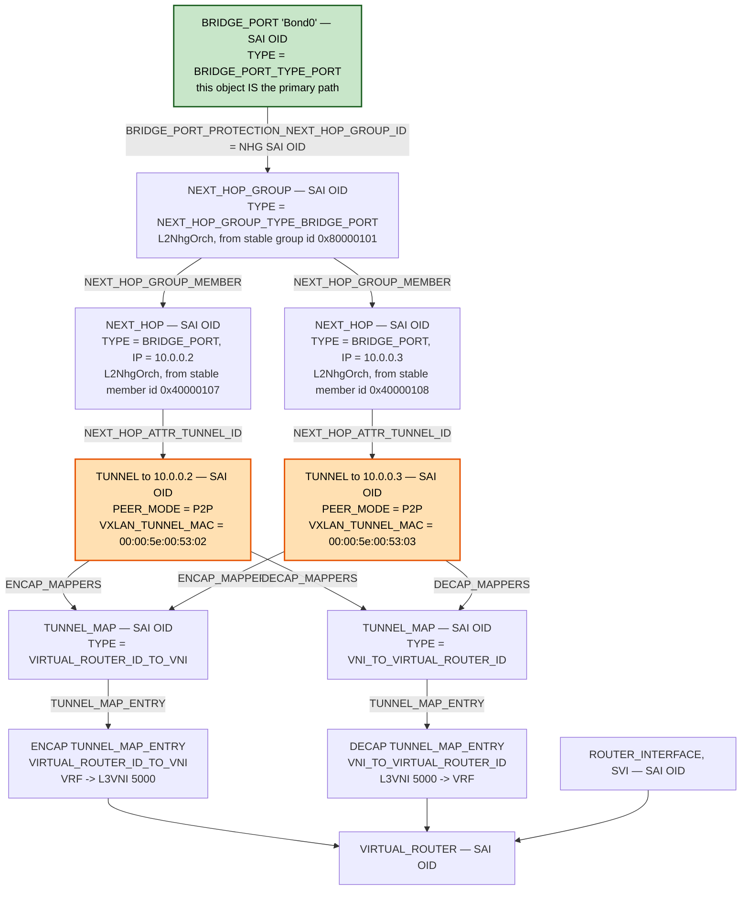

# Bridge-Port Protection Group (Primary/Backup) — SONiC High-Level Design

## Table of Contents

- [1. Revision](#1-revision)
- [2. Scope](#2-scope)
- [3. Definitions / Abbreviations](#3-definitions--abbreviations)
- [4. References](#4-references)
- [5. Overview](#5-overview)
- [6. Requirements](#6-requirements)
  - [6.1 Functional requirements](#61-functional-requirements)
  - [6.2 Configuration and management requirements](#62-configuration-and-management-requirements)
  - [6.3 Scalability requirements](#63-scalability-requirements)
  - [6.4 Warm boot requirements](#64-warm-boot-requirements)
- [7. Architecture Design](#7-architecture-design)
  - [7.1 High-level architecture](#71-high-level-architecture)
  - [7.2 New component — bpProtOrch](#72-new-component--bpprotorch)
  - [7.3 SONiC call flow (program)](#73-sonic-call-flow-program)
  - [7.4 Orchestration interaction summary](#74-orchestration-interaction-summary)
- [8. High-Level Design](#8-high-level-design)
  - [8.1 FPM messages](#81-fpm-messages)
  - [8.2 fpmsyncd changes](#82-fpmsyncd-changes)
  - [8.3 L2NhgOrch / VxlanTunnelOrch changes (backup group)](#83-l2nhgorch--vxlantunnelorch-changes-backup-group)
  - [8.4 bpProtOrch (new)](#84-bpprotorch-new)
  - [8.5 Cross-orch contract (L2NhgOrch ↔ bpProtOrch)](#85-cross-orch-contract-l2nhgorch--bpprotorch)
  - [8.6 DB schema changes](#86-db-schema-changes)
  - [8.7 Reconciliation model](#87-reconciliation-model)
  - [8.8 MAC, neighbor and FDB lifecycle constraints](#88-mac-neighbor-and-fdb-lifecycle-constraints)
- [9. SAI API](#9-sai-api)
- [10. Configuration and management](#10-configuration-and-management)
  - [10.1 Manifest (if the feature is an Application Extension)](#101-manifest-if-the-feature-is-an-application-extension)
  - [10.2 CLI / YANG model Enhancements](#102-cli--yang-model-enhancements)
  - [10.3 Config DB Enhancements](#103-config-db-enhancements)
- [11. Warmboot and Fastboot Design Impact](#11-warmboot-and-fastboot-design-impact)
- [12. Memory Consumption](#12-memory-consumption)
- [13. Restrictions / Limitations](#13-restrictions--limitations)
- [14. Testing Requirements / Design](#14-testing-requirements--design)
  - [14.1 Unit test cases](#141-unit-test-cases)
  - [14.2 System test cases](#142-system-test-cases)
- [15. Open / Action items](#15-open--action-items)

---

## 1. Revision

| Rev | Date | Author | Change Description |
|---|---|---|---|
| 1.0 | 2026-09-18 | Patrice Brissette - Cisco<br>Manas Kumar Mandal - Cisco | Initial draft |
| 1.1 | 2026-10-08 | Patrice Brissette - Cisco | Align with FRR HLD: drop Member VNI; flush and rebuild on every new FPM session (warm reboot and reconciliation out of scope) |
| 1.2 | 2026-10-14 | Patrice Brissette - Cisco | Align with FRR HLD rev 1.2: one Group per ES; Group carries full Members; RMAC applied as a tunnel `set`; add O4 (ID ownership) |
| 1.3 | 2026-10-26 | Patrice Brissette - Cisco | Align with FRR HLD rev 1.3 and the SONiC id allocator HLD: fpmsyncd publishes stable SONiC ids; Group carries its ESI; replay ends with `REPLAY_DONE`; reconciliation replaces the session-start flush |
| 1.4 | 2026-10-27 | Patrice Brissette - Cisco | Align with FRR HLD rev 1.4: the protected bridge port is the ES PortChannel (the .1Q bridge port), one Binding per ES; VLAN sub-interfaces are not separate bridge ports |
| 1.11 | 2026-11-24 | Patrice Brissette - Cisco | Align recovery defaults with SAI; bound pending state and use one CONFIG_DB enable; define tagged restart cleanup and replay outage; add sonic-sairedis/syncd notification support; align RMAC and protection ID ownership with FRR; handle PortChannel oper-down failover and recovery in both modes |
| 1.12 | 2026-11-25 | Patrice Brissette - Cisco | Define the shared native-layout FPM ABI and stable SONiC ID mapping; reconcile each complete FPM replay at `REPLAY_DONE` instead of flushing protection before replay |

---

## 2. Scope

This document describes the SONiC design for **primary/backup path protection per bridge port** for EVPN Layer-3 multihoming (L3MH). The protection object lives on a **bridge port** whose bridge has an **SVI attached to an IP table (VRF or GRT)** — hosts behind the port are reached by **L3 routing via the SVI**:

- **Primary** = the local bridge port (host reachable through the local access link).
- **Backup** = an **ECMP group of VXLAN L3 tunnels** to peer VTEPs, learned from **BGP EVPN RT-1 aliasing** and downloaded to SONiC over **FPM**.

Protection is enabled on the interface that owns the Ethernet Segment (the
PortChannel). That PortChannel is the protected bridge port in the .1Q
bridge, as for L2 EVPN-MH; all its VLANs share one Group and one Binding.

The initial protection behavior is **all-active L3MH**: the local bridge port
is primary and all eligible remote leaves are backup Members. Single-active
operation, including use of EVPN primary/backup bits, is outside this HLD.

On a platform that passes the routed-traffic validation in [system test 2](#142-system-test-cases), **hardware protection mode** performs a **fast, data-plane switchover** on local access-link failure from the primary bridge port to the backup tunnel NHG, with **no control-plane reconvergence** and **no change to the MAC/neighbor/route entries**. **Software protection mode** also switches to the backup NHG, but is control-plane-driven and has no fast data-plane timing guarantee.

The presence or absence of an **L2VNI must not matter** for the protection concept.

This HLD covers the SONiC components only: fpmsyncd, orchagent, `sonic-sairedis`, syncd, and the SAI adapter/ASIC. The hardware switchover callback requires notification metadata, serialization, and delivery through `sonic-sairedis`/syncd to orchagent. FRR/zebra/bgpd control-plane behavior is specified in the companion FRR design (see [References](#4-references)).

---

## 3. Definitions / Abbreviations

| Term | Definition |
|---|---|
| **ES / ESI** | Ethernet Segment / Ethernet Segment Identifier (EVPN multihoming) |
| **VTEP** | VXLAN Tunnel End Point |
| **VNI / L2VNI / L3VNI** | VXLAN Network Identifier; L2 (bridge) vs. L3 (routed/symmetric-IRB) VNI |
| **RMAC** | Router MAC — the remote leaf's router MAC used as the inner DMAC of a routed VXLAN packet. It may be common across VRFs on a peer; this design requires a common RMAC for all VRFs sharing the same peer P2P tunnel. |
| **RT-1 / RT-2 / RT-5** | EVPN route types: Ethernet Auto-Discovery (aliasing), MAC/IP, IP-Prefix |
| **Aliasing** | Reaching a multi-homed host via *any* leaf attached to its ES ([draft-ietf-bess-evpn-ip-aliasing](https://datatracker.ietf.org/doc/html/draft-ietf-bess-evpn-ip-aliasing-04), §§2–4). The eligible peer set is computed by FRR|
| **NHG** | Next Hop Group |
| **FPM** | Forwarding Plane Manager channel (FRR → fpmsyncd) |
| **bpProtOrch** | The one new orch introduced by this design: it binds a backup NHG to a protected bridge port by setting the SAI bridge-port protection attributes (see [5. Overview](#5-overview)) |
| **L2NhgOrch** | Existing orch owning `L2_NEXTHOP_GROUP_TABLE` → SAI NHG |
| **Protection path** | The backup NHG a protected bridge port falls back to. The **primary path is the bridge port itself**, so it is never named as a group member |
| **SVI** | Switch Virtual Interface (`Vlan<x>` L3 interface) |

---

## 4. References
| Doc | Link |
|---|---|
| EVPN IP aliasing / backup path | [draft-ietf-bess-evpn-ip-aliasing -04](https://datatracker.ietf.org/doc/html/draft-ietf-bess-evpn-ip-aliasing-04), §§2–4 |
| EVPN L3MH |  [SONiC HLD](https://github.com/sonic-net/SONiC/pull/2543) |
| FRR EVPN-MH extern mode (ext-learn) | [FRRouting/frr PR #21863](https://github.com/FRRouting/frr/pull/21863) |
| **Authoritative SAI EVPN-MH model (pinned revision 0.4)** — defines the bridge-port protection NHG, software and hardware protection modes, committed-path state, recovery policy, notification, and `SAI_TUNNEL_ATTR_VXLAN_TUNNEL_MAC` | [SAI-Proposal-EVPN-Multihoming at commit 72c5aa0](https://github.com/manamand2020/SAI/blob/72c5aa0bc4a5b45ac3681b54d7f7e8a46d6747d0/doc/tunnel/SAI-Proposal-EVPN-Multihoming.md) |
| Related SAI protection proposals (next-hop-group based, different attach point) | [SAI-Proposal-FRR](https://github.com/opencomputeproject/SAI/blob/master/doc/SAI-Proposal-FRR.md), [SAI-Proposal-HW-FRR](https://github.com/opencomputeproject/SAI/blob/master/doc/SAI-Proposal-HW-FRR.md) |

---

## 5. Overview

### The problem, in plain terms

A leaf switch can reach a multi-homed host **two ways**: *directly*, over its own local access link, and *indirectly*, through the peer leaves that share the same Ethernet Segment. While the local link is up we want to use it; the instant it fails we want traffic to fall back — immediately — onto VXLAN tunnels to those peers, and to swing back when the link recovers.

The naive way to do this is to reprogram every affected route or MAC on failure. That does not scale: one access link can front thousands of hosts, so reacting per-entry is both slow and **O(routes)**.

### The idea: protect the port, not the routes

Rather than touch any route or MAC, we attach a single **protection object** to the **bridge port**:

> **primary = the local port · backup = an ECMP group of VXLAN tunnels to the peer leaves**

Every MAC, neighbor, and route that already resolves through that port **inherits** the backup automatically — none of those entries change. Protection state is therefore **O(ports)**, not O(routes), and failover becomes a single hardware action: when the port loses carrier, the ASIC swaps primary→backup **in the data plane**, with no control-plane reconvergence.

The two states look like this. Note what does **not** change between them: the traffic, the routes, the MACs, and the neighbor entries are all identical — the only thing that moves is which path the bridge port's protection attribute has committed in hardware.



Because the Linux kernel has no way to express "local port as primary, tunnel-ECMP as backup, for *routed* traffic," this protection lives entirely in SONiC and is carried **end-to-end over FPM → SONiC → SAI**. Existing L3MH MAC/neighbor synchronization is unchanged by this protection design and is outside its scope; the new objects here are the protection Member, Group, and Binding.

### What FRR hands to SONiC

FRR computes the backup set from BGP EVPN and sends **three small objects** down the FPM channel. SONiC stitches them together by id:

| # | Object | Meaning | APPL_DB |
|---|---|---|---|
| 1 | **Member** (per peer VTEP) | one VXLAN L3 tunnel endpoint (`type=l3` in this release) + `{ remote_vtep, family, type, router_mac (RMAC) }`; the Member is VRF-independent, while SAI selects the encapsulation L3VNI from the packet VRF through tunnel maps | `L2_NEXTHOP_GROUP_TABLE:<stable SONiC member id>` |
| 2 | **Group** (per protected ES) | the ECMP list of stable SONiC Member IDs used as the backup of the ES bridge port | `L2_NEXTHOP_GROUP_TABLE:<SONiC group id>` |
| 3 | **Binding** (per port) | "this bridge port's backup is that group" | `EVPN_ES_BACKUP_NHG_TABLE:<ifname>` |

### The two SONiC components

Two orchs do the work, and both are named throughout the rest of this document, so they are introduced here.

- **`L2NhgOrch`** is the **existing** orch that owns `L2_NEXTHOP_GROUP_TABLE`. It turns the **Members + Group** rows into one SAI next-hop-group and exposes that group's oid to other orchs. It already builds exactly the object this design needs — a group of type `SAI_NEXT_HOP_GROUP_TYPE_BRIDGE_PORT` whose members are `SAI_NEXT_HOP_TYPE_BRIDGE_PORT` next hops, each pointing at a peer VTEP's tunnel.
- **`bpProtOrch`** is the **one new orch** this design adds. It exists for a single job: to attach a backup group to a port. It reads the **Binding**, resolves that group's oid from `L2NhgOrch`, and sets `SAI_BRIDGE_PORT_ATTR_BRIDGE_PORT_PROTECTION_NEXT_HOP_GROUP_ID` on the protected bridge port, plus the switchover-mode and recovery-policy attributes that go with it. It holds a reference on the group so SAI keeps it instantiated even though no route points at it.

Protection is an **attribute on the bridge port**, not a two-member protection group. The primary path *is* the bridge port that carries the attribute, so only the backup needs naming — there is no enclosing group and no primary "member" to encode. The complete object model, including the switchover mode, committed-path state, recovery policy, hardware notification, and tunnel RMAC, is defined by the pinned [SAI EVPN-MH model](#4-references).

The protection capability has two operating models. In **software protection**, `bpProtOrch` observes bridge-port operational state from `PortsOrch` and drives the SAI admin mode directly. In **hardware protection**, the ASIC handles failures it can detect autonomously and reports the committed state to SONiC. In either mode, a protected PortChannel reported operationally down by `PortsOrch` triggers a software failover override: `bpProtOrch` sets `SAI_BRIDGE_PORT_ATTR_BRIDGE_PORT_PROTECTION_ADMIN_MODE=PROTECTION`. This covers loss of the last LACP member even when that member's carrier remains up and the ASIC does not recognize the aggregate as failed. On recovery, `bpProtOrch` restores the configured admin intent using the revertive and wait-to-restore policy. Software mode programs only `PRIMARY` or `PROTECTION`, never SAI `AUTO`; in hardware mode `AUTO` is used again only after the PortChannel is confirmed up and recovery policy allows it. Hardware protection is required for [R4](#61-functional-requirements); software protection is a functional fallback but does not claim the same failover time.

### Room to grow

The first release carries **L3 VXLAN** backups, but nothing in the plumbing is L3-only. Every Member is tagged with a `type` (`l3`/`l2`), and because both kinds build the *same* SAI member type, adding **L2 VXLAN** backups later ([R6](#61-functional-requirements)) can reuse the same bridge-port NH builder, with different tunnel setup requirements. A `type=l2` member simply skips the RMAC handling. The same messages, tables, and orchs are reused throughout.

More broadly, the SAI attach point sees only a next-hop-group oid; the encapsulation lives on the tunnel objects the members reference. Nothing in the protection mechanism is specific to VXLAN, or to EVPN.

---

## 6. Requirements

### 6.1 Functional requirements

| # | Requirement |
|---|---|
| R1 | Primary path is the **local adjacency** (host reachable through the local bridge port). |
| R2 | Backup path is a **list (ECMP) of VXLAN L3 tunnels** to peer VTEPs, learned from BGP EVPN RT-1 aliasing. |
| R3 | On a platform validated for routed-traffic redirection, **all local adjacencies** resolved via a specific bridge port inherit that port's primary/backup protection. |
| R4 | In **HARDWARE** protection mode, switchover on link-failure detection must be fast and data-plane-driven, without control-plane reconvergence. **SOFTWARE** protection mode provides functional switchover but has no fast data-plane timing guarantee. |
| R5 | Program via the **FPM channel** for SONiC consumption. |
| R6 | Initial design uses **VXLAN L3** backup tunnels; must extend to **L2 VXLAN** tunnels later. |
| R7 | The presence or absence of an **L2VNI must not matter** for the protection concept. |
| R8 | The **MAC aging timer must exceed the ARP/ND refresh interval, with margin**, so a live host's MAC is never aged out from under a still-valid neighbor. |
| R9 | A neighbor is removed **only when ARP/ND resolution fails** — never as a side effect of MAC age-out or FDB flush. |
| R10 | A **protected bridge port must not trigger an FDB flush when it goes down**, in the same way an MLAG interface does not. |

### 6.2 Configuration and management requirements

- The base feature is derived from existing EVPN-MH configuration (ESI on the access port, SVI in a VRF/GRT with an L3VNI) and from received EVPN routes. FRR/zebra owns the control plane and emits the protection objects over FPM.

The `BRIDGE_PORT_PROTECTION|<ifname>` CONFIG_DB row is the single operator
enable and policy source for the protected bridge port. The SONiC configuration
manager renders the FRR interface command `evpn mh bridge-port-protection`
from this row on the ES-owning PortChannel; deleting the row removes the FRR
command. This keeps FRR object generation and SONiC attachment policy from
being enabled independently. L3MH neighbor synchronization is orthogonal and
is not a prerequisite for constructing the protection group.

FRR exports objects only while the rendered command is configured, local ES
state is eligible, and EVPN contexts are compatible. The CONFIG_DB row also
selects the hardware/software protection mode and the per-port recovery and
reconciliation policy. The operator does not configure the backup NHG in
SONiC. When the command is removed, FRR publishes deletes for the Binding,
Group, and unreferenced Members. `bpProtOrch` and `L2NhgOrch` enforce safe
detach-before-unref ordering while reconciling those independent updates.

  * **SONiC CONFIG_DB schema:** stores the bridge-port protection policy for the protected port, including protection mode, administrative override, recovery policy, and reconciliation parameters. The backup NHG identifier is not duplicated in CONFIG_DB; it is derived from FRR state and published by fpmsyncd in `EVPN_ES_BACKUP_NHG_TABLE`.
    * **Per-bridge-port `convergence_mode`** (HW protection only). Controls whether `bpProtOrch` reconciles ASIC-detected switchover state against the software view for that protected bridge port. With `convergence: enabled` (default), `bpProtOrch` participates in the role decision and reconciles the two views. With `convergence: disabled`, `bpProtOrch` only observes ASIC notifications and publishes state without general software/hardware convergence. In both settings, `PortsOrch` oper-down still triggers the software `PROTECTION` override for failures the ASIC may not detect.
    * **Per-bridge-port `t_resync_period_ms`** (HW protection only). Sets the periodic check for that protected bridge port (default 30 s) that reads hardware state and maintains eventual consistency between software and hardware. This is helpful when notifications are lost. Set this field to `0` to disable the periodic check.

These opt-outs may be combined on the same bridge-port protection object. With `convergence: disabled` and `t_resync_period_ms = 0`, `bpProtOrch` performs no general reconciliation and no periodic consistency check, and there is no automatic recovery from a lost ASIC notification. The `PortsOrch` oper-down override remains active in either setting because hardware may not detect a PortChannel failure caused by LACP member removal; its recovery follows the configured admin intent and revertive policy.

### 6.3 Scalability requirements

- Protection state is **O(bridge ports / ESIs)**, independent of the number of MACs or host routes behind the port.
- Backup NHG membership is **O(ESIs)**; membership changes are **in-place NHG updates** (stable `nhg_id`/oid while zebra stays running).
- The SONiC identifier map is **O(protection Members + Groups)** and is keyed by stable object identity, not zebra's session-scoped IDs.

### 6.4 Warm boot requirements

- Warm reboot remains out of scope. FPM reconnect, fpmsyncd restart, and zebra restart use a full replay and reconciliation; unchanged protection objects retain their SONiC IDs and stay attached. A cold SONiC restart begins with no protection objects and rebuilds them from replay. No claim is made that protection is available before the cold-start replay completes ([§11](#11-warmboot-and-fastboot-design-impact)).

---

## 7. Architecture Design

This architecture view follows the bridge-port protection objects from FRR over FPM through SONiC to SAI. Existing L3MH MAC/neighbor synchronization is unchanged and outside this design's scope. Inside SONiC the protection objects fan out to `L2NhgOrch`, which builds the backup tunnel group, and the new `bpProtOrch`, which binds that group to the port. Only the highlighted boxes are new or change; other EVPN/VXLAN paths are shown only where they interact with protection.

### 7.1 High-level architecture



| Layer | Module | Role | Change |
|---|---|---|---|
| FRR | **bgpd** | Computes the eligible peer VTEPs for the ES (valid in every IP-VRF of the ES) and each peer's RMAC (Router's MAC EC of its IP A-D per-EVI routes); sends them to zebra. | FRR-side; see FRR HLD |
| FRR | **zebra** | Owns the NHG; builds one Group per ES from the peers bgpd sends; binds it to the ES bridge port (PortChannel). | New **FPM emitters** for the objects; peer RMAC on routed members |
| Channel | **FPM** | Carries the protection objects (rich, kernel-independent). | New/extended messages |
| Channel | **Kernel netlink** | Carries the existing `NHA_FDB` groups consumed by `fdbsyncd`; other MAC/neighbor synchronization is outside this design's scope. | No change |
| SONiC | **fdbsyncd** | Parses kernel `NHA_FDB` groups → `L2_NEXTHOP_GROUP_TABLE` (`onMsgNhg`); handles `NDA_NH_ID`. | Existing L2 NHG path; not changed for protection |
| SONiC | **fpmsyncd** | FRR FPM → `ROUTE_TABLE` / `NEXTHOP_GROUP_TABLE`; already parses `RTM_FPM_*` EVPN-MH (SHL/DF/ES-backup-NHG) → `EVPN_ES_BACKUP_NHG_TABLE`. | New parsing for the tunnel NHG (Member/Group) over FPM |
| SONiC | **L2NhgOrch** | Consumes `L2_NEXTHOP_GROUP_TABLE`; builds SAI NHG + members (`createSaiNextHop(l2_nhg_id, tunnel_id, remote_vtep_ip)`, `createSaiNextHopGroup()`) — already **`BRIDGE_PORT` type**, which is what the attach point requires. | Resolve a P2P tunnel per peer VTEP carrying the RMAC; expose the NHG oid — see [8.3](#83-l2nhgorch--vxlantunnelorch-changes-backup-group) |
| SONiC | **NeighOrch / FdbOrch** | Existing L3MH neighbor and FDB orchestration; detailed synchronization is outside this protection design. | No change |
| SONiC | **bpProtOrch (NEW)** | Consume `EVPN_ES_BACKUP_NHG_TABLE`, resolve the NHG, set the bridge-port protection attributes on the protected port. | **New orch** |
| SONiC | **sonic-sairedis / syncd** | Serialize and deliver the SAI switch-level hardware-protection switchover notification to orchagent. | **New notification metadata, serializer, handler, and processor support** |
| SONiC | **SAI / ASIC** | Bridge-port protection attach point; **port-state-driven** primary↔protection switchover. | Attributes from the pinned SAI model — see [§9](#9-sai-api) |

### How FRR builds the backup tunnel list

FRR computes the eligible peer set for the Ethernet Segment and the protected
IP-VRF/L3VNI, then exports the **Member**, **Group**, and **Binding** objects
over FPM. The derivation from EVPN routes — aliasing, peer eligibility, RMAC
resolution, and withdrawal — is entirely FRR's responsibility and is specified
in the companion [FRR HLD](#4-references). SONiC does not parse EVPN routes.

From SONiC's point of view the three objects are:

- each **Member** names one peer VTEP tunnel identity; the local VTEP is never a
  Member because the local bridge port is the primary path,
- the **Group** is the ECMP list of those Members, and
- the **Binding** attaches the Group to the protected bridge port.

fpmsyncd writes these as APPL_DB rows; `L2NhgOrch` builds the backup NHG from the
Member and Group rows, and `bpProtOrch` uses the Binding to attach that NHG to
the protected bridge port. A local access-link failure simply selects the
already-programmed Group in the data plane; it requires no EVPN route change and
no control-plane reconvergence.

### 7.2 New component — `bpProtOrch`

- **Type:** an `Orch` and an **`Observer` of both L2NhgOrch and PortsOrch**, mirroring the existing observer patterns used by `MuxOrch`/`MirrorOrch`.
- **Consumes:** the FPM-derived `EVPN_ES_BACKUP_NHG_TABLE:<ifname> { nexthop_group: <id> }`, the per-port policy in `CONFIG_DB BRIDGE_PORT_PROTECTION|<ifname>`, and the SAI NHG oid produced by `L2NhgOrch` for `<id>`.
- **Programs:** the **SAI bridge-port protection attributes** on the protected port — the port is the primary path, the resolved NHG is the protection path.
- **Lifecycle:** must hold a **reference** on the backup NHG so it materializes in SAI even though **no route references it** (otherwise NhgOrch/L2NhgOrch may not instantiate it). In software mode it also consumes qualified bridge-port down/up notifications from PortsOrch and explicitly drives `PROTECTION_ADMIN_MODE`; hardware mode observes those events but leaves path selection to the ASIC.

At startup, `bpProtOrch` queries SAI attribute capability for `HARDWARE` bridge-port protection and caches the result in `STATE_DB SWITCH_CAPABILITY|switch` as `BRIDGE_PORT_HW_PROTECTION_CAPABLE=true|false`. A policy requesting `HARDWARE` is programmed in hardware mode when supported. Otherwise `bpProtOrch` logs the fallback, programs software mode, and publishes `protection_type=sw_protection` in the port's STATE_DB row. The fallback remains functional; the fast data-plane timing guarantee in [R4](#61-functional-requirements) applies only to hardware mode.

**The SAI object model is defined — `bpProtOrch` is a new SONiC consumer, not a new SAI object.** The attach point `SAI_BRIDGE_PORT_ATTR_BRIDGE_PORT_PROTECTION_NEXT_HOP_GROUP_ID` is defined in the pinned [SAI EVPN-MH model](#4-references) §3.2.4 for bridge ports of type `SAI_BRIDGE_PORT_TYPE_PORT`; §3.2.6 defines the surrounding control and observability surface:

| Attribute | Purpose here |
|---|---|
| `..._PROTECTION_MODE` | `SOFTWARE` (control plane decides) or `HARDWARE` (the adapter selects the protection path autonomously on a qualified bridge-port failure). **[R4](#61-functional-requirements)** wants `HARDWARE` |
| `..._PROTECTION_ADMIN_MODE` | Administrative override: `AUTO`, `PRIMARY` (pin to the port, lock protection out), `PROTECTION` (force onto the group). In **software** protection `bpProtOrch` programs only `PRIMARY`/`PROTECTION` (it realizes operator-intent `AUTO` by following link state); SAI `AUTO` is used only in **hardware** protection. Supersedes the deprecated boolean `..._BRIDGE_PORT_SET_SWITCHOVER` |
| `..._PROTECTION_STATE` (read-only) | Which path is currently committed in hardware — the authoritative value `bpProtOrch` reconciles against |
| `..._PROTECTION_REVERTIVE` + `..._PROTECTION_WAIT_TO_RESTORE_TIME` | Hardware-mode recovery policy; these SAI attributes are valid only for hardware protection. In software mode `bpProtOrch` applies the equivalent CONFIG_DB policy itself. |
| `SAI_SWITCH_ATTR_BRIDGE_PORT_HW_PROTECTION_SWITCHOVER_NOTIFY` | Switch-level callback reporting each hardware-initiated switchover as `{ bridge_port_id, previous_state, current_state, reason }` |

Because the primary path is the bridge port itself, there is **no separate two-path protection-group object** in this design: no enclosing group containing primary and backup members, no per-member configured role, and no primary member to resolve. There is only the backup NHG referenced by the bridge-port protection attribute. That is what makes the attach point expressible — a bridge port oid is not a next-hop oid and could not be a next-hop-group member.

Notifications are **advisory**; `bpProtOrch` treats `..._PROTECTION_STATE` as authoritative and reconciles against it, so a dropped notification degrades to stale state rather than a wrong decision.

### 7.3 SONiC call flow (program)

Putting it together, here is the happy-path programming sequence — from the **three FPM messages** arriving (Member, Group, Binding) to a protection object sitting on the port. Note the two halves land **independently**: `L2NhgOrch` builds the tunnel group from the **Member + Group** messages, and `bpProtOrch` — driven by the **Binding** — resolves that group and applies it. After that, hardware mode leaves failover to the ASIC; software mode is driven by the PortsOrch notification path described below.



### 7.4 Orchestration interaction summary

The inter-orch **call graph** — who calls whom (method-level) — and the one genuinely new coupling. Module roles/changes are already in the [7.1 architecture table](#71-high-level-architecture); this focuses on the runtime interactions.



**Flow (the coupling that matters):**

1. **Population.** `fpmsyncd` writes the L3 **member rows** (`vtep,type=l3,router_mac`) + **group row** to `L2_NEXTHOP_GROUP_TABLE`, and the **binding** (`ifname→nhg_id`) to `EVPN_ES_BACKUP_NHG_TABLE`. The Member is VRF-independent; SONiC selects the encapsulation L3VNI from the packet's VRF through tunnel maps, not from the Member.
2. **L2NhgOrch → VxlanTunnelOrch.** For each member, L2NhgOrch resolves (or creates) a `PEER_MODE_P2P` tunnel to that peer VTEP with `SAI_TUNNEL_ATTR_VXLAN_TUNNEL_MAC` = the member's RMAC, then builds a `SAI_NEXT_HOP_TYPE_BRIDGE_PORT` nexthop `{IP = vtep, TUNNEL_ID = that tunnel}` and assembles the members into a `BRIDGE_PORT`-type NHG → `oid(nhg_id)`.
3. **bpProtOrch → L2NhgOrch — the one new cross-orch link** (see [Cross-orch contract](#85-cross-orch-contract-l2nhgorch--bpprotorch)). bpProtOrch joins by `nhg_id`, calls `getNhgOid(nhg_id)` + `refNhg()` (pin — no route references it), then sets the bridge-port protection attributes on the protected port with that oid as the protection path.
   - **Ordering:** binding may arrive before the NHG → bpProtOrch **parks & retries** via the observer mechanism.
   - **Teardown:** the protection attribute is cleared first, then `unrefNhg()` — ref gates the SAI NHG delete.
   - **Membership churn:** L2NhgOrch mutates members in place; `nhg_id`/oid stay stable while zebra runs → bpProtOrch does nothing.
4. **FdbOrch / NeighOrch.** Program MAC / neighbor for the **primary** path exactly as today; they don't know about protection — it lives on the bridge port beneath them.

**Port-oper-down transition (both modes).** On protected PortChannel oper-down, `PortsOrch` notifies `bpProtOrch`, which sets `PROTECTION_ADMIN_MODE=PROTECTION`, including when hardware mode is configured. The override covers LACP removal of the last collecting/distributing member while carrier remains up. It takes precedence over configured `admin_mode=PRIMARY` while the local path is down. On oper-up, software mode applies the revertive/WTR policy before restoring the configured intent; hardware mode releases to `AUTO` only after oper-up is confirmed, allowing the ASIC's revertive/WTR policy to act. In software mode `bpProtOrch` programs only `PRIMARY`/`PROTECTION`, never SAI `AUTO`. This transition is independent of hardware convergence and is detailed in [§8.4.1](#841-hardware-protection-reconciliation-state).

---

## 8. High-Level Design

This section **follows the data as it travels**, so it can be read straight through:

- **8.1 - 8.2** — the three messages FRR sends over FPM, and how fpmsyncd lands them in APPL_DB.
- **8.3 - 8.4** — how `L2NhgOrch` turns those rows into a SAI backup group, and how the new `bpProtOrch` attaches that group to the port.
- **8.5** — the one genuinely new handshake between those two orchs (and the races it has to survive).
- **8.6 - 8.7** — the APPL_DB schema, stable IDs, and replay reconciliation after a restart.
- **8.8** — the MAC / neighbor / FDB lifecycle rules the design depends on, and why a protected port must not flush its FDB.

#### A running example

To keep the rest of this section concrete, we thread a single scenario through it:

> This leaf protects bridge port **`Bond0`** (an all-active ES). Two peer leaves attach to the same ES, at VTEPs **`10.0.0.2`** and **`10.0.0.3`**, with router-MACs **`00:00:5e:00:53:02`** and **`00:00:5e:00:53:03`**. The protected routed traffic is in **L3VNI 5000**, selected from its VRF through the tunnel map. FRR publishes session-scoped member ids **`0x40000007`** / **`0x40000008`** and group id **`0x80000001`**; fpmsyncd maps them to stable SONiC IDs before writing APPL_DB ([§8.2](#82-fpmsyncd-changes)).

For illustration, fpmsyncd maps those wire IDs to stable SONiC Member IDs
`0x40000107` and `0x40000108`, and Group ID `0x80000101`. The APPL_DB rows
use the SONiC IDs; the FPM wire IDs are not published:

```text
# Member rows — one per peer VTEP (8.1.3)
L2_NEXTHOP_GROUP_TABLE:0x40000107 = { remote_vtep:10.0.0.2, family:AF_INET, type:l3, router_mac:00:00:5e:00:53:02 }
L2_NEXTHOP_GROUP_TABLE:0x40000108 = { remote_vtep:10.0.0.3, family:AF_INET, type:l3, router_mac:00:00:5e:00:53:03 }
# Group row — the ECMP list and stable identity metadata (8.1.3)
L2_NEXTHOP_GROUP_TABLE:0x80000101 = { esi:00:11:22:33:44:55:66:77:88:99, nexthop_group:"0x40000107,0x40000108" }
# Binding — port → backup group (8.1.2)
EVPN_ES_BACKUP_NHG_TABLE:Bond0    = { nexthop_group:0x80000101 }
```

Watch `Bond0`, the two VTEPs, and stable SONiC Group ID `0x80000101` reappear in the flows below.

### 8.1 FPM messages

FPM already carries a family of **private EVPN-MH messages** (`RTM_FPM_*`, raw-processed) in SONiC's `fpmsyncd/fpm/fpm.h`. This design reuses one (**Binding**) and adds two (**Member**, **Group**).

#### 8.1.1 The three FPM messages (summary)

| # | Message | Carries | SONiC table |
|---|---|---|---|
| 1 | **Member** (per VTEP/tunnel identity) | FRR wire `nh_id` + **{ `type`, `family`, `remote_vtep`, `router_mac`(RMAC) }** | `L2_NEXTHOP_GROUP_TABLE:<stable SONiC member id>` |
| 2 | **Group** (per protected ES bridge port) | FRR wire `nhg_id` + owning ESI + full Member entries | `L2_NEXTHOP_GROUP_TABLE:<stable SONiC group id>` |
| 3 | **Binding** (per port) | `{ ifindex, backup_nhg_id }` (`evpn_backup_nhg_msg`); translated to SONiC Group ID | `EVPN_ES_BACKUP_NHG_TABLE:<ifname>` |

- The **Member** message carries `type` (l2\|l3), `family`, `remote_vtep`, and `router_mac` (RMAC), keyed on the wire by FRR's `nh_id`. fpmsyncd publishes it under a stable SONiC Member ID derived from `(type, family, VTEP)`. There is one Member per shared peer-VTEP/tunnel identity, and it is VRF-independent, so a peer may serve multiple compatible VRFs through that Member. The Member carries no VNI; tunnel maps select the encapsulation VNI from the packet's VRF.
- The **Group** message carries its ESI and each full Member (including the Member identity and attributes), not only the member IDs. SONiC stores the ESI for stable Group ID recovery; RMAC remains on each Member.
- The **Binding** message (existing `evpn_backup_nhg_msg`) is just `{ ifindex, backup_nhg_id }`.
- `router_mac` is **mandatory for `type=l3`** members and becomes `SAI_TUNNEL_ATTR_VXLAN_TUNNEL_MAC`. For **`type=l2`** it is absent/zero and ignored. The Member carries no VNI; the encapsulation VNI comes from tunnel maps, never from a next-hop attribute. `type` remains on the wire mainly for **[R6](#61-functional-requirements)** (future L2).

#### 8.1.2 `EVPN_ES_BACKUP_NHG` — per-port binding (EXISTS on SONiC side)

```c
/* Shared FPM API header used by FRR and fpmsyncd. */
struct evpn_backup_nhg_msg {
    int      ebnm_ifindex;
    uint32_t ebnm_backup_nhg_id;
};
/* message types */
RTM_FPM_ADD_EVPN_ES_BACKUP_NHG
RTM_FPM_DEL_EVPN_ES_BACKUP_NHG
```

- Fixed C-struct payload (no rtattr TLVs), raw-processed.
- fpmsyncd `RouteSync::onEvpnEsBackupNhgMsg` → translates the FRR Group ID and writes `EVPN_ES_BACKUP_NHG_TABLE:<ifname>` with the stable SONiC Group ID.
- The FRR implementation extends the existing dplane FPM provider to encode
    `DPLANE_OP_BR_PORT_UPDATE`; this HLD defines the consumer-side API contract.
- **Limitation:** per-port only (no VLAN/MAC). Sibling `evpn_shl_msg`/`evpn_df_msg` carry a `vid` if per-BD granularity is ever needed.

#### 8.1.3 `L2_NEXTHOP_GROUP` messages — Member & Group (NEW over FPM)

Two **new** `RTM_FPM_*` messages feed the `L2_NEXTHOP_GROUP_TABLE` (the two row kinds of the [Reconciliation model](#87-reconciliation-model)). Like `EVPN_ES_BACKUP_NHG` (the binding above) they are **raw-processed C-struct payloads** (no rtattr TLVs). The **Member** message is **fixed-size**; the **Group** message is a **fixed header followed by a variable-length array** of full Member entries. The Member message carries one tunnel endpoint; the Group carries its ESI and repeats each Member in full, so every Group is self-contained. FRR IDs are session-scoped wire identifiers; fpmsyncd maps them to stable SONiC IDs before publishing APPL_DB rows.

```c
/* Shared FPM API header used by FRR and fpmsyncd. */

/* Message 1 — per-VTEP tunnel member (carries the encap) */
struct l2_nhg_member_msg {
    uint32_t l2nm_nh_id;             /* member id (nh_id)                         */
    uint8_t  l2nm_type;              /* 0 = L2 (bridged backup), 1 = L3 (routed)  */
    uint8_t  l2nm_family;            /* AF_INET | AF_INET6 (remote_vtep family)   */
    union {
        struct in_addr  ip4;
        struct in6_addr ip6;
    } l2nm_remote_vtep;            /* peer VTEP IP */
    uint8_t l2nm_router_mac[6];    /* RMAC — set on the peer's P2P tunnel */
};
/* message types */
RTM_FPM_ADD_L2_NEXTHOP
RTM_FPM_DEL_L2_NEXTHOP

/* Message 2 — per-ES group (full Member entries) */
struct l2_nhg_group_msg {
    uint32_t l2ng_nhg_id;          /* FRR group id */
    uint32_t l2ng_count;           /* number of members that follow */
    uint8_t  l2ng_esi[10];         /* owning ES identity */
    struct l2_nhg_member_msg l2ng_members[]; /* sorted by l2nm_nh_id */
};

```

```text
RTM_FPM_ADD_L2_NEXTHOP_GROUP
RTM_FPM_DEL_L2_NEXTHOP_GROUP
RTM_FPM_EVPN_MH_REPLAY_DONE      ; no payload; sent once after a full replay
```

The shared FPM ABI uses **native C layout, not packed structs**. The Binding
retains its existing two-field ABI (`int` ifindex and `uint32_t` Group ID; 8
bytes where `sizeof(int) == 4`). The Member
field order is `nh_id, type, family, remote_vtep, router_mac`; on the supported
ABI its size is 32 bytes, with `remote_vtep` at offset 8 and `router_mac` at
offset 24. The Group header is 20 bytes: `nhg_id` at offset 0, `count` at
offset 4, ESI at offset 8, and Members beginning at offset 20. Each Member
entry is 32 bytes, so the Group payload is exactly `20 + 32 * l2ng_count`
bytes. The shared header must
assert these sizes and offsets at compile time in both the SONiC producer and
consumer. The Group Member array is sorted in ascending unsigned FRR Member ID
order before every Add/update; unchanged membership must not cause churn due
only to input order.

- **Message 1 (Member)** → fpmsyncd maps the FRR ID by `(type, family, VTEP)` and writes `L2_NEXTHOP_GROUP_TABLE:<stable SONiC member id>` = `{ remote_vtep, family, type` (+ `router_mac` when `type=l3`) `}`. `router_mac` is programmed onto the peer's P2P tunnel. The Member carries no VNI: it is VRF-independent, and SONiC selects the encapsulation L3VNI from the packet's VRF through tunnel maps, never from the `BRIDGE_PORT` next hop. `type` is on the wire mainly for **[R6](#61-functional-requirements)** (future L2).
- **Message 2 (Group)** → fpmsyncd uses the Group ESI and full embedded Members to map the FRR Group and Member IDs to stable SONiC IDs, then writes `L2_NEXTHOP_GROUP_TABLE:<SONiC group id>` = `{ nexthop_group: "<SONiC member id>,<SONiC member id>,…" }`. **No** `router_mac` is written on the group row because it is per Member.
- **`REPLAY_DONE`** ends a replay. fpmsyncd then removes stale SONiC protection rows that the complete replay did not refresh ([§8.2](#82-fpmsyncd-changes)).
- Both are **new FPM API messages** emitted by the FRR dplane provider and
    consumed by fpmsyncd handlers (`RouteSync::onL2NhgMemberMsg` /
    `RouteSync::onL2NhgGroupMsg`).
- **Framing & validation (Group is variable-length).** The payload is the 20-byte native-layout `l2_nhg_group_msg` header followed by exactly `l2ng_count` 32-byte Member entries. fpmsyncd first bounds `l2ng_count` by `L2_NHG_MAX_MEMBERS`, then validates the exact payload length. This order prevents an unchecked socket-supplied count from overflowing the length calculation. Truncated, over-long, or out-of-range frames are dropped and logged; Member and Binding frames are fixed-size and length-checked the same way.
- **Value validation (Member) — validate before commit, never partial or stale.** fpmsyncd validates a Member into a staging record and writes the whole row in **one set operation** (all fields together, never field by field), so a rejected frame performs **no** DB write and can never leave a half-written row. The policy is **reject, not partial-accept**:
  - **Hard reject (drop + log, no DB mutation):** an unknown/unsupported message type, an unknown or missing address family, a `type=l3` member missing its mandatory RMAC, or any field inconsistent with `type` (e.g., `l3` without an RMAC). The offending frame is dropped and logged (`WARN`, or `ERROR` for framing errors), and **any existing stable SONiC row for that Member identity is left untouched** — fpmsyncd neither partially overwrites it nor deletes it. Because zebra is the source of truth, it re-emits a corrected Member or an explicit delete; fpmsyncd never fabricates a correction.
  - **Known-but-deferred (accept + inert):** a well-formed `type=l2` member is valid on the wire but L2 backup is deferred ([R6](#61-functional-requirements)); the row is written and `L2NhgOrch` simply builds no SAI object for it yet, logging once. Fields that are meaningless for the declared `type` (e.g., RMAC on `type=l2`) are ignored rather than treated as errors.
  - **Deletes always honored.** A delete uses the current-session FRR-ID map to remove the corresponding stable SONiC row idempotently (unknown ID → no-op), so a withdrawal — or a follow-up delete after a rejected update — always clears state and can never leave a stale row.
- **Idempotent:** re-send of the same object identity overwrites its stable SONiC row; delete removes it. Groups reference stable SONiC Member IDs (see [Reconciliation model](#87-reconciliation-model)).

### 8.2 fpmsyncd changes

fpmsyncd is the **translator**: it turns the raw FPM messages above into APPL_DB rows. Three thin handlers are added/used:

- New handlers `RouteSync::onL2NhgMemberMsg()` / `onL2NhgGroupMsg()` write the two `L2_NEXTHOP_GROUP_TABLE` row kinds.
- `RouteSync::onEvpnEsBackupNhgMsg()` (binding) translates the session-scoped FRR Group ID through the current-session map and writes `EVPN_ES_BACKUP_NHG_TABLE:<ifname>` with the stable SONiC Group ID. (The struct exists today; the FRR emitter is new.) A Binding whose Group is not yet known is held and written when the Group arrives.
- All are **idempotent**: re-send overwrites the row; delete removes it.
- **Separate wire IDs from SONiC IDs.** FRR Member and Group IDs are session-scoped and may be reused after zebra restarts. fpmsyncd validates the protection type tags, then maps Member identity `(type, family, VTEP)` and Group identity (ESI) to stable SONiC IDs. It allocates an unused ID in the corresponding protection-tag namespace for a new identity, publishes only SONiC IDs as APPL_DB keys, and retains the FRR-to-SONiC mapping for the active FPM session. At startup, fpmsyncd reconstructs the stable map from existing protection rows: Member identity is in the Member fields, and Group identity is stored in the Group row's `esi` field. The same identity therefore resolves to the same SONiC ID after fpmsyncd restart; a reused FRR ID is never treated as object identity. A cold SONiC restart begins with empty APPL_DB and allocates IDs anew from the complete replay.
- **Replay reconciliation.** Until `REPLAY_DONE`, fpmsyncd stages the incoming full snapshot and candidate ID mappings without changing APPL_DB or SAI attachments. The marker commits the snapshot: fpmsyncd applies new/changed Members, then Groups, then Bindings using stable IDs, and removes unrefreshed objects in Binding → Group → Member order with keyed deletes on protection-tagged rows. No producer-wide delete or pre-replay flush is used. If the marker is missing, fpmsyncd discards the incomplete staged snapshot, logs the failure, and retains the prior APPL_DB rows and SAI attachments.
- After `REPLAY_DONE`, subsequent FPM messages are incremental updates and are applied idempotently through the current-session wire-ID map.
- **Producer ownership.** The matching FPM **encoders** run in the SONiC-owned `dplane_fpm_sonic` dataplane plugin (maintained in `sonic-buildimage`, loaded by zebra), not in upstream FRR. The encoder and fpmsyncd decoder use the same shared native-layout FPM header and compile-time size/offset assertions; the zebra `DPLANE_OP_*` context that feeds the plugin is FRR-side (companion FRR HLD).

### 8.3 L2NhgOrch / VxlanTunnelOrch changes (backup group)

`L2NhgOrch` already builds the objects this attach point requires: a `SAI_NEXT_HOP_GROUP_TYPE_BRIDGE_PORT` group containing `SAI_NEXT_HOP_TYPE_BRIDGE_PORT` members with `IP` = VTEP and `TUNNEL_ID` = the peer P2P tunnel. No new member or group builder is needed. SAI permits `TUNNEL_MAC` and `TUNNEL_VNI` only on `TUNNEL_ENCAP` next hops, so a bridge-port next hop cannot carry either. The peer RMAC must therefore be programmed on the P2P tunnel and VRF/VNI selection must come from tunnel maps.

What changes is where the routed-encap information goes.

- **RMAC is programmed on the P2P tunnel.** `SAI_TUNNEL_ATTR_VXLAN_TUNNEL_MAC` supplies the inner DMAC for routed packets sent through that peer's tunnel. FRR sends one Member per peer VTEP with the latest RMAC; an update to that Member is a `set` on the existing tunnel, not a new Member or nexthop rebuild. An `l3` Member without an RMAC is invalid and is rejected by fpmsyncd (§8.1.3); SONiC does not defer it while waiting for RMAC resolution.
- **L3VNI is selected by tunnel maps.** The Member carries no VNI. On encap, `VIRTUAL_ROUTER_ID_TO_VNI` selects the L3VNI from the packet's VRF; on decap, `VNI_TO_VIRTUAL_ROUTER_ID` maps the received L3VNI back to the VRF ([row 3](#sai-row-3)). The per-peer P2P tunnel uses the common VLAN and VRF mapper sets, so it can serve multiple VRFs when their mappings exist and they share the same peer RMAC.
- **Members** are built by the existing path: `IP` = peer VTEP, `TUNNEL_ID` = that peer's P2P tunnel. Both are `MANDATORY_ON_CREATE` for `SAI_NEXT_HOP_TYPE_BRIDGE_PORT`.
- **Group** stays `SAI_NEXT_HOP_GROUP_TYPE_BRIDGE_PORT` with one member per peer, so traffic load-balances across the peers after switchover.
- Legacy `type=l2`/FDB members from fdbsyncd are unaffected — they already take this same path.

Because the member type is the same for `type=l2` and `type=l3`, the `type` field no longer selects a *builder*; it records whether the backup is bridged or routed and therefore whether a tunnel RMAC is required.

#### How one P2P tunnel selects an L2VNI or L3VNI

The tunnel identifies the **remote peer**, while the packet's forwarding context selects the VNI through the appropriate encap tunnel map. The hierarchy is:



Equivalently, the single per-peer tunnel owns both mapper families:

```text
P2P tunnel to VTEP-A
  ENCAP_DST_IP = VTEP-A
  ENCAP_MAPPERS:
    - VLAN/bridge domain -> L2VNI
    - virtual router/VRF -> L3VNI
```

`VxlanTunnel::createDynamicDIPTunnel()` creates one tunnel indexed by the remote DIP, enables both mapper families, and asks `createTunnelHw()` to use the common encap/decap maps (`orchagent/vxlanorch.cpp:1155`):

```cpp
TUNNELMAP_SET_VLAN(mapper_list);
TUNNELMAP_SET_VRF(mapper_list);
dip_tunnel->createTunnelHw(
    mapper_list,
    TUNNEL_MAP_USE_COMMON_ENCAP_DECAP,
    false);
```

In `VxlanTunnel::createTunnelHw()`, the common-map path resolves the selected VLAN mapper to `VLAN_ID_TO_VNI` and the selected VRF mapper to `VRID_TO_VNI` (`orchagent/vxlanorch.cpp:804`). The dynamic-DIP path currently selects the VLAN and VRF families; `BRIDGE_IF_TO_VNI` is the equivalent L2 mapping when the bridge mapper family is selected elsewhere. Thus L2 and L3 forwarding do **not** require separate P2P tunnels to the same peer.

#### Coexistence with the existing routed overlay path

The backup `BRIDGE_PORT` next hop uses the existing per-peer P2P tunnel returned by `getTunnelPort(<vtep_ip>)`. There is one such tunnel per remote VTEP, identified by its VXLAN/underlay/source/`ENCAP_DST_IP`/mapper configuration and referenced by OID from the next hop. This design adds the peer RMAC by setting the mutable `SAI_TUNNEL_ATTR_VXLAN_TUNNEL_MAC` attribute on that existing tunnel.

The sharing rules are:

- **Across VRFs:** tunnel maps select the L3VNI from the packet's VRF on encap and identify the VRF from the L3VNI on decap. One P2P tunnel and one Member per peer VTEP serve the VRFs that share that peer. FRR updates the Member with the latest RMAC and logs a mismatch across VRFs; SONiC applies that RMAC to the shared tunnel and does not create per-VRF Members or tunnel identities. Deployments must resolve RMAC mismatches so the selected RMAC is valid for routed traffic in every sharing VRF; see [O1](#15-open--action-items).
- **Across protected VRFs on one port:** protection is attached to the bridge port, not to a VRF. Its backup NHG must therefore contain only peers valid for every protected VRF on that port. Different peer sets per VRF require a finer-grained SAI attachment point and are outside this release.
- **With existing L2 users:** `TUNNEL_USER_IMR`, `TUNNEL_USER_MAC`, and existing L2NhgOrch aliasing members continue to share and reference-count the tunnel. The RMAC applies only to routed encapsulation; bridged packets retain their original inner Ethernet header.
- **Protection may be the only tunnel user (no IMET).** The per-peer P2P tunnel is reference-counted across `tunnel_user_t` users (IMR/MAC/IP). In routed-only L3MH with no L2VNI there is **no IMET**, so `L2NhgOrch` takes its **own tunnel-user reference** when it builds the backup member — creating or pinning the tunnel so the tunnel and its `VXLAN_TUNNEL_MAC` exist independent of any IMET/MAC/IP user — and releases it when the last backup member for that peer is removed. This is what keeps [R7](#61-functional-requirements) (L2VNI-independence) satisfiable.

The two P2P uses are shown side by side. Both reference a per-peer tunnel; only the routed-backup path needs the peer RMAC.



The left column is unchanged L2 forwarding and the right column is the routed backup added by this design. The P2P tunnel is the common tunnel model; the peer RMAC is used only when that tunnel encapsulates routed traffic.

`L2NhgOrch` exposes a **resolve + reference API** for `bpProtOrch`:

```cpp
bool getNhgOid(uint32_t nhg_id, sai_object_id_t &oid); // true + oid on hit; false on miss
bool refNhg(uint32_t nhg_id);                          // pin: block delete while referenced
void unrefNhg(uint32_t nhg_id);                        // release
```

(`getNhgOid` returns **false on miss** so there is an explicit "not ready yet" signal; on a hit `oid ≠ SAI_NULL_OBJECT_ID`. This is what lets `bpProtOrch` park a binding whose group hasn't been built yet — see [8.5](#85-cross-orch-contract-l2nhgorch--bpprotorch).)

In the running example, this step produces **`nhg 0x80000001`** — a `BRIDGE_PORT`-type group of two members, one per peer VTEP (`10.0.0.2` and `10.0.0.3`), each referencing that peer's P2P tunnel with the peer's RMAC set on it — and `getNhgOid(0x80000001)` is exactly what `bpProtOrch` calls next.

### 8.4 bpProtOrch (new)

`bpProtOrch` consumes `EVPN_ES_BACKUP_NHG_TABLE`, resolves the group id to a SAI oid via `L2NhgOrch`, and sets the bridge-port protection attributes described in [§7.2](#72-new-component--bpprotorch) on the protected bridge-port. Its whole job is that binding, so it is deliberately small:

- **Attach:** set `SAI_BRIDGE_PORT_ATTR_BRIDGE_PORT_PROTECTION_NEXT_HOP_GROUP_ID` to the resolved oid, `..._PROTECTION_MODE` to `HARDWARE` where the platform supports it (**[R4](#61-functional-requirements)**), and the revertive/wait-to-restore policy.
- **Detach:** clear the attribute back to `SAI_NULL_OBJECT_ID` (it is `@allownull`), then release the reference on the group.
- **Observe:** register for `SAI_SWITCH_ATTR_BRIDGE_PORT_HW_PROTECTION_SWITCHOVER_NOTIFY`, and treat read-only `..._PROTECTION_STATE` as authoritative when reconciling.
- **Override:** expose `..._PROTECTION_ADMIN_MODE` for operator- or orch-driven pinning (drain, maintenance, or a software-decided switchover on a platform without `HARDWARE` mode).

#### 8.4.1 Hardware protection reconciliation state

This section describes hardware-mode state tracking and convergence. In both protection modes, `bpProtOrch` also monitors the protected PortChannel's `PortsOrch` oper-state. An observed oper-down is a software-detected failure and always triggers `ADMIN_MODE=PROTECTION`, even if the configured operator intent is `PRIMARY`, the carrier on the last LACP member is still up, or `convergence_mode=disabled`. The configured `admin_mode` remains operator intent; the SAI admin-mode write is a temporary oper-down override. `bpProtOrch` tracks that override separately from the last committed SAI path.

- On oper-down, the expected path is `PROTECTION`; retain the SAI `ADMIN_MODE=PROTECTION` override for the whole time the PortChannel remains down. Do not release it merely because the ASIC confirms `PROTECTION`.
- On confirmed oper-up, resolve the override according to configured intent. `admin_mode=PROTECTION` remains pinned to protection. `admin_mode=PRIMARY` returns to primary after the PortChannel is stably up for `wait_to_restore_time_ms`. With `admin_mode=AUTO`, hardware mode releases the override to `AUTO` only after oper-up, allowing SAI's `revertive` and wait-to-restore behavior to take effect; software mode returns to `PRIMARY` after the configured WTR only when `revertive=true`, otherwise it remains on protection.
- **A hardware-committed `PROTECTION` is authoritative for ASIC-detected failures.** When the ASIC reports `PROTECTION` (switchover notification or read-back) before a PortChannel oper-down is observed, `bpProtOrch` adopts it as the expected path; a stale software view that still says "port up" must not drive a revert. If `PortsOrch` later reports oper-down, the software override is held until the recovery rules above permit its release.

The tracker records the cause and duration of an oper-down override, whether a recovery transition is pending, and the last committed path. Reconciliation remains **fail-safe and asymmetric**: it may drive toward `PROTECTION` immediately, but it releases an oper-down override only after a positively confirmed PortChannel oper-up and the configured recovery policy. A configured `PRIMARY` pin cannot force traffic onto a PortChannel that SONiC reports down.

##### Hardware protection, with `convergence_mode=enabled`

Each port has three reconciliation states:

- `STEADY`: the SAI protection state agrees with the expected path; no reconciliation timer is armed.
- `CONVERGING`: the calculated expected path and the ASIC protection state disagree. `bpProtOrch` records both views and arms `t_reconcile_default_ms`.
- `INCONSISTENT`: the deadline expires without agreement, or a required SAI programming operation fails.

`bpProtOrch` reconciles a port as follows:

1. **Refresh the observed state.** Every ASIC notification updates the cached `PROTECTION_STATE`, the last committed path, and `last_cache_update_ts`. At a reconciliation deadline or `t_resync_period_ms` tick, `bpProtOrch` uses that cache only while it is no older than `t_cache_fresh_threshold_ms`; otherwise it reads `..._PROTECTION_STATE` with `sai_get`, refreshes the cache, and records whether the result came from the cache or SAI.
2. **Compare observed and expected paths.** If the observed state matches the expected path, `bpProtOrch` records `last_arbitration_outcome=matched` and returns to `STEADY`.
3. **Request correction when they differ — asymmetrically.** Correcting **toward `PROTECTION`** is fail-safe and is applied immediately. Correcting **toward `PRIMARY`** is applied only when the expected `PRIMARY` is backed by a confirmed PortChannel oper-up and the configured recovery policy. If the ASIC reports `PROTECTION` while software expects `PRIMARY` only because it has not yet seen link-down, `bpProtOrch` adopts `PROTECTION` instead of forcing `PRIMARY`. When a corrective write is warranted it temporarily sets `ADMIN_MODE=PRIMARY` or `PROTECTION`, records `last_arbitration_outcome=corrective_override`, and remains `CONVERGING` while it waits for confirmation.
4. **Verify and release the temporary override.** For ASIC-detected failures, once a corrective state is confirmed, `bpProtOrch` releases any corrective admin override and reads the protection state again. For a `PortsOrch` oper-down failure, it keeps `ADMIN_MODE=PROTECTION` even after confirmation and releases or changes it only after oper-up and the recovery rules above. If the state remains aligned with the expected path, the port returns to `STEADY`; otherwise a new `CONVERGING` cycle begins.
5. **Record failures.** A failed SAI read or corrective write records `last_arbitration_outcome=failed` and enters `INCONSISTENT`. A later matching notification or successful read-back clears `INCONSISTENT` and returns the port to `STEADY`.

The configured operator `admin_mode` intent is never changed by a temporary SAI override. An oper-down override takes precedence over `PRIMARY` while the PortChannel is down; on recovery `bpProtOrch` restores the configured intent (`PRIMARY`, `PROTECTION`, or `AUTO`) under the recovery policy above.



##### Hardware protection, with `convergence_mode=disabled`

No general hardware-reconciliation deadline is armed. ASIC notifications update `protection_state` directly in STATE_DB; `bpProtOrch` does not reconcile ASIC-detected switchover against `PortsOrch`. The separate oper-down override remains active: `PortsOrch` down sets SAI admin mode to `PROTECTION`, and confirmed oper-up restores the configured intent according to the recovery policy. `bpProtOrch` also records SAI programming failures as `INCONSISTENT`.

##### Software protection

Software protection does not use the hardware reconciliation above. `bpProtOrch` observes `PortsOrch` and drives the SAI admin mode directly, programming **only `PRIMARY` or `PROTECTION`, never SAI `AUTO`** (SAI `AUTO` means the ASIC decides, which applies only to hardware mode). It **tracks each protected port's oper-state at all times, regardless of `admin_mode`**, so a later configuration change acts on the real current state.

Behavior follows operator `admin_mode` intent, with a PortChannel oper-down override that takes precedence over `PRIMARY`:

| `admin_mode` | On apply | Port down | Port up |
|---|---|---|---|
| `AUTO` | evaluate current state (below) | force `PROTECTION` | `revertive=false` keep `PROTECTION`; `revertive=true` run the WTR window, then write `PRIMARY` |
| `PRIMARY` (pin local) | write `PRIMARY` unless oper-down | force `PROTECTION` while down | after the WTR stability window, restore `PRIMARY` |
| `PROTECTION` (pin backup) | write `PROTECTION` | keep `PROTECTION` | keep `PROTECTION` |

**Wait-to-restore is a link-stability window.** When recovery policy calls for returning to `PRIMARY`, `wait_to_restore_time_ms` starts on confirmed PortChannel oper-up and the interface must stay up for the whole period. Any oper-down cancels the timer and retains `PROTECTION`; the next oper-up restarts it fresh. This applies to `AUTO` with `revertive=true` and to an explicit `PRIMARY` intent recovering from an oper-down override. `AUTO` with `revertive=false` stays on protection; explicit `admin_mode=PROTECTION` remains pinned there.

**Runtime `admin_mode` changes** re-evaluate against the tracked port state:

- → `PRIMARY`: write `PRIMARY` only when the PortChannel is up; if it is down, retain the temporary `PROTECTION` override and restore `PRIMARY` after the WTR stability window.
- → `PROTECTION`: write `PROTECTION`.
- → `AUTO`: resume link-driven behavior from the **current** state — do not blindly force `PRIMARY`: port down → `PROTECTION`; port up on `PROTECTION` → apply the revertive procedure (`revertive=false` keep `PROTECTION`; `revertive=true` run the WTR window then `PRIMARY`); port up on `PRIMARY` → stay `PRIMARY`.

`reconciliation_state` is a **flag, not a path**: after every admin write `bpProtOrch` reads back `..._PROTECTION_STATE` and publishes it as `protection_state`. `STEADY` means the read-back matched the request; `INCONSISTENT` means the write failed or the read-back still differs. While `INCONSISTENT`, `bpProtOrch` keeps publishing the observed path and retries on a bounded exponential backoff (and on the next port/config event), clearing to `STEADY` on the first matching read-back. `CONVERGING`, arbitration, and cache read-back fields are `n/a`.

Proposed skeleton:

```cpp
class BpProtOrch : public Orch /*, public Observer */ {
public:
    BpProtOrch(DBConnector *appDb, DBConnector *configDb);
private:
    struct BpProtEntry {
        std::string     ifname;         /* protected bridge port           */
        uint32_t        nhg_id;         /* backup NHG id (join key)        */
        sai_object_id_t bridge_port_oid;/* the protected bridge port       */
        sai_object_id_t prot_nhg_oid;   /* protection path (L2NhgOrch NHG) */
        bool            nhg_ref_held;   /* ref-hold on the L2 NHG          */
        bool            oper_down_override; /* hold SAI PROTECTION until PortChannel recovery */
    };
    std::map<std::string /*ifname*/, BpProtEntry> m_entries;

    void doTask(Consumer &consumer) override;    /* EVPN_ES_BACKUP_NHG_TABLE or BRIDGE_PORT_PROTECTION */
    bool resolveNhg(uint32_t nhg_id, sai_object_id_t &oid); /* via L2NhgOrch::getNhgOid; false on miss */
    bool attachProtection(BpProtEntry &e);       /* set bridge-port protection attrs */
    bool detachProtection(BpProtEntry &e);       /* clear attr, then unref           */
    void onPortOperState(const std::string &ifname, bool oper_up); /* software failover/recovery in both modes */
    void onHwSwitchover(const sai_bridge_port_hw_protection_switchover_notification_data_t &ev);
};
```

### 8.5 Cross-orch contract (L2NhgOrch ↔ bpProtOrch)

The two orchs own different halves of the same object: `L2NhgOrch` owns the **SAI NHG** (`m_nhg_nh[nhg_id] → oid`); `bpProtOrch` owns the **bridge-port protection attributes** that reference that oid. They are joined **by `nhg_id`** (the value in `EVPN_ES_BACKUP_NHG_TABLE:<ifname>.nexthop_group`).

1. **Resolve + ref.** `bpProtOrch::resolveNhg()` calls `getNhgOid()`; on success it `refNhg()` (the backup NHG has **no referencing route**, so without a pin SAI would not instantiate / would garbage-collect it).
2. **Ordering / race — two readiness preconditions.** Attach needs **both** the NHG oid **and** the protected **bridge-port oid** (resolved by `PortsOrch`). The binding (`EVPN_ES_BACKUP_NHG_TABLE`), the NHG (`L2_NEXTHOP_GROUP_TABLE`), and the bridge-port resolution are independent. `bpProtOrch` observes **both `L2NhgOrch`** (NHG create/delete) **and `PortsOrch`** (bridge-port add/resolve); a binding that arrives before **either** dependency is **parked and retried, never discarded**, and attaches once both resolve.
3. **Teardown ordering — not triggered by operational port-down.** Teardown happens only on **binding withdrawal, interface deletion, or explicit protection disablement** — never on an operational port-down. An operational down is the protection event itself: the attachment is retained and the data plane uses the backup path, so `bpProtOrch` keeps the protection NHG attached and the ref held. When a real teardown does occur, ordering matters: while `bpProtOrch` holds a ref, `L2NhgOrch` must not delete the SAI NHG, so `bpProtOrch` clears the protection attribute **first**, then `unrefNhg()`.
4. **In-place membership updates are transparent.** When the peer set changes, `L2NhgOrch` mutates the NHG members **in place** — `nhg_id`/oid are stable — so `bpProtOrch` takes no action on membership churn.

### 8.6 DB schema changes

Protection remains an attribute of the bridge-port interface: `bpProtOrch` configures and reports the bridge-port protection attributes described in [§7.2](#72-new-component--bpprotorch). The backup NHG is separately owned by `L2NhgOrch` and referenced by the bridge port.

The management path is `CLI/YANG -> CONFIG_DB BRIDGE_PORT_PROTECTION -> bpProtOrch`. CONFIG_DB holds operator policy and is validated by the YANG model; FPM supplies only the FRR-owned backup-NHG binding.

```text
; CONFIG_DB — desired bridge-port protection policy for the protected port
BRIDGE_PORT_PROTECTION|{{ifname}}
    protection_mode          = STRING          ; HARDWARE | SOFTWARE; default: HARDWARE when supported, otherwise SOFTWARE
    convergence_mode         = STRING          ; enabled | disabled; default: enabled
    admin_mode               = STRING          ; AUTO | PRIMARY | PROTECTION; default: AUTO
    revertive                = BOOL            ; default: true (revertive; aligns with SAI default)
    wait_to_restore_time_ms  = INTEGER         ; default: 0 (ms)
    t_reconcile_default_ms   = INTEGER         ; default: 600; reconciliation deadline for hardware protection
    t_resync_period_ms       = INTEGER         ; default: 30000; 0 disables periodic resync
    t_cache_fresh_threshold_ms = INTEGER       ; default: 1200; maximum age of cached hardware state before SAI read-back
    t_binding_hold_ms        = INTEGER         ; default: 5000; maximum time to suppress an FDB flush while Binding/Group resolution is pending
```
**CONFIG_DB field semantics:**

- `protection_mode` selects `HARDWARE`, where the ASIC performs link-failure switchover, or `SOFTWARE`, where `bpProtOrch` selects the path. `HARDWARE` is preferred when supported; otherwise the default is `SOFTWARE`.
- At startup, `bpProtOrch` probes and publishes `SWITCH_CAPABILITY|switch.BRIDGE_PORT_HW_PROTECTION_CAPABLE`. When a `HARDWARE` request is unsupported, it logs the condition and applies `SOFTWARE`; the resulting `protection_type` in STATE_DB is authoritative.
- `convergence_mode` controls whether `bpProtOrch` reconciles the software view with ASIC state for hardware protection. It is `enabled` by default and is not applicable to software protection.
- `admin_mode` is the requested bridge-port override (operator intent): `AUTO` follows normal protection behavior, `PRIMARY` pins the local bridge port, and `PROTECTION` forces the backup NHG. In software mode `bpProtOrch` realizes `AUTO` by driving the SAI admin mode to `PRIMARY`/`PROTECTION` from link state and never programs SAI `AUTO`; in hardware mode `AUTO` maps to SAI `AUTO` (the ASIC decides).
- `revertive` controls whether the bridge port returns to the local primary path after recovery. In hardware mode it is programmed into SAI; in software mode `bpProtOrch` enforces it locally. The default is `true`, matching the SAI default and returning all-active traffic to the local path after recovery. An operator may explicitly configure `false` to remain on the backup path; an adapter that does not support `false` may reject that SAI set with `SAI_STATUS_NOT_SUPPORTED`, which `bpProtOrch` reports as a programming failure rather than silently changing the requested policy.
- `wait_to_restore_time_ms` delays a revertive transition after recovery. `0` means no delay. The SAI attribute is hardware-mode-only; the same CONFIG_DB value drives a software timer in software mode.
- `t_reconcile_default_ms` is the default time allowed for software and ASIC views to converge after a hardware-protection transition.
- `t_resync_period_ms` is the periodic hardware-state read interval. `0` disables periodic resynchronization, but not the startup read.
- `t_cache_fresh_threshold_ms` is the maximum age of cached ASIC state before reconciliation must read SAI again.
- `t_binding_hold_ms` bounds how long a port may remain `PENDING` while FRR's Binding or its backup Group is expected but not yet resolved. It is not an FDB-aging timer. A resolved Binding cancels the timer; a withdrawal or empty Group leaves the port pending only until the deadline, after which a deferred FDB flush may run if the port is down.
```text
; STATE_DB — live bridge-port protection state for the same object
BRIDGE_PORT_PROTECTION_STATE|{{ifname}}
    protection_state                = PRIMARY | PROTECTION
    protection_type                 = sw_protection | hw_protection
    convergence_mode                = enabled | disabled       ; hw_protection only; n/a otherwise
    reconciliation_state            = STEADY | CONVERGING | INCONSISTENT
    admin_mode                      = AUTO | PRIMARY | PROTECTION ; operator intent (committed path is protection_state)
    t_reconcile_armed_at            = RFC3339 timestamp | empty ; hw_protection + convergence enabled only
    last_arbitration_outcome        = matched | corrective_override | failed | none ; hw_protection + convergence enabled only
    last_arbitration_source         = cache | sai_get | none    ; hw_protection + convergence enabled only
    last_arbitration_ts             = RFC3339 timestamp | empty ; hw_protection + convergence enabled only
    last_cache_update_ts            = RFC3339 timestamp | empty ; hw_protection only; see Section 8.4.1
    last_resync_ts                  = RFC3339 timestamp         ; startup sweep only when t_resync_period_ms = 0; otherwise advances per sweep
```
**STATE_DB field semantics:**

- `protection_state` is the authoritative read-only SAI result: `PRIMARY` means the ASIC uses the bridge port named by the row key; `PROTECTION` means it uses the attached backup NHG.
- `protection_type` reports the active protection implementation: software-controlled or ASIC-assisted.
- `reconciliation_state` reports reconciliation progress and is the single health field: `STEADY` when views agree, `CONVERGING` while a hardware transition is awaiting agreement, and `INCONSISTENT` after reconciliation or a required programming action fails. A port needs attention whenever this is not `STEADY`.
- `admin_mode` in STATE_DB records the operator intent (`AUTO`/`PRIMARY`/`PROTECTION`); the committed SAI path is reported separately by `protection_state`.
- `t_reconcile_armed_at`, `last_arbitration_outcome`, `last_arbitration_source`, and `last_arbitration_ts` are hardware-protection diagnostics for the most recent reconciliation attempt; they are `n/a` for software protection. `matched` means the observed ASIC state already matched the expected path; `corrective_override` means a temporary administrative override was applied and is awaiting confirmation; `failed` means a SAI read or corrective write failed.
- `last_cache_update_ts` records when cached hardware state was last refreshed from an ASIC notification or `sai_get`. Arbitration and periodic resync use the cache while it is no older than `t_cache_fresh_threshold_ms`; otherwise they refresh it with `sai_get`. `last_resync_ts` records the last per-port periodic or startup resynchronization.

One table is brand new to a consumer, one gains a few fields, and the rest are untouched. In full:

```text
; APPL_DB — NEW consumer needed; produced by fpmsyncd (RTM_FPM_*), consumed by bpProtOrch
EVPN_ES_BACKUP_NHG_TABLE:{{ifname}}
    nexthop_group = STRING     ; stable SONiC ID of the backup Group for the protected port

; shared table — existing kernel NHA_FDB groups plus FPM protection rows; consumer L2NhgOrch
; protection rows use dedicated type tags — see "Protection IDs in the shared table" below
; TWO row kinds keyed by id — a given row is EITHER a member OR a group, never both:

;  (1) MEMBER row — one per shared VTEP/tunnel identity (keyed by stable SONiC member id)
L2_NEXTHOP_GROUP_TABLE:{{member_id}}
    remote_vtep = IP           ; the VTEP endpoint (the member)
    type        = l2 | l3      ; [NEW] routed (l3) vs bridged (l2, R6) backup
    family      = AF_INET | AF_INET6 ; [NEW] stable Member identity
    router_mac  = MAC          ; [NEW] peer RMAC (type=l3) — set on the P2P tunnel

;  (2) GROUP row — one per protected ES (keyed by stable SONiC group id); references stable SONiC member ids
L2_NEXTHOP_GROUP_TABLE:{{group_id}}
    nexthop_group = STRING     ; "member_id,member_id,..." (no router_mac here)
    esi           = STRING     ; [NEW] owning ESI; restores fpmsyncd's Group ID map
; `esi` is identity metadata consumed by fpmsyncd and ignored by L2NhgOrch.

; unchanged by bridge-port protection — VXLAN_FDB_TABLE, NEIGH_TABLE
; NOT used — NEXTHOP_GROUP_TABLE (underlay L3 ECMP, no VXLAN encap)
```

**Protection IDs in the shared table — no collision, scoped reconciliation.** This design adds protection Member/Group rows to `L2_NEXTHOP_GROUP_TABLE`, alongside existing kernel `NHA_FDB` groups written by `fdbsyncd`. SONiC-assigned protection IDs use the shared 32-bit layout with a 4-bit type tag at bit 28 (`NHG_ID_TYPE_POS = 28`; `enum nhg_type`). This design specifies ownership and reconciliation only for its protection rows:

- **Disjoint protection ids.** SONiC Member and Group IDs carry the FPM-only protection tags ([O4](#15-open--action-items)), distinct from IDs used by existing kernel `NHA_FDB` groups, so protection reconciliation cannot select those kernel rows.
- **Tagged discovery, exact-key deletion.** After `REPLAY_DONE`, fpmsyncd removes each stale protection row with a keyed delete; it never bulk-deletes the table or deletes rows outside those protection tags. The same dependency order applies to Binding rows.
- **The consumer keys by stable ID.** `L2NhgOrch` treats the SONiC ID as an opaque join key (see [§8.7](#87-reconciliation-model)); the protection type tags keep protection rows from aliasing the existing kernel `NHA_FDB` rows.

The important distinction is:

- `BRIDGE_PORT_PROTECTION` owns the port-scoped configuration and policy knobs that correspond to the SAI bridge-port protection attributes in [§7.2](#72-new-component--bpprotorch). The backup NHG association remains in `EVPN_ES_BACKUP_NHG_TABLE`, so it has one source of truth.
- `protection_mode` selects `HARDWARE` (ASIC-initiated switchover) or `SOFTWARE` (SONiC-initiated switchover). For hardware protection, `t_reconcile_default_ms` bounds the reconciliation deadline and `t_cache_fresh_threshold_ms` controls when cached ASIC state must be refreshed with a SAI read-back.
- `BRIDGE_PORT_PROTECTION_STATE` reports the authoritative read-only SAI protection state for the bridge port.
- `EVPN_ES_BACKUP_NHG_TABLE` is only the input binding that tells `bpProtOrch` which backup NHG to attach to the port; it is not the object model for the protection itself.
- `L2_NEXTHOP_GROUP_TABLE` carries the Member and Group rows that `L2NhgOrch` uses to create and own the backup NHG.

This keeps the model aligned with the actual design: `L2NhgOrch` creates and owns the NHG, while `bpProtOrch` owns the bridge-port protection object that references it.

### 8.7 Reconciliation model

Member, Group, and Binding updates arrive as separate messages. Their wire IDs
are meaningful only within the current FPM session. fpmsyncd translates them to
stable SONiC IDs using object identity, then joins APPL_DB rows using those
stable IDs:

```text
FPM Member id ──map by (type, family, VTEP)──> stable SONiC Member id
FPM Group id  ──map by ESI──────────────────> stable SONiC Group id
L2_NEXTHOP_GROUP_TABLE:<SONiC member id> = { remote_vtep, family, type, router_mac }
L2_NEXTHOP_GROUP_TABLE:<SONiC group id>  = { esi, nexthop_group: "<SONiC member id>,…" }
EVPN_ES_BACKUP_NHG_TABLE:<ifname>         = { nexthop_group: <SONiC group id> }
                └───────────────────────────────┬───────────────────────────┘
                          L2NhgOrch builds NHG ─┴─ bpProtOrch attaches protection
FDB_TABLE / NEIGH_TABLE            = existing state; synchronization outside this design
```

- **Stable identity.** A Member is keyed by `(type, address family, VTEP)`; a Group is keyed by its ESI; a Binding is keyed by interface name. RMAC is a Member attribute and does not change Member identity.
- **Session-local wire map.** During a session fpmsyncd maps each FRR wire ID to the stable SONiC ID for its identity. Group messages carry the full Members, so fpmsyncd can rebuild the Member map even if an individual Member message has not yet arrived. A Binding with an unresolved Group is parked until the mapping and Group row exist; it is never attached to a different Group because an FRR ID was reused.
- **Replay reconciliation.** At FPM session start, fpmsyncd stages replay objects and stable-ID mappings in memory; it does not mutate APPL_DB or SAI while the snapshot is incomplete. `REPLAY_DONE` is the commit point. fpmsyncd applies additions/updates in Member → Group → Binding order, preserving unchanged rows and attachments, then removes unrefreshed protection rows by keyed deletes in Binding → Group → Member order. A missing marker means the snapshot is incomplete: discard the staged snapshot and retain the old reconciled state. This is reconciliation, not a pre-replay flush.
- SONiC IDs retain the protection type tags and are allocated without colliding with kernel `NHA_FDB` IDs. A zebra restart may reuse an FRR wire ID for a different object, but it cannot alias the stable SONiC ID or retarget an existing Binding.
- **MAC/neighbor** untouched; they inherit protection via the port.

During replay, `EVPN_ES_BACKUP_NHG_TABLE:Bond0` refers to the stable SONiC Group ID
resolved from the current session's FRR Group ID. The identifier may differ from
the FRR wire ID; only SONiC IDs appear in APPL_DB and are consumed by the orchs.

### 8.8 MAC, neighbor and FDB lifecycle constraints

The protection object sits on the bridge port, but routed traffic only *reaches* that bridge port because a **neighbor** resolves to it. That indirection is what makes the design O(ports) instead of O(routes) — and it is also its most fragile assumption. Three lifecycle rules [R8-R10](#61-functional-requirements) have to hold, or routed traffic silently stops traversing the protected object and failover never engages.

#### Why routed traffic depends on the neighbor

The resolution chain for a routed packet to a host behind the ES is:

```text
host route / prefix  →  neighbor on the SVI  →  (VLAN, MAC)  →  FDB entry  →  bridge port  →  protection attribute
```

`NeighOrch` programs the neighbor on the SVI RIF and joins `FdbOrch` on **(VLAN, MAC)** (see the [7.1 architecture table](#71-high-level-architecture)), so the bridge port is reached *through* the FDB entry rather than named directly by the neighbor.

#### Host MAC/neighbor import

For a local multihomed host, the synchronized MAC and its SVI neighbor resolve
through the local ES bridge port, so the host's routed traffic follows the
protected primary path. How those MAC/neighbor and host-route entries are
installed is EVPN control-plane behavior owned by FRR and the L3MH neighbor
synchronization feature; this HLD only depends on the resulting entries.

The protection dependency is simple: while the neighbor remains valid, its FDB entry must remain too. Without the `(VLAN, MAC)` FDB entry, the neighbor no longer resolves to the protected bridge port. On some platforms it instead resolves to the bridge flood destination, which bypasses protection and silently prevents failover.

#### R8 — MAC aging must outlive ARP/ND refresh

This requirement and the following ARP/ND-based lifecycle discussion apply only to **L3 tunnel protection**. L2 tunnel protection does not rely on ARP/ND neighbor resolution and is out of scope for this release.

The MAC aging timer is `fdb_aging_time` in the CONFIG_DB `SWITCH` table, which `SwitchOrch` maps to `SAI_SWITCH_ATTR_FDB_AGING_TIME`. It **must be longer than the ARP/ND refresh interval**, with margin, so that a neighbor refresh always re-learns the MAC before aging can remove it. Stated as an invariant: the **neighbor lifecycle drives the MAC lifecycle, never the reverse**.

A margin rather than a single tuned value is the right target, because ARP/ND refresh is kernel-driven and varies with `base_reachable_time`, per-address jitter, and `arp_update` behaviour. Sizing aging at a comfortable multiple of the worst-case refresh is more robust than matching a nominal figure.

For MACs on an Ethernet Segment, FRR owns the lifecycle (ext-learn), so those entries should not be subject to data-plane aging at all. Where the ext-learn origin makes an entry non-dynamic, aging is moot — but the invariant must still hold for any entry that remains dynamic, and the ext-learn/aging interaction should be confirmed per platform.

#### R9 — neighbors are removed only on ARP/ND failure

A MAC age-out or an FDB flush is **not** evidence that the host has gone away. Under EVPN multihoming the same host is reachable through the peer leaves as well, and its MAC may still be present remotely. Neighbor removal must therefore be gated on **actual ARP/ND probe failure** and nothing else.

Today's behaviour works against this and is worth being explicit about: `FdbOrch::updatePortOperState()` flushes the port's FDB entries and then raises `SUBJECT_TYPE_FDB_FLUSH_CHANGE`, which is consumed as an **ARP flush**. Port-down therefore cascades into neighbor teardown, which is precisely the outcome [R9](#61-functional-requirements) forbids for a protected port.

#### R10 — no FDB flush when a protected bridge port goes down

This is the concrete code change, and the precedent already exists. The current logic is:

```cpp
// FdbOrch::updatePortOperState(), on SAI_PORT_OPER_STATUS_DOWN
if (gMlagOrch->isMlagInterface(p.m_alias))
{
    SWSS_LOG_NOTICE("Ignoring fdb flush on MCLAG port:%s", p.m_alias.c_str());
    return;                                  // no flush, and no observer notify
}

if (p.m_bridge_port_id != SAI_NULL_OBJECT_ID)
{
    flushFDBEntries(p.m_bridge_port_id, SAI_NULL_OBJECT_ID);
}
// ... then, per VLAN, notifyObserversFDBFlush() -> ARP flush
```

MLAG takes the early return for exactly the reason that applies here: the MACs are still valid because the host remains reachable by another path. **A protected bridge port is the same situation** — the host is still reachable through the backup NHG — so it must take the same early return.

Two details matter. First, the early return must suppress **both** the flush and the observer notification; suppressing only `flushFDBEntries()` is insufficient, because it is the notification that drives the ARP flush and therefore the neighbor loss. Second, the predicate must be evaluated **at flush time** and re-evaluated when protection is withdrawn: if the Ethernet Segment or the binding is removed while the port is still down, the normal flush must then take place, or stale MACs persist indefinitely. Because the suppressed port-down event does not re-fire, this needs an **explicit trigger**: when `bpProtOrch` processes the protection withdrawal it checks the port's oper-state and, if still down, asks `FdbOrch` to run the deferred flush then; if the port is up, no action (a later real down flushes normally).

#### Identifying a protected bridge port

How `FdbOrch` learns that a port is protected is an open item ([O3](#15-open--action-items)). The natural shape mirrors MLAG — a predicate on the orch that owns the state, `gBpProtOrch->isProtectedBridgePort(alias)` sitting alongside `gMlagOrch->isMlagInterface(alias)`.

The CONFIG_DB row is the single operator enable and policy source; FRR is the
source of the usable backup path. A port is `PROTECTED` only when the FPM
Binding resolves to a non-empty NHG and the protection attribute is attached.
`bpProtOrch` consumes both inputs and is the in-orchagent authority for
`FdbOrch`; it also owns the bounded pending timer that prevents a policy row
alone from suppressing a flush indefinitely.

Because those signals and the port-down event race, the predicate is **tri-state**, not a boolean:

| Result | Meaning for `FdbOrch` | When `bpProtOrch` returns it |
|---|---|---|
| `PROTECTED` | suppress the flush | the binding resolves to a group with at least one member, and the protection attribute is attached on the bridge port |
| `PENDING` | suppress the flush only until its deadline | the CONFIG_DB enable was just applied, a Binding/Group/bridge-port dependency is unresolved, or a Binding was removed after a completed replay or FRR withdrawal |
| `NONE` | flush normally | protection is disabled or the pending deadline expired without an attached non-empty backup |

`PENDING` is a bounded transition state, not evidence that a backup path is
available. Its timer starts when the CONFIG_DB enable is applied without an
FRR Binding, when a Binding arrives before its Group/bridge port is resolvable,
or when a Binding is removed while the policy remains enabled. A successful
attachment changes the state to `PROTECTED` and cancels the timer. The
`t_binding_hold_ms` default is 5 seconds. This bounds ordinary FRR withdrawals
and unresolved Binding/Group dependencies.

The pending cases are:

- **Enable-before-binding.** The CONFIG_DB row has enabled protection and rendered the FRR command, but FRR has not yet produced `EVPN_ES_BACKUP_NHG_TABLE:<ifname>`. This is only pending for `t_binding_hold_ms`; a config row alone never suppresses a flush indefinitely.
- **Binding-before-dependencies.** The Binding is present but its Group is not resolved or the bridge-port oid is not ready, so `bpProtOrch` has parked it for retry as described in [§8.5](#85-cross-orch-contract-l2nhgorch--bpprotorch) step 2. This wait is bounded by the same timer.
- **Binding removed while enabled.** A completed replay or FRR withdrawal removes the Binding while CONFIG_DB policy remains. Keep `PENDING` only through the same bounded hold; if a new eligible Binding does not restore protection by expiry, transition to `NONE`.

FRR exports no Binding when protection is disabled, the ES is not eligible for
L3MH protection, or the eligible peer set is empty; it withdraws an existing
Binding and Group when the last eligible Member disappears (see the
[FRR HLD](https://github.com/sonic-net/SONiC/pull/2576)). A Binding delete or
empty Group starts or continues the bounded hold, not an indefinite pending
state. Timer expiry transitions to `NONE`. Timer expiry changes the
FDB flush classification but does not discard the Binding or cancel its
observer-based resolution retry; a late-resolving non-empty Group can still be
attached. If the port is down when `PENDING` becomes `NONE`, `bpProtOrch` asks
`FdbOrch` to run the deferred flush; if it is up, a later port-down event
follows the normal flush path. Thus only an attached non-empty backup
suppresses a flush indefinitely.

---

## 9. SAI API

**No new SAI object is required beyond the pinned model.** The VXLAN tunnels, VRF, SVI and underlay routes are standard EVPN/VXLAN programming. The pinned [SAI EVPN-MH model](#4-references) defines `SAI_NEXT_HOP_GROUP_TYPE_BRIDGE_PORT` and `SAI_NEXT_HOP_TYPE_BRIDGE_PORT` in §3.2.1, the protection attach point in §3.2.4, and the software/hardware control, recovery, notification, and tunnel-RMAC attributes in §3.2.6. What is new in SONiC is a consumer and orchestration path for that surface.

The switch-level `SAI_SWITCH_ATTR_BRIDGE_PORT_HW_PROTECTION_SWITCHOVER_NOTIFY`
callback also requires `sonic-sairedis` and syncd changes. Add a notification
class and serializer under `meta/`, then decode and dispatch it through syncd's
`NotificationHandler` and `NotificationProcessor` to `bpProtOrch`, following
the existing BFD session-state notification pattern. This path delivers the
ASIC's committed state and reason; `bpProtOrch` still treats the read-only
`..._PROTECTION_STATE` attribute as authoritative.

Protection is an attribute on the bridge port: the **primary path is the bridge port that carries the attribute**, so only the protection path is named (see [§7.2](#72-new-component--bpprotorch)).

Objects programmed (dependency-ordered).

| # | SAI object / attribute | Orch | New? |
|---|---|---|---|
| 1 | `SAI_OBJECT_TYPE_VIRTUAL_ROUTER` | VRFOrch | reused |
| 2 | `SAI_OBJECT_TYPE_TUNNEL_MAP` pair: `VIRTUAL_ROUTER_ID_TO_VNI` for encap and `VNI_TO_VIRTUAL_ROUTER_ID` for decap | VxlanVrfMapOrch | reused |
| <a id="sai-row-3"></a>3 | `SAI_TUNNEL_MAP_ENTRY` pair: `VIRTUAL_ROUTER_ID_TO_VNI` for encap and `VNI_TO_VIRTUAL_ROUTER_ID` for decap | VxlanVrfMapOrch | reused |
| 4 | `SAI_OBJECT_TYPE_TUNNEL` per peer VTEP, `SAI_TUNNEL_PEER_MODE_P2P`; current `createDynamicDIPTunnel()` attaches the common VLAN and VRF encap/decap mapper sets | VxlanTunnelOrch | reused |
| 5 | `SAI_OBJECT_TYPE_ROUTER_INTERFACE` (SVI) and underlay routes to the VTEPs | IntfsOrch / RouteOrch | reused |
| <a id="sai-row-6"></a>6 | `SAI_TUNNEL_ATTR_VXLAN_TUNNEL_MAC` — peer RMAC, the inner DMAC for routed packets encapsulated by this P2P tunnel; defaults to `SAI_SWITCH_ATTR_VXLAN_DEFAULT_ROUTER_MAC` | VxlanTunnelOrch | **attribute from pinned SAI model** |
| <a id="sai-row-7"></a>7 | `SAI_NEXT_HOP_TYPE_BRIDGE_PORT` member — `SAI_NEXT_HOP_ATTR_IP` = peer VTEP, `SAI_NEXT_HOP_ATTR_TUNNEL_ID` = that peer's tunnel (both mandatory on create) | L2NhgOrch | reused |
| 8 | `SAI_OBJECT_TYPE_NEXT_HOP_GROUP` of type `SAI_NEXT_HOP_GROUP_TYPE_BRIDGE_PORT`, plus `SAI_OBJECT_TYPE_NEXT_HOP_GROUP_MEMBER` per peer, so traffic is load-balanced across the peers after switchover | L2NhgOrch | reused |
| 9 | `SAI_BRIDGE_PORT_ATTR_BRIDGE_PORT_PROTECTION_NEXT_HOP_GROUP_ID` on the protected bridge port (`SAI_BRIDGE_PORT_TYPE_PORT`, `@allownull`) — the protection path | **bpProtOrch** | **new consumer** |
| 10 | `..._PROTECTION_MODE`, `..._PROTECTION_ADMIN_MODE`, read-only `..._PROTECTION_STATE`, `..._PROTECTION_REVERTIVE`, `..._PROTECTION_WAIT_TO_RESTORE_TIME` | **bpProtOrch** | **attributes from pinned SAI model** |
| 11 | `SAI_SWITCH_ATTR_BRIDGE_PORT_HW_PROTECTION_SWITCHOVER_NOTIFY`; `sonic-sairedis` notification metadata/serializer; syncd `NotificationHandler`/`NotificationProcessor`; orchagent callback | **sonic-sairedis / syncd / bpProtOrch** | **SAI attribute from pinned model; new notification plumbing** |
| 12-16 | Bridge port, neighbor, FDB, host `/32` route, DF/non-DF | PortsOrch / NeighOrch / FdbOrch / RouteOrch / EvpnMhOrch | reused (primary path) |

Instantiated with the running example's values, that table is the following object graph. The hex values (`0x8000…`, `0x4000…`) are **stable SONiC APPL_DB logical IDs** — join keys carried in the Member/Group rows, never SAI handles; every box is the **SAI object** (an `OID`) that `L2NhgOrch` creates from the row bearing that ID. Every edge is a SAI attribute, and the only edge `bpProtOrch` writes is the top one — and it references the **SAI NHG OID**, not the logical Group ID:



**Logical SONiC ID vs SAI OID.** The stable SONiC `group_id` / `member_id` values live in APPL_DB rows; they are join keys, never SAI handles. `L2NhgOrch` creates the SAI next-hop-group and member objects and owns the mapping `SONiC group ID → SAI NHG OID` (and `SONiC member ID → SAI next-hop OID`). `bpProtOrch` obtains the group's OID via `getNhgOid(SONiC group ID)` ([§8.3](#83-l2nhgorch--vxlantunnelorch-changes-backup-group)) and writes **that OID** into `SAI_BRIDGE_PORT_ATTR_BRIDGE_PORT_PROTECTION_NEXT_HOP_GROUP_ID` — the bridge-port attribute references the SAI NHG OID, not the logical ID.

The tunnel-map entries are shared because they encode the VRF/L3VNI mapping, not the peer RMAC. The RMAC remains on each peer P2P tunnel ([row 6](#sai-row-6)). If multiple VRFs share one peer P2P tunnel, they share the same RMAC on that tunnel and differ by their VRF/L3VNI tunnel-map entries.

Note that nothing points *at* the bridge port to make it the primary — it is the primary by virtue of carrying the attribute, which is why the graph has a single root rather than a two-member protection group.

Two consequences worth noting. The RMAC rides on the **P2P tunnel** ([row 6](#sai-row-6)) rather than on the next hop — not by preference, but because `SAI_NEXT_HOP_ATTR_TUNNEL_MAC` and `SAI_NEXT_HOP_ATTR_TUNNEL_VNI` are both `@validonly` on `SAI_NEXT_HOP_TYPE_TUNNEL_ENCAP` and so are unavailable on the `BRIDGE_PORT` member the attach point requires. That is why one tunnel per peer VTEP is required, why the member next hop needs only `IP` + `TUNNEL_ID` ([row 7](#sai-row-7)), and why [row 6](#sai-row-6) is a new attribute at all. Because `SAI_NEXT_HOP_GROUP_ATTR_TYPE` is `CREATE_ONLY`, the switchover mode cannot be encoded as a group type; it is a settable attribute on the bridge port.

---

## 10. Configuration and management

The bridge-port protection binding is derived from FRR EVPN-MH state and delivered over FPM. SONiC exposes the protection policy and reconciliation tunables through CONFIG_DB and reports the resulting bridge-port state through STATE_DB (see [DB schema changes](#86-db-schema-changes)).

### 10.1 Manifest (if the feature is an Application Extension)

Not applicable — this is not an Application Extension.

### 10.2 CLI / YANG model Enhancements

A new `sonic-bridge-port-protection.yang` model validates the per-interface `BRIDGE_PORT_PROTECTION` configuration: `protection_mode`, `convergence_mode`, `admin_mode`, `revertive`, `wait_to_restore_time_ms`, `t_reconcile_default_ms`, `t_resync_period_ms`, `t_cache_fresh_threshold_ms`, and `t_binding_hold_ms`. The model rejects unsupported enum values and negative timer values. The EVPN-MH configuration renderer (`EvpnMhEsMgr`) reads the same row and renders/removes the FRR `evpn mh bridge-port-protection` command, so there is no separate enable bit to drift from SONiC policy.

`show bridge-port-protection` displays one row per protected bridge port from `STATE_DB BRIDGE_PORT_PROTECTION_STATE`.

```text
$ show bridge-port-protection
INTERFACE      STATE        TYPE            CONVERGENCE  RECONCILIATION  ADMIN_MODE  LAST_ARBITRATION                                  LAST_RESYNC
-------------  -----------  --------------  -----------  --------------  ----------  ------------------------------------------------  --------------------
PortChannel10  PRIMARY      hw_protection   enabled      STEADY          AUTO        none                                              2026-09-18T12:00:00Z
PortChannel20  PROTECTION   hw_protection   enabled      CONVERGING      AUTO        corrective_override (cache) @ 2026-09-18T12:01:02Z  2026-09-18T12:00:00Z
PortChannel30  PRIMARY      sw_protection   n/a          STEADY          AUTO        n/a                                               2026-09-18T12:00:00Z
```

```text
$ show bridge-port-protection PortChannel20 --verbose
INTERFACE      STATE       TYPE           CONVERGENCE  RECONCILIATION  T_RECONCILE_ARMED_AT   LAST_ARBITRATION_SOURCE  LAST_CACHE_UPDATE
-------------  ----------  -------------  -----------  --------------  ---------------------  -----------------------  ------------------------
PortChannel20  PROTECTION  hw_protection  enabled      CONVERGING      2026-09-18T12:01:00Z   cache                    2026-09-18T12:01:02Z
```

- `INTERFACE` is the protected bridge port. `STATE` is the authoritative SAI protection state: `PRIMARY` uses the bridge port and `PROTECTION` uses the backup NHG.
- `TYPE`, `CONVERGENCE`, `RECONCILIATION`, and `ADMIN_MODE` report the corresponding STATE_DB fields.
- `LAST_ARBITRATION` is rendered as `<outcome> (<source>) @ <timestamp>`, for example `corrective_override (cache) @ 2026-09-18T12:01:02Z`. It displays `none` when no arbitration has run (`outcome=none`, source and timestamp empty), and `n/a` for software protection or hardware protection with `convergence_mode=disabled`.
- `LAST_RESYNC` reports `last_resync_ts`. `show bridge-port-protection --verbose` additionally displays `T_RECONCILE_ARMED_AT`, `LAST_ARBITRATION_SOURCE`, and `LAST_CACHE_UPDATE`.
- `show bridge-port-protection <interface>` limits the output to one protected bridge port.

### 10.3 Config DB Enhancements

For each protected interface, the operator configures `BRIDGE_PORT_PROTECTION|<ifname>` through the YANG/CLI path. This row is the single enable and policy source: its presence enables protection and causes the SONiC configuration manager to render `evpn mh bridge-port-protection` under the ES-owning PortChannel; deleting it removes the FRR command. The other fields tell `bpProtOrch` how to operate protection: hardware or software mode, recovery behavior, administrative override, hardware reconciliation timers, and the bounded Binding hold time.

The operator does **not** configure the backup NHG. FRR derives it from EVPN state and sends the port-to-NHG association over FPM. fpmsyncd stores that association in `EVPN_ES_BACKUP_NHG_TABLE`, and `bpProtOrch` combines it with the per-port CONFIG_DB policy to program the bridge-port protection attributes. See [DB schema changes](#86-db-schema-changes) for the complete field list.

---

## 11. Warmboot and Fastboot Design Impact

- **Scope.** Warm reboot remains out of scope. FPM reconnect, fpmsyncd restart, and zebra restart are handled by replay reconciliation while SONiC/APPL_DB remains available. A cold SONiC restart starts with empty protection state and rebuilds it from a full replay.
- **Stable SONiC identifiers.** FRR wire IDs are session-scoped and may be reused. fpmsyncd maps Member identity `(type, family, VTEP)` and Group identity (ESI) to SONiC IDs. It reconstructs this map from existing Member rows and the Group row's ESI metadata after fpmsyncd restart. SONiC IDs keep the protection type tags and remain stable while their object identity exists.
- **Snapshot reconciliation.** At a new FPM session, fpmsyncd stages the full replay and candidate ID mappings without changing APPL_DB rows or SAI attachments. `REPLAY_DONE`, sent after the last Member, Group, and Binding (also for an empty replay), commits the snapshot. fpmsyncd applies additions/updates in Member → Group → Binding order using stable IDs, then removes objects not refreshed by the snapshot in Binding → Group → Member order with individual keyed deletes on protection-tagged rows. It does not bulk-delete the shared table.
- **Incomplete replay.** If `REPLAY_DONE` does not arrive, fpmsyncd discards the staged snapshot and mappings, retains the last reconciled APPL_DB/SAI state, logs the incomplete replay, and waits for a subsequent complete replay/session. The bounded `t_binding_hold_ms` continues to apply only to genuinely unresolved or withdrawn bindings, not to unchanged objects retained during replay.
- **Binding-before-NHG.** A newly received Binding whose Group has not yet been reconstructed is parked and retried via the observer. Unchanged Bindings continue to reference their existing stable Group IDs while the replay is in progress.
- **Protection availability.** Replaying unchanged state causes no detach/reattach and no protection gap. Updates or deletions in the completed snapshot are applied after replay completion with detach-before-unref ordering. Cold-start protection becomes available only as its initial replay builds the objects; the primary path remains the normal path during that interval.

---

## 12. Memory Consumption

- Protection state is **O(bridge ports / ESIs)**, not O(MACs/routes).
- Replay staging is temporary and bounded by the size of the protection topology (Members + Groups + Bindings), not by host count.
- Member `l2_nh` objects are **shared per (VTEP, tunnel)** and ref-counted; the P2P tunnel objects they reference are shared per peer VTEP. fpmsyncd's identity map is O(Members + Groups); stable SONiC IDs survive zebra and fpmsyncd restarts while APPL_DB state remains available. Group membership updates in place.
- No measurable steady-state memory impact beyond the per-port protection entry and the backup NHG members.

---

## 13. Restrictions / Limitations

- Initial release supports **L3 VXLAN** backup tunnels only; **L2 VXLAN** members (`type=l2`) are deferred ([R6](#61-functional-requirements)).
- Protection is configured on the ES PortChannel and applies to all its VLANs
  through one Binding on that bridge port. VLAN sub-interfaces are not
  separate protected bridge ports.
- Assumes **symmetric IRB** with (effectively) **1:1 VRF↔L3VNI**. Multiple VRFs may share the same peer P2P tunnel because tunnel maps provide VRF↔L3VNI selection, but they must use a common peer RMAC and the port-level backup NHG must use a peer set valid for every protected VRF on that port.
- The bridge-port protection attributes this design consumes are defined by the pinned revision 0.4 [SAI EVPN-MH model](#4-references), whose status is **In review** rather than merged into the upstream SAI specification.
- `SAI_BRIDGE_PORT_PROTECTION_MODE_HARDWARE` is **optional ASIC functionality**. On a platform that does not support it, the binding still programs and protection falls back to `SOFTWARE` mode. Software mode provides functional switchover without the fast data-plane timing guarantee; **[R4](#61-functional-requirements)** applies to hardware mode.
- **Platform support gate:** before claiming this feature is supported on a platform, validate that its SAI/ASIC redirects **L3VNI-routed traffic** from the protected bridge port to the backup group. This behavior is described by requirement 9 of the [SAI EVPN-MH proposal](#4-references), but must be verified on each platform; bridged-traffic redirection alone is insufficient. Run [system test 2](#142-system-test-cases) in each supported protection mode and verify the routed packet path, encapsulation, and unchanged control-plane entries.
- Protection applies only to bridge ports of type `SAI_BRIDGE_PORT_TYPE_PORT`.

---

## 14. Testing Requirements / Design

Testing splits cleanly along the same seam as the design: **unit tests** prove each orch does its job in isolation (parse a message, build a group, program a protection object), and **system tests** prove the behavior that actually matters to an operator — fast failover and clean recovery, with no collateral damage to the primary path.

### 14.1 Unit test cases

1. **fpmsyncd parsing and ABI** — validate the native-layout Member (32 bytes), Group header (20 bytes plus 32 bytes per Member), and existing 8-byte Binding with compile-time size/offset assertions in the shared header and runtime payload-length checks. Verify identity mapping to stable SONiC IDs, including a zebra ID reused for a different identity; the Member carries no VNI, so SONiC never emits `SAI_NEXT_HOP_ATTR_TUNNEL_VNI`; add/update/delete are idempotent by object identity. A malformed Member is rejected with no DB write and leaves any existing row untouched; a follow-up delete clears the row.
2. **L2NhgOrch / VxlanTunnelOrch builder** — a `type=l3` member resolves a `PEER_MODE_P2P` tunnel to the peer VTEP with `SAI_TUNNEL_ATTR_VXLAN_TUNNEL_MAC` = the member's RMAC, and produces a `SAI_NEXT_HOP_TYPE_BRIDGE_PORT` nexthop `{IP, TUNNEL_ID}`; the group is `SAI_NEXT_HOP_GROUP_TYPE_BRIDGE_PORT`; an RMAC update arrives on the same `nh_id` with a new `router_mac` and is applied as a `set` of `SAI_TUNNEL_ATTR_VXLAN_TUNNEL_MAC` on the existing tunnel, without creating another Member/tunnel or rebuilding the next hop/group. A mismatch between RMACs from different VRFs is logged by FRR; SONiC applies the latest RMAC received to the shared peer tunnel.
3. **L2NhgOrch resolve/ref API** — `getNhgOid`/`refNhg`/`unrefNhg` behave correctly; ref pin blocks NHG delete.
4. **bpProtOrch** — on `EVPN_ES_BACKUP_NHG_TABLE` set/del, resolves the NHG and sets/clears the bridge-port protection attributes; ordering race (Binding before NHG) parks and retries via the observer but suppresses FDB flushes only until `t_binding_hold_ms`; an absent or empty Group transitions to `NONE` after replay completion or timer expiry; teardown clears the attribute before unref; a hardware switchover notification updates cached state and is reconciled against read-only `..._PROTECTION_STATE`; a PortsOrch oper-down forces SAI `PROTECTION` in both modes, including when configured `admin_mode=PRIMARY` or hardware convergence is disabled, and recovery follows the configured intent/revertive/WTR policy.
5. **Replay reconciliation** — reconstruct stable ID maps from APPL_DB Member identity fields and Group ESI metadata after fpmsyncd restart; refresh unchanged objects using the same SONiC IDs; preserve existing attachments throughout replay; commit stale-object deletion only after `REPLAY_DONE`; delete stale rows individually in Binding → Group → Member order; ignore kernel-tagged rows; do not sweep on a missing marker or partial replay.
6. **Management and capability** — YANG validation populates `BRIDGE_PORT_PROTECTION`; the configuration manager renders/removes `evpn mh bridge-port-protection` from that same row; `bpProtOrch` applies policy updates independently of FPM binding updates, publishes `BRIDGE_PORT_HW_PROTECTION_CAPABLE`, falls back from an unsupported `HARDWARE` request to `SOFTWARE`, reports an explicit `revertive=false` request as a programming failure if the adapter returns `SAI_STATUS_NOT_SUPPORTED`, and expires unresolved `PENDING` state at `t_binding_hold_ms`.
7. **Shared Member lifecycle** — deleting one Group reference does not delete a peer Member still referenced by another Group; deleting its final reference removes the Member after the Group update.

### 14.2 System test cases

1. **Provisioning / steady state** — primary up, backup NHG programmed, traffic through the local port.
2. **(A) Local access-link down and routed-traffic platform gate** — for each protection mode claimed as supported on the platform, install a host neighbor/FDB entry and tenant-VRF route resolving through the protected bridge port; send routed traffic through the SVI, bring the local access link down, and verify packets are redirected to the backup tunnel NHG with the expected peer RMAC and L3VNI. Verify the peer delivers traffic to the host, then restore the link and verify recovery. Confirm no route, neighbor, or FDB reprogramming is needed. A platform passes the gate only if routed forwarding succeeds; bridged-only redirection does not qualify. In HARDWARE mode, also verify fast data-plane switchover without control-plane reconvergence.
3. **LACP aggregate oper-down with carrier up** — remove the final collecting/distributing member while its carrier remains up and verify `PortsOrch` reports the protected PortChannel down. In both HARDWARE and SOFTWARE modes, including `convergence_mode=disabled` and configured `admin_mode=PRIMARY`, verify `bpProtOrch` forces SAI admin mode to `PROTECTION` and holds it for the entire oper-down interval. After oper-up, verify WTR/revertive behavior restores the configured intent; verify `revertive=false` remains on protection for `AUTO`.
4. **Revert** — access link up → revert to primary.
5. **(B) Remote leaf/member loss** — in-place NHG membership shrink; **no** primary switchover.
6. **Membership churn** — while zebra stays running, a leaf joins/leaves the ES; `nhg_id`/oid stay stable and `bpProtOrch` takes no action.
7. **RMAC update** — FRR updates the existing Member for a peer VTEP with a new RMAC; verify fpmsyncd updates the same row and L2NhgOrch sets `SAI_TUNNEL_ATTR_VXLAN_TUNNEL_MAC` on the existing P2P tunnel without creating another Member, tunnel, next hop, or group.
8. **Scale** — many ESIs/ports with ECMP backup groups; convergence and memory targets.
9. **Restart and reconnect** — on FPM reconnect, fpmsyncd restart, and zebra restart, verify unchanged Members, Groups, and Bindings retain their SONiC IDs and SAI attachment; verify a reused FRR ID cannot alias another object; remove a peer while FRR is down and verify only the stale Member/Group/Binding is removed after `REPLAY_DONE`. A replay without the marker must retain the last committed protection state and must not sweep rows.
10. **Host import** — a synchronized MAC/neighbor and its tenant-VRF host route install so that routed traffic resolves through the protected bridge port.
11. **Multiple VRFs on one protected port** — packets from two VRFs select different L3VNIs through `VR_ID_TO_VNI` while sharing the same peer P2P tunnel and RMAC; a peer not valid for every protected VRF is excluded from the port-level backup NHG.
12. **No eligible Binding** — with protection enabled but FRR disabled, the ES ineligible for L3MH, or the peer Group empty, verify no Binding is exported; `PENDING` expires (or ends at `REPLAY_DONE`), and a down port's deferred FDB flush runs after transition to `NONE`. Also verify a Binding that resolves before the hold deadline becomes `PROTECTED` and cancels the timer.

---

## 15. Open / Action items

The SAI shape used here is the pinned revision 0.4 [SAI EVPN-MH model](#4-references) (see [§9](#9-sai-api)). What remains open, in priority order:

| # | Item | Notes |
|---|---|---|
| O1 | **RMAC consistency across VRFs** | FRR sends one Member per peer VTEP with the latest RMAC and logs a mismatch when VRFs use different RMACs. SONiC cannot see a second per-VRF RMAC or reject/defer a second Member; it applies the received RMAC to the shared P2P tunnel. A mismatch must be resolved so the selected RMAC is valid for routed traffic in every VRF sharing that peer tunnel. |
| O3 | **Identifying a protected bridge port in FdbOrch** | Needed for [R10](#61-functional-requirements). Shape mirrors MLAG: `gBpProtOrch->isProtectedBridgePort(alias)` next to `gMlagOrch->isMlagInterface(alias)`, using the CONFIG_DB enable/policy plus `EVPN_ES_BACKUP_NHG_TABLE` state. The predicate is tri-state (`PROTECTED`/`PENDING`/`NONE`); `PENDING` suppresses a flush only until `t_binding_hold_ms` expires, including after a Binding withdrawal. See [8.8](#88-mac-neighbor-and-fdb-lifecycle-constraints). |
| O4 | **Implement shared FPM ABI and stable SONiC ID mapping** | The wire contract is native C layout, with Member size/offsets and Group size/offsets asserted in the shared header ([§8.1.3](#813-l2_nexthop_group-messages--member--group)). Member and Group FPM IDs are session-scoped; fpmsyncd maps them to stable SONiC IDs by `(type, family, VTEP)` and ESI respectively, storing the Group ESI in its APPL_DB row so the identity map can be rebuilt after fpmsyncd restart ([§8.2](#82-fpmsyncd-changes)). SONiC IDs retain protection type tags distinct from kernel `NHA_FDB` IDs. The shared header and companion FRR HLD must use this same ABI before implementation; the current FRR HLD's packed-struct example must be updated to match. |
