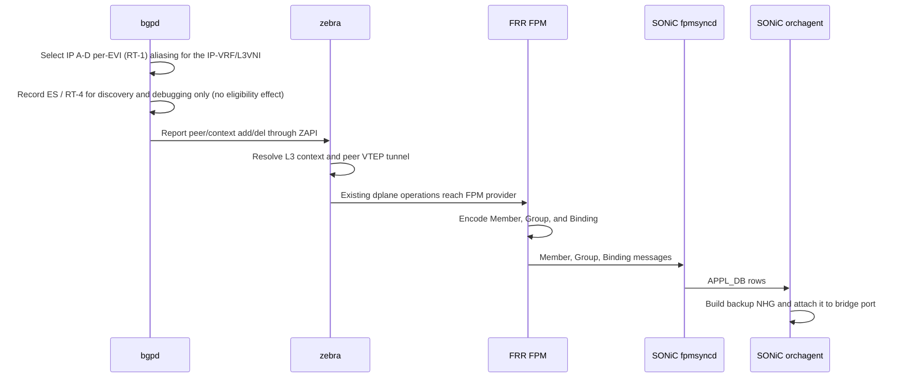

# EVPN Bridge-Port Protection Group: FRRouting High-Level Design

## Table of Contents

- [1. Revision](#1-revision)
- [2. Scope](#2-scope)
- [3. Definitions and abbreviations](#3-definitions-and-abbreviations)
- [4. References](#4-references)
- [5. Feature overview](#5-feature-overview)
- [6. Requirements](#6-requirements)
  - [6.1 Functional requirements](#61-functional-requirements)
  - [6.2 Configuration requirements](#62-configuration-requirements)
  - [6.3 Scale and restart requirements](#63-scale-and-restart-requirements)
- [7. Architecture](#7-architecture)
  - [7.1 Control-plane inputs](#71-control-plane-inputs)
  - [7.2 FRR ownership](#72-frr-ownership)
  - [7.3 Data flow](#73-data-flow)
  - [7.4 BGP extension](#74-bgp-extension)
  - [7.5 Zebra extension](#75-zebra-extension)
  - [7.6 IP A-D route origination and import (bgpd)](#76-ip-a-d-route-origination-and-import-bgpd)
- [8. Zebra protection lifecycle](#8-zebra-protection-lifecycle)
  - [8.1 Protection state](#81-protection-state)
  - [8.2 BGP peer context in zebra](#82-bgp-peer-context-in-zebra)
  - [8.3 Member and group identifiers](#83-member-and-group-identifiers)
  - [8.4 Peer VTEP tunnel resolution](#84-peer-vtep-tunnel-resolution)
  - [8.5 Object consistency and safe deletion](#85-object-consistency-and-safe-deletion)
  - [8.6 Failure flows](#86-failure-flows)
  - [8.7 Kernel MAC and neighbor lifecycle](#87-kernel-mac-and-neighbor-lifecycle)
  - [8.8 Advertisement prerequisites](#88-advertisement-prerequisites)
- [9. FPM interface](#9-fpm-interface)
  - [9.1 Message model](#91-message-model)
- [10. Configuration and operational visibility](#10-configuration-and-operational-visibility)
- [11. Restart and replay](#11-restart-and-replay)
- [12. Error handling](#12-error-handling)
- [13. SAI API](#13-sai-api)
- [14. Warmboot and fastboot design impact](#14-warmboot-and-fastboot-design-impact)
  - [14.1 Warmboot and fastboot performance impact](#141-warmboot-and-fastboot-performance-impact)
- [15. Memory consumption](#15-memory-consumption)
- [16. Testing](#16-testing)
- [17. Limitations and open items](#17-limitations-and-open-items)

---

## 1. Revision

| Revision | Date | Author | Description |
|---|---|---|---|
| 1.0 | 2026-09-29 | Patrice Brissette | Initial FRR HLD |
| 1.1 | 2026-10-08 | Patrice Brissette | Address review comments: Binding export independent of carrier state; drop Member VNI; flush and rebuild on every new FPM session (warm reboot and reconciliation out of scope); shared Group peer-set intersection; add SAI, warmboot/fastboot, and memory sections; fix links |
| 1.2 | 2026-10-14 | Patrice Brissette | Re-align the FRR architecture: one Group per ES, eligibility and RMAC decided in bgpd, new BPP_PEER ZAPI |

---

## 2. Scope

An Ethernet Segment connects a host or downstream device to more than one leaf.
Under normal conditions, a leaf sends traffic to that device through its local
access port. If that port fails, the leaf must continue forwarding through one
of the other leaves attached to the same Ethernet Segment.

The problem is scale. A single access port can serve thousands of hosts. On a
failure, changing every route, neighbor, and MAC entry that points to the port
would be slow and disruptive. The bridge-port protection group solves this by
protecting the port itself:

```text
primary   = local bridge port
backup    = ECMP group of VXLAN tunnels to peer VTEPs
```

The backup group is programmed before a failure occurs. When the local port
goes down, SONiC applies its configured protection behavior to select the
backup group without waiting for route reconvergence and without changing the
host's existing MAC, neighbor, or route entries. FRR only maintains the backup
objects; it does not select the protection mode.

FRR builds the backup group from eligible EVPN peers for the Ethernet Segment.
It sends SONiC the peer tunnel Members, the Group containing those Members, and
the Binding that attaches the Group to the local bridge port. SONiC creates the
tunnels and next-hop group, then programs the protection attribute on the
bridge port. The FRR and SONiC responsibilities are therefore:

- **FRR:** discover eligible peers, track their EVPN reachability, resolve the
  peer tunnel context, maintain stable object identifiers, and export updates.
- **SONiC:** create the backup forwarding objects and attach the Group to the
  protected bridge ports. `bpProtOrch` owns the bridge-port protection
  attribute; FRR only supplies the backup forwarding objects.

This document covers the FRR side of that contract. The SONiC and SAI behavior
is described in the companion [Bridge-Port Protection Group HLD](https://github.com/sonic-net/SONiC/pull/2556).

The design is intended for routed VXLAN forwarding and is documented using
all-active L3MH as the primary deployment context. L3MH neighbor synchronization
is specified by the separate [L3MH Neighbor Synchronization HLD](https://github.com/sonic-net/SONiC/pull/2543). This HLD only consumes the forwarding state produced by that feature; it does not redefine neighbor synchronization.

### In scope

- Per-ES/interface enablement with `evpn mh bridge-port-protection`.
- EVPN peer discovery and eligibility for the backup group.
- Peer VTEP tunnel resolution, including L3VNI and RMAC dependencies.
- In-memory Member and Group identifier continuity across peer churn while
  zebra stays alive. Warm reboot, reconciliation, and identifier persistence
  across a restart are out of scope; every new FPM session starts from empty
  and is rebuilt from zebra's full replay.
- FPM emission of Member, Group, and bridge-port Binding objects.
- Peer changes, tunnel resolution changes, restart, and replay behavior.
- Interaction with existing EVPN MAC and neighbor state.

### Out of scope

- SONiC orchagent implementation and SAI adapter behavior.
- Per-host route, neighbor, or MAC reprogramming during failover.
- Single-active multihoming behavior.
- L2 VXLAN protection Members in the initial release.

---

## 3. Definitions and abbreviations

| Term | Meaning |
|---|---|
| **ES** | Ethernet Segment. The local multihomed attachment represented by an ESI. |
| **ESI** | Ethernet Segment Identifier. |
| **L3MH** | EVPN Layer-3 multihoming. |
| **RT-1** | EVPN Ethernet Auto-Discovery route; the base route for both terms below. |
| **IP A-D per-EVI (RT-1)** | Ethernet Auto-Discovery route scoped to an EVI, advertised into the IP-VRF to identify candidate peer VTEPs for the corresponding IP-VRF/L3VNI. |
| **IP A-D per-ES (RT-1)** | Ethernet Auto-Discovery route scoped to an Ethernet Segment, used for peer eligibility, fast convergence, and withdrawal. |
| **ES / RT-4** | Ethernet-Segment route used for ES peer discovery and as an operational cross-check for debugging; it does not gate protection eligibility. |
| **RT-2** | EVPN MAC/IP route. |
| **RT-5** | EVPN IP Prefix route. |
| **EVPN IP route** | The reachability route being aliased: an EVPN MAC/IP route (RT-2) or EVPN IP Prefix route (RT-5) carrying the ES's ESI. |
| **VTEP** | VXLAN tunnel endpoint. |
| **L3VNI** | VXLAN identifier for an IP-VRF. |
| **Tunnel map** | SONiC/SAI VRF-to-VNI mapping that selects the VXLAN encapsulation VNI from the routed packet's VRF. A SONiC data-plane construct; FRR does not create or program it. |
| **RMAC** | Router MAC used as the inner destination MAC for routed VXLAN traffic. |
| **Bridge port** | The local access (sub-)interface where host MACs are learned; the protected object. In routed L3MH it is typically a VLAN sub-interface (e.g. `BE1.10`) whose SVI sits in one IP-VRF. |
| **SVI** | Switched Virtual Interface; the routed interface for a VLAN, placed in an IP-VRF. |
| **Member** | One peer-VTEP protection next hop. |
| **Group** | The ECMP set of Members (peer tunnels) inherited by the protected bridge ports under one parent interface. |
| **Binding** | Association between a local bridge-port (sub-)interface and its Group. |
| **FPM** | Forwarding Plane Manager protocol used to send forwarding objects from FRR to SONiC. |
| **ZAPI** | FRR's internal bgpd-to-zebra protocol. |
| **Ext-learn** | FRR-controlled kernel forwarding state that is not ordinary data-plane learning. |

---

## 4. References

| Reference | Purpose |
|---|---|
| [EVPN L3MH Neighbor Synchronization HLD](https://github.com/sonic-net/SONiC/pull/2543) | Neighbor synchronization for routed-only multihoming. |
| [Bridge-Port Protection Group SONiC HLD](https://github.com/sonic-net/SONiC/pull/2556) | SONiC, FPM consumer, orchagent, and SAI design. |
| [RFC 7432](https://datatracker.ietf.org/doc/html/rfc7432) | Base EVPN procedures. |
| [RFC 8365](https://datatracker.ietf.org/doc/html/rfc8365) | EVPN overlay operation over VXLAN. |
| [EVPN IP Aliasing draft -04](https://datatracker.ietf.org/doc/html/draft-ietf-bess-evpn-ip-aliasing-04) | EVPN aliasing and backup-path procedures in Sections 2–4. |
| [FRRouting EVPN-MH extern-mode work](https://github.com/FRRouting/frr/pull/21863) | Related FRR EVPN-MH external-learning behavior. |

---

## 5. Feature overview

The target deployment is a datacenter leaf-spine fabric. Servers and other
downstream systems may use LAGs to attach to two or more leaf switches, while
the fabric provides routed VXLAN connectivity between leafs. In this model,
the local leaf should use its directly attached link for normal traffic, but a
failure must not interrupt traffic while the peer leafs and the underlay remain
available.

This is especially important in routed-only fabrics, where the access VLAN may
not have an L2VNI. The protection group is still a forwarding-path mechanism:
it does not create a new host route, neighbor entry, or MAC entry. It gives the
existing forwarding state a prebuilt alternate path through the peer leafs.

A host behind an ES therefore has two forwarding choices: the local access
link and the peer leafs attached to the same ES. The local link is the preferred
path. If it fails, the peer path must already be available so traffic can move
without per-host route, neighbor, or MAC updates.

The protection group represents that relationship as one port-level object:

```text
local bridge port
  |
  | Binding: protected port -> Group ID
  v
Group: peer Member 1, peer Member 2, ...
  |
  +-- Member: peer VTEP tunnel + L3 context + tunnel attributes
```

SONiC attaches the Group to each inherited bridge port before traffic is
affected. When a port loses carrier, SONiC selects the backup Group according
to its configured protection mode. FRR does not perform a route-by-route
switchover; it only keeps the protection objects current as peer reachability
changes.

FRR and SONiC divide the work as follows:

- **FRR** discovers the peer leaves, determines which peer VTEP tunnels are
  usable, and sends Member, Group, and Binding updates over FPM.
- **SONiC** creates the tunnel next hops and ECMP Group, then attaches that
  Group to the bridge port and programs the ASIC protection behavior.

---

## 6. Requirements

### 6.1 Functional requirements

| ID | Requirement |
|---|---|
| R1 | FRR must derive the protection peer set from IP A-D per-EVI (RT-1) aliasing AND valid IP A-D per-ES (RT-1) coverage for the same ESI/IP-VRF/L3VNI. ES / RT-4 provides ES peer discovery and an operational cross-check for debugging; it does not gate eligibility. |
| R2 | The initial protection path must use VXLAN L3 Members for all-active L3MH only. Single-active operation is out of scope. |
| R3 | Protection is enabled on a parent interface. Every eligible bridge port/sub-interface under that interface inherits the same protection Group and receives a Binding. |
| R4 | Each L3 Member must identify its peer VTEP tunnel and its required tunnel attributes, including RMAC. |
| R5 | FRR must send a Binding that associates the protected bridge-port sub-interface with the Group. |
| R6 | Protection or ES teardown must publish deletes for the Binding, Group, and unreferenced Members; SONiC owns their dependency ordering. Peer churn updates the Group in place while at least one eligible Member remains; an empty Group withdraws the Binding and Group. |
| R7 | Membership changes must update the existing Group in place when possible. |
| R8 | Member and Group identifiers must remain stable across replay for an unchanged topology. |
| R9 | FPM updates must be idempotent and safe when duplicate or replayed messages are processed independently by SONiC. |
| R10 | The protection feature must not alter ordinary EVPN-MH route advertisement policy unless explicitly enabled. |

### 6.2 Configuration requirements

| Condition | FRR behavior |
|---|---|
| Feature not configured | Protection is disabled; no objects are exported. |
| Protection command configured before dependencies exist | Retain the intent in `PENDING`; export no partial Binding. |
| Local ES, bridge port, IP-VRF, and L3VNI become valid | Build and export the Group and Binding when at least one eligible Member exists. |
| Matching RT-1 context is unavailable | Keep the intent pending; export no backup objects. |
| Protection command removed | Delete the Binding, Group, and unreferenced Members. |

Configuration order is not significant. FRR reconciles the protection state
whenever one of its dependencies changes.

The FRR configuration is:

```text
router bgp <asn>
 address-family l2vpn evpn
  advertise-all-vni
 exit-address-family
!
interface PortChannel10
 evpn mh es-id 10
 evpn mh bridge-port-protection
```

`evpn mh es-id` and `evpn mh bridge-port-protection` are configured on the
parent interface that owns the ESI. Every bridge port or sub-interface below
that interface inherits the protection configuration. Zebra creates one
Binding per inherited bridge port; all Bindings reference the Group built from
the eligible peer set for the parent ES/VLAN. A bridge port becomes eligible when
its local IP-VRF/L3VNI context is valid. No separate protection command is
required on each sub-interface.

### 6.3 Scale and restart requirements

- Protection state is proportional to the number of protected parent interfaces,
  inherited bridge-port Bindings, and peer tunnel identities, not the number of
  hosts, MACs, or routes behind an ES.
- Warm reboot and reconciliation are out of scope. Every new FPM session starts
  from empty: SONiC flushes the protection objects and zebra's full replay
  rebuilds them.
- A flush and rebuild must never cause a primary-path flap. Protection is
  unavailable until the replay completes.
- Identifier persistence across a zebra restart is out of scope.

---

## 7. Architecture

### 7.1 Control-plane inputs

FRR builds protection state from existing EVPN control-plane and zebra state:

| Input | Owner | Use |
|---|---|---|
| Local interface and ESI | zebra | Identifies the protected parent interface, its inherited bridge ports, and the local ES. |
| Local ES operational state | zebra | Drives IP A-D per-ES TX only. Never an input to Binding export: a local link down leaves the Binding, Group, and Members installed. |
| Remote IP A-D per-EVI (RT-1) routes | bgpd | Provides the aliasing candidate PE set for a specific ESI and IP-VRF/L3VNI; imported by the IP-VRF Route Target. |
| Remote IP A-D per-ES (RT-1) routes | bgpd | Provides fast-convergence eligibility and withdrawal for the same ESI/IP-VRF. A route withdrawal invalidates the corresponding peer, following the existing MAC-aliasing route handling. |
| Remote ES / RT-4 routes | bgpd | Provides ES peer discovery and an operational cross-check for debugging; does not gate eligibility and is not a substitute for IP A-D per-ES (RT-1). |
| IP-VRF and L3VNI | bgpd/zebra | Qualifies the routed protection context. |
| Peer VTEP tunnel and RMAC | bgpd | Peer VTEP from the RT-1 next hop; RMAC from the Router's MAC EC of the peer's IP A-D per-EVI routes. |
| Eligible peer VTEP set | bgpd | Selects the active peer VTEPs for the ES/context from the EVPN aliasing state and sends the resulting peer-set changes to zebra. |
| `evpn mh bridge-port-protection` | zebra | Per-ES/interface protection-group gate. |

bgpd owns the EVPN route join and sends zebra the resulting peer/context state.
The detailed BGP extension and ZAPI contract are specified in
[Section 7.4](#74-bgp-extension). The protection-enable command remains a
zebra/local-interface control; it is not inferred from a BGP route.

### 7.2 FRR ownership

| Component | Responsibility |
|---|---|
| **bgpd** | Receives IP A-D per-EVI (RT-1) aliasing, IP A-D per-ES (RT-1), and ES / RT-4 routes, computes the eligible IP-VRF/L3VNI-scoped peer set, and sends the resulting peer-set changes to zebra through ZAPI. |
| **zebra** | Owns local interface state, peer VTEP tunnel objects, protection objects, identifiers, and dplane updates. |
| **EVPN data plane** | Maintains normal EVPN-MH MAC and neighbor state. Protection does not replace that state. |
| **dplane FPM provider** | Extends the existing dplane operation path to serialize Member, Group, and Binding changes. |
| **SONiC** | Translates FPM objects into APPL_DB and SAI objects. `bpProtOrch` owns the bridge-port protection attachment. |

The control-plane split is intentional. bgpd owns BGP route selection; zebra
owns the forwarding objects and their lifetime.

### 7.3 Data flow



The Member and Group describe the backup NHG. The Binding identifies which
local bridge port uses that Group. These objects are independent and are joined
by their FRR-owned identifiers.

### 7.4 BGP extension

bgpd owns the EVPN route join. Protection is **ESI-based**: the ESI is
configured on the parent interface, inherited by every bridge port below it,
and matched against the ESI carried in the peers' RT-1 routes. bgpd therefore
maintains route state per `(ESI, IP-VRF/L3VNI, peer VTEP)`, derives
eligibility per `(ESI, peer VTEP)` over every IP-VRF of the ES, and
notifies zebra whenever that result changes. The new protection peer messages
do not carry a bridge-port `ifindex`; zebra maps each ESI-scoped result to the
bridge ports that inherit the ESI. Existing uses of `ifindex` in bgpd, zebra,
ZAPI, and the dplane are unchanged, and the bridge-port `ifindex` remains the
key of the Binding (zebra protection entry, `DPLANE_OP_BR_PORT_UPDATE`, FPM
`ebnm_ifindex`).
bgpd does not allocate `nh_id`/`nhg_id` and does not emit FPM messages.

Zebra tells bgpd which local ESIs are protected by sending
`ZEBRA_LOCAL_ES_EVI_ADD (esi, l3vni)` for each IP-VRF of the ES, only when
the ES is in L3MH mode and has `bridge-port-protection`
([Section 7.6](#76-ip-a-d-route-origination-and-import-bgpd)). bgpd
evaluates protection eligibility only for local ESIs with at least one L3VNI
ES-EVI.

The eligibility rule is:

```text
active(ESI, VRF, VTEP) = valid IP A-D per-EVI (RT-1) aliasing, with Router's MAC EC
                         AND valid IP A-D per-ES (RT-1) coverage
eligible(ESI, VTEP)    = active in every IP-VRF of the local ES
rmac(ESI, VTEP)        = latest RMAC received in the peer's per-EVI routes
```

A single bgpd resolver, `bgp_evpn_es_l3_vtep_re_eval()`, computes
`eligible` and is the only sender of protection peer updates. It follows the
L2 pattern of `bgp_evpn_es_vtep_re_eval_active()` (an ES-VTEP is active when
ANY EVI is active), with EVERY IP-VRF instead, because one Group per ES must
be valid for every bridge port of the ES. zebra never re-checks eligibility.

RT-4 provides ES peer discovery and an operational cross-check for debugging.
Its presence does not gate protection eligibility, which is determined by the
per-EVI and per-ES RT-1 routes. Changes to RT-4 alone do not add or remove a
protection peer. bgpd records whether each peer's RT-4 is present and exposes
it in show output. An RT-2 or RT-5 host withdrawal changes host reachability,
not protection membership.

Protection peer updates use **two new, dedicated ZAPI commands** (bgpd →
zebra). The existing `ZEBRA_REMOTE_ES_VTEP_ADD/DEL` commands and their payloads
are **unchanged**:

```text
ZEBRA_EVPN_BPP_PEER_ADD     (new)
ZEBRA_EVPN_BPP_PEER_DEL     (new)
```

Both new commands carry the same key; ADD also carries the peer RMAC:

```text
esi[10]        local ESI matched by the peer's RT-1        # key
type           protection Member type: L2 or L3            # key
vtep_family    remote peer VTEP address family             # key
vtep_address   remote peer VTEP                            # key
rmac           peer RMAC, latest received                  # attribute, ADD only
```

The message key is `(esi, type, vtep_family, vtep_address)`; it identifies
one ESI-scoped eligible peer, one message per peer (not per VRF). `type`
distinguishes L3 protection from future L2 protection for the same ESI and
peer; `vtep_family` is a key field only because it qualifies how
`vtep_address` is interpreted. No VRF or VNI is carried: bgpd has already
checked every IP-VRF of the ES and rejected any per-EVI route whose label
does not match the VRF's L3VNI. ADD is re-sent when the peer's RMAC changes.
Future L2 protection will define its own
context fields when it is specified. These new messages carry no bridge-port
`ifindex`: zebra resolves `esi → local ES → parent interface → inherited
bridge ports` and uses each bridge port's `ifindex` for its Binding.

The ZAPI command code is the discriminator between the two scopes:

- **`ZEBRA_REMOTE_ES_VTEP_ADD/DEL` (existing, unchanged):** ES-wide EVPN-MH
  handling. bgpd sends it when the peer joins or leaves the whole ESI; zebra's
  existing handler updates only the ES-VTEP entry (ES NHG, MAC aliasing, DF).
- **`ZEBRA_EVPN_BPP_PEER_ADD/DEL` (new):** sent by the resolver when a peer
  becomes eligible or ineligible for the ESI; a separate zebra handler
  updates only protection state. A protection `DEL` never touches the shared
  `(ESI, VTEP)` ES-VTEP entry, which is deleted only by
  `ZEBRA_REMOTE_ES_VTEP_DEL`.

bgpd maintains route-instance state internally and sends zebra the resulting
eligible/ineligible peer transition, rather than asking zebra to aggregate
individual route withdrawals.

Because the existing commands are unchanged, no existing payload is reinterpreted.
The new commands are decoded strictly: a short or malformed payload is
rejected and logged, never partially applied.

### 7.5 Zebra extension

Zebra owns the local protection objects and translates the BGP peer set into
FPM-ready objects. It performs the following work:

1. Accept and hold the protection command in a pending state when its ES or VRF
   dependencies are not yet available, and activate it automatically once they
   are.
2. Add each ESI-scoped eligible peer to the ES Group, and create a
   protection entry for each valid local bridge port that inherits the ESI.
3. Build each Member from the peer VTEP and the RMAC received from bgpd.
4. Allocate or restore Member and Group identifiers.
5. Export the complete Member, Group, and Binding state through the dplane.

The initial routed Member is:

```text
nh_id          FRR-owned Member identifier                # key (allocated)
type           L3                                         # identity
family         peer VTEP address family                   # identity
remote_vtep    peer VTEP address                          # identity
router_mac     peer RMAC                                  # attribute
```

`nh_id` is the row key that FRR allocates and that SONiC uses as the FPM/APPL_DB
Member key. It is functionally dependent on the tunnel identity
`(type, family, remote_vtep)`: zebra allocates exactly one `nh_id` per
distinct identity and reuses it while that identity is unchanged. The RMAC is
an attribute: an RMAC change re-sends the same `nh_id` with the new value,
which SONiC applies as a `set` on the peer tunnel. `type` is
part of the identity so the same peer VTEP can hold two distinct Members — a
separate `nh_id` for an L2 Member and for an L3 Member. `family` is identity
only because it qualifies how `remote_vtep` is interpreted. The Member carries
no VNI: it is VRF-independent, so SONiC obtains the encapsulation VNI from the
VRF tunnel map at the bridge port's context.

The Group contains a complete, sorted list of Member IDs. A Group update does
not change the Binding. The Binding contains the protected bridge-port ifindex
and the Group ID.

This section is the ownership boundary: BGP decides *which peers qualify*;
zebra decides *whether the forwarding objects are ready* and *how they are
exported*.

### 7.6 IP A-D route origination and import (bgpd)

Today FRR's EVPN-MH originates and imports RT-1 only in **MAC-VRF scope**:
EAD-per-EVI per L2VNI (L2VNI RD, label = L2VNI, L2VNI RTs) and EAD-per-ES
carrying the ES's L2VNI RTs. The **IP-VRF-scoped** IP A-D per-EVI and IP A-D
per-ES routes this design relies on are neither originated nor classified
today. They are new bgpd work, and they are bound to L3MH.

**L3MH binding**

- IP-VRF scope applies only to an ES in **L3MH mode**: `advertise-all-vni
  l3vni-neigh` is set and at least one bridge port's BD is `L3VNI_NEIGH`
  (no L2VNI), as defined by
  [FRRouting/frr PR #23304](https://github.com/FRRouting/frr/pull/23304).
  `evpn mh bridge-port-protection` on an ES that is not in L3MH mode leaves
  the entry `PENDING` with reason `not in L3MH mode`.
- Zebra signals the ES's IP-VRF set by reusing
  `ZEBRA_LOCAL_ES_EVI_ADD/DEL (esi, vni)` with the VRF's L3VNI, payload
  unchanged. It is sent only for an L3MH ES with `bridge-port-protection`,
  while at least one bridge port of the ES is configured in that VRF. bgpd
  classifies the VNI (L2VNI → existing ES-EVI path; L3VNI → IP-VRF
  reference on `bgp_evpn_es_vrf`). `ZEBRA_LOCAL_ES_ADD` is unchanged: no
  new flag.
- An ES that is not in L3MH mode keeps today's MAC-VRF-only behavior,
  unchanged.

**TX (local L3MH ES)**

| Route | RD | Ethernet Tag | Label | Extended communities |
|---|---|---|---|---|
| IP A-D per-EVI, one per (ES, IP-VRF) | IP-VRF RD | 0 | L3VNI | VXLAN encap, IP-VRF export RTs, Layer-2 Attributes EC with `P=1`, Router's MAC EC (the VRF's RMAC) |
| IP A-D per-ES | the existing EAD-per-ES route (existing RD/fragment scheme) — no second per-ES route | MAX-ET | 0 | existing ECs, with the ES's IP-VRF export RTs **added** to its RT set (fragmented as today) |

IP A-D per-EVI follows config only: it is advertised while at least one
bridge port of the ES is configured in that VRF, and withdrawn when the last
one is removed, the VRF leaves the ES, or the ES leaves L3MH mode. Its role
is to give peers the VRF's reachability (L3VNI and RMAC); bridge-port and ES link
state are never inputs (same as L2, `ead_evi_adv_for_down_links`).
IP A-D per-ES follows the existing EAD-per-ES activity rule and is the only
route that carries link state, so a local ES failure mass-withdraws the leaf
from every peer's protection Group. When the ES also has L2VNIs, the MAC-VRF
EAD-per-EVI routes are still originated unchanged, and the single EAD-per-ES
route carries both the L2VNI and the IP-VRF RTs.

**RX classification (scope)**

A received RT-1 is classified by its import context:

- **IP-scoped:** its RTs match an IP-VRF's import RTs. It is recorded in that
  VRF's ES-VRF state (`bgp_evpn_es_vrf`) per peer VTEP. A per-EVI route
  counts only with Ethernet Tag 0, a label equal to that VRF's L3VNI, and a
  Router's MAC EC, whose RMAC is stored with it;
  otherwise it is ignored for protection and logged under the protection
  debug flag. A per-ES route provides per-ES coverage for that VRF.
- **MAC-VRF scoped:** its RTs match an L2VNI's import RTs. Existing
  processing, unchanged.
- A route matching both is processed independently in each scope. State never
  moves between the MAC-VRF and IP-VRF scopes. Overlapping L2VNI and IP-VRF
  RTs are not recommended.
- Only IP-scoped routes whose ESI matches a local L3MH ES feed protection
  eligibility ([Section 7.4](#74-bgp-extension)).
- As in L2 (`bgp_evpn_remote_es_evi_add()`), IP-scoped state is created on
  RX for any ESI and freed on the last withdraw. It never depends on local
  protection config; `bridge-port-protection` gates only what the resolver
  sends to zebra.

---

## 8. Zebra protection lifecycle

### 8.1 Protection state

Zebra keeps one protection entry per eligible **bridge port** — the access
sub-interface where host MACs are learned (e.g. `BE1.10`). Each entry inherits
the protection command and ESI from its parent interface and keeps its own
IP-VRF/L3VNI context. The entry is keyed by the bridge-port `ifindex`:

```text
BridgePortProtection
    ifindex            bridge-port sub-interface, e.g. BE1.10
    interface name     human-readable name of that sub-interface
    ESI                Ethernet Segment, inherited from the parent LAG (e.g. BE1)
    IP-VRF / L3VNI     the VRF context of this bridge port; L3VNI is diagnostic
    protection enabled inherited from the parent interface
    Group ID           nhg_id of the backup Group for this bridge port
    export state       DISABLED / PENDING / ACTIVE / WITHDRAWING
```

FRR exports the Binding when the local context exists — the bridge port and ES
are configured, `evpn mh bridge-port-protection` is enabled, and the
IP-VRF/L3VNI is known — and at least one eligible Member exists. Carrier or
operational-down state is not an export dependency; the Binding must remain
installed so SONiC can select the backup. Before that
point, zebra keeps the entry pending and exports nothing. If the Group becomes
empty, FRR does not export/download an empty Group. It withdraws the Binding and
Group, and SONiC then knows that the interface has no protection path. The local
port remains the primary path while protection is available.

A Member is a peer tunnel identified by `(peer VTEP, address family, type)`, with the RMAC as an attribute. The routed VXLAN
encapsulation VNI comes from SONiC's VRF tunnel map; it is not encoded as a
per-next-hop forwarding decision by FRR. Zebra creates one Binding for each
eligible bridge port under the protected parent interface, and a Group may be
referenced by the Bindings of multiple bridge ports. A shared Group contains
only peers eligible for every IP-VRF of the ES; bgpd enforces this before
sending the peer ([Section 7.4](#74-bgp-extension)). A failover on any
bridge port therefore never selects a peer that is invalid for its VRF.

### 8.2 BGP peer context in zebra

Peer eligibility is calculated by bgpd per `(ESI, peer VTEP)` over every
IP-VRF of the ES and delivered to zebra through ZAPI as described in
[Section 7.4](#74-bgp-extension). Zebra adds each peer to the ES Group, which
is bound to every bridge port that inherits the ESI, including bridge ports
created after the peer was received. Each received peer becomes a Member
with the RMAC bgpd sent; zebra adds no readiness check of its own.
Underlay reachability of the peer VTEP is handled by bgpd nexthop tracking
([Section 8.6](#86-failure-flows)).

### 8.3 Member and group identifiers

FRR owns two identifier spaces:

- `nh_id` identifies one Member.
- `nhg_id` identifies one Group.

Both carry the existing EVPN-MH type bits in the FPM key and the SONiC APPL_DB
key, so they cannot be confused with unrelated next-hop objects. They must not
encode any route, MAC, or neighbor identity.

Object identity:

- One Member ID per `(peer VTEP, address family, type)` tunnel identity,
  which is VRF-independent. The RMAC is an attribute and does not change the
  ID. The same Member may be shared by multiple Groups.
- One Group ID per protected ES (`es->l3_nhg_id`), shared by the Bindings of its
  inherited bridge ports; its Members are the eligible peers defined in
  [Section 8.1](#81-protection-state). A membership change
  updates the Group in place; it does not create a new Group for every
  peer-set variation.

Retirement:

- Do not recycle an ID while its object still exists in zebra's active database.
- An ID is released when zebra removes the object and queues its delete to the
  dplane provider. FPM gives no SONiC acknowledgement, so a released ID stays
  retired for the rest of the zebra lifetime.

### 8.4 Peer VTEP tunnel resolution

Each routed Member needs the peer RMAC, used as the routed VXLAN inner
destination MAC. The VXLAN tunnel to the peer VTEP is created by SONiC from
the Member; zebra has no tunnel object to resolve. If the peer VTEP becomes
unreachable in the underlay, bgpd nexthop tracking invalidates its RT-1
routes and the peer loses eligibility ([Section 8.6](#86-failure-flows)).

The RMAC comes from the Router's MAC Extended Community of the peer's IP A-D
per-EVI routes, which the
[EVPN IP Aliasing draft](https://datatracker.ietf.org/doc/html/draft-ietf-bess-evpn-ip-aliasing-04)
requires. It arrives with the route that makes the peer eligible, so there
is no window where a peer is eligible but its RMAC unknown. bgpd sends it in
`ZEBRA_EVPN_BPP_PEER_ADD`; zebra does not look up RT-2/RT-5 RMAC state. A
per-EVI route without the EC does not count for eligibility. An RMAC change
is an in-place Member update ([Section 8.6](#86-failure-flows)).

**One RMAC per peer VTEP.** SONiC programs the RMAC once on the shared
per-peer tunnel, so a peer VTEP has exactly one protection RMAC: the latest
RMAC received in any of its per-EVI routes for the ES. When it changes, bgpd
re-sends `ZEBRA_EVPN_BPP_PEER_ADD` with the new value; the peer never leaves
the Group. A peer that updates its VRFs one at a time therefore causes one
in-place Member update on the first update and nothing on the next ones.
Different RMACs across VRFs are not rejected; the difference is logged
under the protection debug flag.

### 8.5 Object consistency and safe deletion

Member, Group, and Binding messages are independent and idempotent, so the
protection state converges to the same result regardless of arrival order
(idempotent messages, per R9). SONiC parks any reference it
cannot resolve yet — for example a Binding received before its Group — and
reconciles it once the referenced object appears. Ordering is therefore not
required for correctness.

This section defines the producer-side rules that independence does not provide:
object self-consistency, safe deletion, and identifier reuse.

**Required rules**

- **Object self-consistency.** Never publish a Group that lists a Member FRR has
  already deleted, and never publish a Binding that names a Group FRR is tearing
  down. Each exported object must be well-formed on its own.
- **Detach before unreference (delete direction).** Withdraw in the order
  `Binding -> Group -> Member` so a live, referenced object is never deleted out
  from under its referrer. `bpProtOrch` clears the bridge-port protection
  attribute before `L2NhgOrch` removes the Group, and the Group drops a Member
  before that Member is deleted.
- **Identifier release timing.** Release an `nh_id`/`nhg_id` only after its
  delete has been queued to the dplane. FPM gives no SONiC acknowledgement, so a
  released ID stays retired for the rest of the zebra lifetime and is not reused
  early.
- **Complete-object updates.** Every message carries the complete current
  object, never a delta: a Group update lists the full sorted Member set (so an
  unchanged set causes no NHG churn), and a reconnect or replay re-emits the
  complete object set. This keeps the messages idempotent (R9).

**Best-effort ordering (optimization only)**

On creation FRR sends `Member -> Group -> Binding` to minimize the transient
window in which SONiC parks an unresolved reference. This is a convergence-time
optimization, not a correctness requirement; the parking behavior above handles
any other order.

**Event outlines**

- **Protection enable / peer addition:** export the Member(s), then the updated
  Group. The Binding is created once at enable and is unchanged for later peer
  churn.
- **Peer removal:** export the Group without the peer's Member, then delete the
  Member once it is unreferenced. If the Group empties, withdraw the Binding and
  Group; SONiC then reports no protection path and the local port stays primary.
- **Protection disable or ES removal:** withdraw `Binding -> Group -> Member`,
  releasing identifiers only after the sequence completes.

### 8.6 Failure flows

The local link failure and remote peer failure have different owners:

| Event | FRR action | Invariant / guarantee |
|---|---|---|
| Local bridge port loses carrier | No FRR route or host-state action. SONiC selects the programmed backup according to its protection mode. | Preserve host routes, neighbors, MACs, and EVPN routes unchanged. |
| Peer withdraws IP A-D per-EVI (RT-1) | The peer no longer covers every IP-VRF of the ES: bgpd sends one DEL; zebra removes its Member from the ES Group. | Host reachability stays intact. |
| Peer withdraws IP A-D per-ES (RT-1) | Mass-withdrawal: bgpd sends one DEL for the peer; zebra removes its Member from the ES Group. Follows existing MAC-aliasing route handling. | Invalidate the peer immediately, even while a per-EVI or RT-4 route for it still remains. |
| Peer withdraws RT-4 | Update only the RT-4 debugging cross-check; leave per-EVI/per-ES-derived eligibility unchanged. RT-4's DF-election and single-active roles do not apply to all-active L3MH. | Changes to RT-4 alone never add or remove a protection peer. |
| Host RT-2 is withdrawn | Let normal EVPN processing handle the host. | Leave the protection Group unchanged. |
| Peer per-EVI loses its Router's MAC EC | That VRF no longer counts: bgpd sends one DEL; zebra removes the Member. | A routed Member is never exported without an RMAC. |
| Peer VTEP becomes unreachable in the underlay | bgpd nexthop tracking invalidates the peer's RT-1 routes; bgpd sends `ZEBRA_EVPN_BPP_PEER_DEL` and zebra removes the Member from the Group. | No extra zebra state; the peer returns through the normal eligibility path when it is reachable again. |
| Peer RMAC changes (in any VRF's per-EVI) | bgpd re-sends ADD with the latest RMAC. Zebra re-sends the same Member (`nh_id`) with the new RMAC and the Group with the refreshed copy. | The peer never leaves the Group; no Member delete; Bindings not resent. |
| Group becomes empty | Delete the Binding and Group. SONiC reports that the interface has no protection path. | Keep the local primary path intact. |

### 8.7 Kernel MAC and neighbor lifecycle

L3MH neighbor synchronization is specified by the separate [L3MH Neighbor
Synchronization HLD](https://github.com/sonic-net/SONiC/pull/2543).
That feature supplies the host neighbor and local-ES forwarding state; this HLD
supplies the backup Group. FRR does not create, withdraw, or reprogram host
neighbors as part of a bridge-port failure.

The protection-specific rule is that a local carrier event does not change
EVPN host state. A peer route withdrawal changes Group membership, while a
local port failure is handled by SONiC using the already-exported backup
objects.

### 8.8 Advertisement prerequisites

The peer advertisements follow the
[EVPN IP Aliasing draft](https://datatracker.ietf.org/doc/html/draft-ietf-bess-evpn-ip-aliasing-04).
No new route type or BGP attribute is required, but FRR must originate and
classify the IP-VRF-scoped A-D routes ([Section 7.6](#76-ip-a-d-route-origination-and-import-bgpd)).
The following table maps the
draft procedures to FRR protection processing:

| Route | Required fields for this design | Protection use | Withdrawal effect |
|---|---|---|---|
| IP A-D per-EVI (RT-1) | IP-VRF RD, non-zero ESI, Ethernet Tag 0, IP-VRF export RTs, L3VNI/VNI label, Layer-2 Attributes Extended Community with `P=1` for all-active, and Router's MAC Extended Community | Supplies the aliasing candidate peer and its RMAC | The peer is invalid for the corresponding IP-VRF/protection context |
| IP A-D per-ES (RT-1) | ESI and IP-VRF RTs; multiple routes may be advertised when the RT set requires it | Supplies the fast-convergence eligibility for the ES | The corresponding peer is invalidated using the existing MAC-aliasing route handling |
| RT-2 / RT-5 host or prefix route | Non-zero ESI when the route is using this L3MH ES, plus the IP-VRF RT | Identifies the host or prefix that can resolve through the ES aliasing set; it does not define the Group or supply the protection RMAC | Host or prefix reachability changes; the Group is not changed solely because one host route is withdrawn |
| RT-4 ES route | ES identity and the normal ES discovery attributes | ES peer discovery and an operational cross-check for debugging; it does not gate eligibility and is not the backup-list source | Debugging cross-check changes; peer eligibility follows the RT-1 routes |

FRR follows the draft's route roles and the existing MAC-aliasing state
machine. An IP A-D per-EVI and IP A-D per-ES route must both be valid for the
same ESI/IP-VRF/L3VNI context before a peer is exported. The peer VTEP's RMAC
comes from the Router's MAC Extended Community of its IP A-D per-EVI routes
(a MUST in the draft); RT-2/RT-5 RMAC state is not used for protection.

The per-ES A-D route may still carry the ESI Label Extended Community per
RFC 7432, but this routed design neither requires nor consumes it: there is no
BUM split-horizon label to program, and the all-active redundancy mode is
already conveyed by the per-EVI Layer-2 Attributes Extended Community (`P=1`).

---

## 9. FPM interface

### 9.1 Message model

The initial interface uses private raw-processed FPM messages.

```c
/* Shared by FRR and fpmsyncd. Do not redefine these structures independently. */
struct __attribute__((packed)) l2_nhg_member_msg {
  uint32_t l2nm_nh_id;
  uint8_t  l2nm_type;       /* 0 = L2, 1 = L3 */
  uint8_t  l2nm_family;     /* AF_INET or AF_INET6 */
  union {
    struct in_addr  ip4;
    struct in6_addr ip6;
  } l2nm_remote_vtep;
  uint8_t  l2nm_router_mac[6]; /* peer RMAC */
};

struct __attribute__((packed)) l2_nhg_group_msg {
  uint32_t l2ng_nhg_id;
  uint32_t l2ng_count;
  struct l2_nhg_member_msg l2ng_members[]; /* exactly l2ng_count, sorted by nh_id */
};

struct __attribute__((packed)) evpn_backup_nhg_msg {
  uint32_t ebnm_ifindex;
  uint32_t ebnm_backup_nhg_id;
};
```

The layout is a fixed, packed wire format; the shared header enforces the exact
size and field offsets with compile-time assertions so the FRR provider and
SONiC fpmsyncd cannot drift out of wire compatibility.

The Group carries each Member in full (same layout as `l2_nhg_member_msg`),
not only its `nh_id`. Every Group message is therefore self-contained, which
future reconciliation needs. The Member message is still sent on its own.

The corresponding message types are:

```text
RTM_FPM_ADD_L2_NEXTHOP
RTM_FPM_DEL_L2_NEXTHOP
RTM_FPM_ADD_L2_NEXTHOP_GROUP
RTM_FPM_DEL_L2_NEXTHOP_GROUP
RTM_FPM_ADD_EVPN_ES_BACKUP_NHG
RTM_FPM_DEL_EVPN_ES_BACKUP_NHG
```

The Binding structure already exists on the SONiC side. Zebra already creates
`DPLANE_OP_BR_PORT_UPDATE` with `backup_nhg_id`; the FPM provider must add its
encoder.

Member and Group messages use these dedicated queued dplane operations:

```text
DPLANE_OP_EVPN_MH_NH_UPDATE
DPLANE_OP_EVPN_MH_NHG_UPDATE
```

Each operation carries the complete object and an add/update or delete action.
All three object types use the existing dplane provider queue. No direct
zebra-to-fpmsyncd channel or SONiC-side FPM walk is introduced.

At every FPM session start, zebra queues the complete Member, Group, and
Binding set; see [Section 11](#11-restart-and-replay).

---

## 10. Configuration and operational visibility

Configuration and dependency behavior are defined in [Section 6.2](#62-configuration-requirements).
The command gates only this protection feature; it does not change DF election
or ordinary EVPN-MH route advertisement.

SONiC's per-port policy controls how an exported Binding is attached and
whether hardware or software protection is used. It does not create the FRR
Group and cannot enable a port that FRR has not exported.

FRR should expose enough state to diagnose the feature without inspecting FPM
packets manually. At minimum, show output should identify:

- Interface and ESI.
- Protection enabled or disabled.
- Group ID.
- Each Member ID.
- Peer VTEP address.
- L3VNI per protection entry (bridge port / IP-VRF context).
- Peer VTEP and RMAC per Member.
- Exported Member count.
- Member and Group export state.
- State reason for a PENDING entry (the specific missing dependency).
- Last FPM update or error.

Why a peer is not eligible (missing VRF, no Router's MAC EC)
is shown by bgpd in `show bgp l2vpn evpn es-vrf detail`.

Operational states:

| State | Meaning | Exported |
|---|---|---|
| `DISABLED` | protection not configured | nothing |
| `PENDING` | configured, a dependency is missing (see reason) | nothing |
| `ACTIVE` | Binding, Group, and every received peer's Member exported | all |
| `WITHDRAWING` | delete sequence in progress | being removed |

Each PENDING entry carries a reason so the cause is visible in show output
without a packet capture:

| State | Reason | When |
|---|---|---|
| `PENDING` | `no local ES` | `es-id` missing on the parent interface |
| `PENDING` | `IP-VRF or L3VNI unknown` | the bridge port's SVI has no VRF, or the VRF has no L3VNI |
| `PENDING` | `not in L3MH mode` | the bridge port's BD is not in L3MH mode |
| `PENDING` | `no eligible peer` | bgpd has sent no peer for the ES |

These reasons are reported through show output and debug logs.

These are FRR control-plane states. SONiC's hardware protection state is
reported separately through its STATE_DB interface.

---

## 11. Restart and replay

### FPM session start

At every FPM session start, SONiC flushes the protection objects (see
[below](#flush-on-every-new-fpm-session)) and zebra replays the complete current
state in this order:

1. Member objects.
2. Group objects.
3. Binding objects.

The replay must be idempotent. SONiC may receive the Binding before the Group
has been reconstructed; the SONiC consumer parks that Binding until the Group
appears.

The SONiC ownership contract is explicit:

- `L2NhgOrch` owns the backup NHG and its SAI object identifier.
- `bpProtOrch` resolves the Group ID to that SAI identifier and holds a
  reference while the Binding is installed.
- If the Binding arrives before the Group, `bpProtOrch` parks it and retries
  after `L2NhgOrch` publishes the Group. It must not discard the Binding.
- On detach, `bpProtOrch` clears the bridge-port protection attribute first and
  then releases its NHG reference. `L2NhgOrch` may delete the NHG only after
  that reference is released.
- Membership changes update the existing NHG in place; the Group ID and SAI
  object identifier remain stable, so `bpProtOrch` does not reattach the
  protection object for ordinary membership churn.

### Restart behavior at a glance

| Event | Behavior |
|---|---|
| FPM reconnect | Flush and rebuild. IDs are unchanged because zebra keeps them in memory. |
| fpmsyncd restart | Flush and rebuild. |
| SONiC reboot (warm or cold) | Treated as cold for protection: flush and rebuild. |
| bgpd restart with zebra alive | No new FPM session. Objects are updated in place unless withdrawn and recreated. |
| zebra or full FRR restart | Flush and rebuild. IDs may change. |

### Flush on every new FPM session

Warm reboot and reconciliation are out of scope for this project, matching the
companion SONiC HLD. zebra allocates `nh_id` and `nhg_id` from a runtime bitmap
that is reinitialized after a restart, so creation order can change the IDs.
Stale-kernel reservation prevents collisions with kernel objects during
startup; it does not restore the previous FRR-to-object mapping.

A restarted zebra may therefore assign a previously used `nhg_id` or `nh_id` to
a different object. If SONiC applied that object over an old row, a Binding
left from the previous zebra would point to a Group with a different meaning,
and a failover on that port would send traffic to the wrong peers. Pruning
stale rows after a replay does not prevent this, because the reused ID is
republished, not stale.

The design therefore guarantees one safety rule: **a Binding never outlives the
Group meaning it was attached to.** It is enforced by starting every FPM
session from empty:

- When an FPM session comes up, fpmsyncd deletes every FPM-produced protection
  row in the order `Binding -> Group -> Member` before applying any object from
  the session.
- zebra then replays the complete Member, Group, and Binding set.

Every case is handled the same way, so no marker or stored state is needed to
tell a zebra restart from a reconnect. The flush only detaches protection. It does not touch the primary path, host
MACs, neighbors, or routes. Protection is unavailable from the flush until the
replay completes, so a local port failure in that window is not protected.

### Configuration replay

Configuration replay must not cause a transient Binding to be exported before
its local ES and peer context are valid. Replaying an interface, ESI, and the
protection-group command should converge to the same object set as a live
configuration.

---

## 12. Error handling

This section covers the local error, dependency, and transport conditions that
keep FRR from exporting a complete protection object — missing configuration or
context, invalid input, and FPM connection or serialization failures. It is
distinct from [Section 8.6](#86-failure-flows), which handles external
reachability events (link and route changes). The governing principle is
containment: an error leaves the affected object pending and is
reported through the state reason ([Section 10](#10-configuration-and-operational-visibility)); it never tears down the local
primary path or unrelated MAC, neighbor, or EVPN route state.

| Condition | FRR behavior |
|---|---|
| No local ESI | Keep protection disabled and do not export objects. |
| No eligible peer | Do not export/download a Group or Binding; withdraw any existing Binding and Group. SONiC knows that the interface has no protection path. |
| Missing L3VNI/IP-VRF context | Keep protection pending and report the missing dependency. |
| Invalid peer VTEP address | Reject the Member and log the peer and ESI. |
| Peer RMAC differs across protected VRFs | Use the latest RMAC received; log the difference under the protection debug flag ([Section 8.4](#84-peer-vtep-tunnel-resolution)). |
| FPM connection failure | Retain state and replay the complete object set after reconnect. |
| FPM serialization failure | Preserve the current object state, report the error, and retry. |
| Unsupported forwarding object type | Do not silently fall back to a different FRR object model; report the capability mismatch. |

---

## 13. SAI API

No SAI API change is required on the FRR side. FRR does not call SAI; it only
exports Member, Group, and Binding objects over FPM. The SAI objects and
attributes that SONiC programs from those objects, including the bridge-port
protection attributes, are specified in the companion
[SONiC HLD](https://github.com/sonic-net/SONiC/pull/2556).

---

## 14. Warmboot and fastboot design impact

Warm reboot and reconciliation of protection objects are out of scope (see
[Section 11](#11-restart-and-replay)). For protection, every restart is treated
as cold: each new FPM session flushes the protection objects and zebra's full
replay rebuilds them. Existing warmboot and fastboot behavior for routes, MACs,
and neighbors is unchanged, because protection objects use separate FPM
messages and APPL_DB tables.

During fastboot or warmboot, protection becomes available only after BGP EVPN
converges and zebra exports the objects. Until then the primary path forwards
normally, but a local port failure is not protected.

### 14.1 Warmboot and fastboot performance impact

- No stalls, sleeps, or blocking I/O are added to the boot critical chain.
  Protection objects are queued on the existing dplane provider after the EVPN
  state they depend on is learned.
- No CPU-heavy processing (for example, template rendering) is added to the
  boot path. The added work is proportional to the number of protected bridge
  ports and peer tunnels, not hosts or routes.
- No third-party dependency is added or updated.
- No new service or docker is introduced, so nothing needs to be delayed.
- When `evpn mh bridge-port-protection` is not configured, no protection
  objects are created or exported, and boot behavior is unchanged.
- No control-plane or data-plane downtime is added to existing traffic.

---

## 15. Memory consumption

No protection state is allocated when `evpn mh bridge-port-protection` is not
configured, and memory does not grow while the feature is disabled. When
enabled, memory is bounded by topology, not by hosts, MACs, or routes:

| Component | State | Scales with |
|---|---|---|
| bgpd | Route state per `(ESI, IP-VRF, peer VTEP)` and eligibility per `(ESI, type, peer VTEP)`, for protected local ESIs only | Protected ESIs × IP-VRFs × peers |
| zebra | Protection entry per bridge port (Section 8.1) | Protected bridge ports |
| zebra | Member per tunnel identity | Distinct `(peer VTEP, family, type)` |
| zebra | Group with a sorted Member ID list | Protected parent interfaces × Members per Group |
| dplane/FPM | Queued Member (28 bytes), Group (8 + 4×N bytes), and Binding (8 bytes) payloads | Pending updates; freed after encoding |

Identifiers are drawn from zebra's existing `nh_id`/`nhg_id` bitmap; no new
allocator is added.

---

## 16. Testing

### 16.1 Unit tests

- **Configuration:** Require per-interface `evpn mh bridge-port-protection`;
  reject protection state without a valid local ES; remove the interface
  command and verify independent deletes converge with SONiC's detach-before-
  unref ordering.
- **Aliasing and ES membership:** Add an IP A-D per-EVI (RT-1) and matching
  IP A-D per-ES (RT-1) state and create a Member; withdraw either route and
  invalidate the corresponding peer; ignore a peer belonging to a different
  ESI; handle multiple peers.
- **Route attributes and ordering:** Reject or defer an IP A-D per-EVI (RT-1)
  with an IP-VRF label/VNI mismatch; process
  IP A-D per-EVI (RT-1), IP A-D per-ES (RT-1), and ES / RT-4 arrival/withdrawal in
  different orders; verify that a peer is admitted without RT-4 and that RT-4
  changes alone never add or remove a protection peer.
- **Member RMAC:** Build each Member with the RMAC from
  `ZEBRA_EVPN_BPP_PEER_ADD`; on a new RMAC, re-send the same `nh_id` with the
  new value and the Group, with no Member delete; retain a Member while
  another protected object references the same tunnel identity. In bgpd,
  verify a per-EVI without the Router's MAC EC does not count and that a
  different RMAC in one VRF updates the Member without a DEL.
- **Protected bridge-port scope:** Verify that every eligible bridge port under
  the configured parent interface receives one Binding to the parent Group, and
  that an interface outside the protected parent receives no protection
  objects.
- **ZAPI contract:** Verify the exact `ZEBRA_LOCAL_ES_EVI_ADD/DEL` (L3VNI)
  and `ZEBRA_EVPN_BPP_PEER_ADD/DEL` payloads (ESI, type, VTEP address,
  family, and RMAC on ADD); that bgpd sends a peer only once its IP A-D per-EVI (RT-1) and
  IP A-D per-ES (RT-1) are valid in every IP-VRF of the ES; that losing one
  VRF sends one `ZEBRA_EVPN_BPP_PEER_DEL`; and that
  `ZEBRA_REMOTE_ES_VTEP_DEL` removes only the ES-wide ES-VTEP entry, never
  protection state.
- **Identifier lifecycle:** Reuse Member and Group IDs for unchanged state;
  preserve EVPN identifier type bits; do not reuse an ID before delete
  completion.
- **FPM serialization:** Validate fixed-size Member and Binding payloads;
  validate Group count and exact variable payload length; verify IPv4 and IPv6
  peer encoding; verify add, update, and delete messages; verify shared-header
  size/offset assertions and NHG type-bit preservation.
- **Replay:** Replay the complete object set after FPM reconnect; replay with
  unchanged identifiers while zebra remains alive; verify duplicate Adds are
  harmless.

### 16.2 Integration tests

1. **Steady state**: one local ES, two IP A-D per-EVI (RT-1) aliasing routes with matching
  IP A-D per-ES (RT-1) coverage and ES / RT-4 discovery, complete Member/Group/Binding
  export.
2. **Peer join**: add IP A-D per-EVI (RT-1) aliasing and IP A-D per-ES (RT-1) coverage and verify in-place
  Group expansion.
3. **Peer leave**: withdraw IP A-D per-ES (RT-1) coverage and verify the peer is
  removed immediately; retain the Binding only while the Group still has an
  eligible Member.
4. **Last peer leave**: withdraw the final eligible IP A-D per-ES (RT-1) route
  and verify that FRR deletes the Binding and Group.
5. **ES withdrawal**: withdraw ES / RT-4 while valid IP A-D per-ES (RT-1) coverage
  remains and verify discovery context is invalidated without removing the
  Member or treating ES / RT-4 as the fast-convergence withdrawal signal.
6. **RMAC source**: verify the Member RMAC equals the Router's MAC EC of the
  peer's per-EVI routes, independent of RT-2/RT-5 timing.
7. **RMAC update**: the same Member `nh_id` is re-sent with the new RMAC and
  the Group is refreshed; no Member is created or deleted.
8. **No-L2VNI operation**: verify protection works with L3VNI-only forwarding.
9. **L2VNI coexistence**: verify existing L2 EVPN processing is unchanged.
10. **Local link failure**: verify FRR does not withdraw valid host MAC or
   neighbor state solely because the primary link is down.
11. **FPM reconnect**: verify SONiC flushes the protection objects in
   `Binding -> Group -> Member` order and rebuilds them from the replay with
   unchanged identifiers.
12. **Primary path during flush**: verify the flush and rebuild cause no
   primary-path flap and no host MAC, neighbor, or route change.
13. **zebra restart:** verify the flush completes before the replay is applied,
  and that no Binding ever references a Group rebuilt with a recycled ID.
14. **Identifier reuse:** verify retired IDs are not reused within a zebra
  lifetime.
15. **Scale:** verify many protected ESs, multiple L3VNIs, multiple RMACs, and
  multiple peer Members per Group.

The FRR tests validate control-plane state and FPM output. SONiC system tests
must additionally validate ASIC failover, route continuity, and protection
state.

---

## 17. Limitations and open items

1. **L3 Members only in the initial release.** The wire model carries a type
   field so L2 Members can be added later, but L2 protection behavior is not
   defined here.
2. **Parent-interface granularity.** Protection is configured on the parent
   interface. Every eligible bridge-port sub-interface below it receives one
   Binding to the parent protection Group.
3. **Shared RMAC per peer VTEP.** The design supports one peer RMAC per peer
   VTEP, shared across all of that VTEP's protected VRFs; only the L3VNI varies
   per VRF. If a peer VTEP advertises different RMACs per VRF, the latest
   received is used for all of them ([Section 8.4](#84-peer-vtep-tunnel-resolution)). Supporting per-VRF RMACs
   would require a per-RMAC tunnel identity in both FRR and SONiC.
4. **Warm reboot and reconciliation.** Warm reboot, reconciliation, identifier
   persistence across a zebra restart, and protection without a gap across a
   restart are out of scope. Every new FPM session flushes and rebuilds the
   protection objects, so protection is unavailable until the replay completes.
   Future options include stable or namespaced IDs, or a staged snapshot in
   which SONiC detaches old Bindings before exposing replacement Groups.
5. **FPM message versioning.** The private message family must remain compatible
   between the FRR provider and SONiC fpmsyncd. A capability or version check is
   needed before deployment with mixed software versions.
6. **SONiC protection capability.** The SONiC HLD owns the bridge-port
   protection mode and determines whether hardware or software protection is
   available. FRR exports the backup forwarding objects without selecting or
   depending on that mode.
7. **Peer reachability.** The protection Group describes peer paths; underlay
   reachability remains the responsibility of the normal routing system.
8. **Identifier format.** The FRR EVPN-MH source comment and value mask must be
   reconciled before the ID format is frozen as an FRR-to-SONiC contract. The
   practical allocator range and type-bit layout must be documented in the
   shared FPM header.

Warm reboot, reconciliation, and protection without a gap across a restart are
out of scope and are not prerequisites for this feature.
