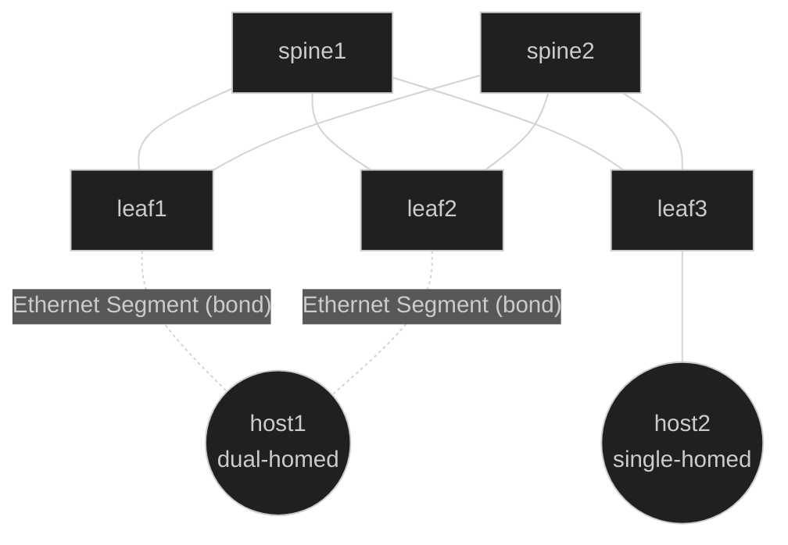
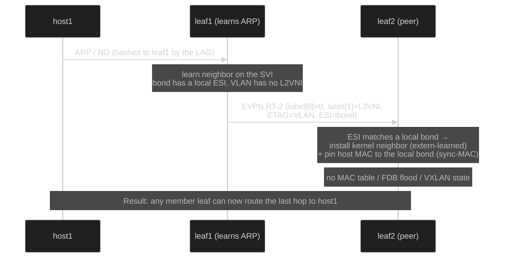

# EVPN Layer-3 Multihoming Neighbor Synchronization — SONiC High-Level Design

## Table of Contents

- [1. Revision](#1-revision)
- [2. Scope](#2-scope)
- [3. Definitions and Abbreviations](#3-definitions-and-abbreviations)
- [4. References](#4-references)
- [5. Overview](#5-overview)
- [6. Problem Statement](#6-problem-statement)
- [7. Solution](#7-solution)
  - [7.1 The idea](#71-the-idea)
  - [7.2 The wire signal](#72-the-wire-signal)
  - [7.3 What a receiver installs](#73-what-a-receiver-installs)
  - [7.4 The enable knob](#74-the-enable-knob)
- [8. Architecture](#8-architecture)
  - [8.1 Reference topology](#81-reference-topology)
  - [8.2 Data flow](#82-data-flow)
  - [8.3 Ownership model](#83-ownership-model)
  - [8.4 FRR data-model extensions](#84-frr-data-model-extensions)
  - [8.5 ZAPI messages (bgpd ↔ zebra)](#85-zapi-messages-bgpd--zebra)
  - [8.6 Runtime lifecycle](#86-runtime-lifecycle)
- [9. Requirements](#9-requirements)
- [10. Configuration and Management](#10-configuration-and-management)
  - [10.1 FRR command](#101-frr-command)
  - [10.2 SONiC configuration modes](#102-sonic-configuration-modes)
  - [10.3 CONFIG_DB](#103-config_db)
  - [10.4 YANG model](#104-yang-model)
  - [10.5 frrcfgd and template](#105-frrcfgd-and-template)
- [11. SAI / Data-Plane Impact](#11-sai--data-plane-impact)
- [12. Warm Boot / Fast Boot](#12-warm-boot--fast-boot)
- [13. Restrictions and Limitations](#13-restrictions-and-limitations)
- [14. Testing](#14-testing)

---

## 1. Revision

| Rev | Date | Author | Description |
|---|---|---|---|
| 0.1 | 2026-09-09 | Patrice Brissette (Cisco) | Initial HLD |
| 0.2 | 2026-10-07 | Patrice Brissette (Cisco) | Enable knob folded into `advertise-all-vni [l3vni-neigh]`; flag carried in `ZEBRA_ADVERTISE_ALL_VNI` (review feedback) |
| 0.3 | 2026-10-21 | Patrice Brissette (Cisco) | Added the `BGP_GLOBALS_AF` field `advertise-all-vni-l3vni-neigh` (YANG, frrcfgd, template) so the token persists in frrcfgd mode (review feedback) |
| 0.4 | 2026-11-24 | Patrice Brissette (Cisco) | Documented the FRR runtime lifecycle, including state ownership, reconciliation, and L2VNI coexistence and handoff. Aligned route distinguisher and Zebra state details with FRR. Clarified platform responsibility for ASIC programming and the scope of warm reboot support. |

---

## 2. Scope

This document describes an EVPN control-plane enhancement that lets the leaf
switches that share a multihomed host keep the host's **ARP/ND (neighbor) entry
in sync** using EVPN Route Type 2 (RT-2) **even when the host's VLAN has no
L2VNI** — that is, in a **pure Layer-3 multihoming (L3MH)** fabric. The host may
be attached to **two or more** leaves (all members of the same Ethernet
Segment); the mechanism scales to any number of segment members.

The feature behavior described here is implemented in **FRRouting (FRR)**, the
routing stack used by SONiC. Zebra installs and removes the synchronized kernel
neighbor and local Ethernet Segment FDB pin through Linux netlink. SONiC's
neighbor and FDB consumers determine how that kernel state is realized in the
ASIC; this HLD does not prescribe a particular FDB consumer or SWSS mode. No new
SAI object is defined by the FRR feature. The SONiC configuration change in this
HLD is one CONFIG_DB field so the setting persists in frrcfgd mode (see
[section 10](#10-configuration-and-management)). This document explains
**what** the feature does and **why**.

---

## 3. Definitions and Abbreviations

| Term | Meaning |
|---|---|
| **EVPN** | Ethernet VPN — BGP control plane for overlay networks (RFC 7432). |
| **Multihoming (MH)** | A host attached to two (or more) leaf switches through one logical bond (LAG), for redundancy and load-sharing. |
| **ESI** | Ethernet Segment Identifier — the identity of that multihomed bond, shared by the leaves that connect to it. |
| **L2VNI** | A VXLAN VNI that carries one bridge domain (VLAN). Provides stretched Layer 2 across the fabric. |
| **L3VNI** | A VXLAN VNI that carries one routing domain (VRF). Used for routed (Layer-3) traffic. |
| **RT-2** | EVPN Route Type 2 — the MAC/IP advertisement (normally used to sync MAC + ARP/ND). |
| **SVI** | The Layer-3 interface (gateway) for a VLAN. |
| **Neighbor** | A host's ARP (IPv4) or ND (IPv6) entry: the IP↔MAC binding a router needs to forward the last hop to that host. |
| **L3MH** | Layer-3 multihoming: a multihomed host in a **routed-only** fabric (no stretched L2, no L2VNI). |

---

## 4. References

| Reference | Description |
|---|---|
| [draft-ietf-bess-evpn-l3mh-proto](https://datatracker.ietf.org/doc/draft-ietf-bess-evpn-l3mh-proto/) | **EVPN Layer-3 multihoming** — ARP/ND synchronization via RT-2. The IETF basis for this feature. |
| [RFC 7432](https://datatracker.ietf.org/doc/html/rfc7432) | BGP MPLS-Based Ethernet VPN (base EVPN). |
| [RFC 9135](https://datatracker.ietf.org/doc/html/rfc9135) | Integrated Routing and Bridging (IRB) in EVPN. |
| [FRRouting/frr#23304](https://github.com/FRRouting/frr/pull/23304) | FRR implementation (bgpd, zebra, lib). |
| [sonic-net/sonic-buildimage#30221](https://github.com/sonic-net/sonic-buildimage/pull/30221) | SONiC YANG model, frrcfgd and template support for `advertise-all-vni-l3vni-neigh`. |

---

## 5. Overview

Modern data-center fabrics increasingly run **routed-only** underlays: every leaf
is a Layer-3 gateway, and there is **no stretched Layer 2** between leaves and
therefore **no L2VNI**. At the same time, operators still want **server
redundancy**, so a server is multihomed to **two or more** leaves through a
single LAG — an EVPN **Ethernet Segment**.

These two goals collide on one small but important detail: **the host's ARP/ND
entry**. In a routed fabric, a leaf can only forward the final hop to a host if
it knows that host's IP↔MAC binding. When the host is multihomed, **any** of the
segment's member leaves may need to deliver that last hop — so **all** of them
must know the entry, even if only one actually learned it from the wire.

In a classic EVPN deployment this synchronization happens "for free" because the
host's VLAN has an L2VNI and the neighbor information rides along inside the
Layer-2 (MAC) machinery. **In an L3MH fabric there is no L2VNI, so that vehicle
does not exist.** This feature gives the neighbor entry its own ride.

---

## 6. Problem Statement

Consider a host **multihomed to leaf1, leaf2, … leafN** over one bond (one
Ethernet Segment), in a fabric with **no L2VNI** for the host's VLAN. (Two
members is the common case; the reasoning is identical for more.)

- The host sends its ARP once. Because of LAG hashing, that ARP is delivered to
  **only one** of the member leaves — say **leaf1**. leaf1 learns the neighbor
  (IP↔MAC) and can route to the host directly.
- **Every other member leaf** is an equally valid next hop for that host (same
  bond, same segment), but it **never saw the ARP**, so it has **no neighbor
  entry**.

The consequences when traffic arrives at one of those other leaves (or is hashed
to it by the fabric):

- **No reliable delivery.** That leaf cannot resolve the host's MAC, so it
  cannot build the last-hop rewrite. Its only recourse is to ARP/ND the host
  itself on the segment — but under LAG hashing the host's **reply can be
  delivered to a different member leaf**, so this self-resolution is unreliable.
  With no L2VNI there is also no flood domain to fall back on, so the packet is
  dropped until (if ever) the neighbor resolves.
- **Redundancy is degraded.** The whole point of multihoming is that **any**
  member leaf can serve the host. Without a synchronized neighbor, only the leaf
  that happened to learn the ARP works well.
- **The usual fix is unavailable.** In an L2VNI deployment the member leaves
  would converge the entry through the Layer-2 EVPN path. That path is absent by
  design in L3MH.

> **In one sentence:** in a routed-only multihoming fabric, the leaves that share
> a host have no standard way to agree on that host's ARP/ND entry, because the
> Layer-2 mechanism that normally carries it has been removed.

---

## 7. Solution

### 7.1 The idea

Reuse the EVPN route that already carries ARP/ND information — **RT-2** — to
synchronize the neighbor within its Ethernet Segment.

A leaf that receives such a route and recognizes the host's Ethernet Segment as
**one of its own local bonds** installs the **kernel neighbor entry** and a
local FDB pin on an eligible VLAN without an L2VNI (see
[§7.3](#73-what-a-receiver-installs)). This mechanism is based on
[draft-ietf-bess-evpn-l3mh-proto](https://datatracker.ietf.org/doc/draft-ietf-bess-evpn-l3mh-proto/).

### 7.2 The wire signal

An RT-2 is marked as **"pure Layer-3 / neighbor-only"** by a single, unambiguous
signal: an MPLS **Explicit NULL** label in the first label slot.

| Field | Value | Meaning |
|---|---|---|
| **Label-1** (`label[0]`) | **0** (Explicit NULL) | *"install the neighbor, not the MAC"* — the one flag that distinguishes this route. |
| **Label-2** (`label[1]`) | **L3VNI** | the routing domain (VRF) the host belongs to. |
| **Ethernet Tag** | **VLAN ID** | identifies which SVI/subnet the neighbor lives on. |
| **Route Distinguisher** | **IP-VRF RD** | Uses the configured RD or derives one from the router ID and an allocated VRF RD ID. |
| **Route Target** | **IP-VRF RT** | so the receiving VRF imports it. |
| **ESI** | the host's **bond identity** | how a receiver decides "this segment is local to me." |

Because the distinguishing signal is a normal EVPN field, the route rides the
**existing** BGP EVPN infrastructure — no new address family, no new attribute.

### 7.3 What a receiver installs

When a leaf receives a pure-L3 RT-2 whose **ESI matches one of its own local
bonds** and whose Ethernet Tag resolves to an eligible SVI on a VLAN without an
L2VNI, it programs:

1. **The kernel neighbor** (ARP/ND) on the SVI selected by the Ethernet Tag,
   marked as externally-learned. This is the entry that lets the leaf route the
   last hop to the host.
2. **A local forwarding pin (sync-MAC)** — the host's MAC pointed at the local
   bond in the bridge FDB. This is needed because LAG hashing can mean this leaf
   *never* sees the host's frames on its own link; without the pin, routed
   delivery would have nowhere to send the rewritten packet. The pin sends it
   straight out the correct bond. There is one pin per (MAC, VLAN), shared by
   all synced neighbors of a dual-stack or multi-IP host, and it stays until the
   last of them is withdrawn.

The route creates no VXLAN or remote MAC state, Inclusive Multicast (RT-3)
route, or flood list. If the receiver's ESI does not match a local bond, it
installs nothing. If the VLAN has an L2VNI, Zebra holds eligible pure-L3 peer
state inactive.

### 7.4 The enable knob

The feature is turned on per box with an optional **`l3vni-neigh`** token on the
existing `advertise-all-vni` command (`advertise-all-vni l3vni-neigh`). Folding
it into the existing command — rather than adding a stand-alone sub-command —
means EVPN-enable and L3MH-enable are always applied together, with no ordering
dependency between config commands or between ZAPI messages. It is a
**capability enable that gates both directions**:

- **Transmit:** authorizes originating the `label[0]=0` RT-2 for locally learned
  neighbors on no-L2VNI VLANs.
- **Receive:** a received `label[0]=0` RT-2 is honored only when the token is
  set. RFC 7432 makes the MAC/IP label mandatory, so with the token off the
  route is **invalid** and nothing is programmed from it: no neighbor, no
  sync-MAC, and **no IP import into the VRF** (no /32 or /128 host route).

With the token absent, a feature-capable box neither originates these routes nor
programs any part of a received one. The route stays in the BGP EVPN table, so
turning the token on later installs it without a route refresh. A box without
the feature does not recognize the signal (see
[§13](#13-restrictions-and-limitations)).

---

## 8. Architecture

### 8.1 Reference topology

A minimal L3MH fabric: two spines, three leaves, one dual-homed host on the
multihoming pair, and one single-homed control host.



- **leaf1 + leaf2** share the multihomed host over one Ethernet Segment. They
  originate and cross-sync the host's ARP/ND entry. The segment can have **more
  than two** member leaves; the behavior is identical for each additional member.
- **leaf3** is not a member of that segment; it imports nothing for it.
- The **spines** are pure Layer-3 transit. There is **no L2VNI** anywhere — only
  an **L3VNI per VRF**.

### 8.2 Data flow

The neighbor learned on one member leaf is advertised as a pure-L3 RT-2 and
installed as a synced neighbor on **every other member leaf** of the segment
(the flow below shows one peer for clarity).



Withdrawal is symmetric: when the neighbor is deleted or ages out on leaf1, the
RT-2 is withdrawn and leaf2 removes the synced neighbor. The sync-MAC pin is
per (MAC, VLAN) and shared by all of the host's synced neighbors (for example
its IPv4 and IPv6 addresses), so leaf2 removes the pin only when the host's last
synced neighbor is withdrawn.

### 8.3 Ownership model

| Layer | Responsibility |
|---|---|
| **FRR — bgpd** | Originate / receive the pure-L3 RT-2; decide "is this ESI local to me?"; drive the neighbor install/withdraw toward zebra. |
| **FRR — zebra** | Program the **kernel neighbor** (ARP/ND) and the **local-ES sync-MAC** into the bridge FDB via netlink. Suppress all Layer-2 (VXLAN/FDB-flood/RT-3) state. |
| **Linux kernel** | Hold the neighbor and FDB entries; **answer ARP/ND** from that state (FRR has no packet-level responder). |
| **SONiC / platform FDB consumer** | Consume kernel neighbor and FDB state and realize it in the ASIC using the platform's existing integration. The FRR design does not select a SWSS `mac_sync_mode`, require an `L3EvpnMH` subtype, or depend on FPM. FPM may be one SONiC path for carrying kernel FDB state to the ASIC, but is not a prerequisite of the FRR design. |

The BGP knob controls RT-2 origination and acceptance. It does not select the
SONiC FDB consumer. FRR validation therefore covers the neighbor and sync-MAC
state Zebra installs in the kernel; SWSS-specific prerequisites and ASIC-entry
validation belong in the SONiC integration design and tests.

Answering ARP/ND for same-subnet hosts, when desired, remains an external kernel
/ orchestrator concern (`proxy_arp` / `proxy_ndp`), exactly as in EVPN today —
FRR does not toggle those sysctls.

### 8.4 FRR data-model extensions

The pure-L3 neighbor-sync container reuses a `zebra_evpn` instance **keyed on
the L3VNI** and shared by all no-L2VNI VLANs of that VRF. Each neighbor entry
carries its VLAN identity. Zebra adds a per-VLAN MAC cache and a separate
neighbor index keyed by L3VNI, MAC, and VLAN.

| Structure | Extension | Purpose |
|---|---|---|
| `zebra_evpn` (per-VNI EVPN instance) | new flag **`ZEVPN_L3_NEIGH_SYNC`** | Marks the L3VNI-keyed instance as the shared **pure-L3 neighbor-sync** container — no FDB, no flood, no VXLAN. |
| `zebra_neigh` (synced ARP/ND entry) | new fields **`eth_tag`** (owning VLAN/ETAG) and **`sync_mac_ifindex`** (local-ES pin) | Let one shared container serve many SVIs, and track the sync-MAC pin for cleanup (removed with the host's last synced neighbor). |
| `zebra_evpn_access_bd` (access VLAN/BD) | new **`l3_mac_es_table`** — hash of *host MAC → local access port* (**new table**) | On a no-L2VNI VLAN there is no MAC table; this cache records which local bond a host MAC sits behind, so the RT-2 carries the correct **ESI**. |
| Zebra neighbor index | new **`zebra_l3_mac_idx`** — hash of *(L3VNI, MAC, VLAN) → neighbor IPs* | Finds neighbors that share the same host MAC and VLAN for sync-MAC handling and reconciliation. |
| `bgp` (EVPN default VRF) and `zebra_vrf` | new **`advertise_l3vni_neigh`** flag, set alongside `advertise_all_vni` | Stores the `l3vni-neigh` token in bgpd and zebra; set and cleared together with EVPN-enable. |

RT-2 origination in bgpd is sourced entirely from the existing per-VRF EVPN
instance — **no new bgpd EVPN instance is created**.

```
zmh_info                               global EVPN-MH info (existing)
└─ evpn_vlan_table                     hash of all access VLANs/BDs (existing)
   └─ zebra_evpn_access_bd             one per (bridge, VLAN)        (existing)
      ├─ vid                           → Ethernet Tag
      ├─ vlan_zif                      → SVI (gateway) of the VLAN
      ├─ mbr_zifs                      → member bonds → local ESI
      └─ l3_mac_es_table   ← NEW       hash: host MAC → local access port
         └─ { macaddr (key), acc_ifindex }   ← NEW  one entry per learned host MAC

zebra_evpn                             reused instance, keyed on the L3VNI
│                                      flag ZEVPN_L3_NEIGH_SYNC  ← NEW
└─ neigh_table                         synced ARP/ND entries (existing hash, key = IP)
   └─ zebra_neigh { ip, mac,
                    eth_tag           ← NEW  owning VLAN/ETAG
                    sync_mac_ifindex  ← NEW  local-ES sync-MAC pin }

zebra_l3_mac_idx        ← NEW           hash: (L3VNI, MAC, VLAN) → neighbor IPs
```

- The **`l3_mac_es_table`** is the join key for ESI resolution: the ARP/ND event
  gives *IP → MAC*, this cache gives *MAC → local port → ESI*. It is created
  lazily on the first bridge-FDB learn and freed when the VLAN/BD is torn down.
- The **`zebra_evpn`** singleton is not new — it is the normal per-VNI EVPN
  object, instantiated here on the **L3VNI** and shared by every no-L2VNI VLAN of
  the VRF. Each `zebra_neigh` carries its own `eth_tag`, so one shared container
  still serves many SVIs.

### 8.5 ZAPI messages (bgpd ↔ zebra)

ZAPI is the internal channel between bgpd and zebra. The existing EVPN enable
message gains one flag. The existing MAC/IP ADD messages carry the new flag bit
and the Ethernet Tag. The DEL messages also gain the Ethernet Tag.

| Message | Direction | Change |
|---|---|---|
| `ZEBRA_ADVERTISE_ALL_VNI` | bgpd → zebra | **Extended** — new 1-byte **`l3vni_neigh`** flag after the existing fields, so EVPN-enable and L3MH-enable arrive atomically in one message. |
| `ZEBRA_MACIP_ADD` / `ZEBRA_MACIP_DEL` (local) | zebra → bgpd | Both append the **Ethernet Tag**. ADD uses **`ZEBRA_MACIP_TYPE_L3_NEIGH_SYNC`** (`0x80`) to identify a pure-L3 entry. |
| `ZEBRA_REMOTE_MACIP_ADD` / `ZEBRA_REMOTE_MACIP_DEL` | bgpd → zebra | Both append the **Ethernet Tag**. ADD uses the same flag and supplies the **ESI** for the local ES match. |

**Fields carried** (in wire order; new additions in **bold**):

| Message | Fields |
|---|---|
| `ZEBRA_ADVERTISE_ALL_VNI` | advertise, flood_ctrl, **l3vni_neigh** |
| `ZEBRA_MACIP_ADD` (local) | VNI, MAC, IP, **flags (0x80)**, seq, ESI, **eth_tag** |
| `ZEBRA_MACIP_DEL` (local) | VNI, MAC, IP, state, **eth_tag** |
| `ZEBRA_REMOTE_MACIP_ADD` | VNI, MAC, IP, VTEP-IP, **flags (0x80)**, seq, ESI, **eth_tag** |
| `ZEBRA_REMOTE_MACIP_DEL` | VNI, MAC, IP, VTEP-IP, **eth_tag** |

For a pure-L3 entry, the `VNI` field carries the **L3VNI**. On a remote DEL,
Zebra finds the neighbor by IP in the L3VNI container and checks that the MAC
and Ethernet Tag both match before removing the peer state.

Because the MAC/IP encoding grows, the ZAPI version (`ZSERV_VERSION`) is bumped.
bgpd and zebra ship in the same FRR package, so their versions always match.

### 8.6 Runtime lifecycle

The detailed runtime callflows are implemented in
[FRRouting PR #23304](https://github.com/FRRouting/frr/pull/23304). The main
state transitions are summarized here.

#### Local learn and origination

Zebra joins two independently learned pieces of kernel state: ARP/ND supplies
`IP → MAC`, while the bridge FDB supplies `MAC → access port → ESI`. Either
event may arrive first. Zebra retains an incomplete neighbor but does not
originate an RT-2 until it can resolve a valid local, non-bypass ESI. If the
FDB mapping ages out, Zebra withdraws the RT-2 but retains the ARP/ND entry; a
later FDB relearn restores the advertisement. IPv6 link-local neighbors are
excluded.

Origination also requires an operational L3VNI, a same-VRF SVI for the ETAG,
and a bridge domain not owned by an L2VNI. A local neighbor ADD carries the
L3VNI, MAC, IP, ETAG, and resolved ESI to bgpd. bgpd advertises the RT-2 under
the IP-VRF with Explicit NULL followed by the L3VNI label.

#### Import and installation

bgpd accepts a pure-L3 neighbor-sync RT-2 only when it has an IP, exactly two
labels (`0`, L3VNI), matches the importing VRF and route target, and is enabled
by the local feature knob. A non-local ESI creates no synchronized state. For
a local ES, Zebra installs the externally learned kernel neighbor and static
sync-MAC pin when the ETAG resolves to a usable SVI in the L3VNI's VRF and the
VLAN has no L2VNI. An unusable or missing SVI, or an L2VNI on the VLAN, leaves
the peer state inactive for later reconciliation. The pure-L3 RT-2 creates no
remote MAC, VXLAN, or flood state.

#### Ownership and path reconciliation

For a matching IP/MAC/ETAG, a locally learned neighbor takes precedence over a
peer-synchronized copy. Zebra retains the peer's ESI, sequence, and router flag
while local ownership is active. If the peer withdraws, the local neighbor is
unchanged; if the local neighbor is deleted first, Zebra restores the retained
peer neighbor and sync-MAC immediately. A remote route that changes MAC or
ETAG is treated as a move to a new key. A remote withdraw must match the
current MAC and ETAG. On an ETAG move, Zebra uses the previously installed SVI
interface index to remove the old kernel neighbor.

Several RDs or BGP paths can back the same host. Withdrawing one path does not
remove the aggregate neighbor while another eligible path remains. bgpd
reconciles the surviving path and sends Zebra an update only when the effective
ESI or router flag changes. The sync-MAC is shared by all active neighbors
using the same `(L3VNI, MAC, ETAG)`; Zebra deletes it only after the final user
is removed, or moves it when the surviving owner uses a different ES bond.

#### Dependency and configuration changes

| Event | Runtime behavior |
|---|---|
| `l3vni-neigh` enabled | Open receive processing, reevaluate the ES base, replay local kernel neighbors, and reimport stored remote routes. Zebra keeps an existing L2VNI base and can select an operational L3VNI when no L2VNI base is available. |
| `l3vni-neigh` disabled | Close the ADD path, withdraw local pure-L3 advertisements, and flush remote neighbor and sync-MAC state; DEL handling stays active during cleanup. Bare `advertise-all-vni` can remain enabled. |
| SVI, VLAN, address, or VRF dependency appears | Reconcile held remote owners and install those whose ETAG SVI now belongs to the L3VNI VRF. |
| Kernel neighbor or sync-MAC disappears unexpectedly | Repair the derived kernel/FDB state from the retained remote owner when the SVI is usable; otherwise hold it inactive until dependencies recover. |
| L2VNI attaches to the access VLAN | Transfer local ownership to normal L2 EVPN, withdraw the pure-L3 advertisement, and retain remote pure-L3 owners inactive. |
| L2VNI detaches from the access VLAN | Seed the pure-L3 cache from retained local MAC entries, including inactive local entries learned by an ES peer. Zebra reuses retained neighbors and reactivates eligible peer state. Local RT-2 origination waits for a usable MAC-to-port mapping if the handoff cannot supply one. |
| SVI moves between VRFs | Withdraw old local routes and uninstall old remote state; replay only entries valid under the new L3VNI/VRF association. |
| L3VNI goes down or is removed | Withdraw local routes before invalidating the L3VNI identity, uninstall remote state, and clear singleton state. On recovery, rebuild identity and replay eligible state. |
| bgpd and Zebra reconnect | Replay the combined EVPN/L3MH enable state, then local kernel neighbors and remote BGP paths; unchanged local routes are not churned. |

Import RT or received-label changes uninstall and revalidate remote imports.
Local RD or export RT changes refresh locally advertised route identity and
attributes. These policy changes do not alter the neighbor ownership rules.

Graceful-restart stale timestamps, stale expiry, and orphan cleanup are not
covered by this lifecycle; see [Restrictions and Limitations](#13-restrictions-and-limitations).

---

## 9. Requirements

**Functional**

1. On a leaf with `advertise-all-vni l3vni-neigh` set and **no L2VNI** for the host's
   VLAN, a locally learned ARP/ND entry is advertised as an RT-2 with
   `label[0]=0`, `label[1]=L3VNI`, Ethernet Tag = VLAN.
2. A received pure-L3 RT-2 whose **ESI is local** installs a kernel neighbor and
   a local-ES sync-MAC pin when the ETAG resolves to a usable SVI in the L3VNI's
   VRF on a VLAN without an L2VNI.
3. A received pure-L3 RT-2 whose **ESI is not local** installs nothing.
4. Multiple SVIs sharing one L3VNI are distinguished on the wire by their
   **Ethernet Tag**.
5. **No** bridge/FDB flood, VXLAN, or remote-MAC state is created (the sole FDB
   entry is the local-ES sync-MAC of requirement 2).
6. `advertise-all-vni` alone (feature knob off) behaves exactly as before — no
   regression.
7. With `l3vni-neigh` off, a received RT-2 with `label[0]=0` is treated as
   invalid: nothing is programmed from it — no kernel neighbor, no sync-MAC, and
   no IP host route in the VRF.

**Coexistence**

8. On a VLAN with an L2VNI, normal L2 EVPN owns the VLAN and handles local
   origination. Zebra holds eligible pure-L3 peer state inactive and installs
   neither a kernel neighbor nor a sync-MAC pin from that route.

**Management**

9. The feature is enabled/disabled by an optional `l3vni-neigh` token on the
   existing `advertise-all-vni` command; it gates both transmit and receive, and
   EVPN-enable and L3MH-enable are applied atomically.
10. In frrcfgd mode (`frr_mgmt_framework_config=true`), the setting is stored in
   CONFIG_DB and survives a bgp container restart, `config reload` and reboot.

---

## 10. Configuration and Management

### 10.1 FRR command

Configuration is an optional token on the existing `advertise-all-vni` command:

```
router bgp <asn>
 address-family l2vpn evpn
  advertise-all-vni l3vni-neigh   ! EVPN enable + L3MH neighbor sync
 exit-address-family
```

| Command | EVPN | L3MH neighbor sync |
|---|---|---|
| `advertise-all-vni l3vni-neigh` | on | on |
| `advertise-all-vni` | on | off |
| `no advertise-all-vni l3vni-neigh` | on | off |
| `no advertise-all-vni` | off | off |

- A single command carries both settings, so there is no config-ordering
  dependency, and the running-config shows a single line.
- The feature is **per box** (gates TX and RX); whether a given VLAN actually
  uses it is decided automatically by the **absence of an L2VNI** for that VLAN.
- State is visible through the existing EVPN show commands (the token, and the
  RT-2's `Label-1: 0` / Ethernet Tag / IP-VRF RT / ESI).

### 10.2 SONiC configuration modes

| Mode | Where the token is stored |
|---|---|
| Split (`docker_routing_config_mode=split`) | In `frr.conf`. The operator enters `advertise-all-vni l3vni-neigh` in vtysh and saves it. No SONiC change is needed. |
| frrcfgd (`frr_mgmt_framework_config=true`) | In CONFIG_DB, in the new `BGP_GLOBALS_AF` field below. frrcfgd applies it, and the frrcfgd template renders it into `frr.conf` at startup. |

In frrcfgd mode, CONFIG_DB is the source of truth. A token typed only in vtysh
would be lost on the next restart, because `frr.conf` is regenerated from
CONFIG_DB. The token therefore needs its own CONFIG_DB field.

### 10.3 CONFIG_DB

One new field in the existing `BGP_GLOBALS_AF` table. No new table.

```
BGP_GLOBALS_AF|{{vrf_name}}|l2vpn_evpn
    "advertise-all-vni"             : {{"true"|"false"}}   ; existing
    "advertise-all-vni-l3vni-neigh" : {{"true"|"false"}}   ; new, default "false"
```

Example:

```json
"BGP_GLOBALS_AF": {
    "default|l2vpn_evpn": {
        "advertise-all-vni": "true",
        "advertise-all-vni-l3vni-neigh": "true"
    }
}
```

| `advertise-all-vni` | `advertise-all-vni-l3vni-neigh` | FRR command |
|---|---|---|
| `true` | `true` | `advertise-all-vni l3vni-neigh` |
| `true` | `false` or absent | `advertise-all-vni` |
| `false` or absent | `false` or absent | `no advertise-all-vni` |

### 10.4 YANG model

New leaf in `BGP_GLOBALS_AF_LIST` of `sonic-bgp-global.yang`:

```yang
leaf advertise-all-vni-l3vni-neigh {
    must "current() = 'false' or (current()/../afi_safi = 'l2vpn_evpn' and current()/../advertise-all-vni = 'true')" {
        error-message "advertise-all-vni-l3vni-neigh requires advertise-all-vni on l2vpn_evpn";
    }
    type boolean;
    description "EVPN L3 multihoming: sync host ARP/ND entries to ES peers as pure-L3 RT-2 routes over the L3VNI (advertise-all-vni l3vni-neigh)";
}
```

The `must` rule allows `true` only on `l2vpn_evpn` with `advertise-all-vni` also
`true`, because the FRR token is an option of `advertise-all-vni`.

### 10.5 frrcfgd and template

- **frrcfgd:** `advertise-all-vni` and `advertise-all-vni-l3vni-neigh` are
  handled by one handler that sends one command for the combined state (table
  in 10.3). They are not sent as two separate commands, because a bare
  `advertise-all-vni` turns the token off in FRR and would undo it.
- **Template:** `bgpd.conf.db.addr_family.evpn.j2` renders
  `advertise-all-vni l3vni-neigh` when both fields are `true`, so the token is
  restored when `frr.conf` is generated at startup.

No new SONiC CLI or SAI change is required.

---

## 11. SAI / Data-Plane Impact

FRR installs and removes the synced kernel neighbor and local-ES sync-MAC via
Linux netlink. Whether and how the kernel FDB pin is programmed in the ASIC
depends on the platform's FDB consumer and SONiC integration. FPM may carry this
kernel FDB state to the ASIC on a platform that uses that path, but FRR does not
require FPM or prescribe a SWSS `mac_sync_mode` or FDB subtype. This HLD defines
no new SAI object or attribute. SONiC integration documentation and tests should
specify any SWSS-specific prerequisites and validate the resulting ASIC entry.

---

## 12. Warm Boot / Fast Boot

Warm-reboot and fast-boot preservation are **not introduced or guaranteed by
this feature**. L3MH adds no retention or warm-boot reconciliation for
synchronized kernel neighbors or sync-MAC FDB pins. The existing EVPN warm-boot
limitations therefore apply; in particular, the existing EVPN multihoming
design excludes warm reboot while its EVPN graceful-restart and reconciliation
dependencies remain unresolved (see
[`EVPN_VxLAN_Multihoming.md`](EVPN_VxLAN_Multihoming.md#7-warm-boot-support)).

The bgpd/Zebra reconnect replay described in [section 8.6](#86-runtime-lifecycle)
restores FRR's eventual control-plane and kernel state after those daemons
reconnect. It does not establish that the neighbor or FDB state is retained
through a warm reboot, nor does it specify how long traffic may be interrupted.
ASIC realization and replay of the FDB pin after restart remain dependent on the
platform's FDB consumer and SONiC integration. This feature adds no boot-time
wait or separate boot stage. Normal FRR replay can still process eligible
neighbor and route entries after reconnect; this HLD has no measured boot-time
impact for that work and defines no warm-boot or fast-boot downtime target.
Preservation and downtime must be assessed against the platform's existing
behavior; no additional FRR persistent database is introduced.

---

## 13. Restrictions and Limitations

- **Neighbor sync only (this phase).** The feature programs the kernel neighbor
  and the local-ES sync-MAC. Importing the host's `/32` or `/128` as a RIB route,
  backup next-hop groups, and remote-VTEP multipath are **follow-up work** and
  are not part of this design.
- **FRR does not answer ARP/ND.** The kernel answers from the programmed
  neighbor; same-subnet ARP/ND suppression, if wanted, is an external
  `proxy_arp` / `proxy_ndp` prerequisite.
- **Import granularity.** Until the ES-Import RT optimization is added, RT-2s are
  imported at whole-VRF granularity and non-local ESIs are discarded after
  import — correct, but broader fan-out in large fabrics.
- **Mixed fabric with leaves that lack the feature.** An FRR build without this
  feature does not recognize `label[0]=0` and imports the RT-2 as an ordinary
  symmetric-IRB route, installing a /32 or /128 host route toward the
  originating VTEP:
  - an older leaf that is not a segment member sends traffic for the host only
    to the originating leaf, while upgraded leaves do not install the route and
    keep using the subnet route;
  - an older leaf that is a segment member installs a host route more specific
    than its local subnet, so traffic hairpins through the fabric instead of
    leaving on the local bond.

  Upgrade every leaf in the VRF before enabling `advertise-all-vni l3vni-neigh`.
- **CONFIG_DB field needs a feature-capable FRR.** If
  `advertise-all-vni-l3vni-neigh` is `true` on an image whose FRR does not have
  the token, FRR rejects the whole `advertise-all-vni l3vni-neigh` command, so
  EVPN is not enabled either. Leave the field unset on such images.

---

## 14. Testing

FRR validation is at the **control-plane and kernel-state** level in the FRR
EVPN multihoming test suite: the ES-peer leaf has the synced neighbor and
sync-MAC in the kernel, the non-member leaf installs nothing, a leaf with the
token off installs nothing (no neighbor, no sync-MAC, no host route in the
VRF), and an L2VNI-owned VLAN holds eligible pure-L3 peer state without
installing its kernel neighbor or sync-MAC. SWSS-specific prerequisites,
FDB-consumer behavior, restart replay, and ASIC-entry validation belong in
SONiC integration design and tests.
The FRR reconnect and kernel-reconciliation tests below are not warm-boot or
fast-boot preservation tests; those are outside this feature's validation scope.
Additional lifecycle coverage includes:

| Scenario | Representative FRR validation |
|---|---|
| Enable/disable replay and local RT-2 origination | `test_pure_l3_knob_toggle_cleans_and_replays_local_and_remote`, `test_pure_l3_rt2_origination` |
| FDB age-out and relearn | `test_pure_l3_fdb_ageout_withdraws_until_relearn` |
| Local ownership and peer fallback | `test_pure_l3_local_delete_falls_back_to_peer_sync` |
| Surviving BGP path and stale-key protection | `test_pure_l3_sync_falls_back_to_surviving_route`, `test_pure_l3_stale_key_withdraw_keeps_newer_key` |
| Deferred SVI install and VRF validation | `test_pure_l3_sync_waits_for_svi`, `test_pure_l3_etag_svi_in_other_vrf_not_installed` |
| Kernel-derived-state repair | `test_pure_l3_synced_neigh_survives_kernel_flush`, `test_pure_l3_fdb_sync_mac_delete_reconciles` |
| Key mobility and shared sync-MAC | `test_pure_l3_sync_mac_and_etag_mobility_reoriginates`, `test_pure_l3_dual_stack_sync_mac_shared` |
| L2VNI coexistence and ownership handoff | `test_pure_l3_rolling_l2vni_holds_peer_sync`, `test_pure_l3_bd_gains_l2vni_transfers_ownership`, `test_l2vni_loss_handoffs_local_neigh_without_relearn` |
| L3VNI lifecycle and IPv6 behavior | `test_pure_l3_l3vni_down_withdraws_local_rt2`, `test_pure_l3_ipv6_router_flag_synced`, `test_pure_l3_ipv6_link_local_not_synced` |

SONiC configuration (frrcfgd mode) is covered by unit tests in sonic-buildimage:

- **YANG model tests:** the field accepts `true` and `false`; it rejects `true`
  without `advertise-all-vni`, `true` on an address family other than
  `l2vpn_evpn`, and an invalid value.
- **frrcfgd tests:** each change to the two fields (enable, disable, toggle the
  token, delete) sends exactly the one expected FRR command.
- **On a switch:** set the field in CONFIG_DB and check that
  `show running-config bgpd` shows `advertise-all-vni l3vni-neigh`. Restart the
  bgp container and check that the line is still there.
