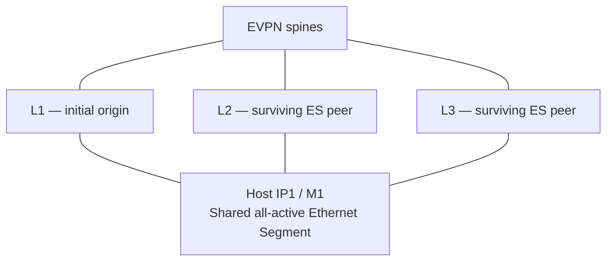
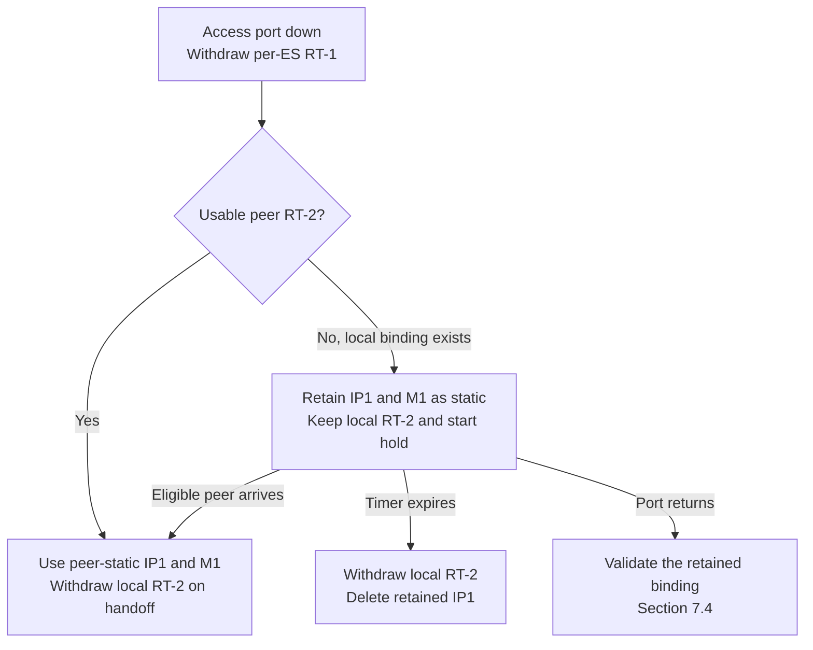
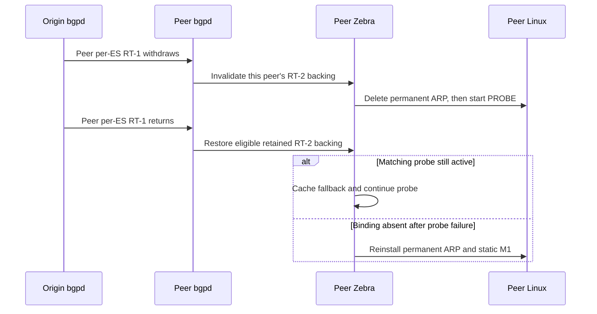
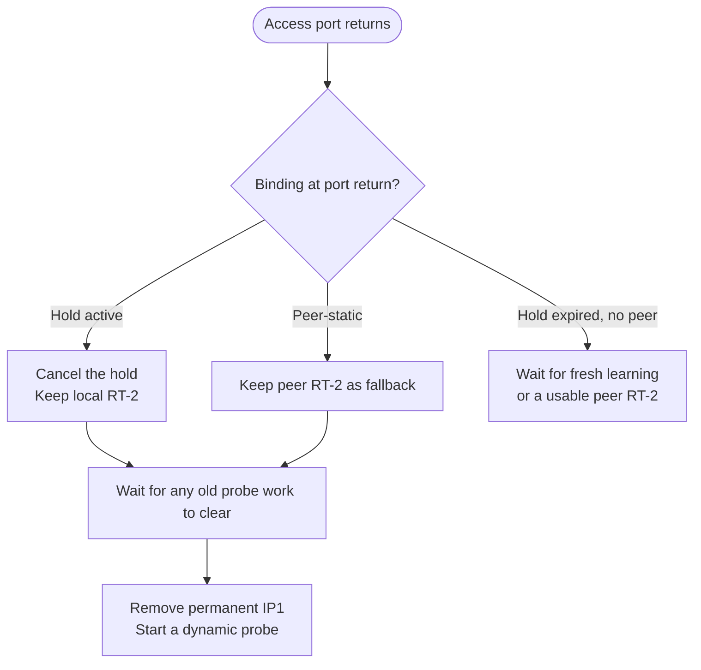

# EVPN L3MH Port-Down Handoff and Recovery — FRRouting High-Level Design

## Table of contents

- [1. Revision](#1-revision)
- [2. Scope](#2-scope)
- [3. Definitions and abbreviations](#3-definitions-and-abbreviations)
- [4. Overview](#4-overview)
- [5. Requirements](#5-requirements)
- [6. Architecture](#6-architecture)
- [7. High-level design](#7-high-level-design)
  - [7.1 Binding ownership and learning](#71-binding-ownership-and-learning)
  - [7.2 Local bridge port down](#72-local-bridge-port-down)
  - [7.3 Peer route withdrawal and restoration](#73-peer-route-withdrawal-and-restoration)
  - [7.4 Local bridge port up](#74-local-bridge-port-up)
  - [7.5 Ordinary ARP aging](#75-ordinary-arp-aging)
  - [7.6 Kernel ordering and shared MAC ownership](#76-kernel-ordering-and-shared-mac-ownership)
  - [7.7 FRR in-memory state](#77-frr-in-memory-state)
  - [7.8 ZAPI and FPM interfaces](#78-zapi-and-fpm-interfaces)
  - [7.9 Scale and performance](#79-scale-and-performance)
- [8. SAI API](#8-sai-api)
- [9. Configuration and management](#9-configuration-and-management)
- [10. Warmboot and fastboot design impact](#10-warmboot-and-fastboot-design-impact)
- [11. Memory consumption](#11-memory-consumption)
- [12. Restrictions and limitations](#12-restrictions-and-limitations)
- [13. Testing requirements](#13-testing-requirements)
- [14. Open items](#14-open-items)
- [15. References](#15-references)

## 1. Revision

| Revision | Date | Author | Description |
| --- | --- | --- | --- |
| 1.0 | 2026-11-27 | Patrice Brissette | Initial draft for SONiC review |

## 2. Scope

This design covers FRRouting (FRR) neighbor and EVPN route handling when a
host-facing bridge port on an all-active EVPN Layer-3 multihoming (L3MH)
leaf goes down or returns. It also covers ordinary ARP aging. An RT-2
withdrawal can trigger the same receiver-side probe if no usable peer
route still backs the binding.

The bridge domain has no L2VNI, has a usable switched virtual interface (SVI),
and belongs to a VRF with an operational L3VNI. The lifecycle applies with
bridge-port protection enabled or disabled. The existing protection design
covers hardware failover and its Member, Group, and Binding objects.
Single-active multihoming and L2VNI neighbor sync are outside this scope.
[Bridge-port protection FRR HLD](https://github.com/sonic-net/SONiC/pull/2576)

## 3. Definitions and abbreviations

| Term | Meaning |
| --- | --- |
| ES / ESI | Ethernet Segment / Ethernet Segment Identifier |
| IP A-D / RT-1 | EVPN Ethernet Auto-Discovery route for IP aliasing. Per-ES tracks the operational attachment. Per-EVI tracks the ES association with the tenant L3VNI. |
| RT-2 | EVPN MAC/IP Advertisement route carrying the host binding. |
| PE / VTEP | Provider Edge / VXLAN Tunnel Endpoint. The advertising PE is the originating leaf, even when several spine paths carry the route. |
| FDB / SVI | Bridge Forwarding Database / Switched Virtual Interface |
| NUD | Linux neighbor state, including `REACHABLE`, `STALE`, `DELAY`, `PROBE`, `FAILED`, and `PERMANENT`. |
| Down-peering | A per-neighbor hold on the leaf whose access port went down. |
| L3VNI / L2VNI | VXLAN Network Identifier for a routed tenant VRF / a bridged broadcast domain. |
| Peer backing | A usable same-binding peer RT-2 that supplies permanent ARP or serves as fallback during a local probe. |

## 4. Overview

If a leaf loses its access port, peers on the same ES can still reach the
host. The affected leaf withdraws its per-ES RT-1 immediately. Zebra hands
off the neighbor if a usable peer RT-2 is already present. Otherwise it
holds the IP and MAC static and keeps the local RT-2 for a bounded time.
A surviving leaf can learn the host and advertise its own RT-2 to end the
hold.

On port return, BGP restores the per-ES RT-1 independently of local ARP
validation. The receiving leaves can re-resolve an eligible retained RT-2
from the recovered origin without another RT-2 update. The recovered leaf
keeps its local RT-2 through validation and uses the outcome to retain it,
withdraw it, or fall back to an eligible peer.

## 5. Requirements

| Area | Design requirement |
| --- | --- |
| Feature enablement | Require L3MH neighbor sync on participating leaves. Bridge-port protection is optional. |
| Local ARP and MAC | Advertise a new local RT-2 when both the IP binding and MAC forwarding are usable. |
| Static ARP | Install peer-backed and retained ARP as `NUD_PERMANENT`. Zebra explicitly removes it before starting a dynamic probe. |
| Independent route lifetimes | Per-ES RT-1 follows access-port state. Per-EVI RT-1 follows the ES-to-L3VNI association. RT-2 follows host binding ownership. |
| Bounded hold | Skip the timer when eligible peer backing is already available. Otherwise hold the local binding for 60 seconds by default and stop on peer takeover, expiry, or port return. |
| Kernel ordering | Apply asynchronous events to their current bindings. Reconcile a replacement if older work already affected it in the kernel. |
| Shared MAC | Keep the static FDB pin while a static ARP uses it on the same bridge and VLAN. Release the pin after the last static user. |

The bridge learns source MACs. A valid ARP frame supplies both a source
MAC learn and an ARP sender binding. Zebra may process either event first.
A unicast ARP reply reaches one leaf. The bridge MAC aging interval exceeds
the ARP reachability interval in the ordinary aging scenarios. A link event
or explicit FDB delete can remove the MAC independently.

## 6. Architecture



The same logic runs on every leaf. L1, L2, and L3 are example roles. Any
leaf can become the local RT-2 originator.

| Component | Responsibility |
| --- | --- |
| bgpd | Originate IP A-D, track per-ES RT-1 copies by tenant and advertising PE, and resolve received RT-2 paths. |
| Zebra | Track port and VLAN membership, own neighbor lifecycles and timers, manage peer fallback, program static ARP and FDB entries, and request local RT-2 updates. |
| Linux bridge and neighbor subsystem | Report port and FDB events, learn ARP and MAC state, run NUD probes, and collect dynamic entries. Zebra uses the existing netlink dataplane. |
| SONiC | Package FRR in the existing routing container. Expose the optional timer override through `frrcfgd`. Use the existing FPM contract for optional backup forwarding. |

FRRouting changes bgpd, Zebra, and shared ZAPI. The SONiC backport in
`sonic-buildimage` carries the FRR code and topotests as separate patches
on top of the L3MH and bridge-port protection code for FRR 10.7.1. A companion
`sonic-buildimage` change carries the optional ConfigDB and YANG timer
override.

## 7. High-level design

### 7.1 Binding ownership and learning

| Zebra state | Binding and local advertisement |
| --- | --- |
| `local-dynamic` | The local IP binding uses a usable FDB entry. Zebra requests a local RT-2 when both are usable. A same-key peer can supply fallback. |
| `peer-sync-protected` | A usable peer backs permanent ARP and static M1 on the local ES. During peer-loss probing, FRR can still display this state with `peerRt1Lost` set while Linux is in `PROBE`. |
| `handoff-wait` | Zebra retains static IP1 and M1 and keeps the local RT-2 while the access port is down and the hold is active. |
| `validation-pending` | Zebra is validating the restored local attachment. It can cache a peer fallback and keep an existing retained RT-2 through the probe and its ARP/FDB learns. |

When ARP arrives first, wait for usable MAC forwarding. When the FDB event
arrives first, wait for the IP binding. An existing RT-2 can remain during
`INCOMPLETE` while the ES still resolves through M1. After MAC forwarding
loss, a MAC learn alone cannot re-advertise an `INCOMPLETE` IP.

A same-key peer can take over when local IP1 is reachable, M1 is missing,
and no local probe is active. During local validation or aging, a usable
peer becomes fallback. A late ARP frame can supply a local learn after
probe cancellation when the slot is dynamic or empty. If IP1 is still
permanent, the frame leaves the peer binding in place.

### 7.2 Local bridge port down



The port-return branch continues in [Section 7.4](#74-local-bridge-port-up),
starting with the **Down-peering hold active** case.

The flow starts with a locally learned IP1. Zebra finds bindings by access-port
ifindex and ESI and checks bridge-domain membership. The per-EVI RT-1 stays
while the association is present. A usable peer skips or cancels the hold.
Expiry withdraws the retained RT-2,
deletes IP1, and releases the pin if no other static ARP needs it. A later
peer RT-2 can install a fresh permanent entry.

If the FDB delete arrives first, Zebra checks kernel port state before
entering port-down handling. A standalone FDB delete re-evaluates the MAC.
During the hold, an old ARP update leaves retained state in place. Zebra
can repair a deleted retained IP1 into an empty slot.

A port-down during validation cancels that validation and re-evaluates
the current binding. Zebra uses a usable fallback, retains a local binding,
or clears unbacked validation when no local binding remains. Existing
peer-static entries remain while their backing stays usable.

### 7.3 Peer route withdrawal and restoration

Bgpd evaluates each advertising PE independently for a given ESI and
L3VNI. When a peer's per-ES RT-1 withdraws, bgpd immediately invalidates
that peer's RT-2 backing in the affected scope. Other peers' RT-1s can
remain active. If two spines carry the same peer's RT-1, losing one BGP
path leaves that RT-1 available through the other spine.

Policy re-evaluation, route replay, and a duplicate copy of a retained
RT-2 cannot restore its backing while the peer's RT-1 is absent. When
that peer's per-ES RT-1 returns, bgpd re-resolves its live retained RT-2
paths. A withdrawn RT-2 stays withdrawn. If all retained copies withdraw
and a fresh RT-2 arrives, bgpd evaluates it through the ordinary import
and eligibility path.



On loss, bgpd can supply an already-eligible same-key alternate as fallback
for the probe. On return, the diagram shows the case where the original RT-2
is still advertised and there is no newer binding or usable peer in place.
A same-key local binding may cache the restored peer while keeping local
ownership.

A fresh usable RT-2 from another peer can replace a peer-loss probe or
reinstall static state after probe failure. Only the receiving leaf of
the unicast ARP reply learns from that reply and can originate its own RT-2.
When a peer RT-2 withdraws, bgpd checks for another eligible RT-2 for
the same binding. If one remains, Zebra can keep the permanent entry
using that route. If none remains and IP1 is still permanent, Zebra
removes the permanent entry and starts a dynamic probe. A usable local
binding stays in place. If a probe or cleanup is already underway,
Zebra clears the withdrawn fallback and lets that work continue.

### 7.4 Local bridge port up

Bgpd restores per-ES RT-1 when the ES becomes operational. Zebra evaluates
the binding independently.



| State at port return | Entry to validation | Local RT-2 outcome |
| --- | --- | --- |
| Down-peering hold active | Cancel the timer. Remove permanent IP1 and start a dynamic probe. | Keep RT-2 through validation and matching ARP/FDB learns. On failure, withdraw it and use current eligible fallback if available. |
| Peer-static after handoff | Keep peer backing as fallback while converting IP1 to dynamic probing. | Originate a local RT-2 once IP1 and M1 are usable. On failure, use eligible peer backing if it remains. |
| Hold expired and no peer | Treat the binding as fresh, including when old cleanup is pending. | Fresh local learning can advertise once both entries are usable. A peer arriving first installs permanent IP1 and static M1. |

Peer arrivals or withdrawals change the fallback available at probe outcome.
A new MAC or VLAN for IP1 ends validation of the old key and withdraws the
old RT-2. Advertise the new key once its IP and MAC are usable. A re-flap
restarts port-down handling. A new probe waits for any prior delete that
still owns the kernel slot.

### 7.5 Ordinary ARP aging

A dynamic entry becomes `STALE` before M1 ages out. Traffic can drive
`STALE` through `DELAY` to `PROBE`. Without traffic, Linux may
garbage-collect IP1. While stale or probing, the local RT-2 stays advertised
if forwarding through M1 remains usable. A valid reply refreshes IP1 and
supplies a MAC learn if needed.

On failure or garbage collection, Zebra verifies current kernel state
before withdrawing a local RT-2. If eligible peer backing exists, Zebra
installs permanent IP1 and static M1. Otherwise a failed entry awaits
kernel collection, and a dynamic MAC can age normally. RT-1 stays active
while the access port is up. Each receiving leaf keeps its permanent
entry if another usable peer RT-2 still backs it. When none remains,
it follows the peer-loss probe.

### 7.6 Kernel ordering and shared MAC ownership

Track the kernel key `(namespace, SVI ifindex, IP)` across enqueue, execution,
notification, and completion. Zebra requests a create-only dynamic
`NUD_PROBE` following removal of permanent IP1. A delete that finds IP1
absent releases its tracking record on completion. After a failed static
delete during retained validation, the create-only request can still fill
an empty slot. Preserve an occupied slot. A rejected PROBE creation ends
the attempt and selects fallback or withdrawal as required by the current
binding.

| Ordering | Outcome |
| --- | --- |
| Old timer or probe result arrives after replacement or relearning | Check generation and operation sequence before applying the result. |
| Untagged `FAILED` or delete arrives after a fresh local learn | Read the current kernel slot. Preserve usable state. If the read is unavailable, keep the binding and retry the read once. |
| Older queued delete runs after an IP replacement | Repair a peer-static replacement into an empty slot. For a lost new local binding, withdraw RT-2 and use an eligible peer or create-only probe with the known MAC. |
| Old FDB delete removes a newly learned M1 | Preserve IP1. Withdraw the affected RT-2 and re-advertise when forwarding becomes usable. |
| Replacement loses RT-1 while the old probe delete is outstanding | Consume the old delete before starting the replacement probe. |
| Repair runs before expiry, with its completion delayed | Expiry deletes the repaired entry. Ignore the late repair result for expired state. A rejected expiry delete can be retried once while the SVI remains in the same L3VNI and no newer binding owns the slot. |

Keep M1 static while any static ARP still uses it. Removing the last static
ARP releases the FDB pin for dynamic relearning. Preserve the other IP
entries, withdraw their RT-2s if M1 becomes unusable, and re-advertise once
both the IP and M1 are usable. The retained RT-2 during port-up validation
follows [Section 7.4](#74-local-bridge-port-up).

A new static user re-pins M1 after an already-queued delete. Dependent
advertisements require usable forwarding, including kernel confirmation
when a static pin is needed. If a confirmed pin disappears, re-evaluate
affected routes and re-pin while a static user remains. A later MAC learn
can trigger recovery after a failed pin install. A rejected static ARP
install or last-user FDB delete ends that write attempt.

### 7.7 FRR in-memory state

Square brackets show lookup keys. Parentheses mark the status of each
record or field group relative to the bridge-port protection parent.
Arrows show lookups or references. For L3 neighbor sync, the EVPN instance
is keyed by the tenant L3VNI.

```text
Zebra
├── EVPN instance [VNI] (reused)
│   └── L3 neighbor table [IP] (reused)
│       └── Neighbor binding (extended)
│           ├── MAC, Ethernet Tag, SVI, and peer ESI (reused)
│           ├── State, generation, and removal reason (new)
│           ├── Expected attachment (new)
│           │   ├── MAC and Ethernet Tag
│           │   └── Access port and ESI
│           ├── Peer state (new)
│           │   ├── Advertising PE and link → peer index
│           │   └── RT-1-lost flag
│           ├── Access port link (new) → port index
│           ├── Hold timer, probe, and kernel readback (new)
│           └── Bridge ifindex and FDB pin confirmation (new)
├── Port index [access-port ifindex, ESI] (new)
│   └── Neighbor list → bindings on the port
│       └── Can span VLANs and L3VNIs
├── Peer index [L3VNI, ESI, advertising PE] (new)
│   └── Neighbor list → synced bindings and local fallbacks
├── Pending deletes [namespace, SVI ifindex, IP] (new)
│   ├── L3VNI and IP → neighbor binding
│   ├── Lookup key → kernel neighbor slot
│   └── Operation sequences and expiry retry state
├── MAC-to-IP index [L3VNI, Ethernet Tag, MAC] (reused)
│   └── IP list → neighbors sharing that MAC
├── Access bridge domain [bridge ifindex, VLAN] (reused)
│   ├── SVI → VRF and L3VNI
│   └── Local MAC cache [MAC] → access port and ESI
└── ES port/VLAN tracker [port, VLAN] (reused)
    └── ES-to-L3VNI association → bgpd ES-VRF
```

```text
bgpd
├── EVPN RIB [RD] (reused)
│   └── RT-2 NLRI [Ethernet Tag, MAC, IP] (reused)
│       └── Received path (extended)
│           ├── ESI, L3VNI, and advertising PE (reused)
│           ├── Generation stamp (new)
│           └── Links (new) → RT-1 scope and RT-2 candidates
├── RT-1 scope [L3VNI, ESI, advertising PE] (new)
│   ├── Generation
│   └── Path list → RT-2 paths in the scope
├── RT-2 candidates [L3VNI, Ethernet Tag, MAC, IP] (new)
│   ├── Path list → spine copies and alternate origins
│   └── Walk stamp → check each binding once per RT-1 change
└── Ethernet Segment [ESI] (extended)
    ├── Bridge-port protection flag (new)
    └── ES-VRF [VRF] (reused)
        └── IP A-D peer state [VTEP] (reused)
            └── Per-ES and per-EVI RT-1 counts → RT-1 scope
```

```text
Cross-daemon lookups
├── Zebra port/VLAN → (ESI, L3VNI) → bgpd ES-VRF association
├── bgpd RT-1 scope → (L3VNI, ESI, advertising PE) → Zebra peer index
└── bgpd RT-2 candidate → (L3VNI, IP) → Zebra binding
    └── Example [4000, 45.0.0.240], checked against VLAN 100 and MAC
```

### 7.8 ZAPI and FPM interfaces

All three messages use existing ZAPI opcodes. The new message form is
the type 2 neighbor-backing delete carried by `ZEBRA_EVPN_BPP_PEER_DEL`.
The standard 10-byte header and network byte order still apply.

| Message | Direction | Status | Change |
| --- | --- | --- | --- |
| `ZEBRA_EVPN_BPP_PEER_DEL` | bgpd → Zebra | Extended | New type 2, `ZAPI_EVPN_BPP_PEER_L3_NEIGH_BACKING`, adds an L3VNI field and uses the tenant VRF ID in the header. Type 1 keeps the forwarding-member payload and EVPN VRF context. |
| `ZEBRA_LOCAL_ES_ADD` | Zebra → bgpd | Extended | A new trailing `bpp` byte reports whether optional forwarding protection is configured. An absent byte defaults to true for compatibility with the parent implementation. |
| `ZEBRA_REMOTE_MACIP_ADD` | bgpd → Zebra | Reused | The wire layout stays the same. For pure-L3 sync, the existing VTEP field carries the advertising PE, and existing flag bits distinguish refresh, fallback, and restore. |

```text
ZEBRA_EVPN_BPP_PEER_DEL (extended)
├── ESI                  10 bytes
├── type                 uint8   1 = forwarding member (reused)
│                                2 = neighbor backing (new)
├── address family       uint8
├── peer VTEP            4 or 16 bytes
└── L3VNI (new)          uint32  present for type 2 only

ZEBRA_LOCAL_ES_ADD (extended)
├── ESI                  10 bytes
├── originator IP        uint16 family + address
├── oper_up              uint8
├── df_pref              uint16
├── bypass               uint8
└── bpp (new)            uint8   optional trailing byte, 0 or 1

ZEBRA_REMOTE_MACIP_ADD for pure L3 (reused)
├── L3VNI                uint32
├── MAC                  6 bytes
├── IP length            uint16
├── IP                   IP-length bytes
├── advertising PE       uint16 family + address
├── flags                uint8
│   ├── 0x80             L3_NEIGH_SYNC
│   ├── 0x40             L3_NEIGH_REFRESH
│   ├── 0x08             L3_NEIGH_FALLBACK
│   └── 0x10             L3_NEIGH_RESTORE
├── sequence             uint32  zero for pure L3
├── ESI                  10 bytes
└── Ethernet Tag         uint32
```

The type 2 payload is 20 bytes for IPv4 and 32 bytes for IPv6. Type 1
deletes carry 16 or 28 bytes, respectively. Queue invalidation ahead of
the surviving fallback update. On RT-1 restoration use `L3_NEIGH_RESTORE`
on the MAC/IP ADD. MAC/IP DEL retains its wire format.

The existing FPM contract continues to carry optional backup forwarding.
The host lifecycle adds no FPM opcode, Member, Group, or Binding.

### 7.9 Scale and performance

A local port change visits bindings indexed to that port and ESI. RT-1
loss or restoration visits paths in the affected origin/ESI/L3VNI scope.
Bgpd checks each affected binding once across duplicate spine paths and
sends at most one restore per eligible binding on recovery. A shared MAC
event re-evaluates the dependent IPs. These paths avoid a full host-table
scan. A port with many hosts can still generate per-neighbor kernel and
timer work. Measure that work independently of hardware failover.

## 8. SAI API

The design adds no SAI API or object and requires no SWSS or syncd change.
There is no schema change to APPL_DB, ASIC_DB, STATE_DB, COUNTERS_DB, or
LOGLEVEL_DB. The existing protection HLD governs optional hardware
forwarding. ConfigDB changes for the timer are in
[Section 9.2](#92-sonic-configdb-and-yang).

## 9. Configuration and management

### 9.1 FRR CLI

| Command | Scope and effect |
| --- | --- |
| `advertise-all-vni l3vni-neigh` | Required in the BGP EVPN address family of participating leaves. |
| `evpn mh bridge-port-protection` | Optional on the host-facing ES interface. Controls backup forwarding. |
| `evpn mh l3-neigh-down-peering-time <seconds>` | Global Zebra setting. Range 1–86,400 seconds. Default 60 seconds. |
| `no evpn mh l3-neigh-down-peering-time` | Restore the 60-second default. |

The hold gives a peer time to learn ARP, originate the RT-2, and have
the affected leaf receive and accept it. Linux controls the ordinary
ARP probing and aging intervals.

Example settings on L1 for VLAN 100 in VRF `vrf1` with L3VNI 4000.

```text
vrf vrf1
 vni 4000
exit-vrf
!
interface hostbond1
 evpn mh es-id 1
 evpn mh es-sys-mac 44:38:39:ff:ff:01
!
router bgp 65011
 address-family l2vpn evpn
  advertise-all-vni l3vni-neigh
 exit-address-family
!
evpn mh l3-neigh-down-peering-time 45
```

For the protection-enabled example, add `evpn mh bridge-port-protection`
under L1's `interface hostbond1`. L2 and L3 can still provide usable
backing with protection disabled on their ports.

### 9.2 SONiC ConfigDB and YANG

The companion management change adds an optional YANG-backed
`l3_neigh_down_peering_time` field to the existing `EVPN_MH_GLOBAL`
table under the `default` key. `frrcfgd` applies the override to Zebra.
Removing the field removes the FRR override and restores its default.
The range matches FRR. Existing ConfigDB files can omit the field.
The design uses the existing management path and adds no dedicated
CLICK, KLISH, SNMP, or REST command.
[SONiC timer management change](https://github.com/sonic-net/sonic-buildimage/pull/31142)

```json
{
  "EVPN_MH_GLOBAL": {
    "default": {
      "l3_neigh_down_peering_time": "45"
    }
  }
}
```

### 9.3 Operational visibility

The example uses IP1 `45.0.0.240`, M1 `02:00:00:00:01:f0`, VLAN 100,
and L3VNI 4000. L1's VTEP is `10.0.0.11` and L2's is `10.0.0.12`.

| Command | Relevant output |
| --- | --- |
| `show evpn` / `show evpn json` | `l3-neigh-down-peering-time: 60s` / `"l3NeighWaitTime": 60`. |
| `show running-config` | `evpn mh l3-neigh-down-peering-time 45` in the override capture. |
| `show evpn arp-cache vni 4000 ip 45.0.0.240 [json]` | State, peer origin, RT-1 lost flag, timer, and MAC ownership. JSON includes `l3mhState`, `peerRt1Lost`, and `timerState`. |
| `show bgp l2vpn evpn route type 1 [json]` | L1's per-ES RT-1 with Ethernet Tag `4294967295` withdraws on port-down. Its per-EVI RT-1 with tag `0` stays. |
| `show bgp l2vpn evpn route detail type macip [json]` | L1's Ethernet Tag `100` RT-2 stays during the hold. L2 advertises after takeover. |
| `show bgp l2vpn evpn es-vrf summary [json]` | `L3MH yes` and `L3VNI-Refs 1` with protection disabled. |
| `show bgp l2vpn evpn es-vrf ip-ad-vteps [json]` | `IP-AD-EVI yes`, `IP-AD-ES yes`, and `Active yes` with protection disabled. |
| `show bgp l2vpn evpn es l3-eligibility [json]` | `Eligible no` and `Zebra-Op none` with protection disabled. Eligible peers show `yes` and `add` when enabled on L1. |
| `show evpn mh bridge-port-protection`, `member`, and `export json` | The protection-enabled capture shows two members, one group, and one binding on L1. |

Relevant lines after L1's port goes down and before L2 relearns IP1.

```text
leaf1# show evpn arp-cache vni 4000 ip 45.0.0.240
 L3MH state: handoff-wait
 Peer present: no
 MAC ownership: sync-static
 Timer state: down-peering (00:00:55)

leaf2# show evpn arp-cache vni 4000 ip 45.0.0.240
 L3MH state: peer-sync-protected
 Peer origin: 10.0.0.11
 Peer RT-1 lost: yes
 MAC ownership: none
 Timer state: inactive

leaf2$ ip neigh show to 45.0.0.240 dev vlan100
45.0.0.240 lladdr 02:00:00:00:01:f0 PROBE
```

During the hold, L1's Linux entry is `PERMANENT` and its bridge FDB
entry is static. After takeover L1 shows `peer-sync-protected`, peer
origin `10.0.0.12`, and an inactive timer. On port-up, L1 shows
`validation-pending` while Linux shows `PROBE`. An inactive
`Sync-info: -` indicates that the traditional EVPN MH flags and peer
hold timer are inactive. Use the dedicated L3MH fields and Linux state
to interpret this scenario.

Correlate L1's RT-1 and RT-2 in the spine view. In the sample, the
per-EVI RT-1 is under RD `10.0.0.11:2`. The per-ES RT-1 under
`10.0.0.11:3` withdraws on port down, while the pure-L3 RT-2 shows
`VNI 0/4000` during the hold. After L2 takes over, its RT-2 is under
`10.0.0.12:2`. Changing L1's tenant router ID separately withdraws the
per-EVI route under the old auto-derived RD and advertises the new RD.

Use `debug bgp evpn mh l3vni-neigh` to trace scoped route changes and
survivor selection. Use `debug zebra evpn mh l3vni-neigh` for state
transitions, timer decisions, and dataplane probe results. Compare with
`ip neigh show` and `bridge fdb show` when verifying Linux state.

## 10. Warmboot and fastboot design impact

Hold timers, operation sequences, and pending deletes are in-memory FRR
state. The design adds no persistent handoff state or mechanism to resume
an in-progress hold or probe after daemon restart. Recovery uses current
kernel state, BGP convergence, and configuration replay. Optional backup
forwarding follows the existing bridge-port protection replay contract.

The new work is asynchronous. It adds no startup wait on the hold timer,
new container, or boot dependency. Measure boot-time CPU, convergence,
and forwarding during steady-state restart and restart during active
handoff before claiming a warmboot or fastboot disruption bound.

## 11. Memory consumption

| Owner | Added state | Scaling |
| --- | --- | --- |
| bgpd | Generation scopes and references to existing RT-2 paths and candidate records. | Live scoped paths, unique bindings, and populated peer scopes. |
| Zebra | Neighbor lifecycle fields, port and peer indexes, pending kernel operations, and FDB confirmation. | Managed neighbors, populated index keys, and in-flight operations. |
| Zebra event loop | Down-peering timer per binding awaiting handoff. | Retained local neighbors during the hold. |

The feature reuses existing route, neighbor, and FDB state. It adds no
persistent host database. Disabling neighbor sync gates host lifecycle
processing and timer creation. BGP can still index received pure-L3 paths
with a valid ESI and L3VNI. Measure that footprint and verify that index
entries are freed as paths withdraw and references drain.

## 12. Restrictions and limitations

- The documented host scenarios use IPv4 ARP. IPv6 peer addresses have
  a defined ZAPI representation. Validate IPv6 ND host behavior separately.
- If a peer fails to learn the host before the hold expires, FRR withdraws
  the retained route and cleans up the local binding. This can precede
  a later successful learn.
- Software handoff and optional hardware backup forwarding have their
  own lifetimes. Successful FRR handoff alone gives no ASIC convergence
  or packet-loss bound.

## 13. Testing requirements

### 13.1 Unit tests

Verify ZAPI encoding and decoding for both peer-delete types and both
address families. Check invalid input and the trailing ES protection
field. Exercise timer generation and cancellation, matching probe
results, and retirement of stale work. Test slot occupied, slot absent,
write rejection, and shared MAC ownership on the same and different VLANs.

### 13.2 Integration and system tests

Trigger link, NUD, FDB, timer, and BGP events directly. Use protocol
barriers and gate enqueue, kernel execution, notification, and completion
where event order matters.

| Scenario | Assertions |
| --- | --- |
| Initial learning | Reverse ARP/FDB notifications. Originate one local RT-2 only when both are usable. Install permanent ARP and static MAC on peers. |
| Port down and handoff | Exercise both protection settings, an already-ready peer, late peer, hold expiry, and early FDB delete. Assert per-ES withdrawal, per-EVI continuity, and that the unicast responder originates the learned binding. |
| RT-1 and RT-2 ordering | Withdraw one duplicate spine path and verify the peer's RT-1 stays available. Withdraw the peer's RT-1 and verify its backing is invalidated while other peers stay active. Restore RT-1 before and after RT-2 withdrawal. Check active and failed receiver probes, unchanged originating RT-2, and no revival of a withdrawn route. |
| Port up and re-flap | Exercise retained, peer-static, and expired starting states. Vary peer arrival and withdrawal, probe success and failure, learn order, key mobility, and pending work across re-flaps. |
| Ordinary aging | Drive `STALE`, traffic-driven probe, failed probe, and idle GC. Verify RT-1 continuity, peer fallback, and ARP/FDB relearn. |
| Shared pins and stale work | Exercise last-user removal and new users arriving during queued deletes. Verify confirmation gating and reconciliation when an old delete runs after a replacement. |
| SONiC integration | Check the timer default, override, bounds, removal, and config replay. Check CLI/JSON visibility and existing FPM forwarding with protection enabled and disabled. |
| Scale and restart | Measure host and route churn on multi-VLAN ports. Validate steady-state restart and restart during the hold or probe on a representative platform. |

## 14. Open items

- Measure scale and warmboot/fastboot behavior on representative hardware.

## 15. References

- [SONiC HLD template](https://github.com/sonic-net/SONiC/blob/master/doc/guidelines/hld_template.md)
- [EVPN bridge-port protection FRR HLD](https://github.com/sonic-net/SONiC/pull/2576)
- [FRRouting L3MH without an L2VNI](https://github.com/FRRouting/frr/pull/23304)
- [FRRouting bridge-port protection group](https://github.com/FRRouting/frr/pull/24071)
- [FRRouting L3MH port-down handoff and recovery](https://github.com/FRRouting/frr/pull/24584)
- [SONiC FRR port-down backport](https://github.com/sonic-net/sonic-buildimage/pull/31131)
- [SONiC down-peering timer management](https://github.com/sonic-net/sonic-buildimage/pull/31142)
