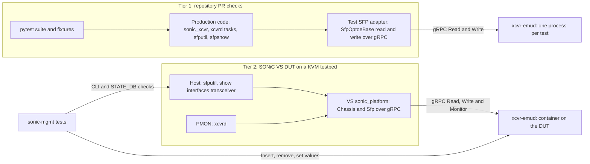
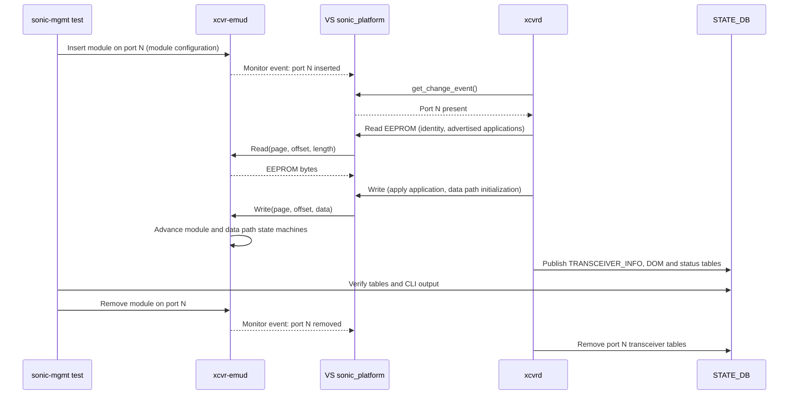

# xcvr-emu: Emulated Transceiver Testing in SONiC CI

## Table of Content

- [1. Revision](#1-revision)
- [2. Scope](#2-scope)
- [3. Definitions/Abbreviations](#3-definitionsabbreviations)
- [4. Overview](#4-overview)
  - [4.1. Problem statement](#41-problem-statement)
  - [4.2. xcvr-emu](#42-xcvr-emu)
  - [4.3. Proposal](#43-proposal)
  - [4.4. Benefits](#44-benefits)
- [5. Requirements](#5-requirements)
  - [5.1. Functional requirements](#51-functional-requirements)
  - [5.2. CI requirements](#52-ci-requirements)
  - [5.3. Exemptions](#53-exemptions)
- [6. Architecture Design](#6-architecture-design)
- [7. High-Level Design](#7-high-level-design)
  - [7.1. Hosting, versioning and packaging](#71-hosting-versioning-and-packaging)
  - [7.2. Tier 1: integration tests in repository PR checks](#72-tier-1-integration-tests-in-repository-pr-checks)
  - [7.3. Tier 2: transceiver system tests on SONiC VS](#73-tier-2-transceiver-system-tests-on-sonic-vs)
  - [7.4. Emulator fidelity and governance](#74-emulator-fidelity-and-governance)
  - [7.5. Rollout and gating](#75-rollout-and-gating)
  - [7.6. Repositories changed](#76-repositories-changed)
  - [7.7. Serviceability and debug](#77-serviceability-and-debug)
- [8. SAI API](#8-sai-api)
- [9. Configuration and management](#9-configuration-and-management)
  - [9.1. Manifest (if the feature is an Application Extension)](#91-manifest-if-the-feature-is-an-application-extension)
  - [9.2. CLI/YANG model Enhancements](#92-cliyang-model-enhancements)
  - [9.3. Config DB Enhancements](#93-config-db-enhancements)
- [10. Warmboot and Fastboot Design Impact](#10-warmboot-and-fastboot-design-impact)
- [11. Memory Consumption](#11-memory-consumption)
- [12. Restrictions/Limitations](#12-restrictionslimitations)
- [13. Testing Requirements/Design](#13-testing-requirementsdesign)
  - [13.1. Unit Test cases](#131-unit-test-cases)
  - [13.2. System Test cases](#132-system-test-cases)
- [14. Open/Action items - if any](#14-openaction-items---if-any)
- [15. References](#15-references)

### 1. Revision

| Rev | Date | Author | Change Description |
|:---:|:----:|:------:|:-------------------|
| 0.1 | 10/29/2026 | Ariz Zubair (Microsoft) | Initial version |

### 2. Scope

This document proposes adding [xcvr-emu](https://github.com/ishidawataru/xcvr-emu), an open-source software emulator of CMIS transceivers, to the continuous integration (CI) of the SONiC repositories that manage pluggable modules. The goal is to run SONiC's real transceiver management code against emulated modules on every pull request, without hardware.

The document covers:

- Hosting xcvr-emu as a SONiC community repository (`sonic-net/xcvr-emu`) and consuming it as a versioned, test-only dependency.
- Emulator-backed integration tests in the PR checks of sonic-platform-common, sonic-platform-daemons and sonic-utilities (Tier 1).
- Running xcvrd and the sonic-mgmt transceiver tests on SONiC virtual switch (VS) KVM testbeds with emulated modules (Tier 2).
- The rules for emulator fidelity, versioning, gating and maintenance.

The following are out of scope:

- Any change to the run-time behavior, CLI, database schema or SAI usage of SONiC on hardware platforms.
- Replacing unit tests, or replacing the qualification of real modules on physical testbeds.
- Emulating the physical layer (optical and electrical signals, link training, real module timing).

### 3. Definitions/Abbreviations

| Term | Definition |
|------|------------|
| CMIS | Common Management Interface Specification for pluggable and on-board modules |
| C-CMIS | Coherent CMIS, the CMIS extension for coherent modules such as 400ZR |
| CDB | Command Data Block, the CMIS mechanism used for firmware management and other commands |
| CI | Continuous integration |
| CPO / LPO / ELSFP | Co-packaged optics / Linear pluggable optics / External laser small form-factor pluggable |
| DOM | Digital optical monitoring |
| DPB | Dynamic port breakout |
| DPSM / MSM | CMIS data path state machine / module state machine |
| DUT | Device under test |
| KVM testbed | sonic-mgmt virtual testbed in which the DUT runs the SONiC VS image as a KVM virtual machine |
| OIR | Online insertion and removal |
| PMON | Platform monitor container, which runs xcvrd |
| PR checker | CI pipeline job that runs for every pull request |
| VDM | Versatile Diagnostics Monitoring (CMIS) |
| VS | SONiC virtual switch platform |
| xcvrd | Transceiver daemon in PMON (sonic-platform-daemons) |
| sonic_xcvr | Transceiver API package in sonic-platform-common (`sonic_platform_base/sonic_xcvr`) |
| xcvr-emu | The CMIS transceiver emulator this HLD proposes to use in CI |
| xcvr-emud | xcvr-emu's emulation server, which exposes a gRPC API |
| xcvr-emush | xcvr-emu's interactive shell and client |

### 4. Overview

#### 4.1. Problem statement

SONiC's transceiver management stack is large and changes often: the `sonic_xcvr` memory maps and APIs, the xcvrd CMIS state machine, application selection, breakout handling and DOM/VDM publishing, and the `sfputil` and `show interfaces transceiver` CLIs. The set of module types keeps growing (CMIS 5.x, C-CMIS/ZR, LPO, CPO, ELSFP).

In PR CI this code is exercised only by unit tests built on mocks. End-to-end behavior is validated later, on physical testbeds with real modules and often an operator. A mock encodes what the test author believes the layer below returns. When the real layer returns something else, the unit tests stay green and the failure is found on a switch. Recent examples:

| Reference | What broke | Why PR CI did not catch it |
|-----------|------------|----------------------------|
| sonic-utilities #3795 | `show interfaces transceiver info` crashed on CMIS modules with `KeyError: 'supported_max_laser_freq'` after xcvrd started publishing the API dictionary as-is (sonic-platform-daemons #590). | The keys exist only for C-CMIS modules, but the CLI tests' mocked STATE_DB (`tests/mock_tables/state_db.json`) gave every CMIS port the C-CMIS keys. |
| sonic-utilities #4020 | The same failure on backplane cartridges (`KeyError: 'active_apsel_hostlane1'`), which landed with the `get_transceiver_info()` change in sonic-platform-common #590. | CLI tests read hand-written STATE_DB content instead of real API output. |
| sonic-utilities #3153, #3267 | `sfputil` EEPROM page handling needed two fixes. | The #3267 regression test's mock returns upper page 0 for every non-zero offset, so its expected "upper page 11h" dump is really page 0. |
| sonic-buildimage #18893 | xcvrd crashed during dynamic port breakout with a CMIS module. | The unit tests did not catch that the CMIS manager ignored the port add and remove events that breakout causes. The crash was reproduced on SONiC VS with emulated modules and fixed in sonic-platform-daemons #500. |

The `sfputil` unit tests alone contain 379 `MagicMock(` calls, none with a `spec`, so they cannot detect when the real API changes shape.

#### 4.2. xcvr-emu

xcvr-emu was written by Wataru Ishida (NTT) and presented at the 2024 OCP SONiC Workshop in "Enabling Advanced Transceiver Control in SONiC Virtual Environments". It is an Apache-2.0 Python emulator of CMIS modules:

- `xcvr-emud` is a gRPC server that models each module's EEPROM (pages and banks), the CMIS module and data path state machines, and insertion and removal. Its `SfpEmulatorService` provides `Read`, `Write`, `GetInfo`, `UpdateInfo`, `Monitor` and `List`.
- `xcvr-emush` is an interactive shell for creating, reading, writing and monitoring emulated modules.
- It is distributed as a pip-installable package and as a container image.

The emulator replaces only the hardware access path (EEPROM reads and writes). Everything above it is SONiC production code: CMIS parsing, application advertisement decoding, state transitions, DOM decoding, database publishing and CLI rendering.

The author used xcvr-emu to reproduce sonic-buildimage #18893 on SONiC VS, and listed other issues it could help debug: sonic-buildimage #20430 and #19336, sonic-platform-daemons #408 and sonic-platform-common #489.

#### 4.3. Proposal

1. **Host** xcvr-emu in the SONiC organization as `sonic-net/xcvr-emu`, maintained by its author together with SONiC contributors, and consume tagged releases only. The repository transfer was presented to the SONiC TSC on 10/29/2026.
2. **Tier 1:** run emulator-backed integration suites inside the existing PR checks of sonic-platform-common, sonic-platform-daemons and sonic-utilities. The suites already exist as sonic-platform-common #758 (53 tests), sonic-platform-daemons #895 (30 tests) and sonic-utilities #4877 (96 tests).
3. **Tier 2:** add an emulator-backed SFP implementation to the VS platform, enable xcvrd on VS DUTs that use the emulator, and run the sonic-mgmt transceiver tests on KVM testbeds in the PR checkers.
4. **Govern** the emulator like other SONiC code: faithful to the CMIS specification, extended through design review, and released with versions.

#### 4.4. Benefits

- Cross-layer regressions (API to daemon to database to CLI) are caught before merge instead of on switches.
- Field issues can be reproduced without hardware and kept as regression tests.
- New module types and features can be developed and tested before hardware is available, as the author intended for CPO and ELSFP.
- Contributors and transceiver vendors get an executable reference for the module behavior SONiC expects.
- Alternative implementations of the same daemons, such as the proposed Rust xcvrd (sonic-platform-daemons #936), can be checked against the same behavior baseline.
- The cost is low: Apache-2.0, Python, test-only, and Tier 1 runs in the existing pipelines.

### 5. Requirements

#### 5.1. Functional requirements

| ID | Requirement |
|----|-------------|
| FR-1 | Run SONiC's production transceiver code (`sonic_xcvr`, xcvrd, `sfputil`, `sfpshow`, `show` and `config interface transceiver`) against emulated CMIS modules without hardware. |
| FR-2 | Replace only the hardware access path and, where a test needs it, the database and platform-discovery boundary. Production code must not contain test-only branches for the emulator. |
| FR-3 | Model module behavior as the CMIS specification defines it: EEPROM pages and banks, module and data path state machines, advertised applications, DOM and VDM values, insertion and removal. |
| FR-4 | Let a test declare module contents (identity, applications, thresholds, monitor values) in a configuration file, and change module state at run time (insertion, removal, value changes, fault injection). |
| FR-5 | Support multiple independent modules (ports) in one test. |
| FR-6 | Run on SONiC VS so that xcvrd and the CLIs can be tested on a KVM DUT. |

#### 5.2. CI requirements

| ID | Requirement |
|----|-------------|
| CI-1 | Hermetic and deterministic: each test (or test module) starts its own emulator instance on the loopback interface and an ephemeral port, from a checked-in configuration, and shares no state with other tests. |
| CI-2 | Versioned: consumers depend on a tagged release of `sonic-net/xcvr-emu`, never on a personal fork or a moving branch. Updating the emulator is a normal PR in each consuming repository. |
| CI-3 | Test-only: the emulator is installed through a `testing` extra and never becomes a run-time dependency of SONiC packages or of images for hardware platforms. |
| CI-4 | Optional for developers, mandatory in CI: integration tests skip cleanly when the emulator is not installed on a developer machine, but fail in CI if it is missing, so a suite cannot silently stop running. They can be selected or deselected with a pytest marker or path. |
| CI-5 | No new CI infrastructure: Tier 1 runs in the existing pytest steps, and Tier 2 uses the existing KVM testbeds and PR testing framework. |
| CI-6 | Bounded cost: start-up time, test duration and resource use are measured and stay within existing pipeline time limits. |
| CI-7 | Diagnosable: on failure, emulator logs and the EEPROM state needed to reproduce the failure are available from the pipeline. |
| CI-8 | Compatible with the Python, gRPC and protobuf versions SONiC ships. |

#### 5.3. Exemptions

- Physical-layer behavior (optical power, signal integrity, link training, real module timing) is not emulated.
- SFF-8472 and SFF-8636 modules are not emulated in the first phase; unit tests remain their coverage.
- Vendor-specific behavior outside CMIS is out of scope unless it can be expressed as module configuration.

### 6. Architecture Design

The SONiC architecture does not change. xcvr-emu takes the place of module hardware in two test environments: pytest in the repositories' PR checks (Tier 1), and the VS DUT on KVM testbeds (Tier 2).



- In Tier 1 the production code runs inside the pytest process. A test adapter implements the platform SFP's EEPROM read and write over gRPC, and the database is replaced where a suite needs it.
- In Tier 2 the DUT runs the VS image with an emulator-backed `sonic_platform`. Host CLIs and xcvrd in PMON use it exactly as they use a vendor platform package on hardware.

### 7. High-Level Design

The template's checklist, answered for this design:

- **Built-in feature or Application Extension:** neither. This is test infrastructure, and images for hardware platforms do not change.
- **Modules and repositories changed:** test code in sonic-platform-common, sonic-platform-daemons and sonic-utilities; the VS platform package and device files in sonic-buildimage; vslib in sonic-sairedis, if needed; sonic-mgmt tests and testbed setup; and the new `sonic-net/xcvr-emu` repository. See [7.6](#76-repositories-changed).
- **SWSS, syncd and database schema:** no changes.
- **Warm reboot, fastboot, scalability and memory:** no impact on hardware platforms. CI cost is covered in [11](#11-memory-consumption).
- **Docker dependency:** Tier 2 adds an xcvr-emu container on the VS DUT during tests.
- **Build dependency:** Tier 1 adds a test-only Python dependency. Tier 2 changes VS-only packages.
- **Management interfaces:** none.
- **Platform specificity:** VS only. Platform vendors do not need to implement anything.

#### 7.1. Hosting, versioning and packaging

- **Repository.** `ishidawataru/xcvr-emu` moves to `sonic-net/xcvr-emu` by a GitHub repository transfer, which keeps its history, issues, pull requests and releases and redirects existing links. Initial maintainers: Wataru Ishida (ishidawataru, author), Ariz Zubair (az-pz) and Mihir Patel (mihirpat1). Standard sonic-net repository settings apply: CODEOWNERS, branch protection, PR checks and tagged releases.
- **Compatibility.** The upstream emulator needs changes to work with the gRPC and protobuf versions SONiC ships (package-qualified protobuf imports and SONiC-compatible gRPC constraints). These changes are carried today in a fork commit (`az-pz/xcvr-emu@3aca04f`). They will be submitted as regular PRs and shipped in the first `sonic-net` release.
- **Artifacts.** Each release publishes a Python package that installs from the release tag, and a container image under the sonic-net organization.
- **Consumption.** Repositories pin a release tag in their `testing` extra, and KVM testbeds pin the container image tag. For example (illustrative):

```python
testing_packages = [
    'pytest',
    'pytest-cov',
    'xcvr-emu @ git+https://github.com/sonic-net/xcvr-emu@v<version>',
]
```

- **Upgrades.** Moving to a new emulator release is a PR in the consuming repository, so an emulator change cannot break a pipeline silently.

#### 7.2. Tier 1: integration tests in repository PR checks

All three suites follow the same pattern:

- A pytest fixture starts `xcvr-emud` as a subprocess bound to loopback on an ephemeral port, loads a checked-in YAML module configuration, waits until the server is ready, and stops and reaps it at teardown.
- A thin adapter implements the platform SFP's EEPROM read and write over gRPC, so `XcvrApiFactory`, `CmisApi` and everything above them run unmodified.
- Each repository's existing pytest run discovers the suite, and the emulator is declared as a test dependency (the package's `testing` extra). Where a pipeline does not yet install test extras, a one-line install step is added.
- A pytest marker or path selects or deselects the suites. On a developer machine without the emulator they skip; in CI a missing emulator is an error (CI-4).
- Where integration and unit tests share a pytest session (sonic-platform-daemons and sonic-utilities), isolation tests check that integration fixtures do not leak mocks or modules into the unit tests.

| Repository (PR) | Production code exercised | What is replaced | Scenarios | Tests |
|-----------------|---------------------------|------------------|-----------|:-----:|
| sonic-platform-common (#758) | `SfpOptoeBase` to `XcvrApiFactory` to `CmisApi` | EEPROM transport | EEPROM address translation (pages and banks), API discovery, identity and capability decoding, module and data path state machines, hot-plug, DOM values | 53 |
| sonic-platform-daemons (#895) | xcvrd CMIS manager, port-change observer, transceiver-info and DOM publishers, with the real CMIS APIs | EEPROM transport; `swsscommon` by a namespace-aware in-memory implementation | Cold initialization, admin-down and host-TX gating, absent modules, removal and reinsertion, independent ports, 400G-to-100G application change, unsupported application, signed temperature and voltage decoding, EEPROM page boundaries, transport errors, emulator start-up failure | 30 |
| sonic-utilities (#4877) | `sfputil`, `sfpshow`, the `show` and `config interface transceiver` wrappers, native CMIS parsing and control APIs | EEPROM transport; platform discovery, port mapping, privileges, databases and external command launch are mocked | EEPROM and DOM, raw reads and writes, presence, low-power mode, reset, loopback, TX/RX output control, negative cases, process lifecycle | 96 |

How Tier 1 closes the gaps described in [4.1](#41-problem-statement):

- In the sonic-utilities suite, STATE_DB is filled from real `CmisApi` output, so a CLI that expects keys the API does not publish fails in CI (#3795, #4020).
- CLI EEPROM writes are verified by reading emulator pages directly, including page boundaries, so address translation errors are caught (#3153, #3267).
- A command-inventory check requires an explicit coverage decision for every new `sfputil` command.
- The xcvrd suite drives the CMIS manager through insertion, removal and application changes, the code paths behind sonic-buildimage #18893.

In local validation of sonic-platform-common #758, the 53 integration tests and the full test suite (1,916 tests) pass. In the xcvrd suite, each emulated module currently runs in its own emulator process, because the current emulator revision shares EEPROM storage within a process. Per-module isolation inside one process is a planned emulator improvement (see [14](#14-openaction-items---if-any)).

#### 7.3. Tier 2: transceiver system tests on SONiC VS

Today the VS platform cannot run transceiver tests:

- The VS `sonic_platform` package provides only platform and chassis stubs and no SFP implementation, so `sfputil` and xcvrd have no modules to work with.
- `device/virtual/x86_64-kvm_x86_64-r0/pmon_daemon_control.json` sets `"skip_xcvrd": true`, so xcvrd does not run.

Prior work shows the gap is small. The author's 2024 prototype ran xcvrd on SONiC VS against xcvr-emu ([ishidawataru/sonic-buildimage, branch xcvr-emu](https://github.com/ishidawataru/sonic-buildimage/tree/xcvr-emu)). A later run-time prototype ([emu-deploy](https://github.com/gsoosk/sonic-dev/blob/main/emu-deploy/README.md)) deployed the emulator on a stock VS DUT and passed `test_xcvr_info_in_db`, `test_sfpshow` (presence and EEPROM) and the `test_sfputil` presence, EEPROM and reset checks on a KVM testbed. That prototype patches the DUT at run time, so a reboot, re-image or PMON re-creation removes it.

This design makes the same capability part of the VS image and the testbed setup:

1. **Emulator-backed VS SFP implementation (sonic-buildimage).** Add an `Sfp` class based on `SfpOptoeBase`, and the matching `Chassis` methods, to the VS `sonic_platform` package, with EEPROM reads and writes sent to `xcvr-emud` over gRPC. Map the emulator's `Monitor` stream to `Chassis.get_change_event()` so insertion and removal reach xcvrd. Install the package for both the host and PMON, and provide the SFP inventory (`chassis.sfps` in `platform.json`) that the platform API tests use.
2. **xcvrd only where the emulator is used.** xcvrd stays disabled on regular VS DUTs and runs on DUTs that use the emulator, for example through a dedicated VS HwSKU or a start-up check for the emulator endpoint (open item).
3. **Host-TX readiness.** The xcvrd CMIS manager waits for host-TX readiness. The author's prototype needed vslib to support `SAI_PORT_ATTR_HOST_TX_READY_STATUS`. This is confirmed against the current vslib (sonic-sairedis) and added if still missing.
4. **Emulator placement.** Start with `xcvr-emud` as a container on the DUT, on the host network, so that the host and PMON reach it on `localhost`. If resource use becomes a problem, the alternatives are running it from the sonic-mgmt container or as a shared service.
5. **Breakout (later phase).** DPB tests on VS need `platform.json`-based port configuration, updated lane maps and virtual interfaces for the breakout sub-ports, as in the author's prototype.
6. **Test control.** sonic-mgmt fixtures deploy the emulator with a per-topology module configuration, and provide helpers to insert and remove modules and change values through gRPC or `xcvr-emush`.

The sequence below shows insertion, CMIS initialization and removal on a VS DUT:



**PR checker integration.** sonic-mgmt runs impacted-area-based PR testing. Each PR checker represents a topology, and the test scripts each checker runs are listed in `.azure-pipelines/pr_test_scripts.yaml`. Once KVM DUTs can run the emulator, the transceiver test scripts are added there for one KVM topology, first in an optional (non-blocking) checker. sonic-buildimage PRs, including submodule updates, also run sonic-mgmt tests on KVM, so the same tests cover transceiver changes that arrive through those PRs.

#### 7.4. Emulator fidelity and governance

- The emulator implements the CMIS specification. When SONiC code and the emulator disagree, the specification decides: the fix goes to the emulator (with a specification reference) or to SONiC (as a bug fix).
- Production code never special-cases the emulator, and never deviates from intended behavior to pass an emulator test. Reviewers should treat emulator-specific workarounds in production code as defects.
- New emulator capabilities (for example CDB, bank paging or C-CMIS) are proposed and reviewed through the normal SONiC process, released, and only then used by tests.
- Representative module configurations (for example multi-application, breakout-capable and flat-memory modules) are kept with the tests or in the emulator repository, so that test intent is visible in review.
- The CODEOWNERS of `sonic-net/xcvr-emu` include the author and SONiC transceiver maintainers.

#### 7.5. Rollout and gating

| Phase | Deliverables | Gating |
|:-----:|--------------|--------|
| 0 | `sonic-net/xcvr-emu` created by transfer; first release with the SONiC compatibility changes; container image | Not applicable |
| 1 | sonic-platform-common #758, sonic-platform-daemons #895 and sonic-utilities #4877 pinned to the release and merged | Part of each repository's existing test step, gating like other tests |
| 2 | VS SFP implementation, xcvrd enablement and emulator deployment; transceiver tests on one KVM topology | Optional (non-blocking) checker first; required after a stability period agreed with the maintainers |
| 3 | Emulator coverage growth (see [12](#12-restrictionslimitations)) and new regression scenarios | Per capability |

A flaky emulator-backed test is quarantined with a marker and fixed, rather than left to fail intermittently.

#### 7.6. Repositories changed

| Repository | Change | Phase |
|------------|--------|:-----:|
| sonic-net/xcvr-emu (new) | Emulator, SONiC compatibility changes, releases and container image | 0 |
| sonic-platform-common | `tests/sonic_xcvr/integration` and `testing` extra (#758) | 1 |
| sonic-platform-daemons | `sonic-xcvrd/tests/integration` and `testing` extra (#895) | 1 |
| sonic-utilities | `integration_tests` and `testing` extra (#4877) | 1 |
| sonic-buildimage | VS `sonic_platform` SFP over gRPC, xcvrd enablement for emulator DUTs, VS SFP inventory | 2 |
| sonic-sairedis | vslib host-TX readiness support, if still missing | 2 |
| sonic-mgmt | Emulator deployment and fixtures for KVM testbeds, transceiver tests enabled on KVM, PR test configuration | 2 |

#### 7.7. Serviceability and debug

- Emulator output is captured with the test logs and attached to the pipeline results on failure.
- Tests can dump the emulated EEPROM pages of a failing port.
- Any failure can be reproduced locally with the same emulator release, the same module configuration and `xcvr-emush`.

### 8. SAI API

No SAI API is added or changed. Tier 2 relies on the VS SAI implementation (vslib) reporting the existing attribute `SAI_PORT_ATTR_HOST_TX_READY_STATUS`. Nothing is required from silicon vendors.

### 9. Configuration and management

#### 9.1. Manifest (if the feature is an Application Extension)

Not applicable. This design is not an Application Extension.

#### 9.2. CLI/YANG model Enhancements

No CLI or YANG model changes.

#### 9.3. Config DB Enhancements

No CONFIG_DB changes. Emulated modules are described in YAML files that belong to the tests.

### 10. Warmboot and Fastboot Design Impact

None. The emulator runs only in CI environments and on VS test DUTs, and images for hardware platforms do not change.

#### Warmboot and Fastboot Performance Impact

- No stalls, sleeps or I/O operations are added to the boot critical chain.
- No CPU-heavy processing is added to the boot path.
- No third-party dependency is added to images for hardware platforms. The gRPC client is used only by the VS platform package.
- No service or container is added to the boot path of hardware platforms, so there is nothing to delay and no expected boot time degradation.

### 11. Memory Consumption

There is no memory impact on hardware platforms. In CI, Tier 1 adds one short-lived emulator process per test (and per module in the xcvrd suite), and Tier 2 adds one emulator container on the VS DUT. Both are measured in phases 1 and 2, and the measurements drive the emulator placement decision.

### 12. Restrictions/Limitations

- Today's suites cover bank-0 pluggable CMIS modules. Optical links, real hardware timing, coherent (C-CMIS) and CPO devices, and CDB firmware execution are not covered.
- SFF-8472 and SFF-8636 modules are not modeled in the first phase.
- The current emulator revision shares EEPROM storage within one process, so multi-module tests run one process per module.
- The emulator requires Python 3.10 or later in the test environment.
- Emulated behavior is only as accurate as the emulator's CMIS model. Passing emulator-backed tests does not replace the qualification of real modules on physical testbeds.

Planned emulator coverage, driven through SONiC design review: CDB firmware management, bank paging, C-CMIS and coherent modules, VDM, LPO, CPO and ELSFP, and later SFF-8636 and SFF-8472, while staying aligned with the Python and gRPC versions SONiC supports.

### 13. Testing Requirements/Design

The design is validated by the emulator-backed suites themselves:

- The Tier 1 suites pass in each repository's PR pipeline together with the existing unit tests, and isolation tests show that the integration fixtures do not affect the unit tests.
- Emulator start-up time, suite duration and resource use are measured in each pipeline before and after the suites are enabled (CI-6).
- Tier 2 runs as an optional checker until it meets the agreed stability criteria.
- No warmboot or fastboot testing is needed, because images for hardware platforms do not change.

#### 13.1. Unit Test cases

The Tier 1 suites run as pytest integration tests in each repository:

| Repository | Area | Cases |
|------------|------|-------|
| sonic-platform-common | EEPROM access | Page and bank address translation, page boundaries |
| sonic-platform-common | API discovery and decoding | `XcvrApiFactory` selects `CmisApi`; identity, capability and advertised application decoding |
| sonic-platform-common | State machines and hot-plug | Module and data path state machine transitions; removal and reinsertion |
| sonic-platform-common | DOM | Monitor values decoded from emulated EEPROM |
| sonic-platform-daemons | CMIS manager | Cold initialization, admin-down and host-TX gating, 400G-to-100G application change, unsupported application |
| sonic-platform-daemons | Port events | Absent modules, removal and reinsertion, independent physical ports |
| sonic-platform-daemons | Publishing | Transceiver information and DOM in STATE_DB; signed temperature and voltage decoding |
| sonic-platform-daemons | Robustness | Transport errors, emulator start-up failures, bounded process and thread cleanup |
| sonic-utilities | sfputil | EEPROM and DOM, raw reads and writes, presence, low-power mode, reset, loopback, TX/RX output control |
| sonic-utilities | sfpshow and wrappers | `sfpshow` output from STATE_DB filled with real API output; `show interfaces transceiver` and `config interface transceiver` wrappers invoking the real commands |
| sonic-utilities | Coverage guard | Command inventory requires a coverage decision for each new `sfputil` command |

#### 13.2. System Test cases

Tier 2 runs on a KVM testbed whose DUT uses emulated modules:

| # | Test | Emulator setup or action | Expected result |
|:-:|------|--------------------------|-----------------|
| 1 | `platform_tests/sfp/test_sfputil.py` | Modules present on the front-panel ports | Presence, EEPROM, hexdump, reset and low-power mode checks pass |
| 2 | `platform_tests/sfp/test_sfpshow.py` and `platform_tests/sfp/test_show_intf_xcvr.py` | Same | CLI output matches the emulated module identity |
| 3 | `platform_tests/test_xcvr_info_in_db.py` | Same | TRANSCEIVER_INFO in STATE_DB matches the module configuration |
| 4 | `platform_tests/api/test_sfp.py` | VS SFP inventory in `platform.json` | Platform SFP API returns the emulated values |
| 5 | New: CMIS initialization | Multi-application module | xcvrd applies the configured application and the data path is activated |
| 6 | New: OIR | Remove and reinsert a module through the emulator | Transceiver tables are removed and recreated, and CMIS initialization runs again |
| 7 | New: application change | Port speed or breakout change that needs another application | xcvrd deinitializes and re-provisions the data path without errors |
| 8 | New: DOM thresholds | Move a monitor value across a threshold | DOM values and flags in STATE_DB reflect the change |
| 9 | New: DPB regression for sonic-buildimage #18893 | Breakout-capable module, then apply a breakout | xcvrd keeps running and the sub-ports initialize |
| 10 | Selected `tests/transceiver` suites (for example `eeprom`, `dom`, `oir` and `system`) | Modules configured to match the transceiver inventory | Cases that need no optical link pass on KVM |

### 14. Open/Action items - if any

| # | Item |
|:-:|------|
| 1 | TSC approval of the transfer to `sonic-net/xcvr-emu` (presented 10/29/2026). |
| 2 | First `sonic-net/xcvr-emu` release with the SONiC gRPC and protobuf compatibility changes, and the publishing location of the container image. |
| 3 | How xcvrd is enabled only on VS DUTs that use the emulator (dedicated VS HwSKU or start-up check). |
| 4 | Emulator placement for Tier 2 (DUT container, sonic-mgmt container or shared service), decided on measured resource use. |
| 5 | Which KVM topology carries the transceiver tests, and the stability criteria for making the checker required. |
| 6 | Emulator improvements: per-module EEPROM isolation in one process, insertion and removal events through `Monitor` for `get_change_event()`, CDB, bank paging, C-CMIS, VDM, LPO, CPO and ELSFP, SFF-8636 and SFF-8472. |
| 7 | Whether and how emulator-backed testing extends to physical testbeds. |

### 15. References

- [xcvr-emu repository](https://github.com/ishidawataru/xcvr-emu)
- [Wataru Ishida, "Enabling Advanced Transceiver Control in SONiC Virtual Environments", 2024 OCP SONiC Workshop](https://hosted-files.sched.co/sonicworkshop2024ocp/e1/OCP24_Wataru_Ishida_Enabling_Advanced_Transceiver_Control_in_SONiC_Virtual_Environments.pdf)
- [Author's VS prototype (ishidawataru/sonic-buildimage, branch xcvr-emu)](https://github.com/ishidawataru/sonic-buildimage/tree/xcvr-emu)
- [sonic-platform-common #758: Add xcvr-emu integration tests](https://github.com/sonic-net/sonic-platform-common/pull/758)
- [sonic-platform-daemons #895: Add xcvr-emu integration tests](https://github.com/sonic-net/sonic-platform-daemons/pull/895)
- [sonic-utilities #4877: Add xcvr-emu transceiver integration tests](https://github.com/sonic-net/sonic-utilities/pull/4877)
- [emu-deploy: xcvrd and sfputil against xcvr-emu on a KVM DUT](https://github.com/gsoosk/sonic-dev/blob/main/emu-deploy/README.md)
- [sonic-mgmt: Steps to add a new PR checker for impacted-area-based PR testing](https://github.com/sonic-net/sonic-mgmt/blob/master/docs/tests/add-new-PR-checkers.md)
- [SONiC HLD template](https://github.com/sonic-net/SONiC/blob/master/doc/guidelines/hld_template.md)
